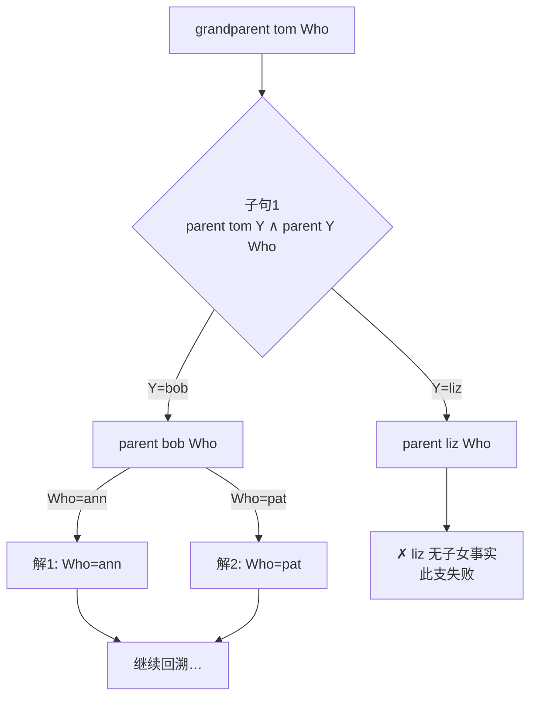

# Prolog 合一与回溯：另一种计算模型

> [返回：演练场导览](01-导览.md)
> 对应演练场 [playground/prolog](https://yidafu.github.io/tech-learning/compiler/playground/prolog)。源码：`src/playground/prolog.js`（约 320 行）。本册讲清逻辑式编程的两个核心算法——合一与回溯搜索，以及它与第四阶段类型推导的血脉联系。

## 声明式：只说"是什么"，不说"怎么做"

同样一个"亲属关系"问题，命令式与逻辑式的对比：

```
// 命令式（mini/JS 风格）：写清怎么找           // Prolog：只声明事实与规则
function grandparent(x, z) {                    parent(tom, bob).
  for (const y of childrenOf(x))                grandparent(X, Z) :- parent(X, Y), parent(Y, Z).
    if (childrenOf(y).includes(z)) return true;
  return false;
}
```

Prolog 程序 = **事实**（`parent(tom, bob).`）+ **规则**（`h :- g1, g2.` 读作"h 成立，若 g1 且 g2 成立"）。你提交一个**查询** `?- grandparent(tom, Who).`，引擎负责找出所有让查询为真的 `Who`。循环、遍历、递归统统消失——**控制流被引擎接管**，这叫反向执行（inverted execution）。

"反向执行"值得再咀嚼一层：命令式里**数据流动是显式的**（你写出每次取值与传递），逻辑式里数据流动被压进**变量绑定**——`Who` 的值不是被赋值的，是被"解出来"的。同一个 `grandparent` 规则，正向查询（已知祖求孙）、反向查询（已知孙求祖）、验证查询（两者都给，问真假）全都成立——**关系没有方向，方向来自查询**。这是关系式思维与函数式思维的根本差异：函数是"输入→输出"的单向箭头，关系是"n 个位置的联合约束"。

## 项的世界：Prolog 只有一种数据结构

```js
{ t: 'v', id, name }            // 变量：大写开头（X、Who、_）；每个有唯一 id
{ t: 'a', name }                // 原子：小写开头的常量（tom、[]）
{ t: 'n', v }                   // 数字
{ t: 'c', name, args }          // 复合项：parent(tom, bob)
```

列表 `[1,2|T]` 解析成 `'.'(1, '.'(2, T))` 的 cons 链——和 Lisp 的链表、第四阶段 AST 的孩子数组是同一个结构换个皮。**Prolog 的代码与数据也是同构的**（规则本身是项），所以它有 `assert/retract` 这样的"程序修改自己"能力。

### 实现走读：词法与列表解析

`tokenize` 的正则按"长 token 优先"排列——与第二阶段 lexer 的 maximal munch 同律：

```js
/\?-|:-|=<|>=|=:=|=\/=|\d+|[a-z][A-Za-z0-9_]*|[A-Z_][A-Za-z0-9_]*|[(),.|\[\]+\-*/=<>]/g
```

- **多字符符号先于单字符**：`?-`、`:-`、`=<`、`=:=' 必须在 `:`、`=`、`<` 之前尝试，否则 `X=<Y` 会被切成三截；
- **大小写分流到不同模式**：`[a-z]…` 是原子、`[A-Z_]…` 是变量——**词法层就用首字符编码了"常量 vs 占位符"的语义区分**（变量另带唯一 id）；
- **列表括号是普通符号**：`[`、`]` 与 `(`、`)` 一起进 token 流，结构组装交给解析层。

列表解析（`list()`）是"语法糖 → 核心项"的教科书演示：

```js
// [1, 2 | T] 的装配（自右向左折 cons）：
let result = tail ?? { t:'a', name:'[]' };       // 无尾默认空表原子
for (let k = items.length - 1; k >= 0; k--)
  result = { t:'c', name:'.', args: [items[k], result] };
// 得到 '.'(1, '.'(2, T)) —— 语法糖消失，只剩复合项
```

打印层（`termStr`）反向走一遍：沿着 `'.'` 链收集元素，尾是 `[]` 就打 `[1, 2]`，是变量就打 `[1, 2 | T]`——**糖在解析时脱掉、在打印时按模式重新识别**。对照第八阶段 Babel 的 AST ↔ code 生成：表示层（核心项）永远只有一种，糖只活在边界上。

### 实现走读：子句级变量作用域

解析器里有一段容易被忽略但极其关键的逻辑——**每个子句/查询有独立的变量作用域**：

```js
let scope = null;                       // 当前子句的变量表
const getVar = (name) => {
  if (name === '_') return makeVar(name);   // 匿名变量：每次出现都是新的！
  if (!scope.has(name)) scope.set(name, makeVar(name));
  return scope.get(name);               // 同名 = 同一个变量对象（靠 id 恒等）
};
// 进入新子句/查询时：scope = new Map()
```

两条规定各买回一个正确性：

- **同名变量共享**：`grandparent(X, Z) :- parent(X, Y), parent(Y, Z)` 里两处 `X` 必须是同一个变量——靠 Map 查表返回同一对象（`id` 相同），后续合一才能把它们绑在一起；
- **匿名 `_` 每次全新**：`member(X, [X|_])` 与 `foo(_, _)` 里的下划线互相无关——若共享，`p(_, _)` 就会被错误地要求两个位置相等。实现上每次调用 `makeVar` 发新 id，显示层（`termStr`）再把 `_G123` 这类名字打印回 `_`。

**"变量 = 带身份的占位符，名字只是显示用的皮"**——这句话在解析层（作用域表）与求解层（α-改名）各兑现一次，是整个引擎的世界观。

### 实现走读：中缀算子与优先级爬升

Prolog 的算式 `N > 0, N1 is N - 1` 是中缀的，解析器用**优先级爬升**处理——与第三阶段 [Pratt 解析](../03-第三阶段/03-Pratt解析.md) 是同族算法：

```js
const OP_PREC = { '+': 1, '-': 1, '*': 2, '/': 2, mod: 2,      // 算术高
                  '=': 0, '<': 0, '>': 0, '=<': 0, '>=': 0, '=:=': 0, is: 0 }; // 比较低

function expr(minPrec) {
  let left = primary();
  while (true) {
    const op = peek(); if (!isOp(op)) break;
    if (OP_PREC[op] < minPrec) break;          // 绑定力不足：交还控制权
    next();
    const right = expr(OP_PREC[op] + 1);       // 左结合：minPrec = prec + 1
    left = { t: 'c', name: op, args: [left, right] };   // 算子也是复合项！
  }
  return left;
}
```

最后一行是 Prolog 的点睛之笔：**中缀算子解析完仍是复合项**——`N - 1` 就是 `'-'(N, 1)`，与 `parent(tom, bob)` 平起平坐。所以算式能被当作**数据**传来传去（`X = 1 + 2` 绑定的是项不是 3），也为下一节的 `is`（显式求值）埋下伏笔。左结合的实现细节：递归下限取 `prec + 1`，同级算子就不再被内层吃掉、回到外层循环左联——正是 Pratt 表里 `(leftBp, rightBp) = (p, p+1)` 的写法。

## 合一：带等式求解的模式匹配

求解一个目标 = 让**查询项**与**规则头**相等，求出变量取值。这个"求等式解"的算法就是**合一（unification）**：

```js
function unify(a, b, s) {          // s: 替换表 varId → 项
  a = walk(a, s); b = walk(b, s);  // 沿绑定链走到头
  if (a.t === 'v' && b.t === 'v' && a.id === b.id) return s;
  if (a.t === 'v') {
    if (occurs(a, b, s)) return null;   // occurs check：X = f(X) 是无限项，拒绝
    return bind(s, a, b);
  }
  if (b.t === 'v') return unify(b, a, s);
  if (/* 原子/数字 */) return a.name === b.name ? s : null;
  if (/* 复合项 */) return 同名同元 && args 逐个 unify ? s : null;
  return null;
}
```

合一比"相等"强、比"赋值"泛：`append([1,2], [3,4], Zs)` 正向解出 Zs，`append(Xs, Ys, [1,2])` **反向**解出三种拆法——同一个规则，双向可用。这是声明式威力的算法根源。

### 三个支撑函数各管什么

- **walk**（解引用）：变量可能绑到另一个变量（`X→Y→tom`），沿替换表走到非变量或未绑定变量为止。**合一永远在"走到头的项"上进行**，否则会拿到过期的表示。这与第四阶段类型推导的 `apply(s, t)`（把已知解代入）是同一动作——那边叫"应用替换"，这边叫"走绑定链"；
- **occurs**（出现检查）：绑定 `X → f(X)` 前查 X 是否出现在右部——出现即"无限项"（rational tree），拒绝。注意 occurs 也要带 s 走链（`occurs(v, t, s)`），因为右部可能经过绑定间接包含 v；
- **bind 的不可变性**：实验室实现里每次绑定都 `new Map(s)` 复制一份新替换表——**分支尝试互不污染**。回溯失败的分支丢弃自己的表即可，无需撤销（undo）操作。工业实现（与第四阶段的 HM 实现同款技巧）用"破坏性绑定 + undo 栈"或 union-find 换性能，语义等价。**不可变替换是"回溯免费"的代价与红利**：代码最简单，内存分配最多。

### 手工推演：一次完整的合一

查询 `parent(tom, Who)` 对子句 `parent(tom, bob)` 与 `parent(pat, jim)`：

| 步骤 | 动作 | 替换表 s |
|---|---|---|
| α 改名 | 子句变量换新 id（本例无变量，恒等） | {} |
| 逐参合一 | `unify(tom, tom)` → 原子相等，s | {} |
| | `unify(Who, bob)` → Who 是变量、无 occurs 问题 → 绑定 | { Who → bob } |
| 递归体 | 子句体为空（事实）→ 报告解：Who = bob | — |

对第二条子句：第一步 `unify(tom, pat)` 原子不等 → 返回 null → **for 循环自然换下一条**——回溯在这里发生，但代码里没有一个"backtrack"字样（见下节）。

**注意 occurs check**：查询 `X = f(X)` 会被拒绝（否则无限项）。很多教学实现省略它换取速度，我们保留——因为第四阶段讲过：**Hindley-Milner 类型推导的核心就是合一算法**（Robinson 1965）。`unify(t1: int→a, t2: int→int)` 解出 `a = int`，与 `unify(append([1],L,R), append([1],[2],Z))` 解出变量绑定，是同一个函数在两个世界工作。类型是项，类型相等是合一——把这句话想通，第四阶段最难的一节就通了。

## 回溯：把搜索树走一遍

求解器是深度优先的树搜索（SLD 树）：

```js
function solve(goals, clauses, s) {
  if (goals.length === 0) return onSolution(s);   // 目标清空：报告解
  const [g, ...rest] = goals;
  for (const clause of matchingClauses(g)) {      // 每个子句是一个选择点
    const { head, body } = renameClause(clause);  // α-改名：变量是新的
    const s2 = unify(g, head, s);
    if (s2) solve([...body, ...rest], clauses, s2);  // 体目标拼到队列前
  }   // 循环耗尽 = 此路不通，自然"回溯"给上一层换个选择
  }
}
```

三个细节：

- **α-改名**：规则每次被使用，变量都换成全新的（名字保留只为显示）。否则两次使用 `parent(X,Y)` 会互相污染绑定。这对应 λ 演算的 α-等价（下一册）——**"变量是占位符而非存储位置"**，声明式语言共享这个世界观；
- **回溯不需要显式代码**：JS 调用栈 + for 循环的天然回卷就是回溯。`solve` 的每层循环就是一个选择点（choice point）；
- **失败驱动**：没有解 = 树走完，报告 `false.`。SWI-Prolog 里 `fail` 谓词强制失败、`(a ; b)` 析构或——都是在这棵树上做文章。

### 内建目标：引擎里的"系统调用"

`solve` 分派目标前先认一批内建（对照 Forth 的内建单词——运行时与语言的边界永远存在）：

| 目标 | 行为 | 备注 |
|---|---|---|
| `true` | 直接继续（恒真） | 单位元 |
| `fail` | 直接失败 → 触发回溯 | "枚举其余解"的开关 |
| `X = Term` | 调 unify，成功即绑定 | 结构相等（不求值） |
| `X is Expr` | **先求值** Expr 再与 X 合一 | 见下节 |
| `< > =< >= =:= =\=` | 两边求值后数值比较 | 只判真假，不产生绑定 |

注意 `=` 与 `is` 的分工正是"项的世界"与"算术的世界"的分界——下一节展开。还有两条防呆：**目标不能是数字或裸变量**（解析层 `goal()` 直接拒绝——"查询必须是可判定形状"），**未定义过程直接报错而不是失败**（`未定义的过程：foo/2`，斜杠后是元数 arity）——失败与出错在逻辑语义里是两回事：失败是"树里没有这个解"，出错是"问题本身不合法"。

### 搜索树的形状：解的顺序从哪来

手工推演一遍（最重要的练习）：查询 `append([1], L, R)` 对规则 `append([], L2, L2).` / `append([H|T], L2, [H|R2]) :- append(T, L2, R2).`——第一步子句一头合一失败（[1] ≠ []），子句二解出 H=1、T=[]，递归后子句一成功……**规则被双向、递归地重用**，这就是"程序 = 逻辑 + 控制"里的逻辑部分。

把这次推演完整落成表格（每行一步，替换表只列新增绑定；α 改名给每次使用的子句变量加上撇号）：

| 步 | 目标队列 | 尝试 | 合一细节 | 结果 |
|---|---|---|---|---|
| 1 | `[append([1],L,R)]` | 子句 1 `append([],L₂,L₂)` | `[1]` vs `[]`：cons 链头 `'.'` vs 原子 `[]` | **失败** → 换子句 |
| 2 | 同上 | 子句 2（改名后）`append([H'|T'],L₂',[H'|R₂'])` | 复合项同名同元，逐参：`H'=1`、`T'=[]`、`L=L₂'`、`R=[1\|R₂']` | 成功，s₁ |
| 3 | `[append([],L,R₂')]`（体拼到队前） | 子句 1（再改名）`append([],L₂'',L₂'')` | `[]`=`[]`、`L=L₂''`、`R₂'=L₂''` | 成功，s₂ |
| 4 | `[]` 队列空 | — | — | **报告解**：L、R 经 walk 解引用 → L 为未绑定变量，R = [1\|L] |
| 5 | 回溯 | 子句 2 对步 3 的目标 | `[]` vs `[H''\|T'']`：空表 vs cons | 失败；无更多子句 → 结束 |

第 4 步的报告值得细看：**L 从头到尾没被绑成具体值**——解是"R 等于 1 后面接上任意 L"，一个带变量的解（partial answer）。Prolog 的解不必是完全的替换；打印时 walk 出每个查询变量的最具体表示（`termStr` + `subst` 做的事）。这个查询若在工业 Prolog 里继续枚举，也只有这一个解——因为规则结构上只有一条路径能同时满足两处合一。换成 `append(Xs, Ys, [1,2])` 就会枚举出三种拆法（自测第 1 题）。

第 5 步"报告解之后还要回溯"是初学者最容易漏的一环：**onSolution 不是终点，是检查站**——报告完继续尝试队列里剩下的选择点，直到整棵树走完。这就是为什么 Prolog 查询默认枚举全部解。

画成一棵树（家谱查询的例子，`?- grandparent(tom, Who)`）：



三个观察：

- **解的顺序 = 子句顺序 × 事实顺序**——深度优先、从左到右。Prolog 程序的"控制流"完全由书写顺序决定，这是它高效的原因（可预测），也是坑的来源（把强约束的子句写后面 = 白搜一大片）；
- **每个解报告后继续回溯**：onSolution 不是 return——除非实现选择截断（工业 Prolog 输入 `.` 停止枚举；实验室版最多渲染前 10 个解、但会数出总数）；
- **无限树是常态**：左递归规则（`p(X) :- p(Y), q(Y).`）会沿着一条无限深的支路走下去。实验室版用全局步数上限（10 万步）兜底报"搜索步数超限（程序可能无限递归）"——工业 Prolog 靠程序员用"结构递减"的写法保证终止。

### 为什么是深度优先（而不是广度优先）

SLD 树的遍历选了深度优先，这个"实现细节"其实塑造了整个语言的生态：

| | 深度优先（Prolog） | 广度优先/迭代深化（部分定理证明器） |
|---|---|---|
| 空间开销 | **O(深度)**——栈上只有当前路径 | 队列存整层 frontier，开销大 |
| 首解速度 | 答案在左侧深处时极快 | 公平但平均更慢 |
| 无限支路 | 会被拖死（永不回头） | 天然公平（每层都会被访问） |
| 实现载体 | 递归/栈（本实现的 JS 调用栈） | 显式队列 |

结论是工程化的：**深度优先用"可能不完备"换"空间常数级 + 贴近顺序直觉"**，而 Prolog 程序员通过把递归基例写在前、把强约束写在目标列表前面，把"不完备风险"自己管理掉——语言设计、实现策略、程序员习惯在这里三位一体。第七阶段讲搜索类优化（公共子表达式、约束排序）时会再遇到同款权衡。

## is 与算术：纯度的妥协

```prolog
factorial(N, F) :- N > 0, N1 is N - 1, factorial(N1, F1), F is N * F1.
```

`is` 强制先求值右端再合一左端——因为 `N - 1` 在纯逻辑里只是个**未求值的项**（第三阶段 AST 里的 `BinaryExpr` 节点！）。Prolog 的算子缺省是"结构保留"的：`X = 1 + 2` 之后 X 绑定的是 `+(1,2)` 这个项而不是 3。**求值是一种显式请求**——与 Lisp（读入即求值）、Forth（书写即执行）形成三种哲学对照。

三种哲学放到一张表里：

| | Lisp | Forth | Prolog |
|---|---|---|---|
| 代码的默认身份 | 数据（S-表达式），eval 时求值 | 动作序列，读到即执行 | 项（结构），**永不自动求值** |
| 求值触发 | eval / apply | 书写顺序 | `is`、比较内建的显式调用 |
| 对照主线 | AST + 树遍历解释器 | 字节码 VM | 符号计算 / 约束求解 |

`factorial(5, F)` 的求解树里 `F is N * F1` 必须放在递归调用**之后**——`is` 求值时右端必须已 fully bound（全绑定），F1 在递归返回前是未知数，`5 * F1` 无法求值（会抛"is 的右端必须是算术表达式"）。**顺序在这里突然重要了**：纯逻辑部分顺序无关，一旦混入 is/比较这类"求值谓词"，程序就有了 Prolog 程序员必须维护的执行序敏感点——这是声明式纯度与图灵完备算术之间的经典妥协。

工业 Prolog 的现代答案是**约束算术**（CLP(FD) 的 `#=`）：`F #= N * F1` 不求值，而是登记约束，变量到齐时统一求解——顺序重新变得无关。"谓词挂约束、引擎解约束"，等于把 is 的妥协又赎了回去，代价是求解器复杂度。**语言设计的历史常常就是同一笔账在不同时代的重新结算**。

## 与主线对照

### 实现走读：从查询到答案的最后一公里

求解之外，`run()` 的收尾逻辑也在讲工程课：

- **查询变量收集**（`collectVars`）：遍历查询项收集非匿名变量（去重、保序）——只有它们会出现在答案行里。对照第四阶段符号表：这也是一次"哪些名字对这个作用域有意义"的解析；
- **解的渲染上限**：最多打印前 10 个解，但**总数照数**（`total`），末行报"……（共 N 个解，仅显示前 10 个）"。无限多解的查询（如 `member(X, [1,2|T])` 配上可生长的 T）会被步数上限拦下而不是刷屏——**输出预算与搜索预算是两道独立的闸**；
- **无变量查询只答 true/false**：`?- parent(tom, bob).` 不枚举"空解"，直接 `true`——答案的形态跟着查询的形态走（对偶：有变量查询的答案就是变量绑定列表）。

这三条没有任何一条是"算法"，但少任何一条 REPL 体验都会崩坏——**语言实现的最后一公里永远是输出工程**（对照 Forth 的行缓冲、λ 演算的 200 字符截断）。

| | Prolog 引擎 | 主线对应物 |
|---|---|---|
| 合一 unify | 第四阶段类型合一 | 同一算法（Robinson），类型是项 |
| 深度优先搜索 | ——（新知识） | 回溯是 `?` 正则（NFA 回溯）的思想亲戚 |
| α-改名 renameClause | λ 演算 α-转换 | 变量 = 占位符 |
| 结构保留的算子 | AST 节点（不求值） | "求值"是解释器给 AST 的服务 |
| 未定义过程 → 报错 | 诊断系统 | 编译期 vs 运行期发现 |

### 工业对照：合一活在哪些地方

- **类型检查器**：HM 系（Haskell/OCaml/Elm/Rust 局部）的 unify 是本册的直系亲属——第四阶段[类型推导](../04-第四阶段/04-类型推导.md)完整展开；
- **模式匹配编译**：Rust/Erlang/Elixir 的函数头模式匹配，本质是"单向合一"（变量只在一边）+ 判定顺序编译成决策树/判定链——第一册 Lisp 的 match 与此同源；
- **miniKanren / core.logic**：把逻辑式编程做成库（_embedded_ logic language），合一 + 代数约束，Clojure/JS 生态都有实现——"范式可以是库"的著名例证；
- **Erlang/Elixir 的函数头匹配**：`def f({:ok, x}), do: …` 按子句顺序尝试模式匹配——没有完整合一（变量只出现在模式一侧），但"子句选择 = 逐条试匹配"的骨架与本册 `solve` 的循环一致；
- **关系数据库的查询规划**：SQL 的 join 求值本质也是"关系的组合约束求解"，优化器的工作对应 Prolog 程序员"排子句顺序"的手艺——一个自动化了，一个交给人；
- **SWI-Prolog**：工业级实现，补充了本教学版没有的整套武器：cut（`!`）剪枝、否定即失败（`\+`）、约束传播（CLP(FD)）、尾调用优化与索引化子句选择（按首参类型/值预筛，避免线性扫全部子句）——教学版 `headMatches` 的逐条筛选是它索引化的"暴力版"。

**cut 值得单独一提**（教学版未实现）：`!` 是一个内建目标，执行到它 = "这条支路上的其余选择点全部丢弃"。它把"搜索策略的控制权"还给程序员——枚举只要第一个解、模拟 if-else 的排他分支都靠它。代价是语义不再"纯逻辑"：同一个程序删掉 cut，解集可能变。**cut 之于 Prolog，如 `goto` 之于结构化编程**——强大、必要（做高效系统的原料）、滥用即祸。

## 常见误区

（每条都在演练场里可以一步复现——报错信息就是最好的教材。）

- **"Prolog 变量可以被赋值"**：变量只能被**绑定一次**（在一条求解路径上）；再"赋值"要么合一失败要么被忽略。`X = 1, X = 2` 是 false 而不是 X 变成 2——单赋值（single assignment）是逻辑语义的地基；
- **"= 与 is 一样"**：`X = 1 + 2` 绑定项 `+(1,2)`；`X is 1 + 2` 绑定 3。前者结构相等，后者求值再合一——混用是新手第一大坑（报错"is 的右端必须是算术表达式"多半是右端有未绑定变量）；
- **"解的顺序无所谓"**：深度优先按子句顺序走。把递归基例写在递归规则后面、或把强过滤条件放到目标列表末尾，都可能导致无限递归或搜索爆炸——**"程序 = 逻辑 + 控制"里的控制半边，顺序就是全部**；
- **"回溯会撤销副作用"**：回溯只回退**变量绑定**（本实现靠不可变替换表天然回退）；I/O、assert/retract 数据库修改等副作用不回退。工业 Prolog 的表格化求值与各种"确定性声明"都是围绕这个坑的工程化；
- **"occurs check 可以永远关掉"**：关掉后 `X = f(X)` 会构造出循环结构，walk 无限绕环（或深度递归栈溢出）。本实现保留 occurs 恰是为了让第四阶段的类型推导版合一可以直接照抄；
- **"失败 = 出错"**：`false.` 是正常答案（树里无解）；`未定义的过程` 才是异常（问题不合法）。把两者混为一谈会把"查询写错谓词名"误诊为"事实不足"；
- **"Prolog 慢是因为逻辑式"**：慢的主要来源是**子句线性筛选与无索引的选择点**——工业实现按谓词名/元数建索引（有的还按首参哈希），把"扫全部子句"降到"直达候选"。教学版 `headMatches` 逐条比对是最朴素形态，与"逻辑范式"无关；
- **"规则里同名变量跨子句共享"**：每条子句（甚至每次使用）的变量都是独立的——解析期的子句作用域 + 求解期的 α-改名双重保证。以为"上一条规则的 X 会带到下一条"，是把变量当成了"全局存储位置"，恰是本册开篇要打破的直觉。

## 与第四阶段的直接连线：类型合一走一遍

既然说"类型推导的核心就是本册的 unify"，那就亲手走一遍（第四阶段[类型推导](../04-第四阶段/04-类型推导.md) 的前置预演）：

```
fn id(x) { return x; }        // 无标注，给 x 发类型变量 α
let a = id(1);                // 调用点：要求 id : (number) → β
```

推导器手里的"方程"（全部是项的合一，与 parent(tom, Who) 无形态差异）：

| 步 | 合一方程 | 细节 | 结果 |
|---|---|---|---|
| 1 | `unify(id的类型, (α)→γ)` | id 的声明类型是 `(α)→α`（体里 return x 把 α 传出来） | 同构，逐参：α=α、γ=α |
| 2 | `unify(实参1的类型, α)` | 1 : number，α 是变量 | **α → number**（就是 `Who → bob` 的绑定！） |
| 3 | 返回类型 | walk(γ) 沿链走 γ→α→number | 调用结果 : **number** |

对照本册：类型变量 = Prolog 变量（带 id 的占位符）、类型构造器 `→` = 复合项、类型检查 = 查询求解、泛型推导 = 带自由变量的解。唯一的方向性差异：**类型合一通常单调整（绑定只往一边长）且解必须存在**（类型错误 = 树走完 false），而 Prolog 乐意枚举多解。

这张表建议折角：第四阶段读不下去时回来翻——三个世界（家谱/列表/类型）里跑的是同一个 `walk + occurs + bind`。

## 动手清单（把引擎摸出包浆）

按难度递增，前三个在演练场里写程序，后三个改引擎（每处 10~20 行）：

1. **length/2**：`len([], 0).` 与 `len([_|T], N) :- len(T, M), N is M + 1.`——查询 `len(X, 3)` 看它"无中生有"地生成三个元素的列表（关系式威力的又一例）；
2. **reverse/2**：按自测第 5 题写好后，查询 `reverse([1,2,3], Y)` 与 `reverse(X, [1,2,3])` 双向跑通；
3. **质数筛/斐波那契**：练 `is` 与比较谓词的顺序敏感（把 `F is N * F1` 挪到递归前，读报错）；
4. **加内建 `dif/2`**（非合一）：在 solve 的内建分派里加一条 `dif(X, Y)`：`unify` 成功则失败、失败则成功——注意不能简单取反（`X = f(X)` 的 occurs 失败不是"它们确定不等"），想想为什么；
5. **加 cut `!`**：内建目标 `!` 需要能"剪掉祖先选择点"——这需要把选择点显式化（当前实现的回溯藏在 JS 调用栈里，恰好是本练习的教学价值：**把隐式回溯改成显式 continuation/选择点栈，才能实现剪枝**）；
6. **首参索引**：把子句按 `名字/元数` 分桶（`Map<string, Clause[]>`），`headMatches` 变成一次查表——体验"索引化子句选择"这一工业优化。

第 5 题是理解"回溯的实现本质"的分水岭：本实现的回溯是免费的（JS 栈），代价是**控制原语做不了**（cut、暂停/恢复求解、迭代深化）。显式化选择点（把 for 循环变成"待试子句列表 + 续延"）之后，这些能力才展开——计算机科学的经典交换再次出现。

（1~5 为原题，6~9 为实现走读与对照题。）

1. `append(Xs, Ys, [1, 2])` 有几个解？手推每一个解的合一过程。
2. occurs check 拒绝的查询长什么样？关掉它，`X = f(X)` 会发生什么？
3. 为什么规则使用前必须 α-改名？构造一个不改名就出错的两个查询。
4. `factorial(5, F)` 的求解树里，`F is N * F1` 为什么必须放在递归调用**之后**？（提示：F1 未绑定时 `5 * F1` 是什么。）
5. 动手：在演练场里写一个 `reverse(Xs, Ys)`（提示：先写 `reverse([], [])` 与三元组辅助谓词 `rev(Xs, Acc, Ys)`），再查询 `reverse(Y, [1,2,3])` 看反向枚举。
6. `p(X) :- q(X), write(X).` 与 `p(X) :- write(X), q(X).`（假设有 write）在 X 未绑定时行为有何不同？这说明目标顺序的什么性质？
7. 对比 `solve` 的"不可变替换表 + 自然回溯"与"破坏性绑定 + undo 栈"两种实现：各自的优势场景是什么？（提示：分支密度、内存分配频率。）
8. 本实现里 `_` 每次出现都是新变量——如果错误地实现成共享，`p(_, _)` 会多出还是少解？构造一个具体例子验证你的判断。
9. 把 `expr(minPrec)`（优先级爬升）与第三阶段 Pratt 的 `parseExpr(minBp)` 并排对照：`OP_PREC[op] + 1` 对应 Pratt 里的哪个数字？为什么这个 +1 恰好实现左结合？
10. 三个内建（`true` / `fail` / `=`）在 solve 里的处理各对应集合运算里的什么？（提示：恒真、空、相等判断——目标序列的合取在代数上是什么？）
