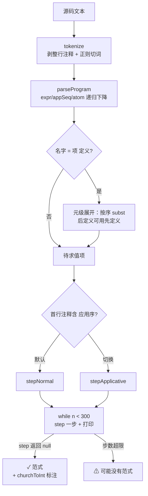

# λ 演算归约器：计算的原子论

> [返回：演练场导览](01-导览.md)
> 对应演练场 [playground/lambda](https://yidafu.github.io/tech-learning/compiler/playground/lambda)。源码：`src/playground/lambda.js`（约 230 行）。本册讲清 α/β 两条规则、捕获避免、Church 编码，以及"求值策略即语言语义"。

## 三条语法，两条规则

Church 在 1930 年代发明 λ 演算来回答"可计算到底是什么"。全部语法一屏装下：

```
e ::= x           变量
    | λx. e       函数抽象（lambda）
    | e₁ e₂       函数应用
```

语义只有两条规则：

- **α-转换**：`λx. x` 与 `λy. y` 是同一个项（绑定变量可改名）。
- **β-归约**：`(λx. e) a` 把 e 里的 x 替换成 a，记作 `e[x := a]`。

就这些。没有数字、没有布尔、没有 if、没有递归——而它能表达全部可计算函数（Church-Turing 论题）。演练场把每一步 β 打印出来，你可以**看着 `ADD 2 3` 一步步归约成 5**。

"能表达全部可计算函数"的分量值得掂一下：图灵机用纸带与状态，λ 演算用函数与应用，两者能力相同——而 λ 演算的表示离"编程语言"更近：抽象就是函数定义、应用就是调用、替换就是传参。**Lisp、ML、Haskell、JS 的函数语义都是它的直系后代**；本册后面会反复回到这句话。

两条规则的地位并不对称：α-转换是**簿记规则**（让"同一个函数"有唯一的书写形式），β-归约才是**计算规则**（真正改变项）。整个归约器 = "反复找 redex 做 β，做之前用 α 排雷"——第三条常见规则 η-转换（`λx. f x` = `f`，当 x 不在 f 自由出现时）本实现不做，它主要用于数学等价证明，不影响求值结果。

## 替换的陷阱：为什么要 α-改名

naive 替换是错的。经典反例：`(λx. λy. x) y`——把体 `λy. x` 里的 x 换成 y，naive 替换得到 `λy. y`（成了恒等函数），但正确的语义是"返回第一个参数"，应该等于 `λz. y`（自由变量 y 与绑定变量 y 被意外"捕获"了）。所以替换前先给撞名的绑定变量改名：

```js
function subst(t, name, val) {
  if (t.k === 'v') return t.n === name ? val : t;
  if (t.k === 'app') return { ...两支分别 subst };
  if (t.a === name) return t;               // 参数遮蔽：体里的 name 不是外层的 name
  if (freeVars(val).has(t.a)) {             // 捕获风险：val 的自由变量撞上绑定名
    const freshArg = `_r${freshCounter++}`;  // 先 α-改名再代入
    return { k: 'l', a: freshArg, b: subst(subst(t.b, t.a, var(freshArg)), name, val) };
  }
  return { k: 'l', a: t.a, b: subst(t.b, name, val) };
}
```

**捕获避免的替换（capture-avoiding substitution）是所有函数式语言实现的地基**：JS 引擎的闭包、Babel 对箭头函数的重命名（`generateUid`）、React Hooks 依赖分析——凡是"把代码代进代码"的场景都在处理同一件事。生产编译器用 de Bruijn 编号（用深度代替名字）从根上消灭捕获问题，代价是人的不可读。

### 走读 subst：四个分支各挡一种情况

逐分支读这段代码，每个分支对应"名字与绑定器关系"的一种形态：

| 分支 | 情形 | 动作 | 类比 |
|---|---|---|---|
| `t.k === 'v'` 且名字相等 | 命中被替换的变量 | 返回 val | 变量引用处代入实参 |
| `t.k === 'v'` 名字不等 | 自由变量/无关变量 | 原样返回 | 不相干的名字不动 |
| `t.k === 'app'` | 复合结构 | 两支递归 | 结构map |
| `t.a === name` | **遮蔽**：进入了一个同名绑定器 | 整个 λ 原样返回 | 内层 x 遮蔽外层 x，内层与替换无关 |
| `freeVars(val) ∋ t.a` | **捕获风险**：val 的自由变量撞上当前绑定名 | 先 α-改名绑定器再递归 | 换名避撞 |
| 其余 | 普通穿透 | 递归体 | — |

注意实现次序：遮蔽判断在捕获判断**之前**——被遮蔽的部分根本轮不到查捕获。两个辅助函数同样精悍：

- **freeVars**（自由变量集）：变量收集自身；λ 收集体后**删掉绑定名**；应用是两边并集。"删绑定名"这一步就是"作用域"在纯数学里的全部表示；
- **fresh 名字生成**：`_r${counter++}` 全局计数器保证永不撞名——Babel 的 `generateUid`（`_ref`、`_ref2`…）是它的工程加强版（还要查作用域避免与用户标识符冲突，见第八阶段[实践-Babel插件](../08-第八阶段/04-实践-Babel插件三选一.md)）；
- **不可变更新**：`subst` 从不修改输入树（`{...t, f}` 造新节点）——step 的轨迹才能保留每一步的快照（打印需要），也让"重放/单步调试"免费。对照第五阶段 VM 的内存化执行：**不可变性买可观察性，卖内存与速度**——教学工具选买，生产运行时选卖。

**作用域的等价表述**：JS 里 `let x = 1; (y => x + y)` 的闭包捕获，是"环境记住 x"；λ 演算里同一件事叫"自由变量 x 由上下文代入"。环境模型（第五阶段闭包）与替换模型（本册）是同一语义的两种实现策略——分别适合机器执行与数学推理。

### de Bruijn 编号：一劳永逸的替代方案

捕获问题的根源是**名字**——两个不同的绑定器可以叫同一个名字。de Bruijn 的方案：**绑定器无名，用"向上数几层"代替**：

```
λx. λy. x          名字表示
λ λ 1              de Bruijn 表示（x 距离自己的绑定器 2 层：越过 λy 是 1，再上是 0…）
```

| 项（名字） | de Bruijn | 说明 |
|---|---|---|
| `λx. x` | `λ 0` | x 是第 0 层外的绑定器 |
| `λx. λy. x` | `λ λ 1` | x 在 1 层外 |
| `(λx. x) y` | `(λ 0) y` | 应用不变 |
| α-改名 | **不存在** | 没有名字就没有改名 |

捕获在 de Bruijn 里表现为"代入时的位移错位"，由明确定义的 shift 操作解决——**不变量从"名字不撞"变成"层数正确"**，后者可机械检查。rustc 的 HIR、Coq/Agda 的内核、许多类型检查器都用它。本实现选名字 + α-改名，是为了让每一步归约的打印对人可读——**教学取舍再次出现：机器友好 vs 人友好**。

## Church 编码：无中生有

没有布尔？布尔就是"二选一"：`TRUE = λt. λf. t`。没有数字？数字就是"把 f 叠 n 次"：

```
0 = λf. λx. x            1 = λf. λx. f x          2 = λf. λx. f (f x)
SUCC = λn. λf. λx. f (n f x)
ADD  = λm. λn. λf. λx. m f (n f x)
MUL  = λm. λn. λf. m (n f)
```

在演练场里输入 `ADD 2 3`，看它六步归约成 `λf. λx. f (f (f (f (f x))))`——**5 不是被"算"出来的，是被"构造"出来的**。代数视角一句话：`PAIR`（配对子示例）是**积类型**、`TRUE/FALSE` 是二元**和类型**的函数表示——ADT 与 λ 演算在语义上互相表达，展开见[第四阶段补充分册：代数数据类型与模式匹配](../04-第四阶段/06-代数数据类型与模式匹配.md)。两个彩蛋：

- `FALSE ≡ 0`：`λt. λf. f` 与 `λf. λx. x` α-等价——布尔与自然数在编码层面是同一个项，演练场会诚实地把 FALSE 识别成 Church 数 0。
- **Y 组合子**：`Y = λg. (λx. g (x x)) (λx. g (x x))` 满足 `Y g ⇒ g (Y g)`——不动点让无名的 λ 演算获得递归。跑一下 `Y g` 示例，看它每一步展开一层、永不停止：递归在这里不是语言特性，是一个精心构造的不动点技巧。JS 里的等价物是 `const fix = f => (x => f(x(x)))(x => f(x(x)))`——你已经在前端生涯里见过它的种种变体（递归 deepMerge 的匿名函数版）。

### ADD 为什么对：手工验证一遍

把 `ADD 2 3` 的归约序列写下来（f、x 均为自由变量，正则序逐步展开；完整轨迹在演练场可复现）：

| 步 | 项 | 动作 |
|---|---|---|
| 0 | `ADD 2 3` | 定义展开（元级代入，非 β） |
| 1 | `(λm. λn. λf. λx. m f (n f x)) 2 3` | β: m := 2 |
| 2 | `(λn. λf. λx. 2 f (n f x)) 3` | β: n := 3 |
| 3 | `λf. λx. 2 f (3 f x)` | β 展开 2 = 叠 f 两次：`f (f (3 f x))` |
| 4 | `λf. λx. f (f (f (f (f x))))` | 内层 `3 f x` → `f (f (f x))`，共 5 个 f |

直观解释：**`m f (n f x)` 读作"先跑 n 遍 f，再跑 m 遍 f"**——m 与 n 的"叠 f 次数"相加就是加法本义。`MUL 2 3 = λf. 2 (3 f)` 则读作"把 f 先复合 3 次，得到的新函数再叠 2 次"——乘法是**函数复合的叠层**，2×3 次 f 全部出现（自测第 3 题验证）。算术在 λ 演算里不是神秘天赋，是"迭代次数"的排列组合。

配对子与 Y 组合子的推导在示例里都有现成入口（`PAIR/FST/SND`、`Y g`），跑通后再看自测第 5 题的 PRED——它用"配对子携带前驱状态"的技巧，是 Church 编码里公认最烧脑的一段。

### Y 组合子：不动点的一步证明

`Y = λg. (λx. g (x x)) (λx. g (x x))` 为什么满足 `Y g ⇒ g (Y g)`？一行 β 就够了（把 `λx. g (x x)` 代入它自己）：

| 步 | 项 | 动作 |
|---|---|---|
| 0 | `Y g` | 即 `(λg. (λx. g (x x)) (λx. g (x x))) g` |
| 1 | `(λx. g (x x)) (λx. g (x x))` | β: g := g（外层归约掉） |
| 2 | `g ((λx. g (x x)) (λx. g (x x)))` | β: x := `(λx. g (x x))`，代入 `x x` 得第二份 |
| 3 | `g (Y g)` | 步 2 的括号部分与步 1 **一模一样**——把 `Y g` 再展开一层，得到 `g (g (Y g))`、`g (g (g (Y g)))`… |

要点在第 3 行：归约出的东西又包含起点——**自复制就是递归**。配合"每次 g 用它的包装函数做参数"，就能写出匿名递归：`Y (λfact. λn. … fact (n-1) …)` 里的 fact 正是"还没做完的我自己"。步 3 也解释了为什么 `Y g` 永不停止：每展开一层就多一个 `Y g` 等着展开——在正则序下这没关系（使用者 `g` 不一定用它的参数），在应用序下会爆炸（所以 Haskell 的 fix 用内部 λ 挡一步，JS 的匿名递归要用命名函数表达式或以上的 Z 变体）。

## 求值策略：先归约哪里，语义就不同

同一个项 `(λx. 0) Ω`（Ω 是自我应用的无穷项 `(λx. x x) (λx. x x)`）：

- **正则序**（normal order，最外最左先归约）：一步得到 0——参数根本没被用，直接丢弃。**惰性求值**（Haskell）的源头。
- **应用序**（applicative order，最内先归约）：先把参数 Ω 归约完——永远归约不完，发散。**急切求值**（JS/绝大多数语言）的源头。

演练场首行注释写 `; 应用序` 即可切换策略，两个对照示例各跑一遍——**求值策略不是实现细节，它决定程序是否能终止**。这也是"语言规范必须规定求值顺序"的原因（JS 规范对 `&&`/`||` 规定短路、对函数实参规定从左到右——都是策略选择）。

### 四种策略一张表

把"策略空间"排全（前两行是归约位置的选择，后两行是记不记忆的选择）：

| 策略 | 归约位置 | 终止性 | 代表 |
|---|---|---|---|
| 全归约（full β-reduction） | 任意 redex | 最自由（理论研究用） | 数学定义 |
| **正则序**（normal order） | 最外最左 | **有范式必能找到**（标准化定理） | 本实现默认 |
| **应用序**（applicative / CBV） | 最内（参数先算） | 可能在有范式时发散 | JS/Java/Python |
| 惰性 + 记忆（call-by-need） | 正则序 + 结果缓存 | 与正则序同终止性、参数只算一次 | Haskell |

call-by-need 是工程上的甜点位：正则序"参数没用就不算"的安全终止性 + 每个参数至多求值一次的效率——用 **thunk + 记忆化**实现（第五阶段 upvalue 的思想亲戚：延迟求值配缓存）。JS 没有内建惰性，但 generator/`() => expr` 手工模拟 call-by-name 是常规操作——"策略即语义"在前端工程里同样成立。

### 副作用时代的回声

纯 λ 演算里策略只影响终止性与步数；一旦语言有副作用（赋值、打印），策略还影响**结果**：`f(x++, x++)` 的实参求值次序、`a[i] = i++` 的读序……JS 规范把这些钉死（从左到右），恰是因为"不确定 = 不可移植"。C/C++ 长期留白的部分角落是未定义/未指明行为的著名来源。**规范指定求值顺序 = 把策略从实现细节升格为语言契约**。

## 归约器实现要点

```js
function stepNormal(t) {
  if (t.k === 'app') {
    if (t.f.k === 'l') return subst(t.f.b, t.f.a, t.x);  // 最外 redex：β
    const f = stepNormal(t.f); if (f) return { ...t, f }; // 否则先试函数部
    const x = stepNormal(t.x); if (x) return { ...t, x }; // 再试参数部
    return null;                                          // 范式
  }
  ...
}
```

小步语义（small-step）实现：`step` 找到**下一个** redex 归约一次，外层循环打印轨迹直到没有 redex（范式）或步数超限（可能发散）。对照主线：第五阶段 VM 的 `while + switch` 是大步执行，这里的 step + loop 把"执行"拆成了可观察的单步——**语义学的工作方式**（操作语义就是这种带标号的归约规则）。Ω 不是 bug，是归约器诚实地报告"没有范式"。

用一张图把 `run()` 的完整流水线挂起来（每个方框都是源码里一个函数）：



与主线六段流水线（第一阶段[编译器是什么](../01-第一阶段/02-编译器是什么.md)）对号：tokenize ↔ 词法、parseProgram ↔ 语法、元级展开 ↔（宏/预处理）、step 循环 ↔ 执行、fmt/churchToInt ↔（反向的）代码生成。**麻雀虽小，流水线一格不少**——这是它适合当"第一个读懂的解释器"的原因。

### stepNormal 与 stepApplicative 的唯一差异

两个策略函数几乎逐行相同，只在**函数部与参数部先归约完之后才做 β** 这一点上分岔：

```js
function stepApplicative(t) {
  if (t.k === 'app') {
    const f = stepApplicative(t.f); if (f) return { ...t, f };  // 先函数部
    const x = stepApplicative(t.x); if (x) return { ...t, x };  // 再参数部
    if (t.f.k === 'l') return subst(t.f.b, t.f.a, t.x);          // 都到头了才 β
    return null;
  }
  ...
}
```

对照着读：正则序在 `t.f` 已是 λ 时**立刻** β（不看参数有没有 redex）；应用序**先扫尽**子项的 redex 才轮到本层。两行代码的次序差 = 两种语言（Haskell vs JS）的分野——**语义差异常常躲在最小的实现细节里**，这是本册最想训练的敏感度。

### 解析器走读：糖的边界

解析层的三个设计都值得停下来看：

- **多参糖**：`λx y. e` 脱糖成嵌套 `λx. λy. e`（`for i 从最后往前包`）——currying 是所有函数式语言共享的表示约定，第五阶段的闭包与它同型；
- **应用左结合**：`appSeq` 循环里 `left = app(left, atom)`——`f a b` 是 `(f a) b`（f 先吃一个参数，结果的函数再吃下一个）。为什么不是右结合？因为 currying 之下右结合会把 `f a b` 解析成 `f (a b)`，语义完全不同；
- **元级定义**：`ADD = …;` 不是 λ 抽象（没有 `λADD.`），是**求值前的文本级缩写**——`run()` 按定义顺序用 `subst` 展开它们（后定义可用先定义的）。没有这个机制，每个例子都要写一整行不换气的项。对照 Lisp 的 `define`：那边是运行时环境绑定，这边是纯替换——**环境与替换的等价性**再次出现。

文法只有四条产生式（对照第三阶段的递归下降，这是它的最小形态）：

```
program → (name = expr ;)* expr          // 定义序列 + 待求值项
expr    → (λ|\\) param+ . expr           // 抽象：体向右延伸到尽头
        | appSeq
appSeq  → atom (atom)*                    // 应用：左结合折叠
atom    → '(' expr ')' | 数字 | 名字       // 数字在词法层变 Church 数
```

三个工程细节：

- **数字字面量即糖**：`atom` 里 `/^\d+$/` 命中就调 `church(n)` 现场构造叠 f 项——**数字从进入语法树的那一刻起就是 λ 项**，后面没有任何特判（无内建算术、无数值类型）。这就是"编码"一词的全部分量：不是翻译，是同一物；
- **λ 体向右"吃到尽头"**：`expr` 解析抽象时体部递归调用 `expr` 而不是 `appSeq`——所以 `λf. f x` 的体是 `f x`（整个应用），要写"返回函数的函数立即应用"必须加括号。这条结合性规则与打印端（`fmt`）的括号策略互为镜像；
- **注释即配置**：策略开关藏在首行注释里（含"应用序"字样则切换）——没有语法位可用的最小"编译指示"（pragma）。对照 Forth 用 `;` 分号注释、本册行内 `;` 是定义分隔符——**词法的每个字符都要挣自己的位置**。

### FALSE ≡ 0 的一行证明

演练场"布尔与条件"示例的彩蛋，值得写成证明形状（α-等价 = 只做改名）：

```
FALSE = λt. λf. f        （第二个参数）
0     = λf. λx. x        （f 零次）
把 t→f、f→x（纯改名）：λf. λx. f  vs  λf. λx. x —— 等等，FALSE 的体是"第二个参数"，0 的体也是"第二个参数"
两者 α-等价 ✓ —— 布尔与自然数在编码层是同一个项
```

这不是巧合而是结构同构：**FALSE 与 0 都是"恒返回第二参数"的函数**（FALSE 选择 else 支、0 是 f 叠零次）。演练场的 churchToInt 会把 FALSE 诚实标注为 Church 数 0——编码撞车时，机器只能报告结构事实，"它到底是布尔还是数"取决于使用方式。第四阶段 ADT 分册会再次遇到"类型即用途"的哲学。

### 打印与 Church 数识别

输出层的两个小机关：

- **最小括号**（`fmt`）：只有"处于操作数位置的应用/抽象"才加括号（`λ` 体右端不加、应用链左端不加）——打印与解析遵循**同一套结合性规则**，才能保证 round-trip（打印→再解析→同一棵树）；
- **churchToInt**（Church 数识别）：模式匹配 `λf. λx. f (f … (f x))` 的形状——沿应用链数 f 出现次数、检查链尾是 x。识别成功就标注"即 Church 数 N"，让 `ADD 2 3` 的输出不止是一串符号，而是可读的"5"。**从具体语法模式反推语义类别**，这个小函数是"模式匹配驱动输出"的微缩案例。

护栏细节：输出行超 200 字符截断（`clip`）——深归约的中间项可能指数膨胀；总步数上限 300 步，超出报"可能没有范式"。两个护栏都是"诚实报告发散"的一部分，与 Ω 的存在意义一致。

## Church-Rosser：为什么策略讨论是有意义的

本册的理论基石：**Church-Rosser 定理（合流性）**——若一个项能归约到两个范式，则这两个范式相同（更准确地说：任意两条归约路径都能延伸到某个公共项）。

画成"菱形"（t 归约出 u、v，两者必能再归约到公共的 w）：

```
        t
      /   \
     β     β
    /       \
   u         v
    \       /
     β     β
      \   /
        w        ← 殊途同归
```

三个直接推论，每个都在指导实现：

1. **范式若存在则唯一**——所以"找到 5 还是找到别的"不取决于运气，只取决于找没找到；
2. **α-改名的选择不影响结果**——fresh 名字叫 `_r1` 还是 `_r7`，范式 α-等价（本实现的 freshCounter 从哪起步都无所谓）；
3. **标准化定理**——正则序若能找到范式，必能找到（于是"正则序救命"不是玄学，是定理）；
4. **η-展开不影响范式**——需要 η 的证明（如优化 `λx. f x` → `f`）与本实现无关，但工程上的"point-free 化/去 point-free 化"都建立在它之上。

反过来说，策略影响的是**效率与终止性**，不影响**答案**（当答案存在时）——这就是为什么语言设计者可以按工程口味（性能、可预测性、副作用次序）选策略，而不用担心"算错"。合流性也给实现者吃定心丸：**优化变换（如提前/推迟某个 β）只要保持归约序列仍是合法 β 序列，结果就不会变**——第七阶段优化 pass 的"语义保持"证明，在纯函数世界里就是这条定理的直接应用。

## 从 λ 演算到真实语言：一张血缘表

把本册的每个概念对应到你每天在写的代码（对应主线各阶段）：

| λ 演算概念 | 真实语言对应 | 主线出处 |
|---|---|---|
| λ 抽象 + 应用 | 闭包 / 一等函数 | [05-第五阶段-解释器实现](../05-第五阶段/04-解释器实现.md) 的 CLOSURE |
| currying（多参糖） | 柯里化 / `bind` / 函数组合 | 高阶函数的地基 |
| 捕获避免替换 | Babel `generateUid`、作用域安全重命名 | [08-第八阶段-实践-Babel插件](../08-第八阶段/04-实践-Babel插件三选一.md) |
| 环境模型 vs 替换模型 | 闭包捕获 vs 宏展开 | Lisp 册 + 第五阶段 |
| Church 布尔 | `a && b` / `a ? x : y` 的本质是选择器 | —— |
| Church 数 / 迭代 | "数据 = 行为"：闭包计数器、对象即消息 | [09-演练场-02-Lisp](02-Lisp元循环解释器.md) 的计数器 |
| Y 组合子 | 匿名递归、`fix` | 本册彩蛋 |
| 正则序 / 应用序 | Haskell 惰性 / JS 急切 | 本册策略节 |
| call-by-need | thunk + memoize、generator 惰性序列 | 策略表 |
| 无类型 → 加类型 | dynamic typing → TS/HM | [04-第四阶段-类型推导](../04-第四阶段/04-类型推导.md) |

读法：λ 演算不是"另一门语言"，是**你现在用的语言剥掉语法糖之后的骨架**。每当你对闭包、柯里化、惰性求值有"为什么这样设计"的疑问，回到这张表找最小复现。

一个常用的自检练习：遇到任何语言特性，先问"它对应 λ 演算里的什么"——能对应的是糖（可脱），不能对应的（赋值、副作用、异常、并发）才是语言真正的"新成分"。这个二分法会贯穿第四阶段（类型）与第五阶段（状态与闭包）的学习。

## 常见误区

- **"α-改名是 β 的准备步骤，可有可无"**：没有它，naive 替换在特定输入下**算错**（本册开头的捕获反例）。Babel 处理嵌套作用域重命名时面对的是同一个问题的工业版；
- **"Ω 归约不完是实现 bug"**：Ω 没有范式是数学事实。归约器的职责是**诚实报告**（步数超限提示），不是"修好"它——发散程序的存在正是不可判定性（停机问题）的直观形态；
- **"Church 编码是玩具"**：它是"数据 = 行为"的极致演示——现代语言里 closure capturing state（计数器闭包）、对象即消息响应（Alan Kay 的对象观）、ADT 的函数表示（第四阶段）全是同一思想的舒适版。SCIP 用一整章讲它不是怀旧；
- **"正则序总是更安全所以更好"**：终止性上占优，但**性能上可能重复求值**（参数出现 n 次就被代入 n 次，call-by-name 的经典问题）、与副作用不兼容（跳过的参数该不该打印？）。急切策略的统治地位有工程理由；
- **"替换和赋值是一回事"**：替换是**纯函数式**操作（旧项不动，返回新项——本实现 `{...t, f}` 不可变更新）；赋值是**破坏性**操作。λ 演算没有赋值，"变量"是占位符（与 Prolog 册同一世界观）——把 JS 的赋值直觉带进来，会把 `subst` 读歪；
- **"λ 演算没有类型所以不安全"**：无类型 λ 演算确实"什么都能算"（包括自应用）；给它加上类型（simple types / HM）立刻得到"强规范化"——所有良类型程序必然终止。第四阶段[类型推导](../04-第四阶段/04-类型推导.md) 的算法 W 正是在这套地基上盖的楼；
- **"Y 组合子就是递归的另一种写法"**：它是"无命名、无自指环境下实现递归"的构造——语言有 `function f() { f() }` 的具名自调用时用不着它。它的价值是证明**递归不需要内建**，以及（对前端同学）解释一堆"函数返回函数"的怪异写法从哪来；
- **"step 每次只归约一步，效率太低"**：教学实现的"低效"是刻意的——可观察的单步是本册的教具（看着 5 被构造出来）。工业函数式实现（Lisp/ML/ Scheme）用环境模型 + 大步求值，把 N 次替换合成一次环境查询——第五阶段闭包实现会亲眼看到这步"替换 → 环境"的工程化。

## 动手清单

（前三个是读懂示例，后三个是改代码——每个都在 15 行以内。）

1. 跑 `AND TRUE FALSE` 与 `OR FALSE TRUE`，写出每步（提示：AND 是"a 选择 b 或 FALSE"）；
2. 定义 `XOR = λa. λb. a (NOT b) b`（需要先定义 NOT），验证四种输入；
3. 跑 `FST (PAIR 1 2)`，然后把 PAIR 的参数换成 Church 数 3 与 4，看 fmt 输出；
4. 切换应用序跑 `MUL 2 3`，数一数比正则序多了几步、为什么；
5. 挑战：用配对子定义 `PRED`（自测第 5 题给了一半提示），验证 `PRED 3` → 2；
6. 挑战：把 `stepApplicative` 改成"call-by-need"——加一个 thunk 节点与记忆化缓存，观察 `ADD 2 3` 的步数变化（提示：只在 subst 入口包一层，命中缓存时零步）。
7. 挑战：给 `tokenize`/`atom` 加字符串字面量支持（提示：正则加 `"[^"]*"`，atom 分支原样存成自由变量——然后思考：没有内建 equality 的 λ 演算能"用"字符串吗？这题的答案就是"Church 编码的边界"）。

## 自测

（1~5 为原题；6~9 为实现走读与跨册对照题，答不出就回到对应小节。）

1. 手写 `(λx. λy. x) a b` 的归约序列；哪一步发生了参数遮蔽？
2. 构造一个 naive 替换会捕获、必须 α-改名的例子，指出捕获发生在哪个绑定器上。
3. `MUL 2 3 = (λm. λn. λf. m (n f)) 2 3` 为什么归约结果是 `λf. 2 (3 f)`？展开验证它确实是 6。
4. 正则序一定能找到范式（若存在），应用序可能在有范式时发散——用 `(λx. 0) Ω` 解释，并说明 JS 为什么选急切策略（提示：性能与可预测性）。
5. 动手：在演练场定义 `PRED`（前驱，提示：配对子技巧 `λn. λf. λx. n (λg. λh. h (g f)) (λu. x) (λu. u)`），验证 `PRED 3` 归约到 2。
6. 对照 `stepNormal`/`stepApplicative` 的代码差异：各用一句话说出"何时做 β"，再用 `(λx. 0) Ω` 各走两步验证。
7. de Bruijn 表示下，`λx. λy. x` 与 `λx. λy. y` 分别是什么？α-改名在这个体系里去哪了？
8. 用 Church-Rosser 定理回答：同一个输入在演练场跑两遍、fresh 计数器起点不同，范式会不会不同？为什么？
9. 三个演练场解释器（Lisp/Forth/λ）分别用环境/栈/替换实现"变量的含义"——各用一句话概括，并说出它们分别对应主线哪个阶段的实现。
