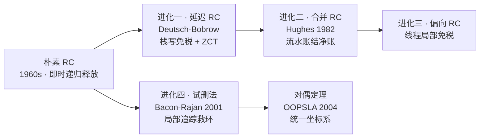

# 引用计数的进化：从朴素 RC 到对偶定理

> [返回：GC 算法专题导览](01-导览.md)
> 第六阶段给 RC 判过一次刑（循环引用 + 赋值税）。但 RC 没死——Swift 用它做语言默认方案，Python 用它承担 90% 的回收，学术界甚至证明了 **RC 与追踪是同一件事的两面**。本册讲清朴素 RC 的每次进化分别买回了什么，最后给出对偶定理：它统一了整个 GC 理论。

## 朴素 RC 的两张罚单

```c
retain(obj)   { obj->rc++; }
release(obj)  { if (--obj->rc == 0) { for (child : obj) release(child); free(obj); } }
assign(slot, new) { retain(new); release(*slot); *slot = new; }   // 每次赋值两次计数
```

罚单一：**循环引用**——`a→b→a` 互守计数，断根后双双永生。罚单二：**赋值税**——每次指针写都要两次原子计数更新，多线程下更是缓存行乒乓（rc 字段成了共享热点）。

### 手推：一串操作里计数器怎么走（naive）

抽象的"两张罚单"落到具体操作上才算真懂。堆里两个对象 a、b（各 1 个引用字段）、两个根槽位 ra、rb，逐操作看计数器与堆的演化（对照 `labs/gc/src/refcount.ts` 的 `setRoot` / `writeRef` / `release`，每行都能手跑）：

**场景一：非环对象的一生（确定性析构的演出）**

| # | 操作 | 计数动作 | rc(a) | rc(b) | 堆上事件 |
|---|---|---|---|---|---|
| 0 | `alloc a`、`alloc b` | 出生 rc=0（**分配 ≠ 存活**：还没人持有） | 0 | 0 | — |
| 1 | `setRoot(ra, a)` | retain(a) | 1 | 0 | — |
| 2 | `writeRef(a, 0, b)` | retain(b) | 1 | 1 | — |
| 3 | `writeRef(a, 0, null)` | release(b) → 归零 → freeSubtree(b) | 1 | — | **b 当场下葬** |
| 4 | `setRoot(ra, null)` | release(a) → 归零 → freeSubtree(a) | — | — | a 下葬 |

第 3 行就是"确定性析构"的字面意思：引用一断、递归释放整棵子树，**析构发生在赋值语句里**而不是未来的某次 GC——文件句柄、锁在这里闭环。第 0 行则是初学者的第一坑：`alloc` 出来的对象 rc=0，**"分配了"不等于"活着"**，谁要活谁挂根。`setRoot` 里还有一行容易忽视的次序注释——"先加后减：自赋值（old === v）也安全"：`x = x` 先 retain 保住、再 release 减回去，净变化为零；反过来先减后加，中间一刻归零会触发对还活着的对象的递归释放。

**场景二：环泄漏的逐步成环（次序敏感！）**

| # | 操作 | 计数动作 | rc(a) | rc(b) | 判定 |
|---|---|---|---|---|---|
| 1 | `setRoot(ra, a)`；`setRoot(rb, b)` | 两个 retain | 1 | 1 | 都活 |
| 2 | `writeRef(a, 0, b)` | retain(b) | 1 | 2 | — |
| 3 | `writeRef(b, 0, a)` | retain(a) | 2 | 2 | 环成——两条边互相供血 |
| 4 | `setRoot(ra, null)` | release(a) | **1** | 2 | a 靠环内边续命 |
| 5 | `setRoot(rb, null)` | release(b) | 1 | **1** | **双双永生：泄漏定案** |

读这张表要看出**次序**：若把第 2、3 步与第 4、5 步对调（先断根、再连环），第 4 步的 release(a) 会把 a 减到 0、级联释放 a→b、b 随之归零——两对象全收。同样的最终引用图，连接次序不同，结局完全不同——**环泄漏因此是"概率性 bug"**，实验室测试专门写了这条"次序敏感"断言防回归。

场景一、二的每一步都能在 `labs/gc/src/refcount.ts` 上手跑复核——本册后面所有演算表同此约定。

### 确定性析构：RC 独有的资产

朴素 RC 最被低估的一点：它是**唯一能承诺"回收点 = 最后引用消失点"的方案**。追踪式 GC 做不到——对象死于"标记发现不可达"的批量时刻，与最后一次使用隔了任意远。这个差异决定了两种资源管理哲学：

| | RC 派（Swift/Python/ObjC） | 追踪派（JVM/Go/V8） |
|---|---|---|
| 内存释放 | 计数归零，即时、可预知 | 下一次 GC，时机不可控 |
| 非内存资源（句柄/锁/连接） | 析构函数（deinit/`__del__`）大体可靠 | 必须显式协议（close/try-with-resources/defer） |
| 析构中还能安全引用别的对象吗 | 基本能（整棵子树按序析构） | 终结器语义普遍谨慎/不推荐 |

Swift 选 ARC 的"确定性析构压倒一切"，落到表格里就是中间一行：**打开的文件想关、拿到的锁想放，依赖析构是 RC 体系的合法风格**；追踪体系里这叫资源泄漏隐患，所以 Java 有 try-with-resources、Go 有 defer——**用显式语法补 RC 免费送的东西**。CPython 的 `__del__` 在计数归零时及时执行也是同一资产（注意与循环引用交互时的边界情况——这也是 Python 要配 `with` 上下文管理器规范的原因之一：资源关闭不该押注在析构时机上）。一句话：RC 的两张罚单人人会背，但它的**独有资产**同样该写进选型账本。



后面每次进化，都是在赎其中一张。按时间线看：

## 进化一：延迟引用计数（Deferred RC，1976）

观察：**绝大多数引用变化发生在栈和寄存器**（局部变量来回赋值），而栈引用的生命周期极短。Deutsch–Bobrow：**栈上引用不计数**——只数堆内字段引用。变量出栈时批量核对，计数为零且"无栈引用候选"才回收。

买回：赋值税大头（局部变量操作）归零。代价：回收从"即时"退化为"需一次小核对"，且要维护候选集。**税收思想与 remembered set 相同：识别热路径，把它从税基里划出去**。

### 延迟 RC 的手推：ZCT 核对的逐步表

把同一串操作换成 deferred 模式再跑一遍（对照 `refcount.ts` 的 `setRoot` deferred 分支与 `scanZCT`；一个根槽位 r，两个对象 x、y）：

| # | 操作 | 计数动作 | rc(x) | ZCT（候选集） | 说明 |
|---|---|---|---|---|---|
| 0 | `alloc x` | 无计数动作，**出生即候选** | 0 | `[x]` | 新对象 rc=0、只被栈"惦记"——Deutsch–Bobrow 方案让它一并候选 |
| 1 | `setRoot(r, x)` | **零计数动作** | 0 | `[x]` | 栈写免税：naive 在此要付一次 retain |
| 2 | `alloc y`（不挂根） | 出生即候选 | 0 | `[x, y]` | 纯垃圾此刻已入册 |
| 3 | `setRoot(r, null)` | 旧值 x 入册 | 0 | `[x, y]` | 免税，但"待安全点核对" |
| 4 | `scanZCT()` | 逐候选查根：x 不在任何槽位 | 0 | `[]` | 核对后仍归零者整组释放 |

三个读法：**第 1 行整行空白就是"赋值税大头归零"的直接证据**（同一位置 naive 要付 retain，这里是零动作）；第 4 行的核对语义是"栈引用此时才数回去"——候选 ≠ 死刑，ZCT 是一份**缓刑名单**；若候选此刻被第二个栈槽还拿着，核对会把那份栈引用数回去、对象复活（测试"候选对象被栈引用时核对后复活"专门验证这一点）。回收从即时变成"攒到安全点一批收"——回收时机开始向追踪式 GC 的形态漂移，这正是对偶定理预告的方向。

## 进化二：合并引用计数（Coalescing RC，1982）

观察：`p.f = x; p.f = y; p.f = z;` 三次赋值对 `p.f` 的**净效果只有一次**（旧值减一、z 加一）。中间的增减全是白干。Hughes：把赋值**缓冲**起来，只在安全点（分配失败前/同步点）应用净变化。

买回：重复覆写场景的计数风暴归一。代价：需要缓冲区与安全点——RC 从"纯即时"向"带批处理"靠拢半步，已经隐约有了追踪式 GC 的形态（安全点 = GC 时机）。

### 合并 RC 的手推：三连写的流水账结账

Hughes 的"净效果"落到操作上（对照 `refcount.ts` 的 `writeRef` coalescing 分支与 `flushJournal`；p、a 各挂一个根，p.f 连写三次）：

| # | 操作 | naive 同位置的行为 | coalescing 的账本 |
|---|---|---|---|
| 0 | `alloc p`、`alloc a`；两个 `setRoot` | rc(p)=1、rc(a)=1（根写当场计税——合并只缓冲**堆内写**） | 同左 |
| 1 | `writeRef(p, 0, b)` | retain(b) | journal += `{old: null, new: b}` |
| 2 | `writeRef(p, 0, c)` | retain(c)、release(b) → **b 当场死** | journal += `{old: b, new: c}` |
| 3 | `writeRef(p, 0, a)` | retain(a)、release(c) → **c 当场死** | journal += `{old: c, new: a}` |
| 4 | `flushJournal()` | — | 净账：a +1；b、c 各 +1−1 = **净零 → 释放** |

naive 列第 2、3 行的两个"当场死"全是白干——对象马上又被覆写，retain/release 成对空转；coalescing 把三条流水账折叠成一条净边，**计数只动了一次**。测试把覆写加码到一千次：journal 长度 1000、retains 计数纹丝不动、flush 后净账分毫不差——"写一千次结一次账"的字面证据。结账次序有个容易忽视的细节：`flushJournal` **先应用全部加项、再应用全部减项**（两段循环）——若按流水账原序逐条结账，"先减后加"的中间态可能把还活着的对象减归零、误触发释放；批量版的次序保证任何对象看到的都是净效果。中间态对象（如 b、c 在结账前 rc=0 却还"活着"）的生命全靠流水账吊着——账实不符是这一变体的常态，不是 bug。

## 进化三：偏向引用计数（Biased RC）

观察：对象引用大多**偏向创建它的线程**（局部性），跨线程共享是少数。方案：计数拆两层——**线程局部计数无同步更新**，只有跨线程引用才动对象头上的全局计数（原子操作）。偏向的线程拥有"免税额度"。

买回：多线程下的缓存行乒乓消失。代价：偏向撤销（对象被别的线程接管）要一次性结清局部计数——又一个"快路径慢路径"分层的经典设计。

### 偏向计数的手推：快路径、慢路径与撤销

两层计数的时序（T1 是偏向线程，T2 是后来者；"局部计数无同步、全局计数原子"）：

| 时刻 | 谁 | 动作 | T1 局部计数 | 全局计数 | 同步开销 |
|---|---|---|---|---|---|
| 0 | T1 | 创建对象，偏向 T1 | +1 | 0 | 无锁 |
| 1 | T1 | 循环内一万次局部赋值 | 波动、净零 | 0 | **全程零原子操作** |
| 2 | T2 | 第一次引用该对象 | — | +1 | 一次原子写 + **触发偏向撤销** |
| 3 | — | 撤销（revoke bias） | 局部合计一次性结清并入全局 | +局部合计 | 一次性成本 |
| 4 | T1/T2 | 双方并发读写 | 不再使用 | 原子增减 | 回到常规 RC 成本 |

读法：第 1 行是快路径的全部卖点——热路径上的"缓存行乒乓"消失；第 2~4 行是慢路径的一次性买单。**快慢路径分层**是本课程反复出现的模式（JIT 的解释器/编译器双层、内联缓存的单态/多态分层同构）。另有一条值得记的工业注脚：同一"偏向多数持有者"的思想在 Java 偏向锁上被证明撤销成本过高，JDK 15 起官方弃用（JEP 374）——**偏向不是免费的，撤销路径决定这项优化值不值**。偏向 RC 能存活，靠的是"对象被跨线程共享"本身就是少数事件这个负载判断——一旦负载换成全员共享，撤销风暴会让它反而变慢。

## 进化四：循环检测（Trial Deletion，2001）

Bacon–Rajan 的并发周期收集：不做全堆追踪，只对**疑似环**做"试删"三步：

1. **trial delete**：从候选根出发，沿引用把环上所有对象的计数**临时减一**（模拟"环内互指全部不算数"）；
2. 判定：计数归零 = 该引用全部来自环内（internal），是**真垃圾环**；仍大于零 = 有外部引用（external root），环还活着；
3. **restore / collect**：活环恢复计数；死环整环回收。

Python 的 `gc` 模块就是这条路线的工业实现：RC 管日常回收，`gc.collect()` 按三个代（0/1/2）周期性跑试删，只扫描"可能含环"的容器对象（tuple/dict/list……，int/str 等原子类型不参与——**类型系统信息直接降低 GC 工作量**）。`gc.disable()` 之后纯 RC 的 Python 依然能跑——因为多数程序根本不制造环。

### 试删法的手推：三个场景逐步演算

试删法的三相（markGray → scan → collectWhite）只有落在具体计数上才看得清。三个场景全部对应实验室测试的可跑用例（`tests/refcount.test.ts`），每张表都能手跑复核。

**场景一：无根环整环回收**（a↔b 互指、两根已断，初始 rc 1/1）

| 相 | 步 | 动作 | rc(a) | rc(b) | 着色 |
|---|---|---|---|---|---|
| trial delete | 1 | markGray(a)：沿边 a→b 减一 | **0** | 1 | a 灰 |
| | 2 | markGray(b)：沿边 b→a 减一 | 0 | **0** | b 灰 |
| scan | 3 | scan(a)：rc=0 → 先着白、再递归 | 0 | 0 | a 白 |
| | 4 | scan(b)：rc=0 → 着白 | 0 | 0 | b 白 |
| collectWhite | 5 | 白者整环下葬（**不再减计数**——相 1 已扣过税） | — | — | freed = 2 |

**场景二：有外部引用，整环复活**（根→a、a→b、b→a，初始 rc(a)=2、rc(b)=1）

| 相 | 步 | 动作 | rc(a) | rc(b) | 判定 |
|---|---|---|---|---|---|
| trial delete | 1~2 | 两条环内边各减一 | 1 | 0 | — |
| scan | 3 | scan(a)：rc=1 > 0 → **scanBlack** 沿出边逐条恢复 | 2 | 1 | **计数分毫回到真值** |
| collectWhite | 4 | 无白可收 | — | — | freed = 0 |

第 3 步是试删法的精髓：**减得有多准、恢复得就有多准**——scanBlack 沿与 markGray 完全相同的边集逐条加回（代码注释原话"与 markGray 的每边减一严格对偶"）。"trial delete 后 rc 仍大于零"由此有了精确含义：**至少有一条边来自候选集之外**（外部引用，external root），环还活着——这正是自测第 3 题的答案。

**场景三：死环发出的边要给外部对象减账**（external 挂根 rc=1；环 a↔b 且 b→external，故 rc(external)=2；随后 a 断根）

| 相 | 步 | 动作 | rc(a) | rc(b) | rc(external) |
|---|---|---|---|---|---|
| trial delete | 1~2 | 环内边减一；**b→external 这条出边也在相 1 被减一**（灰色闭包内的每条边都扣税） | 0 | 0 | **1** |
| scan | 3~5 | a、b 归零 → 着白；scan 递归摸到 external：rc=1 > 0 → scanBlack 转黑 | 0 | 0 | 1 |
| collectWhite | 6 | 下葬 a、b；external 已黑、跳过 | — | — | 1（活） |

净效果是"环死时把它发出的边一并撤销"——机制上这笔减一发生在相 1（trial delete 对灰色闭包内每条边扣税），external 靠"rc 仍 > 0"在 scan 相自证清白转黑、躲过下葬。两个实现细节都写在代码注释里：scan **"先着白再递归"**防环上递归死循环；collectWhite **不再减计数**——死环发出的边在相 1 已扣过税，这里再减就是双重扣税（曾是让外部对象计数归零的真 bug，被写成测试防回归）。

### Python 的三代调度：试删法怎么排班

`gc.collect()` 背后是一套"少扫新代、攒着扫老代"的调度——与追踪式分代 GC 形似，但注意它扫的是**容器候选集**不是全堆：

| 代 | 装什么 | 排班频率 | 晋升规则 |
|---|---|---|---|
| 代 0 | 新生的容器对象 | 最勤（分配增量超过阈值即触发） | 活过一轮 → 升入代 1 |
| 代 1 | 中年容器 | 较少（代 0 收集若干次后才轮到） | 活过一轮 → 升入代 2 |
| 代 2 | 老年容器（含大对象、长期缓存） | 最懒（手动或低频自动） | 终老 |

三条调度细节，每条都是"负载假设兑现成参数"的样本：

- **分代依据**：试删的对象是"可能成环的容器"，越新的容器越可能带着刚造的环被整批丢弃——代 0 高频小扫最划算；**收集第 N 代时连带收集所有更年轻的代**（环可能跨代互指，单扫一代会漏）；
- **阈值可调**：`gc.set_threshold(t0, t1, t2)` 三个旋钮分别控"代 0 触发的新分配增量"与"上两代的收集频率比"——分配速率高的服务调低 t0 换更平滑的延迟，缓存重的服务慎动 t2（老代一扫就是一大片）；
- **探测有账可查**：`gc.get_count()` 返回三代各自的计数、`gc.collect()` 返回本轮收集到的**不可达环对象数**——调优不靠感觉，靠这三个读数（与第六阶段"`--trace-gc` 三问"同一个方法论）。

一个对照观察收尾：追踪式分代 GC 的扫描范围靠 remembered set 收窄（老代一步不碰），Python 的扫描范围靠**类型系统**收窄（原子类型不入候选集）——**"用静态知识缩小扫描面"是分代思想的两种拼写**，哪种可用取决于运行时掌握多少类型信息。

## 编译期路线：Swift ARC 与 Rust

**Swift ARC**：RC 由**编译器**插桩——`retain/release` 是编译产物而不是运行时回调，优化器能成对消除（构造即捕获的 retain 与随后的 release 对消）、把 retain/release 移出循环。环问题不靠 GC，靠**所有权纪律**：`weak`/`unowned` 引用不计数（弱引用是环上人工凿开的缺口）。选择 RC 的价值观：**确定性析构**（作用域退出即释放文件句柄/锁）压倒一切——资源管理语义是第一公民。

**Rust**：默认根本不计数——所有权 + 借用检查在**编译期**证明唯一责任者（第八阶段详述）。`Rc<T>`/`Arc<T>` 是借用检查失败时的**显式退路**：写 `Arc::clone` 的地方就是计数增加的地方，成本在源码里可见。对照三门语言：

| | Python | Swift | Rust |
|---|---|---|---|
| 计数谁来插 | 运行时（解释器字节码） | 编译器 ARC | 程序员显式（Rc/Arc） |
| 环怎么办 | 试删周期检测 | weak/unowned 纪律 | `Weak` + 代码评审 |
| 计数成本 | 隐形 | 优化器可消 | 源码可见 |
| 析构时机 | 即时（非环） | 确定性 | 静态（非 Rc 路线） |

### ARC 优化器在干什么：一对 retain/release 的三种命运

"计数由编译器插桩"真正的含金量在优化器——同一对 retain/release 有三种可被证明合法的命运：

| 手法 | 证明义务 | 效果 |
|---|---|---|
| **成对消除** | retain 与 release 之间指针不变、对象不可能提前释放 | 两行对消，零计数 |
| **提升出循环** | 循环每轮指涉同一对象 | N 次计数 → 1 次 |
| **下沉/延迟** | 对象在更晚的路径才被使用 | 未走到的分支零成本 |

三种手法共享同一个证明义务：**任何"移动计数"的变换都必须保证对象不会在被使用前释放**——Swift 在编译期完全知道每条路径上谁持有谁，这个证明才做得了；运行时插桩的 Python 做不了：解释器不知道"未来"还有没有赋值。这就是"编译期路线"四个字的实质：**把计数从运行时税收变成编译期可优化的显式代码**——第八阶段 Babel 优化器处理"可证明安全的变换"时面对的是同一类证明义务。

### weak 引用与 Rc/Arc：税从写侧挪到读侧

`weak`/`unowned` 不增加计数，但读侧要付钱：weak 引用每次读取都要查对象"还活着吗"——Swift 用旁表（side table）承载这层元数据，Rust 的 `Weak::upgrade` 返回 `Option<Rc<T>>` 强迫调用方处理"已死"分支。对照 GC 专题 03 册的屏障分野：**写侧收费（计数/写屏障）还是读侧收费（读屏障/weak 检查），取决于哪条路径更冷**——同一个取舍范式在这里又一次出现。`Rc<T>` 与 `Arc<T>` 的差别只在计数的同步性：Rc 用普通整数（单线程，无原子开销），Arc 用原子计数（跨线程安全）——`Arc::clone` 写在哪一行，那一行就是计数加一的现场，**成本在源码里可见**是 Rust 路线的价值观（借用检查本体不给堆内环背书：栈上的唯一责任者是它管辖的范围，`Rc` 环要靠 `Weak` 这把官方凿子，与"类型系统挡住的和 GC 解决的从来不是同一类问题"互相印证）。

### autoreleasepool：RC 世界的"分批结账"

ObjC/Swift 的 autoreleasepool 值得一提，因为它把"延迟结账"思想搬进了编译期路线：某些临时对象（典型是跨函数边界返回的对象）先登记进当前的池子、**暂不 release**，池子在作用域末尾（或 runloop 每轮）统一 drain。一次循环体产生一千个临时对象，无池子就是一千次即时释放的峰值；包一层 `@autoreleasepool`，释放集中在池边界——**与延迟 RC 的"攒到安全点"、合并 RC 的"安全点结净账"是同一招的三种拼写**。对偶定理在此显灵：进化方向不问门派，只问"税什么时候付"。

## 对偶定理：RC 与追踪是同一枚硬币

Bacon–Cheng–Rajan《A Unified Theory of Garbage Collection》（OOPSLA 2004）的核心结论：

> **追踪式 GC 是"全局批量数引用"，引用计数是"增量逐点数引用"。任何回收器都是两者的混合。**

- 追踪 = 从根出发把"活引用的净效果"一次性数完（标记即计数）；
- RC = 每次赋值即时更新引用账本，回收时零扫描；
- 分代 GC 的 remembered set = 给追踪装的"账本"（增量化的追踪）；coalescing RC 的安全点 = 给 RC 装的"批量核对"（批处理的 RC）。**两个方向在中间相遇。**

所以"RC vs 追踪"不是信仰之争，是**同一理论空间里的两个坐标**：增量程度（每次赋值付税 vs 每次 GC 付账）与扫描范围（零扫描 vs 全堆/分代扫描）。Swift 选左端、V8 选右端、Python 选中间——各有各的工作负载。

### 把工业回收器钉在坐标系上

两个坐标轴立起来之后，整个内存管理版图都能读成"增量程度 × 扫描范围"上的取点（定性读法，与 04 册的四变量负载坐标系互补——那张表刻画**负载**，这张表刻画**方案**）：

| 方案 | 增量程度：税何时付 | 扫描范围：账何时收 | 取点 |
|---|---|---|---|
| 朴素 RC | 每次赋值 | 零扫描 | 最左端 |
| 延迟 / 合并 RC | 赋值缓冲 | 安全点小核对 | 左端向右半步 |
| Swift ARC | 每次赋值（优化器摊薄） | 零扫描 + weak 旁表 | 左端 + 编译期折扣 |
| Python（RC + 三代试删） | 赋值（容器对象） | 周期性扫"疑似环候选集" | 中间偏左 |
| 分代追踪 GC | GC 时 | remembered set 把扫描缩到跨代边 | 中间偏右 |
| 增量三色标记 | GC 时 | 屏障把图变化摊进赋值路径 | 中间偏右（另一方向） |
| 整体式标记-清除 | GC 时一次付清 | 全堆 | 最右端 |

读法有二：其一，**"两个方向在中间相遇"不是修辞**——Python 从左端向右装了局部追踪，分代 GC 从右端向左装了增量账本，两派在中间拿到的是同一件东西：增量化的引用记账。其二，增量标记行的"屏障摊税"与延迟 RC 的"栈免税"方向相反却目标相同——**都在把税从热路径挪到冷路径**，只是两派认定的热路径不同（RC 派热在赋值、追踪派热在 GC）。下一册 [03-屏障与并发标记](03-屏障与并发标记.md) 的整个屏障族谱，就是"追踪派给赋值路径加税"的完整账单。

## 实跑：四代 RC 全部可运行（labs/gc/refcount.ts）

本册每种进化在 `compiler/labs/gc/src/refcount.ts` 里各是一个 `mode`，同一套 mutator 接口随时切换对照。
试删法的三相内核长这样（Java 版 30 行，Python `gc` 模块的算法本体）：

```ts
markGray(a) {                       // 相 1：trial delete——沿边临时减一
  if (n.cycleColor) return;
  n.cycleColor = 'gray';
  for (const c of children(a)) { rc(c)--; markGray(c); }   // 每条内部边减一
}
scan(a) {                           // 相 2：scan——有外部引用者整组复活
  if (color !== 'gray') return;
  if (rc(a) > 0) scanBlack(a);      // scanBlack：每条出边加一，递归恢复整组
  else { color = 'white'; for (const c of children(a)) scan(c); }   // 先着白再递归：环上安全终止
}
collectWhite(a) {                   // 相 3：白色的整环下葬（不减计数——trial delete 已减过）
  if (color !== 'white') return 0;
  color = 'black';
  for (const c of children(a)) collectWhite(c);
  free(a); return 1;
}
```

实跑过的关键断言（`tests/refcount.test.ts`，9 项）：

- **次序敏感的环泄漏**：先连环（计数互守到 2）再断根（1）——互守锁死；若先断根再连环，朴素 RC 反而能收掉两元环（这解释了"为什么环泄漏是概率性 bug"）；
- **scan 相的精确恢复**：有根环走完试删后 `rc(a)` 分毫回到真值（trial delete 减了多少、scanBlack 沿原路加回多少）；
- **collectWhite 不减计数**：死环发出的边在相 1 已扣过税，这里再扣就是双重扣税——曾让外部对象计数归零的真 bug，写成测试防回归；
- **延迟 RC**：栈写零计数动作（`retains === 0`），安全点 ZCT 核对一次性收走候选；被栈引用的候选核对后复活；
- **合并 RC**：写 1000 次流水账 1000 条、retains 纹丝不动，flush 后净账分毫不差（中间值净效果归零、当场释放）。

### 断言地图：每个测试在证明什么

9 项断言不是平铺的，它们构成一张"进化赎票"的验证网（跑法：`cd compiler/labs/gc && npx vitest run tests/refcount.test.ts`）：

| 测试场景 | 赎的是哪张票 | 断言口径 |
|---|---|---|
| 朴素 RC 非环释放 | 确定性析构成立 | 覆写旧值即回收、断根即回收 |
| 朴素 RC 环泄漏（次序敏感） | 罚单一的存在性 | 先连环后断根 → 双双永生 |
| 试删三相：无根环 | 罚单一的赎法 | `freed === 2`，整环回收 |
| 试删 scan 相：外部引用 | 恢复的精确性 | `rc(a) === 2`、`rc(b) === 1`——真值分毫不差 |
| 试删 collectWhite 相：死环发边 | 死亡的记账义务 | external 存活、`rc === 1`、无悬垂 |
| 延迟 RC 栈免税 | 赋值税大头归零 | `retains === 0`；ZCT 核对收走候选 |
| 延迟 RC 栈引用复活 | 核对语义的保守性 | 被另一槽持有的候选核对后存活 |
| 合并 RC 千次覆写 | 税的递延 | `journal.length === 1000`、retains 不动、flush 后净账归位 |
| 合并 RC 中间值净零 | 结账的正确性 | b、c 结账前 rc=0 却活着，flush 后释放、`rc(a) === 2` |

读法：中间两行值得单独留意——**"候选核对后复活"与"结账前 rc=0 却活着"**都是"过渡期对象账实不符"的形态，两个变体各自用一套机制（ZCT 栈核对 / 流水账次序）保住它们。对偶定理在这里可以提前看一眼：ZCT 核对就是一次只扫候选集的**微型追踪**。

## 常见误区

- **"RC 即时回收 = 没有停顿"**：即时的是**回收时机**，不是成本分布——freeSubtree 递归释放一棵大子树发生在赋值语句里，最坏一次赋值触发链式析构风暴。延迟 RC 把雪崩挪到安全点，代价是"归零 ≠ 立即死"（ZCT 缓刑名单）；合并 RC 再把结账批量化。**即时性逐级换吞吐**，这正是对偶定理两条坐标轴的滑动；
- **"加了试删法，RC 就变成了追踪 GC"**：试删只对**疑似环候选集**做局部追踪，不是全堆——扫描范围的量级完全不同。用对偶定理的坐标说：Python 在"增量程度"轴上没动，只在"扫描范围"轴上多扫了一个小候选集；
- **"weak 引用不计数，所以免费"**：写侧免税、读侧收费——每次解引用都要查活性（Swift 旁表、Rust `Weak::upgrade` 的 Option 返回）。"税写在哪条路径"再次应验，与 03 册读屏障/写屏障的分野同构；
- **"`gc.disable()` 之后 Python 就没有 GC 问题了"**：RC 还在，日常回收照常——但**环泄漏回来了**。多数程序不制造环，禁用没事；一旦有环且分配速率高，就是慢性泄漏。判断依据是 `gc.collect()` 的返回值与计数，不是感觉；
- **"合并 RC 会把计数算错"**：怕的是"逐条结账时先减后加的中间归零"——`flushJournal` 先应用全部加项、再应用全部减项（两段循环），任何对象只看到净效果。流水账不是粗糙，是**换了结账次序的精确**；
- **"Rust 有 Rc 循环引用就是借用检查失效"**：借用检查只证明**栈上**的唯一责任者，堆内 `Rc` 环它不越界管——`Weak` 是官方给定的凿口（std 文档的父链表场景）。类型系统挡住的与 GC 解决的从来不是同一类问题；
- **"ARC 的确定性 = 作用域花括号处析构"**：析构点是"最后一次 release 的执行处"，优化器可以合法地提前或延后它（上文三种命运）。确定性的含义是**回收点可预知、资源闭环可依赖**，不是"逐行对照花括号"；
- **"偏向 RC 过时了所以不用学"**：要学的是**快慢路径分层**这个模式——JIT 双层执行、内联缓存、线程本地分配缓存全是它的变体。Java 偏向锁的退场（撤销成本压倒收益）反而是最好的教学案例：**每个偏向优化都必须回答"撤销路径有多贵"**；
- **"对偶定理只是理论漂亮，没有工程后果"**：它有——它是所有"混合方案"的设计许可证。ZCT 核对、试删法、remembered set、增量屏障的写侧摊税，全是"在两个坐标轴上各取一点"的产物；没有这个定理，每种混合都像拍脑袋，有了它，每种混合都能说出自己在理论空间的坐标。

## 与其他册的连接

- 本册理论在第六阶段的起点（RC vs 追踪的初遇、赋值税四步手推）：[第六阶段 · 垃圾回收深入](../06-第六阶段/03-垃圾回收深入.md)；
- "追踪派给赋值路径加税"的完整账单（屏障族谱与事故回放）：[03-屏障与并发标记](03-屏障与并发标记.md)；
- 工业回收器怎么把这套坐标用出产品形态（分代 remembered set、SATB、黑分配）：[04-工业回收器解剖](04-工业回收器解剖.md)；
- 不用计数也不用追踪的整条路线（所有权把计数问题在编译期消灭）：[05-免GC的内存管理](05-免GC的内存管理.md)；
- 本册实验室的完整地图与跑法（四代 RC、9 项断言）：[01-导览](01-导览.md)；
- 类型信息降低 GC 工作量（容器 vs 原子类型启发式）——"编译期多知道一点、运行期少干一点"的同款分工：[第四阶段 · 类型系统](../04-第四阶段/03-类型系统.md)；
- "候选集 = 可判定的保守近似"的思想亲戚（不动点 + 工作表）：[第七阶段 · 数据流分析](../07-第七阶段/02-数据流分析.md)。

## 自测

（前五题为原题；6~12 为扩写增补题，答不出就回到对应小节的手推表再读一遍。答题前建议先把两个手推场景在 `labs/gc/src/refcount.ts` 上跑一遍——本册所有表都能对账。）

1. 延迟 RC 免掉的是哪类赋值的税？它引入的"候选集"给谁用？
2. `for (...) { p.f = tmp; }` 循环一万次，coalescing RC 实际执行几次净计数变化？
3. 试删算法里"trial delete 后计数仍大于零"意味着什么？这条边叫什么名字？
4. Python 哪些类型不参与周期检测？为什么这能让 GC 工作量骤减？
5. 用对偶定理解释：remembered set 是给追踪式 GC 装了什么？coalescing 是给 RC 装了什么？
6. 手推场景二（环泄漏的次序敏感）：把"连环"与"断根"两步对调，逐步表会怎么走？为什么说环泄漏是概率性 bug？
7. 延迟 RC 手推表的第 4 步 scanZCT 里，若另一个栈槽仍指向候选 x，逐行推演它的 rc 与结局。ZCT 为什么必须"核对后才准死"？
8. `flushJournal` 为什么必须先应用全部加项、再应用全部减项？构造一个"按流水账原序逐条结账会误杀活对象"的具体序列。
9. 试删场景三里，external 的计数在三个相各是多少？它被减掉的那一笔发生在哪个相、为什么不退？
10. ARC 优化器的三种手法各自要证明什么才合法？为什么运行时插桩的 Python 做不了同样的优化？
11. 把 Python（RC + 试删）、Swift ARC、分代追踪 GC 钉在对偶定理的两条坐标轴上，各给出它们的两个坐标值。
12. autoreleasepool 与延迟 RC、合并 RC 的共同思想是什么？三者的"安全点"分别在哪里？

> 进阶：把"追踪派加税"的账单读完（屏障族谱、事故回放、并发移动），转往 [03-屏障与并发标记](03-屏障与并发标记.md)；三家工业回收器如何消费本册的坐标，见 [04-工业回收器解剖](04-工业回收器解剖.md)。
