# 屏障与并发标记：三色不变式的攻防

> [返回：GC 算法专题导览](01-导览.md)
> 第六阶段讲了三色抽象与"黑不指白"不变式，本册把最关键的 15 行代码讲透：**屏障**。先逐帧回放一次"活对象被误回收"的事故，再走完屏障族谱（Dijkstra / Steele / Yuasa），看 Go 如何把两种屏障合并成工业方案，最后回答更难的问题——标记可以并发，**移动**对象怎么并发。

## 事故回放：一次漏标是怎样发生的

经典两对象场景。初始：A（黑，已扫完）、B（白，未访问）、C（灰，待扫）。mutator 与并发标记线程同时工作：

| 步骤 | 谁 | 动作 | 之后的颜色 |
|---|---|---|---|
| 0 | — | 初态 | A 黑，C 灰（队列里），B 白；C→B 这条边还没被扫描 |
| 1 | mutator | `A.f = B`（新写一条 黑→白 边） | A 黑指 B 白——不变式**已经破了**，但没人知道 |
| 2 | mutator | `C.f = null`（C 唯一指向 B 的旧边删掉） | 现在 B 只被黑对象 A 引用 |
| 3 | GC | 弹出 C，扫完它的子引用 | C 黑；队列空，标记结束 |
| 4 | GC | 清除阶段 | **B 仍是白 → 被当成垃圾回收** —— A.f 成了悬垂指针 |

要害：步骤 1 建立了"黑指白"，步骤 2 切断了所有"灰遮护"。**两个动作单独哪个都无害，合谋才致命**。所有屏障策略都是在步骤 1 或步骤 2 上拦截：

- **插入屏障**管住"新边"（步骤 1）；
- **删除屏障**管住"旧边的消失"（步骤 2）。

守住任意一个方向，漏标就不可能发生。

### 逐帧推演：把颜色与工作队列也画进现场

上面的表只给了"颜色"这一列，把**灰队列（worklist）的实时内容**也画进去，事故的机械感才完整。下面是可复现版——实验室 `tests/incremental.test.ts` 的 `incident()` 就是这个脚本：分配顺序 B、A、C，根槽位先挂 C 后挂 A，前置边 C→B，`stepBudget = 1`（每步只弹一个对象，把每个动作摊成独立一帧）：

| 帧 | 谁 | 动作 | A | B | C | grayWork（栈顶在右） | 判定 |
|---|---|---|---|---|---|---|---|
| 0 | — | 建图：C→B 连好、两根挂好 | 白 | 白 | 白 | — | 尚未开标 |
| 1 | GC | beginMark：两个根对象入灰 | 白 | 白 | 灰 | `[C, A]` | C 先挂根故在队首（数组底） |
| 2 | GC | step：弹栈顶 **A** → 黑，扫 A 的出边（空） | **黑** | 白 | 灰 | `[C]` | A 已宣称"孩子都扫完了" |
| 3 | mutator | `A.f = B` | 黑 | 白 | 灰 | `[C]` | **黑指白——不变式已破，无人知晓** |
| 4 | mutator | `C.f = null` | 黑 | 白 | 灰 | `[C]` | B 失去最后的灰遮护 |
| 5 | GC | step：弹 C → 黑，出边已空 | 黑 | 白 | **黑** | `[]` | 队列空 → 收尾根重扫：仍无新灰 |
| 6 | GC | finishCycle 清扫：非本轮 epoch 者回收 | 黑 | **白 → 回收** | 黑 | — | **B 被误收，A.f 成悬垂指针** |

三个读法：其一，帧 2 的**弹出顺序**是关键伏笔——灰队列是栈（后进先出），A 在栈顶先弹，C 留在队里没扫，B 的"灰遮护"还悬而未决；若预算是 2（A、C 同帧弹黑），帧 3 写入时 C 已黑，事故照样成立（B 的遮护同样是黑，救不了它）——**事故与步进粒度无关，只与"两步 mutator 是否落在 B 被扫到之前"有关**。其二，帧 3 单独看不可怕：此时 C 还是灰的，B 有灰遮护（**弱三色不变式仍成立**）；帧 4 才是补刀。其三，帧 5 的收尾根重扫只看根——A 是根，已是黑，重扫不产生新灰：屏障错过的边，重扫也捞不回来。这就是为什么必须有屏障，而不是"多扫几遍"。

## 族谱一：Dijkstra 插入屏障（1978）

**规则**：黑对象写入白引用时，把**白目标置灰**（入待办队列）。

```c
void barrierInsert(Obj* host, Value new) {
  if (isBlack(host) && isWhite(new)) gray(new);   // 新边出现 → 目标重新入队
  *host->field = new;
}
```

直觉：既然黑已经宣称"我的孩子都扫完了"，那么再收养孩子就必须当场补登记。事故场景里步骤 1 被拦截（B 置灰），步骤 3 之后队列非空，B 会被扫到——安全。

代价：**每次引用写入都要判断**，且 mutator 把"灰色债"转嫁给了 GC 队列。变体：JVM G1 用的 SATB 其实是删除方向（见族谱三）；Dijkstra 式插入屏障的工业代表是增量标记时代的 V8。

### 屏障税的记账：一张条件矩阵

"每次引用写入都要判断"到底多贵？把标记期所有写入形态排开，看每种屏障的出手与豁免（对照 `incremental.ts` 的 `writeRef`——四屏障拦在同一个拦截点，矩阵就是它的真值表）：

| 写入形态（标记期） | Dijkstra | Steele | Yuasa/SATB | 混合（Go） |
|---|---|---|---|---|
| 黑宿主 ← 白值（事故帧 3） | 置灰新值 | 退灰黑源 | **不拦** | 新值置灰（+旧值置灰） |
| 灰宿主 ← 白值 | 置灰新值（灰宿主反正会扫它） | **不拦**（灰的宣言还没发） | **不拦** | 新旧都置灰 |
| 任意宿主覆盖了白旧值（事故帧 4） | **不拦** | **不拦** | 置灰旧值 | 旧值置灰 |
| 宿主 ← 黑值 / 灰值 | 判断后放行（零成本） | 判断后放行 | 判断后放行 | shade 对非白值是空操作 |

三行读法：第一行与第三行合起来是本册的总纲——**插入方向只拦"新边出现"，删除方向只拦"旧边消失"，Steele 是插入方向的保守变体**；混合屏障把两列全拦（用两倍的判断买两个方向的安全）。最后一行是工程上的定心丸：屏障对多数写入（非白值、非标记期）只是一次廉价判断——真正的税在热路径的分支与缓存上，所以工业实现都在"把判断做便宜"上卷：G1 的卡表屏障只置一个字节、Go 让栈侧完全免屏障、V8 靠黑分配让新对象根本不进判断分支。

## 族谱二：Steele 屏障（1975/1978）

**规则**：黑对象写入白引用时，把**黑源退灰**。

```c
void barrierSteele(Obj* host, Value new) {
  if (isBlack(host) && isWhite(new)) ungray(host);  // 我又没扫完了，重扫我自己
  *host->field = new;
}
```

不把目标入队，而是让写入者"收回已扫完的宣言"，下次重扫整个 host。更保守（重扫量大）、但灰队列更小。工程上少用但思想重要：**退灰 = 让不变式回到更早的安全态**，与乐观并发控制的回滚同构。

### Steele 的重扫账单：退灰一次有多贵

"重扫量大"到底多大？把同一对象被反复写入的常见模式摆开（host 已黑、目标常白——比如把新造的临时对象逐个塞进缓存槽）：

| 写入序列 | Dijkstra 的账 | Steele 的账 |
|---|---|---|
| `h.f = w1` | w1 入队（1 个对象） | h 退灰（h + 全子树重扫） |
| `h.f = w2` | w2 入队（1 个） | h 又退灰（第二次重扫） |
| `h.f = w3` | w3 入队（1 个） | h 第三次退灰…… |
| 总账 | 队列多 3 个对象，各扫一次 | h 的子树被扫 3 遍 |

读法：写 N 次，Dijkstra 的税是"N 个目标各扫一次"（线性、均摊到不同对象），Steele 的税是"宿主子树重扫 N 遍"（反复付在同一批对象上——**重扫的粒度是子树，不是边**）。这就是"灰队列更小、重扫量大"的精确形状：Steele 把记账义务从队列挪回了宿主，适合队列传输昂贵、子树重扫便宜的环境。自测第 2 题问"重扫的单位是边还是对象"，答案就在这张表里：**单位是宿主对象（连带子树），触发它的却是一次边的写入**。

## 族谱三：Yuasa 快照屏障（SATB，1990）

**规则**：删除屏障。字段被覆盖时，把**旧值置灰**——相当于并发标记开始那一刻给对象图拍逻辑快照，"快照里活着的，本轮都不许死"。

```c
void barrierSnapshot(Obj* host, Value new) {
  if (isWhite(*host->field)) gray(*host->field);   // 旧值可能再没人引用了 → 保它过这轮
  *host->field = new;
}
```

事故场景里步骤 2 被拦截（被删掉的 B 置灰）——即使 A 没建新边，B 也以"快照时刻可达"的身份活过本轮。

### 快照语义的一句话论证：三种屏障各守哪条不变式

第六阶段给过强/弱三色不变式的定义，这里把三代屏障与它们的守护关系钉成一张表——屏障不是三个孤立技巧，是"维持哪条不变式"的三种回答：

| 屏障 | 守的不变式 | 守法 | 破坏时刻的动作 |
|---|---|---|---|
| Dijkstra | **强**：黑不指白 | 让白目标立即变灰，强式当场修复 | 帧 3 置灰 B——黑指白根本不出现 |
| Steele | **强**（恢复式） | 不改目标，把黑源退灰——让"黑指白"退回"灰指白" | 帧 3 退灰 A——违规形态被回滚到合法 |
| Yuasa | **弱**：黑指的白必有灰遮护 | 保证遮护只增不减：任何被覆盖的白值进入队列，等于给它一张永久遮护证 | 帧 4 置灰 B——遮护从"活的灰边"换成"队列里的缓刑" |

读法：Dijkstra 与 Steele 都盯着强不变式（一个修目标、一个修源），Yuasa 干脆放宽到弱不变式、把"遮护"的定义从"图上有一条活的灰边"换成"开标时刻你可达"——**快照就是一张发放给所有初始可达对象的永久遮护证**。这也是 SATB 名称的由来（snapshot-at-the-beginning）：不变式的参照系从"当前图"移到了"开局图"，于是删除方向的一步置灰就能终身有效。强式的代价是写路径每次都要修，弱式的代价是浮动垃圾——**不变式越强，mutator 税越重；不变式越弱，GC 债越多**，这条杠杆贯穿整个族谱。

代价：**浮动垃圾**（floating garbage）——标记开始后断根的对象被快照保到下一轮才死。吞吐优先、停顿敏感的回收器（G1 的并发标记、Go）选它。

### 三屏障出手帧对照：回到事故现场验收

把族谱三代回事故逐帧表，每条屏障的出手帧与代价一目了然：

| 屏障 | 拦截帧 | 动作 | 帧后 grayWork | B 的结局 |
|---|---|---|---|---|
| Dijkstra（插入方向） | 帧 3：`A.f = B` | 白目标 B 置灰 | `[C, B]` | 后续 step 扫到 B → 活 |
| Steele（插入方向·退灰源） | 帧 3：`A.f = B` | 黑源 A 退灰 | `[C, A]` | A 被重扫时发现 B → 活 |
| Yuasa/SATB（删除方向） | 帧 4：`C.f = null` | 被覆盖的旧值 B 置灰 | `[C, B]` | 以"快照时刻可达"身份活过本轮 |
| 混合（Go） | 帧 3 与帧 4 都拦 | 新值 B、旧值 B 都置灰 | 双份保险 | 活（且不依赖"哪个帧先来"） |

最后一行值得多看一眼：混合屏障在帧 3 就把 B 置灰了（新值方向），帧 4 的旧值置灰对 B 是空操作（已非白）——但反过来若 mutator 先做帧 4 再做帧 3，旧值方向先起作用。**两个方向各管一段，顺序颠倒也不怕**，这正是 Go 敢于让栈上随便写的底气。整条族谱的逻辑画成一张图：

```mermaid
flowchart TD
    I[事故两步合谋<br>帧3 黑指白 / 帧4 撤灰遮护] --> Q{拦哪个方向?}
    Q -->|新边出现| INS[插入方向<br>Dijkstra 置灰新值<br>Steele 退灰黑源]
    Q -->|旧边消失| DEL[删除方向<br>Yuasa SATB 置灰旧值<br>快照语义]
    INS --> H[混合屏障 Go 1.8<br>两个方向都拦<br>换栈侧零屏障]
    DEL --> H
    H --> R[读屏障 ZGC<br>不变式建在指针上<br>拦截点从写挪到读]
```



## Go 的混合屏障：一次"够好"的工程合并

Go 1.8 的方案，规则朴素到令人发指：

```c
void hybridBarrier(Obj* host, Value new) {
  shade(*host->field);   // Yuasa：旧值置灰（快照语义）
  shade(new);            // Dijkstra：新值置灰（插入语义）
  *host->field = new;
}
```

为什么两个都要？目标只有一个：**消灭栈重扫**。goroutine 数以万计、栈是增长收缩的，每次 STW 重扫全部栈太贵。有了混合屏障，**栈上随便写**（栈对象的引用变化被堆侧双向兜住：删掉的旧值已置灰、新写入的值也已置灰），标记结束前只需一次极短的 STW 做收尾。买回的是：Go 1.8 之后停顿从 ~10ms 降到亚毫秒。

设计哲学值得抄走：**屏障多一点（写得保守）换栈上零屏障（热路径零成本）**——和延迟 RC 的"栈引用不计数"殊途同归。

### 三家的屏障布置策略对照

把"堆侧拦什么、栈侧怎么办、谁来兜底"排成一张表，工业系统的屏障布局尽收眼底：

| 系统 | 堆侧屏障 | 栈侧 | 正确性兜底 |
|---|---|---|---|
| V8 老生代（增量标记） | 插入屏障（Dijkstra 系）+ 黑分配 | 栈免屏障 | 收尾重扫根（栈是根、重扫必净） |
| G1（SATB） | 删除屏障：pre-value 进 SATB 缓冲 + 卡表置脏 | 栈免屏障 | 根扫描的短 STW |
| Go 1.8+ | 混合屏障：新旧值都置灰 | 栈免屏障 | 标记终止的极短 STW |

三个布局共享同一条纪律：**栈是热路径，一律免税；堆侧字段写是冷路径，全部拦下**。兜底列的"重扫根 / 短 STW"不是摆设——栈免屏障意味着"栈上改的引用屏障管不着"，正确性最终由收尾时的一次全根核对兜住（下一册实践里的 `rootRescans` 计数器就是它的量化）。实验室的布局与 V8 行完全同构：`writeRef` 拦堆侧、根槽位（`roots`）直写不拦、`step()` 队列空后先重扫根再清扫。

### 写屏障的四种实现形态

"屏障"是语义角色，落地形态还有一层工程光谱（同一族谱的不同载体，工业系统按吞吐预算挑形态）：

| 形态 | 载体 | 代表 | 形态特点 |
|---|---|---|---|
| 增量更新（incremental update） | 屏障内当场置灰/退灰，对象直接进标记队列 | 经典 Dijkstra/Steele | 语义最直接，mutator 摸队列 |
| SATB 缓冲（SATB buffer） | 被覆盖的旧值先塞线程本地缓冲，GC 后台批量消化 | G1 | mutator 只碰本地缓冲（快），批量去重后入队 |
| 卡表（card marking） | 屏障只置脏一个字节，"哪条边脏了"推迟到 GC 时扫卡 | 分代 GC / G1 remembered set | 屏障最便宜，GC 侧多一层扫卡开销 |
| 读侧拦截 | 读屏障 / 转发字 | ZGC / Brooks（Shenandoah） | 把税挪到读路径，服务并发移动 |

光谱的排序逻辑是**"屏障做多少、GC 补多少"**：增量更新把活全干在写入现场；SATB 缓冲把"记"与"处理"分离；卡表连"记"都降级成置位。缓冲与卡表都引入一个新风险——**屏障记了、GC 忘了消化**（缓冲没刷完、卡没扫净就进入收尾），所以收尾阶段多了一步"清账"（G1 最终标记收 SATB 缓冲，04 册时间线里的那一段）。教学实现选增量更新形态，是为了让屏障逻辑一眼可读——四行 `writeRef` 全是当场动作。

## 黑分配（black allocation）

并发标记期间新分配的对象直接**生而为黑**——不进白色候选集，本轮绝不回收。两个后果：

- 标记期间分配、随后立刻死亡的对象要**等下一轮**才死——浮动垃圾的另一个来源；
- 实现极简（分配路径零额外判断）。

V8 老生代并发标记用黑分配；Young 代因为"朝生暮死"反而适合每轮全量重标。**浮动垃圾是并发系统的通用折换：用一小撮死缓期，换主线程不停机。**

### 浮动垃圾的两个来源对账

自测第 3 题的两个来源，用一张账单分开算（都可对照实验室用例逐帧验证）：

| 来源 | 机制 | 实验室用例的现象 |
|---|---|---|
| 快照语义（SATB） | 标记开始那一刻可达者，本轮一律保活 | 标记期断根的 x 活过本轮，下一轮 `collect` 才真死 |
| 黑分配 | 标记期新生者生而为黑，本轮绝不清 | 标记期 alloc 的 fresh 本轮免死，下一轮没人引用 → 正常回收 |

两者**会同轮叠加**：快照保住的是"开标时已存在"的对象，黑分配保住的是"开标后才出生"的对象——两批缓刑名单互不重叠、同时存在。上界也各有一个保险丝：快照浮动量的上界是"开标后被断根的活对象总量"，黑分配浮动量的上界是"标记窗口内的分配总量"——标记窗口越长（增量密度越低），后者越大。这解释了一个 `--trace-gc` 的日常现象：并发标记轮次里 alive 略高于稳态不是泄漏，是两份缓刑名单的常态波动（04 册误区表同款结论）。

## 更难的并发：移动对象

标记不动对象，可以慢慢来；**移动（复制/整理）对象意味着所有引用瞬间失效**——并发移动是三色之外的第二战场。两大流派：

- **Brooks 转发指针（1984）**：每个对象头里永远多一个字，指向"自己或已搬运的新家"。读写引用永远先走这个字——间接层常驻，搬完家只需把旧家的转发字改向新家。**用每字段一次间接寻址，换移动自由**。Shenandoah 早期采用。
- **着色指针（colored pointer，ZGC）**：64 位指针的高几位当标记位（marked0/marked1/remapped）。指针自带"我是否已被本轮标记/搬运"的元数据，配合**读屏障**（load barrier：加载引用时检查颜色，过期就顺手修正——"渐进式自愈"）。停顿进入亚毫秒量级。

注意分界：前面所有屏障都是**写屏障**（拦截引用写入），ZGC 的关键却是**读屏障**（拦截引用读取）——因为它的不变式在指针颜色上：**"你手里拿到的引用，永远指向最新家"**。读写各拦一边，对应"不变式建在边"还是"建在点"两种建模。

### 两派并发移动方案对账

Brooks 与着色指针都活着，分歧值得列成表（谁在哪个点付常驻税、自愈怎么发生）：

| | Brooks 转发指针 | 着色指针（ZGC） |
|---|---|---|
| 元数据住哪 | 对象头里恒多的一个字 | 64 位指针的高几位 |
| 拦截点 | 每次引用读写都先过转发字 | 读屏障：加载引用时查颜色 |
| "搬家未完成"时的旧引用 | 仍指旧家，经转发字间接命中新家 | 颜色位标记"待修正"，读时顺手改写 |
| 自愈方式 | 改旧家的转发字（一次改，全体生效） | 各引用持有者自己改自己的（渐进自愈） |
| 常驻成本 | 一次间接寻址（访问对象体的每条路径） | 一次读屏障判断（每次引用加载） |
| 对不移动的 GC | 纯开销（这也是它被诟病的点） | 高位平时闲置 |

读法：两派都把"搬家期间新旧引用并存"这个不变式**做进了访问路径**——Brooks 把代理做成数据（转发字），ZGC 把代理做成指针元数据（颜色位）。前者集中式（一处转发字管所有访问），后者分布式（每个引用各自自愈）——与分布式系统里"中心化代理 vs 客户端自愈"的同构分野。Shenandoah 从 Brooks 演进为加载引用屏障，正是从"数据代理"走向"访问路径拦截"的路线修正。

## 怎么知道屏障写对了：压力测试

屏障 bug 的临床表现是"十万次迭代里偶发一次悬垂指针"——正常负载永远测不出来。工业界的标准姿势是**压力模式**：

- V8：`--stress-incremental-marking`、`--stress-compaction` 把 GC 步进/搬运塞进每次分配间隙；
- JVM：`-XX:+StressGCBed`? 不——真实开关是各类 WhiteBox API 与 `-Xint` 慢放解释执行；
- 自研 VM（下一册实践）：`--stress-gc` 每 K 条指令强制走一步标记 + **三色不变式校验器**（debug 模式下每次屏障后扫描断言"无黑指白"）——把事故回放里那张表变成常驻断言。

并发 GC 的正确性不靠聪明，靠**把不变式变成可执行的检查**——这句话适用于一切并发系统。

### 两个校验器：为什么一个不够

压力测试的骨架是两个断言函数，各守半场、缺一不可：

| 校验器 | 检查时机 | 守的不变式 | 抓不住什么 |
|---|---|---|---|
| `assertTriColorInvariant` | 标记期间（每次变异后） | 黑不指白 | 已错杀完毕、清扫之后的悬垂 |
| `assertNoDangling` | 清扫之后（常驻） | 存活对象不得指向已回收地址 | 尚未发作的"黑指白"隐患 |

前者是**事中**检查：违规当场抛出，能定位到是哪一步写入破坏了不变式；后者是**事后**检查：不管前面哪里出错，只要最终活对象指向了被回收的地址就翻脸。单用前者，"屏障只在收尾前一刻失效"这类时序 bug 可能整轮躲过；单用后者，只能看到事故的尸检报告、看不到案发过程。**事中抓过程、事后抓结果**，两个都是 O(堆) 的贵检查——所以只在 debug/压力模式常驻，这是工业回收器 debug 构建的通行做法（V8 的 verifier 同思路）。压力模式本身由两个旋钮合成：`stepBudget = 1`（每步只处理一个灰对象，停顿最小、窗口最大）与 `markEvery = 1`（每条指令走一步，标记与 mutator 高频交错）——等价于把竞态窗口拉到物理极限，下一册实践把它叫 `--stress-gc` 教学版。

## 实跑：事故表 × 屏障族谱（labs/gc/incremental.ts）

本册全部屏障在 `compiler/labs/gc/src/incremental.ts` 里是 `writeRef` 的同一个拦截点、一个可插拔开关：

```ts
writeRef(host, field, value) {
  const n = this.node(host);
  const old = n.children[field];
  if (this.phase === 'marking') {
    if (barrier === 'dijkstra' || barrier === 'hybrid') shade(value);   // 新值置灰（插入方向）
    if (barrier === 'yuasa'    || barrier === 'hybrid') shade(old);     // 旧值置灰（删除方向，SATB）
    if (barrier === 'steele' && isBlack(host) && isWhite(value)) gray(host); // 黑源退灰
  }
  n.children[field] = value;
}
```

上面那张事故表（A 黑 / B 白 / C 灰未扫，步骤 1 `A.f = B` + 步骤 2 `C.f = null`）被原样写成可执行用例：
根顺序 `[C, A]` + `stepBudget = 1` 让第一步恰好只把 A 弹黑——然后逐屏障回放（`tests/incremental.test.ts`）：

- `none`：B 被扫掉，`assertNoDangling` 抓到 A→悬垂——事故复现，必红；
- `dijkstra`：步骤 1 当场置灰 B → 活；`steele`：A 退灰重扫 → 活；`yuasa`：步骤 2 的旧值 B 置灰 → 活；`hybrid`：双保险 → 活。

"把屏障删掉用例必红、装回必绿"由此从口号变成同一份负载下的开关对照。压力版更进一步：
**seed 13 × 2000 次随机变异**，`hybrid` 全程 0 次黑指白、0 悬垂；同一份负载换 `none`，
三色不变式校验器抓到 15 次违规、收尾悬垂检测必红。压测 mutator 特意包含两类真实事故入口——
"把刚分配的无根对象直接写进字段"（`a[0] = make(...)`，被黑分配保住）与
"把近期已断根的旧对象挂回来"（`p.f = cached`，这才是漏标温床）。

### 用例地图：9 个场景各在验证什么

11 项断言（四屏障逐个回放各占一项）的验证矩阵，读测试文件时按这张表对号：

| 场景 | 验证命题 | 红/绿判据 |
|---|---|---|
| 事故回放 × none | 事故真实存在 | B 被误收 + `assertNoDangling` 必红 |
| 事故回放 × dijkstra / steele / yuasa / hybrid | 四种机制各自能救 | 同一负载下 B 存活、无悬垂，全绿 |
| 不变式校验器 | 事中检查能抓黑指白 | none 抛"黑指白"；hybrid 干净 |
| SATB 浮动垃圾 | 快照语义的缓刑 | 标记期断根者活过本轮、下轮真死 |
| 黑分配 | 新生本轮免死 | 标记期 alloc 者本轮活、下轮无人引用则回收 |
| 压力模式（seed 13 × 2000 变异） | 混合屏障的停顿上界与正确性 | `maxStep ≤ 1`、0 违规、0 悬垂 |
| 同负载删屏障 | 对照组必须红 | 15 次违规 + 悬垂（与上行同一 seed、只换屏障） |
| 根重扫兜底 | 栈免屏障路径的安全网 | 标记期改栈根，收尾重扫捞回 |

这张表最值得学的是**对照组的构造**：压力模式（绿）与同负载删屏障（红）共享同一个 seed、同一份负载、唯一变量是屏障开关——"删掉必红、装回必绿"由此从口号变成可重复的实验。种子化 PRNG（`mulberry32`）保证任何人任何时间重跑，事故都精确复现——**并发 bug 的可复现性不是靠运气，是靠把随机源钉死**。

## 与主线对照

| 本册概念 | 主线位置 |
|---|---|
| 三色抽象、黑不指白 | 第六阶段 [垃圾回收深入](../06-第六阶段/03-垃圾回收深入.md)——本册是它的代码级展开 |
| Dijkstra 屏障落地 | 下一册在 mini VM 里真正实现一遍 |
| 快照思想 | 第五阶段 SSA/常量传播都会遇到"状态定格后增量维护"的同型问题 |
| 读/写屏障的取舍 | 与缓存一致性、乐观锁的读写权衡同构 |

## 常见误区

- **"屏障是 GC 的标配"**：屏障是"图还在被改"时的标配。整体式 GC（全停顿）与并行 GC（STW 期间无人改图）一条屏障都不需要——第六阶段[整体式实践](../06-第六阶段/04-实践-标记清除GC.md)零屏障照样正确。装不装屏障由并发/增量程度决定，不由 GC 决定；
- **"黑指白一出现必然漏标"**：还需要第二个条件——那个白对象**失去全部灰遮护**。事故表帧 3 单独发生时弱三色不变式仍成立（C 还是灰的）；帧 4 才是致命补刀。两步合谋、缺一不可，这也是事故回放要两帧 mutator 的原因；
- **"混合屏障丢两份浮动垃圾"**：浮动垃圾由**保活决策**决定（快照保住谁、黑分配保住谁），不由屏障的判断次数决定。混合屏障置灰的对象集合，本来就是 Dijkstra 或 Yuasa 单独上场时也会置灰的并集的子集场景——多的是安全裕度，不是垃圾；
- **"Steele 屏障被淘汰说明它是错的"**：少用 ≠ 错误。它是插入方向的另一极（灰队列更小、重扫量更大），在"重扫便宜、队列传贵"的存储环境下是合理选择。设计空间的两个端点都值得保留在脑子里；
- **"写屏障只在标记期收费"**：分代屏障（老→新记账）与 G1 卡表屏障**常驻收费**——它们守的不是三色不变式，是 remembered set 的完整性。屏障的收费期由它守的不变式的有效期决定：三色屏障只在标记窗口收费，记账屏障全年无休；
- **"读屏障可以替代写屏障"**：分野在**不变式建在哪**。不变式在边上（快照/插入方向）→ 写屏障；不变式在点上（指针颜色/转发字）→ 读屏障。ZGC 若想用写屏障替代读屏障，就得在每个引用被覆盖时改写全部旧引用——并发下做不到，这正是它选读屏障的原因；
- **"压力测试通过 = 屏障正确"**：压力测试提高的是**检出概率**，不是证明。校验器（事中 + 事后）+ 种子化可复现 + 对照组（删屏障必红）四件套齐了，才敢说"这份负载下正确"；换负载、换步进粒度还要重跑。并发正确性永远只有"未能证伪"，没有"证明"；
- **"屏障逻辑很复杂所以很难写对"**：本册全部屏障的最复杂形态（混合）只有两行 shade。难写的从来不是屏障本体，是**屏障该拦在哪些写入点上**——漏一个写入路径（忘了数组元素写、忘了 upvalue 搬家、忘了全局表）比写错逻辑更常见。下一册实践会把 mini VM 的全部写入点列成清单，那是真正的功夫所在。

## 与其他册的连接

- 事故理论的出处（三色抽象、强/弱不变式的定义）：[第六阶段 · 垃圾回收深入](../06-第六阶段/03-垃圾回收深入.md)；
- 本册全部机制的可运行版与验收清单（状态机、步进、压测）：[06-实践-增量三色标记](06-实践-增量三色标记.md)；
- RC 路线的"栈免税"与本册 Go 栈免屏障的同构：[02-引用计数的进化](02-引用计数的进化.md)；
- 三家工业回收器如何布置这些屏障（V8/G1/Go 的时间线与日志读法）：[04-工业回收器解剖](04-工业回收器解剖.md)；
- 消灭屏障的另一条路（编译期证明所有权，无 GC 亦无屏障）：[05-免GC的内存管理](05-免GC的内存管理.md)；
- "快照 + 增量维护状态"的同型问题（SSA 构建与数据流不动点）：[第七阶段 · SSA构建](../07-第七阶段/03-SSA构建.md)、[第七阶段 · 数据流分析](../07-第七阶段/02-数据流分析.md)。

## 自测

（前五题为原题；6~12 为扩写增补题，答不出就回到对应小节的逐帧表与矩阵再读一遍。）

1. 事故回放里，Dijkstra 屏障在哪个步骤拦截？Yuasa 在哪个步骤？若两个屏障都不装，哪两步合谋导致 B 被回收？
2. Steele 屏障为什么"更保守"？它重扫的单位是边还是对象？
3. SATB 的浮动垃圾从哪来？黑分配的浮动垃圾从哪来？两者会同轮叠加吗？
4. Go 混合屏障为什么能把栈重扫彻底去掉？它付出的代价写在哪个函数里？
5. Brooks 转发指针与 ZGC 着色指针分别在**读**还是**写**上付出常驻成本？ZGC 为什么必须用读屏障？
6. 逐帧推演表的帧 2：若 `stepBudget = 2`（A、C 同帧弹黑），帧 3 写入时事故还成立吗？逐帧表会怎么改？这说明了事故成立条件与步进粒度的什么关系？
7. 条件矩阵里"灰宿主 ← 白值"一行：为什么 Steele 不拦、Dijkstra 照样置灰？两种选择各依赖什么事实兜底？
8. 三屏障出手帧对照表：若 mutator 把帧 3、帧 4 顺序颠倒（先删 C.f 再写 A.f），各屏障分别在哪一帧出手？混合屏障的两条 shade 各对哪个值生效？
9. 浮动垃圾两个来源对账表：快照浮动与黑分配浮动的上界各是什么？哪个与标记窗口长度正相关、为什么？
10. 两个校验器各守半场：构造一个"事中校验器抓不到、事后校验器能抓"的时序场景；再构造一个反过来的场景。
11. 用例地图里"压力模式（绿）× 同负载删屏障（红）"共享同一个 seed——这个对照组设计证明了什么？如果两组用了不同 seed，结论会打什么折扣？
12. Brooks 转发字与 ZGC 颜色位的自愈方式一个是集中式、一个是分布式——说出各自的自愈动作发生在谁身上、由谁触发。

> 进阶：把本册的屏障装进真实状态机并亲手回放事故，转往 [06-实践-增量三色标记](06-实践-增量三色标记.md)；三家工业回收器的完整组装，见 [04-工业回收器解剖](04-工业回收器解剖.md)。
