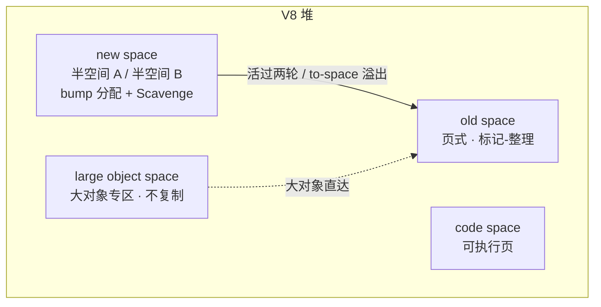
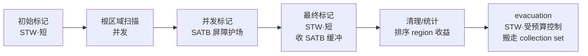

# 工业回收器解剖：V8、JVM 与 Go

> [返回：GC 算法专题导览](01-导览.md)
> 理论齐了，看三家真实产品怎么组装。V8（前端主场）、JVM（分代路线的集大成者）、Go（反分代的异见者）——同一套理论（三色、屏障、分代假说）在三种工作负载下长出三种形态。读完后 `--trace-gc` / `-Xlog:gc` / `GODEBUG` 的每一行都应该能对上理论。

前置阅读建议：[02-引用计数的进化](02-引用计数的进化.md) 给出"RC 与追踪同源"的对偶视角，[03-屏障与并发标记](03-屏障与并发标记.md) 讲透 Dijkstra/Steele/Yuasa 三种屏障与黑分配——本册每出现"屏障"两个字，指的都是那一册的具体机制。

## 先立坐标系：四个设计变量

读工业回收器之前，先把评判的坐标系立起来。任何回收器的形态都可以用四个负载变量解释：

| 变量 | 含义 | 偏向哪条路线 |
|---|---|---|
| **分配速率** | 单位时间新对象产生量 | 越高越需要便宜分配（bump/池化）与高频小回收 |
| **存活率** | 新生对象活过初期的比例 | 越低越适合复制式（Copying 的成本 ∝ 存活者，不是垃圾量） |
| **指针密度** | 对象平均持有多少引用、图是否稠密 | 越密标记成本越高、屏障越烫；也越难做标量替换 |
| **停顿容忍度** | 业务能接受的最大单次停顿 | 越低越需要增量/并发/移动式，且愿意付吞吐税 |

三家在这四个变量上的取值，决定了它们后面所有的分歧。读者可以在阅读每个小节时回看这张表：**每一条"值得偷的决策"，都能还原成四变量的某个取值**。

| 变量 | V8（浏览器） | JVM（服务端） | Go（网络服务） |
|---|---|---|---|
| 分配速率 | 高（每次交互都造临时对象） | 中高 | 高（goroutine 帧对象、请求级对象） |
| 新生代存活率 | 极低（多数对象活不过一轮交互） | 低但缓存抬高了长尾 | 中（逃逸分析已截走一批短命者） |
| 指针密度 | 高（闭包、DOM 包装对象互相引用） | 高（OOP 对象图稠密） | 中（值类型 + slice/map 内建类型规整） |
| 停顿容忍度 | 帧预算（16ms 里扣零头） | 配置化（有的服务毫秒级、有的大堆亚毫秒） | 亚毫秒（长连接网关） |

这张表还能反着用：给自己的服务画像。比如"低分配 + 高存活 + 指针稀疏 + 停顿无所谓"的离线计算服务，选吞吐型回收器就是正解——此时盲目追求"先进"反而吃亏（ZGC 的读屏障税白交）。

## V8：浏览器负载的极致响应

**堆布局**：new space（Scavenge 半空间）+ old space（标记式）+ large object space（大对象专区，直接老年安置、不复制）+ code space。四个空间的存在本身就是工作负载的投影：网页脚本分配速率高、存活率低、交互停顿敏感。



逐个空间看设计动机：

- **new space 的半空间**：分成两半，分配永远在活跃的那半上 bump 推进；Minor GC 时活对象复制到另一半、整半空间一次性作废——垃圾最多少都不影响回收成本（成本只数活人）。两半空间按需伸缩，`--max-semi-space-size` 控制上限；
- **晋升（promotion）**：对象在 new space 活过两轮 Scavenge、或复制时 to-space 装不下（allocation overflow），就搬进 old space——"活得久的去老年"的最朴素落地；
- **large object space**：超过阈值的大对象（大数组、长字符串）直接单独安置，**永远不参与复制**——复制大对象的成本是线性于体积的，直接违反"成本 ∝ 存活数而非存活字节"的初衷；
- **code space**：机器码所在页需要可执行权限，与数据页隔离（W^X 的要求），GC 对它的"回收"其实是代码生命周期管理（去优化后失效的代码）。

**Orinoco 项目以来的并发化路线**（把各阶段逐个从 STW 搬到并发）：

- **并行 Scavenger**：minor GC 本身快（存活集小），但搬运活对象并行化后更快——STW 保留，只是短；
- **增量标记步进**：标记工作切成小步，混入事件循环空闲与分配间隙（写屏障 + 黑分配保不变式——上一册的两件兵器都用上了）；
- **并发标记/并发清扫**：标记根以外的图遍历、老生代的清扫都挪到后台线程，主线程只做启动与收尾的短 STW。

增量与并发还可以再叠一层**调度智慧**：V8 会把标记小步塞进事件循环的空闲时段（idle time，比如两帧之间的间隙），让"反正闲着"的 CPU 替用户干活——GC 从"打断程序的系统调用"变成了"见缝插针的后台任务"。这解释了为什么前端页面的 GC 停顿往往感知不到：不是没有 GC，是 GC 被调度到了你不在的时候。

把这三步连起来看，是一次教科书式的"逐阶段拆解 STW"：**先把回收拆成阶段（标记/清扫/整理），再逐个阶段问"这一段必须停机吗"**。能并发的并发（图遍历、清扫），必须串行的保留 STW 但压短（根扫描、翻面收尾）。第六阶段[标记-清除实践](../06-第六阶段/04-实践-标记清除GC.md)里我们写过整体式版本，[06-实践-增量三色标记](06-实践-增量三色标记.md)把它的标记阶段切成了步进——读完那册再回头看 V8 这三步，一一对应。

**值得偷的决策**：V8 不追求"零停顿"而追求"停顿预算"——页面 60fps 意味着每帧 16ms，GC 设计目标是把停顿压进帧预算的零头。**停顿指标不是绝对值，是负载的函数**。

**一次 Scavenge 的对象旅程**（把上面三步落到具体对象上，对照 `labs/gc/src/copying.ts` 手跑一遍）：

设根槽位 R1、R2，堆里五个对象：A（R1 直接引用）、B（R2 引用）、C（A 的字段引用）、D（谁都不引用）、E（C 引用，同时 A 也引用——菱形共享）。Scavenge 一走：

| 步骤 | 动作 | 副作用 |
|---|---|---|
| 1 | copy(R1→A)：A 搬入 to-space | A.forwarded = 新址 0 |
| 2 | copy(R2→B)：B 搬入 | B.forwarded = 1 |
| 3 | Cheney 扫描从 0 开始：扫 A | A 的字段 C → copy(C)：C.forwarded = 2 |
| 4 | A 的另一字段 E → copy(E) | E.forwarded = 3 |
| 5 | 扫 B：无引用字段 | — |
| 6 | 扫 C：字段 E → 转发指针命中 | **E 只搬这一次**（菱形去重） |
| 7 | 扫 E：无出边 | 队列到头，翻面 |
| 8 | from-space 整半作废 | D 随半空间一起消失——**D 从未被单独"处理"** |

注意第 8 行：复制式回收器根本不知道 D 的存在，垃圾是"没被搬走"而不是"被发现"。这就是"成本 ∝ 存活者"的全部含义——对照 G1 的 evacuation（把活对象搬出 region、整 region 回收）与 ZGC 的并发搬运，是同一个思想的三种并发化程度。

**trace 怎么读**：`node --trace-gc` 每行一次回收，字段大致是：触发原因（space-full / allocation-failure / idle…）、前后堆量、停顿类型（Scavenge / Mark-Compact / Minor Mark-Sweep…）与耗时。读法固定三问：

1. **什么触发的**——`space-full` 频繁 = 半空间太小或分配速率过高；
2. **哪种回收**——Scavenge 多而快是健康的；Mark-Compact 频繁登场说明存活集在变大；
3. **活了多大**——前后堆量差就是"回收掉的量"，连续多轮 alive 只增不减，优先查泄漏而不是调参数。

实验室里各回收器的 `events` 日志是同构的微缩版，例如复制式的行模板是：

```
[gc:<原因>] copied <存活数> objs | dead <垃圾数> | work <工作量>
```

断言只检查字段齐全性——真实 trace 的读法在这里练熟即可。

## JVM：分代路线的集大成与自我革命

**Serial → Parallel → CMS → G1 → ZGC/Shenandoah** 的谱系就是 GC 教科书本身：

- **Parallel**：吞吐优先，STW 但多线程并行——批处理作业的最优解（停顿长一点无所谓，总时间最短才重要）；
- **CMS（2017 弃用、JDK14 移除）**：第一代主流并发标记-清除。败因值得背下来：**清除不整理 → 碎片化 → 并发模式失败（concurrent mode failure）退化为 Full Serial GC**——长停顿在最坏时刻爆发。并发 + 不移动 = 碎片定时炸弹；
- **G1（Garbage First，JDK9 起默认）**：堆切成 ~1–32MB 的 region，逻辑分代物理不分代。并发标记（SATB）找出"垃圾占比最高"的 region 优先回收入 evacuation 停顿——名字由此而来：**先收最赚的**。配套每 region 的 remembered set（卡表 + 后台细化线程）与**停顿预测模型**（`-XX:MaxGCPauseMillis` 给目标，G1 反推这轮收多少 region）。设计核心：把"全堆回收"降维成"按收益调度的增量回收"，停顿可配置、可预测；
- **ZGC（JDK11+，JDK21 起支持分代）**：着色指针 + 读屏障（上一册），并发搬运，停顿亚毫秒且与堆大小无关。代价：吞吐损失（屏障常驻）与更高内存占用（转发元数据）。**用吞吐买停顿**；
- **Shenandoah**：Brooks 转发指针起步、演进为加载引用屏障，与 ZGC 同代竞争；
- **Epsilon（无操作 GC）**：只分配不回收——为压力测试与"跑完就退"的短命作业服务。**"没有 GC"也是一个可配置选项**，这本身就是视角的打开。

CMS 的败局值得逐步推演一遍（每个后继回收器都在赎其中一步）：

| 时刻 | 发生了什么 | 后继者怎么赎 |
|---|---|---|
| 平稳期 | 并发标记清除，停顿短 | — |
| 碎片积累 | 清除不搬对象，空闲块越切越碎 | G1/ZGC：移动式回收（evacuation/并发搬运） |
| 大对象无处安放 | promotion 失败 / 分配装不下 | concurrent mode failure |
| 最坏时刻 | 退化为 **Full Serial GC**，单线程整理全堆 | G1：region 化让"整堆"本身消失 |
| 教训 | **停顿指标要看最坏情况，不是平均值** | ZGC：停顿与堆大小解耦 |

### G1 的三个机制展开

G1 值得多花半页，因为它是"分代思想 + 并发标记 + 停顿工程"三者的交汇点：

- **region 化的逻辑分代**：不再要求 new/old 连续成块，任何 region 都可以当前被指定为 Eden/Survivor/Old 角色，回收后角色回收。这带来了一个此前不可能的操作——**只回收一部分老年代**（mixed GC）：并发标记找出垃圾最富的 region，一次 evacuation 停顿搬走几个，下一轮再搬几个。"全堆 Full GC"从常态变成兜底；
- **remembered set 卡表化**：跨 region 的引用不逐对象记录，而是把 region 切卡页（card），卡表只记"这张卡里有跨代/跨 region 指针"。写屏障命中时置脏卡位，后台细化线程再把脏卡落实到 remembered set——**屏障只做最便宜的一步（置位），昂贵的一步（构造目标集）异步做**，这是所有工业屏障的公共模式；
- **停顿预测模型**：G1 对每个 region 维护历史搬运成本统计，给定 `-XX:MaxGCPauseMillis` 目标，每轮选 collection set 时按"预计收益 / 预计成本"排序装袋，装到预算耗尽为止。**停顿从"结果"变成了"约束输入"**——这是 GC 从算法走向工程的分水岭。

卡表的思想用一张微缩表就能讲透（把老年代想象成 4 张卡，每卡若干对象）：

```
老年代卡页：  [卡0: A B]   [卡1: C D]   [卡2: E]     [卡3: F G]
卡表：         0            1(脏)        0            1(脏)
                            ↑ D.f → 新生对象              ↑ G.f → 新生对象
```

minor GC 只需要扫卡 1 和卡 3 里对象的字段——**两级粒度**：卡表答"哪张卡可能有跨代边"，细化后答"具体哪些边"。精度换成本的经典交换：卡表本身只需一个字节数组，写屏障只做一次置位。实验室 `generational.ts` 的 remembered set 是"精确到宿主对象"的版本（`remembered.add(host)`），没有卡页这层粒度——简化点是**省掉卡表折衷，直奔"老代一步不扫"的核心事实**。

### ZGC 的着色指针怎么工作

64 位指针的高几位被借来存元数据（标记位、重映射位等）。配合**读屏障**：每次从堆里加载引用，检查指针颜色——若指向"旧家"，顺手查转发表修正到"新家"再返回（上一册"渐进式自愈"）。要点有二：

- **修正发生在读取时**，所以搬运对象不必停机等所有引用者更新——引用者手里的旧指针会在它们下次真正用到时被懒修正；
- **代价前移到每次引用读取**：这是 ZGC 吞吐税的来源。G1 把税放在写屏障（SATB），ZGC 把税放在读屏障——**屏障装在哪，税就交在哪**，与负载里"读写比例"共同决定哪家划算。

把一次并发搬运的完整流程走一遍：

1. 标记阶段结束，ZGC 选定要回收的 region，里面的活对象列表在手；
2. 搬运线程把对象复制到新 region，旧位置留下转发表记录（对象体可能原地打转发标记）；
3. 此刻**新旧两处引用并存**：还没被再次访问的旧引用仍是旧地址——着色指针的高位标记"这是待修正的"；
4. mutator 下次**读取**该引用，读屏障发现颜色不对 → 查转发表 → 改写引用为新地址 → 返回新引用（顺手自愈）；
5. 全部引用自愈后，旧 region 整体回收。

关键在第 4 步的"顺手"：修正成本分摊到了千万次读取里，没有任何一次需要"停下所有人改一遍"。这与第六阶段接触过的"写时复制/懒加载"是同一族思想——**把集中式的一致性维护，变成访问路径上的懒修正**。

### JVM 全家族速查

| 回收器 | 停顿形态 | 一句话定位 |
|---|---|---|
| Serial | 单线程全 STW | 小内存、客户端 |
| Parallel | 多线程全 STW | 吞吐批处理 |
| CMS（已移除） | 并发标记清除 | 教材级的失败案例 |
| G1 | region + 并发 + 可配停顿 | 默认位、通用 |
| ZGC | 着色指针 + 读屏障 + 并发搬运 | 亚毫秒、大堆 |
| Shenandoah | 加载引用屏障 + 并发搬运 | ZGC 同代竞品 |
| Epsilon | 不回收 | 压测/短命作业 |

### `-Xlog:gc` 怎么读

现代 JVM 的 GC 日志统一入口。三问与 V8 相同（触发原因 / 回收类型 / 回收量与停顿），多一问：**是 young / mixed / full 哪种**——mixed 频繁但每次短是 G1 的健康态；full GC 出现且伴随 to-space exhausted 之类的字样，通常意味着分配压力或大对象过多挤占了 region。

### 一次 mixed GC 周期的时间线

把 G1 的各阶段连成时间轴（每段是并发还是 STW，是读懂一切并发回收器的通用练习）：



两个观察：

- **STW 的段落只剩三小段**，且 evacuation 的规模被停顿预测模型压着——这是"停顿可配置"落到时间轴上的样子；
- **并发标记与 mutator 并行，靠 SATB 屏障维持快照不变式**（上一册族谱三）。标记结束后每个 region 都有一张"垃圾含量"账单，mixed GC 按账单装袋——Garbage First 的调度就是在这张账单上做背包问题。

对照实验室 `incremental.ts` 的周期状态机：`beginMark`（只入灰，对应初始标记）→ 多次 `step`（对应并发标记，由 `markEvery` 与 `stepBudget` 控制步幅）→ 队列空后重扫根（对应最终标记）→ `finishCycle`（对应清理）。**并发回收器 = 把这张时间轴上的并发段落切成可中断的小步**，工业与教学在这里只差工程精度。

## Go：非分代的异见者

Go 团队的判断与 JVM 分道扬镳：**指针密集 + goroutine 海量 + 栈廉价**的世界里，分代的两大前提都动摇了——

- **分配器先分代**：Go 的分配器（TCMalloc 血统：mcache→mcentral→mheap，按 size class 微型对象池）已经把"小对象分配"做得像 bump 一样快，复制式新生代的最大卖点（快分配）被分配器抢走了；
- **逃逸分析再釜底抽薪**：编译期能证明不逃逸的对象直接**栈分配**，根本不进堆（第七阶段逃逸分析详述）——分代假说里的"朝生暮死主力"被静态分析截走了；
- 于是 GC 只剩一件事：**并发三色标记-清除 + 混合屏障**（上一册），不移动、不分代、不整理，靠 size class 池天然抗碎片。**Pacer**（GOGC 目标的反馈控制器）按分配速率动态调度标记启动时机。

### Pacer：把 GC 当控制系统设计

GOGC=100（默认）的含义：堆增长到"上次回收后存活量的两倍"附近就该开始标记了。但并发标记需要时间，等到阈值才启动就晚了——Pacer 是一个反馈控制器：

- 它维护"标记速率 vs 分配速率"的估计，**提前**启动并发标记，目标是"标记完成的瞬间堆恰好到达目标上限"；
- 分配速率骤升时，Pacer 有两个后手：提高后台标记线程的 CPU 占比；再不够就触发 **mark assist**——让正在疯狂分配的那个 goroutine 自己去分担标记工作（谁污染谁治理）；
- Go 1.19 起的 `GOMEMLIMIT` 补上了另一个维度：软内存上限。Pacer 原来只控"相对增长"，GOMEMLIMIT 给了"绝对天花板"，两者配合把 GC 调度从一维变二维。

Pacer 的思维模型值得单独记一笔：**GC 启动时机不是一条静态阈值，而是一个随负载自校准的控制器**。对照 G1 的停顿预测模型（输入是目标停顿）、对照 V8 把标记步进混进事件循环空闲（idle-time GC）——三家的共同升级是"GC 不再是被动响应分配失败的子程序，而是主动调度资源的系统服务"。

`GODEBUG=gctrace=1` 每行一次 GC：触发时的堆量、目标堆量、标记各阶段耗时（其中含 STW 的两段：启动与终止）、后台标记与 assist 的 CPU 占比。读它同样三问，多一个技巧：**对比"标记用了多少 CPU"与"分配了多少"**——assist 占比长期偏高，说明堆目标定小了（GC 追不上分配），加大 GOGC 用内存换 CPU。

### Go 的并发标记时间线


- 开启/终止两段 STW 都在微秒量级的心愿清单上，大头（标记、清扫）全部并发；
- **混合屏障**（Dijkstra 置灰新值 + Yuasa 置灰旧值）消灭了"重扫全部 goroutine 栈"——上一册讲过它的动机：goroutine 以万计，栈重扫比屏障税贵得多；
- **清扫并发化**之所以容易，是因为标记已经把"死活"写进位图，清扫只是把死对象归还 size class 池——不移动对象的福利再次显现（ZGC 若也这样清扫，读到的引用可能失效，所以它必须并发搬运 + 读屏障自愈）。

对照实验室：`incremental.ts` 的 `writeRef` 里 `hybrid` 分支正是"新值置灰 + 旧值置灰"两行；栈/根槽位写入不打屏障，正确性由 `step()` 队列空后的根重扫兜底（`stats.rootRescans` 计数）——与 Go "混合屏障买回免栈重扫、终止阶段短 STW 兜底"是同一套账，只是 Go 把"根重扫"压到了终态一次性做。

三家对照一张表：

| | V8 | JVM (G1/ZGC) | Go |
|---|---|---|---|
| 分代 | 有（Scavenge + old） | G1 逻辑分代；ZGC 21 起分代 | **无** |
| 移动 | Young 复制；old 整理 | G1 搬 region；ZGC 并发搬运 | **不移动** |
| 核心屏障 | 写屏障 + 黑分配 | G1：SATB 写屏障；ZGC：**读屏障** | 混合写屏障 |
| 停顿目标 | 帧预算（几 ms） | 可配置（G1）/ 亚 ms（ZGC） | 亚 ms |
| 抗碎片靠 | old 整理 | region 搬运 | size class 分配器 |
| 吞吐代价 | 中 | 低（G1）～ 高（ZGC） | 中 |

**读法**：没有最先进的回收器，只有与负载匹配的回收器——分配速率、存活率、指针密度、停顿容忍度四个变量定形态。前端同学的 V8 之所以"半空间 + 并发标记"，是因为浏览器负载四个变量的取值就在那里。

## 怎么给负载选回收器：一张决策路径

把三家的取舍抽成可复用的判断顺序（定性，不替代压测）：

1. **停顿容忍度先定档**：完全不在乎停顿（离线批处理）→ Parallel/Serial 风格，吞吐最优；亚毫秒硬需求（交易、游戏帧循环）→ 读屏障并发移动式（ZGC 路线）；
2. **再看存活率**：新生对象九死一生 → 复制式 minor GC 回本最快；对象普遍长寿（大缓存、长生命周期配置）→ 分代收益缩水，重点转向并发标记 + 整理；
3. **再看指针密度与堆规模**：指针稀疏、对象规整 → 不移动 + size class 池可行（Go 路线）；指针稠密 → 整理成本高但碎片风险也高，需要 region 化增量整理（G1 路线）；
4. **最后看能不能从源头减负**：逃逸分析、对象池、arena、值类型——**最好的 GC 决策常常是让对象根本不进堆**（下一册 [05-免GC的内存管理](05-免GC的内存管理.md) 的主题）。

拿两个假想负载走一遍这条路径（练习"画像 → 选型"的肌肉）：

| 负载画像 | 四变量读数 | 走到哪一步定案 |
|---|---|---|
| 夜间报表：全量数据加载 → 聚合 → 落库退出 | 分配高、存活高、指针中、停顿无感 | 第 1 步即定案：吞吐型，甚至 Epsilon + 大堆一次跑完 |
| 长连接网关：每请求小对象若干、P999 敏感 | 分配高、存活低、指针中、亚毫秒 | 第 2 步加分（复制/分代），第 3 步看指针密度定移动式细节 |
| 前端页面：交互驱动、帧预算 16ms | 分配高、存活极低、指针密、几 ms | 复制 young + 并发标记 old（V8 同款组合） |

注意第三行：它不是"选了 V8"，而是"四变量推出来的形态恰好是 V8 的形态"——**形态是负载的函数**，这正是本节开头那张坐标系表的用法。

## 一分钟自检清单（背下来受用）

- 看到 `Scavenge` 频繁 → 分配速率高，多数朝生暮死：正常，或加大 `--max-semi-space-size`；
- 看到 `Mark-Compact` 耗时增长且 alive 逐轮变大 → 存活集在涨：先查泄漏（快照 diff"只增不减"的构造函数）；
- JVM 频繁 Full GC 且原因 concurrent mode failure（老版本 CMS）→ 碎片化：换 G1；
- Go 的 `gc pause` 极短但 CPU 里 GC 占比高 → GOGC 调大（用内存换 CPU）；
- Go 的 assist 占比长期偏高 → 标记追不上分配：加 GOGC 或查分配热点（谁在高频 new）；
- 换了"更先进"的回收器吞吐反降 → 正常：ZGC 类方案的读屏障是常驻税，吞吐型负载本就不该换。

## 对照实验：本册概念在实验室里的影子

三家回收器的**产品本体**没法在实验室复刻，但它们的决策都能在 `compiler/labs/gc/` 里找到最小影子：

| 工业机制 | 实验室对应 | 实跑断言 |
|---|---|---|
| V8 Scavenge（半空间复制） | `src/copying.ts`：转发指针去重、to-space 即队列、50% 税 | 菱形共享只搬一次；存活集超半空间 → OOM |
| V8/G1 old 整理（Mark-Compact） | `src/mark-compact.ts`：两指滑动 | 整理后堆长 = 存活数（碎片归零） |
| 分代 + 卡表/remembered set | `src/generational.ts`：写屏障登记 old→new | minor GC `oldTraversed === 0`（"小 GC 便宜"的量化证据）；关屏障 → 新对象误收 + 老代悬垂 |
| `--trace-gc` / `-Xlog:gc` / `GODEBUG=gctrace=1` | 各回收器的 `events` 日志（同构字段：原因/存活/回收/阈值） | trace 字段齐全性断言 |
| 增量标记 + 屏障可插拔 | `src/incremental.ts`：none/dijkstra/steele/yuasa/hybrid | none 屏障下活对象被误收（复现事故表）；hybrid 全绿 |

几个值得动手的对照实验（都在测试文件里有现成断言）：

- **复制式的 50% 税**：`CopyHeap` 容量 64，两半各 32——当存活集逼近 32 时 `alloc` 抛出"存活集装不进单个半空间（复制算法的 50% 税收据）"。V8 的 large object space 为什么"宁可直接老年也不复制"，这条异常就是答案；
- **标记-整理的四遍扫描**：`mark-compact.ts` 的 `collect` 依次是 标记 → 定址（第二根手指压出新地址）→ 改指针（forwarding 解耦）→ 滑动搬家，events 里的 `slid N objs to [0..N-1]` 就是"碎片归零"的直接证据。对照 G1 的 evacuation：真实回收器还多了"跨 region 改引用"，需要 remembered set 配合——四遍骨架完全同型；
- **分代的账本**：`generational.ts` 每轮 minor 记录 `lastMinor = { rootRefs, rememberedHosts, oldTraversed, promoted, reclaimed }`，events 行直接打印 `oldTraversed 0`。把 `barrierEnabled` 关掉再跑：新对象被误收、老代出现悬垂——**屏障不是优化，是分代正确性的前提**，这对应 G1 没有卡表就无法只扫一部分堆；
- **Pacer 的微缩版**：`incremental.ts` 的 `stepBudget`（每步灰对象预算 = 停顿旋钮）与 `markEvery`（多少次 tick 走一步 = 增量密度旋钮）就是 Go 标记步进的两个旋钮；`stats.maxStep` 记录最坏单步——把 `stepBudget=1; markEvery=1` 设成压力模式（等价 `--stress-gc`），none 屏障立刻翻车、hybrid 稳定——见 [06-实践-增量三色标记](06-实践-增量三色标记.md)；
- **churn 驱动器**（`src/core.ts`）的行为分布值得一看：约 45% 的操作在分配（其中八成挂根、两成直接变垃圾——制造"朝生暮死"），约 40% 在改引用（其中一小半故意踩两个经典事故入口：把未挂根的新对象写进字段、把已断根的旧对象挂回来——对应增量标记里的"黑分配保命"与"浮动垃圾"），约 15% 在断根。它是"真实程序在 GC 眼里长什么样"的最小替身，也是所有压力测试的 mutator；
- **悬垂检测常驻**：`core.ts` 里的 `assertNoDangling(heap)` 遍历全堆，任何存活对象的字段指向已回收地址即抛错——把它插进 churn 的 `tick` 回调，屏障 bug（none 模式）会在数千次操作内被抓住。这正是上一册说的"把不变式变成可执行的检查"，也是 V8 `--stress-incremental-marking` 一类压力开关的实验室对应物。

一套固定的实验方法（可直接迁移到任何自研运行时）：

1. 用 `churn` + 种子化 PRNG（`mulberry32`，完全可复现）跑出基线；
2. 每次只动一个旋钮（屏障类型 / 预算 / 阈值），重跑同一种子；
3. 断言读 events 账本（回收数、存活数、工作量），而不是肉眼读日志；
4. 用 `assertNoDangling` + `assertTriColorInvariant` 兜正确性——**性能对比在正确性保证之后才有意义**。

churn 驱动器（`src/core.ts`）顺带验证了**分代假说**本身：500 次随机变异后 minor GC，
晋升数 < 60 / 回收数 > 150——"朝生暮死"不是教科书假设，是这份负载的统计事实。

最后补一张"理论 → 工业"的映射总表，把整个专题的前几册与三家产品钉在一起：

| 理论概念（出处） | V8 | JVM | Go | 实验室 |
|---|---|---|---|---|
| 三色抽象（第六阶段） | 增量/并发标记 | G1/ZGC 并发标记 | 并发标记 | `incremental.ts` |
| 强/弱不变式 + 屏障（03 册） | 插入屏障 + 黑分配 | G1 SATB / ZGC 读屏障 | 混合屏障 | `writeRef` 四旋钮 |
| 复制式/半空间（导览） | Scavenge | G1 evacuation | —（不移动） | `copying.ts` |
| 标记-整理（04 册上） | old Mark-Compact | G1 搬运后整理 | — | `mark-compact.ts` |
| 分代 + remembered set（02/03 册） | new/old + 卡表 | region 逻辑分代 + RS | 无分代 | `generational.ts` |
| 对偶定理（02 册） | —（纯追踪端） | — | — | refcount 各 mode 与追踪对照 |

读法：每学一个理论概念，先在实验室跑出它的最小形态，再来这张表对号工业落点——理论、实验、工业三层互相校验，这套流程本身就是编译原理学习法的复用。

## 常见误区

- **"并发 = 没有停顿"**：三家全是并发设计，但全都保留了短 STW（根扫描启动、标记终止、翻面收尾）。并发消掉的是"长停顿"，不是停顿本身；
- **"浮动垃圾是 bug"**：SATB、黑分配、快照屏障都**主动生产**浮动垃圾——本轮多活一拍、下轮照死。用保守换正确与吞吐，是并发系统的标准交换；
- **"G1 的 region 就是分代的老年区"**：region 是**空间调度单位**，分代是**生命周期假设**；G1 把后者装进前者，所以才有 mixed GC 这种"收一部分老年代"的操作；
- **"Go 没分代是因为实现懒"**：是负载判断——分配器池化 + 逃逸分析抽走了分代两大前提（见上文）。同样的判断放到指针稀疏、对象规整的负载里就是对的，搬到别的负载未必；
- **"调优先于测量"**：顺序永远是 trace → 定位四变量 → 调一个旋钮 → 再 trace。同时拧 GOGC、半空间、MaxGCPauseMillis 三个旋钮，等于什么都没测；
- **"回收器决定内存上限"**：上限主要由**存活集**决定（泄漏、缓存无界），回收器只决定"到上限的路走得多难看"。alive 逐轮上涨时，任何回收器都救不了；
- **"移动对象只会更贵"**：移动的代价一次性，换回的是分配永远 bump + 碎片归零——对存活率低、分配速率高的负载，复制/整理是净赚。Go 的反例成立靠的是 size class 池这层前提，不是普适规律；
- **"读屏障比写屏障高级"**：没有高级，只有不变式建在点上还是边上（上一册结尾的分野）。ZGC 用读屏障是因为它的不变式在指针颜色上，G1 用写屏障是因为不变式在快照边上——先有不变式，后有屏障；
- **"minor GC 快是因为堆小"**：错。快是因为**扫描集合小**（根 + remembered set，老年代一步不碰）——`generational.ts` 的 `oldTraversed === 0` 就是这句话的可执行版本。堆可以很大，只要跨代边少。

## 与其他册的连接

- 屏障族谱与黑分配的机制细节：[03-屏障与并发标记](03-屏障与并发标记.md)；
- 增量标记的动手实现（状态机、步进、压力模式）：[06-实践-增量三色标记](06-实践-增量三色标记.md)；
- RC 路线与"RC vs 追踪"的对偶定理：[02-引用计数的进化](02-引用计数的进化.md)；
- 不用 GC 的整条谱系（arena/所有权/EBR）：[05-免GC的内存管理](05-免GC的内存管理.md)；
- 主线的对象模型与 GC 基础：[第六阶段-垃圾回收深入](../06-第六阶段/03-垃圾回收深入.md)、[第六阶段-标记清除实践](../06-第六阶段/04-实践-标记清除GC.md)。

## 自测

（前五题是骨架题，后五题是对照题——答不出时回到对应小节再读一遍。）

1. V8 为什么对 young 用复制式、对 old 用标记式？两个空间各自的负载特征是什么？
2. CMS 的"并发模式失败"为什么会退化为最差的串行 Full GC？G1 用哪两个机制根治它？
3. G1 的"Garbage First"调度的是什么？停顿预测模型反推的变量是什么？
4. Go 去掉分代的两个前提（分配器与逃逸分析）分别抢走了分代 GC 的什么卖点？
5. ZGC 用什么换亚毫秒停顿？为什么说 Epsilon 的存在本身就是一种设计观点？
6. 用四个设计变量（分配速率/存活率/指针密度/停顿容忍度）分别刻画 V8 与 Go 的目标负载，各给两个特征。
7. churn 驱动器里"把已断根的旧对象挂回来"这一步，在并发三色标记里对应哪种现象（提示：上一册 SATB 与浮动垃圾）？
8. 为什么 G1 的写屏障只置脏卡位、由后台线程细化 remembered set，而不是屏障里当场建好？
9. 用本册的 Scavenge 对象旅程表（A~E 五对象）解释：为什么复制式回收器的成本与 D（纯垃圾）完全无关？若 D 是一个 1MB 的大对象，哪一条 V8 机制会让它根本不进 new space？
10. V8 为什么把增量标记步进混进事件循环空闲段，而不是按固定字节间隔触发？这两种调度分别适合什么样的宿主环境？
