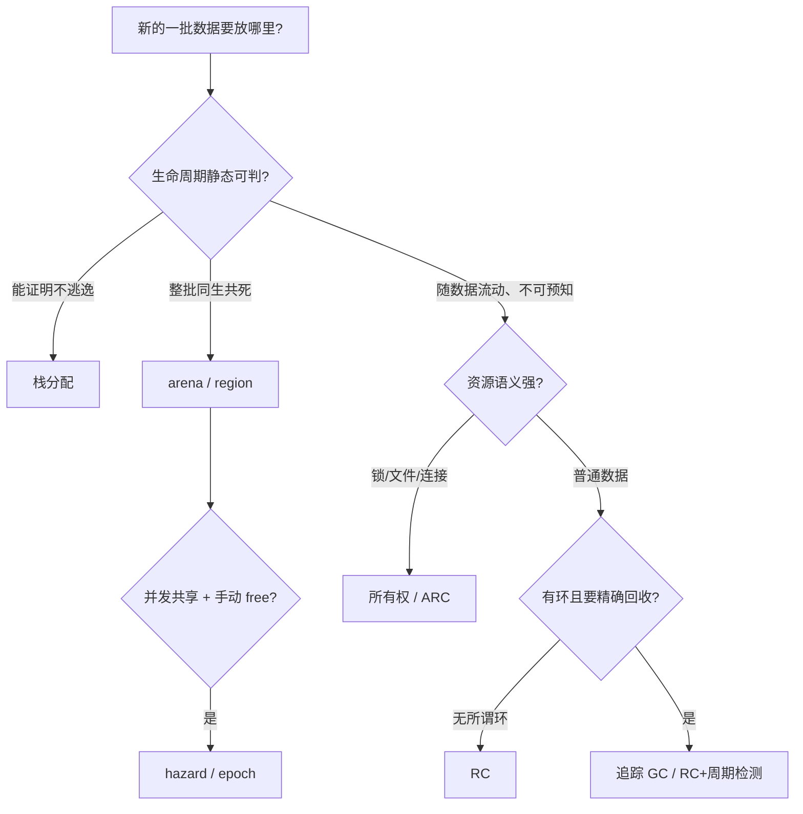

# 免 GC 的内存管理：arena、所有权与并发回收

> [返回：GC 算法专题导览](01-导览.md)
> GC 是自动内存管理的一种答案，不是唯一答案。编译器与前端工具链里大量场景根本不用 GC——**esbuild、oxc、rustc 的 AST 都活在 arena 里**。本册过完"不靠运行时回收"的完整谱系：arena/栈分配/区域推导/所有权/并发手动回收，最后给一张决策表：什么时候 GC 恰恰是正确选择。

一条总线索先挂出来，全册围绕它展开：**内存管理的本质问题是"何时释放、由谁证明安全"**。GC 把证明交给运行时追踪，RC 交给计数器，arena 交给作用域，所有权交给类型系统，EBR 交给纪元协议——五个答案，一个问题。读完回到这句话，谱系自然收拢。

## arena：一批生、一批死

**思路**：一大块内存（arena），内部只递增指针分配（bump），**从不单独释放**——整块一起还。

```ts
class Arena {
  private buf = new ArrayBuffer(1 << 20);
  private top = 0;
  bump(size: number): number {                    // 返回偏移，不返回指针
    const off = this.top; this.top += (size + 7) & ~7;   // 8 字节对齐
    return off;
  }
  reset() { this.top = 0; }                       // 唯一的"释放"：整场清空
  }
```

为什么快：分配 = 加法（比 free list 快一个数量级）；释放 = 置零（与对象数无关）；局部性极好（同批对象紧挨着，缓存命中拉满）。代价是**纪律**：进 arena 的对象必须真的同生共死，且不能再长期持有其中的引用——reset 之后全体悬垂。

三个细节值得放大看，因为它们是所有工业 arena 的公共设计：

- **返回偏移而不是指针**：偏移是相对于 arena 基址的整数——arena 本身可以整体搬家（重新分配更大的块）、可以按值传递、可以序列化，偏移永远有效。**"地址"从世界坐标变成了区内坐标**，这是 arena 能支撑并行（每线程一个 arena，最后合并）的伏笔；
- **对齐（`(size + 7) & ~7`）**：凑到 8 字节边界，保证下一个对象天然对齐——不对齐的访问在部分架构上直接崩溃，在 x86 上也要付未对齐惩罚。真实分配器（malloc、V8 的 bump、bumpalo）都有这步，教学代码常常省略；
- **OOM 不假装无限**：容量耗尽直接抛错。要么开大 arena，要么换分层策略（多 arena 链），**绝不做"单个对象悄悄 free"——那是对纪律的背叛**，一旦可以单独释放，整批证明就失效了。

**编译器是 arena 的天选场景**：一次编译里，AST/HIR/类型节点的生命周期几乎完全重合——"解析完就都在，生成完就都死"。rustc 的 AST/HIR 节点大量走 arena；**oxc（Rust 写的前端工具链）用 bumpalo arena 装整个 AST**，esbuild 的"内存效率"也来自同思想（Go 值类型 + 批次化生命周期）。第八阶段讲"esbuild/oxc 为什么快"，arena 是答案的一半；另一半（并行、单遍）也是本思路的延伸——**生命周期越规整，架构越能放开手脚**（每线程一个 arena，编译完整块丢弃，连跨线程同步都省了）。

前端工程里的同款：请求级对象池（per-request arena 复用）、React Fiber 的可复用节点、**WASM 线性内存本质上就是一个巨型 arena**——JS 引擎看不见 WASM 模块内部的对象，C/Rust 编译到 WASM 后只能自带内存管理（arena 是最常见选择；WasmGC 提案后才有了结构化类型）。Wasm 专题的[线性内存分册](../11-Wasm专题/04-线性内存与JS互操作.md)会再遇到它：一整块 ArrayBuffer、模块内部自己管布局——arena 定义一字不差。

把"线性内存 = arena"再展开半步，它是理解编译到 WASM 的语言的钥匙：

```
WASM 线性内存（一段连续字节）
┌──────────┬──────────┬─────────────┬──────────────┐
│ 静态数据  │ 栈（向下） │ 堆区（向上） │ ……未提交区域  │
└──────────┴──────────┴─────────────┴──────────────┘
                          ↑ Rust/C++ 编译产物在这段里自带 malloc/free 或 arena
```

- 模块内部分好栈与堆（和原生程序一模一样），只是"堆"没有 OS 页支持，全靠模块自己的分配器；
- **跨语言边界的唯一窗口是数字**（JS 与 WASM 互传的是整数/浮点，"对象"只能以线性内存偏移的形式存在）——这正是 arena"偏移代替指针"原则的强制版；
- 于是 C/Rust 的成熟分配器（dlmalloc、tlsf、Rust 的系统分配器）被整个搬进模块——**"免 GC 的内存管理"在 WASM 世界不是选型题，是必答题**。

### async/await 与 AbortController：作用域纪律的运行时版

还有一个前端日常里的"区域"影子：**请求的取消与清理**。`AbortController` 把一族异步操作（fetch、监听器、订阅）绑到同一个信号上，`abort()` 一次性让整族失效——这就是"区域随作用域开闭"的运行时实现（只是"释放"的是行为而不是内存）。对照本册主线：arena 用**水位**界定区域，async teardown 用**信号**界定区域——同一个思想（成批界定生命周期）在不同资源维度的投影。写请求级代码时先问"这批东西归哪个 controller 管"，与问"这批对象归哪个 arena 管"，是同一种设计嗅觉。

### arena 上的数据结构：索引化世界观

arena 定了，数据结构的设计跟着变——这是从"GC 语言的堆"迁移过来时最不习惯的一步：

| 在 GC 堆里 | 在 arena 里 | 原因 |
|---|---|---|
| 对象指针 `Node*` | 区内偏移 `u32` / 下标 | 指针在 reset 后悬垂，偏移只是整数（下一个周期语义清零） |
| `Map<key, node>` | 排序数组 + 二分 / 开放寻址表 | Map 的节点挂在引擎堆上，生命周期与 arena 不同步 |
| 每对象 `children: Node[]` | 扁平数组 + 区间切片 | 数组头对象同样活在引擎堆；切片（start,end）是纯值 |
| 节点身份靠对象引用相等 | 稳定 `id` 字段 | 搬家/复用时 id 不变——实验室 `core.ts` 的 `Node.id` 就是这个用途 |

rustc 的 `IndexVec<T>`（下标即地址）、labs/gc 的 `Addr = number`（"地址即下标——教学堆的全部秘密"），都是这套世界观：**把"引用"降级成整数，把"生命周期"上移给区域**。附带收益有三：缓存友好（数据挤在一段连续内存里）、可快照（memcpy 整块即快照）、可并行（各线程写各自的 arena，无需锁）。

### 字符串与驻留：arena 的最佳拍档

编译器里海量的重复字符串（标识符、关键字、属性名）在 arena 里有个标配优化：**驻留（interning）**——字符串只存一份，全程序用 `u32` 句柄引用。收益叠加：

- 内存：重复的 `"length"` 出现一万次也只占一份；
- 比较：字符串相等退化为整数比较（O(1)），符号表查找从哈希字符串变成查句柄；
- 哈希：句柄本身就是完美哈希键。

esbuild/rustc/tsc（tsc 的字符串驻留 + node 标识符打标）都重度依赖它——**arena 解决"怎么放"，驻留解决"重复怎么消"**，两者是编译器内存故事的上下半场。

**实跑验证**（`compiler/labs/gc/src/arena.ts` + `tests/arena.test.ts`）：上面的 Arena 落地后——

- bump 分配偏移单调推进，`stats.headerWork` 恒 0（RC 的计数、GC 的 mark 位在这里**不存在**——免的不只是回收成本，是每对象元数据税）；
- 1000 次分配后 `reset()`：used 归零、resets = 1、headerWork 仍 0——**一千个对象的释放成本 = 一次赋值**，GC 世界里不存在的操作；
- `mark()/rollback()` 实现 region 栈（rustc 按编译阶段清理 AST 的方式）：内层作用域退出一次水位回滚，且不触发整代 reset；
- 容量耗尽抛 OOM——arena 不假装无限，这正是它要求"同生共死"纪律的另一面。

手跑一遍实验室的账本（对照 `stats` 字段逐行看）：

| 操作序列 | used | allocs | resets | headerWork |
|---|---|---|---|---|
| 初始 | 0 | 0 | 0 | 0 |
| `alloc(16)` × 3 | 48 | 3 | 0 | 0 |
| `m = mark()` | 48 | 3 | 0 | 0 |
| `alloc(8)` × 2（内层阶段） | 64 | 5 | 0 | 0 |
| `rollback(m)`（内层结束） | 48 | 5 | 0 | 0 |
| `alloc(16)`（下一阶段复用同一空间） | 64 | 6 | 0 | 0 |
| `reset()`（整场清空） | 0 | 6 | 1 | 0 |

最后一列从头到尾是 0——对照 [02-引用计数的进化](02-引用计数的进化.md) 里 RC 的两次计数、上一册里 GC 的 mark 位与屏障：**这列 0 就是"免 GC"三个字的量化形态**。中间三行是 region 栈的用法：内层阶段（比如"解析这个函数体时的临时表"）用完即回滚，外层无感知——rustc 的多 arena（AST 一个、HIR 一个、类型一个）+ 分阶段 reset 就是这个模式的工业化版本。

## 栈分配：让作用域替你 free

比 arena 更古老：**局部变量随帧生灭**。关键不是机制（调用约定免费提供），而是**判定**——"这个对象能不能只活在当前帧里"：

- **逃逸分析**（escape analysis）：编译器证明对象不逃出函数（不被返回、不存入堆对象、不传给可能保存它的调用）→ 值接上栈帧，函数返回即消。Go 把它做到了默认开启（上一册：分代 GC 的前提被抽走），JVM C2 的逃逸分析还能进一步做**标量替换**（对象整个拆散成寄存器里的几个字段——对象凭空消失）；
- 这是**纯编译期优化消灭堆分配**——第七阶段优化 pass 清单里它最像魔法：一种"负成本的内存管理"。

标量替换比"栈上放个对象"更进一步，值得看个对照：

```java
// Java 源码                      C2 优化后（对象消失）
Point p = new Point(1, 2);        int x = 1; int y = 2;      // 拆成标量
return p.x + p.y;                 return x + y;              // 连字段访问都省了
```

对象在机器码里**不存在**——没有分配、没有字段访问、GC 根本没见过它。判定条件也最严：不逃逸 + 不被身份比较（`==` 比较的是对象身份，拆散就没了）+ 不加锁（锁消除是另一个配套优化）。

Go 的逃逸分析对用户是可观察的：`go build -gcflags=-m` 会打印每个变量"escapes to heap"或"moved to heap"的原因——读懂这些诊断（被返回、被闭包捕获、太大、赋给了接口）等于读懂了 Go 堆栈分界的判定规则。常见逃逸原因清单（诊断输出的高频语句）：

| 诊断 | 逃逸原因 | 常见改法 |
|---|---|---|
| `moved to heap: x` | 变量被取址且地址逃出函数 | 缩小取址范围 / 返回值代替指针 |
| `escapes to heap: ...` | 值流入接口 / 被闭包捕获 | 避免热路径上装箱；预分配 |
| `... too large for stack` | 超过栈上分配的大小上限 | 分块处理 / 池化 |
| `flowing into ...`（参数级） | 参数被被调方保存 | 检查 API 契约 |

第七阶段的实践里我们会给自己的 mini 语言写一个玩具版逃逸分析——判定规则就是这张表的简化版（被返回 / 被全局捕获 / 被闭包引用 → 堆）。

## 区域推导与所有权：把生命周期写进类型

- **区域（region）**：ML Kit 时代（1990s）的区域推导想把 arena 自动化——编译器推断每个值属于哪个区域、区域随作用域开闭。理论漂亮，实践败于标注负担；但它的直系后代活在两处：Rust 的生命周期 `'a`（区域参数显式化 + 借用检查），与 async/await 的各种 teardown 模式（作用域界定资源族）；
- **所有权（ownership）**：Rust 把"谁负责释放"从运行时问题变成**类型系统问题**——每个值有唯一 owner，owner 出作用域即释放（编译成确定位置的 free，零运行时成本）；引用必须通过借用检查证明"不与释放竞争"。副作用最少、与资源管理（锁、文件）天然统一。`Rc/Arc` 是借用检查失败时的退路——回到了第一册的引用计数，**全谱系在这里闭环**。

### 借用检查到底在证明什么

用一条时间线把规则说清（`&` 共享引用可多条、`&mut` 独占引用同时只能一条）：

```
let mut v = vec![1, 2, 3];
let r = &v[0];          // 共享引用诞生 —— 借用开始
v.push(4);              // ✗ 编译错误：push 需要 &mut（可能扩容搬家，r 悬垂）
println!("{}", r);      // r 的最后使用点
// 借用在"最后使用"处结束（NLL 非词法生命周期），之后的 &mut 合法
```

编译器在证明的命题只有一句：**"任何引用的存活区间内，它指向的内存不会失效或变形"**。GC 用运行时可达性回答这个命题，Rust 用类型与区域代数在编译期回答——答案等价，代价不同（GC 付运行时税 + 悬垂不可能；Rust 付表达力税 + 需要显式协议处理共享可变）。

再补一块拼图——**移动语义（move）**，它与借用规则共同构成所有权的时间线：

```rust
let s1 = String::from("hi");
let s2 = s1;                 // 所有权从 s1 移动到 s2 —— s1 从此不可用（编译器标记）
let r = &s2;                 // 借用开始
println!("{r}");             // 借用结束（最后使用点）
drop(s2);                    // 显式释放：唯一 owner 交出值 —— free 点在源码里可见
```

| 事件 | 谁负责释放 | 编译器做了什么 |
|---|---|---|
| `s1` 诞生 | s1 | 无（栈上的壳 + 堆上的数据） |
| `s2 = s1`（move） | **移交** s2 | s1 被标记为"已移出"，再用即编译错误 |
| `&s2`（借用） | 不变（s2） | 记录借用区间，冲突即编译错误 |
| `drop(s2)` / 作用域结束 | **此刻释放** | 插入确定位置的 free |

三行规则（唯一 owner / move 即失效 / 出域即释放）合起来就是一台"编译期 GC"：**free 的时间点在编译时就全部排定**，运行时零判断。对照追踪 GC 的"运行时才知道活没活"——两个极端，中间是 RC（运行时知道，但即时确定）。

**生命周期标注的省略规则**值得前端同学一提：`fn first<'a>(s: &'a str) -> &'a str` 里 `'a` 说的是"返回值活多久和参数一样长"——这本质是**函数的类型签名携带区域信息**，调用方据此在编译期排出内存计划。第一次读会皱眉，读懂后发现它就是"作用域"的类型化。

### RAII 与 Drop：确定性析构的资源面

所有权管的不只是内存——**任何需要成对操作的资源**（锁的获取/释放、文件的打开/关闭、事务的开启/提交）都能挂上：

```rust
let _g = mutex.lock();      // 获取即构造
do_work();                  // 中途 return / panic 都不会泄漏锁
// _g 离开作用域 → Drop::drop → 自动解锁
```

对照 JS 的 `try/finally` 与 Python 的 `with`：语言级语法糖要求调用者记得写；RAII 把它变成**类型的默认行为**——忘写不可能（编译器插入 drop），这正是决策表里"资源语义强 → 所有权/ARC"一行的原因。Swift 选择 ARC 而不是 GC，同一个理由：**文件句柄/锁的释放时机是语义的一部分，不能等 GC 心情**。

### Rc/Arc/Weak：退路也要看清成本

- `Rc<T>`：单线程引用计数（非原子，便宜）；`Arc<T>`：原子计数（跨线程）；
- `clone()` 只加计数；最后一个 drop 真正释放——回到了 [02-引用计数的进化](02-引用计数的进化.md) 的朴素 RC，环问题也原样回来；
- `Weak<T>` 不计数，升级（`upgrade()`）时可能失败——**环上人工凿开的缺口**，与 Swift 的 `weak` 同一招。

## 并发世界的手动回收：不能乱 free 的 free

无锁数据结构（lock-free list/stack）的难点之一：线程 A 正在读节点 n，线程 B 把它摘了——**什么时候真的 free 是安全的**？两条工业答案：

- **hazard pointer**：每个读者公开声明"我正在摸 n"（单写共享字），回收者扫描全部声明，无人的节点才 free。读侧开销极小，写回收侧要等；
- **epoch-based reclamation（EBR，crossbeam epoch）**：全局纪元时钟，读者进门领号，节点标记"退役于纪元 T"，等所有持有 ≤T 的读者都出门后才批量 free。吞吐更好，内存稍宽裕（死而不葬的节点多活一会儿）。

### EBR 的一次回收时间线

把 epoch 机制落到一次具体回收上（三个线程，T 为全局纪元）：

| 时刻 | 线程 A（读者） | 线程 B（读者） | 线程 C（回收者） |
|---|---|---|---|
| t0 | 进临界区，领号 T=5 | — | — |
| t1 | 读节点 n | 进临界区，领号 T=5 | — |
| t2 | — | 还在读 n | 摘除 n，登记"退役于 T=5"，**不 free** |
| t3 | 出临界区（弃号） | 还在读 n | 扫描：B 仍持 5 → 不能 free |
| t4 | — | 出临界区 | 扫描：无人在 ≤5 → **批量 free n**（连同同批退役节点） |

两个观察：free 被**推迟到可证明安全**（全部 ≤T 读者出门）；回收是**批量的**（攒一批一起放）——batching 是 EBR 比 hazard pointer 吞吐好的直接原因，代价是退役节点多活一段（内存水位稍高）。

注意它们回收的是**单对象**（与 arena 的批量相对）——**并发手动回收是"精确制导"的延迟 free**，思想内核又是同一个：**把"何时释放"从立即推迟到可证明安全的时刻**。GC、RC、arena、EBR 全是这句话的不同实现，区别只在"证明"由谁做（运行时/计数器/作用域/纪元）。

一张四路对照表收束本节：

| | 谁证明 free 安全 | 回收粒度 | 延迟 | 吞吐 | 典型场景 |
|---|---|---|---|---|---|
| GC | 运行时追踪 | 批量（整代/整堆） | 高 | 中 | 通用对象图 |
| RC | 计数器 | 单对象 | 低（即时） | 低（赋值税） | Swift/Python |
| arena | 作用域 | 整批 | 随作用域 | 极高 | 编译器/请求处理 |
| hazard/epoch | 协议（声明/纪元） | 单对象（可批量） | 中 | 高 | 无锁结构 |

再把每种方案的**每次操作成本**排开（定性比较，"零"指无该类动作）：

| 方案 | 分配 | 指针写 | 读取 | 释放 |
|---|---|---|---|---|
| 追踪 GC | bump/池（快） | **写屏障**（标记期） | 自由 | 停顿/并发批处理 |
| RC | 慢（初始化计数） | **两次计数更新** | 自由 | 即时（可能级联） |
| arena | **加法** | 自由 | 自由 | **一次置零** |
| 所有权 | 栈上/堆上都行 | 自由（借用规则编译期查） | 自由（无屏障时） | 编译期排定的 free |
| EBR | 正常分配 | 自由 | **进出门领号** | 延迟批量 |

看出规律了吗：**没有免费的列**——每行都有至少一列是"付税点"，方案之间的差别只是税征在哪一列。选型 = 把税征到你的负载最不疼的操作上（写多读少 → 别选写屏障/RC；读极多 → 小心读屏障与 EBR 领号；分配风暴 → arena 无敌）。

## 工业案例走读：三家工具链的内存方案

把本册概念钉到三个真实的编译器/工具链上（都是前面各册反复出现的名字）：

**rustc：arena 的重度用户**。一次编译分阶段，每阶段一批数据：AST → HIR → 类型/借用信息 → MIR → LLVM IR。早期版本的 arena 按 phase 清理（某阶段结束，整片区域作废）——正是实验室 `mark()/rollback()` 的工业版。此外 rustc 大量用 `IndexVec`（下标代指针）、字符串驻留（`Symbol` 就是句柄）——上一节"索引化世界观"的三件套全部在列。附带一个鲜活的反差：**rustc 自己没有 GC**，但它编译出的程序（含标准库）可以链接任何分配器——内存策略是"按阶段定制"而不是"一刀切"。

**oxc：bumpalo 装整个 AST**。Rust 的 `bumpalo` crate 提供 bump 分配的 arena；oxc 的 AST 节点分配几乎全部落在 arena 上，配合每线程一个 arena 的并行解析，解析完把 arena 的所有权传给下游（linter/transformer 按阶段接管或丢弃）。对照 JS 版实现（对象逐个进引擎堆、靠分代 GC 兜底），oxc 省掉的是：每对象的对象头与隐藏类管理、GC 的标记扫描量、以及跨阶段"谁还活着"的不确定性——第八阶段[工具链选型分册](../08-第八阶段/06-esbuild-SWC与工具链选型.md)会从架构面再讲一遍。

**esbuild：Go 值类型 + 批次化**。Go 没有显式 arena（语言层没有 bump 分配 API），esbuild 的路线是"**用值类型与批次让对象图的形状规整**"：AST 节点用值/切片组织、减少指针层级、解析与转换分阶段完成后尽早让中间数据失去可达性。引擎的分代 GC 看到的是"整批出生、整批死亡"的负载——Scavenge 处理得又快又便宜。**这是"没有 arena 语言也能吃到 arena 红利"的工程姿势：改变分配的形状，让运行时回收器的工作变成批量搬运。**

三家的共同点比差异更重要：**都在用"生命周期规整化"给内存子系统减负**——或显式（arena/所有权）、或隐式（值类型批次化）。这给"我的项目没有 Rust 怎么办"一个务实答案：先做隐式批次化（减少跨阶段的引用持有、缩短临时对象寿命），再考虑显式池化。

## 真实系统都是混血：分层组合才是常态

前面的谱系按"纯路线"讲，工业系统实际全部**按生命周期分层混搭**：

| 层 | 常见方案 | 例子 |
|---|---|---|
| 编译期可证短命 | 栈分配 | Go 逃逸分析、C2 标量替换 |
| 阶段性成批 | arena / region | rustc 的 AST/HIR arena、oxc bumpalo |
| 高频复用的同构对象 | 池化（pool） | Go `sync.Pool`（临时对象跨 GC 存活复用）、连接池 |
| 长寿命、流动的生命周期 | 追踪 GC | JS/Java 的堆 |
| 确定性资源 | 所有权 / finally | Rust Drop、JS `finally`、Python `with` |
| 超大对象 | 独立通道 | Node `Buffer`（堆外）、WASM 线性内存 |

Go 的 `sync.Pool` 值得单独一句：它把"对象池"挂在 GC 周期上——每轮 GC 清一次池（防泄漏），平时复用（防分配税）。**池与 GC 不是对手，是分工**：GC 管生死判定，池管复用节奏。同理 React 的 Fiber 复用（提交阶段重用节点壳）、Node 的 Buffer 池——混搭的原则始终是**按生命周期长短分流，各自用最便宜的机制**。

前端同学最该带走的一条：**作用域纪律就是穷人版 arena**。函数进、临时表建，函数出、临时表随引用断开而死——引擎的 Scavenge 处理这种"整批生灭"的成本极低；反过来，把临时数据挂在模块级缓存/闭包上，就是亲手把它升级成长寿命对象，标记成本与泄漏风险一起涨。写代码时的"这个数据该活多久"一问，就是本册全部内容的应用题。

## 决策表：什么时候 GC 是对的

| 场景 | 首选 | 理由 |
|---|---|---|
| 生命周期随数据流动、无法静态预知（业务对象、DOM） | **追踪 GC** | 生命周期信息只在运行时可达性里 |
| 资源语义强（锁/文件/连接） | 所有权 / ARC | 确定性析构是语义要求 |
| 批处理流水线（编译器、bundler、请求处理器） | **arena** | 天然同生共死，bump 分配 + 整批释放双杀 |
| 生命周期可静态证明不逃逸 | **栈分配** | 负成本 |
| 无锁共享结构 | hazard / epoch | free 的安全性由协议证明 |
| 环不可避免、又不想要追踪 | RC + 周期检测 | Python 路线 |

配一张决策流程图（与上表同一逻辑，换走图的形式，方便贴在脑中）：



JS 里做编译器/工具链（我们全程在做的事）：AST 节点生命周期其实是 arena 型的，但 JS 没有显式 arena——靠引擎分代 GC 间接兜住（Scavenge 就是"批量收走整批短命对象"）。**oxc 用 Rust arena 比 JS 版快的相当一部分，正是把这项工作从运行时搬回了编译期**——同一负载、两种层次的处理时机，这本身就是"编译原理"这四个字的最佳注脚。

JS 里想要 arena 手感的务实替代：

- **TypedArray 池**：把热路径数据结构（token 表、AST 索引表）落进 `Int32Array`，自己管下标分配——字符串/对象引用进不了 TypedArray，但数值型数据可以；这也是热路径代码（虚拟滚动、物理引擎、DSP）的常规操作；
- **对象池 + 代次复用**：`pool.acquire()/release()` 模拟 region 栈，配 `mark/rollback` 语义（请求开始 mark、结束 rollback）——池化是 arena 的退化版（对象级复用而非地址级清零），但对引擎友好；
- **批次化结构共享**：一次性构建、只读使用的数据（编译产物、AST）尽量冻结（`Object.freeze`、持久化数据结构），让"整批"特征显式化——引擎的分代 GC 对"整批死"的负载最友好。

一个把"region 栈"搬进 JS 的最小模式（语法上没有 arena，纪律上可以有）：

```ts
class Pool<T extends object> {
  private free: T[] = [];
  private live: T[] = [];
  constructor(private make: () => T) {}
  acquire(): T {
    const it = this.free.pop() ?? this.make();
    this.live.push(it);
    return it;
  }
  mark(): number { return this.live.length; }          // 对应 arena.mark()
  rollback(watermark: number): void {                  // 对应 arena.rollback()
    while (this.live.length > watermark) this.free.push(this.live.pop()!);
  }
}
// 用法：处理请求前 const m = pool.mark()，finally 里 pool.rollback(m)
// ——"这一批临时对象随请求整批退役"，引擎看到的正是 arena 型负载
```

它与真 arena 的差异要心里有数：对象**壳**被复用而非地址清零，所以 acquire 后必须重置全部字段（或约定"构造即重置"）；但"成批界定生命周期"的核心纪律已经落地，配合 `finally` 保证回滚——这就是 JS 里能拿到的、最接近 rustc 分阶段 arena 的形态。

## 常见误区

- **"arena 是 malloc 的别名"**：malloc 逐对象分配/释放、要管理空闲表；arena 只有 bump 与整场清零。混用术语会错过两者成本模型的本质差异（每对象 O(1)+元数据 vs 整批 O(1)+零元数据）；
- **"arena 里可以偶尔 free 一个对象"**：一次都不行——单个 free 立刻引入空闲管理、碎片、悬挂风险，arena 的全部红利（零元数据、bump、批量释放）同时作废。真有混合需求就分层：短命的进 arena、长命的走正常堆（rustc/esbuild 都这么分层）；
- **"Rust 没有 GC 所以一定比 GC 语言快"**：所有权买的是**内存管理成本的确定性**（无 GC 停顿、无每对象元数据、缓存友好），不是万能的快——算法与数据结构仍然决定大头；
- **"逃逸分析失败的代码是写错了"**：逃逸是**事实陈述**不是错误——被返回、被闭包捕获的对象本来就该活得更久。要做的不是"修复"，是确认这个生命周期是否真的必要（能否改成传值/传入引用/缩短捕获）；
- **"EBR 的内存水位高是 bug"**：是设计折换——用"死而不葬多活一会儿"换批量回收的吞吐。水位可由纪元推进策略调节，但"零积压 + 高吞吐"两个都要是不现实的；
- **"JS 有 GC 就不用考虑生命周期"**：GC 免的是正确性（不会悬垂），不免的是**成本**——长寿命大对象图抬高标记成本、闭包捕获延长意外存活（经典泄漏源）。生命周期设计在任何语言里都是性能工程；
- **"对象池等于 arena"**：池复用的是**对象壳**（每次 acquire 后要重置字段），arena 清零的是**地址空间**（数据直接作废）。池的收益依赖复用率，arena 的收益只依赖"整批死"这个事实——两者经常组合，但不是一回事。

## 与其他册的连接

- RC 的进化与"RC vs 追踪"对偶定理（本文的 `Rc/Arc` 退路、表中的"RC 行"）：[02-引用计数的进化](02-引用计数的进化.md)；
- 三家工业回收器的形态（本文反复引用的"引擎分代兜底"、Go 逃逸分析的下游）：[04-工业回收器解剖](04-工业回收器解剖.md)；
- 屏障机制（本文成本表里 GC 的"写屏障税"的来源）：[03-屏障与并发标记](03-屏障与并发标记.md)；
- 主线的逃逸分析与优化 pass：[第七阶段-经典优化pass](../07-第七阶段/04-经典优化pass.md)；
- WASM 线性内存与互操作：[Wasm 专题-线性内存与JS互操作](../11-Wasm专题/04-线性内存与JS互操作.md)。

## 自测

1. arena 的分配和释放各是什么复杂度？为什么说它的纪律是"同生共死"？
2. 逃逸分析失败的对象会怎样？JVM 的标量替换比栈分配更进一步在哪？
3. Rust 的 `'a` 生命周期与 ML Kit 区域推导的血缘关系是什么？为什么后者没能流行？
4. hazard pointer 与 EBR 各自"证明 free 安全"的机制是什么？谁延迟更低、谁吞吐更好？
5. 为什么说 JS 引擎的分代 GC 给"arena 型负载"兜了底？oxc 把这件事搬回编译期省掉的是什么？
6. arena 返回偏移而不是指针，换来哪三个能力？（提示：本节"区内坐标"的讨论）
7. 用 EBR 时间线表解释：为什么 t3 时刻线程 C 不能 free 节点 n？批量回收的收益与代价分别是什么？
8. 对照"工业案例走读"一节：rustc 与 esbuild 都没有 JS 式 GC 兜底（esbuild 靠 Go GC 但做了批次化），两者的"生命周期规整化"分别落在什么机制上？
9. 在 JS 里给一个"请求级 arena 型负载"（比如每请求构建一次性索引）设计内存方案：纯对象池、TypedArray 池、还是依赖引擎分代？说出你的取舍依据（提示：数据是否数值化、是否需要跨请求复用）。
