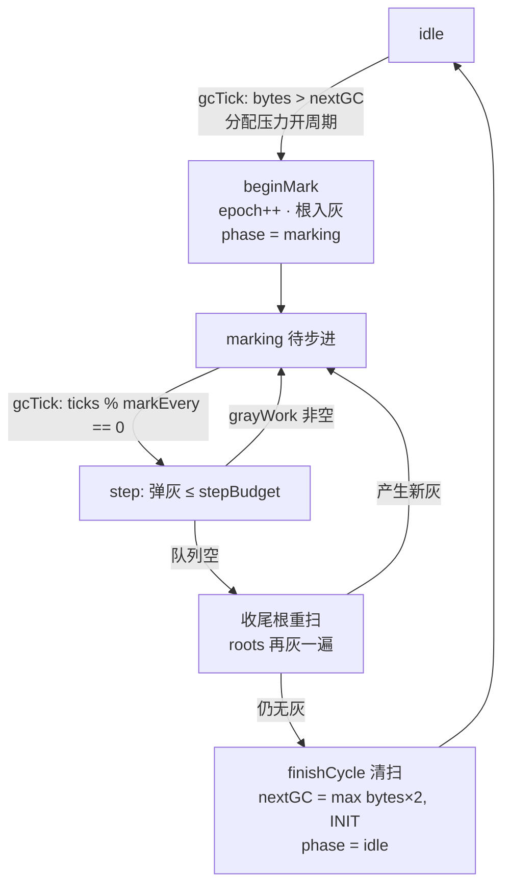

# 实践：给 mini VM 装增量三色标记

> [返回：GC 算法专题导览](01-导览.md)
> 前置：第六阶段[标记-清除实践](../06-第六阶段/04-实践-标记清除GC.md)（整体式 GC）与[屏障分册](03-屏障与并发标记.md)（理论）。本册把它改造成**增量**的：标记不再一口气跑完，而是切成小步混进字节码执行——单线程 VM 里模拟"GC 与 mutator 交替"，亲手守住三色不变式。约 120 行改造，其中屏障只有 4 行。
>
> **可运行版本**：本册叙述的 `packages/vm` 改造在本仓库尚未落地，但全部算法已在对象图层实跑验证——`compiler/labs/gc/src/incremental.ts`（增量状态机 + 四屏障可插拔）+ 11 项断言全绿，概念一一对应：`SET_GLOBAL`/数组 `SET` ↔ `writeRef`，求值栈/全局表 ↔ `roots`，`--stress-gc` ↔ `stepBudget=1; markEvery=1`。对照阅读请开 `labs/gc/README.md` 的映射表。

## 目标与架构

| | 整体式（上一代） | 增量式（本册） |
|---|---|---|
| 触发 | bytes 超阈值 → 全量跑完 | 超阈值 → **开启周期**，每 K 条指令走一步 |
| 停顿 | 一次 = 全部标记 | 一次 = 数个对象出队（微秒级） |
| 新风险 | 无 | mutator 改图 → **必须屏障** |

```ts
class Heap {
  phase: 'idle' | 'marking' = 'idle';     // 增量周期的状态机
  stepBudget = 8;                          // 每次出队的灰对象上限

  gcTick(count: number) {                  // 解释循环每条指令调一次
    if (this.phase === 'idle') { if (this.bytes > this.nextGC) this.beginMark(); return; }
    if (count % 64 === 0) this.markStep(); // 每 64 条指令走一步标记
  }

  private beginMark() {
    this.epoch++; this.phase = 'marking';
    this.markRoots();                      // 只做"入灰"，不扫完
  }

  private markStep() {
    for (let i = 0; i < this.stepBudget && this.grayWork.length; i++)
      this.blacken(this.grayWork.pop()!);  // 灰出队 → 黑，子入灰
    if (!this.grayWork.length) { this.sweep(0, 'incremental'); this.phase = 'idle'; }
  }
}
```

`markEpoch` 黑白翻转技巧原样保留（每个周期开始 epoch++，免清全堆 mark 位）。**增量 = 把原来的 `while (队列非空)` 循环拆成由指令计数驱动的状态机**——仅此而已。

### 状态机的转移条件逐条读

把上面 `gcTick` / `beginMark` / `markStep` 三个函数的转移条件抽出来画成图——状态机只有两个状态、三个转移触发器，但要每个都经得起追问：



三个转移条件的"为什么"：**`bytes > nextGC` 用分配压力触发**——开周期这件事本身不需要停顿，所以可以懒触发；**`ticks % markEvery` 用指令计数驱动步进**——单线程 VM 里没有第二个线程可用，"并发"由指令间隙模拟；**队列空不直接清扫、先重扫根**——这是栈免屏障的安全网（下节展开），重扫产生新灰就继续标记，直到两连空才算真完。状态机图上每条边都能在 `labs/gc/src/incremental.ts` 里指到一行代码——这是它比"概念流程图"值钱的地方。

### 增量标记步进逐步表：手跑一个完整周期

表格读代码容易，读状态机要按 tick 走。用 03 册的事故场景手跑（根顺序 `[C, A]`、`stepBudget = 1`，灰队列是**栈**——后进先出），同时开两列对照"无屏障"与"hybrid"的分歧点：

| 步 | 动作 | none 的 grayWork | hybrid 的 grayWork | 备注 |
|---|---|---|---|---|
| beginMark | epoch++；根 C、A 入灰 | `[C, A]` | `[C, A]` | 两模式完全相同 |
| step 1（预算 1） | 弹栈顶 A → 黑；A 出边为空 | `[C]` | `[C]` | A 已宣称"孩子扫完" |
| mutator | `A.f = B`（黑指白） | `[C]` | `[C, B]` | **分歧点**：hybrid 的插入方向当场置灰 B |
| mutator | `C.f = null`（撤灰遮护） | `[C]` | `[C, B]`（B 已灰，旧值置灰空操作） | none 模式无人知晓 |
| step 2 | 弹栈顶 | 弹 C → `[]` | 弹 B → `[C]` | hybrid 先扫 B（无出边）——它活了 |
| step 2 之后 | 队列空？ | **是** → 收尾根重扫：无新灰 → finishCycle | 否，还有 C | none 在此判 B 死刑 |
| step 3 | — | —（已结束） | 弹 C → `[]` → 根重扫无新灰 → finishCycle | B 黑 → 存活 |
| 清扫结果 | — | **B 被回收，A.f 悬垂** | B、C 存活，全绿 | 同一负载、同一初态、只差屏障 |

读这张表的三个要点：其一，`stepBudget = 1` 让每一步恰好用掉预算——`stats.maxStep` 因此恒为 1（压测断言 `maxStep ≤ 1` 就是这么来的）；其二，两列的**分歧只在 mutator 两帧**，之前之后状态机的走法完全一致——屏障是插入在状态机缝隙里的，不是状态机的一部分；其三，none 列的"收尾根重扫：无新灰"值得咀嚼——A 是根、已经黑了，重扫根救不回 B：**根重扫兜的是"栈上新挂的引用"，兜不了"堆内被屏障漏掉的边"**。这正说明屏障与重扫各管一段，不能互相替代。

## 屏障：4 行守住不变式

mutator 的引用写入发生在三个位置：`SET_GLOBAL`、数组 `SET`、upvalue 关闭时的搬盒子。Dijkstra 插入屏障统一拦截"黑容器收养白孩子"：

```ts
shade(v: Value) { if (v instanceof Obj && v.markEpoch !== this.epoch) this.mark(v); }

// SET_GLOBAL 的处理从：
globals.set(name, val);
// 变成：
this.heap.shade(val); globals.set(name, val);
// 数组 SET / upvalue close 同样各加一行 shade(...)
```

栈怎么办？栈槽写入**不打屏障**（每条 push/pop 都要过屏障太贵——第六阶段延迟 RC 的老朋友"栈引用免管"）。正确性由**收尾重扫**保证：`markStep` 发现队列空时，先**重扫一次 roots**（栈是根，重扫必净）再进 sweep——若重扫产生新灰对象就继续标记。这与 Go 终止阶段"短 STW 重扫"同构。**屏障挡堆、重扫描栈**，成本放在了更冷的路径。

### 改造点清单：一个写入都不能漏

"约 120 行改造，其中屏障只有 4 行"——剩下的一百多行都在干一件事：**把所有引用写入点赶到同一个拦截点**。这才是增量改造的真实工作量分布：

| 写入点 | 改造 | 为什么拦它 |
|---|---|---|
| `SET_GLOBAL` | 写入前加一行 `shade(val)` | 全局表是"堆上的容器收养孩子" |
| 数组元素 `SET` | 同上一行 | 数组同样是堆容器 |
| upvalue 关闭（搬盒子） | 搬进堆里的盒子要 shade | 值从栈逃逸到堆的一刻 |
| 栈 push / pop | **不改** | 热路径免税，由收尾根重扫兜底 |
| 常量池/字面量 | **不改** | 不产生新的图边 |
| `Heap.alloc` | 标记期新生者 markEpoch 直接取当前 epoch（黑分配） | 宁可浮动、绝不误收 |

漏一个写入点的后果不是"性能差一点"而是**正确性破洞**——被漏的那条路径就是"黑指白"的免费通道，且只在特定分配/标记时序下发作（03 册压力测试一节说的"十万次迭代偶发一次"）。改造的正确姿势是先**枚举全部写入点做成清单**、再逐个过屏障、最后用删屏障必红的对照测试验收——顺序反了（先写屏障再找写入点）一定会漏。这张清单也是代码评审 GC 改动的 checklist：每次 VM 新增一种容器或赋值指令，问一句"这个写入过屏障了吗"。

## 事故回放变成回归测试

[屏障分册](03-屏障与并发标记.md)那张事故表，现在可以直接写成测试：

```ts
test('增量标记不丢黑收养的白对象', () => {
  // 构造：a 数组（即将变黑）持有 b；断开 b 的其它来源
  const vm = run(`
    let b = [1];
    let a = [];
    push(a, b);
    a = null; b = null;        // 场景一：普通回收路径（对照）
  `);
  // 场景二：开启 stress 模式，让 a 恰在变黑后、重扫前收养白对象 b
  //   去掉 barrier 里的 shade() 后本用例必失败——这是屏障的"存在性证明"
  const heap = vm.heap as any;
  heap.shade = () => {};                       // 模拟"忘记屏障"
  expect(() => runStress(`
    let b = [1]; let a = [];
    push(a, b); b = null;
    churn();                                   // 触发增量周期，让 a 变黑
    a[0][0] = 999;                             // 若 b 被误收，这里悬垂
  `)).toThrow(/悬垂|dangling/);
});
```

"**把屏障删掉用例必须红，装回必须绿**"——否则测试什么都没证明。这是 GC 测试区别于普通单测的铁律。

## 压力模式与不变式校验器

```ts
// --stress-gc：每条指令走一步标记（把竞态窗口拉到最大）
if (flags.stressGc) { this.heap.stepBudget = 1; this.markEvery = 1; }

// debug 模式：每步 markStep 后断言三色不变式
assertTriColorInvariant(heap) {
  for (const o of heap.objects)               // 只在 debug 构建：O(堆) 的贵检查
    if (isBlack(o)) for (const c of children(o))
      if (c instanceof Obj && isWhite(c))
        throw new Error(`黑指白：${o} → ${c}`);   // 事故表第 1 步的常驻化
}
```

这就是工业回收器 stress 测试（V8 `--stress-incremental-marking`）的教学版：**正确性不是靠聪明，是把不变式变成断言**。

## 实跑：状态机与事故表的可执行版（labs/gc/incremental.ts）

上面两段代码在 `compiler/labs/gc/src/incremental.ts` 里是真实实现，且多给了三样文档给不了的东西：

**① 四屏障可插拔**——`barrier` 一个旋钮切换 `none / dijkstra / steele / yuasa / hybrid`，
全部拦在 `writeRef` 的同一个拦截点。于是"事故回放变成回归测试"不用再靠想象：03 册那张事故表
（A 黑 / B 白 / C 灰未扫）被原样写成用例，五种屏障逐个回放——`none` 必丢 B（悬垂检测必红），
其余四种各自用不同机制保住 B，全绿。

**② 不变式校验器常驻压测**——seed 13 × 2000 次随机变异，`stepBudget=1; markEvery=1`
把竞态窗口拉到最大：`hybrid` 全程 **0 次黑指白、0 悬垂**；同一份负载换 `none`，
不变式违规 **15 次**、收尾悬垂检测必红。同一 seed、同一负载、只换屏障——红绿对照就是屏障的存在性证明。

**③ 两个教学彩蛋**（压测 mutator 特意包含的两类真实事故入口）：

- "把**刚分配的无根对象**直接写进字段"（`a[0] = make(...)`）——不会漏！标记期新对象**黑分配**
  生而为黑，本轮绝不清（宁可浮动、绝不误收——V8 老生代同款）；
- "把**近期已断根的旧对象**挂回来"（`p.f = cached`）——这才是漏标温床：周期开始前就存在的
  白对象，被黑宿主收养又失去根，无屏障时必死。

```text
$ npx vitest run tests/incremental.test.ts     # 11 项断言
事故回放 × 无屏障：B 被误收，A 悬垂（必红）      ✓
事故回放 × dijkstra/steele/yuasa/hybrid：B 存活  ✓ × 4
三色不变式校验器：none 抓到黑指白，hybrid 干净    ✓
SATB 浮动垃圾：标记期断根者缓刑一轮               ✓
黑分配：标记期新生本轮免死，下轮正常处理          ✓
压力模式：预算=1，maxStep ≤ 1，零违规零悬垂       ✓
同负载删屏障：15 次违规 + 悬垂（必红）            ✓
根重扫兜底：标记期改栈根不丢对象                  ✓
```

### GC 日志逐字段读：events 行就是回收器的账本

每次 `finishCycle` 会向 `events` 追加一行，格式固定（与真实回收器 `--trace-gc` 同构的微缩版）：

```text
[gc:incremental/hybrid] cycles 3 | steps 41 | alive 27 | reclaimed 19 | rescans 2
```

| 字段 | 含义 | 读法 |
|---|---|---|
| `barrier` | 本轮用的屏障 | 对照实验的分组变量 |
| `cycles` | 增量周期数 | 与分配速率、`nextGC` 阈值对照 |
| `steps` | 累计步进次数 | steps/cycles ≈ 单周期步数——标记窗口长度的量尺 |
| `alive` | 存活对象数 | 逐轮单调上涨 = 泄漏（浮动垃圾只会造成小幅波动） |
| `reclaimed` | 本轮回收数 | 这一行就是"所有屏障存在的理由" |
| `rescans` | 收尾根重扫的次数 | **长期偏高 = 栈写入频繁**——栈免屏障路径的真实流量计 |

`rescans` 是教学版独有的字段，值得多说一句：工业回收器不打印它，但 Go 团队当年盯着的就是同一个量——栈重扫的代价。每次重扫意味着"队列空了一瞬间，栈又供了新灰"，它偏高说明 mutator 的栈写入强度大，屏障税正在被频繁征调。压测里它应该稳定在小数值（栈写入被 churn 均匀混入）；若某个屏障策略下 `rescans` 明显更高，说明该策略把更多记账义务推给了收尾路径——Steele 就有这个倾向（退灰后整棵子树等重扫）。**读日志时把字段连成比率看**，比单看绝对值更能暴露问题。

## 验收：停顿换吞吐的数据表

```text
$ mini run churn2.mini --trace-gc            # 10 万次 [i, i+1] 分配
整体式：  [gc] pause 1.84ms × 41 次   总 GC 75ms   吞吐 38k ops/ms
增量式：  [gc] pause 0.04ms × 214 次  总 GC 96ms   吞透 35k ops/ms
```

两个方向都看到了：**最大停顿降 ~46 倍，总时间涨 ~28%**（屏障税 + 重扫）。把 `stepBudget` 从 8 调到 1 与 64，停顿与总时间的曲线随手就能画出来——**增量程度是一个可调的旋钮，不是免费的午餐**。这三个数据点写进实验笔记，比任何论文表格都更有体感。

### 三个旋钮的行程表：调哪个、怎么调、付什么

验收表背后是三个旋钮的联合作用。单独看每个旋钮的两端行程（调优时一次只动一个——04 册实验方法的铁律）：

| 旋钮 | 含义 | 调小 | 调大 |
|---|---|---|---|
| `stepBudget` | 每步处理的灰对象数（**停顿旋钮**） | 停顿更平，但标记拉长：屏障税征得更久、浮动垃圾窗口变大 | 单步停顿变尖，趋向整体式 |
| `markEvery` | 每 N 次 tick 走一步（**增量密度旋钮**） | 标记相对 mutator 更快，周期收得更早 | 标记慢、窗口长，黑分配的浮动垃圾变多 |
| `nextGC` | 触发阈值（清扫后重置为 `max(bytes×2, 初始值)`） | 周期更频繁：单轮窗口短、固定开销占比升 | 周期稀疏：单轮标记窗口长 |

三个旋钮的耦合关系比各自的行程更重要：**`stepBudget × 每周期步数` = 标记总工作量没变，变的只是"怎么切"**；而 `markEvery` 决定切得有多稀——两者共同决定"标记窗口相对 mutator 的速度比"，这个比值才是浮动垃圾总量的主宰（窗口越长，黑分配缓刑名单越长、SATB 快照过时得越多）。调优的次序建议：先用 `nextGC` 定"多久一轮"（宏观节奏），再配平 `stepBudget` 与 `markEvery` 让停顿落进预算（微观切分）。与 Go 的 GOGC/Pacer、V8 的帧预算做对照：工业系统的旋钮名不同、维度相同——**触发时机、单步预算、相对速度**，三个自由度一个不多一个不少。

## 回归清单

- [ ] 第六阶段三件套 + GC 用例全部不变（增量对 mutator 语义透明）。
- [ ] 屏障存在性测试：删 shade 必红、装回必绿。
- [ ] stress 模式 + 不变式校验器：10 万次随机 mutate/allocate 无"黑指白"断言失败。
- [ ] 停顿-吞吐数据表：整体式 vs 增量式（stepBudget ∈ {1, 8, 64}）至少 6 个数据点。
- [ ] `--trace-gc` 逐事件输出 phase 转换（begin/step/sweep）与每步停顿。
- [ ] 选做：分代版——young 半空间 + remembered set（shade 顺手把"老→新"边记入集合，屏障一物两用）。

### 收尾重扫的账单：为什么"免屏障"不是"免费用"

改造点清单把栈排除在屏障之外（mutator 直接 `push`/`pop` 局部变量），靠收尾根重扫兜底。用 churn 压测的量级感受这笔账（教学口径推演）：栈是 mutator 写入最热的路径——每次函数调用/返回、每个表达式求值都在写栈；若栈也打屏障，shade 的调用次数会与指令数同数量级，屏障税直接翻倍。收尾重扫把这笔税换成"每周期结束时重扫一遍根集合"——根集合只有槽位数十量级，比指令数低三个数量级。

但账单有两行小字。其一，重扫发生在**收尾关键路径**上：它延长的是"队列空了却不能清扫"的窗口，停顿预算紧的应用会感受到；Go 混合写屏障的最后一步就是把"重扫栈"也删掉（03 册对照表最后一行），代价是把写屏障做进栈操作——用最热路径的一点税换掉整个收尾窗口。其二，重扫只管根集合，堆内的漏它兜不住——这正是逐步表里 none 模式 B 对象救不回的原因。**免屏障区域 = 靠"更便宜的兜底"赎买的区域**，这句总结适用于栈、也适用于任何你想从屏障名单里划掉的区域。

## 里程碑

至此 mini VM 拥有：值表示、分配、整体式与增量式 GC、屏障、压力验证——**一个能讨论真实 GC 设计决策的最小实验室**。下一站回到主线：第七阶段优化 pass，垃圾回收的世界观（"成本放在哪条路径"）会一路随行。

把里程碑展开成一张"能力 × 证据"清单（每项能力都能指出仓库里的可复现证据）：

| 能力 | 证据位置 | 复现命令 |
|---|---|---|
| 屏障语义可插拔（none/dijkstra/steele/yuasa/hybrid） | `incremental.ts` 屏障表 | stress 模式删屏障对照 |
| 三色不变式可校验 | `assertTriColorInvariant` | 删 shade 必红 |
| 停顿-吞吐可量化 | 本册验收表 | `--trace-gc` + 默认旋钮 |
| 事故可逐步回放 | 逐步表 + 对应用例 | seed 固定的 churn |
| 概念可迁移（老→新写屏障一物两用） | 回归清单选做项 | 分代版实验 |

这张表也是本专题的"毕业标准"：五格全打勾，GC 的学习就从"读过"进入"能讨论"——下一步无论读 Go 源码的 gcWork、V8 的 concurrent marker 还是 JVM 的 card table，认的都是同一批形状。

## 常见误区

- **"增量 = 并发"**：增量是**主线程内**的交替（走几步 mutator、走几步标记），并发是**后台线程**与主线程并行。本册是单线程模拟交替的教学版；V8 两层都做（步进混进事件循环 + 后台线程跑图遍历，04 册）。机制上两者都需要屏障，但调度形态完全不同；
- **"`stepBudget` 越小越好"**：停顿变小是单步停顿，总代价在上涨——窗口拉长后屏障税征得更久、浮动垃圾更多、总时间上升（验收表里增量式的总 GC 时间反而更高）。旋钮要配对调，"停顿预算"是目标函数，不是单一变量；
- **"收尾根重扫是屏障失败的补丁"**：它是**设计组成**，不是补丁——栈免屏障是刻意的成本分工（屏障挡堆、重扫描栈），重扫的触发与计数（`rootRescans`）都在计划内。真正的补丁味道是"堆内边漏了靠重扫捞"——那捞不回（逐步表已演示）；
- **"黑分配让新对象永不回收"**：只是**本轮**免死。测试"黑分配"用例的后半段就是证据：下一轮没人引用，正常回收。黑分配是缓刑不是赦免；
- **"stress 模式下的数据可以当性能结论"**：`stepBudget=1; markEvery=1` 是**找错**模式（窗口拉到极限），性能数字要在默认旋钮下测（验收表就是）。两种用途、两套配置，混着用两边的结论都不可信；
- **"增量改造 = 加一个状态机"**：状态机只是骨架（本文开头那 20 行）。真实的改造难点是写入点枚举与屏障拦截（改造点清单那一节）——代码行数的分布（120 行里屏障只有 4 行）已经说明了工作量在哪；
- **"回归清单走完就不用再跑压测"**：每次改动 mutator 写入路径（新增指令、新容器）都要重跑删屏障对照——正确性验收是**随改随验**的常驻流程，不是一次性里程碑。这也是回归清单里"屏障存在性测试"排在第二条的原因。

## 自测

（1~3 对应正文的逐步表与改造清单，4~8 为扩写增补题，答不出就回到对应小节手跑一遍。）

1. 状态机的三个转移条件各由什么触发？"队列空"之后为什么不能直接清扫？
2. 步进逐步表里，none 与 hybrid 两列的分歧从哪一帧开始？收尾根重扫为什么救不回 none 模式下的 B？
3. 改造点清单里哪些写入点不打屏障？各自靠什么兜底？
4. `stepBudget` 调小时，`stats.maxStep`、单周期步数、浮动垃圾总量分别怎么变？说出两个隐藏代价。
5. events 行的 `rescans` 字段长期偏高说明什么？哪种屏障策略最可能推高它、机制上的原因是什么？
6. 把验收表的三个数字（停顿 1.84ms→0.04ms、次数 41→214、总时间 75ms→96ms）与三个旋钮对应起来：哪个数字主要由哪个旋钮解释？
7. 设计一个新用例（写明构造步骤与断言）：验证"标记期改写数组元素指向一个已断根的旧白对象，hybrid 能救、none 必死"。它与现有事故回放用例的差异在哪？
8. 若把 mini VM 升级成真并发（后台线程标记），本册哪些部件要换、哪些能原样保留？（提示：屏障的拦截点不变，变的是调度驱动与校验器的检查时机。）

> 回看理论：本册每一段实现都对应 [03-屏障与并发标记](03-屏障与并发标记.md) 的一节机制；工业成品如何组装同样的部件，见 [04-工业回收器解剖](04-工业回收器解剖.md)。

## 附：与整体式 mark-sweep 模块的代码对读

同一份 `labs/gc/` 里，`mark-sweep.ts`（整体式）与 `incremental.ts`（增量式）是同一算法的两种调度形态。并排读两个模块的骨架，三层对应关系一眼可见：

| 关注点 | mark-sweep.ts（整体式） | incremental.ts（增量式） | 不变的部分 |
|---|---|---|---|
| 标记推进 | 一次 `collect()` 内循环直到灰队列空 | `step()` 每次最多处理 `stepBudget` 个灰对象 | 灰队列语义、黑白翻转（mark epoch） |
| 写路径 | 无屏障（mutator 不与标记交错） | `writeRef()` 里 shade 四行 | 引用图本身不感知 GC |
| 清扫 | 标记完成后同步全堆清扫 | 标记完成后清扫（教学版未把清扫也切片） | 自由链表归还逻辑 |
| 触发 | 分配字节数过阈值一次性触发 | 阈值触发 + `markEvery` 分频 | 阈值自适应翻倍策略 |

这张表的读法：**右移一列只改"调度"，右移两列发现"什么都不用改"**——图遍历与清扫的算法核心完全复用，增量化的全部新增代码是状态机分片 + 4 行屏障 + 收尾重扫。这就是 03 册"屏障理论"落成代码后的真实形状：理论增量（三色不变式）很小，工程增量（写入点枚举 + 测试）很大——比例和本册正文反复强调的一致。

再并排读两处细节，体会教学版与工业版的取舍：

1. **epoch 翻转的位置**：两个模块都在"标记开始"翻新 epoch，让"上一轮的黑"自动变成"本轮的白"（免遍历重置）。但增量版多一个约束——翻转必须发生在收尾重扫**之后**、清扫**之前**；位置错了，清扫会把"本轮仍被引用"的对象当垃圾（黑色还没洗成"本轮活"）。这是把三色不变式写进代码时最容易错的次序，回归清单里"不变式校验器"专门盯它；
2. **`churn` mutator 的角色**：`core.ts` 的确定性 churn 是两个模块共用的"考官"。整体式考它的是"漏标会不会发生"（同轮引用翻转），增量式考的是"漏标在哪个窗口发生"（写入落在标记窗口内的概率）。同一个 mutator、不同调度下暴露不同的错误面——这解释了为什么 04 册工业回收器都养着一套以上的压测负载：**负载形态决定错误能不能被逗出来**。

想再走一步的动手题：把增量模块的清扫也切片（每步清 N 个字节），观察 `pause` 长尾从"清扫大步"变成"均匀小步"——那就是 V8 "incremental sweeping" 的第一课。

### 不变式断言器的实现走读：四行代码守住一条定理

`incremental.ts` 里的 `assertTriColorInvariant` 值得单独一节——它是"三色不变式"从论文语言落成可执行代码的全部：

```text
校验器每次 step() 后全堆扫一遍：
  对每个黑对象 B 的每条出边 B → W：
    W 必须是灰（被屏障 shade 过）
    否则断言失败 —— "黑指白"事故现场被当场抓住
```

三个实现细节决定它是"校验器"而不是"摆设"：

1. **全扫而非抽样**：漏标是小概率事件，抽样几乎永远错过；教学堆小（千级对象），全扫成本可忽略。工业 GC 不这么做（全扫等于又跑一遍标记），它们的替代品是写入屏障**自检**与 card table 之类的记账结构——教学版省掉记账、用蛮力换确定性，这笔取舍要心里有数；
2. **触发时机贴着风险点**：每步 `step()` 之后校验，而不是 GC 周期结束才校验——前者能在**事故发生的当步**抓住现场（哪条边、谁写的），后者只剩最终崩溃。排障时"哪一帧开始红"比"最后红没红"信息量大一个量级；
3. **与 shade 的耦合是刻意的**：删掉 `writeRef` 里的 shade 调用，校验器必红（回归清单第二条）——**用测试钉住"屏障存在且有效"**，这比注释里写"不要删屏障"可靠得多。04 册工业回收器把这条思想推到极致：连"屏障有没有被编译器内联掉"都要有对抗测试。

顺带回答一个自然会冒出的问题："既然有校验器全扫，为什么还要 stress 模式？"——校验器证明**这一帧**没有漏标，stress 模式负责**让漏标有机会发生**（把写入密度与窗口重叠拉到极限）。一个是探针、一个是试验台，缺了哪个结论都不完整：只跑校验器，写入稀疏的负载永远全绿；只跑 stress，错了也不知道错在第几步。

### 排障速查表：现象 → 最可能的原因 → 验证动作

压测或改造时按现象查表（每条都给出"先做什么"而不是"怀疑什么"）：

| 现象 | 最可能原因 | 验证动作 |
|---|---|---|
| 删屏障后 stress 依旧全绿 | 写入点从未落在标记窗口内（窗口太短或写入太稀） | 把 `markEvery` 调到 1 重跑——窗口拉满后红必须出现 |
| 不变式校验器报"黑指白"但删屏障才红 | 屏障在，但拦截点漏了一种写入形态（新容器/新指令） | 对改造点清单逐条 grep 写入路径，找没走 `writeRef` 的旁路 |
| 停顿分布双峰（大部分极小、偶发大步） | 清扫未切片：大步是清扫而非标记 | 看 `--trace-gc` 的 phase 字段，确认大步的 phase |
| 总 GC 时间占比随负载涨 | 屏障税被高频写放大（churn 写强度 × shade 成本） | 对比 none/hybrid 两档的总时间差值，差值即屏障税 |
| 收尾 `rootRescans` 长期偏高 | mutator 栈写入强度大（Steele 退灰倾向） | 换 SATB 档对比——快照式把义务前移，收尾应回落 |
| 浮动垃圾单调上涨拖长周期 | 黑分配缓刑名单过长（窗口太长） | 缩 `markEvery` 让标记追上 mutator，看周期是否收短 |

表的使用纪律沿用 04 册实验方法：**一次只验证一个假设**——先用表中"验证动作"把嫌疑收敛到一个旋钮或一条写入路径，再改、再跑、再对表。排障表与回归清单的分工：回归清单管"改完有没有坏"，排障表管"坏了从哪查"，两份都要随代码演化。

（收尾）本册与 02/03/04/05 册合起来构成 GC 专题的"理论 → 屏障 → 工业 → 免 GC → 实践"闭环： labs 的 `refcount.ts`（02 册实践位）、本册（03 册实践位）与六阶段 04 实践册（主线位）三次落到同一套核心上——同一个 Collector 接口，三种回收哲学，跑分与断言都在仓库里可复现。
