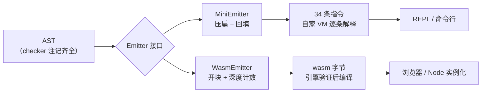

# 后端一：表达式与结构化控制流

> [返回：Wasm 专题导览](01-导览.md)
> 把 mini 编译到 wasm 的第一站：不碰内存、不碰字符串，只做**数值、局部变量、if/else、while、函数调用**。本册结束时你会发现：表达式部分几乎是免费翻译（两台栈机同构），真正的新功课只有一件——把 mini 已经压扁成 `JMP` 的控制流**装回嵌套结构**。

## 值的类型决策：checker 的功劳第二次兑现

mini 运行时只有一种 `Value`；wasm 指令是强类型的。映射由 checker 已算好的 `inferredType` 驱动——和第五阶段"类型化指令（`ADD`/`ADD_STR` 分列）"是同一个思想，只是这次从"指令分派"升级成"值表示"：

| mini 类型 | wasm 表示 | 备注 |
|---|---|---|
| `number` | `f64` | mini 的 number 就是 JS number（64 位 double），忠实对应 |
| `bool` | `i32`（0/1） | 比较指令的产物本来就是 i32，零转换 |
| `unit` | **无值** | wasm 函数签名可以没有 result——`unit` 函数不向栈上压任何东西 |

最后一条有连锁反应：`ExprStmt` 的"栈平衡铁律"（mini 的 `POP`）在 wasm 里变成**有条件的** `drop`——表达式有值才 drop，`unit` 调用后栈上是空的，drop 反而验证失败。类型信息又一次从 checker 流向后端。

### 一条语句上的类型流：`let flag = n < 2;`

"checker 注记驱动 emit"落成一条具体语句的推演（`n` 是 number 参数，槽 0）：

| 步 | 源/emit | 类型注记 | wasm 指令 |
|---|---|---|---|
| 1 | `n` | `inferredType = number` | `local.get 0`（f64 上栈） |
| 2 | `2` | number 字面量 | `f64.const 2` |
| 3 | `<` | BinaryExpr → **bool** | `f64.lt`——吃两个 f64，吐一个 i32 |
| 4 | `let flag = …` | flag 的槽类型随注记 = bool | `local.set 1`（槽声明为 i32） |

四步里没有一步出现"转换"——bool 从诞生（比较指令的产物）到落槽（i32 local）类型一路连续。这正是映射表 `bool → i32` 行"零转换"的准确含义：**不是"帮你转了"，而是"根本不需要转"**。mini 源码里 `flag` 是一个 number 世界里的异类，到 wasm 里它只是另一条 i32 槽位——表示的选择发生在 emit 前，不在运行时。

### 为什么 bool 用 i32 而不是 f64

反证另一个世界：若 bool 用 f64 表示，每处控制流都要付一次转换税——

- `if`/`br_if` 消费的是 **i32** 条件（wasm 规定），f64 的 bool 得先比较出 i32 才能进分支——每个 if 白加一条指令；
- `NOT` 也得从 `i32.eqz` 换成"f64 判零再比较"两步；
- 而 i32 方案下，比较指令的**产物直接就是分支要吃的东西**，`if (a < b)` 从条件到分支零距离。

mini 的比较指令本来就产 i32（第五阶段"比较产 bool"的运行时事实），wasm 把这个事实升格成了类型承诺。映射表里 `LT…NOT_EQ` 一行"消两个 f64 产一个 i32"，就是这条承诺的指令级形状。

## 指令映射表

mini 34 条指令（[第五阶段 v1 指令集](../05-第五阶段/03-字节码设计.md)）中，数值子集逐条对译：

| mini | wasm | 操作码 | 说明 |
|---|---|---|---|
| `CONST i` | `f64.const x` | `0x44` + 8 字节小端 | 没有常量池，立即数内联 |
| `GET_LOCAL s` / `SET_LOCAL s` | `local.get s` / `local.set s` | `0x20` / `0x21` | 参数就是 local 0..n-1 |
| `ADD SUB MUL DIV` | `f64.add sub mul div` | `0xa0..0xa3` | 顺序一致不是巧合——都按操作数在栈上的次序定义 |
| `MOD` | **没有对应指令** | — | wasm 只有整数 `rem`；f64 的 mod 要自己合成（下表后） |
| `NEG` | `f64.neg` | `0x9a` | |
| `NOT` | `i32.eqz` | `0x45` | bool 是 i32，"取反"就是"等于零" |
| `LT GT LE GE EQ_EQ NOT_EQ` | `f64.lt gt le ge eq ne` | `0x63..0x62` | 消耗两个 f64，产出一个 i32——mini 里"比较产 bool"的类型转换在这里显形 |
| `POP` | `drop` | `0x1a` | 见上文"有条件的 drop" |
| `CALL argc` | `call 索引` | `0x10` | 参数个数不再是指令操作数，而是对方签名的一部分 |
| `RETURN` | `return` 或隐式 | `0x0f` | 函数体末尾栈上恰一个值 = 默认返回值；中途 return 用显式指令 |
| `RETURN_UNIT` | （签名无 result） | — | 无返回值路径"消失"在签名里 |
| `NATIVE n` | `call 导入函数` | `0x10` | 索引空间里导入函数排在最前（04 册） |
| `JMP` / `JMP_IF_FALSE` | `block/loop/if` + `br/br_if` | `0x02..0x0d` | **不是一条指令的事**，下两节正题 |
| `CLOSURE` `GET/SET_UPVALUE` `ADD_STR` | — | — | 函数值与堆数据，04 册 |

`MOD` 的合成：`a % b = a - trunc(a / b) * b`（`f64.trunc` 是 `0x9d`）。四条指令换一条指令——**指令集是"够用的最小集"，缺的靠合成**是 wasm 的常态（它连 `sign`、`abs` 的整数版都给你、却故意不给 f64 取模，因为整数取模有硬件指令而 fmod 是库函数）。

### 操作码速查：本专题用到的每一条

映射表的操作码散在各行，按家族收拢成速查表（全部来自前文，记忆时按"家族 + 类型"分组）：

| 家族 | 指令（操作码） |
|---|---|
| 常量 | `f64.const 0x44`+8 字节小端、`i32.const 0x41`+LEB128 |
| 局部变量 | `local.get 0x20` / `local.set 0x21` / `local.tee 0x22` |
| f64 算术 | `add 0xa0` / `sub 0xa1` / `mul 0xa2` / `div 0xa3` / `neg 0x9a` / `trunc 0x9d` |
| f64 比较（产 i32） | `eq 0x61` / `ne 0x62` / `lt 0x63` / `gt 0x64` / `le 0x65` / `ge 0x66` |
| i32 逻辑 | `eqz 0x45` |
| 结构块 | `block 0x02` / `loop 0x03` / `if 0x04` / `else 0x05` / `end 0x0b` |
| 跳转 | `br 0x0c` / `br_if 0x0d` |
| 调用与返回 | `call 0x10` / `return 0x0f` |
| 栈操作 | `drop 0x1a` |

两个规律看一眼就记：**比较集中在 0x6x 段、算术集中在 0xa0 段**——操作码空间按"类型 × 类别"分块排布，"顺序一致不是巧合"的另一半是"分块也一致"；结构块挤在 0x02..0x0d 的低端连续区间——02 册"控制流是一等公民"在编码层也看得见。06 册的 `BIN` 查找表就是这张速查表的代码化。

### MOD 合成手演：栈机上缺一个"第二份 b"

合成公式 `a - trunc(a/b) * b` 在纸上一步到位，放到栈机上会立刻撞上一个问题：**a 和 b 都要被用两次**。手演 `7 % 3` 的算术核心：

| 步 | 指令 | 栈 |
|---|---|---|
| 1 | （a、b 已上栈） | `[7, 3]` |
| 2 | `f64.div` | `[2.333…]` |
| 3 | `f64.trunc` | `[2]` |
| 4 | （要 `× 3`——3 已经被弹掉了！） | — |

纯栈机没有"地址"可以回指，第二次使用只能二选一：**重算**（操作数是纯表达式时免费，副作用表达式不行）或**先存 local 再取**（通用，多两条指令）。所以"四条算术指令"之外还得给 a、b 各备一个临时槽位——缺一条指令，连累的却是寄存器分配。mini 侧同理：第五阶段的 `MOD` 之所以是一条指令，是因为 VM 可以在解释循环里直接弹出两个 Value 复用。完整 emit 序列留作自测 1。

### 操作数顺序：sub 与 div 的"左"是谁

映射表"顺序一致不是巧合"值得展开成一条栈机约定：二元指令的语义固定为**次栈顶 (op) 栈顶**——`[a, b]` 上执行 `f64.sub` 得 `a - b`。所以 emit 永远先发左操作数、后发右操作数，两台机器一字不差。反过来若某台机器定义成"栈顶 (op) 次栈顶"，减法除法就全部镜像（加法乘法侥幸不受影响）——第五阶段设计 mini 指令集时若没对齐这条约定，wasm 后端的 `-` 与 `/` 就得交换发射序。**字节码兼容的第一层不是操作码对齐，是操作数约定对齐**。

## 表达式：免费的部分

栈机的表达式编译就是**后缀序**——两台机器一字不差。`1 + 2 * 3`：

```text
mini emit 序                      wasm emit 序
CONST 1                           f64.const 1
CONST 2                           f64.const 2
CONST 3                           f64.const 3
MUL                               f64.mul
ADD                               f64.add
```

第五阶段的**两条不变式**原样继承："表达式结束时恰一个新值在栈顶"（wasm 验证器逐条检查）、"语句前后栈深不变"（drop/setLocal 收值）。区别只是执法者从自家 `assertStackBalanced()` 变成了引擎的验证器——**你写错了它才告诉你**，而且报错没有行号（06 册的坑清单）。

### 栈机逐步执行：`1 + 2 * 3` 的双栏 trace

"一字不差"用执行轨迹看最清楚——两台机器同一条后缀序、同一份栈形状：

| 步 | mini 指令 | mini 栈 | wasm 指令 | wasm 栈 |
|---|---|---|---|---|
| 1 | `CONST 1` | `[1]` | `f64.const 1` | `[1]` |
| 2 | `CONST 2` | `[1, 2]` | `f64.const 2` | `[1, 2]` |
| 3 | `CONST 3` | `[1, 2, 3]` | `f64.const 3` | `[1, 2, 3]` |
| 4 | `MUL` | `[1, 6]` | `f64.mul` | `[1, 6]` |
| 5 | `ADD` | `[7]` | `f64.add` | `[7]` |

逐帧相同——差异只在执法者（VM 信任 emit / 验证器逐条核对）。这张表还顺带给了"栈深"一个准确定义：**这个表达式的峰值栈深是 3**，即表达式嵌套的最大深度。wasm 引擎把它翻成机器码时，栈深直接决定需要的寄存器个数——栈机的"寄存器压力"就是表达式嵌套深度，这是栈式字节码对引擎友好的一面。

### 比较指令的类型跃迁：栈上唯一的"换轨"处

算术指令保持"f64 进 f64 出"，比较指令是表达式流里唯一改变栈**类型形状**的节点：`[f64, f64] → [i32]`。两个直接后果：

1. **比较的产物不能再进算术**：`(a < b) + 1` 在类型栈上就断——i32 进不了 `f64.add`；mini 的 checker 同样拒绝（bool 不参加算术）——**两个类型系统在这一步的判决完全一致**，只是执法时刻一个在编译期、一个在装载期；
2. **比较的产物可以直接进分支**：`if`/`br_if` 吃 i32，比较产物正好接上——条件表达式不需要任何粘合指令。

类型跃迁点越少，验证器要处理的分支就越少——mini 的类型设计（bool 只能从比较与逻辑来）让整条 emit 流只有比较与 `!`（eqz）两处跃迁。02 册验证器"一遍线性扫描"的顺畅，一半要归功于源语言类型系统的干净。

## if/else：结构化直译

mini 编译器把 if 压扁成两跳；wasm 后端**跳过压扁这一步**，AST 的嵌套直接落成指令的嵌套：

```text
mini（压扁 + 回填）              wasm（保持嵌套）
  <cond>                          <cond>
  JMP_IF_FALSE L_else             if              ;; 0x04 0x40
  <then>                            <then>
  JMP L_end                       else            ;; 0x05
L_else:                            <else>
  <else>                          end             ;; 0x0b
L_end:
```

mini 源码里常见的**提前 return**（`if (n < 2) { return n; }`）也顺：

```wat
local.get $n  f64.const 2  f64.lt
if                 ;; 条件为真走 then
  local.get $n
  return           ;; 0x0f——中途返回仍然是一条显式指令
end
```

if 还有**表达式形态**（blocktype 从 `0x40` 空 换成 `0x7c` f64），两臂各在栈上留一个值——短路求值正好用它：

```wat
;; a && b（a、b 都是 bool → i32）
<emit a>
if (result i32)
  <emit b>         ;; a 真：结果 = b
else
  i32.const 0      ;; a 假：短路，b 根本不执行
end
```

对照 mini 的短路模板（`JMP_IF_FALSE` + 回填）：**控制流依赖变成了结构依赖**——"跳过 b"不再表现为改 ip，而表现为"b 的指令物理上在那个分支里"。

### blocktype：每块自带一个"结果类型"

`if`/`block`/`loop` 的操作码后面都紧跟一个 **blocktype 字节**，声明"这个块结束时往栈上留什么"：

| blocktype | 含义 | 本册出现处 |
|---|---|---|
| `0x40` | 空块——块尾栈深与块头一致，无新值 | if/while 语句形态（06 册 `0x04 0x40`） |
| `0x7f` | 块留一个 i32 | 短路求值 `if (result i32)`（06 册 `0x04 0x7f`） |
| `0x7c` | 块留一个 f64 | if 表达式形态（上文） |

它解决的是验证器的一个实际问题：**块也参与类型栈推演**——`br` 跳到块尾时栈上该有什么，由 blocktype 静态给出。语句形态选 `0x40`（"我只是组织控制流，不留值"），表达式形态选 `0x7f/0x7c`（"我是一个求值单元"）——同一条 `if` 指令，靠这个字节分饰两角。mini 侧没有对应物：`JMP_IF_FALSE L_else` 的"块结果"隐含在栈约定里，没有显式的类型标注字节。

### 验证器视角：两臂必须同形

`if (result t)` 要求 then 与 else **各自**在块尾留一个 t；语句形态则要求两臂都"净空"。两条推论：

- 短路求值里 `else` 臂补 `i32.const 0` 不是可有可无——缺了它两臂不同形，验证当场失败；
- 06 册实测的 `expected 1 elements on the stack for fallthru, found 0` 就是"同形检查"在函数体级别的同类报错——**函数也是一个块**，`end` 处栈上必须恰是签名要求的形状。

对照 mini：`assertStackBalanced()` 只查"语句前后栈深不变"这类粗粒度不变式；wasm 验证器把同形检查细化到**每一条指令**。第五阶段欠下的每一条 assert，这里被引擎加倍讨回。

## while：双层嵌套模式

while 是"向前跳出 + 向后回跳"的组合，正好各用一种块——这是 wasm 后端最值得背下来的模式：

```text
mini（标签视角）                  wasm（嵌套视角）
L_top:                           block            ;; 向前跳的落点：块尾
  <cond>                           loop           ;; 向后跳的落点：块头
  JMP_IF_FALSE L_exit                <cond>
  <body>                            i32.eqz
  JMP L_top                         br_if 1        ;; 假 → 出 block（深度 1）
L_exit:                             <body>
                                    br 0           ;; 回 loop 头（深度 0）
                                  end
                                end
```

两个细节：

1. **`JMP_IF_FALSE` 变成 `i32.eqz` + `br_if`**——wasm 的 `br_if` 是"真则跳"，语义与 mini 恰好相反，补一个取反。硬件上 `br_if` 的实现恰好是"条件为假继续"，所以这个别扭是有性能理由的；
2. **深度从内往外数**：循环体内最内层 `loop` 是 0，包住它的 `block` 是 1。将来 mini 解锁 `break/continue`，分别编译成 `br 1`（出 block）与 `br 0`（回 loop 头）——**两条跳转指令就实现了两个关键字**。

### 双层模式的完整字节：逐段对号

把 `while (i < 10) { i = i + 1; }`（设 `i` 在槽 1）发完，字节逐段对号——这是 06 册 `WhileStmt` 分支的展开：

| 片段 | 字节 | 对应双层模式图上的位置 |
|---|---|---|
| `block` 开块 | `02 40` | "向前跳的落点：块尾" |
| `loop` 开块 | `03 40` | "向后跳的落点：块头" |
| 条件 `i < 10` | `20 01` + `44 00 00 00 00 00 00 24 40` + `63` | `<cond>`（10.0 的小端尾缀 `24 40`） |
| 条件取反 | `45` | `i32.eqz`——细节 1 |
| 条件不成立则出循环 | `0d 01` | `br_if 1` → block 尾（`L_exit`） |
| 循环体 `i = i + 1` | `20 01` + `44 00 00 00 00 00 00 f0 3f` + `a0` + `21 01` | `<body>`（1.0 尾缀 `f0 3f`；`local.set`） |
| 无条件回跳 | `0c 00` | `br 0` → loop 头（`L_top`） |
| 收两块 | `0b 0b` | 两个 `end` |

合计 37 字节（可逐行加总复核）。三个编码细节把"模式"钉死成"字节"：**f64 立即数恒 9 字节**（0x44 + 8 字节小端，02 册）；**槽位索引走 LEB128**，本例单槽只占 1 字节；**`br_if 1` 与 `br 0` 深度差 1**，正对应"loop 内层 0、block 外层 1"。

### break/continue 落地：两层循环的深度全景

循环一多，深度数数要靠纪律。两层 while 嵌套（外层 block_o { loop_o { 内层 block_i { loop_i } } }）里的跳转全景：

| 源码 | 落点 | emit |
|---|---|---|
| 内层 `continue` | 内层 loop 头 | `br 0` |
| 内层 `break` | 内层 block 尾 | `br 1` |
| 外层 `continue` | 外层 loop 头 | `br 2` |
| 外层 `break` | 外层 block 尾 | `br 3` |

读法：**深度 = 从当前指令往外数打开的块**——emit 器必须维护"当前打开块栈"。这就是下一节"难点搬了家"的准确含义：patchJump 消失了，取而代之的是这个计数器。mini 解锁 `break/continue` 时四个关键字位置各对应一行，映射无一特判。

## 反扁平：难点搬了家

第五阶段的编译器走"AST → 压扁成跳转"；wasm 后端走"AST → 保持嵌套"。两条路线图：

```text
mini 后端：  AST ──压扁──▶ 扁平字节码（JMP + 回填）──▶ 自家 VM 逐条解释
wasm 后端：  AST ──保持嵌套──▶ 结构化指令 ──▶ 引擎验证后编译成机器码
```

于是第五阶段的核心技巧 `patchJump`（先占位、算完体长、回填偏移）**在 wasm 后端整个消失了**——没有偏移就没有回填。难点搬到了新家：**维持嵌套深度正确**（`br 1` 数错一层，验证器或语义给你脸色）。

如果 IR 不是 AST 而是三地址码/CFG（LLVM IR 那种"基本块 + 任意跳转"），装回嵌套就成了一门正经学问（Emscripten 时代的 relooper 算法：把任意 CFG 划分成可嵌套的块树，插"标签变量 + 分发 loop"模拟乱跳）。**"IR 设计决定后端好不好写"**——mini 直接从 AST 走第二遍，是结构化 IR 白送的红利。

### emit 器里的深度计数器：工程形态

"维持嵌套深度正确"落到代码里是一个显式的栈。WasmEmitter 维护 `blocks: ('block'|'loop')[]`，每个控制流 emit 前推入、`end` 后弹出；`br N` 的 N 在 emit 时刻由查询算出（伪代码）：

```text
breakLabel    = blocks.length - 1 - blocks.lastIndexOf('block')   // 最近的 block 离我几层
continueLabel = blocks.length - 1 - blocks.lastIndexOf('loop')    // 最近的 loop 离我几层
```

两个工程细节：

1. **错误会显形成 -1**：在没有任何 block 的地方 emit `break`，`lastIndexOf` 返回 -1——比第五阶段"忘了 patchJump 跳到 0 偏移"的静默错误好抓得多，但前提是 emit 器主动 assert 这个 -1；
2. **深度是 emit 期概念，不是运行期概念**：字节里的 `br 1` 永远是 1——嵌套关系静态冻结在指令结构里，运行时不存在"动态算标签"。这也是验证器能静态验证跳转的根本原因（02 册）。

### 什么样的控制流装不回嵌套

AST 直译之所以顺，是因为源语言的控制流本身就是嵌套的。两个边界情况：

- **跳两层**：`while … { while … { break outer; } }`——mini 若支持带标签 break，AST 仍能直译（深度照数）；但三地址码/CFG 里这表现为两条边汇到同一出口，relooper 得先识别"多级退出"模式；
- **共享出口**：两个循环体各自 break 到同一个收尾块——CFG 里出口块有两个前驱，嵌套块树上它只能属于其中一层——relooper 的解法是**标签变量 + 分发 loop**：给"逻辑跳转目标"编号，循环头处分发。代价是每条逻辑跳转多一次比较，这也是 Emscripten 早期产物比手写 wat 胖一截的原因之一。

"IR 设计决定后端好不好写"的反面教材就是它：**不是 wasm 挑剔，是扁平 IR 与嵌套指令流之间隔着一道代价不低的翻译**。mini 从 AST 直走，这道翻译整个免单——但别把"免单"读成"IR 无用"：一旦要跨函数内联、循环优化，AST 上寸步难行（07 册的每个 pass 都预设了更扁的 IR）。

## 双后端的接缝

编译器主体（遍历 AST 的骨架）不需要重写——把 emit 操作抽成策略：

```ts
// packages/ir/src/emitter.ts —— 后端只认这个接口
export interface Emitter {
  const_(v: number): void;
  getLocal(slot: number): void;
  setLocal(slot: number): void;
  binary(op: BinOp): void;                 // '+': f64.add  '<': f64.lt ...
  callFn(index: number, argc: number): void;
  return_(hasValue: boolean): void;
  drop(): void;
  // 控制流是"带回调的结构"而不是"占位符"——这是两个后端最大的接口差异
  ifStmt(then: () => void, els?: () => void): void;
  whileStmt(body: () => void): void;       // mini 版收 cond 首址、回填出口；wasm 版只管开块/收块
}
```

`MiniEmitter` 把它翻成 34 条指令（含压扁与回填），`WasmEmitter`（06 册）把它翻成字节。**同一份 AST 遍历代码，两个目标**——这就是第五阶段"m 前端 × n 后端"预言的第一次兑现。

### 同一次遍历的两个落点

接口两侧的分工画成图——"一份 AST 遍历 × 两个 emit 策略"：



接口上有一个值得盯住的"漏点"：`drop()` 是无条件的，而本册开头说 drop 在 wasm 侧是**有条件的**（unit 不 drop）。条件的判断发生在**调用方**（读 `inferredType`，06 册实测）——说明这个接口对"unit 语义"是漏的，两个后端对"语句收尾"的抽象并不完全同构。诚实的做法是把 `exprStmt` 整个收进接口，让每个后端自己消化 unit——"接口收多紧"与"类型信息漏多远"是一对设计拉锯，同类问题在 [第八阶段 · TypeScript 编译器架构](../08-第八阶段/05-TypeScript编译器架构.md) 里以 checker→transformer 的注记传递再演一遍。

## 常见误区

- **"wasm 的 if 是一条跳转指令"**：`if` 是块的开始（0x04 + blocktype），`else`（0x05）是中缝，`end`（0x0b）才是边界——"跳转"语义由 `br` 家族承担，if 只负责"二选一进哪个臂"；
- **"`br 0` = continue"**：只在 `loop` 里成立；在 `block`/`if` 里 `br 0` 是 break——落点看块的种类，不看指令名（02 册"标签算术"）；
- **"比较的产物可以当数用"**：类型栈上 i32 与 f64 泾渭分明——`(a < b) + 1` 装载期就拒。mini 的 checker 拒得一样早；
- **"`i32.eqz` 补取反是画蛇添足"**：`br_if` "真则跳"与 `JMP_IF_FALSE` "假则跳"语义相反，取反是对齐语义不是冗余——硬件上"为假继续"恰好是分支预测友好的形状（细节 1 的展开）；
- **"表达式部分免费 = 整个后端免费"**：免费的只有两台栈机的同构段；控制流反扁平、unit 语义、槽位记账都是新功课——本册三节各收一笔；
- **"AST 直译没有信息损失，所以不用 IR"**：对本子集成立；要跨函数内联、循环优化时 AST 寸步难行——mini 的选择是"教学期不设 IR"，不是"IR 无用论"；
- **"两个后端可以共享 emit 代码"**：接口可以共享（本册的 Emitter），emit 策略不能——压扁回填与开块计数是两种组织方式，控制流方法上的差异是本质的。

## 与其他册的连接

- 指令字节的格式背景（LEB128、blocktype、段结构）：[02-二进制格式与WAT](02-二进制格式与WAT.md)；
- emit 出的字节怎么被验证、怎么跑起来：[06-实践-mini到Wasm](06-实践-mini到Wasm.md)——本册映射表的全部落地；
- 堆数据与函数值为什么留在 04 册：[04-线性内存与JS互操作](04-线性内存与JS互操作.md)；
- mini 侧映射表的另一半（非数值指令）：[第五阶段 · 字节码设计](../05-第五阶段/03-字节码设计.md)；
- "要不要 IR 层"的正反两面：[第五阶段 · 中间表示家族](../05-第五阶段/02-中间表示家族.md)、[07-第七阶段 · SSA 构建](../07-第七阶段/03-SSA构建.md)；
- 短路求值的 JS 侧原版实现：[第五阶段 · 解释器实现](../05-第五阶段/04-解释器实现.md)。

## 自测

1. `f64` 没有 `rem`：写出 `a % b` 的合成指令序列，并说明为什么结果与 JS 的 `%`（截断语义）一致。
2. `let flag = n < 2;` 里 `flag` 占用的局部变量在函数头该声明成什么类型？`bool` 为什么不占一个 f64 槽？
3. mini 的 `patchJump` 在 wasm 后端为什么消失了？接替它的新难点是什么？
4. 把 `while (i < 10) { i = i + 1; }` 中 `i = i + 1` 的赋值编译后，`local.set` 之前栈上有几个值？`br 0` 与 `br 1` 分别让控制流去哪？
5. `print(fib(10));` 作为表达式语句：什么情况下 emit `drop`、什么情况下不能？（提示：`inferredType`）
6. 为什么 wasm 后端挂在 AST 上"再走一遍"，而不是把 mini 字节码翻译成 wasm 字节码？（至少两个理由）

（7~12 为扩写增补题，答不出就回到对应小节的推演再读一遍。）

7. `if (result i32)` 的两臂各自要满足什么？把 `a && b` 的 emit 字节写全（含 blocktype），标出 `b` 的指令住在哪个臂里。
8. MOD 合成在栈机上为什么需要临时槽位？什么样的调用点可以免掉这个问题、什么表达式不行？
9. `1 + 2 * 3` 双栏 trace：峰值栈深是多少？它与"寄存器压力"的关系是什么？
10. 双层 while 的 37 字节逐段加总复核；`br_if 1` 的 1 与 `br 0` 的 0 各怎么从嵌套深度算出。
11. 什么样的控制流 AST 直译会失败？relooper 的"标签变量 + 分发 loop"各解决什么问题、各付出什么代价？
12. Emitter 接口的哪个方法暴露了 unit 语义的泄漏？两种收口方案（调用方判断 / 接口收紧）各牺牲什么？
