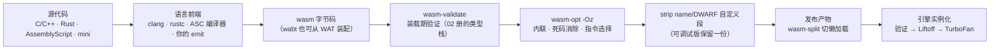

# 工具链与性能真相

> [返回：Wasm 专题导览](01-导览.md)
> 写过后端，再看"别人家的 wasm"怎么生产、怎么调试、为什么快/不快。本册一半是工具链地图（每套工具管流水线哪一段），一半是性能实测——**数据来自本机实测**（Apple arm64 / Node 24.10 / V8 13.6，单机量级、结论看趋势），方法比数字重要：每条你都可以用 20 行 JS 复现。

## 工具链地图

| 工具 | 家族 | 管哪段 | 你会用在哪 |
|---|---|---|---|
| `wat2wasm` / `wasm2wat` | wabt | WAT ⇄ 二进制：汇编器与反汇编器 | 02 册的 41 字节就是它编的；调试时把产物反汇编回 wat |
| `wasm-validate` / `wasm-objdump` | wabt | 装载期验证的 CLI 版；段/指令级 dump | 检查手写字节（06 册） |
| `wasm-opt -Oz` | Binaryen | 字节码级优化器（内联、死码消除、指令选择）；`wasm2js` 降级回 JS | 发布流水线最后一道 |
| Emscripten | C/C++ 世界 | clang 前端 + 胶水运行时（libc 子集、虚拟文件系统、embind 绑定） | 移植既有 C/C++ 库 |
| `wasm-bindgen` / `wasm-pack` | Rust 世界 | Rust ↔ JS 绑定生成（宏标注导出/导入、编组代码自动写） | rapier 这类库的生产路径 |
| AssemblyScript | 独立语言 | **TypeScript 语法子集 → wasm**，无运行时、几十 KB | 和你的 mini 后端同一个思想："一门语言的 wasm 方言" |

分工感：wabt 是"汇编工具"，Binaryen 是"优化 pass"，Emscripten/wasm-bindgen 是"带运行时的整链"，AssemblyScript 是"新前端"。你 06 册手写的 emit ≈ 一个裸版 wat2wasm。

### 工具链流水线全景

把表格里六套工具钉到一条流水线上，"谁管哪段"就不再是记忆题：

这张图回答三个实际问题：

1. **排查问题时你在哪一段**：报错来自前端（类型/语法）、来自验证器（`invalid local index` 这类，06 册实测过）、还是来自运行期 trap（越界/除零）——三段的错误格式完全不同，先分段再查；
2. **优化的两层别混**：前端自己的优化（clang -O2、rustc）在**生成 wasm 之前**就做完了；`wasm-opt` 是字节码层的第二遍——它能看到前端看不到的东西（跨函数内联、全模块死码），也可能重复劳动。这正是第七阶段"优化 pass 分层"的同构问题，见 [07-第七阶段 · 经典优化 pass](../07-第七阶段/04-经典优化pass.md)；
3. **发布物是什么**：最终给浏览器的只有 `.wasm`（可选拆分）与 JS 胶水——name 段是 custom 段（02 册段家族表 id=0），整段剥离不影响执行。

### wabt 逐件手用：一条命令一个角色

wabt 的四件套在 02 册的 41 字节与 06 册的手写字节上正好各司其职，串成一个最小的调试循环：

| 命令 | 输入 → 输出 | 什么时候用 |
|---|---|---|
| `wat2wasm x.wat -o x.wasm` | 文本 → 二进制 | 手写/改 wat 后装配；02 册的 41 字节由此产出 |
| `wasm2wat x.wasm -o x.wat` | 二进制 → 文本 | 拿到别人的 `.wasm`（rapier、ffmpeg.wasm）先反汇编读导出与段 |
| `wasm-validate x.wasm` | 二进制 → 报错或通过 | 手写 emit 之后、实例化之前——06 册"两臂 return"坑的 CLI 裁决 |
| `wasm-objdump -x -d x.wasm` | 二进制 → 段表/反汇编 | 看"段怎么排、函数多大、指令长什么样" |

配合 06 册的经验读这张表：`wasm2wat` 是"反汇编器是第一个调试器"这句第五阶段老话的 wasm 版——你的 emit 错了（栈失衡、local 索引越界），`wasm-validate` 给你报错行，`wasm2wat` 给你看字节被怎么理解了。**CLI 与引擎实例化是两道独立的门**：06 册实测过 wabt 的文本路线能放过某些非法模块、引擎当场拒收——所以"验证以 `wasm-validate`/实例化为准"。

### Binaryen 在字节码层做什么

`wasm-opt -Oz` 是"对字节码跑优化 pass"的字面实践，三个词都值得展开：

- **内联（inlining）**：把小函数体拷进调用点，消掉 `call` 与栈参数传递。实测二马上会看到"wasm 内调用即 `call` 指令、TurboFan 还会再内联"——`wasm-opt` 是在**进引擎之前**就先内联一轮，让 Liftoff 的粗糙代码也少付调用开销；
- **死码消除（DCE）**：下节"体积的账"里的函数级 tree-shaking 就在这层——从导出集合出发做可达性分析，不可达函数整段丢弃。这是数据流分析的"可达性"问题换了个宿主，[07-第七阶段 · 数据流分析](../07-第七阶段/02-数据流分析.md) 的思想在链接期再就业；
- **指令选择（instruction selection）**：同一语义多条指令序列里选最省的（比如把某些比较+分支组合改写），是编译器后端"模式匹配选指令"的老问题，只是选择空间换成了 wasm 指令集。

与前端优化的分工：clang/rustc 在 IR 层已经做了绝大多数优化，`wasm-opt` 的增量收益集中在**跨函数**（前端单元是编译单元，Binaryen 看到的是整个模块）与**链接期才可知**的信息上。"每层工具只做自己层才知道的优化"——这是 pass 体系的通用组织原则，第六阶段的 GC 与它同构：每一遍只依赖上一层已经保证的性质。

### Emscripten 与 wasm-bindgen：胶水层的解剖

工具链表里 Emscripten 与 wasm-bindgen 同属"带运行时的整链"，但两者的胶水长在不同位置——分清它们，"1 MB 从哪来"就有了结构性的答案：

- **Emscripten 的胶水补的是"操作系统"**：C/C++ 代码假设有 libc 与文件系统（`malloc`/`fopen`/`fprintf`…），浏览器没有这一层，于是胶水运行时提供 libc 子集与虚拟文件系统（FS）——`open`/`write` 被翻译成内存里的操作。embind 再把 C++ 类/函数暴露成 JS 可调的形态。**胶水是"为了库代码一行不改"付的兼容税**，这就是体积账里"1 MB 几乎都是运行时"的结构原因：不是 wasm 格式胖，是 C 世界假设的 OS 被整套搬了进来；
- **wasm-bindgen 的胶水补的是"边界"**：Rust 函数上标注宏，工具自动生成两侧代码——JS 侧的 wrapper（加载模块、参数转换）与 wasm 侧的编组代码（字符串按 04 册"指针 + 长度"的套路装箱拆箱）。04 册里你手写 `TextEncoder` + 指针传递的那套样板，bindgen 替你生成。wasm-pack 再往上包一层：产物直接打包成 npm 包；
- **AssemblyScript 的"胶水"是零**：TS 语法子集直接编到 wasm，没有 libc 也没有 GC——它是三条整链里唯一"裸内核"路线，因此几十 KB 起步。它与你的 mini 后端是同一个思想：**为一门语言定制最小的运行时假设**。

三种胶水一张表：

| 整链 | 补的是什么 | 边界数据怎么过 | 体积的代价落在 |
|---|---|---|---|
| Emscripten | OS 抽象（libc/FS）+ 绑定 | embind 自动编组，也可以手动指针 | 运行时胶水（1 MB 档的来源） |
| wasm-bindgen | 仅绑定与编组 | 宏标注处自动生成（字符串/对象） | 只编组所需的薄层 |
| AssemblyScript | 无 | 手动（同 04 册的裸指针套路） | 几乎没有（几十 KB 档） |

读法：**胶水的厚度 = 语言运行时假设的多少**。移植存量资产选厚胶水（Emscripten），新写代码选薄或零——这正是工具链表"你会用在哪"一列的深层依据。

## 可调试性与体积

- **名字**：默认反汇编里全是 `func #3`。编译时带 name 自定义段（函数名/局部名）——`wasm2wat` 立刻可读。发布时再 strip 掉（几 KB 的差距）；
- **源码级**：wasm sourcemap 把指令偏移映回源语言（Chrome DevTools 支持），Rust/Emscripten 一条参数的事；DWARF 调试信息进自定义段可到原生级单步；
- **体积的账**："wasm 动辄 1 MB"几乎都是 Emscripten 拖的运行时（libc/FS）；裸内核（Rust no_std、AssemblyScript）几十 KB 起。压缩三板斧：`-Oz`、strip 调试段、**函数级死码消除**——wasm 的 tree-shaking 是"从导出出发的可达性 GC"，与你第七阶段的 DCE pass 同一思想，只是发生在链接期；
- **懒加载**：`wasm-split` 把"首屏就要"与"后用"切成两个模块，浏览器按需取。

### name 段：为什么调试与发布要编两次

name 段是 custom 段（id=0），所以它"可插在任意位置、可整段跳过"（02 册段家族表的规则）——这决定了它的工程用法：**调试版带名、发布版剥名，而不是二选一**。02 册的 41 字节模块没有 name 段，所以 `wasm2wat` 输出里函数是 `func #0`；加上 name 段后同一份字节反汇编出来就是 `add`。名字不参与执行语义（引擎按索引调函数），这是"调试信息与执行信息分离"的教科书案例——对照 mini 的行号表也是教学版省略、真版挂在函数对象上，同一取舍。

DWARF 走得更远：变量名、类型、行号进自定义段，DevTools 能在 wasm 帧上单步看源码变量——代价是体积，收益是"原生级"的调试体验。sourcemap 则是前端世界熟悉的那套"映射表"思想：**执行表示与源表示之间的双向翻译，按需加载**。

### 体积账怎么复算

"体积的账"那条 bullet 是本册最容易被误读的一句，拆成三个动作复算一遍：

1. **先问产物里有没有运行时**：Emscripten 默认拖进 libc 子集、虚拟文件系统、异常处理胶水——这些是 C/C++ 假设"有操作系统"的补偿层。同一个 C 函数用裸 wabt 路线（手写 wat 或 `-Oz` 后看差值）编出来只有函数本体几十字节（02 册的 41 字节就是量级感）——**差的不是 wasm 格式，是语言运行时**；
2. **三板斧各砍什么**：`-Oz` 砍指令冗余（内联+死码+指令选择）；strip 砍 name/DWARF 自定义段（02 册：可整段剥离）；函数级 DCE 砍"从未被任何导出可达"的函数——三把刀作用在不同层，叠加不是相加关系，最后一把的收益取决于你导出了多少；
3. **判定口径**：比较体积时固定"同一份源码 + 同一套工具链 + 同一套开关"，否则你比的是运行时差异不是编译差异。"几十 KB 起"与"1 MB 起"的对照说的正是：**裸内核 vs 带运行时整链的量级差**。

## 性能真相：三组实测

**前置知识：wasm 也分层编译。** V8 里 wasm 先过 **Liftoff**（基线：编译快、代码糙）尽快开跑，热点再由 **TurboFan** 重编成高质量机器码——与 JS 的 Sparkplug/Ignition → TurboFan 分层同构。关键差异：**tier-up 只惠及后续调用，正在跑的长循环不会被替换**（wasm 无 OSR）。

实测一：**一次性长循环的陷阱**。1 亿次 f64 加法的循环：

| 调用 | 耗时 |
|---|---|
| 第 1 次（Liftoff 代码 + 编译） | 368 ms |
| 第 2 次起（已 tier-up 到 TurboFan） | 58 ms |
| `--liftoff-only`（永远基线） | ~200 ms |
| `--no-liftoff`（直接 TurboFan） | 58 ms（首次即热） |
| JS 对照（JIT 稳态） | 64 ms |

**稳态的 wasm 与充分 JIT 的 JS 打平**——两者都贴着硬件 f64 加法延迟链的下限。教科书说"wasm 接近原生"，JS JIT 的数值热点也接近原生，**两者在纯数值循环上没有档次差**。

实测二：**调用密集才拉开差距**。树递归 `fib(35)`（约 3000 万次调用）：wasm 稳态 25 ms，JS 51 ms——**2 倍**。差距不在算术，在调用：JS 侧的调用约定、参数适配、类型反馈依赖给每次调用加价；wasm 的调用即 `call` 指令，且 TurboFan 对 wasm 内调用做内联。顺带：Liftoff 下的 fib（57 ms）≈ JS——**基线 wasm 与 JIT 的 JS 同档**。

实测三：**边界即关税**。JS 循环里调 1e7 次 wasm `add`：16 ms（约 1.6 ns/次）——单次不贵，但同样 1e7 次发生在 wasm **内部**只要 3 ms，与 JS 内联后的函数调用同速。结论一句话：**循环放哪边，哪边就免费；跨边界按次收税**。凡是"JS 每帧循环调 wasm 一千次小函数"的架构，都付了十五倍的税。

三条总结论：

1. **可预测性是 wasm 的真卖点**：无预热悬崖（首跑就有 Liftoff，想更快可 `--no-liftoff`）、无去优化、无 GC 暂停——延迟敏感场景比"峰值快"更重要；
2. **"wasm 必然快"是幻觉**：纯数值循环与 JIT 的 JS 打平；赢在调用密集、SIMD、并发与可预测；
3. **编组成本常吃掉收益**：数据不过界（缓冲区共享、计算整体搬进去）才是正确姿势——04 册"零拷贝视图"的动机。

### 三组数字怎么读：先把次数除进耗时

三组实测的数字密度高，读法是固定的两步：**先除出"每次操作的价"，再问"这笔价买的是什么"**。下表只是把上面已列数字做了除法（同一批数据的另一种视图，不是新测量）：

| 实测 | 口径 | 总耗时 | 次数 | 每次 |
|---|---|---|---|---|
| 一 | TurboFan 稳态，f64.add | 58 ms | 1e8 | ≈ 0.58 ns |
| 一 | Liftoff 常驻（`--liftoff-only`） | ~200 ms | 1e8 | ≈ 2.0 ns |
| 一 | 首跑（Liftoff 代码 + 编译摊入） | 368 ms | 1e8 | ≈ 3.68 ns |
| 一 | JS 对照（JIT 稳态） | 64 ms | 1e8 | ≈ 0.64 ns |
| 二 | wasm 稳态，fib 每次调用 | 25 ms | ~3e7 | ≈ 0.83 ns |
| 二 | JS 对照，fib 每次调用 | 51 ms | ~3e7 | ≈ 1.7 ns |
| 二 | Liftoff fib 每次调用 | 57 ms | ~3e7 | ≈ 1.9 ns |
| 三 | 跨边界 `add` 每次调用 | 16 ms | 1e7 | ≈ 1.6 ns（原文已给） |
| 三 | wasm **内部**函数调用 | 3 ms | 1e7 | ≈ 0.3 ns |

从这张除法表里读出四个"边界在哪"：

1. **数值下限**：0.58 ns 与 0.64 ns 在同一档——这就是"纯数值循环打平"的数量级证据，两边的价都贴着硬件延迟链，再优化只能省指令数不能省物理延迟；
2. **分层的价格带**：2.0 ns（Liftoff）→ 0.58 ns（TurboFan），基线比优化档贵约 3 倍——Liftoff"代码糙"糙在这；3.68 ns 里多出的是**编译时间摊入**（一次性成本），所以它只出现在第 1 次；
3. **调用税的价格带**：0.83 ns（wasm 内调用）→ 1.7 ns（JS 调用）→ 1.9 ns（Liftoff 下 wasm 调用）。注意最后一行：**Liftoff 的 wasm 调用比 JS 还贵**——基线代码不做内联，调用开销全额现收；TurboFan 内联后才落到 0.83 ns；
4. **边界税的价格带**：1.6 ns（跨边界）vs 0.3 ns（内部），同一次 `add` 相差约 5 倍——差价就是过界的手续：参数装箱/校验、进出 wasm 实例、JS 侧的调用适配。单次绝对值很小（ns 级），但它是**按次线性收**的，循环里调一千次就收一千次。

这张表还解释了实测三那句"付了十五倍的税"的账怎么算：税不是 1.6 ns 本身，而是"边界调用 1.6 ns vs 内联后近乎免费"的**倍率**放大到每次一收——粒度越细（每次调用的活越少），税占的比例越高。

### Liftoff 与 TurboFan：两条编译哲学的分工

"前置知识"那段可以展开成一张分工表——两条编译流水线各自优化什么矛盾：

| | Liftoff | TurboFan |
|---|---|---|
| 优化目标 | **编译延迟**：模块字节一到就尽快能跑 | **执行质量**：机器码贴硬件 |
| 编译方式 | 一遍线性扫描，逐指令直译出粗糙机器码 | 构建 IR、做优化 pass，再选指令 |
| 代码质量 | 无内联、无寄存器精调（≈ 2.0 ns 的 f64 循环） | 内联 + 精调（≈ 0.58 ns） |
| 典型停留时长 | 冷代码、只跑一次的路径 | 热点（调用/迭代计数达标） |
| 对应 JS 侧 | Sparkplug（基线） | TurboFan（优化） |

这个结构与第五阶段的两难一模一样：**"什么时候能跑"与"跑得多快"是一对拉锯**——解释器（05 册）是最快的"能跑"、最慢的"跑"，TurboFan 是反面极端，Liftoff/TurboFan 分层是把两个极端拼成一条"先能跑、再跑快"的流水线。[07-第七阶段 · JIT 视角](../07-第七阶段/05-JIT视角.md) 把 JS 侧这条流水线正面展开；wasm 侧的新信息只有两条：

- **wasm 的 Liftoff 起点高**：类型全静态（02 册验证器保证），基线代码不需要猜类型、不需要类型反馈护栏——所以基线 wasm 已经能跟 JIT 稳态的 JS 打平（实测二：Liftoff fib 57 ms ≈ JS 51 ms）；
- **无 OSR**：JS 的优化编译器能在循环执行中途"换引擎"（on-stack replacement）；wasm 的 tier-up 只把**下一次调用**换成新代码。实测一的第一行（368 ms）就是这条规则的直接后果——编译早已完成，但循环已经在 Liftoff 代码上跑完了。

### 把"循环放哪边"变成可执行的检查

实测三给了决策规则，把它落成三步检查（不写 benchmark 也能先做定性判断）：

1. **找内层循环**：性能敏感路径上真正反复执行的是哪段？内层循环在 JS → 每次迭代都可能跨边界；在内层循环里还逐元素调 wasm 小函数 → 税率最高的形态；
2. **数跨界次数**：循环体内每一次 JS↔wasm 往返（函数调用、读写线性内存视图之外的数据结构）都是一税；把"一层循环整个搬进 wasm"就是把 N 次税合并成 1 次；
3. **问数据的家**：数据住在哪边？住在 JS 对象里、wasm 每次都要"看一眼"→ 编组税（结论 3）；搬进线性内存、用 04 册的零拷贝视图共享 → 免税。数据不搬家，搬的只有计算。

对照 04 册的 bump 分配器与"零拷贝视图"：`newArray` 建在线性内存里、JS 拿 `Float64Array` 直接读写——这套设计的性能动机就是上面第 3 步。反例是 rapier 的反模式：每帧从 JS 逐刚体读坐标、调一次 wasm 更新一个刚体——正确姿势是 `world.step()` 一次推进整个世界（自测第 2 题）。

### benchmark 自查清单：20 行怎么写才不骗自己

本册所有数字都能用 20 行 JS 复现，但复现之前先过这份清单——每一条都对应三组实测里踩过的坑：

- [ ] **分清首跑与稳态**：第一次调用的耗时里含编译（实测一第 1 行 368 ms）。要测稳态就先跑几轮再计时；要测首屏延迟就专门测第一次——两种口径混在一个数里，结论必然错；
- [ ] **给分层加对照组**：同一份模块各跑一遍默认、`--liftoff-only`、`--no-liftoff`——三个数字把"基线价 / 优化价 / 编译摊入"拆开（实测一就是这么设计的）。没有对照组的"wasm vs JS"测的是混在一起的分层行为；
- [ ] **调用粒度与循环位置写清楚**：报数字时说明"循环在 JS 侧调 wasm"还是"循环在 wasm 内部"——实测三证明这两个口径差约 5 倍（1.6 ns vs 0.3 ns）；只报一个数等于什么都没报；
- [ ] **别把编组算进"wasm 的速度"**：如果测的是"JS 数组传进去、结果传回来"的总时间，你测的是编组税不是计算速度。正确姿势是数据先搬进线性内存（一次性成本）、计时只围住纯计算；
- [ ] **量级对表**：跑完先和本册三组实测对量级——f64 累加稳态应在几十 ns/百次的量级、跨边界单次应与 1.6 ns 同档。量级对不上先查环境（是否真的在 wasm 上跑、是否被 JS 引擎内联掉），再谈结论；
- [ ] **只比趋势不比绝对值**：单机量级、单次运行的波动都大；本册开头那句"结论看趋势"是所有数字的免责声明——换台机器 fib 的 25 ms 可能变成 18 或 33 ms，但"2 倍于 JS"的关系通常还在。

### 什么时候"基线档"就是终点

Liftoff 不是待优化的耻辱，三种场景里停在基线档反而是正确决策：

- **只跑一次的路径**：初始化、错误处理、用户罕见触发的分支——TurboFan 化它们的收益永远不会兑现（tier-up 要靠热度触发，没热度就没重编）；
- **启动延迟敏感的小计算**：实测一第 1 行（368 ms）里摊着的是**编译时间**——TurboFan 编得更慢这件事本身是延迟。模块小、单次执行的计算量小的时候，"尽快开跑"比"跑得最优"重要，这正是 Liftoff 的设计初衷；
- **可预测性优先的场景**：总结论 1 的另一面——Liftoff 档没有 tier-up 抖动、没有去优化，行为从第一毫秒起就是稳定的。音频回调、动画帧这类"每帧都同样多的活"的负载，宁可全程基线价，也不要"偶尔快偶尔编译"。

判断口诀：**热度决定档位该不该升**——把模块里的函数分成"每帧热调"与"偶尔冷调"两堆，只有前一堆值得为 TurboFan 等一等；冷的那堆停在 Liftoff 就是终态，不是半成品。

## 工业坐标

| 案例 | 形态 | 一句话 |
|---|---|---|
| Figma | C++ 渲染引擎 → wasm | 编辑器性能的标杆；多线程版是 threads 提案的推手 |
| Photoshop Web / AutoCAD Web / Google Earth | 大型 C++ 移植 | Emscripten 路线的极限展示 |
| Pyodide | CPython + numpy → wasm | "整个语言运行时进浏览器"，含 GC——线性内存里自带解释器 |
| ffmpeg.wasm / SQLite wasm | C 库直译 | 无需服务端的媒体处理/数据库 |
| rapier | Rust → wasm | webgl 站物理专题的选型主角：所有权 + 线性内存，GC 账在编译期结清 |

对照：esbuild/SWC 走的是**原生二进制**而非 wasm——编译器生态两条路："原生进程"要快、要并行；"wasm"要进浏览器、随网页分发。没有谁通吃。

### 案例逐行读：每个案例回答一个问题

把表格当五道问答题的答案集，每行背后有一个值得记住的机制：

- **Figma 回答"大型 C++ 能不能进浏览器"**：答案是能，且渲染这种"每帧整批计算"的负载正好落在实测三的正确侧——把整帧的几何计算关进 wasm 内部循环，JS 只递事件。多线程版推着 threads 提案走，说明**工业需求跑在标准前面**是常态；
- **Photoshop/AutoCAD/Google Earth 回答"存量资产怎么复用"**：几十年的 C++ 不重写，Emscripten 整链搬——付出的体积与启动代价（运行时胶水）是"移植 vs 重写"账目上明码标价的项；
- **Pyodide 回答"带 GC 的运行时能不能塞进线性内存"**：CPython 的解释器、对象模型、GC 全部住在 wasm 线性内存里，JS 只看到一个黑盒导出——这正面回答了 04 册 GC 账表的第三行："对象生死交错"的最重解法是**把整个 GC 搬进来**；
- **ffmpeg.wasm/SQLite wasm 回答"C 库的临界质量"**：这两个库的 API 形态（整段数据进出、无细粒度回调）天然少付边界税——选型时看的不只是"是不是热点"，还有**接口粒度**；
- **rapier 回答"没有 GC 怎么活"**：Rust 所有权在编译期定释放点，线性内存里零 GC 元数据——[GC 算法专题 · 免 GC 的内存管理](../10-GC算法专题/05-免GC的内存管理.md) 的思想在浏览器里的完整落地。

### 两条分发路线的分野

esbuild/SWC 与 Figma/Pyodide 的差别是**分发模型**的差别，不是语言或速度的差别：

| | 原生二进制（esbuild/SWC） | wasm（Figma/Pyodide） |
|---|---|---|
| 跑在哪 | 开发者的机器进程里 | 浏览器沙箱内 |
| 分发方式 | npm 下载 + 安装脚本（平台各一份） | 随网页加载，一份字节全平台 |
| 权限 | 完整系统权限 | 验证 + trap 的沙箱（02 册） |
| 适合 | CLI 工具、构建链、本地服务 | 面向终端用户的页面内计算 |

"没有谁通吃"的展开：构建工具要并行、要文件系统、要起子进程——原生路线的全部优势点；页面内物理引擎要零安装、要跨平台、要沙箱——wasm 路线的全部优势点。两条路线的技术底座是同一套（都是"语言 → 高质量字节码"），所以**换路线的成本集中在分发与权限层，不在编译器本体**——这也是为什么"编译原理"的知识在两条路上几乎全额复用。

## 提案展望（一句话版）

- **SIMD**：128 位固定宽度向量——图像/音频的标配，已全绿；
- **threads**：SharedArrayBuffer + 原子操作；要页面开**跨源隔离**（COOP/COEP 响应头）——部署有门槛；
- **WasmGC**：struct/array 成为**引擎托管对象**——Java/Kotlin/Dart 不再自带 GC；04 册的内存账将被改写；
- **tail-call**：函数式语言的递归安全垫；
- **组件模型 + WASI**：跨语言接口（WIT 描述）+ 引擎无关的系统 API——"浏览器外的 wasm"的公约数；
- **ESM 集成**：`import` 一个 wasm 模块像 import JS 一样自然。

### 提案怎么走到"全绿"

"已全绿"三个字背后是一条标准化的流水线，值得知道各阶段你分别能用什么：

各阶段对使用者的含义：

- **origin/proposal 阶段**：只有规范和参考解释器（一个严格但慢的参考实现）——你能"试"但不能指望性能，工具链支持也是拼凑的；
- **引擎实现期**：各引擎陆续实装但藏在旗标后面——本机 `--experimental-wasm-*` 这类开关属于这个阶段。给生产环境用之前先确认目标引擎的默认状态，**旗标不是兼容性承诺**；
- **全绿**：各引擎默认开启、工具链默认产出——SIMD 处于这一档，所以它从"展望"变成了"图像/音频的标配"。

两个入口问题的展开：

- **threads 的门槛为什么是响应头**：共享内存要求页面进入跨源隔离状态（COOP/COEP），这是浏览器站的安全前提——所以 threads 的成本一半在部署侧不在代码侧。判断"能不能上 threads"先看页面能不能改响应头，再看计算能不能切分；
- **WasmGC 改写的是哪张表**：04 册 GC 账的三行（不还/epoch reset/自管）。struct/array 变成引擎托管对象后，"自管"那一行整个作废——对象图交给引擎的三色标记（第六阶段学的那套）管，你的线性内存退回纯数据缓冲区。06 册 mini 后端不受影响（mini 的 number 子集没有堆对象），但"mini 加数组 → wasm"这条路以后会多一个官方选项。

### SIMD 与 threads：各改写实测表的哪一格

把两条已落地的提案对回三组实测，就能看清它们分别优化哪个维度：

- **SIMD 改"每次操作的价"**：实测一里 f64.add 的单价下限（0.58 ns 档）受制于标量指令延迟链；128 位向量一条指令处理 4 个 f64，单价直接改写——前提是算法可向量化（批量、无分支依赖）。图像/音频天然是批量数据，所以 SIMD 是它们的标配。反过来说：递归 fib（实测二）控制流依赖上一次调用的结果，向量帮不上——**SIMD 的收益边界就是"算法能不能变成规则的批量循环"**；
- **threads 改"并行的维度"**：本册三组实测全是单线程的账。threads（SharedArrayBuffer + 原子操作）把可切分的计算按核数摊开，墙钟时间成倍下降——但前提链条上一册已列：页面要开跨源隔离（COOP/COEP）。**先看部署能不能过门槛，再谈代码能不能切分**；
- **WasmGC/组件模型改的是账本结构**：前者改写 04 册内存账（上文），后者把"分发单元"从单个模块升级成可组合的组件——两者都不改本册三组实测的单线程数字，改的是工程形态。

读法：**提案不是匀速前进的平流，而是各改一格的补丁**——SIMD 改单价、threads 改并行度、WasmGC 改内存账、组件模型改分发。给一个项目排"要不要等某个提案"，就问它缺的是哪一格。

## 决策表：该不该把逻辑放进 wasm

| 场景 | 判定 | 依据 |
|---|---|---|
| 物理/图像/编解码/加密等数值热循环 | **上** | 调用密集 + 无 GC 暂停；实测二、一 |
| 已有成熟 C/Rust 资产要进前端 | **上** | 移植成本低于重写 |
| 沙箱执行不可信计算（插件、规则） | **上** | 验证 + trap 的安全模型天然合用 |
| DOM/字符串密集、边界往返频繁 | **不上** | 编组税；实测三 |
| 业务逻辑轻薄、迭代频繁 | **不上** | 工具链与调试成本 > 收益 |
| "听说 wasm 快" | **先测** | 稳态数值循环与 JIT 打平；先把 20 行 benchmark 写了 |

### 决策表的三步用法

表格逐行给出答案，实际决策按顺序走三步（每步都否决就省下全部集成成本）：

1. **先问负载形状**（对应第 1、4 行）：把内层循环画出来——计算密集还是边界密集？DOM 操作、字符串拼接、频繁小调用是三面红旗，任何一面立着就先不集成；
2. **再问资产存量**（第 2 行）：已有一个成熟的 C/Rust 实现、且接口是"整块数据进出"的形状 → 移植账是正的；需要重新设计接口、或逻辑本身在快速迭代 → 不划算；
3. **最后才跑数字**（第 6 行）：前两步都通过，再写 20 行 benchmark 验证——顺序反了（先测后想）会浪费在注定不该上的方案上。测试时用上面的自查清单。

注意"不上"不等于"白学"：读懂这三行否决理由，你在 code review 里就能拦住"听说 wasm 快"式选型——这是本册最实用的产出。

### 两个假想负载走一遍三步

拿两个典型负载把三步走全（练习"画像 → 判定"的肌肉，与三组实测对号）：

| 负载 | 第 1 步：内层循环形状 | 第 2 步：资产与接口 | 第 3 步：数字 | 判定 |
|---|---|---|---|---|
| 编辑器按键时的代码高亮 | DOM 更新 + 字符串处理为主 | 无现成 C/Rust 资产 | — | 第 1 步否决（边界/字符串密集行） |
| 浏览器里解压用户拖入的大压缩包 | 纯数值/位运算热循环，输入输出都是整块字节 | 有成熟 C 实现，接口形态"整块进出"（ffmpeg/SQLite 同型） | 集成后按自查清单跑 benchmark，量级对表 | 三步全过 → 上 |

两个案例各踩一条实测结论：高亮案踩的是实测三（边界与编组主导成本，计算本身不是热点）；解压案赚的是实测二与一（调用密集的数值循环 + 无 GC 暂停）。注意解压案的接口形状——**"整块字节进出"让跨界次数与数据量无关**，这正是 ffmpeg.wasm/SQLite 那一行"接口粒度"的具体化。

最后补一条使用纪律：决策表的六行是"静态画像"，三组实测是"动态验证"——画像说该上，实测说快不了（比如目标设备内存紧张、编译预算超了），以实测为准。**表给方向，数字给裁决。**

## 常见误区

- **"wasm 一定比 JS 快"**：实测一、二的直接反面——稳态数值循环两者打平（0.58 ns vs 0.64 ns 同档），赢面只在调用密集、SIMD、threads 与可预测性。立项理由里出现"听说 wasm 快"，按决策表第 6 行处理；
- **"tier-up 会救活正在跑的慢循环"**：wasm 无 OSR，长循环用 Liftoff 代码跑到底（实测一第 1 行 368 ms 的直接原因）。"先跑起来等优化"的 JS 直觉在 wasm 的一次性长计算上失效——要么接受基线价（~200 ms 档），要么启动时就用 TurboFan 档；
- **"跨边界调用贵得不能用"**：单次 1.6 ns 是 ns 级，绝对值很便宜；贵的是**粒度**——每次调用干的活越少，税占比越高。判断标准是"每 1.6 ns 买到多少计算"，不是"能不能跨边界"；
- **"Emscripten 产物 1 MB = wasm 本身大"**：大头是 libc/FS 运行时胶水，裸内核几十 KB 起。体积优化三板斧（-Oz、strip、DCE）都作用在"你自己的代码 + 可选运行时"上，先分清再砍；
- **"wasm 没有类型检查开销所以永远快"**：类型检查被 02 册的验证器移到了装载期——这买来的是**运行期确定性**（无去优化、无护栏），不是无限加速。数值循环的物理下限对 wasm 和 JIT 的 JS 一视同仁；
- **"GC 暂停的消失是免费的"**：可预测性的代价是内存管理自己做（04 册 GC 账）或换 WasmGC。没有暂停 ≠ 没有内存问题——泄漏在 bump 指针上是内存只涨不跌，比 JS 堆更沉默；
- **"工具链装了就等于能用"**：wabt/Binaryen/Emscripten 各管一段，混用版本、混用验证口径（CLI validate vs 引擎实例化）是 06 册实测坑的来源。以引擎的实例化结果为最终裁决。

## 与其他册的连接

- 字节从哪来、段怎么排：[02-二进制格式与WAT](02-二进制格式与WAT.md)——41 字节模块与 LEB128 是工具链的原料；
- mini 指令怎么映射：[03-表达式与结构化控制流](03-表达式与结构化控制流.md)——前端那一层的完整展开；
- 零拷贝与线性内存的 GC 账：[04-线性内存与JS互操作](04-线性内存与JS互操作.md)——实测三"数据不过界"的正确姿势；
- 手写 emit 与实测报错：[06-实践-mini到Wasm](06-实践-mini到Wasm.md)——wabt 四件套的实战用法都在那里落地；
- JS 侧分层编译（Sparkplug/Ignition/TurboFan）与 OSR：[07-第七阶段 · JIT 视角](../07-第七阶段/05-JIT视角.md)；
- DCE/内联等 pass 的系统展开：[07-第七阶段 · 经典优化 pass](../07-第七阶段/04-经典优化pass.md)、[07-第七阶段 · 前端工程优化对照](../07-第七阶段/06-前端工程优化对照.md)；
- 线性内存里的 arena 思想：[GC 算法专题 · 免 GC 的内存管理](../10-GC算法专题/05-免GC的内存管理.md)；
- 本专题的收官实践（三栏 demo）：[06-实践-mini到Wasm](06-实践-mini到Wasm.md) 即第八阶段毕业项目 C 的核。

## 自测

1. Liftoff 与 TurboFan 各解决什么矛盾？为什么"一次性长循环"是分层编译的最坏情况（用实测一的三个数字回答）？
2. 用实测二、三解释：为什么 rapier 把 `world.step()` 设计成一次调用推进整个世界，而不是暴露逐刚体的更新函数？
3. wasm 的 tree-shaking 发生在哪个阶段、以什么为可达性起点？与你第七阶段的 DCE pass 异同？
4. Emscripten 产物为什么普遍 1 MB 起，AssemblyScript 却几十 KB？
5. WasmGC 落地后，04 册的哪张表会作废、哪一部分思想反而被官方收编？
6. 你的项目里挑一个真实函数，写出判断它该不该进 wasm 的三步检查。

（7~12 为扩写增补题，答不出就回到对应小节的推演再读一遍。）

7. 把实测一的 368/58 ms 与实测二的 25/51 ms 放进"三条编译哲学分工"表里：Liftoff 的 f64 循环与 TurboFan 差约几倍？Liftoff 的 fib 与 JS 差几倍、与 TurboFan 的 wasm 又差几倍？"基线 wasm ≈ JIT 的 JS"这句话由哪两个数字支撑？
8. 实测三里 1.6 ns 与 0.3 ns 的差价花在哪三类事情上？若把"每帧循环调 1000 次小函数"改成"一次调用推进整批"，跨界次数从多少变多少？税率由此怎么变？
9. name 段为什么可以"调试版带名、发布版剥名"而不影响执行语义？用 02 册段家族表里 custom 段的两条规则回答。
10. threads 提案的部署门槛是什么（哪两个响应头）？为什么说它的成本"一半在部署侧不在代码侧"？
11. benchmark 自查清单里"给分层加对照组"对应哪三个开关/口径？只跑默认配置一个数，会把你测出来的东西混成哪三样？
12. esbuild 与 Figma 同样"编译到高质量机器码"，为什么一个走原生进程、一个走 wasm 沙箱？列出两条路线各自不可让渡的一个优势点。
