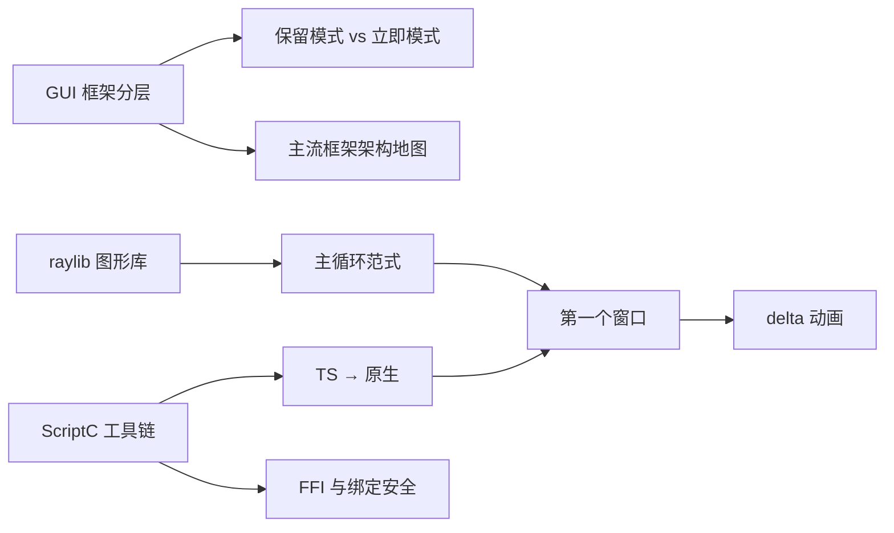

# 第一阶段导览：全局观与第一个窗口

> [返回：GUI框架学习大纲](../GUI框架学习大纲.md)
> 本阶段是全局观：先看清 GUI 框架由哪几层组成、主流框架各自取了什么角度，再认识我们的原料 raylib（图形库，不是框架），最后用 ScriptC 工具链跑通第一个原生窗口。

## 分册索引

| 分册 | 对应大纲条目 | 一句话说明 | 状态 |
|---|---|---|---|
| 01-导览.md | — | 本页 | ✅ |
| 02-GUI框架是什么.md | 1 | 分层解剖、保留 vs 立即模式、浏览器 DOM 的同构对照 | ✅ |
| 03-主流框架架构地图.md | 2 | Flutter 三树 / Qt / GTK4 / SwiftUI / Slint / GPUI / egui 对照 | ✅ |
| 04-raylib图形库解剖.md | 3 | 主循环范式、它给什么、刻意不给什么 | ✅ |
| 05-ScriptC工具链.md | 4 | TS→原生、FFI 机制、绑定安全模型、构建产物解读 | ✅ |
| 06-第一个窗口与帧循环.md | 5 | 事件循环、delta time、工程骨架与开发命令 | ✅ |

## 阶段目标

学完本阶段，你应该能不查资料做到：

- 画出 GUI 框架的分层图（窗口宿主 / 渲染后端 / 框架内核 / 组件层 / 应用），并说出每层解决什么问题
- 说清保留模式与立即模式的区别，以及 egui 和 Flutter 各自为什么那样选
- 解释 raylib 为什么是图形库而不是 GUI 框架——列出它不给你的五样东西
- 独立搭起一个 ScriptC + scriptc-raylib 工程：`npm run dev` 一条命令从 TS 编译到原生窗口跑起来
- 用 delta time 写出与帧率无关的动画

## 知识点地图

## 实践任务清单

1. 跑通最小窗口脚本：开窗 → 渲染 60 帧 → 自动退出、退出码 0（可回归验证）
2. 把帧数/帧时间画在窗口里，用 `setTargetFPS` 对比 30 / 60 / 120 下的 delta 波动
3. 读取鼠标位置与按键状态，在窗口里画出实时反馈（十字线 + 按键高亮）
4. 记录环境：ScriptC / scriptc-raylib / raylib 版本，确认 `package.json` 里 `"type": "module"` 的坑

## 阶段自测

1. 一个 GUI 框架必须替应用解决哪五类问题？浏览器分别用什么机制对应它们？
2. 保留模式和立即模式各自的「一帧」有什么区别？各举一个框架。
3. raylib 的主循环范式是什么？为什么说它的事件模型是轮询式的？
4. scriptc-raylib 为什么要生成 C shim，而不是让 TS 直接调 raylib 函数？
5. delta time 解决什么问题？不用它会出什么 bug？
