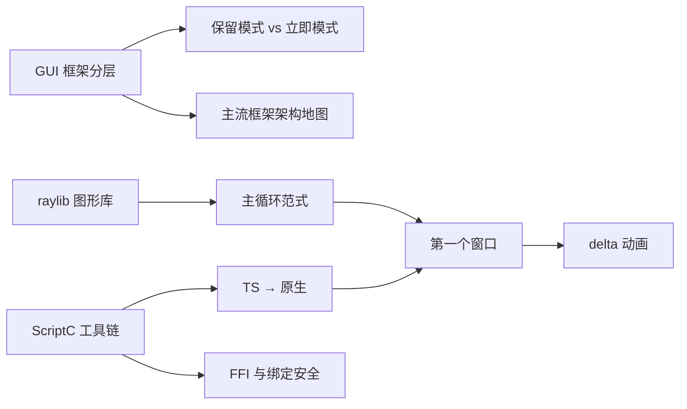

# 第一阶段导览：全局观与第一个窗口

> [返回：GUI框架学习大纲](../GUI框架学习大纲.md)
> 本阶段是全局观：先看清 GUI 框架由哪几层组成、主流框架各自取了什么角度，再认识我们的原料 raylib（图形库，不是框架），最后用 ScriptC 工具链跑通第一个原生窗口。

## 分册索引

| 分册 | 对应大纲条目 | 一句话说明 | 状态 |
|---|---|---|---|
| 01-导览.md | — | 本页 | ✅ |
| 02-GUI框架是什么.md | 1 | 分层解剖、保留 vs 立即模式、浏览器 DOM 的同构对照 | ✅ |
| 03-主流框架架构地图.md | 2 | Flutter 三树 / Qt / GTK4 / SwiftUI / Slint / GPUI / egui 对照 | ✅ |
| 04-raylib图形库解剖.md | 3 | 主循环范式、它给什么、刻意不给什么 | ✅ |
| 05-ScriptC工具链.md | 4 | TS→原生、FFI 机制、绑定安全模型、构建产物解读 | ✅ |
| 06-第一个窗口与帧循环.md | 5 | 事件循环、delta time、工程骨架与开发命令 | ✅ |

## 阶段目标

学完本阶段，你应该能不查资料做到：

- 画出 GUI 框架的分层图（窗口宿主 / 渲染后端 / 框架内核 / 组件层 / 应用），并说出每层解决什么问题
- 说清保留模式与立即模式的区别，以及 egui 和 Flutter 各自为什么那样选
- 解释 raylib 为什么是图形库而不是 GUI 框架——列出它不给你的五样东西
- 独立搭起一个 ScriptC + scriptc-raylib 工程：`npm run dev` 一条命令从 TS 编译到原生窗口跑起来
- 用 delta time 写出与帧率无关的动画

## 知识点地图

## 实践任务清单

1. 跑通最小窗口脚本：开窗 → 渲染 60 帧 → 自动退出、退出码 0（可回归验证）
2. 把帧数/帧时间画在窗口里，用 `setTargetFPS` 对比 30 / 60 / 120 下的 delta 波动
3. 读取鼠标位置与按键状态，在窗口里画出实时反馈（十字线 + 按键高亮）
4. 记录环境：ScriptC / scriptc-raylib / raylib 版本，确认 `package.json` 里 `"type": "module"` 的坑

## 阶段自测

1. 一个 GUI 框架必须替应用解决哪五类问题？浏览器分别用什么机制对应它们？
2. 保留模式和立即模式各自的「一帧」有什么区别？各举一个框架。
3. raylib 的主循环范式是什么？为什么说它的事件模型是轮询式的？
4. scriptc-raylib 为什么要生成 C shim，而不是让 TS 直接调 raylib 函数？
5. delta time 解决什么问题？不用它会出什么 bug？

## 前置知识与依赖关系

本阶段不要求任何图形学或 C 语言基础，但默认你已经具备下面这些前端经验。缺哪一项，就先补哪一项，否则读分册时会在类比处卡住。

| 需要先会的 | 用在哪一册 | 不会的后果 |
|---|---|---|
| 浏览器渲染流水线的大致顺序（样式、布局、绘制、合成） | [02-GUI框架是什么](02-GUI框架是什么.md) | 看不懂「浏览器也是一套 GUI 框架」的同构对照，五件事对不上号 |
| 至少一个声明式框架的重渲染直觉（状态变了，界面跟着变） | [03-主流框架架构地图](03-主流框架架构地图.md) | 分不清「描述界面的对象」和「真正干活的对象」，三棵树只能死记 |
| 事件循环与 `requestAnimationFrame` 的基本用法 | [04-raylib图形库解剖](04-raylib图形库解剖.md)、[06-第一个窗口与帧循环](06-第一个窗口与帧循环.md) | 理解不了轮询式输入和回调式输入的差别 |
| TypeScript 的类型系统与模块化 | [05-ScriptC工具链](05-ScriptC工具链.md) | 读不懂哪些语法在原生编译路线上受限、为什么受限 |
| 命令行与包管理器的日常操作 | [05-ScriptC工具链](05-ScriptC工具链.md) | 构建失败时分不清是工程配置问题还是代码问题 |

阶段之间的依赖是单向的，本阶段产出的三样东西会被后面反复使用：

- 分层图：后面每个阶段都对应其中一层。第二阶段做渲染后端之上的绘制抽象，第三阶段补文本这个特殊图元，第四阶段进入框架内核。先有这张图，才知道每一步在整栋楼的哪一层施工。
- 「刻意不给的清单」：raylib 不提供控件树、布局、文本排版、事件分发和状态管理，这张清单就是后续阶段的施工图，每完成一个阶段就划掉一项。
- 帧循环骨架：之后所有演示程序都长在这个骨架上，只是把循环体里的「画什么」逐步替换成框架自己的流程。

建议的阅读顺序与分册编号一致。唯一可以调换的是 [03-主流框架架构地图](03-主流框架架构地图.md)：如果你急着动手，可以先跳过它直奔工具链与第一个窗口，等第四阶段开工前再回来读，那时对「树」的需求已经切身，读起来收获更大。

## 常见误区与正解

下面五条是前端背景的读者最容易带进来的错误直觉。每条都按「误区、为什么错、正解」三段展开，读完分册后可以回来逐条对照。

| 误区 | 为什么错 | 正解 |
|---|---|---|
| raylib 能开窗口、能画按钮形状，所以它就是一个轻量 GUI 框架 | 它只负责「把像素画出来」和「告诉你此刻输入设备的状态」，不记得上一帧画过什么，也不知道屏幕上哪块区域属于哪个控件 | 把它当作画布加输入采样器。控件树、布局、命中测试、焦点、状态更新全部要我们自己造，详见 [04-raylib图形库解剖](04-raylib图形库解剖.md) |
| 立即模式是落后方案，保留模式才是正统 | 两者是不同约束下的取舍：立即模式省掉了状态同步的复杂度，代价是每帧重算；保留模式省掉了重复计算，代价是要维护一棵长期存活的树和它的失效机制 | 先问场景：调试面板、工具类界面适合立即模式；长列表、复杂动画、无障碍支持需要保留模式。详见 [02-GUI框架是什么](02-GUI框架是什么.md) |
| 帧率锁在六十，所以每帧移动固定像素就够了 | 帧率是目标而非保证，掉帧时动画会变慢；换到高刷新率屏幕，动画又会变快，行为随机器变化 | 所有随时间变化的量都乘以帧间隔，让速度的单位是「每秒」而不是「每帧」，详见 [06-第一个窗口与帧循环](06-第一个窗口与帧循环.md) |
| 用 TypeScript 写，就等于在一个脚本运行时里跑，所有语言特性都能用 | 本项目走的是编译到原生的路线，能用的是一个受限子集，部分动态特性没有对应的原生实现 | 写之前先确认特性是否在子集内，用特性探测而不是凭经验猜，详见 [05-ScriptC工具链](05-ScriptC工具链.md) |
| 各家框架差别只在接口风格，底层都差不多 | 渲染路线（自绘、系统控件、网页内核）、树的层数、变化传播方式都是结构性差异，直接决定性能上限和跨平台成本 | 用几个固定维度去定位每个框架，再把我们要造的东西放进同一个坐标系，详见 [03-主流框架架构地图](03-主流框架架构地图.md) |

## 术语速查表

本阶段出现的术语在后续阶段会被当作已知词汇直接使用，这里集中给出一句话口径。

| 术语 | 英文 | 一句话解释 |
|---|---|---|
| 保留模式 | Retained Mode | 框架长期持有一棵界面对象树，应用只修改树，由框架决定何时重画 |
| 立即模式 | Immediate Mode | 应用每帧重新描述整个界面，框架不保存界面结构 |
| 窗口宿主 | Window Host | 向操作系统申请窗口、接收原始输入事件的最底层 |
| 渲染后端 | Rendering Backend | 把绘制指令变成像素的那一层，通常对接显卡接口 |
| 主循环 | Main Loop | 采集输入、更新状态、绘制、提交，周而复始的那个循环 |
| 帧间隔 | Delta Time | 上一帧到这一帧经过的时间，用来让动画与帧率脱钩 |
| 轮询 | Polling | 每帧主动询问输入状态，而不是等系统回调通知 |
| 外部函数接口 | FFI | 一种语言调用另一种语言所写函数的机制 |
| 绑定 | Binding | 把原生库的函数包装成当前语言可调用形式的那层代码 |
| 垫片 | Shim | 夹在两侧之间做参数转换与安全检查的薄胶水层 |
| 句柄 | Handle | 代表原生侧资源的不透明标识，应用只能持有不能窥探内部 |
| 垂直同步 | VSync | 让提交画面的时机对齐显示器刷新，避免撕裂 |

## 验收清单（DoD）

逐条自查，全部能勾上再进入第二阶段。每一条都要求「不翻资料能做到」，只是「看懂了」不算通过。

- [ ] 能在白纸上画出五层分层图，并为每一层各举一个真实系统中的对应物
- [ ] 能说出框架替应用解决的五类问题，并指出浏览器里各自由什么机制承担
- [ ] 能用一句话区分保留模式与立即模式，并各举一个框架说明它为什么这样选
- [ ] 能列出 raylib 不提供的五样东西，并说出每一样会在后续哪个阶段补上
- [ ] 能解释为什么输入是轮询式的，以及这对「点击」这类瞬时事件的判断方式有什么影响
- [ ] 能讲清一次调用从脚本侧走到原生库中间经过了哪几层，垫片层在其中负责什么
- [ ] 能独立从空目录搭起工程并让窗口出现，遇到模块类型配置问题知道去哪里查
- [ ] 能写出与帧率无关的匀速运动，并说明切换目标帧率后画面速度为什么不变
- [ ] 能说出帧循环的四个步骤及其顺序，并解释顺序颠倒会出现什么现象
- [ ] 能把我们要造的框架放进主流框架的坐标系里，说出它在渲染路线和树结构上分别靠近谁
