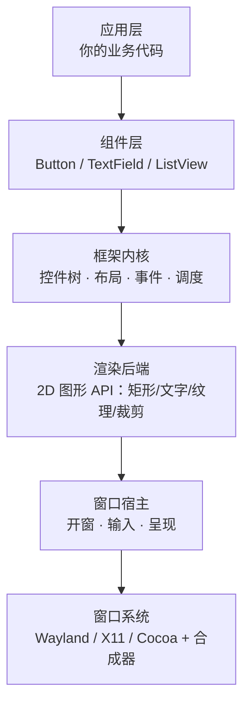
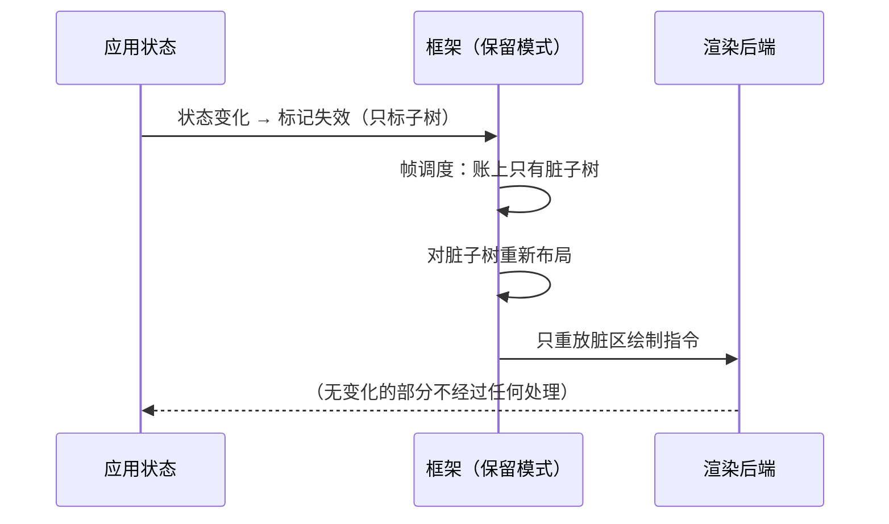
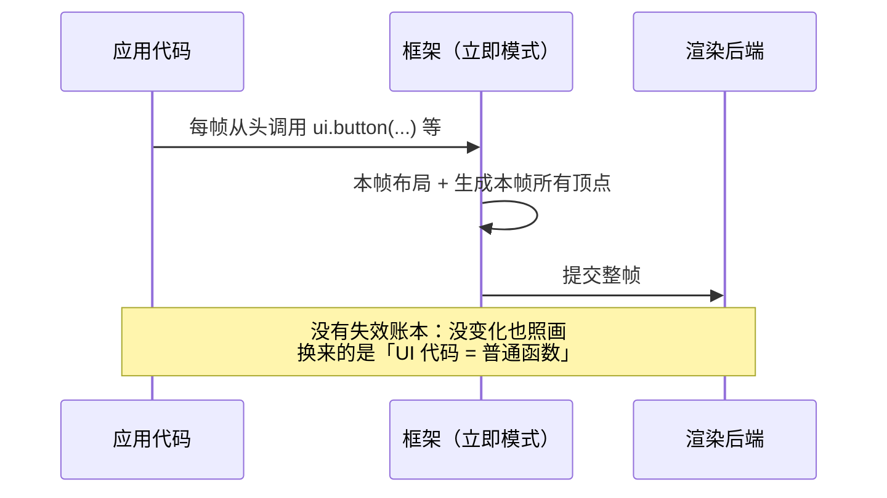
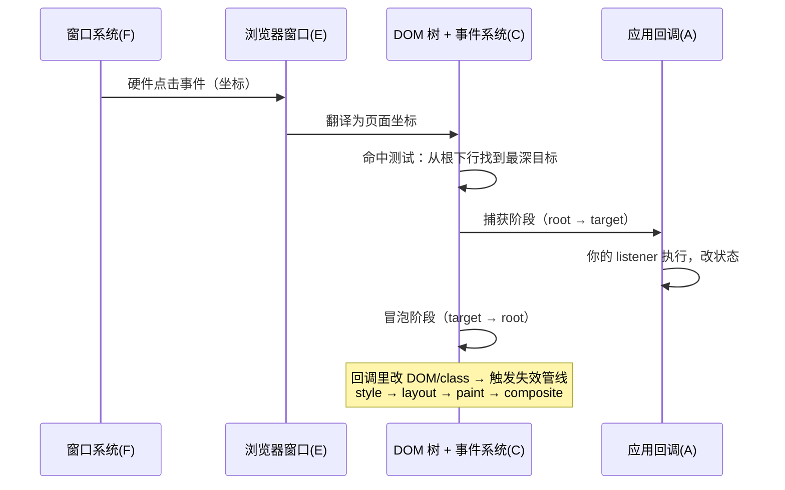

# GUI 框架是什么：分层、两种模式与浏览器的同构

> [返回：第一阶段导览](01-导览.md)
> 对应大纲条目：第一阶段 1。本册回答四个问题：GUI 框架由哪几层组成？每一层在「一帧」里各做什么？框架替你解决了哪些「你自己写会写哭」的问题？保留模式与立即模式的分野在哪里？读完你应该能准确说出 mini-gui 要造的是哪几层、借用的是哪几层。

## 1. 分层解剖：一个桌面应用的完整栈

从屏幕上的像素倒推，任何 GUI 应用都可以切成五层：



| 层 | 职责 | mini-gui 的选择 |
|---|---|---|
| F 窗口系统 | 窗口的注册、层级、合成（多个窗口的像素怎么叠上屏幕） | 操作系统提供，不碰 |
| E 窗口宿主 | 创建窗口、把输入事件交给应用、把帧缓冲送上屏 | **raylib 提供**，不碰 |
| D 渲染后端 | 把「画个圆角矩形」翻译成 GPU/光栅操作 | **raylib 提供**，第二阶段薄薄地包一层 Painter |
| C 框架内核 | 控件树、布局协议、事件分发、失效与重绘调度 | **亲手造**（第四~六阶段） |
| B 组件层 | 常用控件的默认行为与样式 | **亲手造**（第七~八阶段） |
| A 应用层 | 业务状态与界面组装 | 用我们造的框架写 demo |

这个切法就是本课程的施工图：raylib 把 E、D 两层承包了，我们从 C 层开工。**为什么这样切？** 因为 D 层以下是「与操作系统和 GPU 打交道」的知识，换成自绘引擎话题就跑到图形学去了；而 C、B 两层是所有 GUI 框架（无论 Flutter、Qt 还是浏览器）真正共享的骨架。

### 1.1 自下而上：每层各自回答一个问题

分层不是代码分包，而是**问题分包**。判断一段代码属于哪层，看它回答什么问题：

- **F 窗口系统**回答「屏幕上同时有几十个窗口，像素怎么叠、焦点给谁」——这是操作系统的领地（Wayland/X11/Cocoa），应用通过协议与它对话，本课程完全不碰。
- **E 窗口宿主**回答「我的进程怎么拥有一块屏幕上的矩形，并持续往里填内容」——开窗、轮询输入、呈现帧缓冲。raylib 内部用 GLFW 承包了这一层（第 4 册的启动日志里能看到 `Platform backend: DESKTOP (GLFW)`）。
- **D 渲染后端**回答「给我一个圆角矩形+一行字，怎么变成像素」——它只认识图元与纹理，不认识「按钮」。raylib 的 `drawRectangleRounded`/`drawText` 就是这一层的门面。
- **C 框架内核**回答「界面由元素组成，元素有结构、有大小、有事件、会变化」——控件树、布局协议、命中测试、焦点、失效调度全在这里。**这一层是「图形库」与「GUI 框架」的分界线**。
- **B 组件层**回答「常见交互的默认行为长什么样」——按钮的按压反馈、文本框的光标与选区、列表的滚动条。它站在内核的机制之上做约定。
- **A 应用层**回答「这个产品的界面是什么」——用 B 层的积木组装业务界面，理论上不需要知道 C 层的存在。

一个自检：`drawText` 在 D 层；「这段文字放进 Text 组件，宽度不够要换行」在 C/B 层；「购物车标题显示商品数」在 A 层。同一行字，三个问题，三层。

### 1.2 一帧穿过五层

把分层图动起来，看一次「用户点了一下按钮」怎么穿过五层：

```text
一帧的生命（自上而下是「谁驱动谁」，输入方向相反）

 A 应用层      回调里改了业务状态（如购物车数量 +1）
   │ 触发更新
 B 组件层      Button 把「被点击」翻译成自己的视觉状态 + 语义事件
   │ 声明变化 / 通知失效
 C 框架内核    命中测试 → 事件分发 → 脏标记 → 重新布局 → 生成绘制指令
   │ 绘制指令（本站第二阶段的「显示列表」）
 D 渲染后端    把指令攒成批，翻译成 GPU 调用
   │ 提交批次
 E 窗口宿主    present：交换帧缓冲，把这一帧送上屏（vsync 在这附近）
   │
 F 窗口系统    合成器把这帧与其它窗口合成到屏幕
```

注意两个方向：**输入自下而上**（F 收到硬件事件 → E 交给应用 → C 分发到具体控件 → A 的回调被触发），**像素自上而下**（C 生成的意图 → D 翻译 → E/F 送屏）。GUI 框架的全部复杂性，几乎都在「让这两个方向保持一致」上：界面说的和屏幕上画的必须是同一份状态。

第 6 册的帧循环四步（时间 → 输入 → 更新 → 绘制）就是这个图的最简化版：没有框架时，A 层直接在主循环里自己完成「问输入、改状态、发指令」。

### 1.3 用 labs 真实代码给分层点名

分层图不是空谈，本阶段唯一的 demo `gui/labs/mini-gui/src/apps/01-window.ts` 里就能点名三层（E、D、A）——C/B 两层缺席，正是「还没造框架」的直接体现：

```ts
// 逐字摘自 src/apps/01-window.ts（代码语句为原文，行尾 ← 注释为本册批注，// … 为裁剪）
initWindow(WIDTH, HEIGHT, "mini-gui 01 window");   // ← E 窗口宿主：开窗、建 OpenGL 上下文
setTargetFPS(targetFps);                           // ← E：帧节奏（vsync 之外的第二道闸）

while (!windowShouldClose()) {                     // ← E：问窗口系统「关了吗」
  const dt = getFrameTime();                       // ← E：帧计时
  const mouse = getMousePosition();                // ← E：输入轮询
  // …
  if (isKeyDown(KEY_A)) playerX -= move;           // ← A 应用层：业务状态（玩家位置）
  // …
  beginDrawing();                                  // ← D 渲染后端：开一个绘制批
  clearBackground(RAYWHITE);                       // ← D
  drawCircle(// …, SKYBLUE);                       // ← D：图元级绘制，没有「控件」概念
  endDrawing();                                    // ← D：提交批次 + 交换缓冲
}
```

读这段代码时注意「没有的东西」：没有任何对象代表界面元素，没有结构、没有布局、没有事件分发——**C/B 两层完全缺席**，界面就是一段每帧从头执行的绘制脚本。01-window.ts 是全课程的「零点」：后续每个阶段都在往这段骨架上挂新的层，第 6 册逐行走读它。

## 2. 框架替你做的五件事

一个「纯图形库」（比如 raylib）给你画笔；一个「GUI 框架」给你一套**代管界面状态**的系统。代管什么？五件事：

| # | 问题 | 没有框架时的样子 | 框架的答案 | mini-gui 对应阶段 |
|---|---|---|---|---|
| 1 | 布局 | 手算每个控件的 x/y，窗口一变全重算 | 声明式约束 + 布局协议，自动重排 | 第四阶段 |
| 2 | 命中测试 | 遍历所有矩形判断点在谁身上，还要处理嵌套遮挡 | 命中链 + 事件冒泡 | 第五阶段 |
| 3 | 焦点与键盘 | 谁在接收按键？Tab 按下去焦点去哪？ | 焦点链 + 遍历序 | 第五阶段 |
| 4 | 失效与重绘 | 每帧全画一遍，或者自己记账哪块脏了 | 脏标记 + 局部重绘调度 | 第六阶段 |
| 5 | 状态到界面 | 手动同步：改了数据记得改 10 处界面 | 声明式 UI = f(state) | 第七阶段 |

再加上两个「隐形」问题：**文本输入**（光标、选区、IME——第八阶段的深水区）和**无障碍**（屏幕阅读器需要的语义树——我们只做概念映射，见第八阶段对标册）。

### 2.1 用图形库裸写一个按钮，痛在哪

五件事听起来抽象，用一个最小的场景把它们全部逼出来。下面是**示意代码**（不是 labs 源码；mini-gui 里真正的命中测试要到第五阶段才出现），只用图形库的轮询输入 + 绘制原语，写一个「能点的按钮」：

```ts
// 示意代码：不用框架时，「一个能点的按钮」要自己写掉多少东西
// 1. 布局：位置和大小全靠手算，窗口一 resize 全部作废
const bx = 120, by = 80, bw = 200, bh = 40;

// 2. 命中测试：每个可点元素都要在每帧问一遍「鼠标在不在我的矩形里」
const m = getMousePosition();
const hit = m.x >= bx && m.x < bx + bw && m.y >= by && m.y < by + bh;

// 3. 边沿检测：要自己记账「上一帧按没按」，才能区分「点」和「一直按着」
if (hit && isMouseButtonDown(LEFT) && !wasDown) pressTime = now();
if (!isMouseButtonDown(LEFT) && wasDown && hit) onClick();

// 4. 绘制：每帧无条件全画，哪怕按钮跟上一帧一模一样
drawRectangle(bx, by, bw, bh, hit ? HOVER_BG : NORMAL_BG);
drawText("确定", bx + 10, by + 10, 20, BLACK);
```

二十行代码，只覆盖了五件事中 1、2、4 的**一小角**：

- **布局之痛**：`bx/by` 是写死的。父容器想挪它？窗口 resize 了？挨个改数字。第 4 冘的「不给清单」第一行就是这个。
- **命中测试之痛**：一个按钮还好；界面有 50 个元素、还有嵌套容器时，谁先谁后？被遮挡的算不算命中？这行 `if` 会膨胀成一棵树的遍历——第五阶段命中链的由来。
- **焦点之痛**：这个按钮**键盘永远点不到**。Enter/Space 该触发谁？Tab 该跳到哪？轮询模型里键盘输入没有「收件人」，焦点链是第五阶段补的收件人机制。
- **失效之痛**：哪怕鼠标没动、没人点，第 4 段每帧照样画。界面小时无所谓，界面大了就是第六阶段脏标记要省掉的开销。
- **状态到界面之痛**：按钮的文案写死在绘制调用里。想把「确定」改成「保存」，要记得改绘制处；想在两处显示同一个状态，要记得改两处——第七阶段 `UI = f(state)` 要消灭的手工同步。

**一个检验标准**：如果你删掉框架，这五件事里哪件会让你重构整个应用？通常答案是 1 和 5——它们决定了代码的组织方式；2、3、4 是「correctness 苦力活」。这也解释了为什么第五~七阶段按这个顺序推进：先把苦力活做对，再改组织方式。

### 2.2 五件事逐件展开：问题的准确形状

表格是一页纸版本，动手前还需要知道每件事「难在哪」。这里是五个问题的准确形状，细节留给对应阶段：

- **布局不是「算坐标」，是「解约束」**。手算 x/y 的真正问题不是麻烦，而是**依赖方向**：子元素的位置取决于父容器的大小，父容器的大小又可能取决于子元素的内容（wrap）。布局协议（第四阶段的 BoxConstraints）的本质是规定「约束自上而下传、尺寸自下而上报」的单遍规则，让依赖方向不打架。CSS 的 flex/grid、Flutter 的约束协议都是这个问题的成熟解。
- **命中测试不是「点在矩形里」，是「树的遍历」**。难点全在嵌套与遮挡：点落在子元素上也落在父容器上，事件给谁？先问谁？「命中链」记录从最内层到根的路径，「冒泡」规定事件沿链上行的次序（第五阶段）。浏览器 `event.target` 之后的捕获-冒泡两阶段，就是这套机制的完整版。
- **焦点不是「当前控件」，是「遍历序」**。Tab 键要求框架能回答「下一个是谁」——这需要一棵可遍历的树和确定的顺序（第五阶段焦点链）。轮询模型里键盘输入没有收件人（第 4 册 §4），焦点链就是给键盘找收件人的机制。
- **失效调度不是「重画」，是「记账」**。每帧全画（01-window.ts 现在的做法）在界面小时完全够用；界面变大后，第六阶段的脏标记负责记账「谁变了」，布局/绘制只处理账上的部分。记账错误的代价是「改了没反应」或「没改也重画」，前者是 bug，后者是浪费。
- **状态到界面不是「绑定」，是「方向」**。手动同步的根源是**状态和界面是两份拷贝**，改一处忘另一处就 desync。声明式 UI = f(state) 把方向定死：状态是唯一事实，界面是状态的函数——从此只存在「状态错」，不存在「忘了更新界面」（第七阶段）。

## 3. 保留模式 vs 立即模式

这是 GUI 框架最根本的分野，比「用什么语言写」重要得多。

| 维度 | 保留模式（retained） | 立即模式（immediate） |
|---|---|---|
| 控件树 | 框架持有，跨帧存在 | 每帧重建，函数调用栈就是「树」 |
| 状态归属 | 框架/控件对象持有状态 | 应用持有全部状态，UI 无状态 |
| 一帧做什么 | 只处理「变化」（脏标记、局部重绘） | 每帧从头问一遍所有控件重画 |
| 改一行代码的代价 | 大（要理解失效传播） | 小（UI 代码就是普通函数） |
| 缓存与优化 | 框架内建（布局缓存、重绘边界） | 应用自己插缓存（帧间记忆） |
| 代表 | Qt、GTK、Flutter、Slint、**浏览器 DOM** | Dear ImGui、egui、游戏内调试 HUD |

### 3.1 同一个按钮的两种写法

分野不在 API 长相，在**谁持有界面、界面活多久**：

```ts
// 保留模式（Qt/GTK/Flutter 式，示意）：注册一次，框架长期持有控件
const btn = new Button("确定");
btn.onClick = () => save();   // 注册回调：控件活得比这一帧长，回调有意义
container.add(btn);           // 进入控件树，布局/命中/焦点从此归框架管
// 之后应用代码不再过问绘制——按钮状态变了，框架自己决定重画哪里

// 立即模式（egui/ImGui 式，示意）：每帧重新声明，调用即存在
let clickedThisFrame = false;
ui.horizontal((ui) => {
  clickedThisFrame = ui.button("确定").clicked();  // 本帧的按钮，返回本帧的结果
});
if (clickedThisFrame) save();
// 这一帧没执行这行代码，按钮就从界面上消失——UI 无状态，状态全在应用手里
```

保留模式的按钮是一个**对象**，有身份、有生命周期、有内部状态（hover/pressed/焦点）；立即模式的按钮只是**一次函数调用的副作用**，它的「状态」（比如这个按钮本帧被点了吗）由调用返回值带回应用。第 4 册会看到：raylib 的轮询输入模型天然亲和立即模式——这也是很多游戏 HUD 直接用立即模式写的原因。

```text
保留模式（Flutter 式）              立即模式（egui 式）
─────────────────────              ─────────────────────
build() 声明树一次                  每帧：
框架记录 Element 树                   for item in items {
状态变化 → markNeedsXxx                 ui.button(item.label)
框架决定重排/重绘的范围               }  // 调用即存在
                                     // 这一帧没调用的控件就「消失」
```

### 3.2 状态归属的连续谱

「保留 vs 立即」不是二选一的开关，更像一条谱：**每帧重做多少、框架替你记多少**：

| 路线 | 每帧工作量 | 界面状态归谁 | 代表 |
|---|---|---|---|
| 每帧全量重建 | 重画整棵 UI，无任何跨帧记忆 | 应用 | egui / Dear ImGui |
| 全量重建 + diff | 重建描述树，diff 后打补丁 | 框架（组件实例） | React（react 站源码复刻的主线） |
| 细粒度依赖追踪 | 只重跑依赖变化的表达式 | 框架（信号图） | Solid / Slint / mini-gui 第七阶段 |
| 保留 + 失效调度 | 只处理脏掉的子树 | 框架（控件对象） | Qt / GTK / mini-gui 第四~六阶段 |

谱的两端互相印证：egui 证明「框架不记状态」也能做出好用的界面；Flutter/Qt 证明「框架记状态」能换来局部更新与一致性。mini-gui 的路线是先走保留端（第四~六阶段把失效调度做扎实），再在第七阶段于保留内核之上叠细粒度响应式——两种模式的优点在谱上是可以拼接的。

### 3.3 两种模式的一帧（时序对照）

用一次「状态变化 → 界面更新」把两种模式的一帧摆在同一张时序图里：





两图合看，§3.1 表格里的每一行都有了着落：保留模式的一帧在「决定不做什么」上花心思，立即模式的一帧从不想「不做什么」。

mini-gui 选择**保留模式**内核：控件树、脏标记、局部重绘都是保留模式的核心难题，也是学习价值最高的路线；第七阶段在保留内核上叠声明式 API 时，会顺带看清两种模式在「状态归属」上的连续谱（egui 的每帧重建 ↔ React 的全量 diff ↔ Solid/mini-gui 的细粒度更新）。

## 4. 浏览器也是一套 GUI 框架

你在 Web 里的日常，其实是另一套 GUI 框架的日常。同构对照：

| 桌面框架概念 | 浏览器对应物 | mini-gui 对应物 |
|---|---|---|
| 窗口宿主 | 浏览器窗口/标签页 | raylib `InitWindow` |
| 渲染后端 | 光栅化（Skia） | raylib 绘制原语 |
| 控件树 | DOM 树 | Widget 树（第七阶段） |
| 布局对象树 | LayoutObject（Blink） | RenderObject 树（第四阶段） |
| 布局协议 | CSS flex/grid 的约束求解 | BoxConstraints 单遍协议（第四阶段） |
| 命中测试/冒泡 | `event.target` + 冒泡捕获 | 命中链 + 冒泡（第五阶段） |
| 失效调度 | style → layout → paint → composite 管线 | 脏标记管线（第六阶段） |
| 声明式层 | React/Vue 组件 | signals + 函数组件（第七阶段） |

### 4.1 一次点击在浏览器里的旅程

拿 §2.1 的裸写按钮对照浏览器：`addEventListener("click", ...)` 之所以存在，是因为 DOM 树替你完成了命中测试与事件分发；`element.getBoundingClientRect()` 之所以存在，是因为布局引擎替你算了位置；改 `classList` 后界面自动变，是因为样式/布局/绘制失效管线替你调度了重绘。**浏览器把五件事全部代管了**——这正是它作为「人人都会用的 GUI 框架」的成功之处，也解释了为什么本课程禁止浏览器：代管的东西看不见，就不知道它在替你做什么。

把这次点击画成时序，与 §1.2 的一帧图相互印证：



对照 mini-gui 的现状：01-window.ts 里这次点击的旅程只有两步——`getMousePosition()` 拿坐标、`isMouseButtonPressed()` 拿边沿，**没有 C 层，事件到不了「某个控件」**。第五阶段的事件总线做的就是图中「命中测试 + 捕获冒泡」那几格。

mini-gui 的推进顺序恰好是「把浏览器拆开按件复刻」：第四阶段造 Blink 的 LayoutObject 对应物，第五阶段造事件捕获冒泡的对应物，第六阶段造 style/layout/paint 管线的对应物，第七阶段造 React 的对应物。每造一件，回到这张表对一次坐标。

> 这张表是全站与其他站的桥：本站的第四~六阶段与 react 站的调和渲染、webgl 站的渲染管线在概念上互为镜像。学完 mini-gui 再回头看「浏览器为什么这样设计」，会有一种「原来是同一件事」的感觉。

## 5. 常见误区

> 每条误区都按「说法 → 为什么错 → 准确的说法」展开。这些误区在后续阶段的工程决策里会反复出现，值得现在就掰正。

**误区 1：「立即模式框架没有状态。」**
错在把「UI 无状态」读成「没有状态」。界面里总要有地方记住「这个文本框里打了什么字」「动画播到第几秒」「下拉框开没开」——立即模式框架没有控件对象来存这些，于是状态被迫搬到应用侧（egui 的字段或帧间记忆机制）。准确的说法：立即模式把状态的**保管责任**从框架移交给应用；状态本身一个都不会少。

**误区 2：「保留模式一定比立即模式快（或慢）。」**
两个方向都有人信，两个方向都不成立。保留模式的脏标记可以把一帧的工作量压到「只重画一个按钮」，立即模式则每帧全画——看似保留赢；但保留模式要为失效传播、布局缓存、树维护付出内存与复杂度，一旦失效范围算大了（比如一次误伤全树的 relayout），反而比「无脑全画」更慢。**性能取决于每帧实际做的工作量，不取决于阵营标签。**第六阶段做帧预算时用的就是这条朴素标准。

**误区 3：「浏览器只是排版引擎，不算 GUI 框架。」**
把「网页」当特例是直觉，把机制摆出来就不是了：DOM 树（保留控件树）、CSS 布局（约束求解）、事件捕获冒泡（分发）、样式/布局/绘制失效管线（调度）、ARIA 语义树（无障碍）——§2 的五件事加两个隐形问题，浏览器一件不缺，只是换了术语。准确的说法：**浏览器是本课程最方便的参照系**，每个 mini-gui 机制都能在它身上找到同构物（§4 的表）。

**误区 4：「分层就是代码目录分层，一个库属于一层。」**
分层是职责切分，不是物理分包。反例就在手边：raylib 一个库同时横跨 E 层（开窗/输入/present）与 D 层（绘制原语）；Flutter 的三棵树（第 3 册）全都住在「框架内核」一层里，却对应三种不同职责。判断归属要看「这段代码回答哪个问题」（§1.1 的问题清单），不是看它住在哪个目录、由哪个仓库发布。

## 6. mini-gui 的施工范围：借什么、造什么

把 §1 的五层图按「借/造」重新上色，就是全课程的施工平面图：

```text
        我们借的（不造）                我们造的（亲手）
┌───────────────────────────┐   ┌─────────────────────────────┐
│ E 窗口宿主   raylib/Glfw   │   │ C 框架内核                   │
│ D 渲染后端   raylib 原语    │   │   控件树 · 布局 · 事件 · 调度 │
│   （第二阶段用 Painter 薄    │   │ B 组件层                    │
│     封装，后端可换）        │   │   Button / TextField / 列表  │
│ F 窗口系统   操作系统       │   │ A 应用层（用自造框架写 demo）  │
└───────────────────────────┘   └─────────────────────────────┘
```

每长出一块，对应本册的哪一节：

| 阶段 | 长出的东西 | 回对本册哪一节 |
|---|---|---|
| 二 | Painter 接口（D 层薄封装）+ 显示列表 | §1 的 D 层；§3 保留模式的「记录后重放」 |
| 三 | TextPainter + 断行器 | §2 的隐形问题（文本） |
| 四 | RenderObject 树 + BoxConstraints 布局 | §2 之事 1 |
| 五 | 命中测试 + 事件冒泡 + 焦点链 | §2 之事 2、3 |
| 六 | 脏标记 + 局部重绘 + 动画系统 | §2 之事 4；§5 误区 2 的帧预算 |
| 七 | signals + 声明式组件 + keyed 协调 | §2 之事 5；§3.2 连续谱 |
| 八 | 控件库 + 虚拟列表 + 测试 | §2 的两个隐形问题 |

「借」的部分不是黑盒：第 4 册解剖 raylib 给什么不给什么，第 5 册解剖 TS 怎么经由 FFI 驱动它——借来的每一样都要知道成本与边界，这是本课程「跑起来才算」文化对依赖的态度。

### 6.1 三个判例：新需求落在哪层？

分层图的用法是**给新需求定位**。拿三个真实会遇到的需求练手（答案在后两册与后续阶段导览里逐一兑现）：

| 需求 | 落在哪层 | 判据 |
|---|---|---|
| 窗口标题栏显示当前帧率 | E（窗口宿主） | 改的是窗口属性，不是界面内容——raylib `setWindowTitle` 一行的事 |
| 给所有控件加「按下时变暗」效果 | B（组件层） | 是「常见交互的默认行为」，站在内核机制（失效 + 重绘）之上的约定 |
| 界面局部语言切换后只有半屏刷新 | C（框架内核，失效调度） | 是「变化传播记账」的 bug：失效范围算漏了，属于调度正确性 |

判错层的典型代价：把 C 层问题拿到 A 层解决（每个应用自己记得刷新全屏——回到 §2 的手动同步），或把 B 层问题做到 C 层（内核硬编码按钮行为——组件层没法学）。第四阶段的导览会再回到这张判例表的思路。

## 7. 延伸阅读：三座邻站

本站不是孤岛，tech-learning 仓库里已有三座邻站与 GUI 直接相关：

- **react 站《react-源码复刻大纲》**：用 didact 路线从零复刻 VDOM / Fiber / diff / hooks，是「全量重建 + diff」路线的完整施工记录。与本站的关系：同一个问题（UI = f(state)）的两种正交解法——他们复刻 React 的重渲染 + 调和，我们第七阶段做 Solid 式细粒度信号更新。学完本册 §3.2 的连续谱后，可以先去读它的《复刻路线》册建立地图感。
- **webgl 站《渲染管线全局观》**（第一阶段）：D 层再往下挖就是 GPU——顶点、着色器、帧缓冲。mini-gui 的绘制调用最终由 raylib 攒成 OpenGL 批处理提交，批处理之下发生的事就是 webgl 站的领地。第二阶段做 Painter 后端时可对照阅读。
- **compiler 站**：两个接口。其一，第八阶段展望「UI DSL 编译」时（Slint 路线，见第 3 册 §5），编译原理站的词法/语法/代码生成直接可用；其二，第二阶段纹理管理要用的「分配-释放配对」思维，与 compiler 站 GC 专题的分配器设计是同一门课。

## 8. 本册小结

- GUI 栈五层：窗口系统 → 窗口宿主 → 渲染后端 → 框架内核 → 组件层；每层回答一个问题，mini-gui 借 E/D 造 C/B。
- 输入自下而上、像素自上而下，框架的全部复杂性在让两个方向对齐。
- 框架的本质是「代管界面状态」：布局、命中、焦点、重绘调度、状态到界面五件事，外加文本输入与无障碍两个隐形问题。
- 保留模式 vs 立即模式的分水岭是**控件树是否跨帧存在**；状态归属是一条连续谱；mini-gui 走保留模式，第七阶段再叠细粒度响应式。
- 浏览器是同构的参照系，各概念可一一映射；每完成一个阶段回来对一次坐标。

## 自测

1. 五层 GUI 栈中，raylib 承包了哪两层？mini-gui 为什么不自己造渲染后端？
2. 「布局」和「失效调度」分别解决什么问题？为什么说它们比命中测试更影响代码组织？
3. 用 §2.1 的裸写按钮为素材：删掉框架（这里是 raylib 之上的假想组件层）后，五件事里哪几件会让代码结构重写？为什么？
4. 立即模式框架为什么不需要脏标记？它把这些复杂性转嫁给了谁？
5. 「立即模式没有状态」错在哪？egui 应用里文本框的内容必须存在哪里？
6. 保留模式和立即模式哪个更快？给出你的判断标准，并举出「保留模式反而更慢」的一种情形。
7. 浏览器的 style/layout/paint/composite 管线对应 mini-gui 的哪个阶段的哪些机制？DOM 树对应哪棵树？
8. `drawText`（画一行字）和「宽度不够自动换行的多行文本组件」分别属于五层中的哪层？依据是什么？
9. 浏览器里 `element.getBoundingClientRect()` 替你代管了五件事中的哪一件？没有它时你要怎么办（对照 §2.1）？
10. 如果要给 mini-gui 加「多窗口」支持，按五层图应该动哪层？为什么内核层（C 层）几乎不用动？（提示：控件树的坐标系以哪个窗口为参照。）
