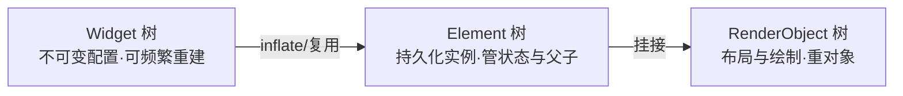
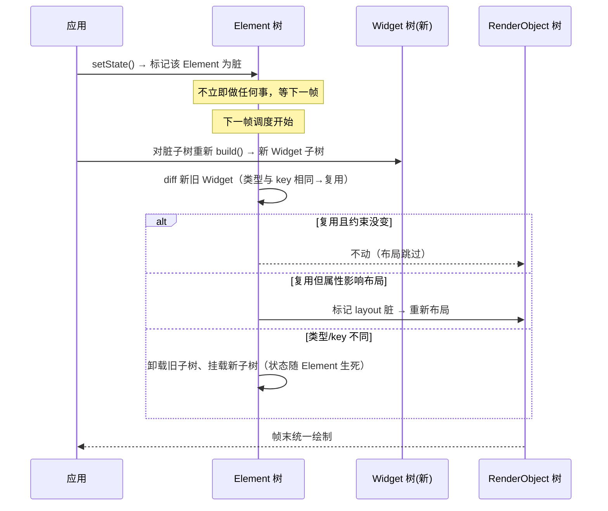
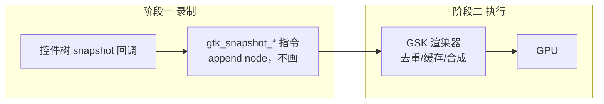

# 主流框架架构地图：七个框架，一张取舍表

> [返回：第一阶段导览](01-导览.md)
> 对应大纲条目：第一阶段 2。本册不教代码，只建坐标系：七个主流框架在「渲染后端 / 布局 / 响应式 / 语言」四个维度上各取了什么角度，每家把「一帧」切成什么样子。mini-gui 每长出一层，都能在这张表里找到它的「亲戚」。本册的概念描述（如 Flutter 三树的重建规则、egui 的一帧流程）是对各框架公开设计的转述，不是本机实测；凡涉及本站实测的数字都标明出自哪一册。

## 1. 一张总表

| 框架 | 语言 | 渲染后端 | 控件树模式 | 布局 | 响应式模型 | 无障碍 |
|---|---|---|---|---|---|---|
| Flutter | Dart | 自绘（Skia/Impeller） | 三树（Widget/Element/RenderObject） | 单遍约束协议 | setState → 重建 Widget 子树 | 自建语义树 |
| Qt（Widgets） | C++ | raster / OpenGL 后端可换 | QWidget 保留树（单树） | QLayout 约束求解 | 信号槽（命令式） | 各平台桥接 |
| GTK4 | C | 快照录制（GSK） | 保留树 + 每帧录制快照 | GTK 布局容器 | 属性绑定 / notify | ATK/AT-SPI |
| SwiftUI | Swift | 平台 Metal（UIKit 落地） | 声明值树 + diff | 声明式容器 | @State 属性图驱动 | 平台桥接 |
| Slint | 自有 DSL + Rust | 软件光栅 / Skia / femtovg | 声明 DSL → 组件树 | 约束（flex/网格） | 属性绑定（编译期） | 内建 |
| GPUI（Zed） | Rust | 自绘（wgpu/Metal） | 保留 Element 树 + 每帧 diff | 简单盒布局 | Entity/Context 订阅 | 部分支持 |
| egui | Rust | 自绘（epaint 顶点） | **立即模式**（无跨帧树） | 自动布局 | 每帧全量重建 | 概念性支持 |

读法：**列是维度，行是路线**。mini-gui 的选择——自绘后端（借 raylib）、双树（Widget + RenderObject）、单遍约束布局、signals 细粒度响应式——就是把 Flutter 的 C 层、Slint 的绑定思想、GPUI 的工程口味拼在一起的教学化版本。

四个维度不是同权的。经验上：**渲染后端决定性能上限，控件树模式决定框架性格，响应式模型决定应用代码的样子**。本册按「后端 → 树 → 响应式」的顺序展开，每家讲清「一帧长什么样」。

### 1.1 四列怎么读

- **渲染后端列**回答「像素从哪来」：平台控件（系统画）、自绘（框架画）、录制合成（框架录、渲染器画）。它决定跨平台一致性、体积、以及文本/无障碍这些「自担账单」的范围（§2 展开）。
- **控件树模式列**回答「界面以什么形式跨帧存在」：三树、单树、值树 diff、快照录制、无树（立即模式）。这是第 2 册「保留 vs 立即」分野的细化，决定框架的失效调度怎么做。
- **布局列**回答「大小和位置怎么定」：约束求解（双向、可多遍）还是单遍盒协议（约束下行、尺寸上行）。第四阶段选单遍，理由在那里讲。
- **响应式列**回答「状态变化怎么传播到界面」：手动连线（信号槽）、框架记账（绑定/diff/信号）、或干脆不传播（每帧重建）。§7 会把这一列展开成完整谱系。

读表的时候建议带着一个问题：「如果把这一格换成 mini-gui 的选择，哪些机制会跟着变？」比如把 Flutter 的三树换成单树，Element 承担的状态与复用就得找新家——这类推演就是本册想训练的架构直觉。

## 2. 维度一：渲染后端——三条路线

第 2 册的 D 层（渲染后端）在框架地图上有三条实现路线：

```text
路线 A 平台控件     路线 B 自绘引擎        路线 C 录制/场景图
┌─────────────┐    ┌─────────────────┐   ┌─────────────────┐
│ 框架只管逻辑， │    │ 框架承包像素，    │   │ 控件树录制绘制指令│
│ 按钮由 OS 画  │    │ 按钮由框架画      │   │ 交给渲染器整帧执行│
└─────────────┘    └─────────────────┘   └─────────────────┘
  早期 Qt/WinForms     Flutter/GPUI/egui     GTK4(GSK)/浏览器合成层
  像素=系统原生          像素=跨平台一致        像素=可缓存可合成
  改进受 OS 节制         体积+自担文本渲染       介于两者之间
```

- **平台控件**：省事但受制于人——系统控件长什么样你说了不算，深定制就要自绘兜底。
- **自绘**：跨平台像素级一致、控件外观无限定制，代价是**文本整形、无障碍、输入法全部自担**（Flutter 自建语义树、自带的文本引擎就是这笔账）。
- **录制/场景图**：控件树保留，但绘制不直接发生，而是先录制成指令/节点（GTK4 快照、浏览器合成层），渲染器可以缓存、合并、部分重放。

raylib 处在这张图的什么位置？它根本不在图里——**它就是 D 层本身的一组原语**，三条路线任何一条都可以盖在它上面。mini-gui 第二阶段的选择最接近路线 C 的极简版：显示列表（记录后整帧重放，暂不做场景图）。

三条路线的账单对比（判定任何「新框架」的后端归属就用这几行）：

| 维度 | A 平台控件 | B 自绘 | C 录制/场景图 |
|---|---|---|---|
| 像素由谁负责 | 操作系统 | 框架 | 框架（经渲染器） |
| 跨平台外观 | 各平台原生（不一致） | 完全一致 | 一致（取决于渲染器） |
| 外观定制自由度 | 受系统控件 API 限制 | 无限制 | 无限制 |
| 文本渲染/IME | 系统（免单） | 框架自担 | 框架自担 |
| 无障碍 | 系统控件自带 | 框架自建语义树桥接 | 框架桥接 |
| 帧内优化空间 | 小（黑盒） | 大（全权） | 大（可缓存/合并/部分重放） |
| 代表 | 早期 Qt/Widgets、WinForms | Flutter、egui、GPUI | GTK4(GSK)、浏览器合成层 |

注意「文本与无障碍」两行：**自绘的真正代价不在画矩形，而在把操作系统替你做的事全部接过来**。mini-gui 自绘 + 只做概念级无障碍（第八阶段对标）就是这个账单的教学化取舍——认了画的自由，就认了文本排版（第三阶段整整一个阶段）的账。

## 3. Flutter：三棵树各自的生命周期与重建成本



Flutter 是「把分层做到树的数量上」的极致：同一个界面在三棵树上各有一份表示，**三棵树的生命周期完全不同**：

| 树 | 是什么 | 生命周期 | 什么时候重建 | 重建成本 |
|---|---|---|---|---|
| Widget | 不可变的**配置描述**（值） | 一帧内 | 每次 build 全量重建描述子树 | 极低（分配轻量对象，可随手百万级） |
| Element | 持久的**实例与身份**，树结构 + 状态挂点 | 跨帧，随挂载/卸载 | 不重建，只 diff 后复用或增删 | 中（保结构、跑 diff、管 GlobalKey） |
| RenderObject | **布局与绘制**的重对象，持布局结果 | 跨帧，比 Element 更稳定 | 布局脏了才 relayout；绘制脏了才 repaint | 高（布局/光栅化） |

一次 `setState` 的旅程：标记 Element 脏 → 下一帧对该子树重新 build（Widget 层全量重建、廉价）→ Element 层 diff 新旧 Widget（runtimeType 与 key 相同则复用）→ 只有布局约束变了才波及 RenderObject。**三树分层的收益就是把「重建的便宜」和「布局的昂贵」隔离开**：描述可以随便重造，重对象纹丝不动。

两个对照点：

- 砍掉 Widget 层（Qt 单树的样子）：状态变化直接作用于控件对象，省一层 diff，但「声明式重建」与「局部更新」要手工调和。
- 砍掉 Element 层（保留树 + 配置合并的方案）：状态与复用没有独立的挂点——mini-gui 第四阶段做 **Widget + RenderObject 双树**（简化版）正是这个教学取舍，第七阶段的 reconcile 会补上 Element 的角色（组件实例 = Element 的影子，keyed 协调 = 复用规则的迷你版）。

### 3.1 一次 setState 的时序

把上面的文字画成图，三棵树的「不同步」一目了然：



diff 的复用判据（runtimeType + key 相同才复用 Element）是第七阶段 keyed 协调的直接原型；「状态随 Element 生死」解释了为什么列表缺 key 会出现状态串行——这条 bug 曲线在 React 里叫 key 缺失，在 Flutter 里同名，mini-gui 第七阶段会亲手修一次。

### 3.2 为什么 Widget 必须不可变

「配置是不可变值」不是洁癖，是 diff 的前提：**只有旧值不被改写，diff 才有旧值可比**。如果 Widget 可变（就地改字段），「这帧和上帧哪里不一样」就无从谈起，三树的复用机制整个塌掉。SwiftUI 的 View 必须是值（§5.1）、React 的 element 必须不可变，全是同一条理由。mini-gui 第七阶段的组件描述同样设计成每帧新建的轻量对象——先有不可变描述，才有可靠 diff。

> 重建成本的不对称（Widget 廉价、RenderObject 昂贵）是第四阶段设计脏标记时的重要参照：mini-gui 的脏标记也按「描述脏 / 布局脏 / 绘制脏」分了粒度，血统就在这里。

## 4. Qt 与 GTK4：保留树的两张老脸

### 4.1 Qt：单树、信号槽、可换后端

- QWidget 单树直连绘制（早于「配置/实例分离」的时代方案）：每个控件既是对象又是绘制单位，`paintEvent` 里直接画。状态、结构、绘制职责挤在一棵树里——对照 Flutter 三树，能看到「把职责拆开」如何成为后来的演进方向。
- **信号槽**是最经典的命令式响应：`connect(sender, &A::clicked, receiver, &B::save)`。事件源与处理方显式连线，没有 diff、没有依赖图，断开连接就是解绑。第 2 册连续谱上它属于「框架不主动传播变化」的一端——一切变化都由代码显式发起。
- 后端抽象（raster/OpenGL 可换）证明了「绘制后端可换」在工程上成立——mini-gui 第二阶段的 Painter 接口就是它的极小版：内核只依赖「画矩形/文字/纹理」的抽象，raylib 只是第一个后端。

信号槽的心智模型（示意代码，展示结构而非逐字 API）：

```ts
// 示意：信号槽 = 一张显式的连线表，写信号时沿表分发
const connections: Array<{ signal: string; receiver: object; slot: Function }> = [];

function connect(signal: string, receiver: object, slot: Function) {
  connections.push({ signal, receiver, slot });   // 连线 = 入表
}
function emit(signal: string, ...args: unknown[]) {
  for (const c of connections)                     // 写信号 = 沿表逐个调用
    if (c.signal === signal) c.slot.apply(c.receiver, args);
}
```

与 §7.1 的对照：这张表**由应用手工维护**——连漏一根线没有事件（静默 bug），连重一根线重复触发。框架不猜你的意图，你也别指望框架替你发现漏连。这种「一切显式」的风格在嵌入式与小工具里至今好用，代价是规模上来后连线本身成为需要管理的复杂度。

### 4.2 GTK4：快照的两阶段——录制与执行

GTK4 的控件树保留，但绘制被切成**两阶段**：



- **录制阶段**：框架遍历控件树，每个控件把自己的样子「说」成一条条快照节点（矩形、纹理、变换、圆角指令），这一步纯 CPU、不碰 GPU。
- **执行阶段**：GSK 渲染器拿到整份指令流，做缓存命中、合并、裁剪，再交给后端画。

好处：指令流可以整帧缓存（没变的子树直接复用上一帧的节点）、可以离屏合成、后端可以换（GL/Vulkan/Cairo）。**这是「保留树」与「立即绘制」之间的中间态：树是保留的，指令是每帧重录的**——mini-gui 第二阶段的「显示列表」与之同宗：记录后整帧重放，只是暂不做缓存与场景图。

对照 egui（§6.2）可以看出差别：egui 连树都不留，指令就是全部；GTK4 留树，指令只是树的每帧投影。

## 5. SwiftUI 与 Slint：声明式的两种极致

### 5.1 SwiftUI：值语义的树 + 平台落地

- View 是**值**（struct，不是对象）：body 每次求值都产生新的描述，框架 diff 新旧描述驱动底层平台层（UIKit 落地）。用户的 API 完全是值语义，「视图对象」被藏起来了。
- 响应式靠**属性图**：`@State`/`@Binding` 等属性包装器既是存储又是依赖边，写属性自动使依赖它的 body 失效。没有显式订阅调用——依赖关系由「body 里读了哪个属性」自动形成（与 Solid/mini-gui 第七阶段的信号收集同思路，只是粒度在属性而非信号）。
- 代价是魔法感：失效边界（哪个 view 的 body 会重算）需要理解才能预测。它证明了一件事：**声明式 API + 保留内核可以只暴露值语义给用户**——mini-gui 第七阶段走同一条路（函数组件返回描述，内核仍然是保留的 RenderObject）。

心智模型（示意代码）：

```ts
// 示意：SwiftUI 式——View 是值，@State 是「框架代管的存储 + 依赖边」
struct Counter: View {            // struct：值，不是对象
  @State var count = 0            // 存储在框架侧，View 重建它不丢
  var body: some View {           // body 读 count → 记下依赖边
    VStack {
      Text("\(count)")            // count 变 → 只有依赖它的 body 重算
      Button("+1") { count += 1 } // 写 @State → 触发失效
    }
  }
}
```

注意 `@State` 的微妙之处：View 本身是随 diff 随手重建的值，`count` 却要跨重建存活——所以存储实际由框架挂在内部结构上，`@State` 只是读写它的门牌。第七阶段 mini-gui 的组件实例承担同样的角色。

### 5.2 Slint：把声明式做成一门语言

- 用**专用 DSL** 描述 UI（`.slint` 文件），绑定关系**编译期**展开成高效代码（属性变化 → 直接跳转更新路径，无运行时 diff），语言层（Rust/C++/JS）只接状态。
- 收益：布局与绑定零运行时解释成本、UI 结构静态可查；代价：多一门语言要学、与宿主语言的互操作边界要设计（属性/回调的进出）。
- 它的存在说明：声明式 API 的尽头可以是「干脆做成语言」。mini-gui 第八阶段展望册（UI DSL 编译方向，衔接 compiler 站）会再遇到这条路——届时 mini-gui 已有的 signals 运行时，正好是「DSL 编译期绑定」想要替代掉的东西，两边一对比，收益与代价就都具体了。

## 6. GPUI 与 egui：性能压力下的两极

### 6.1 GPUI（Zed）：保留树 + 每帧 diff 的现代拼装

Zed 团队为编辑器的低延迟做的框架：**保留 Element 树每帧 diff + wgpu 自绘 + Entity/Context 订阅**。思路与 Flutter 同构（轻描述每帧重建、重对象保留），但工程口味不同：布局故意做简单（盒布局）、渲染直接 wgpu、状态用 Entity 引用计数 + 显式 Context 订阅。

几个值得记住的取舍：

- **布局故意弱**：编辑器界面以「行号列 + 文本区 + 面板」为主，盒布局够用——不做 Sliver/虚拟化体系，换来布局单遍可预测。启示：布局协议的复杂度应该匹配界面形态，mini-gui 第四阶段同样只做盒模型 + Flex。
- **状态显式订阅**：Entity 是带引用计数的模型对象，观察者通过 Context 显式订阅更新，而不是属性图自动收集。介于 Qt 信号槽（全显式）与 SwiftUI 属性图（全自动）之间。
- **延迟指标倒逼架构**：编辑器要求输入到像素的延迟稳定，所以 GPUI 宁可每帧 diff 也要避免「失效漏标导致的偶发长帧」——第 2 册误区 2 的实战版本：预测性比平均性能更值钱。

它是「自绘 + 轻描述树 + 保留内核」在真实产品里的验证——与 mini-gui 血缘最近，第四阶段的很多取舍会闻到它的味道。

### 6.2 egui：立即模式的一帧流程

egui 是七家里唯一的立即模式。它的一帧是**一条直线**，没有树、没有失效账本：

```text
每帧（框架驱动）：
 1 输入装配    把本帧 raw input 事件整理好
 2 跑应用闭包  逐个调用 ui.button()/ui.text_edit() 等
      · 每个控件当场布局（自动布局：先请求所需大小，父容器就地分配）
      · 当场做命中/交互判定（用上一帧的布局矩形近似本帧位置）
      · 输出本帧的 clipped mesh（裁剪过的三角形网格）
 3 字体纹理与 tessellation（把文字/图形全部打成顶点）
 4 提交后端整帧绘制
 5 帧间记忆    想跨帧记住的东西（滚动位置、控件 ID 状态）由框架按控件 ID 代存
```

几个值得咂摸的设计后果：

- **无脏标记**：每帧全画，不存在「改了没反应」的失效 bug 类别——正确性的账单换成了性能的账单。
- **布局无缓存但有 ID**：控件的身份靠调用点自动生成的 ID（可显式指定）；ID 冲突时状态会串——这是立即模式特有的一类 bug。
- **状态在应用**：框架只按 ID 代存少量交互记忆，其余状态（开关开了吗、输入了什么）全在应用字段里。第 2 册误区 1 的出处就在这。
- **交互用上一帧几何**：本帧布局还没算完就要判断点击，只能用上一帧的矩形——界面静止时无感，高速移动的控件会有「点不中」的边角情况，这是立即模式结构性让出的一点精度。

把 §7.1 的计数器换成立即模式写法，对比会更直观（示意代码）：

```ts
// ④ 立即模式（egui 式，示意）：没有记账，每帧重说一遍「界面现在长这样」
let count = 0;                        // 状态在应用，框架不保存
function drawUi(ui: Ui) {             // 每帧被调用
  ui.label(String(count));            // 本帧的文字
  if (ui.button("+1").clicked()) {    // 本帧的按钮 + 本帧的点击结果
    count += 1;                       // 直接改，下一帧 label 自然显示新值
  }
}
```

没有 connect、没有 markDirty、没有信号——**「下一帧自然显示新值」就是立即模式的全部响应式**。正确性账单清零的代价写在了性能账单上：count 没变的那些帧，label 和 button 照样全量重算、重细分、重画。

它是第四~六阶段所有「框架替你管状态」机制的完美反例——每学一个机制，都值得问一句「egui 为什么不需要它」。

## 7. 响应式模型对照：变化怎么传播

把七家的「状态变化怎么到达界面」排进第 2 册的连续谱：

| 模型 | 变化传播方式 | 谁来记账 | 代表 | 记账错误的症状 |
|---|---|---|---|---|
| 手动重绘 | 应用自己调 update/repaint | 应用 | Win32 时代 | 忘了调 → 界面不同步 |
| 信号槽 | 显式 connect 的边 | 应用（连线表） | Qt | 连漏/连重 → 缺事件或重复触发 |
| 属性绑定 | 赋值触发依赖重算 | 框架（依赖图） | GTK4 notify / Slint | 环 → 死循环或报错 |
| 全量重建 + diff | 标记脏 → 重建描述 → diff | 框架（组件实例） | Flutter / React | key 用错 → 状态串到别的实例 |
| 属性图失效 | 写属性 → 依赖它的 body 重算 | 框架（属性图） | SwiftUI | 失效粒度不当 → 过度重算 |
| 细粒度信号 | 写信号 → 只跑依赖该信号的表达式 | 框架（信号图） | Solid / mini-gui(七) | 依赖收集漏边 → 不更新 |
| 每帧重建 | 不传播——每帧重算一切 | 没有账本 | egui | （无此类 bug，代价是全量工作量） |

一列看下来是同一个故事的七种讲法：**变化的传播要么应用手动推（前两行），要么框架记账自动推（中间四行），要么干脆不传播每帧重来（末行）**。记账越细，更新越省、bug 越隐蔽。mini-gui 第七阶段实现 signals 时，这张表就是设计评审表。

### 7.1 同一个计数器，三种写法

「点按钮，数字 +1」——同一个需求在三种记账方式下的样子（示意代码，展示心智模型，非任何框架的逐字 API）：

```ts
// ① 信号槽（Qt 式，示意）：应用显式连线，框架不记账
const label = new Label("0");
const button = new Button("+1");
let count = 0;
connect(button, "clicked", () => {
  count += 1;
  label.setText(String(count));   // ← 手动推：忘了这行就 desync
});

// ② setState（Flutter/React 式，示意）：标记脏，框架 diff 后更新
let count = 0;
function view() {                 // 每次重建都重跑
  return Column([
    Text(String(count)),          // 描述：状态直接读进 UI
    Button({ onClick: () => { count += 1; markDirty(); } }),
  ]);
}
// 框架记账：markDirty 后下一帧重跑 view → diff 新旧描述 → 只改 Text

// ③ signals（Solid/mini-gui 式，示意）：依赖边自动收集，只重跑受影响的表达式
const count = signal(0);
const label = computed(() => String(count.get()));  // 读 count → 记下依赖边
// 模板里 label 变化时只有这一处更新：
count.set(count.get() + 1);       // 写 → 沿依赖边只重算 label，不重跑整个 view
```

三段代码做同一件事，但「谁负责把 count 的变化带到屏幕」的答案完全不同：① 应用自己；② 框架的 diff（代价：重建整段描述）；③ 框架的依赖图（代价：收集与传播的实现复杂度）。到第七阶段，我们会把 ③ 从零写出来——届时回头看 ①②，会明白它们不是进化关系，而是同一张账单的不同付法。

## 8. 常见误区

**误区 1：「Flutter 每帧把三棵树全部重建，所以开销大。」**
只有 Widget 树（轻量配置值）随 build 重建；Element 只在 diff 后增删复用，RenderObject 只在布局/绘制脏时才动。三树设计的目的恰恰是**把昂贵的两棵树与廉价的重建隔离**（§3 的生命周期表）。拿「每帧重建三棵树」否定 Flutter，是把「描述重建」误当成「全部重建」。

**误区 2：「立即模式（egui）简单所以一定慢；保留模式复杂所以一定快。」**
慢快取决于每帧实际工作量，不取决于阵营（第 2 册误区 2 同源）。egui 每帧全量 tessellation 在中型调试面板上完全够快（它的主战场）；保留模式若失效范围算大（一次全树 relayout），一帧的代价比「无脑全画」还高。正确的对比单位是「这一帧画了多少三角形/跑了多少布局」，不是模式标签。

**误区 3：「SwiftUI 的 View 是屏幕上的视图对象。」**
View 是轻量的**值**（描述），body 每次求值都会产生新值；真正持久的是框架内部的结构与平台层对象。证据就在 API 里：View 是 struct，可以随意放进数组、当参数传——对象做不到这么便宜。把它当「视图对象」会误判生命周期（以为 View 存在期间界面就在），进而误解 @State 为什么需要框架代管。

**误区 4：「GTK4 的快照 = 每帧重画 = 立即模式。」**
快照确实每帧重录，但**控件树是保留的**，且指令流可被 GSK 缓存/复用——没变的子树可以整块跳过执行。立即模式的判据是「无跨帧树、调用即存在」（第 2 册 §3 的分水岭），GTK4 有树、有挂载结构、有属性状态，是保留树 + 每帧投影指令的混合形态。mini-gui 第二阶段的显示列表同属这一档。

## 9. 把 mini-gui 放进坐标系（含小结与延伸阅读）

| mini-gui 的选择 | 血缘最近的框架 | 差异（教学化简化） |
|---|---|---|
| raylib 自绘后端 | Flutter / GPUI | 不自己写 GPU 批处理，借 raylib |
| Widget + RenderObject 双树 | Flutter 三树 | 省略 Element，第七阶段由组件实例顶替 |
| BoxConstraints 单遍布局 | Flutter | 只做盒模型 + Flex，不做 Sliver 体系 |
| 显示列表绘制 | GTK4 快照 | 记录后整帧重放，暂不做场景图与缓存 |
| signals 细粒度更新 | Slint 绑定 / Solid | 自己实现依赖收集与拓扑传播 |
| 无头测试 + 自动退出 demo | egui 的 Kerris 习气 | 实跑文化，见各册「实跑」小节 |

> **本册没有实跑**——但表中每一个论断都会在后续阶段被 mini-gui 的代码检验一次。读的时候不用背结论，记住「每家各取哪一角」即可；后面每阶段的导览页都会回指这张表。

延伸到三座邻站：

- **react 站《react-源码复刻大纲》**：§7 表中「全量重建 + diff」一行的完整施工记录（VDOM → Fiber → Reconciliation → hooks）。mini-gui 第七阶段做 keyed 协调前，先读它的《M5-Reconciliation-diff-与复用》能省一半的弯路。
- **webgl 站**：§2 三条后端路线最终都落到 GPU。egui 的 clipped mesh、Flutter 的 Impeller、GPUI 的 wgpu 在渲染端做的事，就是 webgl 站「渲染管线」的领地；mini-gui 借 raylib 批处理回避的底层，想深挖时去那里。
- **compiler 站**：Slint 的编译期绑定（§5.2）=「把运行时依赖图在编译期解开」，这门手艺的通用形态在 compiler 站的词法/语法/代码生成各阶段；第八阶段展望 UI DSL 时正式衔接。

本册小结：

- 七框架四维度（后端/树/布局/响应式）构成 GUI 框架的设计空间地图。
- 渲染后端三条路线：平台控件 / 自绘 / 录制合成；raylib 是原料不是路线。
- 三树、单树、快照、值树、DSL、每帧 diff、立即模式是七种「树策略」，决定框架的性格；分水岭始终是第 2 册那句话——**树是否跨帧存在**。
- 响应式模型是「变化传播的记账方式」谱系：手动推 → 框架记账 → 不记账每帧重来。
- mini-gui = Flutter 的内核 + Slint/Solid 的响应式 + raylib 的后端，教学化拼装。

## 自测

1. Flutter 为什么要三棵树？砍掉 Element 树会发生什么（提示：状态与复用归谁管）？
2. Flutter 里 Widget 树和 RenderObject 树的重建时机与成本有什么不同？`setState` 之后各自动了哪些？
3. GTK4 快照的两阶段各做什么？为什么说它「树是保留的、指令是每帧的」？它和立即模式的判据差异在哪？
4. egui 的一帧流程有哪几步？它为什么不需要脏标记，又把哪些复杂性转嫁给了谁？
5. egui 的控件 ID 机制解决什么问题？ID 冲突会出什么 bug？
6. SwiftUI 的 View 为什么必须是值？@State 的失效粒度是什么？
7. Slint 用 DSL 的收益与代价各是什么？它与 mini-gui 第七阶段的 signals 运行时是什么关系？
8. 信号槽与属性绑定在「谁记账」上的区别是什么？记账错误的症状各举一例。
9. mini-gui 的双树在总表里对应哪家的哪个子集？第七阶段补上的是什么角色？
10. 实操题：不看本册，默画「渲染后端三条路线」的 ASCII 图，并给每条路线标一个代表框架；然后对照 §2 检查你漏了什么判据（提示：像素由谁负责、定制自由度、文本与无障碍由谁承担）。
