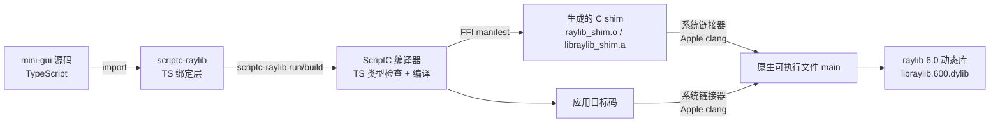

# ScriptC 工具链：从 TypeScript 到原生窗口

> [返回：第一阶段导览](01-导览.md)
> 对应大纲条目：第一阶段 4。本册讲清「TS 怎么变成一个不依赖任何 JS 引擎的原生窗口程序」：编译路线、构建产物、FFI 与 C shim、绑定安全模型、双宿主 TS 子集，以及本机实跑确认过（和踩过）的坑。**本册所有版本号、路径、报错与输出均为 2026-11-14 本机（macOS arm64 / Apple clang 17 / Node 24.10）实测。**

## 1. 编译路线：TS 在哪一步变成了什么



把这条流水线按时间切成五步，每步的输入输出都是可指认的产物：

| 步 | 做什么 | 输入 | 输出 |
|---|---|---|---|
| 1 暂存 | 建一次性源码树，改写 `"scriptc-raylib"` 导入为包内 TS 绑定源码 | 应用源码 + 绑定包 | `build/<平台>/.scriptc-raylib-source/` |
| 2 类型检查 | ScriptC 的 TS 检查（严格模式，含 `noUncheckedIndexedAccess`） | 暂存树 | 诊断信息（如 SC1013） |
| 3 编译 | TS → 目标码（C 后端，不内嵌 JS 引擎） | 暂存树 | 应用目标码 |
| 4 shim | 按 FFI manifest 生成 C 包装并编译 | `ffi.json` | `raylib_shim.o` / `raylib_generated.o` |
| 5 链接 | 系统链接器把目标码与库连成可执行文件 | 步 3+4 产物 + libraylib | `main` + 相邻 dylib |

三个关键事实：

1. **产物里没有 JS 引擎**。运行期是普通 raylib 原生进程，Node 只在构建期出场（装包、跑编译器 CLI）。
2. **绑定是「静态编译」进来的**：`scriptc-raylib run src/apps/01-window.ts` 会做一个**一次性源码暂存树**（`build/<平台>/.scriptc-raylib-source/`），把 `"scriptc-raylib"` 导入改写为包内 TS 绑定源码，再交给 scriptc 整体编译——不是运行时动态加载。
3. **首次构建会下载宿主平台的 raylib 发行包并校验**（本机日志：`Downloading https://github.com/raysan5/raylib/releases/download/6.0/raylib-6.0_macos.tar.gz`），之后有缓存。

实测版本组合：**scriptc 0.4.12 + scriptc-raylib 1.0.4（由 `@raylib/api` 6.0.1 元数据生成）+ raylib 6.0**。要求 Node ≥ 24（装包与开发工具链；运行期不需要）；构建原生产物需要链接器与平台 SDK（macOS 上即 Xcode Command Line Tools）。「实验性编译器」的身份要有心理预期：版本行为可能变，mini-gui 把实测过的版本组合钉在 `package.json`（`scriptc: ^0.4.12`、`scriptc-raylib: ^1.0.4`）里，这正是原因。

暂存树（步 1）还有一个调试上的副作用要知道：**报错路径指向暂存副本而非你的源文件**。SC1013 的报错路径就是 `app/src/main.ts:3:1` 这样的暂存树路径——看到陌生路径先想到「暂存树改写」，对照回 `src/` 下的原文件即可，不是你的工程被改了（暂存树每次构建重建）。

## 2. 构建产物逐件解读

`gui/labs/mini-gui/build/macos-universal/` 实测 `ls`，七个文件各有职责：

```text
main                 ← 可执行文件，745,080 字节
ffi.json             ← FFI manifest：TS 名字 → C 符号映射表，172,137 字节
raylib_shim.o        ← 为绑定生成的 C 中间产物，1,584 字节
raylib_generated.o   ← 绑定包装函数的目标码，274,368 字节
libraylib_shim.a     ← shim 静态库，295,880 字节，链接进 main
libraylib.600.dylib  ← raylib 运行库，3,606,792 字节
RAYLIB_LICENSE.txt   ← raylib 的许可证随产物分发
```

| 文件 | 角色 | 大小说明 |
|---|---|---|
| `main` | 应用 + 静态链进来的 shim + ScriptC 运行时支持 | 745KB——「里面没有 JS 引擎」的体积证据见 §2.1 |
| `ffi.json` | manifest：每个绑定函数的 TS 签名 ↔ C 符号 ↔ 值转换规则 | 172KB，600 个函数级别的映射，机器可查 |
| `raylib_shim.o` | C shim 的胶水目标码 | 1.5KB，薄 |
| `raylib_generated.o` | 生成的大批量包装函数目标码 | 274KB，571 个函数 × 每个一份拆装/校验代码 |
| `libraylib_shim.a` | 上面两者的归档（静态库形态） | 296KB，链接期并入 main |
| `libraylib.600.dylib` | raylib 本体 | 3.6MB，与 main 相邻放置，`@executable_path` 加载——**发布时这两个文件必须一起拷** |

两个工程细节值得点破：

- **dylib 用「相邻 + @executable_path」而不是系统路径**：可执行文件启动时按自身路径旁边的相对位置找 `libraylib.600.dylib`——这让 build 目录天然可迁移（整个目录拷走照样跑），代价是「产物是目录不是单文件」，要把 demo 带去别的机器时记得整个目录一起拷。
- **`.o` 与 `.a` 同时出现**：`.o` 是中间产物（单翻译单元），`.a` 是归档（链接器吃的静态库）。产物目录同时保留两代，是这条工具链「把中间产物落盘可查」的风格——教学上恰好，每一步的输出都摸得着。

还有一个「用体积反推内容」的读法，三步就能确认「没有 JS 引擎」不是口号：

1. `main` 745KB——主流 JS 引擎（V8/JavaScriptCore）以数十 MB 计，嵌入式方案（QuickJS/Hermes 一类）也要数 MB，745KB 的 main 里既装不下引擎、也不剩可怀疑的空间；
2. `raylib_generated.o` 274KB + `libraylib_shim.a` 296KB——多出来的部分恰好是「571 个包装函数 × 拆装代码」的量级；
3. `libraylib.600.dylib` 3.6MB 独立存在——运行库走动态链接，不掺进 main。

产物布局会「自己讲故事」，这是静态编译工具链的教学红利：每条论断（无引擎、有 shim、动态库相邻）都有一个可 `ls` 的证据。

## 3. FFI 机制：TS 怎么调 C

ScriptC 的原生互操作走「**TS 里声明签名 + manifest 绑定 C 符号**」。scriptc-raylib 在这之上生成了一层 C shim（§2 的产物）。为什么必须有 shim，而不是 TS 直连 raylib 的 C 函数？因为**两边的数据表示不同**：

- TS 侧的 `Vector2`、`Color` 是普通对象；C 侧是紧凑结构体 → shim 负责把对象**拆散成标量**再传，结构体返回值经调用期回调**重装**成对象
- TS 字符串是 UTF-8 `指针+长度` 借用段 → shim 校验、临时补 NUL 终结符给 raylib、调用后释放
- 纹理/字体这类 C 资源 → 不暴露裸指针，而是**代际句柄**（`{ handle: number, kind: "Texture" }`）由 C 侧注册表管理

把一次 `drawCircle(400, 225, 18, GOLD)` 的跨界过程画出来（GOLD 展开即 raylib 的 `{ r:255, g:200, b:0, a:255 }`）：

```text
TS 侧                          shim（C）                      raylib（C）
drawCircle(400,225,18,GOLD)
  args: number ×3 + Color 对象
        │
        ▼ 拆对象：Color{r,g,b,a} → 4 个 u8
   [400, 225, 18, 255, 200, 0, 255] ────────►  DrawCircle(400,225,18,color)
                                                  │
                                                  ▼
                                               顶点进批（第 4 册 §3）
        ◄────── 无返回值，调用结束 ──────────
```

每一次跨界都要付三笔小税：**拆装（marshaling）、校验、调用开销**。这是「FFI 不是免费的」的具体形状——它解释了两条 mini-gui 的工程取向：

1. **绘制调用走显示列表整帧重放**（第二阶段）：内核先攒 TS 侧指令表，重放时连续跨界——而不是每个逻辑操作零散跨界；
2. **重的数据（像素、字形）留在 C 侧**，TS 只拿句柄和度量值——「轻描述跨界、重资源留界」是整条工具链的内存观（第 4 册 §6 同款思路）。

按类型盘点 marshaling 的处理方式（这张表是「为什么有的 API 形状是这样的」的答案）：

| TS 侧类型 | C 侧形态 | shim 的转换 |
|---|---|---|
| `number`（整数/浮点） | `int`/`float` 等 | 直接传（最便宜，无拆装） |
| `Vector2`/`Color` 等接口对象 | 紧凑结构体 | 出参拆成标量；返回值经调用期回调重装成对象 |
| `string` | `const char*`（NUL 结尾） | 校验 UTF-8、临时补终结符、调用后释放 |
| 资源句柄 `{handle, kind}` | C 指针 | 查注册表换真指针；错误句柄当场拒绝（§4.2） |
| 回调函数 | C 函数指针 | 仅限「单向、同步、可安全回传」的形态——§4.1 里被拒的类别就是过不了这一行的 |

从表里能读出一个 API 设计规律：**raylib 绑定里「参数全是 number」的函数最便宜**（`drawCircle(x, y, r, color)` 的前三个参数零成本），带结构体与字符串的次之，碰回调的要么变形要么没有。第 4 册 §1.1 命名对照表里那些「参数平平无奇」的绘制函数，恰是性能上最友好的——API 形状与跨界成本的对应关系，值得在写 Painter 时挂在心上。

## 4. 绑定安全模型：571 个函数的边界

scriptc-raylib 由 raylib 官方 API 元数据（`@raylib/api` 6.0.1）生成，覆盖情况（`binding-report.json` 机器可查，且契约测试保证）：

| 类别 | 数量 | 说明 |
|---|---|---|
| 安全直调的官方函数 | 571 | 全部经包装导出 |
| 自动回收的分配对 | 9 | 如 `loadFileData()`、`loadImageColors()` 这类「调用即拷贝进 TS、随后 C 侧立刻释放」的操作，脚本侧**没有也不需要**对应 unload |
| 明确不提供 | 20 | 语义上无法安全跨界，逐符号原因记录在 binding-report.json |
| 变参替身 | 1 | `traceLogText()` 替代 C 的变参 `TraceLog()` |

### 4.1 那 20 个「不提供」是什么、为什么

按类别数（合计 20 个），每类都是「两种运行时模型不同」的具体证据：

| 不提供的类别 | 为什么给不了 |
|---|---|
| 裸窗口指针（平台句柄查询） | 交出原始指针 = 把 C 内存模型泄漏进 TS，任何误用都是未定义行为 |
| 裸内存分配器 | 同上：分配/释放必须配对在 C 侧，TS 拿到裸块只会制造悬垂 |
| 变参日志/格式化函数 | 变参 C ABI 无法从 TS 安全声明，所以给了定参替身 `traceLogText()` |
| 需同步回传 C 内存的回调（文件加载类） | 回调要求「同步返回新分配的 C 内存」，TS 侧无法安全供给 |
| 指针数组资源加载器（字体/模型两个） | 返回指针数组，所有权语义跨不过去 |
| 实时音频回调 | 实时线程上跑 TS 语义，延迟与 GC 抖动都不可接受 |

### 4.2 句柄注册表拒绝了什么

代际句柄不只是「数字换指针」，注册表主动拒绝三类错误操作（这是「句柄式资源管理（拒绝悬空句柄/重复释放）」的展开）：

- **悬空句柄使用**：资源已卸载后再调它的绘制函数 → 拒绝，而不是读到已回收的 GPU 内存
- **重复释放**：同一个句柄卸载两次 → 拒绝（C 侧这通常是 double-free，未定义行为）
- **kind 错配**：拿 Texture 句柄传给要 Font 的函数 → 拒绝（句柄带类型标记）

这套「最大安全绑定，而不是假装能指指针」的取舍，恰好是教学样本：**FFI 边界上的每个「不能用」，都是「两种运行时的内存模型不同」的证据**。我们在第四阶段造 RenderObject 树时，会反着用同样的思路——TS 对象树持有轻量描述，重资源全部走句柄。

### 4.3 那 9 对「自动回收」的一生

「自动回收」的机制值得单独走一遍，因为它是「一个 TS 操作折叠一对 C 调用」的样板（以 `loadFileData()` 为例的概念流程）：

```text
TS 调用 loadFileData(path)
  │
  ▼ C 侧：LoadFileData() → 得到 C 内存块（调用侧拥有）
  ▼ 回调把字节拷贝进 TS 数组（调用期同步完成）
  ▼ C 侧：立刻调用对应的 UnloadFileData() 释放
  ▼ 返回：TS 侧拿到完全自有的字节数组
```

要点在于**所有权在调用内闭环**：C 内存块的生命周期不出这次调用，TS 拿到的是拷贝。所以绑定侧**没有也不需要**导出对应的 unload——脚本侧真调 unload 反而是危险的（释放不归你管的内存）。同类还有 `compressData()`、`loadCodepoints()`、`loadImageColors()`、`loadWaveSamples()` 等。把这个模式记成一句话：**「拷贝即交接」——数据过界的那一刻，所有权就换边了。**

## 5. 构建命令与工程约定

```bash
cd gui/labs/mini-gui

npx scriptc-raylib run  src/apps/01-window.ts --dev   # 开发构建 + 运行（编译更快）
npx scriptc-raylib build src/apps/01-window.ts -o build/demo   # 发布构建
npm run typecheck   # tsc --noEmit（严格模式，含 noUncheckedIndexedAccess）
npm test            # vitest run（core 层无头测试）
npx tsx src/foo.ts  # 怀疑脚本快速验证：.ts 直接跑（不经构建；禁用裸 node，见 §6）
```

**必须用 `scriptc-raylib run/build`，不要裸调 `scriptc build`**——scriptc 自身发现不了 npm 包的原生 manifest 与声明型 FFI 符号，裸调必然失败。这是官方 README 明说的限制，不是玄学。

命令与宿主的对应关系（这张表是「为什么有五条命令」的答案）：

| 命令 | 宿主 | 出场时机 |
|---|---|---|
| `scriptc-raylib run/build` | ScriptC 编译为原生 | 跑窗口、产出可执行文件 |
| `npm run typecheck` | 无（纯静态） | 提交前检查（双宿主共同子集的看门人） |
| `npm test`（vitest） | Node + esbuild | core 层无头回归 |
| `npx tsx src/foo.ts` | Node + esbuild（tsx） | 怀疑脚本快速验证——别用裸 node，见 §6 |

### 5.0 工程配置逐件点名

`package.json` 与 `tsconfig.json` 不大，但每一行都是本册某条结论的落点（内容逐字摘录，行尾 `// ←` 为本册批注）：

```jsonc
{
  "name": "mini-gui",
  "version": "0.1.0",
  "private": true,
  "type": "module",                         // ← §5.1 的坑：没有这行 SC1013
  "scripts": {
    "dev": "scriptc-raylib run src/apps/01-window.ts --dev",   // ← 走包装 CLI，不裸调
    "test": "vitest run",
    "typecheck": "tsc --noEmit"
  },
  "devDependencies": {                      // ← 全部构建期依赖（误区 1）
    "@types/node": "^26.6.6",
    "scriptc": "^0.4.12",                   // ← 实测版本钉死
    "scriptc-raylib": "^1.0.4",
    "typescript": "^5.9.3",
    "vitest": "^3.2.4"
  },
  "engines": { "node": ">=24" }
}
```

快速怀疑验证不进 `scripts`、也不新增 devDependencies：`npx tsx src/foo.ts` 一行即用（tsx 经 npx 按需缓存，实测 v4.20.15）；为什么禁用裸 node 跑 `.ts`，§6 有实测原文。

```jsonc
{
  "compilerOptions": {
    "target": "ES2022",
    "module": "ESNext",
    "moduleResolution": "Bundler",
    "strict": true,                          // ← 双宿主都要吃的严格模式
    "noEmit": true,
    "noUncheckedIndexedAccess": true,        // ← 索引访问必判 undefined
    "exactOptionalPropertyTypes": true,      // ← 可选属性不接受显式 undefined
    "rootDir": "src",
    "skipLibCheck": true
  },
  "include": ["src/**/*.ts"]
}
```

vitest 的配置文件还藏着一条工程细节（逐字摘录注释）：

```ts
// 只跑 src/ 下的测试：build/.scriptc-raylib-source/ 是 scriptc-raylib 的暂存副本，
// 里面的 .test.ts 是同一批文件，不排除会导致测试翻倍。
export default defineConfig({
  test: {
    include: ["src/**/*.test.ts"],
    environment: "node",
  },
});
```

注意这里的主角是**暂存树**（§1 步 1）：它把整份源码连同测试都复制了一份，vitest 若不圈定 `src/`，同一批测试会跑两遍。暂存树在本课程里第二次成为「要绕开的坑」——第一次是报错路径（§1），这一次是测试收集范围。

### 5.1 坑 1：`package.json` 必须 `"type": "module"`

暂存树按最近的 `package.json` 判定模块制式。默认 `npm init` 出来的是 CommonJS，于是 ES import 全线报错（实测原文）：

```text
app/src/main.ts:3:1 - error SC1013: Node classifies this file as CommonJS,
where this ES-module syntax marker is a SyntaxError
  hint: use a .mjs/.mts extension or set the nearest package.json's "type" to "module"
```

修法一行：`npm pkg set type=module`。mini-gui 工程已带。

### 5.2 坑 2：Math.* 的「内嵌动态引擎」边界

静态编译产物不包含 Math 库的动态部分。`src/core/math.ts` 的头注释逐字记录了这个事实与对策：

```ts
// 自带数学库：scriptc-raylib 锁定的 scriptc 0.0.35 静态编译不含
// Math.sqrt / Math.pow / Math.PI / 三角函数（它们属于内嵌动态引擎，本项目构建禁用，
// 实测报 SC2012）。可用的只有：max / min / round / floor / ceil / trunc / abs、**、random。
// 于是 mini-gui 自带一份确定性实现——顺带的好处：跨宿主（原生 / Node）逐位一致。
```

于是 mini-gui 带了自己的 `sqrt`（牛顿迭代）与 `sin/cos`（泰勒展开），并附赠一个工程优点：同一份实现在原生与 Node 两个宿主**逐位一致**，测试断言可以用 `<1e-9` 这种紧容差（`math.test.ts` 就是这么写的）。教训的通用形态：**「语言是 TS」不代表「标准库处处同构」**——跨宿主工程要逐 API 盘点，而不是假设。

## 6. 双宿主的 TS 子集与特性探测

同一份源码要跑在两个宿主里：ScriptC（编译为原生）与 vitest（esbuild 转译）；本地快速验证走第三个入口 `npx tsx`——它与 vitest 同为 Node + esbuild 转译，语义一致，不引入新的宿主差异。实测结论：

| 特性 | ScriptC | vitest / tsx（Node+esbuild） | mini-gui 取舍 |
|---|---|---|---|
| 类/继承/getter/静态成员 | ✅ | ✅ | 用 |
| interface / 泛型 / Map / Set | ✅ | ✅ | 用 |
| 闭包 / 展开 / 解构 / ?? / ?. | ✅ | ✅ | 用 |
| `enum` | ✅ | ✅ | **不用**，改 `const 对象 + 联合类型`（风格纪律，非宿主限制） |
| 构造器参数属性 `constructor(public x)` | ✅ | ✅ | **不用**，显式声明字段（同上） |
| `process.env` | ✅（实测读到） | ✅ | 用（回归开关靠它） |
| `Math.sqrt/pow/PI/三角` | ❌（SC2012） | ✅ | **不用**，自带 `core/math.ts`（唯一硬性宿主限制） |

**实跑**：`src/probe.ts` 特性探测（类继承、泛型、Map/Set、闭包计数器、展开解构、try/catch、switch、instanceof）经 `scriptc run` 输出 `PROBE-OK`，全部通过。三项排除的性质要分开看：Math.* 是硬性宿主限制（ScriptC 报 SC2012，「不能用而不用」）；`enum` 与参数属性在 vitest、tsx 都能跑（「能用而不用」的风格纪律），来历见下两段。

「为什么不用 enum」值得多说一句——注意它**不是宿主限制**：enum 在 ScriptC、vitest、tsx 三个入口都能跑（实测 `npx tsx` 跑含 enum 的文件，连反向映射 `Mode[1]` 都正常输出）。mini-gui 仍坚持不用，理由有三：其一，`const 对象 + 联合类型`表达力等价（类型收窄、按键取值全都有），却没有 enum 反向映射的语义负担；其二，这种写法本身是「可剥离语法」（erasable），整个语言子集将来落到任何更保守的验证工具上也不踩坑；其三，三个入口行为逐位一致，交叉验证时不用怀疑「是不是 enum 的反向映射又在作怪」。一句话：**能跨宿主的写法不止一种时，选约束最少的**——这条对所有「一份代码多宿主」的项目通用。参数属性同理：显式声明字段在所有宿主行为一致，可读性也更好。

为什么坚持要第三个入口（tsx）？因为它是「最快的怀疑验证器」：`npx tsx src/foo.ts` 直接跑，没有构建、没有 vitest 开销；而且它的转译语义与 vitest 同源（同为 esbuild），在这里验证通过的写法，回到回归宿主必然一致——配合上面的风格纪律，怀疑脚本的结论可以无修正地迁移。这条入口有一条明确的禁令：**不要用裸 `node` 直接执行 `.ts`**。Node 24 对 `.ts` 默认走「剥掉类型、直接执行」（strip-only）路线，需要「转译」的语法当场报错（实测原文，Node 24.10）：

```text
SyntaxError [ERR_UNSUPPORTED_TYPESCRIPT_SYNTAX]: TypeScript enum is not supported in strip-only mode
```

同一个文件换 `npx tsx` 直接跑通（tsx v4.20.15，含反向映射输出）。用 strip-only 的路线去验证语义，得出的结论与真实宿主不一致——所以快速验证一律走 tsx，裸 node 只配当反面教材。还要注意分工边界：vitest 测试文件不能拿 tsx 直接跑（实测报 `Vitest failed to access its internal state`，测试的运行时状态由 vitest 运行器注入）——**怀疑脚本归 tsx、测试归 vitest、交付归 ScriptC**，三者不互相越界。

三个入口各自的角色排一下序，方便记：**ScriptC 管交付**（唯一的原生产物）、**vitest 管回归**（无头、快、断言丰富）、**tsx 管怀疑**（最快、最简、与回归宿主同语义）。

## 7. 回归开关与平台说明

demo 全部尊重环境变量（原生进程里 `process.env` 实测可用——曾读到回归开关 `MINI_GUI_SECONDS=42` 的原生产物输出；`argv` 里则是暂存可执行文件的路径，不是你输入的命令行）：

```bash
MINI_GUI_SECONDS=2 MINI_GUI_FPS=30 npx scriptc-raylib run src/apps/01-window.ts --dev
```

| 变量 | 作用 | 用法 |
|---|---|---|
| `MINI_GUI_SECONDS` | 累计时间到点自动退出并打印统计（帧数、耗时、avgFps、maxDt） | 不设 = 一直跑到关窗；回归脚本的「定时炸弹」 |
| `MINI_GUI_FPS` | 目标帧率（`setTargetFPS` 的输入） | 第 6 册帧率无关实验的自变量 |
| `MINI_GUI_SHOT` | 退出前把最后一帧存成 PNG | 视觉回归的取证手段（第 6 册 §6） |

工具链提供 `build:linux-x64` / `build:linux-arm64` / `build:windows-x64` 交叉目标。本课程只在 **macOS（arm64）实测**；Linux 侧按工具链支持声明，未实机验证——如果你在 Linux 上跑，流程应完全一致（首建同样会下载对应 raylib 包）。

`MINI_GUI_SHOT` 的语义在 `01-window.ts` 的头注释里有原文（逐字摘录）：`MINI_GUI_SHOT 退出前把最后一帧存成 PNG（文件名，如 shot.png）`。它与截图时机的铁律（必须在 `endDrawing()` 之后，第 4 册 §3）配合，构成「视觉取证」的标准姿势；工程根目录下的 `shot01.png`/`shot02.png` 就是这么来的存档。

顺带一提回归文化的闭环：**「跑起来才算」之所以能自动化，靠的是这三件套**——定时退出（SECONDS）+ stdout 统计（第 6 册 §5）+ 截图（SHOT）。任何阶段的 demo 只要遵守这个约定，就能在 CI 里跑 2 秒、grep 数字、比截图。

## 8. 常见误区

**误区 1：「原生可执行文件里藏着一个 Node/JS 引擎。」**
产物里没有。Node 只在构建期出场（跑编译器 CLI、装依赖），`main` 是链接了 shim 与 ScriptC 运行时支持的原生程序（745KB 的体积本身就是证据——任何 JS 引擎都以 MB 计）。「npm 装的包 = 运行时依赖」的直觉在这里失效：devDependencies 全是构建期工具。

**误区 2：「FFI 调用和普通函数调用一样便宜。」**
每次跨界都有拆装、校验与调用开销（§3）。单次微不足道，但「每帧每控件多次跨界」会积少成多。mini-gui 的对策是显示列表整帧重放、重资源走句柄——**减少跨界次数与跨界数据量**是 FFI 应用的两条基本纪律。

**误区 3：「scriptc-raylib 只是一份 .d.ts 类型声明包。」**
它同时提供：TS 声明（开发期类型）、包内 TS 绑定源码（编译期被暂存进源码树）、原生 manifest 与 FFI 符号（构建期生成 shim）、以及首次构建时的 raylib 发行包下载与校验。把它当「纯类型包」会解释不了 `为什么裸调 scriptc build 失败`——manifest 的发现逻辑在它的 CLI 里。

**误区 4：「Linux 目标在本课程已经验证过。」**
没有。工具链声明支持 linux-x64/arm64 交叉构建，本站只在 macOS arm64 实跑（大纲亦如此注明）。「工具链支持」与「本课程实测」是两个声明等级——本站所有「实测」字样都指后者，这是全站的措辞纪律。

## 9. 延伸阅读与本册小结

三座邻站对本册的接口：

- **compiler 站**：本册的流水线（暂存 → 类型检查 → 编译 → 生成 shim → 链接）就是一个小型编译驱动（compiler driver）的完整案例，SC 编号诊断信息、多目标码产物、链接期符号解析，都是 compiler 站第一阶段「编译器是什么」的活素材；GC 专题的分配-释放配对与 §4 的注册表纪律同源。
- **webgl 站**：§3 的跨界税往下延伸就是「CPU 侧攒顶点、一次提交」的 GPU 编程纪律——raylib 的批处理（第 4 册 §3）与 WebGL 的 buffer 上传是同一门课的两种方言。
- **react 站**：§7 的「回归三件套」（定时退出 + stdout 统计 + 截图）与 react 站各手册的验收脚本文化同款——「跑起来才算」是全仓库共享的工程价值观。

本册小结：

- 五步流水线：暂存树 → 类型检查 → 编译 → 生成 shim → 链接；产物无 JS 引擎，Node 只在构建期出场。
- 产物七件：main 745,080B、ffi.json 172,137B、shim.o 1,584B、generated.o 274,368B、shim.a 295,880B、libraylib.600.dylib 3,606,792B、LICENSE；dylib 相邻加载，发布成目录。
- FFI 三笔税：拆装、校验、调用开销；对策是整帧重放与句柄化。
- 安全模型：571 直调 + 9 对自动回收 + 20 个不提供 + traceLogText 变参替身；注册表拒绝悬空、重复释放、kind 错配。
- 双宿主子集：Math.* 是唯一硬性宿主限制（SC2012），enum/参数属性属风格纪律排除（`const 对象 + 联合类型` 替代）；快速验证走 `npx tsx`，不用裸 node（strip-only 路线实测报 `ERR_UNSUPPORTED_TYPESCRIPT_SYNTAX`）。`process.env` 可用（实测读到 MINI_GUI_SECONDS=42）。
- 坑两条实锤：缺 `"type": "module"` 报 SC1013（原文在 §5.1）；Math.* 报 SC2012（math.ts 头注释）。

## 自测

1. 产物可执行文件里有没有 JS 引擎？Node 在哪个阶段出场？devDependencies 属于运行期依赖吗？
2. 为什么需要 C shim？说出两类它必须做的「表示转换」，以及字符串借用的完整流程。
3. 代际句柄注册表拒绝哪三类错误操作？这为什么比「裸指针当数字传」安全？
4. 那 20 个不提供的函数分六类，每类的「跨界障碍」分别是什么？变参 TraceLog 的替身长什么样？
5. 裸调 `scriptc build` 会怎样？为什么？（用「谁负责发现 manifest」回答。）
6. `enum` 与参数属性在 vitest/tsx 都能跑，mini-gui 为什么仍不用？这种「能用而不用」与 Math.* 的「不能用而不用」本质差别在哪？快速怀疑验证为什么走 tsx 而不是裸 node？
7. `Math.sqrt` 在哪个宿主可用、哪个宿主报错（错误号是什么）？mini-gui 的替代方案附赠了什么工程优点？
8. `libraylib.600.dylib` 为什么放在 main 相邻目录？把 main 单独拷走会发生什么？
9. 原生产物里 `process.env` 读到的是什么？`argv[0]` 指向哪里？（提示：暂存树。）
10. 实操题：跑 `ls -l build/macos-universal/` 对照 §2 的七件产物与字节数；再跑 `npm pkg get type` 确认模块制式（提示：如果不是 `"module"`，§5.1 的报错会在下一次构建等着你）。
