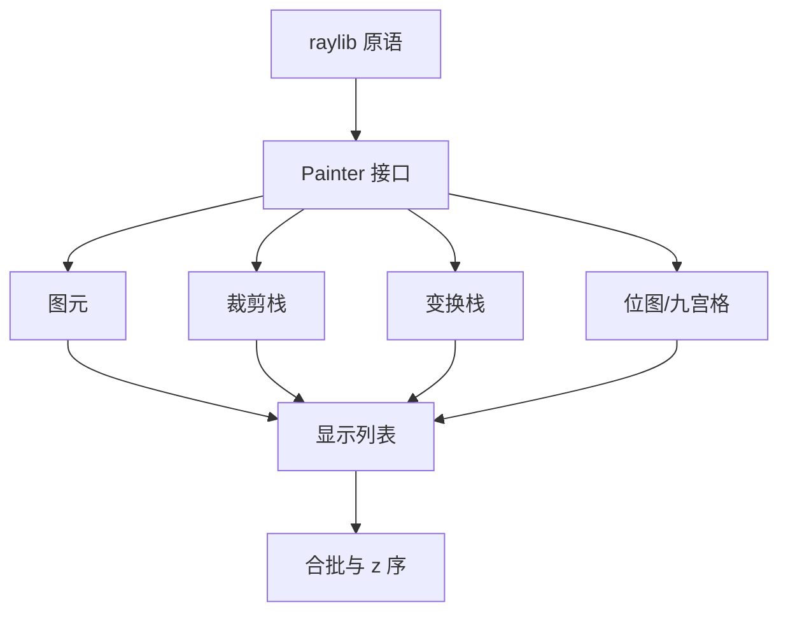

# 第二阶段导览：绘制层

> [返回：GUI框架学习大纲](../GUI框架学习大纲.md)
> 本阶段把 raylib 的裸绘制调用包成平台无关的 Painter API：基础图元、裁剪与变换栈、位图与九宫格，最后落到显示列表——后面所有阶段画任何东西，都只经过这一层。

## 分册索引

| 分册 | 对应大纲条目 | 一句话说明 | 状态 |
|---|---|---|---|
| 01-导览.md | — | 本页 | ✅ |
| 02-从裸调用到Painter.md | 1 | 为什么要抽象、立即绘制 vs 显示列表、save/restore | ✅ |
| 03-基础图元.md | 2 | 几何语义、颜色与调色板、fill/stroke、矩形/圆角/圆/线 | ✅ |
| 04-裁剪与变换.md | 3 | scissor 栈、平移栈、嵌套坐标系 | ✅ |
| 05-位图与九宫格.md | 4 | 纹理句柄、drawImage、NPatch 拉伸 | ✅ |
| 06-显示列表与批处理.md | 5 | 绘制命令记录、按纹理状态合批、z 序 | ✅ |

## 阶段目标

学完本阶段，你应该能不查资料做到：

- 写出一个后端可替换的 Painter 接口（raylib 只是其实现之一），并解释为什么框架内核不能直接调 raylib
- 实现嵌套裁剪（求交）与变换栈，并说清 save/restore 与矩阵栈的对应关系
- 用九宫格画出边框不变形的背景图，解释 NPatch 九个区域各自怎么拉伸
- 解释显示列表的价值（重放 / 重排 / 可测），以及按纹理合批为什么能减少开销

## 知识点地图

## 实践任务清单

1. 实现 `Painter` 接口与 `RaylibPainter` 后端，附一个记录型 mock 后端（供无头测试）
2. 用显示列表画一张卡片 UI：圆角背景 + 边框 + 嵌套裁剪的滚动区 + 九宫格按钮背景
3. 用 mock 后端断言绘制命令序列与裁剪求交结果（无窗口跑通）
4. 对比「直接调 raylib」与「经显示列表重放」的同场景帧时间

## 阶段自测

1. 框架内核直接调 raylib 绘制有什么问题？举两个具体后果。
2. 嵌套裁剪时 scissor 矩形怎么算？子裁剪比父裁剪大时会发生什么？
3. 九宫格里四个角、四条边、中心区各自的绘制规则是什么？
4. 显示列表记录后，绘制顺序还能变吗？什么时候值得按纹理重排？
5. save/restore 如果不配对会出现什么状态泄漏？

## 常见误区与正解

绘制层看起来只是「把函数再包一层」，但包法不同，后面四个阶段的可测性和性能上限就完全不同。下面五条是最常见的想当然。

| 误区 | 为什么错 | 正解 |
|---|---|---|
| Painter 只是给 raylib 函数换个名字，属于过度设计 | 没有这层，控件代码会直接依赖具体图形库：换后端要改所有控件，测试必须开真窗口，绘制顺序也无法在提交前检查或调整 | 抽象的价值在于「内核只认识接口」。接口之下可以是真实后端，也可以是只做记录的模拟后端，详见 [02-从裸调用到Painter](02-从裸调用到Painter.md) |
| 子节点设置的裁剪区域可以比父节点大，从而画到父节点外面 | 裁剪是单调收缩的：新的裁剪矩形要和当前裁剪矩形求交集，结果只会更小或相等，否则滚动区域里的内容就会溢出到容器之外 | 入栈时求交，出栈时恢复；需要画到外面的内容（如弹出层）应当挂在更高的层级，而不是试图突破裁剪，详见 [04-裁剪与变换](04-裁剪与变换.md) |
| 保存与恢复偶尔漏一次没关系，下一帧会重置 | 漏掉恢复会让裁剪和平移泄漏给后续兄弟节点，表现为某个控件之后的内容整体偏移或莫名消失，而且出错位置和肇事位置往往不在同一处 | 把配对当作硬约束：谁保存谁恢复，并在帧末断言栈深度归零，把泄漏变成立刻可见的失败 |
| 九宫格就是把一张图按比例拉伸 | 整图拉伸会让圆角和描边跟着变形。九宫格的要点恰恰是区别对待：四个角不缩放，四条边只沿一个方向拉伸，只有中心区双向拉伸 | 先确定四个边距，再分别计算九个源矩形和九个目标矩形；目标尺寸小于两侧边距之和时要有明确的退化规则，详见 [05-位图与九宫格](05-位图与九宫格.md) |
| 显示列表的意义就是合批提速，所以一定要按纹理重排 | 重排会改变绘制先后，而半透明内容的正确性依赖顺序；况且底层图形库自身已有批处理时，上层再排序可能毫无收益 | 显示列表首先换来的是可重放、可检查、可测试；合批是可选项，要先测量再决定，详见 [06-显示列表与批处理](06-显示列表与批处理.md) |

## 术语速查表

| 术语 | 英文 | 一句话解释 |
|---|---|---|
| 画笔接口 | Painter | 控件唯一能看到的绘制入口，屏蔽底层图形库的差异 |
| 图元 | Primitive | 不可再分的基本绘制单位，如矩形、圆角矩形、圆、线段 |
| 填充与描边 | Fill / Stroke | 前者涂满形状内部，后者只沿轮廓画一定宽度的线 |
| 裁剪矩形 | Scissor / Clip Rect | 限定后续绘制只在该矩形内生效的区域 |
| 裁剪栈 | Clip Stack | 按嵌套层级保存裁剪矩形的栈，入栈求交，出栈恢复 |
| 变换栈 | Transform Stack | 按嵌套层级累积坐标偏移的栈，让子节点使用局部坐标 |
| 烘焙 | Baking | 记录命令时就把当前偏移与裁剪算进坐标，重放时不再依赖状态 |
| 纹理句柄 | Texture Handle | 内核持有的不透明编号，代表后端侧的一张位图 |
| 九宫格 | Nine-Patch | 把位图切成九块、分区拉伸以保持边角不变形的贴图方式 |
| 着色调制 | Tint | 贴图时把每个像素与指定颜色相乘，实现染色与透明度控制 |
| 显示列表 | Display List | 一帧内所有绘制命令的有序记录，可重放、可检查 |
| 合批 | Batching | 把状态相同的连续绘制合并成一次提交以减少开销 |
| 剔除 | Culling | 提前丢掉完全落在可见区域之外的绘制命令 |

## 与真实框架对照

下表是概念层面的对应关系，用来帮你把本阶段的每个零件安放到熟悉的系统里；各家实现细节远比这里复杂，不要把它当作源码级的等价。

| 本阶段概念 | 浏览器画布接口 | Flutter | Chromium | Qt |
|---|---|---|---|---|
| 画笔接口 | 二维绘图上下文 | `Canvas` | 绘制上下文 `GraphicsContext` | `QPainter` |
| 可替换后端 | 由浏览器内部决定 | 引擎层的渲染器（Skia 或 Impeller） | Skia 及其上的合成器 | `QPaintEngine` 与 `QPaintDevice` |
| 保存与恢复 | `save` 与 `restore` | `save` 与 `restore` | 同名的状态保存机制 | `save` 与 `restore` |
| 裁剪 | `clip` | `clipRect` 等 | 裁剪属性节点 | `setClipRect` |
| 九宫格 | 样式里的边框图像 | 图片的中心切片参数 | 边框图像的绘制路径 | 快速界面里的边框图像元素 |
| 显示列表 | 无公开对应物 | 图层树与引擎侧的显示列表 | 绘制操作缓冲与显示项列表 | 场景图的节点树 |

从这张表可以读出三点结论：

- 保存与恢复这套状态栈语义几乎是所有二维绘图接口的共识，我们没有理由另起炉灶。前端读者可以直接把画布接口的经验搬过来。
- 成熟框架都把「记录」和「光栅化」拆成两步，中间产物就是某种形式的显示列表。拆开之后，记录可以在界面线程完成，光栅化可以挪到别的线程甚至别的进程，这是合成器架构的前提。
- 我们的简化在于：变换只做平移并在记录时烘焙进坐标，不支持旋转和缩放。这让裁剪始终是轴对齐矩形，求交只需几次比较；代价是做不了旋转动画，这个取舍在 [04-裁剪与变换](04-裁剪与变换.md) 里有交代。

## 踩坑与排查速查

动手实现时最常遇到的现象集中在状态栈和坐标换算上。先按现象定位原因，再回对应分册核对实现。

| 现象 | 常见原因 | 处置 |
|---|---|---|
| 某个控件之后的所有内容整体偏移 | 平移入栈后没有出栈，偏移泄漏给了后续兄弟 | 检查该控件绘制函数的每条返回路径是否都恢复了状态，尤其是提前返回的分支 |
| 滚动区域的内容画到了容器外面 | 设置裁剪时直接覆盖了当前裁剪，没有与父裁剪求交 | 入栈时一律求交，并用模拟后端断言求交后的矩形 |
| 内容整块消失 | 求交结果为空矩形，后续绘制全部被剔除；或者宽高出现了负值 | 打印当前裁剪矩形，确认父子矩形是否在同一坐标系下比较 |
| 九宫格背景的圆角被压扁或拉长 | 四个角参与了拉伸，或者源矩形与目标矩形的边距取值不一致 | 逐块核对九个矩形，先在纸上把尺寸算一遍再对照代码 |
| 贴图边缘出现细缝或重叠 | 坐标含小数，相邻分块取整方向不一致 | 统一取整策略，保证相邻分块共享同一条边界坐标 |
| 半透明内容的叠加结果不对 | 为了合批调整了绘制顺序，破坏了由后向前的混合次序 | 含半透明的命令保持原始顺序，只在不影响结果的范围内重排 |
| 无头测试通过但真窗口画面不对 | 模拟后端只验证了命令序列，没有覆盖真实后端对命令的执行 | 为真实后端补充截图级的人工核对，并把发现的差异沉淀成新的命令级断言 |
