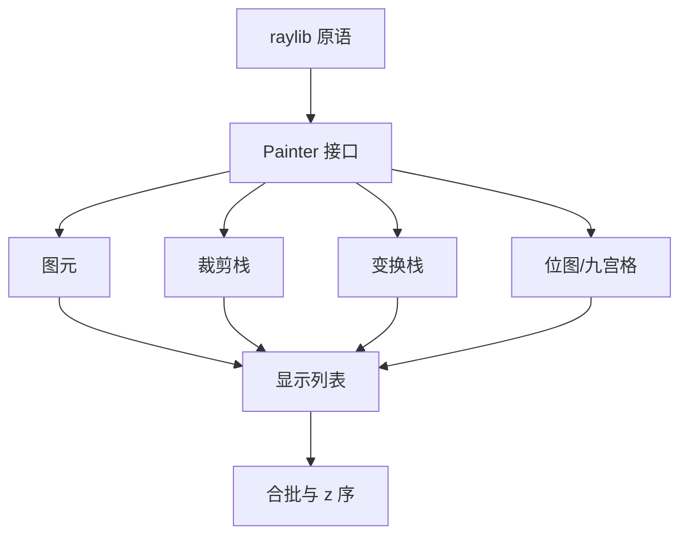

# 第二阶段导览：绘制层

> [返回：GUI框架学习大纲](../GUI框架学习大纲.md)
> 本阶段把 raylib 的裸绘制调用包成平台无关的 Painter API：基础图元、裁剪与变换栈、位图与九宫格，最后落到显示列表——后面所有阶段画任何东西，都只经过这一层。

## 分册索引

| 分册 | 对应大纲条目 | 一句话说明 | 状态 |
|---|---|---|---|
| 01-导览.md | — | 本页 | ✅ |
| 02-从裸调用到Painter.md | 1 | 为什么要抽象、立即绘制 vs 显示列表、save/restore | ✅ |
| 03-基础图元.md | 2 | 几何语义、颜色与调色板、fill/stroke、矩形/圆角/圆/线 | ✅ |
| 04-裁剪与变换.md | 3 | scissor 栈、平移栈、嵌套坐标系 | ✅ |
| 05-位图与九宫格.md | 4 | 纹理句柄、drawImage、NPatch 拉伸 | ✅ |
| 06-显示列表与批处理.md | 5 | 绘制命令记录、按纹理状态合批、z 序 | ✅ |

## 阶段目标

学完本阶段，你应该能不查资料做到：

- 写出一个后端可替换的 Painter 接口（raylib 只是其实现之一），并解释为什么框架内核不能直接调 raylib
- 实现嵌套裁剪（求交）与变换栈，并说清 save/restore 与矩阵栈的对应关系
- 用九宫格画出边框不变形的背景图，解释 NPatch 九个区域各自怎么拉伸
- 解释显示列表的价值（重放 / 重排 / 可测），以及按纹理合批为什么能减少开销

## 知识点地图

## 实践任务清单

1. 实现 `Painter` 接口与 `RaylibPainter` 后端，附一个记录型 mock 后端（供无头测试）
2. 用显示列表画一张卡片 UI：圆角背景 + 边框 + 嵌套裁剪的滚动区 + 九宫格按钮背景
3. 用 mock 后端断言绘制命令序列与裁剪求交结果（无窗口跑通）
4. 对比「直接调 raylib」与「经显示列表重放」的同场景帧时间

## 阶段自测

1. 框架内核直接调 raylib 绘制有什么问题？举两个具体后果。
2. 嵌套裁剪时 scissor 矩形怎么算？子裁剪比父裁剪大时会发生什么？
3. 九宫格里四个角、四条边、中心区各自的绘制规则是什么？
4. 显示列表记录后，绘制顺序还能变吗？什么时候值得按纹理重排？
5. save/restore 如果不配对会出现什么状态泄漏？
