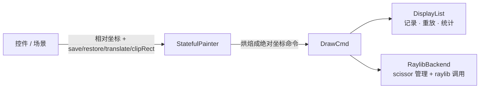

# 从裸调用到 Painter：给绘制装一个可替换的底座

> [返回：第二阶段导览](01-导览.md)
> 对应大纲条目：第二阶段 1。本册回答：为什么框架内核不能直接调 raylib？Painter 抽象怎么设计？「记录时烘焙」与「保留变换」两种显示列表策略怎么选？文末附一组 ScriptC 0.0.35 类型系统的一手发现（抽象类 vs 接口、复合赋值、数组清空）。文中代码逐字摘自 `gui/labs/mini-gui/src/core/painter.ts`（274 行）与 `src/apps/02-painter.ts`（86 行）；测试输出来自本机实跑 `npx vitest run`（撰写时快照：全库 116 tests / 13 files 全绿）。

## 1. 直接调 raylib 的三个后果

假设第四阶段的控件树直接调 `drawRectangle` 画自己，会发生什么？三个后果，各自在后面的阶段爆雷：

| 后果 | 具体表现 | 爆雷阶段 |
|---|---|---|
| 不可测 | 布局与绘制的正确性只能在真窗口里肉眼验证；无头测试无从谈起 | 第八阶段（CI 里没有窗口） |
| 不可换 | 渲染后端焊死在 raylib 上；想换软光栅器（教学）或 GPU 自绘（展望）就是全库重写 | 展望：自绘后端 |
| 不可调度 | 拿不到「一帧的全部绘制命令」，算不了脏矩形、做不了按纹理合批 | 第六阶段（脏区重绘） |

逐条拆开：

1. **不可测**——`drawRectangleRec` 是 FFI 调用，必须有真窗口上下文才能执行。测试想验证「列表滚动后第 7 行是否还在画」，只能开窗口截图肉眼比对；断言写不进 vitest
2. **不可换**——`import { drawRectangleRec } from "scriptc-raylib"` 一旦出现在 `core/` 里，内核就与 raylib 的坐标系、颜色结构、纹理句柄全部耦合
3. **不可调度**——绘制调用散落在各个控件内部、立即执行、不留痕迹。第六阶段需要「这一帧画了哪些命令、哪些落在脏矩形里」的完整清单，直接调用收集不起来

所以第二阶段第一件事：把「画什么」与「谁来画」拆开。**控件产出命令，后端消费命令**。

## 2. 分层总览：Painter → StatefulPainter → CommandSink

先看 `painter.ts` 的头注释，把分层念一遍（逐字摘录）：

```ts
// 绘制层：Painter（带状态的绘制 API）+ 绘制命令 + DisplayList（显示列表）。
//
// 分层：
//   Painter         —— 给框架/控件用的绘制接口：save/restore/translate/clipRect + 各种图元
//   StatefulPainter —— Painter 的唯一实现：维护变换栈与裁剪栈，把相对坐标「烘焙」成绝对坐标命令
//   CommandSink     —— 命令的去处：DisplayList（记录）或后端（RaylibBackend，真正画）
//
// 关键取舍：变换与裁剪在「记录时」烘焙进命令（绝对坐标 + 每条命令自带 clip）。
// 好处是命令自包含、可重放、可断言；代价是命令不再保留树形变换信息（Flutter 选择保留，见分册）。
```

最后一段「关键取舍」就是本册的主线。整条链路画成图：



三个角色各司其职：

| 角色 | 形态 | 职责 | 认不认识 raylib |
|---|---|---|---|
| `Painter` | 抽象类 | 控件看到的 API：图元 + 状态四件套 | 不认识 |
| `StatefulPainter` | 唯一实现 | 维护变换/裁剪栈，烘焙相对坐标 | 不认识 |
| `CommandSink` | 抽象类 | 命令的去处 | DisplayList 不认识；RaylibBackend 认识 |

用起来是真代码（摘自 `apps/02-painter.ts` 的帧循环，注释也是原文）：

```ts
  // ---- 1. 记录：场景 → 显示列表（发生在 beginDrawing 之前）----
  displayList.clear();
  scene.culled = 0; // 统计按帧清零
  const scroll = ((sin(elapsed * 0.8) + 1) / 2) * (12 * 36 - 220);
  buildCardScene(scene, { scrollY: scroll, texture: checkerTex }, WIDTH, HEIGHT);

  // ---- 2. 重放：显示列表 → raylib 后端（scissor 只在裁剪变化时切换）----
  beginDrawing();
  clearBackground(RAYWHITE);
  displayList.replay(backend);
  backend.endFrame();
  endDrawing();
```

**为什么中间再隔一层 CommandSink？** 因为「记录」和「执行」要用同一份烘焙结果——测试里 `DisplayList` 就是断言对象（黄金用例），窗口里 `RaylibBackend` 就是执行器，内核代码一行不改。

## 3. DrawCmd：八种命令，一种形状

命令层的数据定义（`painter.ts` 逐字摘录）：

```ts
export type DrawCmd =
  | { op: "fillRect"; rect: Rect; color: Color; clip: Rect | null }
  | { op: "strokeRect"; rect: Rect; thickness: number; color: Color; clip: Rect | null }
  | { op: "fillRoundedRect"; rect: Rect; radius: number; color: Color; clip: Rect | null }
  | {
      op: "line";
      x1: number;
      y1: number;
      x2: number;
      y2: number;
      thickness: number;
      color: Color;
      clip: Rect | null;
    }
  | { op: "fillCircle"; cx: number; cy: number; radius: number; color: Color; clip: Rect | null }
  | { op: "text"; text: string; x: number; y: number; fontSize: number; color: Color; clip: Rect | null }
  | { op: "texture"; texture: TextureId; dest: Rect; tint: Color; clip: Rect | null }
  | {
      op: "ninePatch";
      texture: TextureId;
      patch: NinePatch;
      dest: Rect;
      tint: Color;
      clip: Rect | null;
    };
```

用可辨识联合（`op` 字面量做 tag）而不是类层次，有三个理由：

1. **命令是数据不是行为**——它会被 `JSON` 式地比较（`expect(list.commands).toEqual([...])`）、被统计（`countByOp`）、被逐条转发（`replay`），plain object 最顺手
2. **switch 窄化**——后端 `execute` 里 `switch (cmd.op)` 之后每个分支自动拿到精确字段类型，TS 层面杜绝「text 命令取 rect」
3. **ScriptC 兼容**——对象字面量就是记录形状，联合类型两侧宿主都支持（第一阶段工具链册的子集表）

每条命令都带 `clip: Rect | null`——这是「烘焙」策略的落点：**裁剪在记录时就算好、随命令携带**，后端不需要理解栈。代价与收益的完整对照见第 8 节。

还有一个容易被忽略的小类型：`TextureId = number`。它不是 raylib 的 `Texture`（那是不透明句柄对象），而是后端注册表自己发的整数编号——详见《05-位图与九宫格》。

## 4. Painter 抽象类：控件看到的一切

12 个抽象签名（4 个状态操作 + 8 个图元），逐字摘录：

```ts
export abstract class Painter {
  abstract save(): void;
  abstract restore(): void;
  /** 平移当前坐标系（累加）。 */
  abstract translate(dx: number, dy: number): void;
  /** 与当前裁剪求交；裁剪只会越裁越小，restore 才能放大。 */
  abstract clipRect(r: Rect): void;
  abstract fillRect(r: Rect, color: Color): void;
  abstract strokeRect(r: Rect, thickness: number, color: Color): void;
  abstract fillRoundedRect(r: Rect, radius: number, color: Color): void;
  abstract line(x1: number, y1: number, x2: number, y2: number, thickness: number, color: Color): void;
  abstract fillCircle(cx: number, cy: number, radius: number, color: Color): void;
  abstract text(text: string, x: number, y: number, fontSize: number, color: Color): void;
  abstract texture(texture: TextureId, dest: Rect, tint: Color): void;
  abstract ninePatch(texture: TextureId, patch: NinePatch, dest: Rect, tint: Color): void;
}
```

按语义分两组读：

**状态组（4 个）**——改变「后续命令如何被解释」，不产生命令：

- `save/restore`：状态存栈/出栈，成对使用；不配对的 `restore` 直接抛错（第 6 节）
- `translate(dx,dy)`：**累加**平移当前坐标系；控件在自己的局部坐标里摆内容
- `clipRect(r)`：与当前裁剪**求交**——裁剪只会越裁越小，`restore` 才能恢复大裁剪

**图元组（8 个）**——每个都产生恰好一条命令（或被剔除）：矩形三类（填充/描边/圆角）、线、圆、文本、纹理、九宫格。选型原则在《03-基础图元》详述：**够画完一张真实卡片 UI，且每个都有明确的「后端如何实现」答案**。

注意 `Painter` 里**没有** `rotate/scale`——v1 的变换只有平移，这是有意的裁剪（第 8 节讲清楚为什么够用）。

## 5. CommandSink：命令的出口

```ts
/**
 * 命令的消费者：显示列表记录它，绘制后端执行它。
 *
 * 注意：这里是抽象类而不是 interface——ScriptC 的类型系统里「类」是名义类型、
 * 「interface/记录」是结构类型，类实例不能当 interface 传（SC2002 实测）。
 * 需要「多个实现类」的多态点一律用抽象类继承；对象字面量才可以匹配 interface。
 */
export abstract class CommandSink {
  abstract execute(cmd: DrawCmd): void;
}
```

只有一个方法，却是整个分层的关键铰链：`StatefulPainter` 只认 `CommandSink`，于是同一份场景代码可以流进两个完全不同的目的地：

| 实现 | execute 做什么 | 谁用它 |
|---|---|---|
| `DisplayList` | `commands.push(cmd)`——存起来 | 无头测试、帧循环的记录阶段 |
| `RaylibBackend` | 翻译成 raylib 调用并执行 | 窗口程序的重放阶段 |

注释里那句「SC2002 实测」是一手踩坑记录，第 9 节展开。

## 6. StatefulPainter：一个小而完整的状态机

### 6.1 全部状态就一个三元组

```ts
export class StatefulPainter extends Painter {
  private readonly sink: CommandSink;
  private readonly stack: PaintState[] = [];
  private state: PaintState = { dx: 0, dy: 0, clip: null };

  /** 发往 sink 的命令数。 */
  emitted = 0;
  /** 因完全落在裁剪区外而被丢弃的命令数（只对有明确包围盒的图元做剔除）。 */
  culled = 0;
```

`PaintState` 在文件上方定义：`{ dx, dy, clip }`，其中 `clip` 是**绝对坐标**、`null` 表示不裁剪。加两个公开计数器 `emitted` / `culled`，就是最原始的性能观测口——不用 profiler 就能回答「这一帧产了多少命令、扔了多少」。

### 6.2 save/restore：值拷贝，不是引用

```ts
  save(): void {
    this.stack.push({ dx: this.state.dx, dy: this.state.dy, clip: this.state.clip });
  }

  restore(): void {
    const prev = this.stack.pop();
    if (prev === undefined) {
      throw new Error("Painter.restore() 没有配对的 save()");
    }
    this.state = prev;
  }
```

两个细节值得盯：

1. **push 的是新对象字面量**（值拷贝），不是 `this.state` 本身。如果 push 引用，后续 `translate` 改的就是栈里那份「快照」，restore 等于没恢复——这是状态机快照的经典浅坑。`clip` 里的 `Rect` 不需要再深拷贝，因为 `clipRect` 每次都生成新矩形、从无原地修改（`rectIntersect`/`rectTranslate` 都是纯函数）
2. **restore 空栈即抛错**，错误消息原文就是 `Painter.restore() 没有配对的 save()`。宁可早炸，不可静默错画——测试里有专项（第 10 节）

### 6.3 translate 与 clipRect：状态怎么变

```ts
  translate(dx: number, dy: number): void {
    // 不写 this.state.dx += dx：嵌套接收者上的复合赋值在 scriptc 0.0.35 不支持（SC1090）
    this.state.dx = this.state.dx + dx;
    this.state.dy = this.state.dy + dy;
  }

  clipRect(r: Rect): void {
    const abs = rectTranslate(r, this.state.dx, this.state.dy);
    this.state.clip = this.state.clip === null ? abs : rectIntersect(this.state.clip, abs);
  }
```

`translate` 是累加（两次 `translate(10,0)` 等于一次 `translate(20,0)`）。`clipRect` 先把**局部矩形平移到绝对坐标系**，再与当前裁剪求交——所以 clip 永远存绝对值，且交出来的结果只会不变或变小。那行注释是 ScriptC 编译边界的实录，第 9 节展开。

### 6.4 图元方法的统一骨架：abs → cull → emit

以 `fillRect` 为例：

```ts
  fillRect(r: Rect, color: Color): void {
    const rect = this.abs(r);
    if (this.cullRect(rect)) return;
    this.emit({ op: "fillRect", rect, color, clip: this.state.clip });
  }
```

所有图元方法都是这三步：坐标过 `abs()`（平移烘焙）、包围盒过 `cullRect()`（剔除判断）、`emit()` 发给 sink。生产线画成图：

```text
fillRect(r) ──► abs: 平移烘焙 ──► cullRect: 与裁剪求交 ─┬─ 交为空 → culled += 1，丢弃
                                                        └─ 有交 → emit → sink.execute(cmd)
```

`emit` 与两个私有助手（逐字摘录）：

```ts
  private abs(r: Rect): Rect {
    return rectTranslate(r, this.state.dx, this.state.dy);
  }

  private clipIsEmpty(): boolean {
    return this.state.clip !== null && rectIsEmpty(this.state.clip);
  }

  /** 包围盒与裁剪区无交集则剔除；返回 true 表示已剔除。 */
  private cullRect(bounds: Rect): boolean {
    const clip = this.state.clip;
    if (clip === null) return false;
    if (rectIsEmpty(clip) || rectIsEmpty(rectIntersect(clip, bounds))) {
      this.cull();
      return true;
    }
    return false;
  }

  private cull(): void {
    this.culled += 1;
  }

  private emit(cmd: DrawCmd): void {
    this.emitted += 1;
    this.sink.execute(cmd);
  }
```

## 7. 剔除：烘焙时顺手做的第一个优化

剔除不是所有图元一视同仁——`line` 和 `text` 没有廉价包围盒，只做「裁剪区为空」的粗剔除；`fillCircle` 用外接正方形当包围盒（保守但便宜）：

| 图元 | 剔除依据 | 保守程度 |
|---|---|---|
| `fillRect` / `strokeRect` / `fillRoundedRect` | 矩形本身 | 精确 |
| `fillCircle` | 外接正方形 `(cx-r, cy-r, 2r, 2r)` | 保守（圆贴着裁剪边缘时可能多保留） |
| `texture` / `ninePatch` | dest 矩形 | 精确 |
| `line` | 仅 `clipIsEmpty()` | 粗剔除：斜线两端都在外的情形不判定 |
| `text` | 仅 `clipIsEmpty()` | 粗剔除：宽度要等第三阶段度量器 |

`text` 的原文注释写得很直白：

```ts
    // 文本宽度要等第三阶段的度量器才知道，这里只做「裁剪区为空」的粗剔除
```

这十几行代码是第八阶段**虚拟列表**的思想雏形：视口外的行连命令都不产生。`card-scene.test.ts` 已经在用它核算——12 行的列表在 220px 视口里，`scroll=0` 时恰好 6 行可见、6 行被剔除（独立公式核算，非硬编码；完整解读在《06-显示列表与批处理》）。

## 8. 烘焙 vs 保留：显示列表的两种策略

我们的 DrawCmd 自带绝对坐标与裁剪。另一条路是 Flutter 的：显示列表保留变换矩阵与裁剪栈指令（save/translate/clip 也是命令），执行时后端重放状态机。

| 维度 | 烘焙（mini-gui） | 保留变换（Flutter） |
|---|---|---|
| 命令自包含性 | 强：单条命令即可断言/重排 | 弱：依赖前序状态 |
| 无头测试 | 直接 `expect(commands)` 黄金断言 | 需要状态机解释器才能断言 |
| 命令体积 | 大（每条带 clip） | 小（状态共享） |
| 局部重放（第六阶段） | 天然支持（任意子序列独立可画） | 要找到配对的状态快照 |
| 表达能力 | 平移/裁剪已覆盖；旋转缩放要烘焙进每个坐标 | 任意矩阵 |

教学取舍说清楚：**烘焙让「显示列表可测、可重放」这两个学习目标最短路径达成**；旋转/缩放的烘焙（每个点过矩阵）留作练习。真实框架选保留式是为了命令体积与 GPU 亲和，两版都合理。

mini-gui 的控件层（圆角、边框、文本基线）在纯平移下已经完备，所以 v1 够用；等第八阶段做缩放主题时再回来补。

## 9. 一手发现：ScriptC 的「类是名义的，接口是结构的」

第一版 `Painter` 写的是 `interface`，`class StatefulPainter implements Painter`，编译报错：

```text
error SC2002: record shapes must match exactly or width-coerce:
expected '{ save: () => void; ... }', got 'm8.StatefulPainter'
```

结论（实测 probe 验证）：

| 写法 | ScriptC 0.0.35 | 说明 |
|---|---|---|
| `class A implements I` 再把 `A` 实例传给 `I` 形参 | ❌ | 类是名义类型，接口是结构记录，互不相认 |
| `abstract class B` + `class A extends B` 传给 `B` 形参 | ✅ | 名义继承链才有多态 |
| 对象字面量 `{ now: () => 42 }` 传给 `interface Clock` | ✅ | 字面量就是记录，结构匹配 |

所以 mini-gui 里**所有多态点（Painter、CommandSink，以及后面的 TextMeasurer、动画驱动）都是抽象类**；对象字面量回调（如时钟注入）才用 interface。这也是「框架内核零 raylib 依赖」能落到类型系统层面的原因。

同一个编译器还有两条在本文件里留下痕迹的边界：

1. **嵌套接收者的复合赋值**——`this.state.dx += dx` 报 `SC1090: compound assignment to fields of computed receivers are not supported yet`，于是 `translate` 拆成显式 `this.state.dx = this.state.dx + dx`（源码里留着那行注释）
2. **给 `.length` 赋值**——`DisplayList.clear()` 不能写 `this.commands.length = 0`（同为 SC1090 家族），改写 `this.commands = []`，换来一次数组分配，语义等价

这类「写法微调、语义不变」的约束是跨宿主编译器的日常：同一份代码要在 ScriptC（编译成原生）与 vitest/esbuild（转译执行）两边都合法。

## 10. 测试解读：painter.test.ts 的 9 个用例

本机实跑（`npx vitest run`，与全库 116 tests / 13 files 同批全绿）：

```text
 ✓ src/core/painter.test.ts (9 tests) 3ms
```

九个用例分三组，全部真实测试名：

| describe | it | 断言要点 |
|---|---|---|
| 变换烘焙 | translate 把相对坐标烘焙成绝对坐标 | `fillRect(0,0,5,5)` @`translate(10,20)` → `{x:10,y:20,...}` 且 `clip:null`，整条命令 `toEqual` 全量比对 |
| 变换烘焙 | save/restore 恢复平移与裁剪 | save 后 `translate(5,5)+clipRect(0,0,100,100)`，第一条命令 `(15,25)`/clip `(15,25,100,100)`，restore 后第二条 `(10,20)`/clip `null` |
| 变换烘焙 | restore 不配对 save 直接抛错（宁可早炸不可静默错画） | `expect(() => p.restore()).toThrow(/没有配对的 save/)` |
| 裁剪栈 | 嵌套 clipRect 求交，只裁越小 | `clip(0,0,100,100)` → `translate(50,50)` → `clip(0,0,100,100)`，命令 clip = `(50,50,50,50)` |
| 裁剪栈 | 完全落在裁剪外的矩形被剔除 | `culled` 为 1，`commands` 只剩搭边那条 `(40,40,20,20)` |
| 裁剪栈 | 空裁剪下文本也被粗剔除 | 两刀不相交的裁剪后 `text("hello",...)`，`culled=1`、命令数 0 |
| DisplayList | replay 保序透传到目标 | 重放到第二个 DisplayList，`target.commands` 与原列表 `toEqual` |
| DisplayList | countByOp 统计 | 2×fillRect + 1×fillCircle → `get("fillRect")=2`、`get("fillCircle")=1` |
| DisplayList | clipSwitches 统计裁剪状态切换 | A→A→B→A→无 的命令序列 → 4 次切换 |

第一行的「全量比对」值得强调：黄金断言直接 `toEqual` 整条命令对象，任何多余字段、任何坐标偏差都会炸——这正是烘焙式命令自包含性带来的测试能力（保留式要先写一个状态机解释器才能做同样的事）。

## 11. 常见误区

- **「抽象 Painter 是为了将来换 DirectX」**——换后端只是第三位的收益（不可换），排在前面的分别是可测（第八阶段无头 CI）与可调度（第六阶段脏区重绘）。把动机排错，实现时就会为「可能永远不会发生的迁移」过度设计
- **「显示列表是缓存，用了就快」**——记录与重放本身有成本（对象分配、两次遍历）。它的第一性价值是**能力**：可断言、可统计、可重排；速度收益要靠后端配合（raylib 内部批处理恰好配合，见《06》第 5 节）
- **「DrawCmd 该做成类，带 execute 方法」**——命令模式把行为绑进命令，后端就没有了翻译空间；我们恰恰要「同一份命令，两种消费」（记录/执行），数据化的命令才做得到
- **「save 只要存个引用就行」**——见 6.2：push 引用会让快照跟着后续 translate 一起变，restore 形同虚设
- **「SC2002 是我 TS 写错了」**——不是。TS 里 `class A implements I` 完全合法；这是 ScriptC 名义类型与结构记录的差异，换抽象类继承即可，不需要怀疑自己的 TS
- **「剔除做了就不用 scissor 了」**——剔除只扔「完全在外」的命令；与裁剪**部分相交**的命令照样进列表，仍然需要后端裁剪（`applyClip`，见《04》）。「搭边的那条保留」正是测试名下的注释原文

## 12. 与其他框架的对照（概念性对照，非本机实测）

| 概念 | mini-gui | Flutter | Skia | GTK4 |
|---|---|---|---|---|
| 即时模式 API | `Painter`（抽象类） | `Canvas` | `SkCanvas` | `Gdk.Snapshot` |
| 命令记录 | `DisplayList`（烘焙式） | `Picture`（`PictureRecorder` 录制） | `SkPicture` | snapshot 本身即记录节点树 |
| 状态栈 | `{dx,dy,clip}` 三元组 | `save/restore`（完整矩阵+裁剪栈） | `save/restore`（矩阵+裁剪+画笔） | `save/restore`（变换节点） |
| 策略 | 记录时烘焙 | 保留变换（执行时重放） | 保留变换 | 节点树（惰性求值） |

有趣的分野：Skia/Flutter 的 `SkPicture`/`Picture` 保留完整状态机指令，所以能整体平移/缩放地重放（一帧录好贴到任意位置）；mini-gui 的烘焙命令已经把坐标焊死，重放只能原位——**能力换可测性**，这是教学项目可以明说的取舍。

## 13. 本册小结

- 控件产命令、后端消费命令：可测、可换、可调度三收益
- Painter（抽象类）→ StatefulPainter（状态烘焙）→ DrawCmd → CommandSink（DisplayList / RaylibBackend）
- 图元方法统一骨架：abs → cull → emit；剔除按图元分级（矩形精确、圆保守、线/文本粗剔除）
- 烘焙式显示列表：命令自包含、可黄金断言；Flutter 保留式是工程另一极
- ScriptC 里多态必须走抽象类继承；嵌套接收者复合赋值与 `.length` 赋值都要换写法（SC1090）
- 烘焙时剔除 = 虚拟列表的雏形

## 自测

1. 控件直接调 raylib 的三个后果，分别会在后面哪个阶段爆雷？
2. 为什么 `DisplayList` 和 `RaylibBackend` 要实现同一个 CommandSink，而不是 DisplayList 持有后端引用？
3. 烘焙式命令为什么「局部重放」天然可行？保留变换式要额外付出什么？
4. `Painter` 为什么必须是抽象类而不是 interface？这是 TS 的限制还是 ScriptC 的？
5. 剔除发生在「记录时」而不是「执行时」，对显示列表的体积意味着什么？对执行时的 scissor 切换又意味着什么？
6. `save()` 里 push 的是 `{ dx: ..., dy: ..., clip: ... }` 新对象而不是 `this.state`，为什么？如果 push 引用，哪个测试会最先抓住这个 bug？
7. `fillCircle` 的剔除为什么用外接正方形？「保守剔除」在什么情况下会保留一条其实完全不可见的命令？
8. `line` 与 `text` 只做 `clipIsEmpty` 粗剔除，各自的「做不到精确」的原因是什么？后者要到哪个阶段才补齐？
9. `translate` 为什么不能写成 `this.state.dx += dx`？错误码是什么？这个限制属于 TS、esbuild 还是 ScriptC？
10. 同一份 `buildCardScene` 在 vitest 里和在窗口程序里分别流向哪个 CommandSink？两侧各验证了什么？
