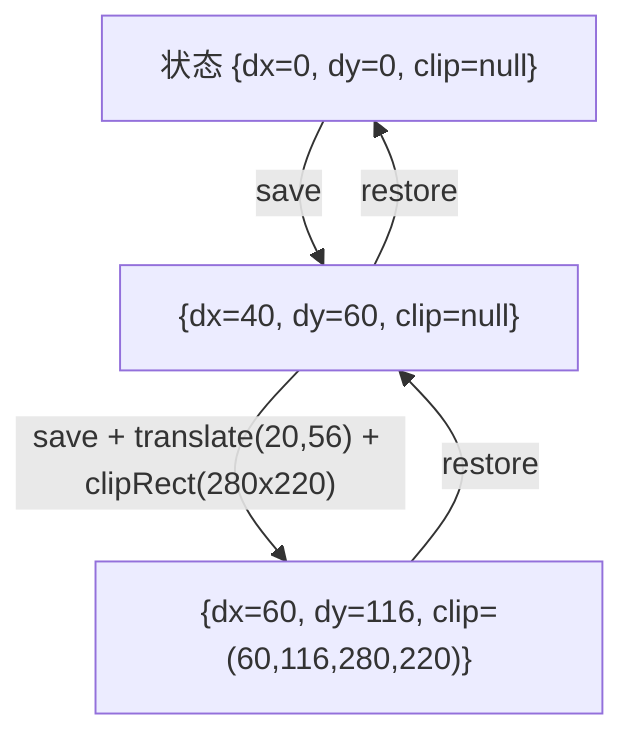
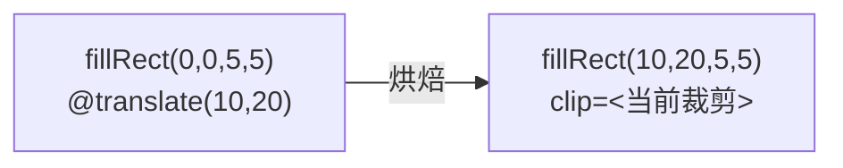

# 裁剪与变换：嵌套坐标系与 scissor 栈

> [返回：第二阶段导览](01-导览.md)
> 对应大纲条目：第二阶段 3。裁剪栈是滚动列表、下拉浮层、长文本省略的公共地基；变换栈让控件在局部坐标系里摆内容。本册逐行走读 `StatefulPainter` 的两套栈、`RaylibBackend.applyClip` 的真实全文、`clipSwitches` 的统计算法，并给出 card-scene 的完整裁剪链手算。代码逐字摘自 `core/painter.ts`（274 行）、`platform/raylib-backend.ts`（146 行）、`scenes/card-scene.ts`（76 行）；测试为本机实跑（撰写时快照：全库 116 tests / 13 files 全绿）。

## 1. 两套栈，一个 State

`StatefulPainter` 的状态定义（逐字摘录）：

```ts
interface PaintState {
  dx: number;
  dy: number;
  clip: Rect | null; // 绝对坐标；null = 不裁剪
}
```

变换栈与裁剪栈**不是两个栈**——它们同生共死在一个 `PaintState` 三元组里，`save/restore` 一次压弹一整份。这是有意的设计：真实 UI 里「换个局部坐标系」和「换个裁剪区」几乎总是成对出现（进入滚动列表的视口 = 平移到列表原点 + 裁到视口），拆成两套 API（`saveTransform/saveClip`）只会让配对错误更容易发生。

`save/restore` 的实现（含计数器与抛错路径）：

```ts
  save(): void {
    this.stack.push({ dx: this.state.dx, dy: this.state.dy, clip: this.state.clip });
  }

  restore(): void {
    const prev = this.stack.pop();
    if (prev === undefined) {
      throw new Error("Painter.restore() 没有配对的 save()");
    }
    this.state = prev;
  }
```

画成图（card-scene 左卡片的真实数值）：



注意 clip 存的是**绝对坐标**——`clipRect(r)` 先把 r 平移到绝对坐标系，再与当前 clip 求交：

```ts
  clipRect(r: Rect): void {
    const abs = rectTranslate(r, this.state.dx, this.state.dy);
    this.state.clip = this.state.clip === null ? abs : rectIntersect(this.state.clip, abs);
  }
```

两行干了三件事：局部→绝对、与当前裁剪复合、结果写回状态。**为什么存绝对而不是局部？** 因为命令要自包含：烘焙出的每条 DrawCmd 直接携带绝对 clip，后端不需要重放任何栈就能执行。存局部的方案里，「这条命令的裁剪到底是什么」要靠前序状态推出来——可测性就没了（对照见《02》第 8 节）。

## 2. 单调性：裁剪为什么只能越裁越小

`rectIntersect` 的数学性质直接决定 API 语义：**交集 ≤ 任一输入**。于是：

- 子控件永远无权「看」到父级裁剪外的世界——滚动列表的内容区嵌在任何复杂层级里都安全
- 想恢复大裁剪？只有 `restore` 回到 save 时刻，没有 `unclip`
- 「谁泄漏了裁剪」这类 bug 因此无处藏身：泄漏只会表现为内容变少（可发现），不会表现为内容越界（静默出错）

这条单调性规则也是 `restore` 必须配对的原因之一：一旦少 restore，小裁剪会**永久**卡住后续所有绘制——所以不配对直接抛错，见第 8 节。

## 3. 嵌套裁剪的求交（手算 + 测试实证）

`painter.test.ts` 的用例「嵌套 clipRect 求交，只裁越小」，原代码：

```ts
p.clipRect(rect(0, 0, 100, 100));
p.translate(50, 50);
p.clipRect(rect(0, 0, 100, 100)); // 绝对 (50,50,100,100)，交出 (50,50,50,50)
p.fillRect(rect(0, 0, 10, 10), RED);
expect(list.commands[0]?.clip).toEqual({ x: 50, y: 50, width: 50, height: 50 });
```

用《03》的 max/min 公式手算第二刀：

```text
第一刀（绝对）：A = (0, 0, 100, 100)
第二刀（局部 (0,0,100,100) 平移 (50,50) 后）：B = (50, 50, 100, 100)

x      = max(0, 50)    = 50
y      = max(0, 50)    = 50
right  = min(100, 150) = 100
bottom = min(100, 150) = 100
交集   = (50, 50, 100-50, 100-50) = (50, 50, 50, 50)   ✓ 与断言一致
```

第二刀「想裁 100×100」，实际只裁出 50×50——**局部坐标里的尺寸声明被父裁剪截短**。这正是滚动列表需要的行为：内容想画多大是内容的事，能露出多少由视口说了算。

求交结果的三个归宿：

| 交集结果 | `rectIsEmpty` | 后续 |
|---|---|---|
| 正常矩形（如上例） | false | 命令携带该 clip 进列表 |
| 零宽/负宽（邻接或分离） | true | 裁剪为空 → 后续命令全部剔除 |
| 部分相交 | false | 命令保留，靠后端 scissor 裁掉越界部分 |

第三行最容易被忽略：**剔除只处理「完全在外」，与裁剪部分相交的命令照样进列表**（`painter.test.ts`「完全落在裁剪外的矩形被剔除」里那条 `(40,40,20,20)` 搭边矩形就是刻意保留的证据）。滚动到列表尽头时，半截露出视口的行靠 scissor 裁，不是靠剔除消失。

## 4. card-scene 的完整裁剪链

把 demo 场景的裁剪链整条走一遍（数值来自 `card-scene.ts` 常量：`LIST_VIEW_POS = {x:20, y:56}`、`LIST_VIEW_W/H = 280/220`，左卡片 `translate(40,60)`）：

```mermaid
graph TD
  A["(0,0) clip=null<br/>背景 fillRect(800x450)"] -->|save + translate(40,60)| B["(40,60) clip=null<br/>panel 两层 + 标题 text"]
  B -->|save + translate(20,56)| C["(60,116) clip=null"]
  C -->|clipRect(0,0,280,220)| D["(60,116) clip=(60,116,280,220)<br/>视口底 + 12 行"]
  D -->|restore| B2["(40,60) clip=null"]
  B2 -->|restore| A2["(0,0) clip=null<br/>右卡片全部命令"]
```

关键一步的算术：`40 + 20 = 60`、`60 + 56 = 116`，局部 `(0,0,280,220)` 的绝对矩形是 `(60,116,280,220)`。黄金断言（`card-scene.test.ts`「行命令的 clip 是绝对坐标的列表视口」）期望值就是用同样的加法独立算的：

```ts
    const expected = {
      x: 40 + LIST_VIEW_POS.x,
      y: 60 + LIST_VIEW_POS.y,
      width: LIST_VIEW_W,
      height: LIST_VIEW_H,
    };
    for (const c of clipped) {
      expect(c.clip).toEqual(expected);
    }
```

断言「所有带 clip 的命令共享同一个裁剪矩形」——因为整个视口段只有一刀 `clipRect`，且中间没有 save/restore 打断。这也预告了第 7 节：全场景只有两次裁剪切换。

## 5. 空裁剪触发的剔除

裁剪为空之后，StatefulPainter 对每条命令先问一句「裁剪还有吗」（`painter.ts` 逐字摘录）：

```ts
  private clipIsEmpty(): boolean {
    return this.state.clip !== null && rectIsEmpty(this.state.clip);
  }

  /** 包围盒与裁剪区无交集则剔除；返回 true 表示已剔除。 */
  private cullRect(bounds: Rect): boolean {
    const clip = this.state.clip;
    if (clip === null) return false;
    if (rectIsEmpty(clip) || rectIsEmpty(rectIntersect(clip, bounds))) {
      this.cull();
      return true;
    }
    return false;
  }
```

`cullRect` 里两个判空分工明确：前者「裁剪已经空了」（连求交都不用做），后者「裁剪非空但与包围盒不相交」（正常剔除路径）。测试「空裁剪下文本也被粗剔除」演示的就是前者的价值——两刀不相交的裁剪后 `text("hello",...))` 一条命令都不产生，`culled=1`、`commands.length=0`。

滚动场景里它长这样：12 行内容、220px 视口，滚到底部后上方滚出视口的行调用 `fillRoundedRect`/`text` 时,`cullRect` 直接返回 true——**行连命令都不进显示列表**。这是第八阶段虚拟列表的思想雏形，第六册会用完整数字核算它。

## 6. 后端执行：applyClip 全文走读

烘焙后的命令自带 `clip: Rect | null`。`RaylibBackend.execute` 每条命令第一件事就是 `this.applyClip(cmd.clip)`。`applyClip` 真实全文（含防御分支与注释）：

```ts
  private applyClip(next: Rect | null): void {
    if (sameClip(this.activeClip, next)) return;
    if (this.activeClip !== null) endScissorMode();
    if (next !== null) {
      if (rectIsEmpty(next)) {
        // 空裁剪：理论到不了这里（上游已剔除），防御性给出 0×0 scissor
        beginScissorMode(0, 0, 0, 0);
      } else {
        beginScissorMode(Math.round(next.x), Math.round(next.y), Math.round(next.width), Math.round(next.height));
      }
    }
    this.activeClip = next;
    this.scissorSwitches += 1;
  }
```

它依赖的四值比较函数（`painter.ts` 逐字摘录）：

```ts
export function sameClip(a: Rect | null, b: Rect | null): boolean {
  if (a === null || b === null) return a === b;
  return a.x === b.x && a.y === b.y && a.width === b.width && a.height === b.height;
}
```

四个设计点逐条读：

1. **同值跳过**——`sameClip` 为真直接 return，连续 N 条同裁剪区的命令只切一次 scissor。切 scissor 是 GPU 状态变更（可能打断内部的绘制合批），能省则省
2. **先 end 再 begin**——从裁剪 A 切到裁剪 B 要走「end → begin」两步，raylib 没有原子切换；从 null 进裁剪只 begin，从裁剪回 null 只 end
3. **round 进整数**——scissor 是像素对齐的光栅化配置，逻辑坐标是浮点，四舍五入对齐。HiDPI 缩放在第八阶段处理（那时 round 的位置要上移到缩放之后，否则会双重取整）
4. **空裁剪防御分支**——上游 StatefulPainter 已剔除空裁剪下的命令，理论到不了这里；万一到了（比如手写命令数组直接 replay），给 0×0 scissor 比崩溃或画出全屏都好。**「理论到不了」的路径给确定性行为**，是防御式编程的教科书案例

配套的帧末收尾：

```ts
  /** 帧末调用：关掉可能残留的 scissor 状态（begin/endDrawing 之间调用）。 */
  endFrame(): void {
    this.applyClip(null);
  }
```

`apps/02-painter.ts` 在 `displayList.replay(backend)` 之后、`endDrawing()` 之前调用它。如果最后一条命令带裁剪而下一帧第一条不带，没有 `endFrame` 的话 scissor 会跨帧残留——「上一帧的列表视口把这一帧的背景裁掉」这类幽灵 bug 的预防针。

## 7. clipSwitches：列表侧的切换统计

`DisplayList` 侧有一份对应的统计（逐字摘录）：

```ts
  /** 相邻命令的裁剪区发生变化的次数——后端要为此切换 scissor 状态。 */
  clipSwitches(): number {
    let switches = 0;
    let prev: Rect | null = null;
    for (const cmd of this.commands) {
      if (!sameClip(prev, cmd.clip)) {
        switches += 1;
        prev = cmd.clip;
      }
    }
    return switches;
  }
```

算法就是一遍线性扫描 + `sameClip` 相邻比较。拿测试「clipSwitches 统计裁剪状态切换」的命令序列做 trace 表（该用例构造了 A→A→B→A→无 五条命令）：

| # | 命令的 clip | prev（扫描前） | sameClip? | switches |
|---|---|---|---|---|
| 1 | A=(0,0,10,10) | null | 否 | 1 |
| 2 | A | A | 是 | 1 |
| 3 | B=(2,2,5,5) | A | 否 | 2 |
| 4 | A | B | 否 | 3 |
| 5 | null | A | 否 | 4 |

`expect(list.clipSwitches()).toBe(4)` 全对上。card-scene 同理：null（背景+左卡面板）→ (60,116,280,220)（视口段）→ null（右卡），`clipSwitches() === 2`——黄金断言「全场景只发生两次裁剪切换」的期望值。

**两个统计何时不相等**：列表侧 `clipSwitches` 数的是命令序列里的变化；后端侧 `scissorSwitches` 还包含 `endFrame()` 的那次 `applyClip(null)`。如果场景最后一条命令带着裁剪结束（忘了 restore），后端会比列表多切一次——两个计数器分列两侧，恰好构成互相校验的观测口。demo 的日志行把两者并排打出来（模板摘自 `apps/02-painter.ts`）：

```ts
console.log(
  `[02-painter] frames=${frames} elapsed=${elapsed.toFixed(2)}s ` +
    `lastFrame: commands=${lastEmitted} culled=${lastCulled} ` +
    `clipSwitches=${displayList.clipSwitches()} backendScissorSwitches=${backend.scissorSwitches}`,
);
```

### 7.1 把整帧命令按裁剪列摆开

统计算法抽象，把 scroll=0 那一帧的命令按 clip 值摆开看就具体了（命令清单由 `card-scene.ts` 逐行推得，与黄金断言的数量一致）：

```text
#   op                          clip                    后端动作
1   fillRect 背景(800x450)      null                    直接画
2   fillRoundedRect 左卡外层    null                    同上（sameClip 跳过）
3   fillRoundedRect 左卡内层    null
4   text 左卡标题               null
5   fillRect 视口底(280x220)    (60,116,280,220)        切换 #1：beginScissorMode
6   fillRoundedRect ×6 可见行   (60,116,280,220)        同值跳过
7   text ×12 全部行             (60,116,280,220)        同值跳过（文本不剔除，scissor 裁）
8   fillRoundedRect 右卡外层    null                    切换 #2：endScissorMode
9   fillRoundedRect 右卡内层    null
10  text 右卡标题               null
11  texture 棋盘格              null
12  ninePatch ×2                null
13  line / fillCircle ×2        null
                                                  帧末：endFrame() → sameClip(null,null) 跳过
```

三个可读出的事实：视口段 19 条命令只切一次 scissor；文本 12 条全在裁剪区里靠 scissor 裁（`text` 无包围盒剔除）；`endFrame` 因为最后已是 null 而**不再增加切换**——`clipSwitches=2` 与 `backendScissorSwitches` 在这一帧相等。

### 7.2 部分相交的行长什么样

黄金断言里的 scroll=200 恰好同时含三种行。行矩形在视口局部坐标里是 `(8, i*36-200+4, 264, 28)`，视口是 `[0, 220)`：

| 行 i | 局部 y 区间 | 与视口的关系 | 结局 |
|---|---|---|---|
| 4 | [-52, -24) | 整体在上方之外 | **剔除**（cullRect 交为空） |
| 5 | [-16, 12) | 上半截在外，露出 [0,12) 共 12px | 保留，scissor 裁掉上 16px |
| 6..10 | [20, 48) … [164, 192) | 全在内 | 保留，全画 |
| 11 | [200, 228) | 下半截在外，露出 [200,220) 共 20px | 保留，scissor 裁掉下 8px |

「剔除与 scissor 的分工边界」就在这一判：**包围盒与裁剪相交吗**——不相交连命令都不产生；相交（哪怕只搭 1px）命令进列表，越界部分交给 scissor。只要 scroll 不是 `ROW_HEIGHT` 的整倍数（demo 里 sin 驱动的滚动是连续值，几乎帧帧不是），视口边缘就会各挂着一条半截行——剔除管整行的去留，scissor 管半截行的切口，两层叠加才是完整的「内容不溢出视口」。

## 8. save/restore 与状态泄漏

不配对的 `restore()` 直接抛错（`painter.test.ts`：`✓ restore 不配对 save 直接抛错（宁可早炸不可静默错画）`，断言 `toThrow(/没有配对的 save/)`）。为什么不静默容忍？

- 静默容忍 = 裁剪/平移泄漏到后续所有绘制，bug 表现为「某个控件莫名消失」或「整帧只剩清屏色」——极难定位
- 抛错 = 第一次不一致就停在调用栈现场，栈顶就是漏 save 的那个控件

反方向的泄漏（多 save 少 restore）不抛错，只表现为 `saveDepth` 不归零——`StatefulPainter` 暴露了这个 getter（`get saveDepth(): number { return this.stack.length; }`），第六阶段做帧间状态断言时用它兜「栈平衡」检查。

### 8.1 card-scene 的栈平衡账本

把 `buildCardScene` 里所有栈操作摘出来数一遍（省略号处是绘制调用）：

```ts
  p.save();                       // ① 左卡片：深度 1
  p.translate(40, 60);
  ...
  p.save();                       // ② 列表视口：深度 2（本场景最深）
  p.translate(LIST_VIEW_POS.x, LIST_VIEW_POS.y);
  p.clipRect(rect(0, 0, LIST_VIEW_W, LIST_VIEW_H));
  ...
  p.restore(); // 恢复列表裁剪    // ② 出栈：深度 1
  p.restore(); // 恢复左卡片平移  // ① 出栈：深度 0
  p.save();                       // ③ 右卡片：深度 1
  p.translate(420, 60);
  ...
  p.restore();                    // ③ 出栈：深度 0
```

3 次 save、3 次 restore，函数返回时 `saveDepth === 0`、状态回到 `{0, 0, null}`——**场景函数是纯的**：同样的输入永远烘焙出同样的命令序列，这是黄金断言能成立的前提。一旦某条路径少了 restore，下一帧从「带着上一帧的平移」开始记录，命令坐标整体漂移、且漂移量逐帧累积——`saveDepth` 不归零就是它的早期信号。写控件的纪律可以记成一句：**进了函数先 save，所有 return 之前 restore**（card-scene 用早退-free 的直线结构回避了这个问题；第四阶段的控件树会用 try/finally 或「渲染完统一弹栈」来兜底）。

这个取舍和 GC 站（compiler 站六阶段）里「宁可 crash 不可悬垂」是同一条原则：**状态泄漏类 bug，早炸就是可调试性**。

## 9. 变换：只做平移，烘焙进坐标

v1 的变换只有平移。烘焙（bake）的意思：`fillRect(rect(0,0,5,5))` 在 `translate(10,20)` 下游变成绝对 `(10,20,5,5)`，命令里不再有变换信息。



平移的实现带着一条 ScriptC 边界的注释（逐字摘录）：

```ts
  translate(dx: number, dy: number): void {
    // 不写 this.state.dx += dx：嵌套接收者上的复合赋值在 scriptc 0.0.35 不支持（SC1090）
    this.state.dx = this.state.dx + dx;
    this.state.dy = this.state.dy + dy;
  }
```

`this.state.dx += dx` 报 `SC1090: compound assignment to fields of computed receivers are not supported yet`——嵌套接收者（`this.state`）上的复合赋值不支持。改写成显式展开即过。同一族限制还有 `this.commands.length = 0`（`DisplayList.clear()` 里改写 `this.commands = []`）。这类「写法微调」不影响语义，是跨宿主编译器的日常：同一份代码要在 ScriptC 与 vitest/esbuild 两边都合法，宁可写「笨一点」的等价形式。

旋转/缩放去哪了？两条路线：a) 也烘焙（每个坐标点过矩阵——练习题：给 `abs()` 加一个 2×2 矩阵与旋转角，`fillCircle` 的半径在非等比缩放下怎么办？）；b) 改成保留式显示列表（Flutter 路线，见《02-从裸调用到Painter》的对照表）。mini-gui 的控件层（圆角、边框、文本基线）在纯平移下已经完备，所以 v1 够用。

## 10. 常见误区

- **「scissor 是遮罩/蒙版，后画的能盖过它」**——scissor 不是合成阶段的图层，是光栅化阶段的**矩形限制**：裁剪区外的像素根本不写入。命令顺序 = 视觉层级，后画的盖前画的；裁剪只决定「这条命令允许写哪些像素」，两者正交
- **「clip 存的是控件局部坐标」**——存绝对坐标。局部方案的命令不自包含，后端要重放状态机才能执行，无头断言也就做不成（第 1 节）
- **「save 存个 this.state 引用就行」**——后续 translate 会原地改掉「快照」，restore 形同虚设。`save()` push 的是值拷贝的新对象（`Rect` 本身不可变使用，浅拷贝即够）
- **「做了剔除就不需要 scissor」**——剔除只扔「完全在外」的命令；部分相交的命令必须靠 scissor 裁（第 3 节的搭边矩形）。两个机制管两种情形，缺一不可
- **「clipSwitches 和 scissorSwitches 永远相等」**——场景以带裁剪的命令收尾时，`endFrame()` 会让后端多切一次（第 7 节）；两者相等是 card-scene 的性质，不是普遍定律
- **「scissor 坐标取整是小事」**——不取整的话行为取决于驱动（截断/舍入不一致），HiDPI 下还会与缩放取整叠加。位置与量纲固定的 round 是确定性的一部分
- **「restore 多调一次顶多没效果」**——直接抛错，这是刻意的（第 8 节）；把抛错改成容忍的代价是泄漏 bug 变成幽灵 bug

## 11. 与其他框架的对照（概念性对照，非本机实测）

| 概念 | mini-gui | Flutter | Skia | GTK4 |
|---|---|---|---|---|
| 裁剪 API | `clipRect`（只交不小） | `Canvas.clipRect`（配合 save/restore） | `SkCanvas::clipRect`（ClipOp 可 Intersect/Difference） | `gtk_snapshot_push_clip` + `pop` |
| 栈语义 | PaintState 三元组整体压弹 | save/restore（矩阵+裁剪+画笔全量） | save/restore（矩阵+裁剪+画笔） | push/pop 节点对 |
| 裁剪下沉时机 | 记录时烘焙进命令 | 保留为指令，执行时下沉 | 保留为指令，执行时下沉 | 记录为节点，渲染器求值 |
| 离屏合成 | 无 | `saveLayer`（昂贵，半透明/滤镜时用） | `SkCanvas::saveLayer` | snapshot 节点自动分层 |
| 差集裁剪 | 无 | 有（`clipRect` 可传 `ClipOp.difference`，很少用） | 有（`ClipOp::kDifference`） | 无直接对应 |

两个观察：其一，Skia 的 `kDifference`（把矩形从裁剪区**挖掉**）mini-gui 不做——UI 里极少需要，且它破坏「只交不小」的单调性论证；其二，Flutter 文档反复强调 `saveLayer` 昂贵（触发离屏缓冲），mini-gui 连 `saveLayer` 的等价物都没有——v1 没有任何需要逐像素合成的效果，**不提供比提供而误用更好**。

## 12. 本册小结

- 状态三元组 `{dx, dy, clip}` + save/restore 栈；clip 存绝对坐标，值拷贝入栈
- 裁剪单调求交：只小不大，恢复靠 restore；空裁剪触发剔除，部分相交靠 scissor
- `applyClip` 四要点：同值跳过、先 end 再 begin、round 取整、空裁剪防御分支；`endFrame` 防跨帧残留
- `clipSwitches`（列表侧）与 `scissorSwitches`（后端侧）互为观测口，`endFrame` 边界可使二者不等
- 变换只平移、烘焙进命令；旋转缩放两条扩展路线；SC1090 逼出的显式展开写法
- 不配对 restore 抛错：状态泄漏宁可早炸

## 自测

1. 子控件想把内容画出父控件的滚动视口，靠什么机制被拦下来？写出两层嵌套时裁剪链的演变。
2. `clipRect` 存进状态前做了哪两步变换？为什么必须先平移到绝对坐标再求交，反过来（先交再平移）会错在哪？
3. `clipSwitches`（列表侧统计）与 `scissorSwitches`（后端侧统计）什么时候会不相等？构造一个最小命令序列。
4. 平移烘焙后，第六阶段做「局部重放一段命令」为什么不需要恢复任何变换状态？
5. 为什么 scissor 坐标要 round？HiDPI 后这个 round 的正确位置在哪一层？
6. 如果允许 `clipRect` 把裁剪改大，举出一个会被立刻破坏的场景。（提示：滚动列表嵌在对话框里，对话框自己也有圆角裁剪）
7. `applyClip` 里为什么有一个「理论到不了」的空裁剪分支？删掉它省两行，代价是什么？
8. `endFrame()` 为什么必须在 `endDrawing()` 之前调用？不调用它，下一帧的第一个症状会是什么？
9. Skia 的 `ClipOp::kDifference` mini-gui 为什么不提供？「只交不小」的单调性给推理带来了什么便利？
10. 用 trace 表的方式算：命令序列 clip 为 null→A→A→B→null→B，`clipSwitches` 是多少？若该序列直接 replay 到后端且 `endFrame` 收尾，`scissorSwitches` 又是多少？
