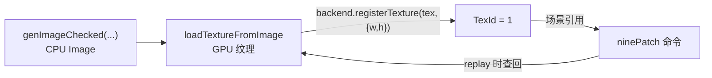
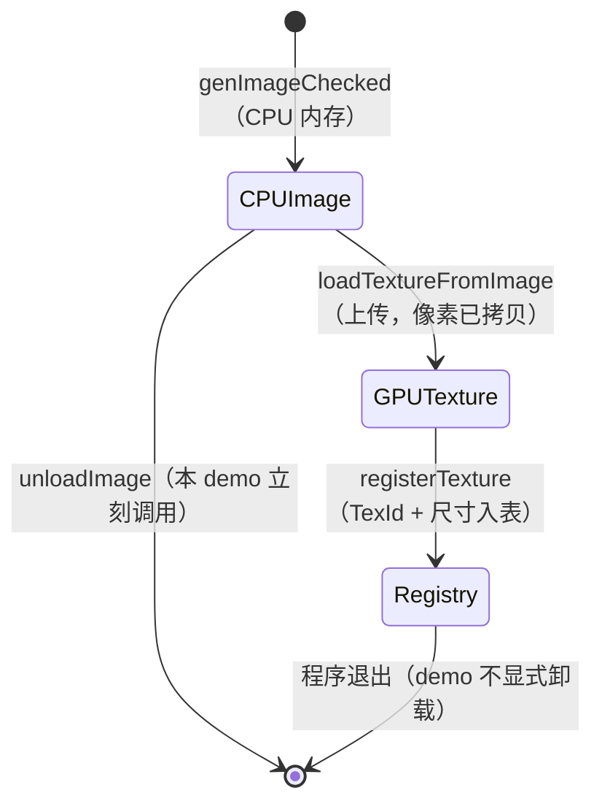

# 位图与九宫格：句柄、程序化纹理与不变形拉伸

> [返回：第二阶段导览](01-导览.md)
> 对应大纲条目：第二阶段 4。本册讲纹理如何进入框架：TexId 句柄隔离、程序化生成（仓库不放二进制素材）、`texture` 命令的源/目标矩形，以及九宫格（NPatch）——按钮背景图拉伸不变形的标准答案。代码逐字摘自 `core/painter.ts`、`platform/raylib-backend.ts`、`scenes/card-scene.ts`、`apps/02-painter.ts`；测试为本机实跑（撰写时快照：全库 116 tests / 13 files 全绿）。

## 1. TexId：内核不认识 raylib 的纹理

raylib 的 `Texture` 是不透明对象（`{ handle, kind }`，C 侧注册表管真身，见第一阶段工具链册）。但连这个类型也不能进 core——内核只认一个类型别名（`painter.ts` 逐字摘录）：

```ts
export type TextureId = number;
```



注册表在 `RaylibBackend`（`platform/raylib-backend.ts` 逐字摘录，含注释）：

```ts
interface RegisteredTexture {
  texture: Texture;
  size: Size;
}

export class RaylibBackend extends CommandSink {
  private readonly textures = new Map<TextureId, RegisteredTexture>();
  private nextId: TextureId = 1;
```

```ts
  /** 注册一张已加载的纹理，返回内核用的不透明 TexId（core 不认 raylib 的 Texture）。 */
  registerTexture(texture: Texture, size: Size): TextureId {
    const id = this.nextId;
    this.nextId += 1;
    this.textures.set(id, { texture, size });
    return id;
  }

  textureSize(id: TextureId): Size {
    const entry = this.textures.get(id);
    if (entry === undefined) throw new Error(`未知纹理 id: ${id}`);
    return entry.size;
  }
```

三个设计决定藏在里头：

1. **id 从 1 起、逐次自增**——demo 里第一张注册的纹理拿到的就是 1。黄金断言 `recordScene` 直接传 `texture: 1`（见第 6 节）能成立，靠的就是这个从 1 起的自增序
2. **注册时显式记录尺寸 `{width, height}`**——绑定层的 `Texture` 句柄不暴露宽高，而 `drawTexturePro` 必须显式给源矩形；尺寸只能由加载方在注册时声明（demo 声明 `{ width: 64, height: 64 }`）
3. **未知 id 查表即抛错**（`lookup` 与 `textureSize` 同款：`throw new Error(\`未知纹理 id: ${id}\`)`）——句柄悬空在编译期类型上防不住（number 就是 number），运行期第一现场拦下

**为什么 `TextureId` 是 number 而不是把 raylib 的 `Texture` 对象放进命令？** 因为命令要流经 `core/`——一旦 DrawCmd 里出现 `Texture` 类型，`painter.ts` 就得 import `scriptc-raylib`，「内核零 raylib 依赖」当场破功；而且命令要能被 `toEqual` 黄金比对，不透明句柄对象没法做值相等。number 是两端都能说的最小公约数，配注册表把悬空风险压到运行期一查。

## 2. 程序化纹理：仓库不放二进制素材

demo 的棋盘格纹理三行生成，放进完整的初始化段里看（`apps/02-painter.ts` 逐字摘录，含两侧上下文）：

```ts
const backend = new RaylibBackend();

// 程序化生成 64x64 棋盘格纹理（不往仓库放二进制素材）
const img = genImageChecked(64, 64, 4, 4, rgba(46, 124, 246), rgba(238, 241, 245));
const tex = loadTextureFromImage(img);
unloadImage(img);
const checkerTex = backend.registerTexture(tex, { width: 64, height: 64 });

// 「记录」与「重放」是两个独立环节：先在显示列表里攒命令，再交给后端执行
const displayList = new DisplayList();
const scene = new StatefulPainter(displayList);
```

时间线上要分清两段：**纹理注册发生在帧循环之前，一次**；`checkerTex` 这个 id 在之后每一帧被 `buildCardScene` 引用（`{ scrollY: scroll, texture: checkerTex }`）。GPU 纹理的「加载一次、每帧引用」是它与「每帧重建的显示列表」的本质区别——前者是跨帧的重量资源（显存），后者是每帧即抛的轻量数据（命令数组）。

`genImageChecked(64, 64, 4, 4, ...)` 的参数是「宽、高、格子横向数、格子纵向数、两色」——64px 里摆 4×4 个格子，每格 16px。两个颜色值 `(46,124,246)` 与 `(238,241,245)` 正是 `PALETTE.accent` 与 `PALETTE.surfaceAlt` 的字面值（demo 里直接写字面量，保证纹理生成不依赖 core 的常量加载顺序）。

### 2.1 Image 与 Texture：两个生命周期



- **Image 在 CPU 内存**，上传后应显式 `unloadImage`——demo 在拿到 Texture 的下一行就调用了，CPU 侧立刻回收
- **Texture 在 GPU**，独立于 Image 存在（`unloadImage` 之后照常可画），注册表管到程序退出
- 资源配对管理（谁分配谁释放）与 compiler 站 GC 专题的「分配-释放配对」是同一门课——FFI 边界上没有 GC 替你兜底，泄漏的是显存与 native 堆

### 2.2 为什么选程序化生成

1. 教学仓库保持纯文本（WebGL 站的 examples 要贴 .png，这里不用）；克隆即构建，没有 LFS 没有二进制 diff
2. 确定性：同样的代码永远生成同样的纹理，截图回归不怕素材漂移
3. 真实项目从 `assets/` 加载（`loadTexture(fileName)`），构建时 scriptc-raylib 会把 assets 拷到产物旁——机制不变，只是 `genImageChecked` 换成 `loadTexture`

## 3. 贴图命令在 StatefulPainter 里的一生

两个图元方法在 `core/painter.ts` 里长得几乎一样（逐字摘录）：

```ts
  texture(texture: TextureId, dest: Rect, tint: Color): void {
    const rect = this.abs(dest);
    if (this.cullRect(rect)) return;
    this.emit({ op: "texture", texture, dest: rect, tint, clip: this.state.clip });
  }

  ninePatch(texture: TextureId, patch: NinePatch, dest: Rect, tint: Color): void {
    const rect = this.abs(dest);
    if (this.cullRect(rect)) return;
    this.emit({ op: "ninePatch", texture, patch, dest: rect, tint, clip: this.state.clip });
  }
```

对照 `Painter` 抽象类的其他图元，有三个只有贴图才有的观察：

1. **dest 要烘焙、patch 不烘焙**——dest 是屏幕坐标系里的矩形，必须过 `abs()` 平移到绝对坐标；而 `patch` 的四条边距定义在**纹理坐标系**，与当前变换毫无关系，原样透传。「哪些参数属于哪个坐标系」决定了「哪些参数要过状态机」，这是读一切绘制 API 的通用判据
2. **剔除用 dest 当包围盒，且是精确的**——不像 `fillCircle` 用外接方形保守估计（见《02》第 7 节），贴图命令的可见范围就是 dest 矩形本身，`cullRect(rect)` 零保守
3. **烘焙后的命令形状**（DrawCmd 联合的两个分支原文）：

```ts
  | { op: "texture"; texture: TextureId; dest: Rect; tint: Color; clip: Rect | null }
  | {
      op: "ninePatch";
      texture: TextureId;
      patch: NinePatch;
      dest: Rect;
      tint: Color;
      clip: Rect | null;
    };
```

命令里只有 `TexId`（number）、切分参数与目标矩形——**没有任何 raylib 类型**。黄金断言直接 `toEqual` 这类对象，正是「句柄隔离」落在数据层的证据。

## 4. texture 命令：源矩形与目标矩形

`p.texture(id, dest, tint)` 的语义：**整张纹理**画到 `dest`（可放大缩小，tint=白色即原样）。后端翻译（`raylib-backend.ts` 的 case 原文）：

```ts
      case "texture": {
        const entry = this.lookup(cmd.texture);
        const source = { x: 0, y: 0, width: entry.size.width, height: entry.size.height };
        drawTexturePro(entry.texture, source, toRlRect(cmd.dest), v(0, 0), 0, cmd.tint);
        break;
      }
```

四个参数各就各位：`source` 从注册表记录的尺寸构造「整张纹理」（`{0, 0, 64, 64}`）；`dest` 是屏幕目标矩形；origin `(0,0)`、rotation 0 是 mini-gui v1 的固定选择（旋转让给未来的变换扩展）；`tint` 见第 8 节。

demo 里唯一的 texture 调用是原尺寸展示：`dest = (20,56,64,64)` 与纹理 64×64 一比一，无缩放。源矩形（画纹理的哪一部分）留给需要的场景扩展（雪碧图动画，见自测第 5 题）；九宫格才是 UI 里更高频的答案。

## 5. 九宫格：拉伸不变形的标准答案

按钮/卡片背景图被拉伸到不同宽高时，直接 `texture` 拉伸会让四角糊掉。九宫格把纹理切成 9 块：

```text
┌───┬──────────────┬───┐
│ 1 │      2       │ 3 │   1,3,7,9 四个角：不缩放，原样贴
├───┼──────────────┼───┤   2,8 上下边：只横向拉伸
│ 4 │      5       │ 6 │   4,6 左右边：只纵向拉伸
├───┼──────────────┼───┤   5 中心：双向拉伸
│ 7 │      8       │ 9 │
└───┴──────────────┴───┘
```

demo 的具体数字标上去（64×64、边距 12，切分线在 12 与 52）：

```text
        0    12                52   64
        │    │                 │    │
      0 ┌────┬─────────────────┬────┐
        │ 1  │        2        │ 3  │     角块 12×12
     12 ├────┼─────────────────┼────┤ ─┐
        │    │                 │    │  │ 边条 12×40（左右）
        │ 4  │        5        │ 6  │  │ 中心 40×40
        │    │                 │    │  │
     52 ├────┼─────────────────┼────┤ ─┘
        │ 7  │        8        │ 9  │     上下边条 40×12
      6 └────┴─────────────────┴────┘
```

切分由四条边距定义（`painter.ts` 逐字摘录）：

```ts
/** 九宫格切分：四条边距（纹理像素）。四角不变形，四边单向拉伸，中心双向拉伸。 */
export interface NinePatch {
  left: number;
  top: number;
  right: number;
  bottom: number;
}
```

注意单位是**纹理像素**，与 dest 的屏幕像素无关——切分发生在纹理坐标系，拉伸发生在「切好的块 → 目标矩形」之间。raylib 原生支持，后端直译（case 原文）：

```ts
      case "ninePatch": {
        const entry = this.lookup(cmd.texture);
        const source = { x: 0, y: 0, width: entry.size.width, height: entry.size.height };
        drawTextureNPatch(
          entry.texture,
          {
            source,
            left: cmd.patch.left,
            top: cmd.patch.top,
            right: cmd.patch.right,
            bottom: cmd.patch.bottom,
            layout: NPATCH_NINE_PATCH,
          },
          toRlRect(cmd.dest),
          v(0, 0),
          0,
          cmd.tint,
        );
        break;
      }
```

`layout: NPATCH_NINE_PATCH` 是 raylib 的 NPatch 布局枚举值——它还有三宫格（`NPATCH_THREE_PATCH_*`）等变体，mini-gui 只用九宫格这一种。

## 6. 九宫格的算术：把 demo 三个尺寸算穿

demo 用同一张 64×64 棋盘格、边距全 12（`card-scene.ts` 原文）：

```ts
  // 原尺寸贴图
  p.texture(state.texture, rect(20, 56, 64, 64), WHITE_TINT);
  // 九宫格：横向拉宽（角不变形）与双向拉大
  p.ninePatch(state.texture, { left: 12, top: 12, right: 12, bottom: 12 }, rect(110, 56, 210, 64), WHITE_TINT);
  p.ninePatch(state.texture, { left: 12, top: 12, right: 12, bottom: 12 }, rect(20, 140, 300, 120), WHITE_TINT);
```

先算纹理侧的切分（64×64、边距 12）：四个角各 12×12；上/下边条 40×12（宽 = 64-12-12）；左/右边条 12×40；**中心 40×40**。再算三个目标矩形下每块的落地尺寸：

| 区域 | 纹理里的尺寸 | dest=64×64（原样） | dest=210×64（横拉） | dest=300×120（双向拉） |
|---|---|---|---|---|
| 四角（1,3,7,9） | 12×12 | 12×12 | 12×12 | 12×12 |
| 上/下边（2,8） | 40×12 | 40×12 | **186**×12 | **276**×12 |
| 左/右边（4,6） | 12×40 | 12×40 | 12×40 | 12×**96** |
| 中心（5） | 40×40 | 40×40 | 186×40 | **276×96** |

横向拉伸量全部由边条与中心吸收（210-24=186、300-24=276），纵向拉伸量由左右边条与中心吸收（120-24=96）——**四角永远 12px 见方不糊**。用棋盘格当素材的好处正在于此：每个格子 16px，角区贴着不满一格的棋盘，拉伸后中间格被拉成明显的长条，「哪块被拉了」一眼可读。

**边距必须 ≤ 纹理半宽**（更准确说：left+right ≤ width、top+bottom ≤ height），否则中心区切不出来——64×64 的纹理边距取 40 时，left+right=80 > 64，中心宽度 64-80 = -16，切分无意义。demo 取 12 < 32（半宽）留足余量；工程上边距就是「拉伸时允许牺牲的不可变形区域」，取素材里圆角/描边的实际半径略加一两个像素。

### 6.1 「角不糊」的机理：重采样只发生在被拉大的块里

「糊」的本质是**重采样**：目标尺寸 ≠ 源尺寸时，目标像素要从源图像的多个 texel 插值出来。把上表按「是否触发重采样」重读一遍：

| 块 | 纹理尺寸 → 目标尺寸（210×64 例） | 重采样？ |
|---|---|---|
| 四角 | 12×12 → 12×12 | 否，1:1 拷贝 |
| 上/下边 | 40×12 → 186×12 | 横向插值（纵向 1:1） |
| 左/右边 | 12×40 → 12×40 | 否（横向拉伸例中纵向未变） |
| 中心 | 40×40 → 186×40 | 横向插值 |

对比一下直接 `texture` 拉伸到 210×64：整张 64×64 → 210×64，**每个像素都参与横向插值**，角上的圆角/描边全被糊掉。九宫格做的事就是把「插值区域」从整张图圈死到边条与中心——这就是「拉伸不变形的标准答案」在像素层面的全部含义。

## 7. 黄金断言：不开窗口验证贴图布局

`card-scene.test.ts` 的贴图用例原文：

```ts
  it("贴图与九宫格各就各位", () => {
    const list = recordScene(0);
    expect(list.countByOp().get("texture")).toBe(1);
    expect(list.countByOp().get("ninePatch")).toBe(2);
  });
```

`recordScene` 构造 `StatefulPainter` + `DisplayList`，传 `{ scrollY, texture: 1 }`（函数原文）：

```ts
function recordScene(scrollY: number): { p: StatefulPainter; list: DisplayList } {
  const list = new DisplayList();
  const p = new StatefulPainter(list);
  buildCardScene(p, { scrollY, texture: 1 }, 800, 450);
  return { p, list };
}
```

`texture: 1` 就是「后端注册表里第一张纹理」的约定值（demo 里 `checkerTex` 恰好从 1 起）。注意一个测试红利：**测试里根本没有后端**——`RaylibBackend` 不存在、注册表不存在、raylib 不存在，`texture: 1` 只是命令里的一个 number。句柄隔离把「场景布局对不对」从「纹理加载/绘制对不对」里剥了出来：前者无头可测，后者留给截图回归。断言的是**命令数量**（texture 1 条、ninePatch 2 条），不是像素；命令的位置、边距、目标矩形都在烘焙结果里，需要时可加 `toMatchObject` 精确锁（练习：给 `ninePatch` 的两条命令断言 dest 与 patch 值）。视觉正确性交给截图（`MINI_GUI_SHOT` 回归，见下一册第 4 节）——**结构与像素两层验证各管一段**。

## 8. tint：逐像素乘法调制

`tint` 是逐像素乘法调制：结果 = 纹理像素 × tint / 255（逐通道）。三种典型用法：

| tint 值 | 效果 | 场景 |
|---|---|---|
| `(255,255,255)` 白 | 恒等——原样绘制 | card-scene 的 `WHITE_TINT` |
| `(200,200,200)` 浅灰 | 每通道乘 ~0.78，整体变暗 | **禁用态按钮**：同一张背景图，无需第二份素材 |
| `(46,124,246)` 主题蓝 | 白底单色图被染成品牌色 | 一套白色图标染任意主题色 |

第三行就是控件库压体积的常用手段——**一套白色素材 + tint 染色**，主题色变化不动素材只动参数。第八阶段控件默认样式会用到。

注意乘法的两个推论：tint 无法把图**变亮**（乘数 ≤ 1，通道上限 255）；alpha 通道同样被乘，tint 的 a < 255 会连同透明度一起压低。card-scene 定义 `const WHITE_TINT: Color = rgba(255, 255, 255);` 显式表达「不调制」，比让调用方猜默认值直白。

拿 demo 纹理的两个格子色算一遍「禁用态变暗」（tint=(200,200,200)，即每通道乘 200/255 ≈ 0.784）：

| 纹理像素 | × tint 后 | 说明 |
|---|---|---|
| 蓝 (46, 124, 246) | (36, 97, 193) | 46×200/255=36.1、124×200/255=97.3、246×200/255=192.9，逐通道取整 |
| 浅灰 (238, 241, 245) | (187, 189, 192) | 蓝通道降幅最大（245→192），相对对比度轻微变化 |

两个格子同时变暗、蓝格子还是蓝格子——**色相结构由纹理保持，明度由 tint 统一压低**。这就是「一张素材 + 状态染色」的全部数学。

### 8.1 回归怎么跑：贴图 demo 的截图验证

demo 文件头的运行说明（`apps/02-painter.ts` 注释原文）：

```text
// 运行（交互）：npx scriptc-raylib run src/apps/02-painter.ts --dev
// 回归 + 截图：
//   MINI_GUI_SECONDS=3 MINI_GUI_SHOT=shot02.png npx scriptc-raylib run src/apps/02-painter.ts --dev
```

三个环境变量（`core/config.ts` 的 `envNumber` 读取）：`MINI_GUI_SECONDS` 到点自动退出，`MINI_GUI_SHOT` 指定截图路径，`MINI_GUI_FPS` 限帧。截图发生在 `endDrawing()` 之后（时机的血泪教训见下一册第 4 节），拿到的是提交后的真帧缓冲——「三块拉伸区域、角格不糊」在图上可肉眼或图像分析核验，与无头的命令数断言互为补充。

## 9. 常见误区

- **「`unloadImage` 之后纹理就画不了了」**——Image 与 Texture 是两个生命周期：上传后 GPU 纹理独立存在，`unloadImage` 回收的是 CPU 侧像素。反过来，**忘了** `unloadImage` 才是泄漏（CPU 内存一直占到进程退出）
- **「TexId 是全局的、持久的」**——它是**每个后端实例**的注册表自增号（从 1 起）。换一个 `RaylibBackend` 实例，老 id 全部悬空；正确姿势是注册方持有 id、后端销毁时一起作废
- **「九宫格边距是目标矩形的像素」**——边距在**纹理坐标系**里量（`NinePatch` 注释原文「纹理像素」）。纹理被拉大后角块跟着变大的错觉，是因为块内容被放大，不是边距变了
- **「边距想设多大设多大」**——必须满足 left+right ≤ width、top+bottom ≤ height，否则中心区切不出（64×64 边距 40 → 中心宽 -16）
- **「tint 是叠加一层颜色/是透明度」**——是逐通道**乘法**。灰色变暗、白色恒等、无法变亮；把它当「盖一层半透明色」理解的人会困惑为什么染不出浅色
- **「texture 命令的 dest 是纹理尺寸的单位」**——dest 是**屏幕目标矩形**（逻辑像素），source 才是纹理像素；两个坐标系在 `drawTexturePro` 的签名里就是分开的两个矩形
- **「九宫格边距四值必须相等」**——demo 里恰好全取 12，但 `NinePatch` 的四条边距完全独立。不对称边距（如左 20 右 8）在 API 层完全合法，只是棋盘格素材会显得不对称；真实素材里「左边框 2px、上边框 4px」的微调正是靠它
- **「九宫格 = 场景侧画九次 texture」**——切分逻辑全部下沉到后端的 `drawTextureNPatch` 一次调用（raylib 内部再拆块）；场景侧始终是**一条**命令。黄金断言 `ninePatch=2` 而不是 18，就是这个设计的直接体现
- **「注册表会替你卸载纹理」**——`RaylibBackend` 没有提供 unregister/unload 接口，注册表管到程序退出（教学取舍：资源卸载的引用计数一课留给第八阶段讨论）。显存回收目前只有「进程结束」一条路
- **「程序化纹理只是教学玩具」**——它同时买到确定性（可重建、可回归）与零素材依赖；不少真实引擎的默认资源（白噪声、渐变、棋盘格）也是启动时程序化生成的

## 10. 与其他框架的对照（概念性对照，非本机实测）

| 概念 | mini-gui | Android | Flutter | Skia | CSS（GTK4 主题同源） |
|---|---|---|---|---|---|
| 九宫格叫法 | NPatch（raylib 术语） | NinePatch（.9.png） | centerSlice（`Image`/`paintImage` 参数） | drawImageNine | border-image |
| 边距定义 | 四条边距（纹理像素） | .9.png 黑线标记拉伸区/内容区 | 一个中心矩形 `Rect` | 一个中心 `IRect` | `border-image-slice`（四条，px 或 %） |
| 角块行为 | 不缩放 | 不缩放 | 不缩放 | 不缩放 | 默认不缩放（`border-image-repeat` 可改） |
| 拉伸策略 | 边单向、中心双向 | 同 | 同（slice 决定） | 同（center 决定） | stretch/round/repeat/space 可选 |
| 染色 | tint 乘法 | `setColorFilter`（ColorMatrix） | `ColorFiltered`/`colorBlendMode` | `SkColorFilter` | filter/opacity |

观察：四家最终都收敛到「四角不动、边与中心吸拉伸」的同一种切分，差别只在边距怎么声明（显式数字 / 图片里画黑线 / 一个 Rect / CSS 四值）。Android 的 .9.png 把元数据编码进素材位图本身——工具链友好但素材不可直接预览；mini-gui 的四数字最朴素，换来的是黄金断言里 `patch` 就是个普通对象、可以直接 `toEqual`。

## 11. 本册小结

- 内核只认 `TextureId = number`；注册表与尺寸查询收在后端（`Map` + 自增 id，未知 id 运行期抛错）
- Image/Texture 两个生命周期，配对释放（`unloadImage` 上传后即调）；程序化生成让仓库保持纯文本且确定
- `texture` 命令：source 恒为整张（注册尺寸）、dest 为屏幕矩形、origin/rotation 固定
- 九宫格四角不缩放、边单向拉伸、中心双向拉伸；边距以纹理像素计，left+right ≤ width、top+bottom ≤ height
- demo 三个尺寸的算术：210×64 时中心 186×40、300×120 时中心 276×96，四角恒 12×12
- tint 乘法染色：一套素材多主题；`texture=1、ninePatch=2` 有黄金断言

## 自测

1. 为什么 `TextureId` 用 number 而不是直接把 raylib 的 `Texture` 对象放进命令？说出至少两条理由（提示：core 的 import 边界、`toEqual` 断言）。
2. `unloadImage` 之后纹理还能画吗？为什么？两段生命周期的资源各自由谁管、何时释放？
3. 九宫格边距设成 40（纹理 64×64）会发生什么？写出中心区宽度的算式。
4. 用 tint 实现「禁用态按钮变暗」：给出 tint 值、写出调制公式，并解释为什么 tint 永远无法把图变亮。
5. `texture` 命令要加强雪碧图（画纹理局部），接口要加什么参数？烘焙（StatefulPainter）与后端（raylib case）各改哪里？剔除逻辑要不要跟着动？
6. 注册表为什么要在注册时显式记 `{width, height}`？绑定层的 `Texture` 句柄缺了什么信息、这个缺口还影响哪些 raylib 调用？
7. demo 里 dest=210×64 的九宫格，上边条最终多宽？左/右边条呢？为什么它们不一样？
8. 黄金断言 `texture=1、ninePatch=2` 为什么能不依赖窗口成立？这个断言防得住「边距写错」吗？要防它该加什么断言？
9. `genImageChecked(64,64,4,4,...)` 生成的棋盘格每格多少像素？用它当九宫格素材，拉伸后「哪块被拉了」为什么肉眼可读？
10. 如果第二张纹理在第一张之前注册，demo 与黄金断言各会发生什么？（提示：`texture: 1` 的约定与 `nextId` 从 1 自增）
