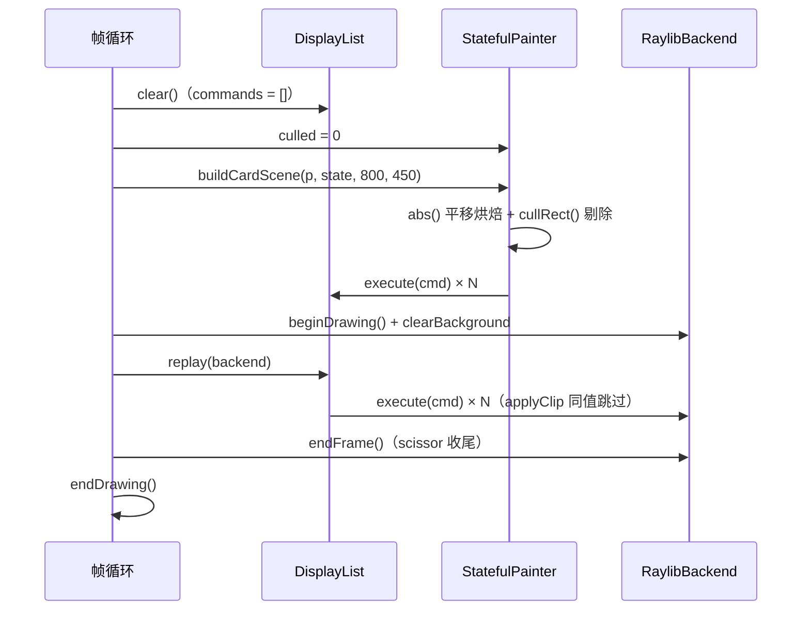

# 显示列表与批处理：记录、重放、排序的机会

> [返回：第二阶段导览](01-导览.md)
> 对应大纲条目：第二阶段 5。显示列表（display list）是本阶段的收官件：把一帧的绘制命令收集成数组，就获得了重放、断言、统计与重排序的全部机会。本册走读 `DisplayList` 全文、核算 card-scene 黄金断言背后的剔除算术，并解释「为什么 raylib 的批处理让按纹理排序在当前后端下不重要」。代码逐字摘自 `core/painter.ts`（274 行）、`scenes/card-scene.ts` / `card-scene.test.ts`、`apps/02-painter.ts`（86 行）；测试为本机实跑（撰写时快照：全库 116 tests / 13 files 全绿）。

## 1. DisplayList：一个类换来的四种能力

全文走读（`core/painter.ts` 逐字摘录，含注释）：

```ts
/** 显示列表：把命令存下来，之后可以整段重放到任意后端。 */
export class DisplayList extends CommandSink {
  commands: DrawCmd[] = [];

  execute(cmd: DrawCmd): void {
    this.commands.push(cmd);
  }

  replay(target: CommandSink): void {
    for (const cmd of this.commands) {
      target.execute(cmd);
    }
  }

  clear(): void {
    // 不写 this.commands.length = 0：给 .length 赋值在 scriptc 0.0.35 不支持（SC1090）
    this.commands = [];
  }

  /** 按 op 统计命令数（调试/回归用）。 */
  countByOp(): Map<string, number> {
    const counts = new Map<string, number>();
    for (const cmd of this.commands) {
      counts.set(cmd.op, (counts.get(cmd.op) ?? 0) + 1);
    }
    return counts;
  }

  /** 相邻命令的裁剪区发生变化的次数——后端要为此切换 scissor 状态。 */
  clipSwitches(): number {
    let switches = 0;
    let prev: Rect | null = null;
    for (const cmd of this.commands) {
      if (!sameClip(prev, cmd.clip)) {
        switches += 1;
        prev = cmd.clip;
      }
    }
    return switches;
  }
}
```

六个成员一行一个能力：

- `execute`——继承自 `CommandSink` 的唯一抽象方法，实现就是 `push`。**记录一个后端 = 实现一个方法**，这是 CommandSink 抽象的全部含金量
- `replay`——顺序透传给任意目标：可以是 `RaylibBackend`（真画）、另一个 `DisplayList`（复制，测试「replay 保序透传到目标」正是这么做的）
- `clear`——帧首清空。注意那行注释：`this.commands.length = 0` 在 ScriptC 0.0.35 报 SC1090，改写 `this.commands = []` 让 GC 收走旧数组，语义等价
- `countByOp`——按 `op` 字面量分组计数，黄金断言与性能观测共用
- `clipSwitches`——相邻比较 `sameClip`，见《04》第 7 节的 trace 表
- `commands` 是 public——测试直接 `expect(list.commands).toEqual([...])`，不为测试开后门、测试就是它的头号用户

### 1.1 三个成员各有一个专项用例

`painter.test.ts` 的 `DisplayList` describe 里，`countByOp` 的用例原文：

```ts
  it("countByOp 统计", () => {
    const { p, list } = painterWithList();
    p.fillRect(rect(0, 0, 1, 1), RED);
    p.fillRect(rect(1, 1, 1, 1), RED);
    p.fillCircle(3, 3, 2, RED);
    expect(list.countByOp().get("fillRect")).toBe(2);
    expect(list.countByOp().get("fillCircle")).toBe(1);
  });
```

`clipSwitches` 的用例构造了 A→A→B→A→无 的命令序列，期望 4 次切换（trace 表在《04》第 7 节）；`replay` 的用例见 3.1。三个用例合起来锁死了「统计口不撒谎」：数字对不上，先怀疑场景，再怀疑统计——两个怀疑方向都有测试背书。

## 2. 一帧的用法：记录与重放是两个独立环节

帧循环的骨架（`apps/02-painter.ts` 逐字摘录，注释也是原文）：

```ts
while (!windowShouldClose()) {
  const dt = getFrameTime();
  frames += 1;
  elapsed += dt;

  // ---- 1. 记录：场景 → 显示列表（发生在 beginDrawing 之前）----
  displayList.clear();
  scene.culled = 0; // 统计按帧清零
  const scroll = ((sin(elapsed * 0.8) + 1) / 2) * (12 * 36 - 220);
  buildCardScene(scene, { scrollY: scroll, texture: checkerTex }, WIDTH, HEIGHT);
  lastEmitted = displayList.commands.length;
  lastCulled = scene.culled;

  // ---- 2. 重放：显示列表 → raylib 后端（scissor 只在裁剪变化时切换）----
  beginDrawing();
  clearBackground(RAYWHITE);
  displayList.replay(backend);
  backend.endFrame();
  endDrawing();

  if (exitAfterSeconds > 0 && elapsed >= exitAfterSeconds) break;
}
```

时序画成图：



滚动由自带的 `sin` 驱动：`((sin(elapsed*0.8)+1)/2) * (12*36-220)` 在 0..212 间往复（12 行 × 36px − 220 视口 = 212 最大滚动）。于是**同一份场景代码每帧烘焙出不同命令集**——黄金断言锁的就是这条「状态 → 命令集」的映射。

记录放在 beginDrawing 之外，好处有二：绘制区只含「执行」，职责干净；将来第六阶段可以直接把「记录」换成「复用上一帧的列表」实现跳帧重放（布局与绘制进一步解耦的入口）。

## 3. 四种能力对应四个阶段的需求

| 能力 | 机制 | 被谁需要 |
|---|---|---|
| 重放 | 命令自包含（绝对坐标+自带裁剪） | 第六阶段：脏区重绘时局部重画 |
| 断言 | 命令数组就是黄金用例的期望对象 | 全阶段：无头测试 |
| 统计 | `countByOp` / `clipSwitches` / `culled` / `emitted` | 性能观测与回归 |
| 重排 | 按纹理/状态分组的机会窗口 | 批处理（见第 5 节） |

全库的观测口汇总一张表（谁挂的、何时清零、回答什么问题）：

| 观测口 | 挂在哪 | 生命周期 | 回答什么 |
|---|---|---|---|
| `commands.length` | DisplayList | 每次 `clear()` 归零 | 这一帧多少命令 |
| `emitted` | StatefulPainter | 随画家累计 | 发往 sink 的命令数 |
| `culled` | StatefulPainter | demo 里每帧手动 `scene.culled = 0` | 剔除了多少 |
| `countByOp()` | DisplayList | 派生查询 | 命令的结构分布 |
| `clipSwitches()` | DisplayList | 派生查询（当前帧列表） | 裁剪变化次数 |
| `scissorSwitches` | RaylibBackend | **进程内累计，从不清零** | 实际 GPU 状态切换总数 |
| `saveDepth` | StatefulPainter | 帧末应回 0 | 栈平衡 |

一个容易读错的细节：demo 日志里 `clipSwitches=${displayList.clipSwitches()}` 是**最后一帧**的列表统计，而 `backendScissorSwitches` 是**整个进程**的累计值——两者不在同一时间窗内，直接比较要换算成「帧间增量」。（日志模板见《04》第 7 节。）

### 3.1 用第二个 DisplayList 当探针

`replay` 的目标不必是后端——重放到一个崭新的 DisplayList，就得到了一份**可自由过滤、计数、打印的副本**。这不是脑补的用法，`painter.test.ts` 的用例就是这么写的（原文）：

```ts
  it("replay 保序透传到目标", () => {
    const { p, list } = painterWithList();
    p.fillRect(rect(0, 0, 1, 1), RED);
    p.fillCircle(3, 3, 2, RED);
    const target = new DisplayList();
    list.replay(target);
    expect(target.commands).toEqual(list.commands);
  });
```

调试技巧由此展开：怀疑某一帧的命令有问题时，`replay` 到探针列表，再对探针做 `filter`/`countByOp`/逐条 `console.log`——原始列表保持原序原样，随时可以再重放到真后端对照。`CommandSink` 抽象在这里第二次兑现价值：**「消费命令」的方式可以任意组合，而场景代码对这一切一无所知**。

## 4. 黄金测试：不开窗口验证一整张卡片

`scenes/card-scene.test.ts` 把整个场景当成纯函数测（5 个用例实跑全绿）。断言期望值不是抄实现输出，而是**独立重算**——剔除数的核算函数原文：

```ts
/** 与场景同规则的可见性判定：行矩形与视口相交（用于独立核算剔除数）。 */
function visibleRowsAt(scroll: number): number {
  const maxScroll = Math.max(0, CARD_ROWS * ROW_HEIGHT - LIST_VIEW_H);
  const s = Math.max(0, Math.min(scroll, maxScroll));
  let visible = 0;
  for (let i = 0; i < CARD_ROWS; i++) {
    const y = i * ROW_HEIGHT - s + 4;
    if (y < LIST_VIEW_H && y + (ROW_HEIGHT - 8) > 0) visible += 1;
  }
  return visible;
}
```

五个用例逐个解读：

**① `scroll=0：视口外 6 行被剔除，可见 6 行`**

```ts
    const visible = visibleRowsAt(0);
    expect(visible).toBe(6);
    expect(p.culled).toBe(CARD_ROWS - visible);
    expect(list.countByOp().get("fillRoundedRect")).toBe(4 + visible);
    expect(list.countByOp().get("text")).toBe(2 + CARD_ROWS);
```

手算核对：12 行 × 36px = 432px 内容，视口 220px。scroll=0 时行 i 的药丸矩形（高 28、顶部偏移 +4）局部 y 区间为 `[36i+4, 36i+32)`；i=5 时 `[184,212)` ⊂ `[0,220)` 可见，i=6 时 `[220,248)` 整体在外被剔除——可见恰好 0..5 共 6 行。`fillRoundedRect` = 4（两张卡片各两层「描边+面板」）+ 6（可见行）；`text` = 2（标题）+ 12（全部行——文本不做包围盒剔除，靠 scissor 裁）。

**② `scroll=200：剔除数随滚动变化（虚拟列表的思想雏形）`**——可见 7 行（行 5..11，其中 5、11 两行半截）、剔除 5 行，`fillRoundedRect = 4 + 7 = 11`。行级数字的完整手算在《04》7.2 的表里。

**③ `行命令的 clip 是绝对坐标的列表视口`**——期望值用 `40 + LIST_VIEW_POS.x = 60`、`60 + LIST_VIEW_POS.y = 116` 独立算出 `(60,116,280,220)`，再断言**所有**带 clip 的命令共享它。

**④ `全场景只发生两次裁剪切换（无裁剪 → 列表视口 → 无裁剪）`**——`expect(list.clipSwitches()).toBe(2)`，推理链在《04》第 4 节的裁剪链图里。

**⑤ `贴图与九宫格各就各位`**——`texture=1、ninePatch=2`（详见《05》第 7 节）。

这是「黄金用例」与「回声测试」的区别：**期望值从需求侧独立推导，实现与断言各自从两头碰面**——碰不上就是 bug，碰上了才有资格说「被测过」。

## 4.1 一帧的完整命令清单（scroll=0）

把 32 条命令按来源摆开（由 `card-scene.ts` 逐行推得，与上面所有断言一致）：

| 来源 | op | 条数 | clip |
|---|---|---|---|
| 背景 | fillRect | 1 | null |
| 左卡 panel（双层描边） | fillRoundedRect | 2 | null |
| 左卡标题 | text | 1 | null |
| 视口底 | fillRect | 1 | (60,116,280,220) |
| 可见行药丸 | fillRoundedRect | 6 | (60,116,280,220) |
| 全部行文字 | text | 12 | (60,116,280,220) |
| 右卡 panel | fillRoundedRect | 2 | null |
| 右卡标题 | text | 1 | null |
| 棋盘格原尺寸 | texture | 1 | null |
| 九宫格 ×2 | ninePatch | 2 | null |
| 分隔线 | line | 1 | null |
| 圆点 ×2 | fillCircle | 2 | null |
| **合计** | | **32** | **切换 2 次** |

另有 6 条 `fillRoundedRect` 在记录时被剔除（`emitted=32、culled=6`）。清单里能读出三个结构事实：视口段 19 条命令共享一个裁剪；12 条 text 全额保留（无包围盒剔除的代价，换 scissor 兜底）；贴图类命令全部无裁剪（右卡片没有嵌套滚动区）。

## 5. 批处理：当前后端下为什么按纹理排序是伪需求

经典理论：显示列表按纹理分组重排，减少 GPU 纹理绑定与状态切换。但 raylib 的 2D 后端**内部就是批处理器**——`begin/endDrawing` 之间所有 `drawTexture*` 进入同一个顶点批，相同纹理的绘制自动合并 draw call（第一阶段日志里的 `RLGL: Render batch vertex buffers` 就是它）。

所以 mini-gui 的排序机会要重新评估：

| 状态切换 | 谁在管 | 我们的观测口 |
|---|---|---|
| 纹理绑定与 draw call | raylib 内部批处理 | 暂无（第六阶段用 GPU 计数器再谈） |
| scissor 开关 | `RaylibBackend.applyClip` 同值跳过 | `scissorSwitches` |
| 命令产出量 | 记录时剔除 | `culled` / `commands.length` |

**结论**：烘焙式命令自包含反而对 raylib 批处理友好（顺序透传即最优）；真正的排序收益要等自绘 GPU 后端（第八阶段展望）才回来。这也解释了 `z 序 = 命令顺序` 为什么够用——后端不重排，绘制顺序完全可预测。

一帧在两层「批处理器」之间的位置画出来：

```text
场景构建（每帧）
    │ 32 条 DrawCmd（自包含）
    ▼
DisplayList.replay ──顺序透传──► RaylibBackend
    │                              │ applyClip：同值跳过（我们管的层）
    │                              ▼
    │                        raylib 内部顶点批（RLGL）
    │                              │ 相同纹理的 drawTexture* 自动合流
    │                              ▼
    └────────── z 序不变 ────── endDrawing：一次提交 + 交换缓冲
```

上层（我们）管「命令产出量与裁剪切换」，下层（raylib）管「纹理绑定与 draw call 合并」——观测口因此分居两层（第 3 节的表）。

什么时候「重排」会重新变成真需求？三个前置条件同时成立：后端自己管理纹理绑定、命令间无重叠遮挡（或可容忍遮挡变化）、合批收益大于排序成本。card-scene 一条都不满足（后端是 raylib、卡片明显互相遮挡）——**识别「教科书建议在此处不适用」和记住建议本身一样重要**。

## 6. 一个实测坑：takeScreenshot 与批处理

给 demo 加截图回归时发现：**在 `endDrawing()` 之前调 `takeScreenshot`，存下来的是纯清屏色**。原因正是批处理——`drawText/drawCircle` 只是往 CPU 侧顶点批里攒数据，`endDrawing` 才提交 GPU 并交换缓冲；此前读到的帧缓冲里只有立即执行的 `clearBackground`。

```ts
// 正确位置：绘制提交之后、关窗之前（apps/02-painter.ts 帧循环之后）
if (shotPath !== undefined) takeScreenshot(shotPath);
closeWindow();
```

demo 把截图放在循环结束之后（配合 `MINI_GUI_SECONDS` 到点退出），此时最后一次 `endDrawing` 已提交。这是「绘制调用 ≠ 像素已上屏」最直观的一课：**调用返回 ≠ 命令完成**，提交时机由后端的批处理策略决定。第一阶段截图已用此修复验证：图上可见 HUD 文字、双轨道圆球、绿方块与金十字线（图像分析确认）。

## 7. 记录/重放分离对帧循环的影响

demo 帧循环最终形态：

```text
输入轮询（windowShouldClose/getFrameTime）→ 更新状态（scroll 由 elapsed+sin 算出）
  → 【记录显示列表】→ beginDrawing → clearBackground → 【重放到后端】→ endFrame → endDrawing
```

两层分离各自买到的东西：

1. **记录在 beginDrawing 之外**——场景构建是纯数据变换，不需要 GPU 上下文；无头测试复用的正是这一点（vitest 里没有窗口，`buildCardScene` 照跑）
2. **重放是唯一的「进绘制区」动作**——绘制区内只有 `beginDrawing/clearBackground/replay/endFrame/endDrawing` 五步，职责单一；将来第六阶段把记录换成「跳过（复用上一帧列表）」，绘制区代码一行不改

### 7.1 预演：脏区重放为什么「到时候就行」

导览给第六阶段的任务是脏区重绘：只重画与脏矩形相交的部分。它对本册数据的依赖可以现在就验证——**命令自包含让「过滤后重放」成为纯数据操作**。拿 scroll=0 的 32 条清单举例：假设脏矩形只覆盖左半屏 `(0,0,400,450)`，与右卡片的 9 条命令（绝对范围 x≥420）全不相交，重放集就是 32 − 9 = 23 条；再叠加剔除语义（视口外行本来就不在表里），需要执行的命令进一步减少。整个过程不需要恢复任何变换/裁剪状态——**每条命令的坐标与 clip 都是烘焙死的**，过滤条件只是一个矩形求交。第六阶段真正要解决的只剩「脏矩形怎么算、何时失效」，重放机制本身已经在袖子里。

注意 `clearBackground` 不在列表里，所以局部重放后未覆盖区域保留上一帧像素——这正是脏区重绘想要的语义，清屏策略到时候要换成「按需清除脏区」而不是整屏 `clearBackground`。

注意 `clearBackground(RAYWHITE)` 依然在重放之前、由 app 层直接调用——它是「画布准备」而不是场景的一部分，所以不进显示列表（背景色的 `fillRect` 是场景自己的事，两条路径不冲突：清屏色只在无命令覆盖处可见）。

## 8. 常见误区

- **「显示列表要按纹理排序才能快」**——在 raylib 上不成立：后端内部已是批处理器，纹理合流免费（第 5 节）。排序是「自绘后端时代」的需求，提前做是无收益的复杂度
- **「黄金断言就是把实现跑一遍、把输出抄进期望」**——那是回声测试：实现错了断言跟着错，永远绿。黄金的价值在**期望值独立计算**（`visibleRowsAt` 与场景代码同规则但各自编写），碰不上才报警
- **「takeScreenshot 放 beginDrawing 里更『及时』」**——拍到的只能是清屏色：批处理尚未提交（第 6 节）。同理，任何「读回帧缓冲」的操作都要在 `endDrawing` 之后
- **「clipSwitches 和 scissorSwitches 是同一个数」**——列表侧按当前命令序列统计，后端侧含 `endFrame()` 的收尾切换且**跨帧累计**；场景以带裁剪命令收尾时两边就会分叉（《04》第 7 节）
- **「clear() 换新数组是泄漏/浪费」**——旧数组交给 GC，每帧一次小分配在 JS/ScriptC 两个宿主里都可忽略；倒是 `commands.length = 0` 的「零分配」写法在 ScriptC 0.0.35 直接编不过（SC1090）
- **「命令数涨了先优化绘制」**——先看 `culled` 和命令清单（`countByOp`）：数量上涨常常是剔除失效（裁剪链断了）或重复构建，症状在统计口里，不在 GPU 里
- **「记录放进 beginDrawing 也没差」**——眼下能跑，但绘制区内做场景构建会把「纯数据变换」绑死在 GPU 上下文里，第六阶段的跳帧复用与第八阶段的无头 CI 都会为此付税
- **「clearBackground 也可以画进显示列表」**——清屏是「画布准备」，语义上先于一切命令；放进列表后它就要参与剔除、统计、局部重放，而脏区重绘恰恰**不想要**整屏清除（见 7.1 末段）。留在 app 层是刻意的一刀
- **「DisplayList 记完就是只读的，不能改」**——`commands` 是 public 数组，测试与工具可以自由 `filter`/`slice` 生成子列表再 replay（3.1 的探针用法）；「不改」是纪律不是能力缺失——生产路径不改性换来的是推理简单

## 9. 与其他框架的对照（概念性对照，非本机实测）

| 概念 | mini-gui | Flutter | Skia | Android（硬件加速） | GTK4 |
|---|---|---|---|---|---|
| 记录容器 | `DisplayList`（命令数组） | `Picture`（PictureRecorder 录制） | `SkPicture` | `RenderNode`（DisplayList） | `Gdk.Snapshot`（节点树） |
| 命令形态 | 烘焙：绝对坐标+自带裁剪 | 保留：矩阵/裁剪指令序列 | 保留 | 保留 | 声明式节点 |
| 重放 | `replay(CommandSink)` | `Picture` 贴到 `Canvas`/合成 `Scene` | `SkPicture::playback` | draw DisplayList | 渲染器遍历节点树 |
| 复用粒度 | 整表（第六阶段练局部） | `Picture` 缓存（`RepaintBoundary`） | `SkPicture` 缓存 | RenderNode 缓存 | snapshot 帧内一次性 |
| 批处理归属 | raylib 内部 | Skia/Impeller 内部合批 | Skia 内部 | RenderThread 合批 | GSK 渲染器 |

两条分野值得记：其一，**Flutter 的 `RepaintBoundary` 对应「局部重放」的边界**——重绘范围被显式圈出来，与本册「命令自包含使局部重放天然可行」是同一个问题的两种解法（它靠边界标记，我们靠数据自包含）。其二，**批处理几乎都在更底层**：UI 层显示列表负责「收集与复用」，合批交给渲染器——mini-gui 把批处理也让渡给 raylib，正是这个工业分工的缩影。

## 10. 本册小结

- DisplayList 六成员：execute（记录）、replay（重放）、clear（帧首清空，SC1090 逼出 `= []` 写法）、countByOp / clipSwitches（统计）、public commands（断言入口）
- 黄金用例期望值独立计算（`visibleRowsAt`），不做回声测试；scroll=0 帧的全清单：32 条命令、6 条剔除、2 次裁剪切换
- 观测口分家：列表侧（commands/culled/countByOp/clipSwitches）与后端侧（scissorSwitches，跨帧累计）
- raylib 内部已是批处理器：纹理合流免费，scissor 切换自管，z 序即命令序；排序收益等自绘后端
- takeScreenshot 必须在 endDrawing 之后——批处理提交时机的一手证据
- 记录/重放分离：记录无需 GPU 上下文（无头测试的根基），重放是唯一进绘制区的动作
- 探针用法：replay 到第二个 DisplayList，可过滤/计数/打印而不动原表
- 脏区重放的预演：过滤即矩形求交，无需恢复任何状态；清屏策略届时要跟着改

## 自测

1. 局部重放一段命令，为什么不需要前后文？（哪两个设计决策保证了这点？）
2. `countByOp` 发现 fillRect 比预期多 3 条，你会怎么定位多余命令的来源？说出排查顺序（提示：clip 链 → culled → 逐段记录）。
3. 为什么说黄金用例的期望值「独立计算」很重要？回声测试会在什么时候给你虚假的安全感？
4. raylib 场景下按纹理重排显示列表为什么收益有限？哪三个前置条件成立时它变回真需求？
5. 如果 `takeScreenshot` 放在两次 `endDrawing` 之间（一帧开始处），会拍到什么？为什么？
6. demo 日志里 `clipSwitches` 与 `backendScissorSwitches` 的时间窗有什么不同？怎么比才公平？
7. `clear()` 里 `this.commands = []` 与 `this.commands.length = 0` 语义等价吗？为什么选前者？这个限制是 TS 的还是 ScriptC 的？
8. 32 条命令的清单里，为什么 text 有 12 条而 fillRoundedRect 只有 6+4 条？两个数字分别由什么机制决定？
9. Flutter 用 `RepaintBoundary` 圈重绘范围、mini-gui 靠命令自包含，两种思路各牺牲了什么？（提示：命令体积 vs 边界标记的维护）
10. 如果第六阶段要实现「上一帧列表直接跳过记录」，帧循环的哪一段被替换？`displayList.clear()` 的调用时机要怎么改？
