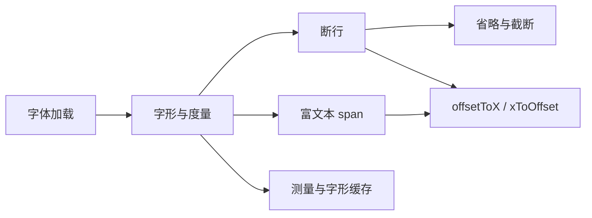

---
references:
  - 02-字体与字形
  - 03-文本度量
  - 04-断行算法
  - 05-富文本span
  - 06-文本缓存
---

# 第三阶段导览：文本与排版

> [返回：GUI框架学习大纲](../GUI框架学习大纲.md)
> 文本是 GUI 里最难的「图元」：度量、断行、混排、省略、富文本。本阶段做出 TextPainter，并给第五阶段的输入框预留光标几何 API——没有这三几何函数，输入框做不出来。

## 分册索引

| 分册 | 对应大纲条目 | 一句话说明 | 状态 |
|---|---|---|---|
| 01-导览.md | — | 本页 | ✅ |
| 02-字体与字形.md | 1 | 默认字体、TTF 加载、字形图集、字号与 DPI | ✅ |
| 03-文本度量.md | 2 | advance、基线、行高、measureText 等价实现 | ✅ |
| 04-断行算法.md | 3 | 贪心断行、断行点、CJK 混排、clip/fade/省略 | ✅ |
| 05-富文本span.md | 4 | 样式分段、两遍布局、span 命中几何 | ✅ |
| 06-文本缓存.md | 5 | 测量缓存与失效、字形缓存策略 | ✅ |

## 阶段目标

学完本阶段，你应该能不查资料做到：

- 解释 advance、基线（ascent/descent）、行高三者的关系，并算出一行文本的包围盒
- 手写贪心断行器，处理中英混排与行尾标点禁则
- 实现单行省略（ellipsis）与多行截断，并解释为什么必须在测量阶段处理而不是绘制阶段
- 设计富文本 span 的数据结构，实现「先测宽再摆位」的两遍布局
- 提供 `offsetToX` / `xToOffset`，说清它们在光标定位、选区高亮里的用途

## 知识点地图

## 实践任务清单

1. 实现 TextPainter：单行 / 多行 / 对齐 / 省略号 / 富文本 span 全覆盖
2. 断行测试集：中英混排、超长单词、行尾标点、空串与全空白
3. 实现 `offsetToX` / `xToOffset` 并写往返断言（offset→x→offset 稳定）
4. 加测量缓存后对比 1000 条文本重复布局的耗时变化

## 阶段自测

1. 为什么行高不等于字号？行高应该由谁决定？
2. 贪心断行在什么情况下会得到非最优结果？Knuth-Plass 解决了什么？
3. 省略号为什么必须在测量时处理？绘制时截断会破坏什么？
4. 富文本为什么需要两遍布局？一遍为什么不行？
5. `xToOffset` 在点击定位时如何处理 x 落在两个字符之间的情况？

## 前置知识与依赖关系

文本阶段夹在绘制层和布局层之间，向下只依赖一个能力，向上却要供给两个阶段，因此它的接口设计比实现细节更重要。

| 方向 | 依赖对象 | 具体依赖什么 |
|---|---|---|
| 向下 | 第二阶段的画笔接口 | 只需要「在某个位置用某种字号画一段字符串」这一个图元，其余全部在本阶段自己算 |
| 向下 | 第一阶段的字体资源句柄 | 字体由图形库加载并以句柄形式持有，内核不直接接触字形数据 |
| 向上 | 第四阶段的布局协议 | 文本节点要回答「给定最大宽度，我需要多宽多高」，这正是测量与断行的输出 |
| 向上 | 第五阶段的输入框 | 光标位置、选区高亮、点击定位都建立在偏移与横坐标互相换算的两个函数之上 |

阅读前最好已经具备两点认识。其一是样式表里行高、字号、基线对齐这些属性的直观效果，本阶段会解释它们背后的度量模型。其二是字符串按码元还是按字符计数的差别，因为偏移量的定义必须在全阶段保持一致，否则光标会落在半个字符中间。

分册之间的依赖是一条主线加一条支线：[02-字体与字形](02-字体与字形.md) 和 [03-文本度量](03-文本度量.md) 是地基，[04-断行算法](04-断行算法.md) 建立在度量之上，[05-富文本span](05-富文本span.md) 又建立在断行之上；[06-文本缓存](06-文本缓存.md) 是横切的优化，可以最后读，但它要求前面的测量接口足够纯，同样的输入必须得到同样的输出。

## 常见误区与正解

| 误区 | 为什么错 | 正解 |
|---|---|---|
| 一段文字的宽度等于字符数乘以字号 | 除了等宽字体，每个字形的前进宽度各不相同；中文、英文、标点混排时差别更大 | 宽度是逐字形前进宽度的累加，必须向字体查询而不能估算，详见 [03-文本度量](03-文本度量.md) |
| 行高就是字号 | 字号只是字体设计空间的缩放基准。一行的实际高度由基线以上和以下两部分加上行间留白共同决定，不同字体在同一字号下高度并不相同 | 行高是排版层的独立参数，由文本样式指定并参与布局，而不是由绘制时的字形高度反推 |
| 断行就是按空格切分，放不下就换行 | 中文没有空格，几乎每个字之间都可以断；而某些标点不能出现在行首或行尾；超过整行宽度的长单词还需要强制拆开，否则会死循环 | 先把文本切成不可再分的可断块，再做贪心装填，并为「行内一个块都放不下」准备兜底出口，详见 [04-断行算法](04-断行算法.md) |
| 省略号在绘制时把超出的部分裁掉再补三个点即可 | 绘制阶段已经拿不到「哪些字符被保留」的信息，布局算出的尺寸也与实际显示不符，光标和命中测试会全部错位 | 省略是测量阶段的职责：在断行结果上重新截取并预留省略号的宽度，输出的行数据就是最终显示的内容 |
| 测量和绘制可以各用各的字体参数，差一点看不出来 | 口径不一致会导致文字溢出容器、光标与字形对不齐、选区高亮偏移，而且字越多误差累积越明显 | 测量与绘制必须共用同一套字体、字号、字距口径，这是本阶段的铁律 |
| 缓存加得越多越好 | 缓存键若漏掉字号或字体，会返回过期结果；失效时机不对，换字体后界面会保留旧的宽度 | 键必须覆盖所有影响结果的输入，换字体视为一次全局失效，详见 [06-文本缓存](06-文本缓存.md) |

## 术语速查表

| 术语 | 英文 | 一句话解释 |
|---|---|---|
| 字形 | Glyph | 字符在某款字体里的具体图形，同一字符在不同字体中字形不同 |
| 字形图集 | Glyph Atlas | 把大量字形预先画进一张纹理，绘制时按区域取用 |
| 前进宽度 | Advance | 画完一个字形后笔位向前移动的距离，决定下一个字形的起点 |
| 基线 | Baseline | 一行文字共同对齐的那条隐形横线，多数字母坐在它上面 |
| 上伸与下伸 | Ascent / Descent | 基线到字形顶部和底部的距离，共同构成字体的内容高度 |
| 行高 | Line Height | 相邻两行基线之间的距离，包含内容高度与行间留白 |
| 可断块 | Chunk | 断行时不可再拆的最小单位，如一个英文单词或一个汉字 |
| 贪心断行 | Greedy Line Breaking | 每行尽量多放，放不下就换行，不回头调整已排好的行 |
| 禁则 | Kinsoku | 中日文排版中关于哪些标点不得位于行首或行尾的规则 |
| 省略 | Ellipsis | 内容超出限定行数时截断并以省略号提示还有后文 |
| 样式片段 | Span | 富文本中共享同一套样式的一段连续文字 |
| 字体回退 | Font Fallback | 当前字体缺少某个字符时，依次到备用字体中寻找字形 |
| 塑形 | Shaping | 把字符序列转换为带位置的字形序列的过程，处理连字与复杂文字 |

## 与真实框架对照

同样是概念层面的对应。真实系统的文本栈要处理双向文字、复杂文种塑形、字体回退和亚像素定位，本阶段的实现只覆盖其中最基础的一条路径。

| 本阶段概念 | Flutter | Chromium | Qt | 本阶段的简化 |
|---|---|---|---|---|
| 文本排版入口 | `TextPainter` 与底层段落对象 | 行内布局算法 | `QTextLayout` | 一个函数完成测量、断行、摆位 |
| 度量查询 | 段落对象返回的行度量 | 字体数据与塑形结果 | `QFontMetrics` | 一个可替换的测量器接口 |
| 塑形 | 由引擎内的塑形库完成 | 由塑形库完成并缓存结果 | 内置文本引擎 | 不做塑形，一个字符对应一个字形 |
| 断行规则 | 遵循统一码的断行标准 | 同上，并叠加样式属性的控制 | 同上 | 手写规则，只区分空白、西文单词和汉字 |
| 富文本 | 嵌套的文本片段树 | 行内盒与行内项列表 | 文本文档与字符格式 | 扁平的片段数组 |
| 光标几何 | 按偏移取光标位置、按坐标取偏移 | 选区与光标的位置换算 | 行对象的光标与坐标互换 | 两个互逆的换算函数 |
| 缓存 | 段落对象可复用，布局结果按约束缓存 | 塑形结果缓存与行内布局缓存 | 字体引擎层的字形缓存 | 测量器内部按文本与字号缓存宽度 |

对照之后有三点值得带走：

- 成熟框架无一例外把「度量」做成可查询的独立能力，布局层只和度量对话而不关心字形怎么画。我们把测量器抽成接口也是同样的道理，附带的好处是可以换上一个规则固定的模拟测量器，让排版逻辑脱离真实字体完成测试。
- 光标几何在每个框架里都是文本排版对象的公开方法，而不是输入框的私有逻辑。原因很直接：只有排版结果知道每个字符最终落在哪一行、哪个横坐标。
- 我们省掉的塑形与双向文字，恰恰是真实文本栈里最重的部分。这意味着本阶段的实现无法正确显示需要连写或从右向左书写的文字，这是一个明确的范围边界，不是疏漏。

## 验收清单（DoD）

- [ ] 能画图说明前进宽度、基线、上伸、下伸、行高之间的关系，并手算一行文字的包围盒
- [ ] 能解释字形图集的作用，以及为什么要显示中文就必须在加载字体时指定所需字符
- [ ] 能手写贪心断行，并正确处理中英混排、连续空白、超长单词三种情况
- [ ] 能说出「行内一个块都放不下」时为什么必须强制收下，否则会发生什么
- [ ] 能实现单行省略与限定行数的多行截断，并说明省略号的宽度是在哪一步预留的
- [ ] 能设计富文本的数据结构，并讲清两遍布局各自的输入与输出
- [ ] 能实现偏移与横坐标的互相换算，并通过往返一致性的断言
- [ ] 能说明点击落在两个字符之间时取哪一侧，以及这样取的理由
- [ ] 能指出测量缓存的键包含哪些字段，以及哪三种时机必须让缓存失效
- [ ] 能在不开窗口的前提下，用模拟测量器跑通全部排版测试
