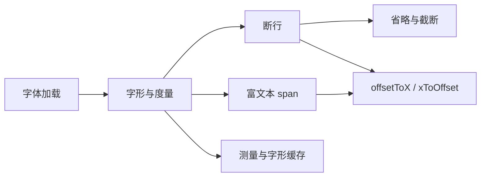

# 第三阶段导览：文本与排版

> [返回：GUI框架学习大纲](../GUI框架学习大纲.md)
> 文本是 GUI 里最难的「图元」：度量、断行、混排、省略、富文本。本阶段做出 TextPainter，并给第五阶段的输入框预留光标几何 API——没有这三几何函数，输入框做不出来。

## 分册索引

| 分册 | 对应大纲条目 | 一句话说明 | 状态 |
|---|---|---|---|
| 01-导览.md | — | 本页 | ✅ |
| 02-字体与字形.md | 1 | 默认字体、TTF 加载、字形图集、字号与 DPI | ✅ |
| 03-文本度量.md | 2 | advance、基线、行高、measureText 等价实现 | ✅ |
| 04-断行算法.md | 3 | 贪心断行、断行点、CJK 混排、clip/fade/省略 | ✅ |
| 05-富文本span.md | 4 | 样式分段、两遍布局、span 命中几何 | ✅ |
| 06-文本缓存.md | 5 | 测量缓存与失效、字形缓存策略 | ✅ |

## 阶段目标

学完本阶段，你应该能不查资料做到：

- 解释 advance、基线（ascent/descent）、行高三者的关系，并算出一行文本的包围盒
- 手写贪心断行器，处理中英混排与行尾标点禁则
- 实现单行省略（ellipsis）与多行截断，并解释为什么必须在测量阶段处理而不是绘制阶段
- 设计富文本 span 的数据结构，实现「先测宽再摆位」的两遍布局
- 提供 `offsetToX` / `xToOffset`，说清它们在光标定位、选区高亮里的用途

## 知识点地图

## 实践任务清单

1. 实现 TextPainter：单行 / 多行 / 对齐 / 省略号 / 富文本 span 全覆盖
2. 断行测试集：中英混排、超长单词、行尾标点、空串与全空白
3. 实现 `offsetToX` / `xToOffset` 并写往返断言（offset→x→offset 稳定）
4. 加测量缓存后对比 1000 条文本重复布局的耗时变化

## 阶段自测

1. 为什么行高不等于字号？行高应该由谁决定？
2. 贪心断行在什么情况下会得到非最优结果？Knuth-Plass 解决了什么？
3. 省略号为什么必须在测量时处理？绘制时截断会破坏什么？
4. 富文本为什么需要两遍布局？一遍为什么不行？
5. `xToOffset` 在点击定位时如何处理 x 落在两个字符之间的情况？
