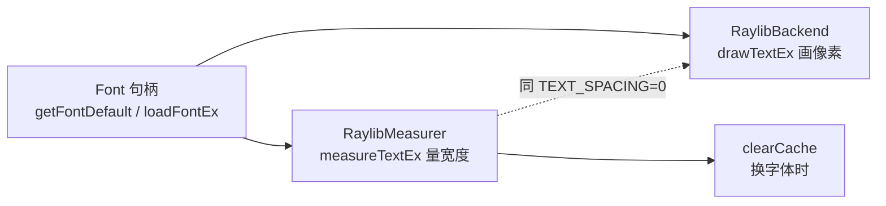
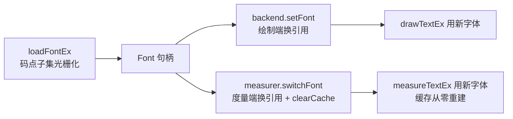

# 字体与字形：默认字体的来历与 CJK 的现实

> [返回：第三阶段导览](01-导览.md)
> 对应大纲条目：第三阶段 1。本册讲 mini-gui 眼里的「字体」：raylib 默认字体是什么、字形图集怎么组织、为什么绑定层读不到字符推进宽度、以及怎么加载一个能画中文的字体。事实全部来自本机实测日志、绑定声明文件（`scriptc-raylib/dist/generated/*.d.ts`）与 labs 源码。

## 1. 默认字体：224 个字形的内嵌图集

第一阶段抓过启动日志，其中两行是本册的主角：

```text
INFO: TEXTURE: [ID 2] Texture loaded successfully (128x128 | GRAY_ALPHA | 1 mipmaps)
INFO: FONT: Default font loaded successfully (224 glyphs)
```

逐词解读：

- 默认字体是**编译进 raylib 的一张 128×128 纹理**（`GetFontDefault()` 返回的内嵌资源），不是矢量字体
- **224 个字形** ≈ ASCII 可打印字符（95 个）+ 一批常用拉丁扩展/符号。**没有 CJK**——第一阶段所有屏幕文字强制 ASCII 就是这个原因：画了也查不到字形（缺字形时 raylib 以占位形式渲染，问号/方块）
- 图集只有 128×128：224 个字形平均每个摊 16384/224 ≈ 73 个纹理像素——默认字体只打算在**小字号**下够用，是「保证能出字」的兜底，不是排版品质的承诺
- 日志里的 `1 mipmaps`：只有基本级、没有多级渐进链——缩小采样时没有低分辨率版本可用，字形图集的通行做法就是不生成 mipmap（要小字号就重新光栅化小图，见第 10 节）
- `fontSize` 对位图字体是**整数倍缩放**（2×、3×…平滑），非整数倍会取最近的整数倍再仿射——大字号会有像素味

位图字体 vs 矢量字体（TTF/OTF）的分界：

| 维度 | 位图（默认字体） | 矢量（TTF，第 6 节加载） |
|---|---|---|
| 存储形态 | 一张纹理，每字形一个小矩形 | 字形轮廓（贝塞尔曲线）+ 度量表 |
| 渲染路径 | 查矩形 → 画纹理切片 | 轮廓 → 光栅化 → 入图集 → 画切片 |
| 字号 | 整数倍缩放（非整数倍会糊/锯齿） | 任意字号重新光栅化 |
| 内存 | 常驻一张小纹理 | 按码点子集光栅化（第 6 节） |

## 2. 字形图集（glyph atlas）模型

```text
┌─────────────── 128×128 纹理 ───────────────┐
│ A  B  C  D  E  F  G  H  I  J  K  L  M  N  O │
│ P  Q  R  S  T  U  V  W  X  Y  Z  a  b  c  d │
│ ...          每个字形占一个小矩形            │
└─────────────────────────────────────────────┘
绘制 "AB"：查 A 的图集矩形 → 画纹理切片；查 B → 再画一片
```

「画文本 = 一串纹理切片」是所有 GUI 框架的底层共识。把「画 "AB"」拆成步骤（对照第 5 节的 API 全景）：

1. 拿 `'A'` 的码点 0x41 查字形序号——`getGlyphIndex(font, codepoint)`，绑定真暴露了这个函数
2. 拿序号查图集矩形——`getGlyphAtlasRec(font, codepoint): Rectangle`，返回**可读的** `{x, y, width, height}`（第 4 节会看到：图集矩形漏得出，advance 漏不出）
3. 以图集矩形为源、按 advance 累计出的位置为目标，画一片纹理
4. `'B'` 重复 1–3——每字符一次查询加一次切片

mini-gui 不亲自走这四步（`drawTextEx` 一次打包），但度量端的 `measureTextEx` 问的正是同一套 advance 累计——绘制与度量在图集模型下是同一张账的两面。

业界同构：

- **Flutter**：引擎把光栅化后的字形放进 glyph atlas，每帧按图集矩形出 draw call
- **浏览器**：字体光栅缓存（glyph raster cache），同一字形同一字号只光栅化一次
- **raylib**：默认字体干脆**生来就是**一张图集，省掉光栅化那一步

矢量字体只是多了一步「字形轮廓 → 光栅化 → 入图集」，入集之后的路径完全一致。所以本册的图集模型对第 6 节加载的 CJK 字体同样成立——`loadFontEx` 光栅化的产物就是一张（或一组）图集纹理。

图集的两个工程推论：

1. **纹理切换成本**：一段文字若跨多张图集（多字体混排），绘制要在纹理间切换——第二阶段第六册「按纹理合批」的动机之一（纹理与采样本身是 webgl 站第一阶段的正题）
2. **图集是缓存**：光栅化贵、画切片便宜——「贵的结果存起来，便宜的动作每帧做」与《06-文本缓存》的度量缓存是同一形态的决策（一个是几何缓存，一个是像素缓存）

**本实现没有 kerning**：图集模型下相邻字形对（如 `AV`）的间距微调需要 kerning 表参与度量；raylib 的 `measureTextEx` 按字符 advance 累加，不做字形对修正。等宽 Mock 下无感，真字体下也是「可接受的教学近似」。

## 3. GRAY_ALPHA：格式与内存账单

日志里的 `GRAY_ALPHA` 值得单独一节。它是一种**双通道**纹理格式：每像素 2 字节——一个灰度字节（字形浓淡）+ 一个蒙版字节（alpha，边缘抗锯齿）。对比常见格式：

| 格式 | 字节/像素 | 用途 |
|---|---|---|
| RGBA8 | 4 | 通用彩色纹理 |
| GRAY_ALPHA | 2 | 字形/蒙版类纹理（本默认字体） |
| R8（纯灰度） | 1 | 无软边需求的遮罩 |

默认字体的内存账单（由日志数字直接算）：128 × 128 像素 × 2 字节 = 32768 字节 = **32 KiB**——同样尺寸的 RGBA8 要 64 KiB。字形天生是「单色 + 软边」，彩色通道纯属浪费，这是字形图集通行用灰度类格式的原因（彩色 emoji 是例外，它们需要 RGBA 图集）。

一个小验证练习：第 6 节 `loadFontEx(path, 32, codepoints, count)` 光栅化 `CJK_SAMPLE` 的 45 个码元、基准字号 32——新图集的面积需求远小于默认字体的 224 字形，但仍是一张独立纹理（多一次纹理切换，见第 2 节推论 1）。

## 4. 绑定层的一堵墙：GlyphInfo 是句柄

理想中每字形有可读元数据（advance 推进、offset、图集矩形）。绑定声明里也确实有这个类型——但看它的**实际形状**（`scriptc-raylib/dist/generated/types.d.ts` 原文）：

```ts
export interface GlyphInfo {
    readonly handle: number;
    readonly kind: "GlyphInfo";
}
```

两个字段：一个整数句柄、一个类型标记。**字段读不出来**——advance、offset、矩形全在句柄背后的原生结构体里，scriptc-raylib 的「最大安全绑定」策略不透出它们（第一阶段工具链册讲过这套策略）。于是字符推进宽度只能这样求：

```ts
advanceAt(text, i) = measure(text[0..i+1]) − measure(text[0..i])   // 前缀差分
```

真实实现（`core/text/measurer.ts`）：

```ts
advanceAt(text: string, index: number, fontSize: number): number {
  const before = this.measure(text.slice(0, index), fontSize);
  const withCh = this.measure(text.slice(0, index + 1), fontSize);
  return withCh - before;
}
```

一条 n 字符的行做一次完整光标几何（`xToOffset` 逐字符问 advance）是 n 次差分 = **O(n²) 次字符度量**——这个约束直接决定了两件事：

1. **度量缓存从「优化」变成「必需」**（《06-文本缓存》：断行的前缀链让缓存天然高命中，实测第二次排版零穿透）
2. **光标命中按「字符中点」近似**而不逐字形精确（`xToOffset` 的中点吸附，《05-富文本span》）——第五阶段 TextField 够用

对照真实框架：能直接读 advance 的系统（FreeType/HarfBuzz 集成）里，`advanceAt` 是 O(1) 查表，前缀差分与度量缓存都不需要存在。**一堵墙决定一片架构**——mini-gui 的文本缓存整册都在给这堵墙付房贷。

墙到底有多高？把绑定声明里字体相关的函数全部摆出来看（`generated/raylib.d.ts` 原文归类）：

| 类别 | 函数 | mini-gui 用了吗 |
|---|---|---|
| 取字体 | `getFontDefault()` / `loadFont(fileName)` / `loadFontEx(…)` / `loadFontFromMemory(…)` / `loadFontFromImage(…)` | 前两个 + Ex |
| 字体生命周期 | `isFontValid(font)` / `unloadFont(font)` / `exportFontAsCode(…)` | 否（demo 常驻） |
| 绘制 | `drawTextEx(font, text, pos, fontSize, spacing, tint)` / `drawTextPro(…)`（带旋转）/ `drawTextCodepoint(s)(…)` | drawTextEx |
| 度量 | `measureTextEx(font, text, fontSize, spacing): Vector2` / `measureTextCodepoints(…)` | measureTextEx |
| 字形查询 | `getGlyphIndex(font, codepoint): number` / `getGlyphInfo(font, codepoint): GlyphInfo` / `getGlyphAtlasRec(font, codepoint): Rectangle` | 否 |

最后一行最有意思：**墙不是全线封闭的**。`getGlyphAtlasRec` 返回的 `Rectangle` 是可读的普通结构体（`{x, y, width, height}` 四个 number）——图集矩形漏得出来；漏不出来的是 `GlyphInfo` 里的 **advance 与 offset**。而排版最需要的恰恰是 advance：图集矩形只告诉你「字形贴图多大」，不告诉你「光标走多远」——`i` 的贴图可以很窄，advance 里却带着两侧留白。于是前缀差分仍是唯一出路，但这个细节值得记准确：**墙精确地堵在「度量元数据」上，不是堵在「一切字形信息」上**。

顺带一提 `drawTextCodepoint`（画单个码点）与 `measureTextCodepoints`（量码点数组）——它们是码点级 API，mini-gui 走字符串级就够了；真要抠代理对（emoji）的正确性时，这对 API 是现成的升级口。

## 5. 一个字体句柄，两个消费者

`Font` 与 `GlyphInfo` 一样是不透明句柄（同一个声明文件里就三行：`{ handle, kind }`）。它有两个彼此独立的消费者，构造时都拿默认字体起步：

```ts
// platform/raylib-backend.ts（绘制端）
constructor() {
  super();
  this.font = getFontDefault();
}

// platform/raylib-measurer.ts（度量端）
constructor(font?: Font) {
  super();
  this.font = font ?? getFontDefault();
}
```

两端各自怎么用这个句柄：

```ts
// 度量端：measureRaw（宽度问答）
measureTextEx(this.font, text, fontSize, TEXT_SPACING).x

// 绘制端：text 命令执行（像素问答）
drawTextEx(this.font, cmd.text, v(Math.round(cmd.x), Math.round(cmd.y)), Math.round(cmd.fontSize), 0, cmd.color)
```



- `measureTextEx(font, text, fontSize, spacing)` 返回包围盒 `Vector2`，取 `.x` 即宽度
- `TEXT_SPACING = 0` 是平台层唯一常量：**度量端与绘制端共用**，两端任何一个自己另定 spacing，光标几何立刻漂移（《03-文本度量》第 4 节的铁律）
- `switchFont`（度量端换字体 + 清缓存）与 `setFont`（绘制端换引用）必须成对出现——第 6 节的 demo 代码背靠背写着这两行

## 6. 加载一个能画中文的字体

raylib 的 TTF 加载用 stb_truetype 光栅化**指定码点子集**。绑定声明（`generated/raylib.d.ts`）：

```ts
export declare function loadFontEx(fileName: string, fontSize: number,
  codepoints: ReadonlyArray<number>, codepointCount: number): T.Font;
export declare function loadCodepoints(text: string): number[];
```

demo 的策略全文（`apps/03-text.ts`）：

```ts
const CJK_FONT_CANDIDATES = [
  "/System/Library/Fonts/Supplemental/Arial Unicode.ttf", // macOS
  "/usr/share/fonts/truetype/noto/NotoSansCJK-Regular.ttc", // Linux（常见）
];
const CJK_SAMPLE =
  "中文混排测试：把一段中文与 English 混在一起，贪心断行要按「字」断开而不是按空格。";
let cjkFontLoaded = false;
for (const path of CJK_FONT_CANDIDATES) {
  if (fileExists(path)) {
    const codepoints = loadCodepoints(CJK_SAMPLE);
    const font = loadFontEx(path, 32, codepoints, codepoints.length);
    backend.setFont(font);        // 绘制端
    measurer.switchFont(font);    // 度量端 —— 两端必须同步换字体
    cjkFontLoaded = true;
    break;
  }
}
```

五个工程要点：

1. **码点子集**：CJK 全集几万字，一次性光栅化又慢又占显存；`loadCodepoints(CJK_SAMPLE)` 把 demo 用到的字符编码成码点数组，`loadFontEx` 只光栅化这些——图集小、启动快。这也解释了真实框架为什么有「字体回退链」——一个字体管不全（第 9 节）
2. **baseSize=32**：光栅化的基准字号，后续绘制按它缩放。demo 里的正文字号（16/18/22）都小于 32——缩放方向是缩小，比放大省像素味
3. **换字体必须两端同步**：绘制端 `backend.setFont` + 度量端 `measurer.switchFont`（内部 `clearCache()`）。只换绘制端：画的字新、量的宽旧——光标与断行全错；只换度量端：反过来。demo 里两行背靠背，任何一端单独存在都是 bug 温床
4. **候选路径探测 + 回退**：macOS 试 Arial Unicode，Linux 试 Noto，都找不到就退回默认字体画英文——demo 在任何宿主都不会死
5. **`loadCodepoints` 接受任意字符串**：demo 用一段固定样本文案当「码点清单」——文本本身就是自己的子集说明，简单到不会错

加载成功后，右列排的就是真中文（同样在启动期一次排好）：

```ts
const cjk = cjkFontLoaded
  ? layoutText([{ text: CJK_SAMPLE }], { fontSize: 18, color: PALETTE.text, width: 360 }, measurer)
  : null;
// 帧循环里：
if (cjk !== null) {
  paintText(p, cjk, 440, 48);
} else {
  p.text("cjk font not found on this host", 440, 24, 16, PALETTE.textMuted);
}
```

退出日志带一枚冒烟指标：`[03-text] cjkFont=true/false …`——字体有没有加载成功，一眼可查。

两端同步的结构图：



## 7. demo 屏幕的字体清单：03-text.ts 实况

把 `apps/03-text.ts` 里所有上屏的文本对象列成清单（全部真实参数）：

| 对象 | 内容 | fontSize | width | 特殊参数 |
|---|---|---|---|---|
| 左列标题 | `"wrap (width 360)"` | 16 | — | 直接 `p.text`（不走排版器） |
| wrapped | PARAGRAPH（贪心断行说明文，153 字符） | 18 | 360 | wrap |
| ellipsized | 同一段 PARAGRAPH | 16 | 360 | maxLines 2 + ellipsis |
| rich | 5 个 span：`rich `/`spans`/` share one `/`line`/` and wrap together` | 18 | 300 | 三种颜色混排 |
| cjk | CJK_SAMPLE（中文与 English 混排） | 18 | 360 | 字体加载失败则整块不排 |
| 右列标题 | `"cjk wrap (width 360)"`，失败时 `"cjk font not found on this host"` | 16 | — | 兜底文案 |
| caret 行 | `"click to move the caret"` | 22 | **不传** | 单行自然宽 |

三个读法：

- **caret 行不传 width**——`layoutText` 里 `opts.width ?? Number.MAX_SAFE_INTEGER`，断行退化为只按换行符切（《05-富文本span》3.2 节）。单行文本的语义就是「不约束宽度」
- **同一篇 PARAGRAPH 排两遍**（wrapped 18px / ellipsized 16px）——字号不同、宽度预算同、截断策略不同，三变量对照实验放在一屏里
- **排版全部发生在帧循环外**（启动期一次排好，帧循环只 paintText）——《06-文本缓存》第 7 节「布局缓存」的 demo 侧用法；退出日志打印 `wrappedLines/ellipsisLines/richLines` 三枚行数冒烟指标

这张表也是「字号速查」的实景：18px 行高 23、16px 行高 20（《03-文本度量》第 8 节），在屏幕上对应的就是左列两段文字的行间距差。

## 8. 练习：给 mini-gui 换一款字体

把第 6 节的流程反过来做一遍，检验你是否真的理解了两端同步。任务：在 macOS 上把 demo 换成 Menlo（等宽，路径 `/System/Library/Fonts/Menlo.ttc`；等宽意味着光标几何与 Mock 的心智模型一致）。

步骤（全部用已验证的 API）：

1. `fileExists(path)` 探测——`.ttc` 是字体合集（TrueType Collection），raylib 的 stb_truetype 取其中第一个字体
2. `loadCodepoints(demo 全部文案)` ——注意：**不只是 CJK_SAMPLE**，还要包含英文段落（换字体后默认字体的拉丁字形不再参与），漏了哪个字符哪个字符就查不到字形
3. `loadFontEx(path, 32, codepoints, codepoints.length)` 光栅化
4. 背靠背两行：`backend.setFont(font)` + `measurer.switchFont(font)`
5. 跑起来点击 caret 行验证对位，退出看 `caretOffset roundtrip=true`

三个预埋的坑（都在前文出现过）：

- 只调 `setFont` 不调 `switchFont`：画的是 Menlo、量的是旧字体——光标漂移（第 5 节）
- 反过来只调 `switchFont`：量的是 Menlo、画的是旧字体——断行与视觉不符（第 5 节）
- 码点清单漏字符：那个字符以占位形式上屏（第 1 节）

做完这个练习，「字体是度量器的状态，换状态必须两端同步 + 显式失效」就不再是书上的话，而是你手指的记忆。

## 9. 字体回退链：一个字体管不全

（本节是概念对照，非 mini-gui 实现。）

demo 的「候选路径 + 回退默认字体」是字体回退链（fallback chain）的最小形态。真实系统的问题更普遍：**任何单一字体都不覆盖 Unicode 的可见子集**——拉丁字体没汉字，中文字体没 emoji，emoji 字体没阿拉伯文。于是绘制每一字符前都要先问「哪个字体有它」：

- **浏览器/CSS**：`font-family: "PingFang SC", "Microsoft YaHei", sans-serif` 就是一条显式回退链——逐字体找字形，全链 miss 才画「豆腐块」（tofu，空心方框）。每个 `font-family` 项还可以按字重/字形变体细分
- **Flutter**：`FontFallback` 列表 + 引擎的 `findFallback`；平台默认字体也参与兜底
- **操作系统层**：CoreText/DirectWrite 维护全局回退表，应用不指定时按文字脚本（script）自动挑

回退链与度量的交互是深水区：**回退发生在字符粒度**——同一行的「中文 + emoji」可能来自两个字体，advance 各查各的表，图集也跨张。mini-gui 把回退做在「字体加载时的码点选择」上（一次性、无运行时回退），代价就是第 6 节的码点清单必须提前写全——demo 文案外的中文字符画不出来。这是「简单性换覆盖面」的又一次显式取舍。

（字形挑选之外还有 shaping——连字（fi）、阿拉伯文形变等需要 HarfBuzz 级的整形器；mini-gui 的等宽假设与 raylib 的逐字符渲染都不做 shaping，教学口径如实记边界。）

## 10. 字号、行高与 DPI

- **位图默认字体**：整数倍缩放；**矢量字体**：任意字号光栅化（`loadFontEx` 的 baseSize 之外按需缩放）
- **行高由排版层决定**：`layoutText` 的 `lineHeightRatio`（缺省 1.25，入口处 `Math.round` 取整）——**不是字体属性**。ascent/descent 只在绘制基线对齐时需要（多字号混排），mini-gui 的行推进用行高、行内顶部对齐，简化掉基线记账（《03-文本度量》第 6 节有 12.5 与 13 的口径差实录）
- **HiDPI**：字号是逻辑像素；物理像素换算在第八阶段统一处理（那时 `fontSize` 的 round 位置也要审一遍——现在 round 在后端执行处，缩放进来后应上移到缩放之后）

取整位置的现状盘点（两处，各有理由）：

```text
layoutText 入口：lineHeight = Math.round(块字号 × 比例)     ← 累计量，早定死防漂移
后端执行处：    drawTextEx(…, Math.round(x), Math.round(y), Math.round(fontSize), …)  ← 栅格量，最后一刻才取整
```

中间层全程浮点：piece.x、行宽、offsetToX 的返回值都可能是 12.5 这样的半像素——**浮点在管道里流动，整数只在两端出现**。第八阶段加 DPI 缩放时，缩放因子乘在浮点管道里没问题，但后端那三个 round 就要重新审：`round(x)` 应变成 `round(x × scale)`（先缩放再取整），否则逻辑坐标取整后再缩放会把误差放大 scale 倍。这就是「审点」的具体含义。

三个量的分工表：

| 量 | 谁决定 | 在哪实现 |
|---|---|---|
| 字形长什么样 | 字体（图集） | raylib 渲染 |
| advance（推进宽） | 字体度量 + spacing | measureTextEx / 前缀差分 |
| 行高 | 排版参数（块字号 × 比例） | layoutText 入口 |
| 字号的物理大小 | 逻辑字号 × DPI | 第八阶段 |

「字形归字体、行高归排版、物理大小归平台」——三者分离是本阶段的隐性大纲。

## 11. 常见误区

| 误区 | 真相 | 出处 |
|---|---|---|
| 行高 = 字号 | 行高是排版参数（字号 × 1.25），字体只出字形 | 第 10 节 |
| advance = 字形宽度 | advance 是推进量，含设计留白；等宽字体才相等 | 第 4 节 |
| 默认字体能画中文 | 224 字形无 CJK；画了也查不到字形 | 第 1 节 |
| 位图字体任意倍缩放无损 | 非整数倍取最近整数倍再仿射——有像素味 | 第 1 节 |
| 换字体只换绘制端就够 | 度量端必须同步 switchFont + 清缓存，否则量的还是旧宽度 | 第 5、6 节 |
| CJK 全量光栅化更省心 | 几万字的图集又慢又占显存；码点子集是标准做法 | 第 6 节 |
| GlyphInfo 能读出 advance | 它是不透明句柄 `{ handle, kind }`——前缀差分是唯一出路 | 第 4 节 |
| 图集只是位图字体的概念 | 矢量字体光栅化后同样入图集；Flutter/浏览器同构 | 第 2 节 |
| 字形图集该用 RGBA | 字形是单色+软边，GRAY_ALPHA 省一半带宽与内存 | 第 3 节 |

## 12. 本册小结

- 默认字体 = 128×128 GRAY_ALPHA 位图图集（32 KiB）、224 字形、无 CJK、整数倍缩放、无 mipmap 链
- 「画文本 = 一串纹理切片」：位图与矢量字体入集之后同构；图集是像素缓存
- GlyphInfo 是不透明句柄 → advance 靠前缀差分 → O(n²) → 度量缓存必需、光标中点吸附
- 一个 Font 句柄、两个消费者（度量端/绘制端），TEXT_SPACING 共用，换字体两端成对换
- CJK 加载 = 候选路径 + 码点子集光栅化 + 两端同步；回退链是「一个字体管不全」的系统答案
- 字形归字体、行高归排版、物理大小归平台（DPI 留第八阶段）

## 自测

1. 默认字体为什么画不了中文？它是矢量还是位图？128×128 与 224 这两个数字分别描述什么？
2. `advanceAt` 为什么用前缀差分？它把哪个复杂度从 O(1) 变成了 O(n)，缓存又把它压回了什么？
3. `loadFontEx` 为什么要传码点数组？全量加载 CJK 的代价是什么？
4. 换字体时度量缓存为什么必须清？不清会出什么错？忘调 `backend.setFont` 又会出什么错？
5. 字形图集模型下，「画 "AB"」在绘制后端发生什么？矢量字体比位图字体多哪一步？
6. 浏览器的 `font-family` 列表与 demo 的 `CJK_FONT_CANDIDATES` 数组，分别是哪个粒度的回退？各在什么时刻生效？
7. 为什么说「图集是缓存」？它与《06-文本缓存》的度量缓存缓存的东西有什么不同？
8. `TEXT_SPACING = 0` 这个常量定义在哪个文件、被哪两端引用？它防的是什么 bug？
9. GRAY_ALPHA 每像素几字节？128×128 的默认字体图集占多少内存？换成 RGBA8 翻几倍？
10. 假设绑定层明天把 GlyphInfo 的字段全部开放了，本阶段的哪几册内容会大幅缩水？各删掉哪一段？
