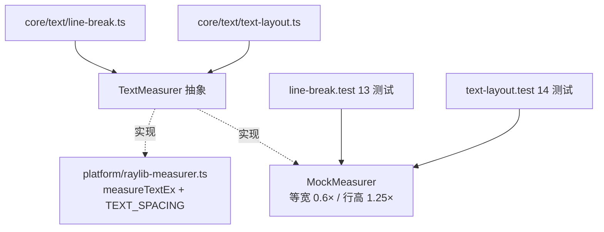

# 文本度量：advance、行高与「测量=绘制」铁律

> [返回：第三阶段导览](01-导览.md)
> 对应大纲条目：第三阶段 2。断行、对齐、省略号、光标定位全都建立在「量得准」上。本册逐行走读度量抽象（`measurer.ts` 全文 70 行）、三个必须钉死的口径（spacing、行高、半开区间），以及为什么 MockMeasurer 能让全部排版逻辑无头可测。

## 1. 度量的三个量

```ts
export interface TextMetrics {
  lineHeight: number;
  ascent: number;
  descent: number;
}

export abstract class TextMeasurer {
  measure(text, fontSize): number          // 单行宽度
  advanceAt(text, index, fontSize): number // 第 index 个字符的推进（前缀差分）
  metrics(fontSize): TextMetrics
}
```

三个量各自回答一个几何问题：

- **advance（推进）**：光标从字形左边界走到右边界移动的距离。**不是字形宽度**——「i」的字形很窄，但推进里可能包含两侧留白；「W」的字形可能带悬挂（kerning 下甚至互相叠压）。等宽字体（含 mini-gui 的默认位图字体、MockMeasurer）两者相等——这是后文一切「可整除推演」成立的原因
- **ascent / descent**：基线（baseline）之上/之下的高度。基线是多字号混排垂直对齐的参照——「大字与小字底对齐」就是对齐 baseline。mini-gui 行内**顶部对齐**（简化），ascent/descent 只在将来做基线对齐时才需要精确
- **lineHeight（行高）**：上一行顶到下一行顶的距离。**排版层参数**（`layoutText` 的 `lineHeightRatio`，缺省 1.25），不是字体属性——同一字体可以排出不同行高的段落

三者的关系画出来：

```text
        ┌── ascent ──┐
        │  ┌─────┐   │
  ←advance→│ 字形 │   │      lineHeight = ascent + descent + 行距
        │  └─────┘   │           （mini-gui 口径：块字号 × 1.25，round 取整）
        └─ descent ──┘
  ───────── 基线 baseline ─────────
```

真实字体的 ascent/descent 由字体的 hhea/OS2 表声明；mini-gui 的绑定读不到这些（句柄不透明，《02-字体与字形》），所以走教学近似（第 6 节）。

## 2. 度量抽象放在 core：一个接口换掉整个平台

`src/core/text/measurer.ts` 顶部注释写明了分层意图：

```ts
// 文本度量抽象：断行与排版只依赖这个抽象类，具体实现可以是
//  - RaylibMeasurer（平台层，measureTextEx 前缀差分）
//  - MockMeasurer（测试，等宽假想字体，数值完全确定）
//
// 为什么需要缓存：绑定层的 GlyphInfo 是不透明句柄（读不到 advance 字段），
// 字符推进只能用「前缀宽度差分」求，一条 n 字符的行是 O(n²) 次度量——
// 没有缓存的断行器在大文本上会立刻变慢（见《06-文本缓存》实测）。
```

依赖方向一张图：



于是：

- 断行器 13 个测试 + 排版器 14 个测试全部跑在 MockMeasurer 上，无窗口、无 raylib、全库 116 个测试 470ms 跑完
- 换渲染后端（假想 SDL 版）只动 platform 层，core 文本代码零改动
- 「度量」被压成一个纯函数 `(text, fontSize) → width`——所有可测性都来自这个窄化

这是第三阶段最重要的一次依赖倒置：**排版算法依赖度量抽象，而不是度量实现**。

## 3. TextMeasurer 基类全文走读

```ts
export abstract class TextMeasurer {
  private readonly widthCache = new Map<string, number>();
  /** 缓存命中数（观测口，测试/分册用）。 */
  cacheHits = 0;
  /** 绕过缓存的真实度量次数（观测口）。 */
  rawMeasures = 0;

  /** 单行文本宽度（像素）。子类实现时与绘制端使用同一 spacing。 */
  protected abstract measureRaw(text: string, fontSize: number): number;

  /** 行高相关度量（随字体与字号变化）。 */
  abstract metrics(fontSize: number): TextMetrics;

  measure(text: string, fontSize: number): number {
    if (text === "") return 0;
    const key = `${fontSize}:${text}`;
    const hit = this.widthCache.get(key);
    if (hit !== undefined) {
      this.cacheHits += 1;
      return hit;
    }
    const w = this.measureRaw(text, fontSize);
    this.rawMeasures += 1;
    this.widthCache.set(key, w);
    return w;
  }

  /** text[index] 在上下文中的推进宽度（前缀差分；等宽字体下与位置无关）。 */
  advanceAt(text: string, index: number, fontSize: number): number {
    const before = this.measure(text.slice(0, index), fontSize);
    const withCh = this.measure(text.slice(0, index + 1), fontSize);
    return withCh - before;
  }

  /** 清空缓存（换字体时调用；TextMeasurer 不持有字体，由使用方通知）。 */
  clearCache(): void {
    this.widthCache.clear();
  }
}
```

逐点拆解：

- **模板方法模式**：`measure` 是骨架（查缓存 → miss 才调 `measureRaw` → 回填），子类只填 `measureRaw` 这一个洞。缓存逻辑只写一遍，Mock 与真字体免费共享
- **空串早退**：`if (text === "") return 0`——空串的宽度是平凡的 0，不值得走缓存（实测：`measure("", 10)` 后 `rawMeasures=0`、`cacheHits=0`，两计数器纹丝不动）。这个早退在断行器里被高频踩到：每块到达时 `curText + pendingSpaceText` 常为空串
- **键格式 `` `${fontSize}:${text}` ``**：字号与文本拼一个字符串键。文本里可以出现任意字符（含 `:`），看似有歧义，其实没有：字号永远是不含冒号的前缀，字符串的第一个冒号唯一切出字号——`(fontSize, text) → key` 是单射，无碰撞。教学上不必上 `[fontSize, text]` 数组键或双层 Map
- **`advanceAt` 的注释说「等宽字体下与位置无关」**：比例字体里 advance 依赖前后文（kerning 连字），前缀差分恰好把上下文效应吸收进差值——差分本身就是「在上下文里量这个字符」的定义
- **`clearCache` 的注释说「TextMeasurer 不持有字体」**：基类不知道字体为何物，失效由持有字体的使用方（RaylibMeasurer.switchFont）触发——见第 5 节

缓存与观测口是《06-文本缓存》的正题，本册先记住接口形状即可。

## 4. 铁律：测量与绘制用同一口径

第一版后端用 `drawText`（内部 spacing 与默认字体绑定），度量器用 `measureTextEx(font, text, fontSize, 0)`——spacing 差一点点，**光标就会落在字符中间**。修复后的约定：

```ts
// 平台层唯一常量，两端共用（raylib-measurer.ts）
export const TEXT_SPACING = 0;

// 度量端：measureRaw 里
measureTextEx(this.font, text, fontSize, TEXT_SPACING).x

// 绘制端：raylib-backend.ts 的 text 命令执行
drawTextEx(this.font, cmd.text, v(Math.round(cmd.x), Math.round(cmd.y)), Math.round(cmd.fontSize), 0, cmd.color)
```

raylib 的 `spacing` 参数是「字符间额外间距」。度量端算 0、绘制端画非 0（或反之），每过一个字符偏差就累加一份 spacing——10 个字符后偏差 = 10×spacing，肉眼可见。「测量=绘制」是文本系统的第一条不变量，光标几何、省略号截断、对齐空隙全押在它上面。

注意绘制端还做了三个 `Math.round`（x/y/fontSize）——绘制是像素栅格操作，取整合理；但**度量端不取整**（宽度保持浮点，如 12.5），只在行高等「累计会漂移」的场合才在排版层取整（`layoutText` 入口的 `Math.round`）。取整位置的选择是口径问题：早取整会累积误差，晚取整只在栅格化那一刻损失半像素。

**半开区间口径**：全文的 offset 语义是「第 offset 个字符**之前**」——offset ∈ [0, len]，len+1 个合法光标位对 len 个字符。`offsetToX` 超界钳到行尾、`xToOffset` 中点吸附，全部建立在这个口径上（《05-富文本span》第 7 节逐条展开）：

```text
  h   e   l   l   o        字符（5 个）
 |   |   |   |   |   |     光标位（6 个：offset 0..5）
 0   6   12  18  24  30    x 坐标（等宽 6px/字符）
```

## 5. 换字体 = 一次受控的全局失效

`RaylibMeasurer` 全文走读（`platform/raylib-measurer.ts`）：

```ts
export const TEXT_SPACING = 0;

export class RaylibMeasurer extends TextMeasurer {
  private font: Font;

  constructor(font?: Font) {
    super();
    this.font = font ?? getFontDefault();
  }

  /** 换字体后必须调用：宽度缓存全部失效。 */
  switchFont(font: Font): void {
    this.font = font;
    this.clearCache();
  }

  protected measureRaw(text: string, fontSize: number): number {
    return measureTextEx(this.font, text, fontSize, TEXT_SPACING).x;
  }

  metrics(fontSize: number): TextMetrics {
    // 默认位图字体没有可读的基线元数据（句柄不透明），按教学近似：
    // ascent ≈ 字号、descent ≈ 0.25×字号、行高 1.25×字号
    return {
      lineHeight: fontSize * 1.25,
      ascent: fontSize,
      descent: fontSize * 0.25,
    };
  }
}
```

宽度缓存键是 `(fontSize, text)`，**不含字体**——因为字体是度量器的**状态**而不是调用参数。换字体时 `switchFont` 做两件事：换引用 + `clearCache()`，一次显式失效。这套策略与第六阶段「脏标记」同构：状态变了，派生缓存必须跟着死。

**为什么不是把字体塞进缓存键**：键含字体的话，旧字体的条目永远不会错误命中（正确性更稳），但会变成永远无人再查的死条目（内存泄漏面）；显式失效把「什么时候字体变了」收敛到唯一入口，忘了调用的后果是**错误命中**（新字体下量旧宽度）——把错误从「静默内存增长」换成「一调必现的几何错位」，教学与工程都更可调试。两种方案的完整对照表在《06-文本缓存》第 9 节。

**换字体必须两端同步**：绘制端 `backend.setFont(font)` + 度量端 `measurer.switchFont(font)`。只换一端就是「量的宽度和画的宽度对不上」——光标立刻漂移。demo 里两行代码背靠背（`apps/03-text.ts`，见《02-字体与字形》第 6 节全文）。

## 6. metrics() 的教学近似与行高口径差

`RaylibMeasurer.metrics` 的注释自己承认了近似来源：句柄不透明 → 读不到基线元数据 → 按「ascent ≈ 字号、descent ≈ 0.25×字号」估。对顶部对齐 + 统一行高的 mini-gui，这份近似只影响「将来做基线对齐」的精度，当前无感。

一个容易踩的口径差（实测验证）：

```text
metrics(10).lineHeight         → 12.5   （MockMeasurer/RaylibMeasurer 都是未取整值）
layoutText 的 lineHeight        → 13     （入口处 Math.round(块字号 × 比例)）
```

**排版真正使用的行高来自 `layoutText` 入口的 `Math.round(blockFontSize × lineHeightRatio)`，不是 `metrics()`**。`metrics().lineHeight` 是「字体视角的建议」，`layoutText` 是「排版口径的决定」——两者不一致正是「行高由排版层决定，不由字体决定」的代码级证据。paintText 的 y 推进、size.height、黄金断言里的 `y:73 = 60+13` 全部用后者。

## 7. MockMeasurer：让排版完全可测

全文：

```ts
/** 测试用假想等宽字体：advance = 0.6×fontSize，行高 1.25×，全部可整除推演。 */
export class MockMeasurer extends TextMeasurer {
  static readonly ADVANCE_RATIO = 0.6;
  static readonly LINE_HEIGHT_RATIO = 1.25;

  protected measureRaw(text: string, fontSize: number): number {
    return text.length * fontSize * MockMeasurer.ADVANCE_RATIO;
  }

  metrics(fontSize: number): TextMetrics {
    return {
      lineHeight: fontSize * MockMeasurer.LINE_HEIGHT_RATIO,
      ascent: fontSize,
      descent: fontSize * 0.25,
    };
  }
}
```

`measureRaw` 一行：字符数 × 字号 × 0.6。常用速查表（手算即机器算——公式是纯的）：

| text | fontSize | measure | 备注 |
|---|---|---|---|
| `"hello"` | 10 | 30 | 5 字符 × 6 |
| `"hello world"` | 10 | 66 | 含空格 11 字符 |
| `"中文测试文本"` | 10 | 36 | UTF-16 码元 6 个 |
| `"..."` | 10 | 18 | 省略号预算 |
| 任意 | 10 | 6×n | n = 码元数 |

价值不在「快」，在**数字可整除推演**：fontSize=10 时每字符 6px，「宽度 30」就是「5 个字符」——断行、省略号、光标边界的期望值全可以手算，测试断言精确到像素。排版逻辑（core/text/*）完全不知道自己跑在真字体还是假字体上——这就是度量抽象的回报。

「等宽」还带来一个可测试性礼物：`advanceAt` 的值与位置无关（恒 6）——光标几何的期望边界是等差数列 0,6,12,18,24,30，中点吸附的测试值（2.9/3.1）可以精确落在边界两侧 0.1px。真字体做不到这种精度设计。

Mock 的另一个角色：**缓存行为的测试载体**。`cacheHits`/`rawMeasures` 是基类字段，MockMeasurer 上的计数就是纯逻辑计数（无 FFI 噪声）——《06-文本缓存》的测试「第二次排版 rawMeasures 不增长」因此可以写成精确断言。

## 8. 字号速查表：把公式套到 demo 的真实字号上

两条公式（advance = 0.6×fontSize；排版行高 = round(1.25×fontSize)）套遍 mini-gui 实际用到的字号（10 是测试口径，16/18/22 是 `apps/03-text.ts` 的真实字号）：

| fontSize | advance/字符 | metrics().lineHeight | layoutText 行高 | 用在哪 |
|---|---|---|---|---|
| 10 | 6 | 12.5 | 13 | 全部 27 个文本断言 |
| 16 | 9.6 | 20 | 20 | demo 小标题 / ellipsized 段 |
| 18 | 10.8 | 22.5 | 23 | demo 正文 / CJK 段 |
| 22 | 13.2 | 27.5 | 28 | demo 光标行 |

两个观察：

- **16 与 18 的每字符宽不是整数**（9.6 / 10.8）——测试口径选 10 不是巧合，是「让所有期望值都是整数」的设计；真机 demo 的 16/18 则不追求可整除
- **`.5` 结尾的行高向上取整**（22.5→23、27.5→28）：`Math.round` 对正数的 half-up 行为。黄金断言 `y:73 = 60 + 13` 里的 13 就是这么来的（12.5 → 13）

这张表也回答一个实践问题：「demo 里两行 18px 的文字隔多远？」——23px（不是 18、也不是 22.5）。**算行高永远查排版口径那一列**。

## 9. 一次断行的度量账单

把度量器当黑盒的人容易低估「断行到底量了多少次」。这里给一张最小账单（`"hello world"@30`、MockMeasurer、直跑实测 raw=3、hits=2）：

| # | 调用点 | 度量串 | 结果 | 值 | 用途 |
|---|---|---|---|---|---|
| 1 | chunkWidth | `"hello"` | 穿透 | 30 | 词块多宽 |
| 2 | curWidth | `""` | 早退 | 0 | 行首行宽（空串免单） |
| 3 | chunkWidth | `" "` | 穿透 | 6 | 空格块多宽 |
| 4 | curWidth | `"hello"` | 命中 | 30 | 加空格放不下 → 空格丢弃 |
| 5 | chunkWidth | `"world"` | 穿透 | 30 | 词块多宽 |
| 6 | curWidth | `"hello"` | 命中 | 30 | 加 world 放不下 → 换行 |

六次 `measure` 调用、三次穿透、两次命中、一次早退，断出 `["hello","world"]`。三个观察：

- **`"hello"` 被问了三遍**（#1、#4、#6），只在第一遍穿透——缓存的存在感不在「快」，在「同一问题的重复提问被合并」
- **早退是白送的**：行首那次 `curWidth` 度量根本不产生键、不计数
- **账单结构由断行器决定**：chunkWidth/curWidth 交替出现，长前缀逐步变长——《06-文本缓存》把这个模式命名为「前缀链」，并给出更大输入的完整 16 行账单

真字体下每行「穿透」都是一次 FFI 往返——这张表同时是性能预算表：**断行成本 ≈ 穿透次数 × FFI 常数**，而穿透次数 ≈ 唯一前缀数 ≈ O(n)，缓存把指数式的重复提问压回了线性。

## 10. 口径验收面：27 个断言在守什么、守不到什么

第三阶段文本相关的测试恰好 13（line-break）+ 14（text-layout）= **27 个**，实跑全绿。把它们按本册的口径归类：

| 口径 | 代表断言 | 出处 |
|---|---|---|
| 行高 = round(字号×比例) | 单行 size = {width:30, height:13}；paintText 第二行 y=73 | text-layout「单行」/ 黄金断言 |
| 半开区间 offset ∈ [0, len] | offsetToX 0..5 全遍历 = [0,6,12,18,24,30]；超界钳行尾 | text-layout「光标几何」 |
| 中点吸附 | xToOffset 2.9→0、3.1→1、999→5 | 同上 |
| 往返稳定 | offset→x→offset 全遍历不动 | 同上 |
| 断行行为（宽度口径的消费方） | line-break 全部 13 个 | line-break.test |
| span 记账 | 归属跨断行、跨片段连续 | text-layout |
| 度量缓存 | 第二次排版 rawMeasures 不增长 | text-layout「度量缓存」 |

**测试守不到的口径**同样重要——两条都住在 platform 层，MockMeasurer 够不着：

1. **TEXT_SPACING 两端一致**：Mock 没有 spacing 概念，27 个断言没有一条能抓住「度量端 0、绘制端非 0」的漂移——这条铁律的验收只能靠 demo 真机（光标点击对位、`caretOffset roundtrip=true` 冒烟）
2. **真字体的宽度**：Mock 的等宽假设在真字体上不成立（比例字宽、无 kerning 已是近似），真实偏差只能在真机上目检

所以「27 个断言全绿」的准确读法是：**core 排版逻辑的全部口径已被钉死；platform 层的两条口径靠 demo 冒烟**。分层测试的边界要像分层实现一样清楚。

## 11. 概念深化：浏览器 line-height 的历史包袱

（本节是概念对照，非 mini-gui 实测。）

CSS 的 `line-height: normal` 大约是 1.2 倍字号——这个数字不是设计出来的，是**早期浏览器对字体度量理解不足的遗留**。真相链：

- 字体文件的 ascent + descent 常常**大于** em 尺寸（字形可以伸出 em box），不同字体差异很大（Times ≈ 1.15，某些手写体 > 1.5）
- `line-height: normal` 取字体的「建议行高」（hhea 表的 lineHeight 字段），于是同一段落换字体行高就变——设计者抱怨
- CSS 后来规定 `line-height` 可用**无单位数字**（如 `1.5`）：行高 = 数字 × **自身**字号，与字体度量解耦，子元素各自继承数字再算——这就是 mini-gui `lineHeightRatio` 的口径
- 无单位 vs 带 px 的区别成了前端经典面试题：`line-height: 1.5` 与 `line-height: 1.5em` 在嵌套元素上结果不同（前者每层重算，后者锁定父级像素）

mini-gui 的选择（`块字号 × 比例，round 取整，全块统一`）站在「无单位数字」这一侧——行高是排版决定，字体最多给建议。这与 CSS 内容区（content-area，由字体度量决定）与行盒（line box，由 line-height 决定）分离的现代口径一致：**「一段文字占多高」和「字长什么样」是两个问题**。

## 12. 已知的近似与取舍

| 近似 | 原因 | 影响 |
|---|---|---|
| 行内顶部对齐（不用基线） | 省掉 per-span ascent 记账 | 混排大字号时视觉略跳，可后续加 |
| 断行统一用块字号估宽 | span 字号参与断行会互相耦合 | 极端混排下断点可能早/晚一个字符 |
| xToOffset 按字符中点 | 无字形级 advance | 光标落在字符间时取最近边界 |
| UTF-16 码元切分 | 实现从简 | emoji 代理对可能被拆开（教学口径） |
| metrics 教学近似 | 句柄不透明读不到基线表 | 基线对齐（未实现）时需重估 |
| 行高入口统一 round | 防浮点行高累计漂移 | 半像素级视觉差，无功能影响 |

每个近似都有「为什么现在可以接受」的理由——这正是教学工程的口径：**近似可以，但必须记账**。

## 13. 常见误区

| 误区 | 真相 | 出处 |
|---|---|---|
| 行高 = 字号 | 行高是排版参数（字号 × 比例）；字号只管字形大小 | 第 1、6、8、11 节 |
| advance = 字形宽度 | advance 含设计留白；等宽字体才相等 | 第 1 节 |
| spacing 差一点无所谓 | 每字符累积一份偏差，光标/对齐立刻露馅 | 第 4 节 |
| 缓存键该含字体 | 字体是状态不是参数；显式失效换可调试性 | 第 5 节 |
| metrics() 是行高的权威来源 | layoutText 入口的 round 才是排版口径（12.5 ≠ 13） | 第 6、8 节 |
| 度量端顺手 round 宽度 | 宽度保持浮点，取整只在栅格化/累计行高时做 | 第 4 节 |
| ascent/descent 马上要用 | 顶部对齐 + 统一行高下用不到；基线混排才需要 | 第 12 节 |
| 断行每个字符量一次宽 | 量的是块与前缀；账单见第 9 节，缓存再砍一刀 | 第 9 节 |
| 27 个断言守住了全部口径 | platform 层两条（spacing、真字体宽度）测试够不着 | 第 10 节 |

## 14. 本册小结

- 三个量：advance（推进，非字形宽）、ascent/descent（基线，混排才需要）、lineHeight（排版参数）
- 抽象在 core、实现在 platform：MockMeasurer 让 27 个文本断言全部无头、精确到像素；platform 层口径靠 demo 冒烟
- 铁律：measureTextEx 与 drawTextEx 同 spacing（TEXT_SPACING=0）；取整位置晚做
- 换字体 = switchFont + clearCache 显式失效；两端（backend/measurer）同步
- 行高口径：round(块字号 × ratio)，不是 metrics() 的建议值；速查表钉死 demo 各字号
- 一次断行的度量账单：穿透次数 ≈ 唯一前缀数，缓存把重复提问合并
- 近似全部记账：六条取舍各有理由与影响

## 自测

1. advance 与字形宽度的区别是什么？什么时候相等？
2. spacing 不统一会在哪两个功能上首先露馅？画出偏差累积的示意。
3. 宽度缓存键为什么不含字体？失效靠什么机制？
4. MockMeasurer 的「数字可整除」给测试带来了什么质变？举一个真字体做不到的断言设计。
5. `metrics(10).lineHeight` 与 `layoutText` 排版用的行高各是多少？为什么差 0.5？
6. 推算：MockMeasurer 下 `measure("你好 world", 10)` 是多少？（提示：UTF-16 码元数）
7. 推算：`measure(" ", 10)`、`measure("   ", 10)`、`measure("hello ", 10)` 各是多少？断行器为什么高频度量前两者？
8. 第 9 节的账单里，`"hello world"@24` 会怎么变？逐次列出每个度量串的结果（穿透/命中/早退），并写出断行结果。（提示：`hello`=30 放不下 24 的行，走硬拆）
9. 18px 与 22px 的排版行高各是多少？demo 光标行两击之间隔多少像素？
10. 如果要让 span 各自字号参与断行，贪心算法要改哪里？会引入什么新的失效场景？
