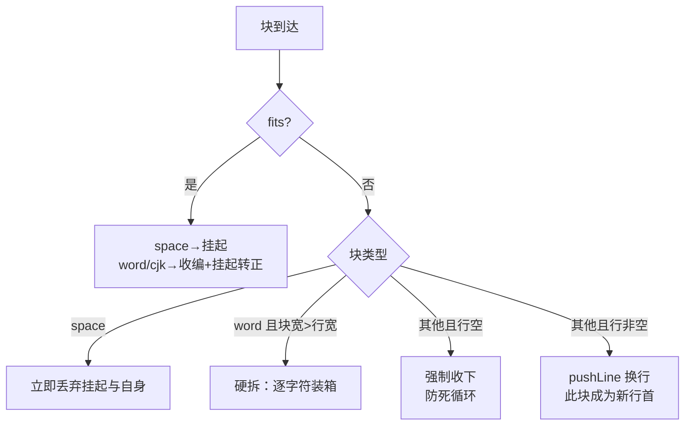
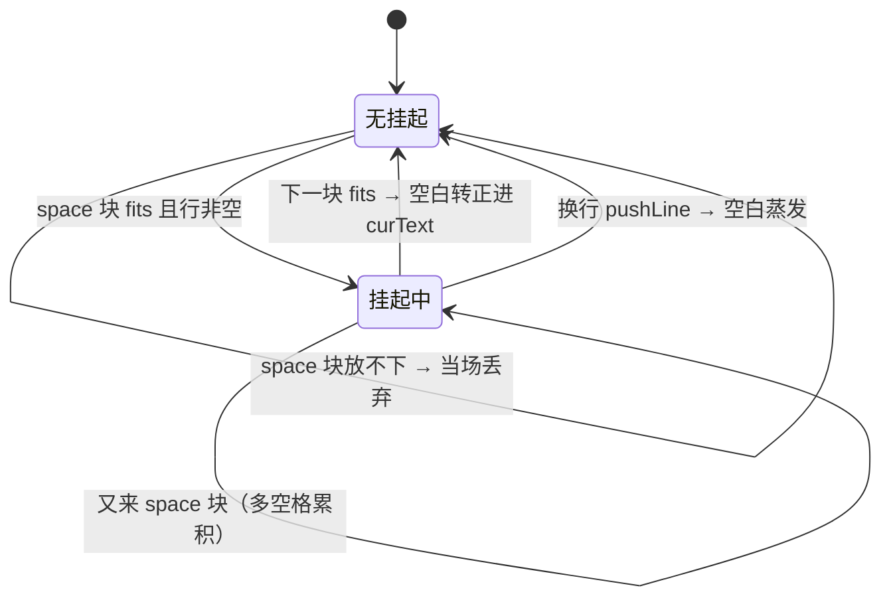

# 断行算法：贪心装箱与可断块

> [返回：第三阶段导览](01-导览.md)
> 对应大纲条目：第三阶段 3。断行器是排版层算法密度最高的 150 行：可断块模型、空白的挂起与丢弃、CJK 字间皆可断、长词硬拆。本册把 `line-break.ts` 从头到尾走读一遍——贪心主循环逐分支讲透，每个行为都有断言钉死（`line-break.test.ts` 13 个测试实跑全绿），每个推算题的答案都经过对源码的无头直跑验证。

## 1. 断行的输入输出：先把问题说窄

断行器回答一个很窄的问题：**给定一段文本、一个行宽、一个度量器，输出行序列**。

```ts
export interface BreakOptions {
  width: number;      // 行宽上限（像素）
  fontSize: number;   // 字号（传给度量器）
  measurer: TextMeasurer;  // 度量抽象（真字体 / Mock 都行）
}
```

注意它不知道颜色、不知道 span、不知道对齐——那些是上层（《05-富文本span》）的事。断行器只消费宽度。这个窄接口是它能被 13 个测试完全钉死的前提：MockMeasurer 每字符恰好 6px（fontSize=10），「宽度 30」就是「5 个字符」，期望值全部可以手算。

**断行的单位不是字符，是块（chunk）**——这是全册最重要的一个抽象，下一节展开。

## 2. 可断块（chunk）：先把文本切成原子

| 块类型 | 内容 | 断行待遇 |
|---|---|---|
| word | 连续的拉丁字母/数字/符号 | 块内不可断；超行宽整体换行 |
| space | 连续空白（空格 0x20 / 制表 0x09） | 挂起——行尾丢弃、行首吞掉 |
| cjk | 单个汉字（自成一块） | 前后皆可断 |
| newline | `\n` | 硬断行 |

```text
"hello 中文 abc" → [word:"hello"][space][cjk:"中"][cjk:"文"][space][word:"abc"]
"hi 你 a\nb"    → [word:"hi"][space][cjk:"你"][space][word:"a"][newline][word:"b"]
```

第二个切分来自测试原文（`chunkify` 的第一个测试），断言逐块核对 `kind` 与 `text` 两个序列。

为什么要先切块而不是直接逐字符扫？因为**断行机会由字符类别决定，而类别是成段出现的**：拉丁词内部任何位置都不许断，词与词之间的空白是天然断点，汉字两两之间都是断点。把「同类别连续段」折叠成一个原子，主循环面对的就是 7 种块而不是 15 个字符——判定的粒度对了，代码才能短。

每个块还带一份**源索引**：

```ts
export interface Chunk {
  text: string;
  kind: "word" | "space" | "cjk" | "newline";
  /** 块内字符在源文本中的索引。 */
  srcIndices: number[];
}
```

`srcIndices[i]` 是块内第 i 个字符在原文中的位置。现在只需记住：断行过程会**丢弃字符**（换行处空白、换行符本身），丢弃之后还能不能找回「这个字符原来在哪」——全靠这份索引。它是《05-富文本span》里 span 归属的生命线。

## 3. chunkify 全文走读

分类的依据是三个小函数，先看清楚范围：

```ts
const CJK_START = 0x2e80;
const CJK_END = 0x9fff;

export function isCJK(codeUnit: number): boolean {
  // 覆盖 CJK 部首/符号/汉字主流区段；片假名/谚文等边角按「非 CJK」处理（可断性退化，不致错）
  return codeUnit >= CJK_START && codeUnit <= CJK_END;
}

export function isSpace(codeUnit: number): boolean {
  return codeUnit === 0x20 || codeUnit === 0x09;   // 空格与制表符
}
```

两点如实说明（源码注释原话）：范围只盖 0x2E80–0x9FFF 主流区段，片假名、谚文落在区间外，会被当成 word 处理——后果只是「该断的地方没给断点」，不会错；另外全部分类按 **UTF-16 码元**，代理对（emoji）可能被拆在两块里，教学口径接受这个简化。

切分主循环全文：

```ts
export function chunkify(text: string): Chunk[] {
  const chunks: Chunk[] = [];
  let buf = "";
  let idx: number[] = [];
  let kind: Chunk["kind"] | null = null;

  const flush = (): void => {
    if (kind !== null && buf !== "") {
      chunks.push({ text: buf, kind, srcIndices: idx });
    }
    buf = "";
    idx = [];
  };

  for (let i = 0; i < text.length; i++) {
    const c = text.charCodeAt(i);
    let k: Chunk["kind"];
    if (c === 0x0a) k = "newline";        // 判定顺序：换行 → 空白 → CJK → 其他全是 word
    else if (isSpace(c)) k = "space";
    else if (isCJK(c)) k = "cjk";
    else k = "word";

    if (k === "cjk" || k === "newline") {
      flush(); // CJK 单字与换行符自成一块
      chunks.push({ text: text.charAt(i), kind: k, srcIndices: [i] });
      kind = null;
      continue;
    }
    if (kind !== k) {
      flush();
      kind = k;
    }
    buf += text.charAt(i);
    idx.push(i);
  }
  flush();
  return chunks;
}
```

逐段拆开：

- **状态**：`buf`（正在累积的块文本）、`idx`（对应的源索引）、`kind`（当前块的类别）。三者合起来就是「正在成形的那一块」
- **`flush` 闭包**：把成形的块落袋，然后清空累积器。注意守卫 `kind !== null && buf !== ""`——文本开头的第一个字符不会触发空 flush；连续类别切换时也不会产出空块
- **判定顺序**：`0x0a` 换行最优先（它绝不该被算进 word），然后空白、CJK，最后**剩下的全部归 word**——标点、数字、西里尔字母……都不是断行特殊角色
- **CJK 与换行走快车道**：先 `flush()` 掉正在成形的 word/space，然后单字直接成块 `continue`。这就是「汉字自成一块」的实现——四个字就是四个块
- **word 与 space 走慢车道**：类别不变就继续往 `buf` 里追加；类别一变（词→空格、空格→词）先 flush 再换轨。所以 `"aa   bb"` 里三个空格是**一个** space 块，不是三个

用 `"hi 你 a\nb"` 过一遍（测试原文的输入）：

| i | 字符 | 类别 | 动作 | 产出块 |
|---|---|---|---|---|
| 0,1 | h,i | word | 追加进 buf | （成形中 "hi"） |
| 2 | 空格 | space | 类别变 → flush | `word:"hi"` |
| 3 | 你 | cjk | flush 空格块 → 单字成块 | `space:" "`、`cjk:"你"` |
| 4 | 空格 | space | 新轨成形 | |
| 5 | a | word | flush 空格块 | `space:" "` |
| 6 | \n | newline | flush word 块 → 单字成块 | `word:"a"`、`newline:"\n"` |
| 7 | b | word | 新轨成形 | |
| 末尾 | | | flush | `word:"b"` |

共 7 块，与测试断言的 `["word","space","cjk","space","word","newline","word"]` 一致。

`chunkify` 的第二个测试「源索引与字符一一对应」用 `"a b"` 核对：三块的 `srcIndices` 分别是 `[0]`、`[1]`、`[2]`——一条测试里三处断言，钉住「索引跟字符不丢不重」。

## 4. 贪心主循环：四个状态变量一个骨架

`breakLinesIndexed` 的全部状态：

```ts
export function breakLinesIndexed(text: string, opts: BreakOptions): BrokenLine[] {
  const lines: BrokenLine[] = [];
  let curText = "";             // 当前行已定型的文本
  let curIdx: number[] = [];    // 当前行已定型的源索引
  let pendingSpaceText = "";    // 挂起中的空白（还没决定归属）
  let pendingSpaceIdx: number[] = [];

  const pushLine = (): void => {
    lines.push({ text: curText, srcIndices: curIdx });
    curText = "";
    curIdx = [];
    pendingSpaceText = "";   // 成行的一刻，挂起空白若还在，就地丢弃
    pendingSpaceIdx = [];
  };
```

四个变量分两组：`cur*` 是**已收编**的内容（一定属于当前行），`pendingSpace*` 是**未决**的空白（可能属于当前行，也可能在换行时蒸发）。`pushLine` 是唯一的成行动作——注意它的最后一击：清空挂起空白。**行尾空白不占行宽**这条规则就藏在这两行赋值里。

主循环每块先算三个数：

```ts
  for (const chunk of chunkify(text)) {
    if (chunk.kind === "newline") { pushLine(); continue; }

    const chunkWidth = opts.measurer.measure(chunk.text, opts.fontSize);
    const curWidth = opts.measurer.measure(curText + pendingSpaceText, opts.fontSize);
    const lineEmpty = curText === "" && pendingSpaceText === "";
    const fits = curWidth + chunkWidth <= opts.width;
```

- `chunkWidth`：这块自己多宽
- `curWidth`：**当前行宽含挂起空白**——判定「装不装得下」时，挂起的空白算进行宽（它们一旦转正就要占地方），但还没写进 `curText`
- `lineEmpty`：行是否连挂起空白都没有——它守着「防死循环」分支
- `fits`：注意是 `<=`，**恰好放得下就算放下**（有专门测试钉这条边界）

## 5. 分支一：装得下（fits）

```ts
    if (fits) {
      if (chunk.kind === "space") {
        // 空白挂起：可能是本行行尾，也可能在换行时被丢弃
        if (curText !== "" || pendingSpaceText !== "") {
          pendingSpaceText += chunk.text;
          for (const si of chunk.srcIndices) pendingSpaceIdx.push(si);
        }
      } else {
        curText += pendingSpaceText + chunk.text;
        for (const si of pendingSpaceIdx) curIdx.push(si);
        for (const si of chunk.srcIndices) curIdx.push(si);
        pendingSpaceText = "";
        pendingSpaceIdx = [];
      }
      continue;
    }
```

两个子分支：

- **space 块**：进挂起区。内层守卫 `curText !== "" || pendingSpaceText !== ""` 防的是「行首空白被挂起」——空行开头的空白直接吞掉，不进挂起区（行首不留空白的规则在这里＋下面的丢弃分支共同保证）
- **非 space 块（word/cjk）**：**挂起空白转正**。注意拼接顺序 `curText += pendingSpaceText + chunk.text`——空白插在中间，索引也按这个顺序入账，然后清空挂起区。这一行是「空白到底属于谁」的最终裁决：只要后面还有内容跟上来，空白就是**行内分隔符**，归属本行

于是空白的命运由**下一块**决定：下一块放得下 → 空白转正进本行；放不下 → 换行，空白蒸发。这就是「挂起」的全部含义——把决定推迟到信息齐的那一刻。

## 6. 分支二：装不下的四个出口



### 6.1 出口一：放不下的空白，立即丢弃

```ts
    if (chunk.kind === "space") {
      pendingSpaceText = ""; // 行尾空白直接丢（连同索引）
      pendingSpaceIdx = [];
      continue;
    }
```

真实路径（`"hello world"@30` 手推，每字符 6px）：`hello` 收编后行宽 30；空格块 6px，`30+6 > 30` 放不下 → 在这里丢弃；`world` 到达时 `curWidth=30`（挂起区空），`30+30 > 30` → 走出口四换行。结果 `["hello","world"]`——测试「词间断行：换行处空白被丢弃」钉的就是这条链。

### 6.2 出口二：长词硬拆

word 块**自身就超行宽**时，无处可换——换到新行它还是放不下。只能拆：

```ts
    if (chunk.kind === "word" && chunkWidth > opts.width) {
      // 长词本身超行宽：按字符硬拆（先把已有内容成行）
      if (curText !== "") pushLine();
      let piece = "";
      let pieceIdx: number[] = [];
      for (let i = 0; i < chunk.text.length; i++) {
        const next = piece + chunk.text.charAt(i);
        if (opts.measurer.measure(next, opts.fontSize) > opts.width && piece !== "") {
          lines.push({ text: piece, srcIndices: pieceIdx });
          piece = chunk.text.charAt(i);
          pieceIdx = [chunk.srcIndices[i] ?? i];
        } else {
          piece = next;
          pieceIdx.push(chunk.srcIndices[i] ?? i);
        }
      }
      curText = piece; // 剩余部分作为新行开头继续装
      curIdx = pieceIdx;
      continue;
    }
```

细节逐个看：

- 先 `if (curText !== "") pushLine()`——硬拆前把已有内容成行，拆出来的第一片从一个空行开始
- 内循环还是贪心：`piece` 逐字符加长，`measure(next) > width` 且 `piece !== ""` 就把 `piece` 成行、当前字符另起。`piece !== ""` 守卫的仍是「行空时哪怕超宽也要收一个字符」——否则一个字符都放不进无限行宽为零的行，内循环也会死
- `chunk.srcIndices[i] ?? i`：正常取源索引，取不到时回退到块内位置——防御性写法，硬拆出的每一段仍带正确索引
- **`curText = piece` 而不是 pushLine**：拆剩的尾巴不当场成行，留作新行开头继续接后续块——直跑验证 `"abcdefg bb"@30 → ["abcde","fg bb"]`：拆剩的 `fg`（12px）继续收编后面的空白与 `bb`，拼成第二行 `"fg bb"`（30px 顶格）

手推测试用例 `"abcdefghij"@24`（10 字符 60px > 24）：

| piece 累积 | 试加下一字符 | 宽度 | 动作 |
|---|---|---|---|
| a→abcd | 试加 e → "abcde" | 30 > 24 | 成行 `"abcd"`，piece=e |
| e→efgh | 试加 i → "efghi" | 30 > 24 | 成行 `"efgh"`，piece=i |
| i→ij | 无下一字符 | 12 | 留作 curText |

结果 `["abcd","efgh","ij"]`——注意 `abcd` 恰好 24px 顶格：内循环条件同样是 `>` 才拆，与主循环的 `fits`（`<=`）口径一致。

### 6.3 出口三：行空强制收下——防死循环

```ts
    if (lineEmpty) {
      // CJK 单字超宽也必须收下，否则死循环（一个字就是最小单位）
      curText = chunk.text;
      curIdx = chunk.srcIndices.slice();
      continue;
    }
```

想象没有这个分支：一个 12px 宽的行，来一个 18px 的 cjk 块——放不下，走出口四 `pushLine` 换行；新行还是空，块还是 18px，还是放不下……**无限产出空行，永远收不下这个字**。死循环的根因是「换行」这个动作对「行空」的情形不产生任何状态变化。

解法：行空时无条件收下。代价是这一行会溢出行宽（渲染上超界），收益是算法必然终止。**「一个字是最小单位，再窄的行也要吞下它」**——这是所有真实断行器的公共底线规则（浏览器对超宽的不可断内容也是让其溢出而非丢弃）。

触发它的最小例子：`breakLines("中", {width: 3, …})`——6px 的字进 3px 的行，单字成行 `["中"]`，行宽溢出但没有丢字。

### 6.4 出口四：常规换行

```ts
    pushLine();
    curText = chunk.text; // 常规换行：这块成为新行首
    curIdx = chunk.srcIndices.slice();
```

最平凡也最常见：当前行装不下这块，成行，这块做新行首。注意 `slice()`——索引拷贝一份，块对象不被共享修改。

## 7. 十三个测试逐条解读：每个断言在防什么错

新鲜实跑（本册写作时 `npx vitest run` 全库输出节选）：

```text
✓ src/core/text/line-break.test.ts (13 tests) 2ms
Test Files  13 passed (13)
Tests  116 passed (116)
Duration  470ms
```

逐条列出（输入全部 fontSize=10，每字符 6px）：

| # | 测试名（`it` 原文） | 输入 → 期望 | 在防什么错 |
|---|---|---|---|
| 1 | 拉丁词 / 空白 / CJK / 换行各成块 | `chunkify("hi 你 a\nb")` 的 kind 与 text 序列 | 分类器把汉字并进词、把换行算进空白等切分错误 |
| 2 | 源索引与字符一一对应 | `chunkify("a b")` 三块 srcIndices=[0]/[1]/[2] | 索引错位——下游 span 归属全崩（第 2 节的生命线） |
| 3 | 空串产生一行空行 | `""@60 → [""]` | 空文本返回零行——上层按行数排 y 坐标会画出负高度 |
| 4 | 词间断行：换行处空白被丢弃 | `"hello world"@30 → ["hello","world"]` | 换行后行尾残留空格——撑宽行、污染对齐空隙 |
| 5 | 恰好放得下就不断（宽度含空格正好等于限制） | `"hello world"@66 → ["hello world"]` | `fits` 写成 `<`——66px 顶格被误断；边界口径漂移 |
| 6 | 长词超行宽按字符硬拆 | `"abcdefghij"@24 → ["abcd","efgh","ij"]` | 长词整块丢弃或整块溢出；硬拆口径与主循环不一致 |
| 7 | CJK 字间皆可断 | `"中文测试文本"@12 → ["中文","测试","文本"]` | 汉字被当成 word 整块——窄行下整段溢出 |
| 8 | 中西混排：拉丁词内不断、CJK 与拉丁之间可断 | `"hello 中文 abc"@60 → ["hello 中文","abc"]` | 混排交界处不可断——「词内不断」误伤 CJK |
| 9 | 换行符硬断行 | `"a\nb"@60 → ["a","b"]` | `\n` 被当空白挂起丢弃——显式换行失效 |
| 10 | 行尾空白不占行宽（aa 后跟多空格再 bb，两行各两字符） | `"aa   bb"@12 → ["aa","bb"]` | 三连空格让 `aa` 行宽变 30——对齐/截断全部失真 |
| 11 | 不超宽原样返回 | `"abc"@30 → "abc"` | 不超宽也加省略号 |
| 12 | 超宽截断加省略号（… 宽 18px，可用 30-18=12 → 2 字符） | `"abcdef"@30 → "ab..."` | 省略号自身宽度没从预算里扣——总宽越界 |
| 13 | 极端窄：只剩省略号 | `"abcdef"@18 → "..."` | keep 为空时拼出 `""` 或死循环 |

对着源码看这张表：测试 4、5、10 盯 `fits` 与空白丢弃；6 盯硬拆内循环；7、8 盯 chunk 分类；9 盯 newline 快车道；3 盯收尾 `pushLine`。**每个分支至少被一条测试瞄准**——这就是「行为由断言钉死」的含义。

## 8. 空白的挂起：两条丢弃路径

空白从挂起到消失有两条路，都真实存在于代码路径中（以下推算均经源码直跑验证）：

**路径 A：空白自己放不下，当场丢弃。** `"hello world"@30`：空格到达时行宽已 30，`30+6 > 30`，走 6.1 出口直接蒸发。

**路径 B：空白挂起成功，下一块放不下，随 `pushLine` 蒸发。** `"hello world"@36`：`hello` 后行宽 30，空格 `30+6 ≤ 36` 挂起成功；`world` 到达 `36+30 > 36` 换行，`pushLine` 清空挂起区。结果仍是 `["hello","world"]`——两条路径殊途同归，这正是设计的对称性：**无论空白在哪一刻判定为「行尾」，它的结局都一样**。

再看挂起**转正**的例子 `"a b cc"@24`：`a` 收编（6px）；空格挂起（12 ≤ 24）；`b` 到达 `12+6 ≤ 24`——挂起转正，`curText="a b"`；第二个空格挂起（24 ≤ 24 恰好）；`cc` 到达 `24+12 > 24` 换行——第二个空格蒸发。结果 `["a b","cc"]`。一个输入里同时演完「转正」与「蒸发」。

挂起状态机的完整状态图：



为什么行首空白不会出现？两个位置联手堵死：空行的 space 块即使 fits 也被「行非空」守卫挡在挂起区外（第 5 节）；换行后挂起区已被 `pushLine` 清空。所以任何一行的 `curText` 都不可能以空白开头。

## 9. CJK 的断行规则差异与禁则

拉丁词以空格为界；中文没有空格，**每个汉字都是合法断点**。混排文本（`"hello 中文"`）在 word 块与 cjk 块交界处天然可断——块的分类系统免费处理了这件事，不需要特殊「混排模式」。测试 8 就是这条免费能力的验收。

**未实现的真规则**（教学口径如实列出，源码注释与分册口径一致）：

- **行首禁则**（避头标点）：行首不能是 `，。、；：？！）」』……` 等收尾类标点——它们在语义上属于前一行的末字
- **行尾禁则**（避尾标点）：行尾不能是 `（「『` 等开启类标点——开了括号就换行，视觉上「悬」着
- **Knuth-Plass 整段最优化断行**：词间空隙微调换行质量（第 10 节）

禁则实现并不难——在 `chunkify` 的分类处把标点归入新类别 `cjk_close`（不可行首）/`cjk_open`（不可行尾），贪心装箱在收块时前看一块：想把 `。` 挤到下一行时，改为把它和前一个汉字捆绑成不可分段。影响面：测试 7 的 `"中文测试文本"` 无标点不受影响；新增几条带标点断言（如 `"中文。测试"@12` 期望 `["中文。","测试"]` 而不是 `["中文","。测试"]`）。留给读者作为练习，难度适中。

（真实世界的完整规则表在 Unicode 标准的 UAX #14「Unicode Line Breaking Algorithm」里，按字符属性配对判定断点，几十种属性类别——概念上与本节的块模型同构：先分类、再按相邻类别查表。）

## 10. 为什么贪心「够好」：与 Knuth-Plass 对照

| 维度 | 贪心（本册） | Knuth-Plass |
|---|---|---|
| 复杂度 | O(字符数 × 度量成本)，一遍扫描 | 整段动态规划，O(n²) 级 |
| 决策范围 | 只看当前行 | 全段所有可能的断点组合 |
| 行间空隙 | 每行独立最优，可能一行松一行紧 | 全段均匀度最优化（badness 总量最小） |
| 增量性 | 改一段尾部只重排尾部 | 改一个字全段重算 |
| 适合场景 | 屏幕 UI（行长实时变）、编辑器 | 印刷排版（书、论文） |

贪心的复杂度一遍扫描无回溯；Knuth-Plass 排版质量更好，代价是**整段重排**——改一个字全段重算，与「增量排版」「行缓存」（本阶段第六册）直接冲突。浏览器与 Word 用的是带禁则的贪心变体；Flutter 的 `TextPainter` 也是贪心。教学与工程双重理由：mini-gui 选贪心。

贪心什么时候肉眼可见地次优？极端例（概念推演，非测试用例）：宽 10 字符的行、文本 `"aaaa bbbbbbbb cc"`——贪心第一行装 `aaaa`（4 字 + 空格后放不下 8 字词）换行，第二行 `bbbbbbbb` 换行，第三行 `cc`；整段最优可能是第一行 `aaaa` 后把空隙拉开与第二行共享。差异只在**空隙均匀度**，不在于对错——贪心永不产出超宽行、永不丢字（这两条由断言 6、7 和防死循环分支兜底）。

## 11. 省略号（ellipsize）

单行省略号独立成函数，全文：

```ts
/** 省略号截断：把一行裁到 width - "..." 宽度以内，再接上 "..."。 */
export function ellipsize(line: string, width: number, fontSize: number, measurer: TextMeasurer): string {
  const dot = measurer.measure("...", fontSize);
  if (measurer.measure(line, fontSize) <= width) return line;
  let keep = "";
  for (let i = 0; i < line.length; i++) {
    const next = keep + line.charAt(i);
    if (measurer.measure(next, fontSize) + dot > width) break;
    keep = next;
  }
  return keep + "...";
}
```

结构：**先量省略号自身的宽度 `dot`，把它从预算里扣掉，再用贪心收字符**。三个测试对应三段路径：

```text
✓ 不超宽原样返回            "abc"@30 → "abc"（18px ≤ 30，早退）
✓ 超宽截断加省略号           "abcdef"@30 → "ab..."（可用 30-18=12 → 恰好 2 字符，总宽 30 顶格）
✓ 极端窄：只剩省略号         "abcdef"@18 → "..."（可用 18-18=0 → keep=""，循环一步即停）
```

再补两个直跑验证的边界（不在测试集里，供推演）：

- `"abcdefg"@36 → "abc..."`：可用预算 36-18=18 → 3 字符，`abc` 后 24+18=42 > 36 停
- `"abcd"@24 → "abcd"`：24 ≤ 24 恰好不超宽——**早退判定同样是 `<=`**，与 `fits` 口径一致

**为什么必须在度量阶段做而不是绘制时做**：省略号要占宽度预算。绘制时才截断的话，截出来的 `...` 会画到约束盒外，而且上层（对齐、光标几何）拿到的行宽与视觉不一致——「测量=绘制」铁律（《03-文本度量》）在截断场景的直接推论。多行省略（maxLines）在《05-富文本span》里与 span 归属一起处理，那里还有「合并行」的口径问题。

## 12. 常见误区

| 误区 | 真相 | 出处 |
|---|---|---|
| 断行单位是字符 | 单位是 chunk；字符只在硬拆内循环里出现 | 第 2 节 |
| 行尾空白留着无妨 | 空白占宽：撑宽行、污染对齐空隙、让 ellipsize 预算失真 | 测试 4、10 |
| CJK 超宽单字丢掉防溢出 | 强制收下让它溢出——丢字是比溢出严重得多的错；且不收会死循环 | 6.3 |
| 空白属于「上一个词」 | 空白属于谁由下一块决定——挂起机制把裁决推迟 | 第 8 节 |
| 贪心是最优断行 | 贪心是「每行独立最优」；整段均匀度最优是 Knuth-Plass 的领地 | 第 10 节 |
| 省略号绘制时再加 | 省略号占宽度预算，必须进度量；绘制时加会越界且几何失真 | 第 11 节 |
| 恰好顶格算超宽 | `fits` 与 ellipsize 早退都是 `<=`——顶格即放下 | 测试 5 |
| 硬拆出的段不需要源索引 | 索引照记（`srcIndices[i] ?? i`），下游 span 归属靠它 | 6.2 |

## 13. 本册小结

- 先切块后装箱：word 不可断、space 挂起、cjk 单字皆断点、newline 硬断
- 贪心主循环四个出口：空白丢弃 / 长词硬拆 / 行空强制收下（防死循环）/ 常规换行
- 挂起空白的两条丢弃路径殊途同归：当场放不下丢弃，或随 `pushLine` 蒸发
- 源索引全程记账：断行丢弃字符不丢位置——富文本归属的生命线
- ellipsize 先扣省略号宽度再贪心收字符；顶格语义全线 `<=`
- 13 个测试每个分支至少一条瞄准；贪心的取舍理由是增量性与成本

## 自测

1. 空白为什么要「挂起」而不是直接收编？直接收编在哪种输入下出错？
2. CJK 单字超行宽且行空时为什么必须收下？不收会怎样？画出死循环的状态流转。
3. `"aa bb"` 在恰好 30px 宽（5 字符）处，断行结果是什么？空格去哪了？（提示：`aa ` 前缀 18px，`+bb` 恰好 30px）
4. `"hello world"` 在宽 42 时断成什么？宽 60 呢？（每字符 6px；两问答案相同，为什么？）
5. `"abcdefgh"` 在宽 30 时断成什么？`"中文测试"` 在宽 18 时呢？
6. 禁则（行首标点）要在 chunk 模型的哪一步加？影响哪些既有断言？
7. 硬拆内循环里的 `piece !== ""` 守卫去掉后，什么输入会让它出问题？
8. Knuth-Plass 与贪心的取舍，和第六册要讲的「行缓存」有什么冲突？
9. `ellipsize("abcdefg", 36, 10, m)` 返回什么？写出预算推算过程。
10. `breakLines` 是 `breakLinesIndexed` 的薄封装。为什么库要同时导出这两个函数？谁该用哪个？
