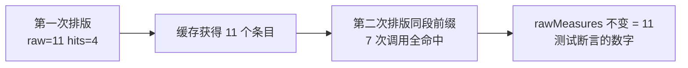
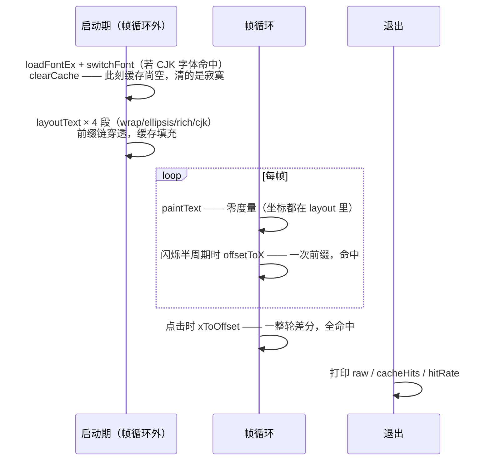

# 文本缓存：把 O(n²) 度量压回 O(n)

> [返回：第三阶段导览](01-导览.md)
> 对应大纲条目：第三阶段 5。前缀差分让一次断行变成 O(n²) 次度量；缓存把它压回 O(n)。本册讲缓存键的选择、失效时机、命中模式的形状（前缀链）、advanceAt 的两倍调用，以及用「观测口」而不是猜来做缓存决策——所有计数来自对源码的无头直跑与 vitest 实跑。

## 1. 没有缓存的代价：三层放大

断行器对每个候选行宽做 `measure(前缀)`。代价被三层结构放大：

**第一层：advanceAt 的前缀差分。** 绑定层 GlyphInfo 是不透明句柄（`{ handle, kind }`，读不到 advance 字段——《02-字体与字形》），字符推进只能这样求：

```ts
advanceAt(text, index, fontSize) = measure(text[0..index+1]) − measure(text[0..index])
```

一条 n 字符的行做一次光标几何就是 n 次差分、每次差分两次度量，每次度量又处理最长 n 字符——**O(n²) 的字符处理量**。

**第二层：断行的试探。** 贪心装箱每收一块要量 `chunkWidth` 和 `curWidth`（含挂起空白的前缀）——同一行的前缀被反复拉出来量。以一条 100 字符的行、贪心试探平均 50 次前缀度量计，一条行就是 ~50 次 `measureTextEx`。

**第三层：FFI 边界。** `RaylibMeasurer.measureRaw` 每次穿透到 raylib（`measureTextEx` 过宿主边界）——**FFI 调用的常数成本**放大了算法的常数。一个 500 行的段落渲染一次是六位数级的度量调用。

三层相乘，没有缓存的断行器在大文本上立刻变慢。缓存不是优化项，是功能成立的前提。

## 2. 缓存放在抽象基类里：全文走读

```ts
export abstract class TextMeasurer {
  private readonly widthCache = new Map<string, number>();
  /** 缓存命中数（观测口，测试/分册用）。 */
  cacheHits = 0;
  /** 绕过缓存的真实度量次数（观测口）。 */
  rawMeasures = 0;

  /** 单行文本宽度（像素）。子类实现时与绘制端使用同一 spacing。 */
  protected abstract measureRaw(text: string, fontSize: number): number;

  measure(text: string, fontSize: number): number {
    if (text === "") return 0;
    const key = `${fontSize}:${text}`;
    const hit = this.widthCache.get(key);
    if (hit !== undefined) {
      this.cacheHits += 1;
      return hit;
    }
    const w = this.measureRaw(text, fontSize);
    this.rawMeasures += 1;
    this.widthCache.set(key, w);
    return w;
  }

  /** 清空缓存（换字体时调用；TextMeasurer 不持有字体，由使用方通知）。 */
  clearCache(): void {
    this.widthCache.clear();
  }
}
```

三个设计决定：

1. **缓存键 `(fontSize, text)`，不含字体**——字体是度量器的**状态**而不是调用参数；换字体走 `switchFont → clearCache()` 显式失效，而不是把字体塞进键里让缓存条目默默变废纸（第 11 节给两种方案的完整对照）
2. **缓存实现在基类（模板方法）**：`measureRaw` 是子类唯一的洞，MockMeasurer 与 RaylibMeasurer 免费获得同一套缓存行为——测试可以观测缓存命中而不关心真实字体，`cacheHits` 在 Mock 上是纯逻辑计数、无 FFI 噪声
3. **`cacheHits / rawMeasures` 两个计数器是公开观测口**：缓存效果是量出来的，不是拍脑袋

值得单独一提的还有**空串早退**：`if (text === "") return 0` 在查缓存之前——空串宽度平凡为 0，不走缓存不计数。实测验证：`measure("", 10)` 之后 `rawMeasures=0`、`cacheHits=0`，两个观测口纹丝不动。这不是无所谓的细节：断行器每块到达时都调 `measure(curText + pendingSpaceText)`，行首时这串是空串——高频路径上的免单。

## 3. advanceAt：差分的两倍调用与缓存回敬

`xToOffset` 逐字符问 advance（《05-富文本span》第 7 节），每问一次就是两次 `measure`。以 `"hello"` 全行扫一遍（fontSize=10，直跑实测）：

| i | measure(slice(0,i)) | measure(slice(0,i+1)) |
|---|---|---|
| 0 | `""` → 早退 | `"h"` → RAW |
| 1 | `"h"` → HIT | `"he"` → RAW |
| 2 | `"he"` → HIT | `"hel"` → RAW |
| 3 | `"hel"` → HIT | `"hell"` → RAW |
| 4 | `"hell"` → HIT | `"hello"` → RAW |

清点：5 字符 → 5 次穿透、4 次命中、1 次早退（实测 raw=5、hits=4）。规律很干净：**第一次扫一行，每个前缀穿透一次；同一行再扫，n 次差分全部命中**（实测第二次扫 raw 不变、hits 4→13，净增 9 次命中）。demo 的光标行每帧调 `offsetToX`（一次前缀）+ 闪烁竖条，点击时调 `xToOffset`（一整轮差分）——得益于缓存，**只有第一帧付穿透的钱**。

这就是「前缀差分 O(n²) 被缓存压回 O(n)」的微观机制：差分产生的度量串是嵌套前缀族 `{s[0..1], s[0..2], …, s[0..n]}`，族内无重复，族间（同一行反复扫）全命中。

## 4. 观测口怎么用：demo 与测试两个消费方

**demo 侧**（`apps/03-text.ts` 退出前）：

```ts
console.log(
  `[03-text] measure: raw=${measurer.rawMeasures} cacheHits=${measurer.cacheHits} ` +
    `hitRate=${((measurer.cacheHits / (measurer.cacheHits + measurer.rawMeasures)) * 100).toFixed(1)}%`,
);
```

跑一次 demo 就能拿到本次会话的穿透数、命中数、命中率——「缓存有没有用」从印象变成数字。（具体的 raw/hitRate 数值随宿主字体与文本内容浮动，此处只引用格式，不伪造读数。）

**测试侧**（`text-layout.test.ts`「度量缓存」用例）：

```ts
it("相同 (text,fontSize) 只穿透一次到原始度量", () => {
  const mm = new MockMeasurer();
  const layout = layoutText([{ text: "aaaa bbbb cccc" }], { …, width: 30, maxLines: 2, overflow: "ellipsis" }, mm);
  expect(layout.lines).toHaveLength(2);
  expect(mm.rawMeasures).toBeLessThan(mm.cacheHits + mm.rawMeasures); // 有命中才成立
  expect(mm.cacheHits).toBeGreaterThan(0);
  const before = mm.rawMeasures;
  layoutText([{ text: "aaaa bbbb" }], { fontSize: 10, color: BLACK, width: 30 }, mm); // 前缀全部命中缓存
  expect(mm.rawMeasures).toBe(before);
});
```

实跑输出（本册写作时 `npx vitest run` 全库节选）：

```text
✓ src/core/text/text-layout.test.ts (14 tests) 5ms
Test Files  13 passed (13)
Tests  116 passed (116)
Duration  470ms
```

三段断言分别防三种退化：

- `rawMeasures < 总调用数`：缓存根本没命中过（键算错了、缓存没接线）
- `cacheHits > 0`：同上，从另一侧钉
- **`第二次排版同段文本后 rawMeasures 不增长`**：这是全用例最硬的一条——「文本不变时，重复排版零穿透」。注意第二次排的是 `"aaaa bbbb"`（第一次的**前缀**），它的每个度量串都被第一次覆盖过

## 5. 命中模式的形状：断行的前缀链

贪心断行的度量调用是**前缀链**：`measure("a")`、`measure("ab")`、`measure("abc")`……外加块宽 `measure(chunk)` 的反复重查。前者让长前缀被反复命中，后者让同一块在不同行组合下复用。

先看一个最小例子（`"hello world"@30`，直跑实测 raw=3、hits=2）：

| # | 调用方 | 量的是什么 | 结果 | 值 |
|---|---|---|---|---|
| 1 | chunkWidth | `"hello"` | RAW | 30 |
| 2 | curWidth | `""` | 早退 | 0 |
| 3 | chunkWidth | `" "` | RAW | 6 |
| 4 | curWidth | `"hello"` | **HIT** | 30 → 空格放不下，丢弃 |
| 5 | chunkWidth | `"world"` | RAW | 30 |
| 6 | curWidth | `"hello"` | **HIT** | 30 → 换行 |

`"hello"` 被量了三次、只穿透一次——**这就是缓存的全部日常**。

再把第 4 节测试用例的完整调用序列手推出来（与无头直跑的计数逐一对账：第一次排版 raw=11、hits=4；第二次排版 raw 不变、hits +7——数字全部实测）。

**第一次排版 `"aaaa bbbb cccc"`（w30、maxLines=2、ellipsis；每字符 6px、`...`=18px）：**

| # | 调用方 | 量的是什么 | 结果 | 值 |
|---|---|---|---|---|
| 1 | chunkWidth | `"aaaa"` | RAW | 24 |
| 2 | curWidth | `""` | 早退 | 0 |
| 3 | chunkWidth | `" "` | RAW | 6 |
| 4 | curWidth | `"aaaa"` | **HIT** | 24 |
| 5 | chunkWidth | `"bbbb"` | RAW | 24 |
| 6 | curWidth | `"aaaa "` | RAW | 30 → 换行 |
| 7 | chunkWidth | `" "` | **HIT** | 6 |
| 8 | curWidth | `"bbbb"` | **HIT** | 24 |
| 9 | chunkWidth | `"cccc"` | RAW | 24 |
| 10 | curWidth | `"bbbb "` | RAW | 30 → 换行 |
| 11 | ellipsis | `"..."` | RAW | 18 |
| 12 | keep 循环 | `"b"` | RAW | 6 |
| 13 | keep 循环 | `"bb"` | RAW | 12（+18=30 恰好，收） |
| 14 | keep 循环 | `"bbb"` | RAW | 18（+18=36 超停） |
| 15 | 摆位 | piece `"aaaa"` | **HIT** | 24 |
| 16 | 摆位 | piece `"bb..."` | RAW | 30 |

清点：RAW 11 次（#1,3,5,6,9,10,11,12,13,14,16），HIT 4 次（#4,7,8,15）——与直跑计数一致。注意命中都长什么样：**「块宽查过一遍之后，curWidth 再查同一块」「断行时量过的行首，摆位时再量一遍」**——同一字符串在不同阶段被不同调用方反复要，缓存把它们合并成一次穿透。

**第二次排版 `"aaaa bbbb"`（同 measurer、同字号、w30）：**

| # | 调用方 | 量的是什么 | 结果 |
|---|---|---|---|
| 17 | chunkWidth | `"aaaa"` | HIT |
| 18 | chunkWidth | `" "` | HIT |
| 19 | curWidth | `"aaaa"` | HIT |
| 20 | chunkWidth | `"bbbb"` | HIT |
| 21 | curWidth | `"aaaa "` | HIT |
| 22 | 摆位 | piece `"aaaa"` | HIT |
| 23 | 摆位 | piece `"bbbb"` | HIT |

七次调用全部命中，**零穿透**——`rawMeasures` 停在 11，这正是测试最后一条断言验的数字。第二次的文本是第一次的前缀（`"aaaa bbbb"` 的全部度量串 ⊂ 第一次的度量串集合），前缀链的形状保证了这种「子文本白拿」的命中模式。



把度量调用面完整清点一遍（全部来自 labs 源码）：

| 调用点 | 所在 | 模式 | 缓存待遇 |
|---|---|---|---|
| `chunkWidth`（块宽） | line-break 主循环 | 同块反复查 | 首查穿透，重查命中 |
| `curWidth`（行前缀含挂起空白） | line-break 主循环 | 递增前缀链 | 前缀间无重复、跨行复用 |
| 硬拆 `measure(next)` | 长词分支 | 前缀链（词内） | 同上 |
| `measure("...")` + keep 循环 | ellipsize | 一次前缀链 | `...` 全局只穿透一次 |
| piece 摆位宽度 | layoutText 第二遍 | 行文本重查 | 与断行期命中合并 |
| `measure(piece.text.slice(0, local))` | offsetToX | 前缀查询 | 稳定命中 |
| `advanceAt` ×2 | xToOffset | 嵌套前缀族 | 第 3 节的微观机制 |

**没有一个调用点是「一次性随机字符串」**——这就是断行场景命中率天然高的结构性原因。

## 6. 失效的三个时机

| 时机 | 机制 | 不失效的后果 |
|---|---|---|
| 换字体 | `switchFont` 显式 `clearCache()` | 新字体下量的还是旧宽度（错误命中） |
| 文本变化 | 键含全文，自动「失效」（旧键变死条目） | 无错误，只涨内存 |
| 字号变化 | 键含 fontSize，自动分流 | 无错误 |

三行里藏着一个关键不对称：**正确性风险只来自状态（字体），不来自参数（文本/字号）**。参数进了键，参数变了自然查不到旧条目——「不会错，只会浪费」；状态不进键，状态变了必须有人负责喊一嗓子——忘了喊就是静默的错误命中。这套「参数靠键、状态靠失效」的分工是所有派生缓存的设计模板（第六阶段脏标记是它的通用化：状态变 → 派生物死）。

注意第二行的取舍：**以文本为键的缓存不会错误命中，但会积累死条目**。教学规模无所谓；真实框架会做 LRU 或按控件分桶（Flutter 的 Paragraph 缓存就是按对象生命周期整体丢弃）。把「正确性靠键、内存靠淘汰」记成一句口诀。

## 7. 上层还有一层：布局缓存

度量缓存不是文本栈里唯一的缓存。往上走一层，`RenderText`（`core/render/text-object.ts`）缓存的是**整个布局结果**：

```ts
export class RenderText extends RenderObject {
  private lastLayout: TextLayout | null = null;

  /** 改文本：唯一入口，自动标脏。 */
  setText(spans: TextSpan[]): void {
    this.spans = spans;
    this.markNeedsLayout();      // 脏标记 → 下帧 performLayout 才会重跑 layoutText
  }

  protected performLayout(c: BoxConstraints): void {
    // …
    this.lastLayout = layoutText(this.spans, opts, this.measurer);
    this.setSize(c, this.lastLayout.size);
  }
```

demo 的用法更直接（`apps/03-text.ts`）——排版对象在**帧循环之外**构造，注释写着「缓存：内容不变就只排一次」：

```ts
// ---- 排版对象（缓存：内容不变就只排一次）----
const wrapped = layoutText([{ text: PARAGRAPH }], { fontSize: 18, …, width: 360 }, measurer);
```

三层缓存叠起来看（第三层是 raylib 内部的字形光栅，概念对照）：

| 缓存层 | 缓存什么 | 键/归属 | 失效 |
|---|---|---|---|
| 度量缓存（本册） | 字符串宽度 | `(fontSize, text)` | `clearCache`（换字体） |
| 布局缓存（RenderText/demo） | TextLayout（行、片段、坐标） | 挂在对象上 | `markNeedsLayout`（setText/约束变） |
| 字形图集（raylib 内部） | 光栅化字形位图 | `(font, codepoint, size)` | 字体卸载（概念） |

三层各管一段：图集管「像素只光栅一次」、度量管「宽度只算一次」、布局管「行只断一次」。失效信号逐层上传：换字体 → 清度量缓存 + （图集换源）；改文本 → 标脏重排（度量层自动因键不同而无害）。**每层的失效粒度都选在自己能唯一负责的那个状态变化上**——这是缓存分层的要义。

## 8. 时序：一次 demo 会话的缓存生命周期

把 demo（`apps/03-text.ts`）从启动到退出按时间排开，看每一段谁在付度量的钱：



三个阶段三种账：

- **启动期**：唯一付穿透钱的时段——（可能的）换字体 + 四段排版。注意源码顺序：`switchFont` 在所有 `layoutText` **之前**（字体探测在 demo 开头、排版对象在后），所以那次 `clearCache` 清的是空缓存——**失效的代价不在清的动作，而在「若已度量过就要重付」**；顺序把这份代价消掉了
- **帧循环**：`paintText` 不调 `measure`（坐标在布局期已定死），光标只在闪烁的「亮」半周调一次 `offsetToX`（一次前缀查询，命中）——**稳态帧的度量成本约等于零**，这就是「文本只排一次」的全部含义
- **交互**：点击触发 `xToOffset`（一整轮 advanceAt 差分）——第 3 节已算过：同文本第二轮起全命中

这张时序图也解释了观测口的读法：**退出时打印的 raw/cacheHits 是「启动期成本 + 交互期命中」的混合账**——hitRate 高说明稳态长，不代表启动便宜；raw 低说明文本没变过。两个数字要一起读。

## 9. 计数器的使用守则

`cacheHits` / `rawMeasures` 是公开字段，用起来有三条不成文的规矩（都来自现有代码的用法）：

1. **没有 reset 接口**——要重新计数就新建实例。测试正是这么做的：`const mm = new MockMeasurer()` 每个用例一个干净计数器，断言才写得死（`expect(mm.rawMeasures).toBe(before)`）
2. **读取时机在会话边界**——demo 在 `closeWindow()` 之后打印：会话已结束，数字不再变，读到的就是全程账
3. **计数不是免费的，但便宜到忽略**——每次 `measure` 两次整数自增；与一次 FFI 往返（真字体）或一次字符串拼接（键构造）相比可忽略。真正的常规开销在键构造：每次 miss 都要拼 `` `${fontSize}:${text}` ``——这也是「空串早退」省得不只是查表，还有拼键

把观测口当「仪表盘」而不是「API 承诺」：字段类型、语义都可能随阶段演进（第八阶段做性能面板时大概率要加 reset 或按标签分桶），依赖它做逻辑分支的代码才是真的坏味道。

## 10. 缓存的边界：什么时候别缓存

- **一次性文本**（demo 标题）：命中率低，缓存纯开销——但基类缓存是懒加载的，不重复度量就没有第二次调用，代价可控（一次 Map.set 的成本换以后万一的重查）
- **动画中每帧变化的字符串**（帧率 HUD `fps 60→61`）：键每帧不同，纯 miss，还往 Map 里塞死条目。真实框架用「文本 + 数字占位」分层（静态前缀缓存、数字段单独画）——第八阶段帧时间面板会用到这个技巧
- **超大文本**：全文进键意味着一条 1 万字符的段落产生 1 万个「前缀键」，每个键都是完整字符串副本——内存 O(n²) 于行字符数。真实排版器缓存的是「断点 + 行宽」而不是每个前缀（行级粒度），教学实现取简单

**命中率本身也会误导**：一次性文本多的场景，命中率天然低——这不说明缓存坏了，说明负载不匹配（自测第 2 题）。观测口给数字，解读要带着负载模型。

## 11. 概念深化：缓存键设计的两种方案

「键该不该含字体」是个真问题，两种方案各自的失败模式：

| 方案 | 正确性 | 内存 | 失效方式 | 失败模式 |
|---|---|---|---|---|
| 键含字体（`(font, fontSize, text)`） | 永不错误命中 | 旧字体条目永不清理 → 死条目累积 | 无需显式失效 | 静默内存增长；换字体的 bug 无从暴露 |
| 键不含字体（本实现） | 依赖显式失效 | 换字体即整体重置 | `switchFont → clearCache()` 唯一入口 | 忘调 switchFont → 错误命中，光标立刻错位（一调必现） |

mini-gui 选后者的深层理由：**把失效收敛到唯一入口，就把「换字体」这个动作变成了可审计的事件**——`clearCache` 的调用点就是字体生命周期的记账点。前者把失效摊到「永远不发生」，代价是没有任何代码位置能回答「现在缓存里躺着哪些字体的宽度」。

Map 无限增长的三种治理（概念对照，非 mini-gui 实现）：

- **LRU**：按最近使用淘汰，适合键空间大且局部性强的负载（浏览器字形缓存、Skia 的 glyph cache 都走这条路）
- **分桶/按对象生命周期**：缓存挂在对象上，对象死缓存死（Flutter 的 Paragraph 布局缓存）——免淘汰算法，靠 GC
- **代际清空**：定期全清（帧末/内存告警），简单粗暴，适合「重建成本低」的缓存

选择的关键问句：**重建一条条目的成本 vs 维护淘汰机制的复杂度**。度量一次的成本低（微秒级），LRU 的簿记可能比度量本身贵——这也是教学实现选「不淘汰、靠 clearCache」的正当性。

## 12. 与其他册的接口

- 《02-字体与字形》：GlyphInfo 句柄 → 前缀差分 → 本册的 O(n²) 出发点；`switchFont` 两端同步的度量端一半
- 《03-文本度量》：`measure/advanceAt` 的口径与空串早退；行高不进缓存的原因（它是纯计算，无 FFI）
- 《04-断行算法》：前缀链的产地——`chunkWidth`/`curWidth` 的调用模式就是第 5 节两张表的来源
- 《05-富文本span》：摆位与光标几何的度量（piece 宽、前缀 slice）是缓存的第二类消费者
- 第六阶段：脏标记是「显式失效」的通用化——`markNeedsLayout` 与 `clearCache` 同构（第 7 节两层缓存的对照）

## 13. 常见误区

| 误区 | 真相 | 出处 |
|---|---|---|
| 缓存键该含字体 | 字体是状态不是参数；显式失效换可审计性 | 第 2、11 节 |
| 缓存该放在断行器里 | 放度量基类：Mock/真字体共享同一行为，测试可观测 | 第 2 节 |
| 命中率越高越好 | 命中率是负载的函数；一次性文本拉低命中率不代表缓存坏 | 第 10 节 |
| measure("") 也走缓存 | 空串早退不计数——高频路径上的免单 | 第 2 节 |
| 淘汰策略是必需品 | 先问重建成本；度量微秒级，簿记可能更贵 | 第 11 节 |
| 文本变了缓存会出错 | 参数进键 → 不会错只会浪费；会错的是状态（字体） | 第 6 节 |
| 缓存后 O(n²) 变 O(1) | 变 O(唯一前缀数) = O(n)；首次排版仍是 n 次穿透 | 第 1、3 节 |
| 度量缓存是文本栈唯一的缓存 | 上面还有布局缓存（RenderText），下面还有字形图集 | 第 7 节 |

## 14. 本册小结

- 前缀差分 + 断行试探 + FFI 常数 ⇒ 缓存是必需品
- 键 `(fontSize, text)`；字体变更显式 `clearCache()`；空串早退免计数
- advanceAt 的嵌套前缀族：首扫 n 次穿透，再扫全命中（实测 5/4 → 0/9）
- 观测口让效果可量化：demo 打印 raw/hitRate，测试断言「第二次排版零穿透」（实测 raw=11/hits=4 → +7 全命中）
- 三层缓存各管一段：图集管像素、度量管宽度、布局管行；失效粒度钉在各自唯一负责的状态变化上
- 正确性靠键，内存靠淘汰；失效收敛到唯一入口换可审计性

## 自测

1. 为什么缓存键不含字体？两种方案（含字体 vs 显式失效）各自的失败模式是什么？
2. `cacheHits/rawMeasures` 观测口在什么情况下会误导你（提示：一次性文本）？
3. 帧率 HUD 这类每帧变化的文本，如何设计两层缓存？
4. Map 无限增长的三个治理方案（LRU / 分桶 / 代际清空）各适合什么场景？
5. 如果 measure 变成 O(1)（假设拿到了字形级 advance），本册的缓存还有必要吗？哪些收益会消失？
6. 手推：MockMeasurer、fontSize=10 下第一次排版 `"aaa bbb"`（w12、无 maxLines）会产生哪几次 rawMeasures？写出每个字符串与值。
7. 承上题：紧接着第二次排版 `"aaa bbb"`（同参数），rawMeasures 增长几？为什么？第三次排版 `"aaa"` 呢？
8. `advanceAt("hello", 4, 10)` 触发哪两次 measure？各命中还是穿透（假设 `"hell"`/`"hello"` 都已入缓存）？
9. 换字体后忘调 `switchFont`，具体哪类功能的 bug 会最先暴露？画出错误命中的传播链。
10. 「正确性靠键、内存靠淘汰」——把这条口诀套到第 7 节的布局缓存上，`markNeedsLayout` 对应口诀的哪一半？
