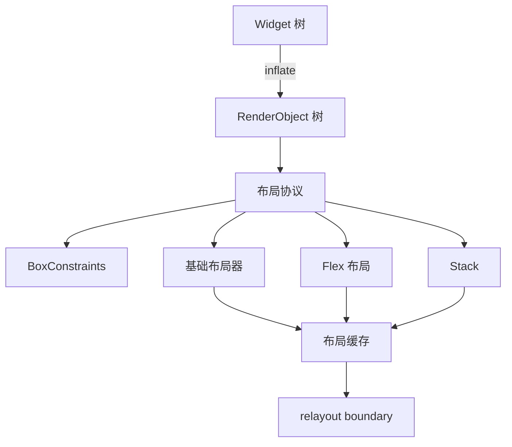

# 第四阶段导览：控件树与布局

> [返回：GUI框架学习大纲](../GUI框架学习大纲.md)
> 本阶段是框架内核的心脏：Widget / RenderObject 双树分层、「约束向下、尺寸向上、父定位置」的单遍布局协议，以及 Padding / Row / Column / Stack 这些布局器——Flutter 布局体系的可运行简化版。

## 分册索引

| 分册 | 对应大纲条目 | 一句话说明 | 状态 |
|---|---|---|---|
| 01-导览.md | — | 本页 | ✅ |
| 02-为什么是两棵树.md | 1 | Widget/RenderObject 分层、attach/detach、简化三树 | ✅ |
| 03-布局协议.md | 2 | 约束向下尺寸向上、BoxConstraints、紧松约束 | ✅ |
| 04-盒模型与基础布局器.md | 3 | Padding、Align、SizedBox、装饰盒 | ✅ |
| 05-Flex布局.md | 4 | Row/Column 主轴交叉轴、flex 分配、Stack/Positioned | ✅ |
| 06-布局性能.md | 5 | 布局缓存、relayout boundary、失效冒泡 | ✅ |

## 阶段目标

学完本阶段，你应该能不查资料做到：

- 解释为什么需要两棵树：不可变的描述（Widget）与可变的布局绘制对象（RenderObject）各自的生命周期
- 手写单遍布局协议的三个阶段：约束下传 → 尺寸上报 → 父摆位置
- 实现含 flex 因子的 Row / Column，解释空间分配算法与溢出的判定
- 说清 relayout boundary 的成立条件，以及它为什么能把重布局范围截断在子树内
- 写出无头布局断言测试：给定约束树，断言每个节点的尺寸与位置

## 知识点地图

## 实践任务清单

1. 实现 RenderObject 基类：attach/detach、layout、paint、失效标记
2. 实现 Padding / Align / SizedBox / DecoratedBox 与 Row / Column（含 flex）/ Stack / Positioned
3. 布局黄金用例：约 30 组「约束树 → 期望尺寸/位置」断言，无头可跑
4. 构造一个边界实验：改一个叶子的内容，验证只有其 relayout boundary 内的节点重排

## 阶段自测

1. Widget 与 RenderObject 分开，解决了什么问题？单树方案（如老式 Qt）的代价是什么？
2. 「约束向下、尺寸向上」为什么一遍就能完成布局？什么布局需求会打破单遍假设（提示：intrinsic）？
3. 紧约束与松约束的区别是什么？`SizedBox` 和 `Center` 分别传什么约束给子节点？
4. flex=1 的两个子节点分 100px，另一个子节点固定 30px，最终各多少？为什么？
5. markNeedsLayout 为什么要冒泡到父？relayout boundary 又是如何截断冒泡的？
