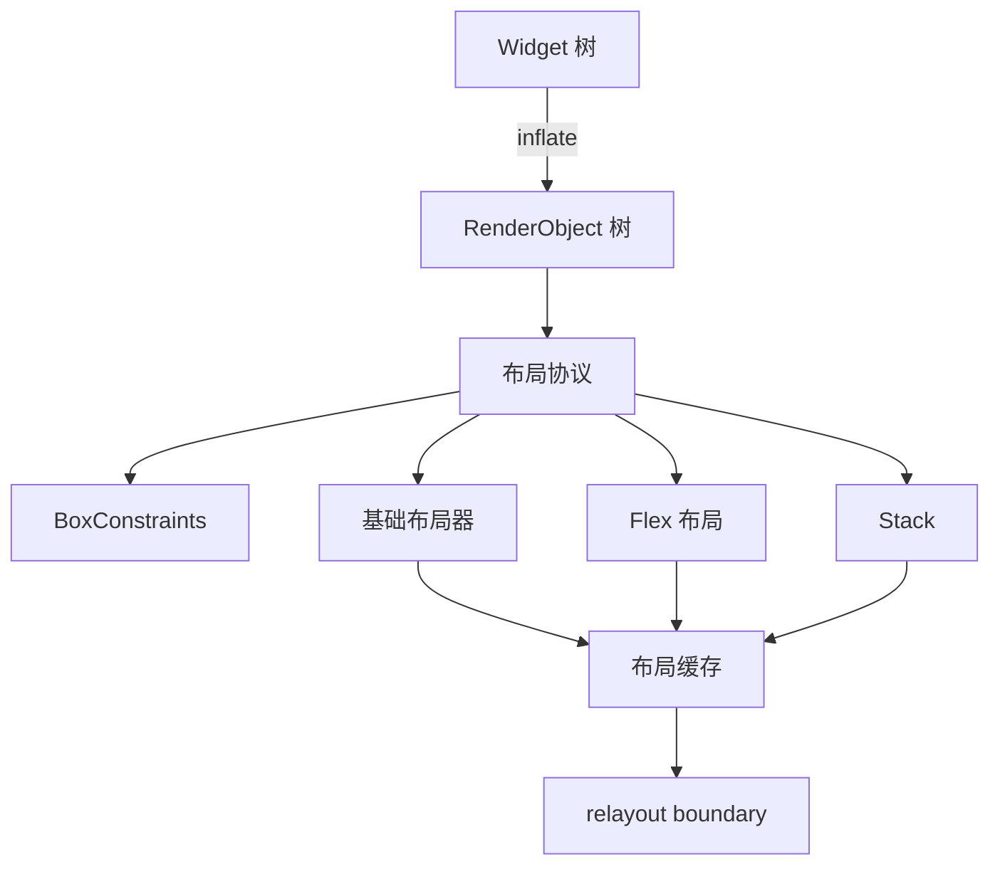

---
references:
  - 02-为什么是两棵树
  - 03-布局协议
  - 04-盒模型与基础布局器
  - 05-Flex布局
  - 06-布局性能
---

# 第四阶段导览：控件树与布局

> [返回：GUI框架学习大纲](../GUI框架学习大纲.md)
> 本阶段是框架内核的心脏：Widget / RenderObject 双树分层、「约束向下、尺寸向上、父定位置」的单遍布局协议，以及 Padding / Row / Column / Stack 这些布局器——Flutter 布局体系的可运行简化版。

## 分册索引

| 分册 | 对应大纲条目 | 一句话说明 | 状态 |
|---|---|---|---|
| 01-导览.md | — | 本页 | ✅ |
| 02-为什么是两棵树.md | 1 | Widget/RenderObject 分层、attach/detach、简化三树 | ✅ |
| 03-布局协议.md | 2 | 约束向下尺寸向上、BoxConstraints、紧松约束 | ✅ |
| 04-盒模型与基础布局器.md | 3 | Padding、Align、SizedBox、装饰盒 | ✅ |
| 05-Flex布局.md | 4 | Row/Column 主轴交叉轴、flex 分配、Stack/Positioned | ✅ |
| 06-布局性能.md | 5 | 布局缓存、relayout boundary、失效冒泡 | ✅ |

## 阶段目标

学完本阶段，你应该能不查资料做到：

- 解释为什么需要两棵树：不可变的描述（Widget）与可变的布局绘制对象（RenderObject）各自的生命周期
- 手写单遍布局协议的三个阶段：约束下传 → 尺寸上报 → 父摆位置
- 实现含 flex 因子的 Row / Column，解释空间分配算法与溢出的判定
- 说清 relayout boundary 的成立条件，以及它为什么能把重布局范围截断在子树内
- 写出无头布局断言测试：给定约束树，断言每个节点的尺寸与位置

## 知识点地图

## 实践任务清单

1. 实现 RenderObject 基类：attach/detach、layout、paint、失效标记
2. 实现 Padding / Align / SizedBox / DecoratedBox 与 Row / Column（含 flex）/ Stack / Positioned
3. 布局黄金用例：约 30 组「约束树 → 期望尺寸/位置」断言，无头可跑
4. 构造一个边界实验：改一个叶子的内容，验证只有其 relayout boundary 内的节点重排

## 阶段自测

1. Widget 与 RenderObject 分开，解决了什么问题？单树方案（如老式 Qt）的代价是什么？
2. 「约束向下、尺寸向上」为什么一遍就能完成布局？什么布局需求会打破单遍假设（提示：intrinsic）？
3. 紧约束与松约束的区别是什么？`SizedBox` 和 `Center` 分别传什么约束给子节点？
4. flex=1 的两个子节点分 100px，另一个子节点固定 30px，最终各多少？为什么？
5. markNeedsLayout 为什么要冒泡到父？relayout boundary 又是如何截断冒泡的？

## 前置知识与依赖关系

本阶段第一次把前三个阶段的零件组装成「一棵会自己排版、自己绘制的树」，因此对前序产出的依赖最重。

| 前序产出 | 在本阶段的用途 | 缺失时的表现 |
|---|---|---|
| 第二阶段的画笔接口与显示列表 | 每个渲染节点的绘制函数只向画笔发命令；无头测试靠记录型后端断言 | 节点只能直接调用图形库，布局与绘制无法脱离窗口验证 |
| 第二阶段的裁剪与平移栈 | 父节点把子节点摆到某个位置，本质是先平移再让子节点在局部坐标里绘制 | 每个节点都要自己换算绝对坐标，嵌套一深就出错 |
| 第二阶段的几何值类型 | 尺寸、偏移、矩形是布局协议的通用货币 | 约束与尺寸的运算散落各处，边界情况无法统一处理 |
| 第三阶段的文本测量 | 文本节点是最典型的「尺寸取决于约束」的叶子：给的宽度不同，行数和高度就不同 | 布局协议只能用固定尺寸的色块验证，看不出约束下传的意义 |

向后看，本阶段的产出同样是后续阶段的地基：第五阶段的命中测试要沿着渲染树逐层把坐标换算到子节点的局部坐标系，依赖的正是本阶段记录下来的位置与尺寸；之后的状态更新与重建，则要回答「描述变了以后，哪些渲染节点可以复用」，这正是两棵树分层的回报。

前端读者可以借助已有经验，但要警惕两处不对等。一是样式表的布局是多种模式并存、规则彼此交织的；这里只有一条统一协议，每种布局器都是协议的一个实现。二是弹性布局在样式表里同时支持放大和收缩，这里只实现了按比例分配剩余空间，空间不足时判定为溢出而不是压缩子节点，详见 [05-Flex布局](05-Flex布局.md)。

## 常见误区与正解

| 误区 | 为什么错 | 正解 |
|---|---|---|
| 两棵树是重复劳动，一棵树既存配置又做布局更简单 | 单树意味着配置对象本身就是重量级的长寿对象，每次界面变化都要在原地做细粒度修改，声明式的「整体重新描述」无从谈起 | 描述层轻量、不可变、可随意重建；渲染层重量、可变、尽量复用。分层之后才谈得上比对与复用，详见 [02-为什么是两棵树](02-为什么是两棵树.md) |
| 子节点想要多大就是多大，父节点只负责摆放 | 子节点的尺寸必须落在父节点给出的约束区间内。如果允许子节点越界，父节点基于子尺寸所做的计算就全部失效 | 子节点在约束内选择尺寸，选完由父节点决定位置；子节点既不知道也不应该关心自己的位置，详见 [03-布局协议](03-布局协议.md) |
| 给节点设了宽高，它就一定是这个尺寸 | 尺寸请求要先经过父约束的钳制。父节点传下来的是紧约束时，子节点没有任何选择余地，自己声明的宽高会被忽略 | 排查尺寸不符合预期时，先看这个节点收到的约束，再看它的请求，顺序不能反 |
| 居中、对齐是子节点的属性 | 位置由父节点决定，子节点没有摆放自己的权力 | 对齐是一种布局器：它向子节点传松约束让其取自然尺寸，再根据剩余空间计算偏移，详见 [04-盒模型与基础布局器](04-盒模型与基础布局器.md) |
| 布局慢就给每个节点都加上重布局边界 | 边界成立是有条件的：只有当节点的尺寸不受子节点影响时，子树内部的变化才不会波及外部。条件不成立却强行截断，父节点会使用过期的尺寸 | 边界由约束形态自动判定而非人工指定；优化的第一步是让缓存命中，即约束没变且自身未标脏时直接跳过，详见 [06-布局性能](06-布局性能.md) |

## 与真实框架对照

| 本阶段概念 | Flutter | Chromium | Qt 控件体系 |
|---|---|---|---|
| 描述树 | `Widget`，不可变的配置 | 文档对象模型的节点加计算后的样式 | 无独立描述层，控件对象身兼两职 |
| 渲染树 | `RenderObject` | 布局对象树，新架构下产出不可变的片段树 | 控件对象自身 |
| 中间层 | `Element`，负责比对与持有状态 | 无直接对应，样式重算承担类似的差异计算 | 无 |
| 约束下传 | 盒约束，四个数表达宽高的上下限 | 约束空间，另含可用尺寸与百分比基准等信息 | 布局管理器结合尺寸提示与尺寸策略分配几何 |
| 尺寸上报 | 节点在布局后写入自己的尺寸 | 布局算法返回片段 | 控件提供尺寸提示，最终几何由父布局设置 |
| 弹性布局 | 行与列，子节点带弹性因子 | 弹性盒布局算法，支持放大、收缩与基准尺寸 | 盒式布局，子项带拉伸因子 |
| 层叠定位 | 层叠容器与定位子节点 | 绝对定位与包含块 | 层叠布局，或手动设置几何 |
| 重布局截断 | 重布局边界 | 布局根与布局结果缓存 | 布局失效沿父链上传，由布局管理器统一重算 |

读这张表时注意三点：

- 我们实现的是 Flutter 布局体系的简化版，所以第一列和第二列几乎可以逐项对上；差别在于我们省掉了中间层，描述到渲染节点的对应关系在本阶段靠手写组装完成，自动比对留到后续阶段。
- 浏览器的约束信息比四个数丰富得多，因为样式表里存在百分比、固有尺寸关键字等需要额外上下文的取值。这也解释了为什么浏览器布局难以保证单遍完成，而我们的协议可以。
- 单遍协议的代价是表达力：凡是「父节点的尺寸取决于子节点在另一种约束下的尺寸」的需求，都要靠固有尺寸查询这类额外机制补足。本阶段明确不做，只在 [03-布局协议](03-布局协议.md) 里说明边界在哪里。

## 踩坑与排查速查

| 现象 | 常见原因 | 处置 |
|---|---|---|
| 节点尺寸为零，画面上什么都没有 | 子节点在松约束下没有内容可撑开，又没有显式尺寸；或者忘记在布局函数里写回尺寸 | 打印该节点收到的约束与最终尺寸，确认是「约束允许为零」还是「根本没算」 |
| 设置的宽高不生效 | 父节点传入的是紧约束，子节点的请求被钳制 | 在两者之间插入一个会放松约束的布局器，如对齐容器 |
| 弹性子节点没有分到剩余空间 | 主轴方向的约束是无界的，剩余空间无从计算 | 检查外层是否把无界约束传了进来，常见于滚动容器内部 |
| 内容溢出容器边缘 | 非弹性子节点的尺寸之和已超过主轴可用空间 | 让部分子节点变为弹性，或者在外层加裁剪与滚动 |
| 修改内容后界面没有更新 | 只改了数据没有标记需要重新布局，缓存命中后直接跳过 | 所有影响尺寸的修改入口都要标脏，并让标记向上传到最近的边界 |
| 一处小改动引起整棵树重排 | 沿途没有任何节点满足边界条件，标记一路传到了根 | 检查关键容器收到的是否为紧约束，必要时用固定尺寸的容器把子树隔开 |
| 子节点位置全部叠在左上角 | 父节点完成了子节点的布局，却没有为它们写入偏移 | 区分「让子节点算尺寸」与「父节点定位置」两步，后一步不能省 |
| 黄金断言偶发失败 | 断言依赖了真实字体的度量，不同环境结果不同 | 无头测试一律使用规则固定的模拟测量器 |

## 验收清单（DoD）

- [ ] 能说出描述对象与渲染对象各自的生命周期，并解释为什么前者可以随意丢弃重建
- [ ] 能写出挂载与卸载子节点时必须维护的不变量，并说明违反后会出现什么问题
- [ ] 能背出布局协议的三句话，并解释为什么位置信息不由子节点自己保存决定
- [ ] 能区分紧约束与松约束，并说出几个基础布局器分别向子节点传递哪一种
- [ ] 能手算内边距容器对约束的收缩，以及子节点尺寸确定后自身尺寸如何得出
- [ ] 能实现带弹性因子的行与列，并口算出一组给定子节点的最终尺寸
- [ ] 能说明主轴空间不足时如何判定溢出，以及为什么不选择压缩子节点
- [ ] 能实现层叠容器，并说清未定位子节点与已定位子节点的布局差异
- [ ] 能说出重布局边界成立的条件，并构造实验验证重排范围确实被截断
- [ ] 能在不开窗口的情况下，用约束树加期望尺寸与位置的形式写出黄金断言
