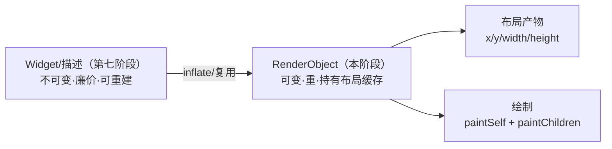
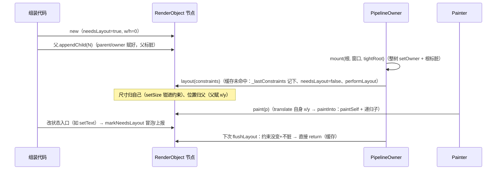

# 为什么是两棵树：Widget 与 RenderObject 的分工

> [返回：第四阶段导览](01-导览.md)
> 对应大纲条目：第四阶段 1。mini-gui 的内核是「双树」：不可变的描述树与可变的布局绘制树。本册讲清这个分层解决什么问题、双树怎么挂接维护，以及为什么第七阶段还会在它上面再叠第三层（组件树）。走读对象：`gui/labs/mini-gui/src/core/render/render-object.ts` 的树维护、失效与布局段（绘制/图层段是第六阶段在同一个文件里长出来的增量，本册只看结构）。

## 1. 单树的代价

设想一棵「既是描述又是实例」的单树（老式 Qt QWidget 的形态）：

- 节点持有可变状态（尺寸、脏标记、缓存约束）——**重建成本高**
- 声明式 API（第七阶段）需要「随手重建 UI 描述」的能力——可变重对象做不到廉价丢弃
- 布局缓存与身份耦合：换个配置对象就得换节点？还是原地改？原地改 = 描述与状态互相污染

把这三条落到 panel 场景（`src/scenes/panel-tree.ts`）就具体了。「改一下标题文本」在两种世界里的样子：

| 步骤 | 单树世界 | 双树世界（mini-gui 现状 → 第七阶段完全体） |
|---|---|---|
| 描述变化 | 不存在描述层——直接改节点字段 | 重新生成一棵描述子树（廉价对象，随手丢弃） |
| 应用变化 | 手写 setter：改哪个字段？要不要顺带标脏？漏一处界面就僵 | reconcile 对比新旧描述，只把差异落到 RenderObject |
| 状态归属 | 缓存、脏标记、业务数据挤在同一个类里 | RenderObject 只管布局绘制状态；描述层无状态可污染 |

mini-gui 当前还没走到完全体：**描述层（Widget）要等第七阶段**，本阶段只有 B 层（RenderObject 直接手工组装，`panel-tree.ts` 就是手写树）。但这不妨碍现在就把 B 层的「重」做对——正因为将来 A 层会随便重建，B 层必须自己扛住全部生命周期纪律：挂接、失效、缓存、绘制。这些纪律全部写在 `render-object.ts` 的基类里，也是本册走读的主线。

先看这个文件自己的开场白（文件头注释，逐字摘录）：

```text
// RenderObject：布局与绘制树的节点基类。
// 单遍布局协议（constraints down / size up / parent sets offset）：
//   layout(constraints) 由父调用；子类在 performLayout 里
//   「对每个 child 调 child.layout(子约束)，读 child.size，最后给 child.x/y 赋值并设自己的 size」。
//
// 失效与缓存：
//   markNeedsLayout() 自底向上冒泡，直到 relayout boundary（本子树尺寸不影响父时成立）；
//   layout() 若约束没变且不脏则直接跳过（布局缓存）。
```

五行注释，四册书的目录：协议（第三册）、失效（第六册）、缓存（第六册）、「子类在 performLayout 里做什么」（第四、五册）。本册负责把「这是棵什么树、树怎么维护、树怎么被遍历绘制」讲完。

## 2. 双树分工



第七阶段的声明式组件会补上 A 层，reconcile 负责 A→B 的增量同步——这正是 Flutter「三树砍一树」的教学简化版（Element 的角色届时由组件实例顶替）。

**RenderObject 的职责边界**（`render-object.ts` 基类）：

| 归属 | 内容 |
|---|---|
| 基类管 | 树结构（parent/children/appendChild）、失效冒泡（markNeedsLayout）、布局缓存跳过、边界判定、默认绘制遍历 |
| 子类管 | performLayout（怎么用约束定尺寸、怎么摆子）、paintSelf（画不画自己） |

这个分法的要害是**「共性上收、个性下放」**：

- 所有布局器都要「挂子、标脏、被缓存、被绘制」——写一遍，放基类；
- 每个布局器唯一的自由度是「拿到约束后摆出什么几何」——`performLayout` 一个抽象方法；
- 每种控件唯一的绘制差异是「自己长什么样」——`paintSelf` 一个空默认方法。

对照文件里的实际声明（逐字摘录）：

```ts
protected abstract performLayout(c: BoxConstraints): void;

protected isFixedSize(): boolean {
  return false;
}
```

`performLayout` 是抽象的——不实现它连类都实例化不了，编译器替我们检查「每个布局器必须回答『我怎么排』」。`isFixedSize` 是反向的口子：默认「不是」，叶子度量型节点（RenderText、RenderBox）覆盖成 true，第六册的边界判定会用到。

## 3. 基类字段：树的身份与布局产物

把基类的实例字段排成一张表，就是一棵 RenderObject 的全部「家当」：

| 字段 | 类型 | 初始值 | 谁有权写 |
|---|---|---|---|
| `parent` | `RenderObject \| null` | null | appendChild / removeChild |
| `children` | `readonly RenderObject[]` | `[]` | appendChild / removeChild / clearChildren |
| `owner` | `PipelineOwner \| null` | null | setOwnerRecursive（mount 时整树赋值） |
| `x` / `y` | number | 0 | **父**（performLayout 里摆位时） |
| `width` / `height` | number | 0 | 自己（经 setSize / layout 兜底） |
| `needsLayout` | boolean | **true** | layout() 复位；markNeedsLayout 置位 |
| `relayoutBoundary` | `RenderObject \| null` | null | updateRelayoutBoundary |
| `layoutCount` | number | 0 | layout()（观测口） |
| `_lastConstraints` | `BoxConstraints \| null` | null | layout() |
| `needsPaint` / `layer` | boolean / DisplayList \| null | true / null | 第六阶段的绘制失效与图层缓存（本册不展开） |

三个读法：

1. **`needsLayout` 初始是 true**。新节点天生是脏的——它从没排过布局，「需要排」是安全默认。这也解释了为什么 `appendChild` 只标父不标子也能工作：子出厂即脏，第一次 layout 一定会真正执行。
2. **x/y 与 width/height 写在同一个类里，权限却不同**。源码原注：「布局产物：尺寸归自己，位置归父」。子类在 performLayout 里给**自己的** width/height 赋值（经 setSize），给**孩子的** x/y 赋值。字段不加 private 是教学取舍，但纪律靠协议维持——第六册会看到滚动视口恰恰是「父改子 y」的合法用户。
3. **`children` 是 readonly 数组引用**，挡得住整体替换、挡不住 `children.push(...)`。绕过 appendChild 直接 push 会同时漏掉三件事：parent 指针、owner 继承、脏标记——树静默坏掉。这就是「永远走 appendChild」的规矩（见下节）。

尺寸的读口是个 getter，把两个字段打包成值对象：

```ts
get size(): Size {
  return { width: this.width, height: this.height };
}
```

每次调用新建对象（不缓存引用）——与 `constraints.ts` 的值对象哲学一致：布局通货宁可多分配，不可共享可变状态。

## 4. 树维护的规矩：appendChild 全文走读

三个维护方法里，appendChild 是枢纽。逐字摘录：

```ts
appendChild(child: RenderObject): void {
  if (child.parent !== null) {
    throw new Error("child 已有 parent（先 detach）");
  }
  this.children.push(child);
  child.parent = this;
  child.setOwnerRecursive(this.owner);
  this.markNeedsLayout();
}
```

五行代码，四条纪律，一行一条：

1. **单一父节点强制**：`child 已有 parent（先 detach）`。共享子树是布局系统无法处理的身份歧义——同一个子被两个父各 layout 一次，`_lastConstraints` 互相踩、x/y 被两边摆，缓存与边界全部失真。这类错误必须在挂接时炸，不能等布局时静默错。
2. **parent 回指**：树的双向链闭合。向上冒泡（markNeedsLayout 找 `this.parent`）依赖它。
3. **owner 整树继承**：`setOwnerRecursive` 递归把 `this.owner` 写进子树每个节点。挂在已 mount 的树上，新子树自动获得调度器；挂在游离子树上，owner 保持 null——此时若它是布局边界，失效上报会被丢弃（markNeedsLayout 里 `if (this.owner !== null)` 守着）。
4. **挂接即标脏**：标的是**父**（`this.markNeedsLayout()`），不是子。语义是「我的孩子列表变了，我的尺寸可能变」——而子自己出厂即脏（上节），双方都会在下次 flush 被排到。

removeChild 与 clearChildren（摘录）：

```ts
removeChild(child: RenderObject): void {
  const idx = this.children.indexOf(child);
  if (idx < 0) return;
  this.children.splice(idx, 1);
  child.parent = null;
  this.markNeedsLayout();
}

clearChildren(): void {
  while (this.children.length > 0) {
    const last = this.children[this.children.length - 1];
    if (last !== undefined) this.removeChild(last);
  }
}
```

两个细节：

- removeChild 删不存在的子**静默返回**（`idx < 0` return），与 appendChild 的「有父就抛错」宽严不对称。理由：删除是幂等意图（「确保它不在」），挂接是身份声明（「它归我」）——前者重复无害，后者重复必然是 bug。
- 删除同样**标父不标子**：子被摘下后保持原几何（width/height 还是旧值），等再挂新父时由新父重新处理。clearChildren 复用 removeChild 逐个摘，行为一致。

**改内容入口的自动标脏**。树结构之外，「同一棵树、内容变了」也要有纪律入口。RenderText 是本阶段唯一的内容型节点（逐字摘录）：

```ts
/** 改文本：唯一入口，自动标脏。 */
setText(spans: TextSpan[]): void {
  this.spans = spans;
  this.markNeedsLayout();
}
```

测试覆盖（`layout.test.ts`，`改文本触发重排`）：先 flush 一次拿到 `before = text.layoutCount`，然后 `text.setText([{ text: "abcd" }])`，断言三连——`needsLayout === true`、再 flush 后 `layoutCount === before + 1`、新尺寸 `{ width: 24, height: 13 }`（4 字符 × 6px，MockMeasurer fontSize=10 时每字符 6px）。spans 是 private 字段，绕过 setText 根本改不了——**把「改状态的口」收窄到会标脏的那一个**，是双树之外的第二道保险。

## 5. 默认绘制：一遍深度优先

绘制遍历的骨架短得可以背下（逐字摘录；blit 分支是第六阶段的图层合成，本阶段先当它不存在）：

```ts
paint(p: Painter): void {
  p.save();
  p.translate(this.x, this.y);
  this.paintInto(p);
  p.restore();
}

/** 局部坐标绘制（不含自身平移）——图层记录与复用都走这里。 */
paintInto(p: Painter): void {
  this.paintSelf(p);
  for (const child of this.children) {
    if (!child.needsPaint && child.layer !== null && child.isRepaintBoundary()) {
      // 图层合成：干净的边界子树在子偏移处重放缓存，不重画
      p.save();
      p.translate(child.x, child.y);
      p.blit(child.layer);
      p.restore();
    } else {
      child.paint(p);
    }
  }
}

protected paintSelf(_p: Painter): void {
  // 默认无自绘
}
```

拆开读：

1. `paint = translate(自身 x/y) + paintInto`；`paintInto = paintSelf + 逐子递归`。自己先画（背景在下），孩子后画（内容在上）—— painter 语义天然保证层序，不需要 z-index。
2. **paintSelf 默认空**。容器（Padding、Flex）不画自己；有皮肤的节点（RenderColoredBox、RenderDecoratedBox、RenderBox、RenderText）各自覆盖。子类只需要回答「我在 (0,0) 到 (w,h) 的局部坐标里画什么」。
3. **坐标变换由基类统一处理**：进入自身先 `translate(this.x, this.y)`，画完 `restore()`。子永远画在「(0,0) 是自己左上角」的局部坐标系里，多深都一样。这就是第二阶段 translate 栈的用法现场——每个节点的 paintSelf 都在写「绝对干净的局部几何」。源码里还留着一条修复记录注释（摘录）：「旧版只在 paintChildren 里平移自身一次，子的 x/y 从未进绘制，所有子都画在父原点——命中对、绘制错」——**坐标纪律破了不会崩，只会悄悄画错**，这类 bug 靠黄金断言抓住。
4. blit 分支（第六阶段）：干净的重绘边界子树直接重放缓存的显示列表，不递归。第四阶段读代码时忽略这个 if，剩下的就是纯深度优先遍历。

用 panel 场景手推一遍这条链。`panel-tree.test.ts` 的断言「状态徽标绝对右缘 = 776」的完整链路：

```text
root（ColoredBox, x=0）        translate(0,0)
 └ pad（Padding 24, x=24）      translate(24,24)
    └ col（Column, x=0）        translate(0,0)
       └ header（Row, x=0）     translate(0,0)
          └ status（Box 90×24, x=662）
绝对 x = 0+24+0+0+662 = 686；右缘 = 686 + 90 = 776 = 800 − 24（右边距）
```

测试里的写法（摘录）：`expect(colAbsX + header.x + status.x + status.width).toBe(776)`。**绝对坐标从来不存在任何字段里**，它只在遍历到那一点的变换栈里——这就是「位置归父 + 遍历时平移」组合出的世界。

同文件的整树绘制断言：`fillRect` 7 条（背景 / 弹性占位 / 状态徽标 / 主体两块 / 页脚基条 / 页脚徽标）+ `fillRoundedRect` 2 条（装饰盒内外两层）+ `text` 1 条（标题）。18 个节点只发出 10 条命令——**纯结构节点（Padding/Flex/Expanded）零绘制**，双树分工在绘制侧的体现。

### 5.1 合法的覆盖点：RenderScrollView 的裁剪与滚动条

基类的绘制不是铁板。`scroll.ts`（第五阶段内容，这里只看结构）覆盖 `paintInto`（逐字摘录）：

```ts
/** 覆写局部绘制：视口裁剪只作用于内容子树，滚动条画在裁剪外（均为自身坐标）。 */
paintInto(p: Painter): void {
  p.save();
  p.clipRect({ x: 0, y: 0, width: this.width, height: this.height });
  const content = this.children[0];
  if (content !== undefined) content.paint(p);
  p.restore();
  this.paintScrollbar(p);
}
```

为什么这么组：裁剪必须**只包住内容**（越界滚出去的部分不画），滚动条必须画在**裁剪之外**（否则自己也被裁掉）。于是它用 save/clipRect/restore 圈出裁剪范围，圈外再补滚动条——覆盖的合法姿势是**重组基类的段落**，而不是绕开 translate 纪律自己平移。注意它连子遍历都自己接管了（直接 `content.paint(p)`，不走基类的循环）——视口只有一个内容子，这个特化是安全的。

## 6. 手写组装现场：panel-tree.ts

第七阶段之前，A 层的「描述」由**手写代码**扮演。`src/scenes/panel-tree.ts` 的 `buildPanelTree(measurer, fontSize)` 就是本阶段的综合 demo 树，组装全文骨架（摘录，注释保留原样）：

```ts
export function buildPanelTree(measurer: TextMeasurer, fontSize: number): RenderObject {
  // 根：背景
  const root = new RenderColoredBox(PALETTE.bg);
  const pad = new RenderPadding(edgeInsets(24));
  root.appendChild(pad);

  const col = new RenderFlex({ direction: FlexDirection.column, gap: 12 });
  pad.appendChild(col);

  // ---- 头部：标题 + 弹性占位 + 状态徽标 ----
  const header = new RenderFlex({ direction: FlexDirection.row, gap: 12, crossAxisAlign: CrossAxisAlign.center });
  header.appendChild(new RenderText([{ text: PANEL_TITLE }], { fontSize, color: PALETTE.text }, measurer));
  header.appendChild(new RenderExpanded(1, new RenderBox(0, 1, PALETTE.bg))); // 弹性占位（同色不可见）
  header.appendChild(new RenderBox(PANEL_STATUS_W, 24, PALETTE.accent));
  col.appendChild(header);

  // ---- 主体：左卡片（2 份）+ 右列（1 份）----
  const body = new RenderFlex({ direction: FlexDirection.row, gap: 12 });
  const leftCard = new RenderDecoratedBox({ background: PALETTE.surface, border: PALETTE.border, radius: 10 });
  leftCard.appendChild(new RenderBox(0, 300, PALETTE.surfaceAlt));
  body.appendChild(new RenderExpanded(2, leftCard));
  body.appendChild(new RenderExpanded(1, new RenderBox(0, 300, PALETTE.surface)));
  col.appendChild(body);

  // ---- 页脚：层叠 + 右上角徽标 ----
  const footer = new RenderStack();
  footer.appendChild(new RenderBox(752, 20, PALETTE.border));
  footer.appendChild(new RenderPositioned({ right: 0, top: 0 }, new RenderBox(60, 20, PALETTE.ok)));
  col.appendChild(footer);

  return root;
}
```

画成树（18 个节点，第四/五册的黄金数字全部长在这棵树上）：

```text
ColoredBox(背景)                          ← 根，tight 铺满 800×450
└─ Padding(24)
   └─ Flex(column, gap12)
      ├─ Flex(row, gap12, center)         ← header，高 24 = max(13, 24)
      │  ├─ RenderText("mini-gui layout")  ← 15 字符 × 6 = 90×13
      │  ├─ Expanded(1) ─ Box(0,1)         ← 弹性占位 548 宽，同色不可见
      │  └─ Box(90,24)                     ← 状态徽标，x = 662
      ├─ Flex(row, gap12)                  ← body，高 300
      │  ├─ Expanded(2) ─ DecoratedBox ─ Box(0,300)   ← 493 宽
      │  └─ Expanded(1) ─ Box(0,300)                  ← 246 宽
      └─ Stack                             ← footer，752×20
         ├─ Box(752,20)                    ← 基条
         └─ Positioned(right:0, top:0) ─ Box(60,20)    ← 徽标 x=692
```

读这段组装代码要注意三件事：

1. **它就是「描述」的手工形态**。`new RenderFlex({...})` 的参数对象（direction/gap/crossAxisAlign）是不可变的配置——第七阶段的 Widget 不过是把这类配置搬到可廉价重建的轻对象上，再由 reconcile 翻译回这些构造调用。
2. **结构即语义**。弹性占位是 `RenderExpanded(1, RenderBox(0,1,同色))`——「占位」不是布局器的功能，是**用现有积木组合出来的用法**（宽 0、高 1、颜色与背景相同的盒子，外面包一层弹性）。双树分层不改变这种组合风格：结构表达意图，基类保证纪律。
3. **挂接全走 appendChild**。整棵树 17 次挂接，每次都自动完成 parent 回指、owner 继承、父标脏——组装代码里看不到这三件事，因为它们被基类收编了。这就是「共性上收」省下的心智。

顺带数一下：18 节点 = 1 根 + 1 Padding + 1 Column + (1 header + 3 子 + 1 孙) + (1 body + 2 Expanded + 3 孙) + (1 Stack + 3 孙)。「18」这个数字第六册会反复用到（首排 totalPerformLayouts = 18）。

## 7. 一个节点的生命周期

把本册内容串成一条时间线（状态变化全部来自源码）：



这条线上的每个箭头都对应本册走过的一段源码：构造（§3 字段表）、挂接（§4 appendChild）、布局入口（第六册走读 layout 全文）、绘制（§5）、失效（第六册 markNeedsLayout）。**双树分工落到单节点上，就是「重状态的生命周期被基类管住，节点自己只在 performLayout/paintSelf 两个瞬间做事」**。

## 8. 基类的另一半：事件槽位（第五阶段前瞻）

`render-object.ts` 有近 100 行在第四阶段用不上——12 个事件槽位（PointerDown/Move/Up/Enter/Leave、Wheel、Click、DoubleClick、DragStart/Update/End、Key）。它们的存在形态值得现在就看一眼，因为**形态本身是被宿主语言逼出来的设计**（源码注释摘录）：

```text
* ScriptC 0.0.35 的三条实测边界决定了这里的形态（见《02-输入抽象》）：
*   ① 类字段存函数不能直接调用 —— 所以入口做成「转发方法」（虚分发），方法体里调字段
*   ② 可选字段（?: | undefined）的函数值没有静态表示 —— 字段一律「可空（null）」而非可选
*   ③ 可空（null）函数字段 + 调用完全可用（probe8 实测）—— 每个事件一个独立槽位
```

模式是固定的：每个事件一对「槽位 + 注入器 + 转发方法」——

```ts
setOnClick(fn: ((ev: PointerEvent) => void) | null): void { this.fnClick = fn; }

onClick(ev: PointerEvent): void {
  const fn = this.fnClick;
  if (fn !== null) fn(ev);
}
```

第四册不需要理解事件流，只需要记住结构事实：**基类把「树 + 布局 + 绘制 + 事件入口」四类横切关注全部收编**，子类依然只需覆盖 performLayout / paintSelf / 事件转发方法这几个窄口。这正是双树分层的 B 层想要的形状：重，但重得规整。

## 9. 常见误区

1. **「appendChild 之后马上能画」**——不能。挂接只标脏；width/height 还是 0（新节点）或旧值（重挂节点），要等下一次 flushLayout。测试里所有几何断言都在 flush 之后。
2. **「两个父共享一个子能省内存」**——appendChild 直接抛 `child 已有 parent（先 detach）`。布局身份不容共享：`_lastConstraints` 会互相覆盖，缓存立刻失真。
3. **「children.push 也行，反正都是数组」**——绕过 appendChild 会漏掉 parent 回指、owner 继承、父标脏三件事，树静默坏掉。
4. **「子类要画自己就覆盖 paint」**——默认覆盖 paintSelf。直接覆盖 paint 忘了 translate 会坐标错乱（源码修复记录注释里那次「命中对、绘制错」就是坐标纪律破了的实例）；要重组段落时覆盖 paintInto（RenderScrollView 的裁剪+滚动条先例）。
5. **「removeChild 应该把子标脏」**——不需要。子出厂/重挂时由 appendChild 与字段初始值保证脏；removeChild 标的是父（孩子列表变了，父的尺寸可能变）。
6. **「游离子树也能参与调度」**——owner 为 null 时，边界失效的上报被 `if (this.owner !== null)` 静默丢弃。先 mount，再挂接。
7. **「x/y 是子的属性，子想改就改」**——位置归父。子自己改 x/y 会被父下一次摆位覆盖；唯一的「父授权改位」用法是滚动视口直接写 content.y（第五阶段）。
8. **「paintSelf 里要用绝对坐标」**——永远用局部坐标 (0,0)..(w,h)；绝对位置由遍历时的变换栈临时给出。

## 10. 概念对照：Flutter 的三树与 React 的两树（概念对照，非本机实测）

| 维度 | Flutter | React | mini-gui |
|---|---|---|---|
| 描述层 | Widget（不可变配置） | 元素描述（JSX 产物） | 第七阶段补：函数组件返回的描述树 |
| 实例层 | RenderObject（布局+绘制） | DOM 节点 / 宿主组件 | 本阶段：RenderObject |
| 中间层 | Element（持有状态、连接两树） | 无独立中间层（fiber 兼任） | 无（组件实例顶替，教学简化） |
| 同步机制 | rebuild → Element 复用判定 → inflate/复用 RenderObject | reconcile → diff → 提交宿主 | 第七阶段 reconcile |

两点对照观察（均为公开资料的理解，非本机实验）：

- Flutter 的 Element 树解决「同一个 Widget 配置出现在树上多个位置」的身份问题，以及 State 放哪的问题。mini-gui 砍掉它，代价是身份与状态全压到 RenderObject/组件实例上——规模小的时候是简化，规模大了就得补（Flutter 的选择证明了这点）。
- React 的「虚拟 DOM」是纯描述、每次重建；真实 DOM 是重实例。这与 Widget/RenderObject 的分层动机完全同构：**廉价重建的描述 + 昂贵保有的实例，中间靠 diff/reconcile 汇合**。

## 11. 与三张知识地图的衔接

- 第二阶段显示列表：树.paint 产出命令流，DisplayList 是它的容器——panel 整树 7 fillRect + 2 fillRoundedRect + 1 text 就是这关系的实证——第六阶段脏区重绘在此基础上做「只重放脏子树」
- 第三阶段文本：RenderText 是布局树上的叶子，`isFixedSize=true` 让文本天然成为布局边界（下一册展开）；MockMeasurer 的等宽数值（每字符 6px、行高 13）让所有文本断言可手推
- 第五阶段事件：基类的 12 个事件槽位已在位，滚动视口的三段式 paint 是第一个「重组基类段落」的用户
- 第七阶段组件：函数组件返回的描述树 inflate 成这棵 RenderObject 树——「树策略」对照表（第一阶段架构地图）在此闭环

## 自测

1. 单树方案在第七阶段会撞上什么墙？为什么「不可变描述」必须廉价？
2. appendChild 为什么要求 child 无父？「共享子树」在布局系统里是什么性质的错误？
3. appendChild 标脏标的是谁？为什么标父不标子也能保证新子树被排到？（提示：needsLayout 的初始值）
4. 子类 paintSelf 为什么可以完全不管自己的 x/y？「绝对坐标」在绘制遍历的哪个时刻存在？
5. removeChild 删不存在的子是静默返回，appendChild 挂有父的子却抛错——这个宽严不对称的设计理由是什么？
6. 绕过 appendChild 直接 children.push 会漏掉哪三件事？各自的后果是什么？
7. RenderText 的 setText 为什么把 spans 设为 private？「唯一入口自动标脏」防的是什么用法？
8. RenderScrollView 覆盖 paint 加 paintAfterChildren，为什么不直接在 paintSelf 里画滚动条？（提示：裁剪栈与层序）
9. RenderText 的 isFixedSize=true 意味着什么？它与布局边界有什么关系（下一册展开）？
10. mini-gui 省掉 Element 树的代价是什么？第七阶段用什么机制补？Flutter 为什么不省？
