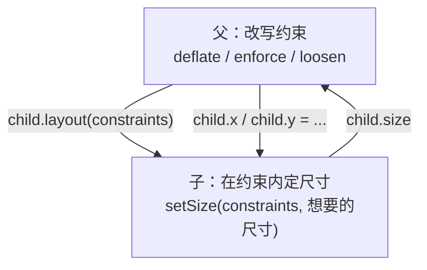

# 布局协议：约束向下、尺寸向上、父定位置

> [返回：第四阶段导览](01-导览.md)
> 对应大纲条目：第四阶段 2。单遍布局协议是整个内核的心脏。本册把协议三句话拆开讲，配合约束代数（tight/loose/loosen/deflate/enforce/constrainSize）与黄金断言逐函数走读 `gui/labs/mini-gui/src/core/render/constraints.ts`（86 行）与 `constraints.test.ts`（4 组断言），并复盘开发中被测试抓住的一个真问题：根约束该是紧的还是松的。

## 1. 协议三句话



三句话各管一件事，**权限单向**：

| 谁 | 权力 | 没有的权力 |
|---|---|---|
| 父 | 决定子的约束区间、决定子的位置 | 直接设定子的尺寸 |
| 子 | 在约束内选自己的尺寸 | 决定自己在哪、把约束顶破 |

这套权限划分的收益是**组合安全性**：任何父配任何子，布局结果都在双方声明过的范围内。父不需要了解子的类型（Padding 不关心子里是文本还是 Flex），子不需要了解父的意图（RenderText 只管「给我宽度区间，我还你行数与高度」）。第四、五册的全部布局器，都是在这三句话的权限框架内做文章。

`setSize` 是基类提供的唯一合法尺寸写入口（`render-object.ts` 摘录）：

```ts
/** 供测试与调试断言用：设置尺寸并保证在约束内。 */
protected setSize(c: BoxConstraints, size: Size): void {
  const s = constrainSize(c, size);
  this.width = s.width;
  this.height = s.height;
}
```

想要什么尺寸随便说，基类负责钳回约束区间——子类算错也不会越界。而且这只是第一道防线：`layout()` 在 `performLayout` 返回后还会再钳一次（第六册走读），双保险。

## 2. BoxConstraints：通货的形状

`constraints.ts` 的开场白（文件头注释，逐字摘录）：

```text
// BoxConstraints：布局协议的通货。
// 协议三句话：
//   ① 父传约束（宽高的 min/max 区间）给子
//   ② 子在约束内返回自己的尺寸
//   ③ 父决定子摆在哪里（x/y 由父设置）
// 值对象 + 纯函数（与 Rect 同理：两端宿主、记录形状匹配都最省心）。
```

数据结构就四个数（摘录）：

```ts
export interface BoxConstraints {
  minWidth: number;
  maxWidth: number;
  minHeight: number;
  maxHeight: number;
}
```

设计决策逐条：

- **区间而非单值**。「宽 800」说不清是「正好 800」（紧）还是「最多 800」（松）——区间 `[min, max]` 一口气表达两种：min === max 是紧，min === 0 是松，其余是普通区间。
- **interface 而非 class**。值对象：没有身份、没有方法、比较按值（`constraintsEqual` 逐字段比）。跨宿主序列化、测试断言 `toEqual` 都是天然支持。
- **Infinity 是合法值**。`maxWidth: Infinity` 表示「主轴不限」——Flex 给非弹性子的约束、滚动视口给内容的高度约束都靠它。无界不是 bug，「无界 + 某些消费者」才是（第五册的 Expanded 防呆）。
- **不变量只有一条：min ≤ max**。全部代数函数的防御目标都是保住它（下面逐个看）。

## 3. 构造与判定：tight / loose / loosen / isTight

四个基础函数全文（摘录）：

```ts
/** 紧约束：宽高都被钉死为一个值。 */
export function tight(size: Size): BoxConstraints {
  return { minWidth: size.width, maxWidth: size.width, minHeight: size.height, maxHeight: size.height };
}

/** 松约束：0..size（父「最多这么大」，子自由发挥）。 */
export function loose(size: Size): BoxConstraints {
  return { minWidth: 0, maxWidth: size.width, minHeight: 0, maxHeight: size.height };
}

/** 把 min 放开到 0，max 保持——「你要多大都行，但别超过我」。 */
export function loosen(c: BoxConstraints): BoxConstraints {
  return { minWidth: 0, maxWidth: c.maxWidth, minHeight: 0, maxHeight: c.maxHeight };
}

export function isTight(c: BoxConstraints): boolean {
  return c.minWidth === c.maxWidth && c.minHeight === c.maxHeight;
}

export function widthIsTight(c: BoxConstraints): boolean {
  return c.minWidth === c.maxWidth;
}

export function heightIsTight(c: BoxConstraints): boolean {
  return c.minHeight === c.maxHeight;
}
```

四个使用方（后文都会走到）：

| 函数 | 谁在用 | 语义 |
|---|---|---|
| `tight(size)` | owner.mount（tightRoot 时）、SizedBox | 「就这么大，别商量」 |
| `loose(size)` | owner.mount（非 tightRoot）、Align/Stack 的非定位子 | 「最多这么大，随意」 |
| `loosen(c)` | 布局器内部改写：把父给的区间下限放开 | 「父要求至少 min，我转述成随意」 |
| `isTight` / `widthIsTight` / `heightIsTight` | RenderText（判断宽度有界）、边界判定 | 只读判定 |

`constraints.test.ts` 第一组的断言（`tight / loose / loosen`，摘录要点）：

```text
tight({10,20})   → {minW:10, maxW:10, minH:20, maxH:20}
loose({10,20})   → {minW:0, maxW:10, minH:0, maxH:20}
loosen(loose({10,20})) === loose({10,20})   // 已松再松不变（幂等）
loosen(tight({10,20}))  === loose({10,20})  // 紧的也能松开
isTight(tight({1,2})) === true; isTight(loose({1,2})) === false
```

`loosen` 的幂等断言值得多看一眼：它防的是「多层容器层层放开下限」时语义漂移——Align 里再嵌 Align，里层拿到的约束下限已经是 0，再 loosen 不会变化。代数性质上测试，比口头约定可靠。

## 4. deflate：四边收缩的代数

Padding 传给子的约束 = 父约束四边往里缩。全文（摘录）：

```ts
/** 四边各缩进 inset（Padding 布局器传给子的约束）。 */
export function deflate(c: BoxConstraints, inset: { left: number; top: number; right: number; bottom: number }): BoxConstraints {
  const deflatedW = Math.max(0, c.maxWidth - inset.left - inset.right);
  const deflatedH = Math.max(0, c.maxHeight - inset.top - inset.bottom);
  return {
    minWidth: Math.min(Math.max(0, c.minWidth - inset.left - inset.right), deflatedW),
    maxWidth: deflatedW,
    minHeight: Math.min(Math.max(0, c.minHeight - inset.top - inset.bottom), deflatedH),
    maxHeight: deflatedH,
  };
}
```

三步防御，一步不能少：

1. **max 先算且钳 0**：`deflatedW = max(0, maxW - l - r)`。insets 比父还宽时（比如 800 宽的窗口里塞 500+500 的边距），max 会变负——负的 max 没有意义，钳 0。
2. **min 也缩、也钳 0**：`max(0, minW - l - r)`。只缩 max 不缩 min，子的下限就还顶在父的旧下限上——区间 [20..30] 四边缩 12 会变成 [20..6] 这种倒挂非法约束。
3. **min 再与 deflatedW 取小**：`Math.min(..., deflatedW)`。在前两步都到位的前提下，`minW ≤ maxW` 经单调运算后仍然保序，这一钳理论上不改变结果——它的作用是**把「min ≤ max」从「依赖调用方传入合法约束」的隐含前提，变成函数出口处自己担保的结论**：无论未来谁改这段代码，非法区间都出不了这个函数。

测试第二组 `deflate：四边缩进并保持 min ≤ max` 的两组数（摘录）：

```text
{minW:20, maxW:30, minH:20, maxH:30} 四边各缩 5
  → {minW:10, maxW:20, minH:10, maxH:20}        // 正常收缩：min、max 同步内移

同约束四边各缩 50（缩穿）
  → {0, 0, 0, 0}                                 // max 钳 0，min 也钳 0（min>max 是非法约束）
```

第二组是纯粹的边角：缩穿之后子得到「必须是 0×0」的紧约束——不是崩溃、不是负尺寸，而是一个语义上完全确定的退化结果。**约束代数的非法状态必须在代数层消灭，不能指望调用方自觉**。

## 5. enforce：两套约束取交

ConstrainedBox / SizedBox 的算法：附加约束与父约束取交。全文（摘录）：

```ts
/** 两套约束取交集（叠加约束的布局器用，如 ConstrainedBox × 父约束）。 */
export function enforce(child: BoxConstraints, parent: BoxConstraints): BoxConstraints {
  return {
    minWidth: Math.min(Math.max(child.minWidth, parent.minWidth), parent.maxWidth),
    maxWidth: Math.min(child.maxWidth, parent.maxWidth),
    minHeight: Math.min(Math.max(child.minHeight, parent.minHeight), parent.maxHeight),
    maxHeight: Math.min(child.maxHeight, parent.maxHeight),
  };
}
```

方向不对称，各有道理：

- **max 取小**：`min(child.max, parent.max)`——两个上限取更严的，交集直觉。
- **min 取大后钳回父 max**：`min(max(child.min, parent.min), parent.max)`——先取更严的下限，但**结果不许超过父的 max**。少了这一钳，附加 min=150 碰上父 max=100 会造出 [150..100] 这种倒挂区间。

测试第三组 `enforce：附加约束与父约束取交` 的两组数（摘录）：

```text
parent = {0..100, 0..100}
enforce({minW:30, maxW:50, minH:0, maxH:200}, parent)
  → {minW:30, maxW:50, minH:0, maxH:100}         // 常规交集：max 被父钳到 100

enforce({minW:150, maxW:200, minH:0, maxH:10}, parent)
  → {minW:100, maxW:100, minH:0, maxH:10}        // 附加 min 高于父 max：min 被父 max 钳住（min ≤ max 恒成立）
```

第二组是本函数的存在理由：ConstrainedBox 想要「至少 150 宽」，父只给得起 100——**父的约束是硬边界，子的愿望必须让路**。结果 100..100 是「父能力范围内的最大妥协」，协议不破。

注意这两组断言同时也是 SizedBox 的语义背书：`RenderSizedBox.performLayout` 用的正是 `enforce(tight(boxSize), c)`（第四册走读）——「我想要 200×80，父允许的话就 200×80，不允许就取交集」。

## 6. constrainSize：钳进区间 + 双保险

尺寸侧的对应函数（摘录）：

```ts
/** 把任意尺寸钳到约束区间（子返回尺寸时的兜底，也是协议合法性的最后防线）。 */
export function constrainSize(c: BoxConstraints, size: Size): Size {
  const w = Math.min(Math.max(size.width, c.minWidth), c.maxWidth);
  const h = Math.min(Math.max(size.height, c.minHeight), c.maxHeight);
  return { width: w, height: h };
}
```

先抬到 min（`max(size, min)`）再压到 max（`min(..., max)`）——标准 clamp。前提是 min ≤ max，而这由前两个函数保证。测试第四组：

```text
c = {10..20, 10..20}
constrainSize(c, {width:5,  height:25}) → {width:10, height:20}   // 低于 min 抬上去、高于 max 压下来
constrainSize(c, {width:15, height:15}) → {width:15, height:15}   // 区间内原样通过
```

「子不能顶破约束」这句协议承诺，在代码里落实为**两道防线**：

1. `setSize(c, size)` 内部先钳——子类主动报尺寸时就已经被修过；
2. `layout()` 在 `performLayout(c)` 返回后**再钳一次**（`render-object.ts` 摘录）：

```ts
this.performLayout(c);
// 尺寸兜底钳回约束（子类忘写/写错也不至于越界）
const s = constrainSize(c, this.size);
this.width = s.width;
this.height = s.height;
```

第 2 道防线防的是「子类绕过 setSize 直接写 width/height 字段」或「performLayout 忘了设尺寸」——只要走 `layout()` 入口，出界的尺寸活不过这一行。去掉它，最先出错的是所有「自己 = 子 + insets」型布局器（Padding）：子越界 1px，父跟着越界，层层放大到根。

## 7. constraintsEqual / constraintsLabel：缓存的钥匙与失败的嘴

最后两个函数（摘录）：

```ts
export function constraintsEqual(a: BoxConstraints, b: BoxConstraints): boolean {
  return (
    a.minWidth === b.minWidth && a.maxWidth === b.maxWidth &&
    a.minHeight === b.minHeight && a.maxHeight === b.maxHeight
  );
}

/** 约束的字符串表示（测试失败信息友好）。 */
export function constraintsLabel(c: BoxConstraints): string {
  return `w[${c.minWidth.toFixed(1)}..${c.maxWidth.toFixed(1)}] h[${c.minHeight.toFixed(1)}..${c.maxHeight.toFixed(1)}]`;
}
```

`constraintsEqual` 是第六册布局缓存的钥匙——`layout()` 用它判断「这次约束和上次一样吗」，一样且不脏就直接返回。按值逐字段比较（四个 `===`），O(1) 且无浮点陷阱（数字要么相等要么不等，没有容差问题）。`constraintsLabel` 只服务于诊断：断言红的时候打出 `w[0..9007199254740991] h[0..100]` 这种一眼可读的形式。

顺带一个实测彩蛋：`9007199254740991` 就是 `Number.MAX_SAFE_INTEGER`——Flex 主轴无界约束在诊断输出里的长相，第六册的探针输出里会再见到它。

## 8. 一遍为什么够

父先给约束、子立刻返回尺寸——布局在**一次深度优先遍历**里完成，没有「先量一遍再摆一遍」（浏览器 CSS 布局的双遍）也没有迭代求解（老式 Qt 约束求解器）。代价是表达力边界：

- 无法表达「子想要多大就多大，父再包住」（intrinsic 尺寸上行）——文本叶子靠 `isFixedSize` 近似
- 表格/瀑布流这类需要跨行测量的布局要靠多阶段协议（Flutter Sliver 的领域）

为什么单遍做不了「父根据子内容定尺寸」？推演一遍就清楚：父要包住子，就得先知道子的尺寸；子的尺寸又依赖父给的约束（宽 30 会断行、宽 800 单行）——信息依赖成环。单遍协议的方向是单向的（约束只向下、尺寸只向上），环必须被斩断。mini-gui 的斩法：

1. **文本叶子固定尺寸化**：RenderText 声明 `isFixedSize() = true`——它的尺寸只由内容与 max 宽决定，「尺寸不随父约束变」让布局系统可以信任缓存值（第六册的边界判定消费这一点）。
2. **包不包得住，父用约束区间表达**：Padding 想「子 + insets」？它把 deflated 约束给子、子返回什么就加什么——**父不是「要」子的尺寸，是「收」子的尺寸**。真想要 shrink-wrap（贴内容），第七阶段会在组件层用「先量后组」的组合模拟（两次单向遍历，而不是一次双向遍历）。

对照两条路（概念对照，非本机实测）：

| 方案 | 遍数 | 谁这么做 | 代价 |
|---|---|---|---|
| 单遍、约束下行 | 1 | Flutter box 协议、mini-gui | 表达力受限（intrinsic 缺失） |
| 内容驱动双遍 | 2+ | 浏览器 CSS（layout/reflow）、`width:auto` 的 shrink-to-fit | 中间布局可能被推翻重排 |
| 约束求解 | 迭代收敛 | 老 Qt、Auto Layout | 最灵活，性能与可预测性最差 |

教学取舍：盒模型 + Flex + Stack 覆盖 90% 应用界面，协议保持一遍。

## 9. 真问题复盘：根约束是紧的还是松的

黄金用例第一批全红：`RenderBox(100,50)` 挂到 800×600 的窗口后测出来是 800×600。原因在 `owner.ts`（摘录）：

```ts
export class PipelineOwner {
  /** 根约束是否钉死为窗口尺寸（生产宿主为 true；黄金用例常用 false 拿内容尺寸的根）。 */
  tightRoot = true;
  ...
  flushLayout(): void {
    ...
    root.layout(this.tightRoot ? tight(this.rootSize) : loose(this.rootSize));
```

`flushLayout` 默认给根 **tight(窗口)** —— Flutter 的 RenderView 语义（根铺满屏幕，要内容尺寸的根得自己包 Align）。生产语义没错：窗口是画布，根背景就该铺满。但黄金用例问的是「这棵子树本身多大」——语义不同。

修法不是改内核，而是把选择显式化（`mount` 摘录）：

```ts
owner.mount(root, windowSize, { tightRoot: true /* 生产宿主 */ });   // 默认：铺满
owner.mount(root, windowSize, { tightRoot: false });                 // 黄金用例：松根，内容尺寸
```

两个世界各自的用法（都是测试里的真实写法）：

- `layout.test.ts` 的 helper：`function flush(root, tightRoot = false)`——**黄金用例默认松根**，所以 `RenderBox(100,50)` flush 后测得 100×50；
- `panel-tree.test.ts`：`owner.mount(tree, WIN)` 不传参——**生产语义 tight 根**，第一断言就是「根铺满窗口」800×450。

同一行测试还藏着对称案例：`RenderBox(100,50)` 用 tight 根挂到 60×60 窗口，测得 60×60——紧约束会把 100 钳到 60（constrainSize 的 min 抬升路径）。**紧根既能放大也能缩小**，方向由窗口说了算。

教训：**「约束从哪来」是协议的一部分**，宿主语义（窗口）与测试语义（画布）不同时，差异要变成显式参数，而不是让测试迁就生产。

## 10. 位置归父的应用现场：滚动

第三句话（父定位置）最远离直觉的用户是滚动视口。`scroll.ts` 的核心三行（摘录）：

```ts
private placeContent(): void {
  const content = this.children[0];
  if (content !== undefined) {
    content.y = this.scrollY === 0 ? 0 : -this.scrollY;
  }
}
```

滚动 = **改子的 y，仅此而已**。不重排（约束一个数没变）、不重建（树结构不动）、甚至不经过 layout 入口——命中测试与绘制遍历自然消费新位置（坐标系在 paintChildren 的 translate 里）。文件头注释把这一点写成原则（摘录）：

```text
//   - 内容子节点被摆到 y = -scrollY（位置归父协议的现场应用），命中测试自动获得正确坐标
//   - 滚动只是改内容 y，不触发重布局（布局缓存友好）
```

「位置归父」乍看是限制（子不能决定自己在哪），换来的正是这种自由：**任何想移动子树的人，只要它是父，就不需要动布局系统**。第五册的 Stack 锚点、本册的 Align 摆位、这里的滚动偏移，全是同一句话的不同读法。

## 11. 协议的黄金断言样例

`layout.test.ts` 里与本册直接相关的断言（全部实跑，数字可手推）：

```text
✓ Padding：子的约束收缩，自己 = 子 + insets          // (100,40) + 四边10 → 自己 (120,60)，子位于 (10,10)
✓ SizedBox：给子紧约束（子被迫同尺寸）              // 子 10×10 被拉到 200×80
✓ Align：子自然尺寸，按比例摆位                     // x=1,y=0.5 → 子在 (700,280)
✓ RenderText 有界宽 30 → 两行 26px 高；无界 → 单行   // 26 = 2 × 13（行高 round(10×1.25)）
✓ RenderBox 紧根 60×60 窗口 → 被钳到 60×60           // min 抬升路径
```

手推两条最典型的：

- **Padding (120,60)**：松根下父约束 loose(800,600)，deflate 四边 10 → 子约束 [0..780]×[0..580]；子 RenderBox(100,40) 在区间内原样通过；父尺寸 = 10+100+10 = 120、10+40+10 = 60；子位置 (10,10)（insets.left/top）。四则运算里没有一步「问子的意见」以外的协商。
- **Align (700,280)**：loosen 后子取自然 100×40；父有界填满 800×600；slack = (800−100, 600−40) = (700,560)；x = 700×1 = 700、y = 560×0.5 = 280。「按比例摆位」就是 slack 乘法。

## 12. 常见误区

1. **「minHeight 是子的承诺，子说 5 就 5」**——min 是父给的区间下限，constrainSize 会把 5 抬到 10。子对下限没有否决权。
2. **「deflate 只减 max 就够」**——min 不跟着缩，子的下限顶在父的旧下限上，min>max 或子被迫越界都可能发生。
3. **「enforce 的附加 min 一定生效」**——高于父 max 时被钳到父 max（150 想要、100 到手）。父的约束是硬边界。
4. **「loose 和 loosen 是同一个函数」**——loose(size) 从尺寸构造新区间；loosen(c) 把**已有约束**的下限归零。一个造币，一个改币。
5. **「约束没变就一定不重排」**——还要看脏标记：缓存命中需要「不脏 + 约束没变」两个条件同时成立（第六册）。反之「脏了才重排」也不对：约束数值变了，不脏也排。
6. **「无界约束（Infinity）是 bug」**——Flex 主轴、滚动视口的主轴都合法使用无界；非法的是「无界 + 特定消费者」（第五册的 Expanded 会直接抛错）。
7. **「子可以稍微顶破 max 一点」**——constrainSize 两道防线（setSize 与 layout 兜底）连 1px 都不放出去。
8. **「改文本要手动调 markNeedsLayout」**——setText 是唯一入口且自动标脏；spans 是 private，想绕都没有路径。
9. **「根当然是松约束，不然测什么」**——生产宿主恰恰要紧根铺满窗口。tightRoot 的默认值是 true，黄金用例显式传 false。两种语义都对，错的是混用。

## 自测

1. 协议里「子不能顶破约束」由哪两行代码保证（两道防线）？去掉第二道，哪个布局器最先出错？
2. `deflate` 为什么不能只减 max 不动 min？构造一个具体输入让「只减 max」产生非法约束。
3. `enforce` 的「min 取大后还要钳回父 max」防御的是哪种构造顺序？写出触发它的具体数字。
4. 为什么单遍协议做不了「父想根据子内容定尺寸」？mini-gui 用什么近似？第七阶段准备怎么补？
5. tightRoot 的取舍背后，生产宿主和黄金用例各自需要什么？`layout.test.ts` 的 flush helper 和 `panel-tree.test.ts` 的 mount 各自怎么写？
6. 滚动视口改 `content.y = -scrollY` 为什么不需要重排？这依赖协议的哪一句话？
7. 推算：tight(800,600) 经 Padding(edgeInsets(24)) 传子，子的约束是什么？（答案形状：w[a..b] h[c..d]，四个数）
8. 推算：enforce({minW:40, maxW:60, minH:0, maxH:∞}, {0..100, 0..50}) 的结果？
9. 推算：Align 在松根 800×600 下，alignment x=0.5、y=1，子 RenderBox(100,40)——子落在哪？Align 自己多大？
10. `constraintsEqual` 为什么逐字段 `===` 而不用容差比较？它服务的那个机制（布局缓存）对「约等」零容忍的原因是什么？
