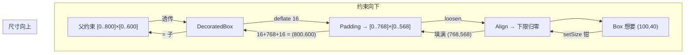

# 盒模型与基础布局器：Padding / SizedBox / Align / 装饰盒

> [返回：第四阶段导览](01-导览.md)
> 对应大纲条目：第四阶段 3。基础布局器每个只做一件事：**改写传给子的约束**，或**在自己的尺寸里摆子**。本册逐个走读 `gui/labs/mini-gui/src/core/render/layout-widgets.ts`（192 行）里的六个布局器与测试积木 RenderBox——它们是第五册 Flex 的原料。所有黄金断言来自 `layout.test.ts` 实跑。

## 1. 全家福

| 布局器 | 给子的约束 | 自己的尺寸 | 黄金断言（实跑） |
|---|---|---|---|
| RenderPadding(insets) | deflate(父约束, insets) | 子 + insets | 子 (100,40)+四边10 → 自己 (120,60)，子位于 (10,10) |
| RenderConstrainedBox(extra) | enforce(extra, 父约束) | 子（无子时取 effective 的 max） | 断言在代数层（constraints.test.ts 的 enforce 组） |
| RenderSizedBox(size) | enforce(tight(size), 父约束) | size | 子 10×10 被拉到 200×80 |
| RenderAlign(alignment) | loosen(父约束) | 有界填满 / 无界贴子 | x=1,y=0.5 → 子在 (700,280) |
| RenderColoredBox(color) | 原样透传 | 子 | panel 根：铺满 800×450 后画背景 |
| RenderDecoratedBox(...) | 原样透传 | 子 | panel 左卡片：2 层圆角命令 |

先看公共形态：六个类的 performLayout 都是同一个模板的变体——

```text
拿到父约束 c
  → 算出子的约束 childC（deflate / enforce / loosen / 透传，四选一）
  → child.layout(childC)
  → 决定子的位置（x/y 赋值）
  → 决定自己的尺寸（setSize(c, ...)）
```

这正是第三册协议三句话的机器化：**改约束、收尺寸、摆位置**。每个类的个性只在两处：childC 怎么算（第一列）、自己多大（第二列）。位置除了 Padding（insets 处）和 Align（slack 比例处），清一色 (0,0)。

还有一个公共细节值得先指出来：**每个类都处理「无子」分支**。容器不是必有内容——空 Padding 占位、空装饰盒画纯色块，都是合法用法。无子分支的尺寸语义各不相同（下文逐个看），这是「积木可任意组合」的隐藏成本。

## 2. RenderPadding：insets 的代数

performLayout 全文（摘录）：

```ts
protected performLayout(c: BoxConstraints): void {
  const child = this.children[0];
  if (child === undefined) {
    this.setSize(c, {
      width: this.insets.left + this.insets.right,
      height: this.insets.top + this.insets.bottom,
    });
    return;
  }
  child.layout(deflate(c, this.insets));
  child.x = this.insets.left;
  child.y = this.insets.top;
  this.setSize(c, {
    width: this.insets.left + child.width + this.insets.right,
    height: this.insets.top + child.height + this.insets.bottom,
  });
}
```

逐段读：

- **无子时尺寸 = insets 之和**。四边 10 的空 Padding 是 20×20 的「透明占位」。语义：留白本身就是内容——列表项间距、卡片内空的预留区。
- **子的约束是 deflate(c, insets)**，第三册走读过的代数：min/max 四边收缩、缩穿钳 0、min ≤ max 恒成立。**边距不是从子的尺寸里扣，是从父的预算里扣**——子拿到的区间已经小了一圈，它在区间内自由发挥。
- **子位于 (insets.left, insets.top)**。注意**位置归父**在这里的具体形态：Padding 把子摆到 insets 处，这是协议第三句话。子自己的 x/y 字段对子是只读的（纪律上）。
- **自己 = insets + 子**。三段加法在 max 一侧、min 一侧同时成立吗？不一定——如果父约束把子钳小了（比如父只给 50 宽、insets 就占 20），Padding 报上去的「想要尺寸」是 20+子实际宽+20；最后一行 `setSize(c, ...)` 还会把这个和再钳进父约束。**Padding 自己也可能被父压缩**，压缩后它的绘制（无自绘）与子的位置不变，只是自己的 width/height 变小——子可能因此「看起来溢出」，这与第五册 Flex 的 mainOverflow 记账是同族问题。

黄金断言（`Padding：子的约束收缩，自己 = 子 + insets`，数字手推）：

```text
松根 800×600 → deflate(loose(800,600), 四边10) = [0..780]×[0..580]
子 RenderBox(100,40) 区间内原样通过 → (100,40)，位于 (10,10)
自己 = 10+100+10 × 10+40+10 = (120,60)
```

panel 场景的连环应用（`panel-tree.ts`）：根是 tight(800,450)，`RenderPadding(edgeInsets(24))` 传给 Column 的约束是 deflate(tight(800,450), 24) = **tight(752,402)**——紧约束！这解释了后面所有数字的来源：Column 宽 752、header/footer 宽 752、页脚基条干脆直接写死 752 宽。**一次 deflate 定死了整条子树的宽度预算**。

## 3. RenderConstrainedBox：愿望与现实的交集

performLayout 全文（摘录）：

```ts
protected performLayout(c: BoxConstraints): void {
  const child = this.children[0];
  const effective = enforce(this.extra, c);
  if (child === undefined) {
    this.setSize(c, { width: effective.maxWidth, height: effective.maxHeight });
    return;
  }
  child.layout(effective);
  child.x = 0;
  child.y = 0;
  this.setSize(c, child.size);
}
```

- **`enforce(this.extra, c)`**：extra 是构造时传入的「我想要的区间」，与父约束取交（第三册走读：max 取小、min 取大后钳回父 max）。ConstrainedBox 的语义是**愿望，不是命令**——想要「至少 150」，父只给 100 时到手 100..100。
- **无子时自己 = effective 的 max**：约束盒本身没有内容，就拿「交集允许的最大值」当尺寸——「给我多大我占多大」的占位语义。
- **有子时自己 = 子**：不添加任何几何，纯约束改写器。

`layout.test.ts` 没有专门给 ConstrainedBox 的布局断言——因为它的全部个性都在 `enforce` 这一个函数调用里，而 enforce 的四组边角断言（含「附加 min 高于父 max」）在 `constraints.test.ts` 的第三组覆盖了。**布局器只是代数的搬运工时，测代数就等于测布局器**。

## 4. RenderSizedBox：紧约束的发生器

performLayout 全文（摘录）：

```ts
protected performLayout(c: BoxConstraints): void {
  const effective = enforce(tight(this.boxSize), c);
  const child = this.children[0];
  if (child === undefined) {
    this.setSize(c, this.boxSize);
    return;
  }
  child.layout(effective);
  child.x = 0;
  child.y = 0;
  this.setSize(c, this.boxSize);
}
```

- 它是 ConstrainedBox 的特例：extra = tight(boxSize)。「我想要恰好 200×80」与父约束取交——父松就真得 200×80，父只给 100 就得交集。
- **子的约束是紧的**（交集结果 min === max，当父允许时）——子无论想多大都被钉到 boxSize。黄金断言（`SizedBox：给子紧约束（子被迫同尺寸）`）：`RenderBox(10,10)` 进 `RenderSizedBox(200×80)`，出来 200×80。10×10 的愿望被紧约束完全覆盖。
- **注意两个 setSize 的差异**：无子分支 `setSize(c, this.boxSize)`，有子分支也是 `setSize(c, this.boxSize)`——但中间夹着 `child.layout(effective)`。SizedBox 对自己的尺寸**不听子的**：子多大都与我没关系，我就是 boxSize（再被父约束钳一次）。这与 Padding（子 + insets）形成对照：**有的容器被内容撑开，有的容器把内容拍扁**。
- 对称的失败案例在测试另一处：`RenderBox(100,50)` 用 tight 根挂 60×60 窗口被钳到 60×60——紧约束既能放大（10→200）也能缩小（100→60），方向由区间端点决定。

## 5. RenderAlign：slack × 比例

performLayout 全文（摘录）：

```ts
protected performLayout(c: BoxConstraints): void {
  const child = this.children[0];
  if (child === undefined) {
    this.setSize(c, { width: c.maxWidth, height: c.maxHeight });
    return;
  }
  // 子先取自然尺寸（松约束：min 归零、max 继承）
  child.layout(loosen(c));
  // 自己：约束有界就填满；无界（如被 unconstrained 包着）就贴子
  const ownW = c.maxWidth === Infinity ? child.width : c.maxWidth;
  const ownH = c.maxHeight === Infinity ? child.height : c.maxHeight;
  const slackX = Math.max(0, ownW - child.width);
  const slackY = Math.max(0, ownH - child.height);
  child.x = slackX * this.alignment.x;
  child.y = slackY * this.alignment.y;
  this.setSize(c, { width: ownW, height: ownH });
}
```

四个读点：

- **子收到 loosen(c)**：下限归零、上限继承。「先取自然尺寸」——子想多大要多大（不超过父的上限）。
- **自己的尺寸分两档**：约束有界就填满（占满可用空间，对齐才有意义）；无界就贴子（`c.maxWidth === Infinity` 时 own = child——没有「可用空间」可填，退化为 shrink-wrap）。这层分档是很多「Align 在无界环境里炸不炸」问题的答案：不炸，退化。
- **slack 钳 0**：`Math.max(0, ownW - child.width)`。子比父大时 slack 为负，直接取 0——子落在 (0,0)，溢出交给上层记账（本册的容器都不裁剪）。
- **slack × 比例**：x=0 左、x=1 右、x=0.5 居中，比例可以任意小数。对齐不是「子选边」，是**父在剩余空隙（slack）里按比例摆子**。这个乘法是所有「对齐」类布局（含 Stack 的非定位子）的统一公式。

黄金断言（`Align：子自然尺寸，按比例摆位`，数字手推）：

```text
松根 → loosen(800,600) → 子 RenderBox(100,40) 取自然 (100,40)
own = (800,600)（有界填满）；slack = (700,560)
x = 700×1 = 700；y = 560×0.5 = 280     → 子在 (700,280)，Align 自己 (800,600)
```

## 6. 装饰盒：背景与内容的分离

RenderColoredBox 与 RenderDecoratedBox 的布局代码**逐字相同**（透传 + 尺寸 = 子 + 无子填 max）：

```ts
protected performLayout(c: BoxConstraints): void {
  const child = this.children[0];
  if (child === undefined) {
    this.setSize(c, { width: c.maxWidth, height: c.maxHeight });
    return;
  }
  child.layout(c);
  child.x = 0;
  child.y = 0;
  this.setSize(c, child.size);
}
```

`child.layout(c)` 原样透传——装饰层**不参与布局协商**，只叠一层绘制。两个类的差异全在 paintSelf。RenderColoredBox（摘录）：

```ts
protected paintSelf(p: Painter): void {
  p.fillRect({ x: 0, y: 0, width: this.width, height: this.height }, this.color);
}
```

RenderDecoratedBox（摘录）：

```ts
protected paintSelf(p: Painter): void {
  const r = { x: 0, y: 0, width: this.width, height: this.height };
  p.fillRoundedRect({ x: r.x - 1, y: r.y - 1, width: r.width + 2, height: r.height + 2 }, this.radius + 1, this.borderColor);
  p.fillRoundedRect(r, this.radius, this.background);
}
```

描边用「外圈大一圈的圆角矩形」近似（第二阶段的选择：画布 API 没有描边路径，就用两层填充叠出 1px 边）。panel 断言里的 `fillRoundedRect 2 条`正是这两层。

**背景归装饰盒、内容归子**——这就是「盒模型」在 mini-gui 里的极简形态：

| CSS 盒子层 | mini-gui 的归属 |
|---|---|
| margin | 外层再包 RenderPadding（组合，不是属性） |
| border | RenderDecoratedBox 的 borderColor（画出来的，不占布局） |
| padding | RenderPadding 的 insets |
| content | 子 |

CSS 把四层塞进一个 box-sizing；mini-gui 把它们拆成可组合的积木。**代价**：圆角边框不占布局空间（想留边框位得自己加 Padding）；**收益**：装饰与结构正交——给任何子树套背景不需要动那棵子树的任何代码。

panel 用例：根 `RenderColoredBox(PALETTE.bg)` 铺满画背景；左卡片 `RenderDecoratedBox({ background: surface, border: border, radius: 10 })` 包着内容盒。radius 默认 8，panel 显式给 10。

## 7. 测试用万能积木：RenderBox

```ts
/** 测试/调试用叶子：固定尺寸的色块（黄金用例的万能积木）。 */
export class RenderBox extends RenderObject {
  constructor(public boxWidth: number, public boxHeight: number, public color: Color = PALETTE.accent) {
    super();
  }

  protected performLayout(c: BoxConstraints): void {
    this.setSize(c, { width: this.boxWidth, height: this.boxHeight });
  }

  protected isFixedSize(): boolean {
    return true;
  }

  protected paintSelf(p: Painter): void {
    p.fillRect({ x: 0, y: 0, width: this.width, height: this.height }, this.color);
  }
}
```

三件事：

- **performLayout 只有一行**：想要 (boxWidth, boxHeight)，被 setSize 钳进约束。黄金用例全部用它当「已知尺寸的子」——布局器的输出因此是纯算术（见断言里的整数）。
- **isFixedSize() = true**：声明「自身尺寸不随约束变化」（近似——约束区间不含期望值时仍会被钳，如 60×60 窗口的例子；但「不随 min/max 的常规变动而变」足以让边界判定成立，第六册展开）。panel 场景里它同时充当占位（`Box(0,1,同色)` 弹性占位）与色块（状态徽标、页脚基条）。
- **boxWidth 是 public**——第六册的边界实验靠运行时改它触发重排（`leaf.boxWidth = 80; leaf.markNeedsLayout()`）。

顺带一提同文件的辅助构造（摘录）：

```ts
export interface EdgeInsets { left: number; top: number; right: number; bottom: number; }
export function edgeInsets(all: number): EdgeInsets {
  return { left: all, top: all, right: all, bottom: all };
}
```

四边独立是完整形态（deflate 按 left/top/right/bottom 各自缩），`edgeInsets(n)` 是「四边同值」的糖。panel 用 `edgeInsets(24)`，测试用 `edgeInsets(10)` / `edgeInsets(8)`。

## 8. 无子分支：六个「空容器」各自多大

§1 埋的问题正式展开：每个布局器都写了 `if (child === undefined)` 分支，但**空容器的尺寸语义六个类三种主张**：

| 布局器 | 无子时的尺寸 | 语义主张 |
|---|---|---|
| RenderPadding | insets 之和（如四边 10 → 20×20） | 留白本身就是内容 |
| RenderConstrainedBox | effective 的 max（交集允许的最大值） | 「给我多大我占多大」的贪婪占位 |
| RenderSizedBox | boxSize（再被父钳） | 我说了算，有没有内容都一样 |
| RenderAlign | c.maxWidth × c.maxHeight | 对齐是「空间里的行为」，没内容也得有空间 |
| RenderColoredBox / DecoratedBox | c.maxWidth × c.maxHeight | 纯色块/空圆角盒也是可视内容 |

三个读法：

- **Align 的无子分支最「虚」**：拿走子之后它还是坚持填满约束——一个空的居中容器在画布上确实应该占着那块地（否则嵌套结构会塌）。注意 `c.maxWidth` 可能是 Infinity，此时 `setSize` 会把它钳进……钳进什么？min 侧。min 是多少就是多少（松约束下 0）——**无界环境里的空 Align 尺寸为 0**，这是「钳」语义的自然结果，不是 bug。
- **SizedBox 的无子分支与有子分支返回同一个值**（都是 boxSize）：它是六个里唯一「内容完全不影响自己尺寸」的容器——把子拍扁的能力与无视子的能力同源。
- **组合出「固定留白」**：`RenderPadding(edgeInsets(8))` 不挂子，就是一个 16×16 的间隔件——比 SizedBox(16,16) 多了「被 deflate 再钳」的柔顺性（放进更紧的父里会收缩）。列表间距、卡片呼吸位，都是这个用法的变体。

对照测试：`layout.test.ts` 的黄金断言全部是「有子」路径；无子分支目前没有直接断言——它属于「实现口径必须统一」的约定区，读源码时值得多看一眼的原因。

## 9. 组合演练：五个积木搭一张卡片

导览实践任务里的经典题：**卡片 = 16 边距、圆角背景、内容居中**。组装代码（用本册积木，可直接跑在测试环境里）：

```ts
const card = new RenderDecoratedBox({ background: PALETTE.surface, border: PALETTE.border, radius: 8 });
const pad = new RenderPadding(edgeInsets(16));
const center = new RenderAlign({ x: 0.5, y: 0.5 });
center.appendChild(new RenderBox(100, 40));
pad.appendChild(center);
card.appendChild(pad);
```

结构语义逐层：装饰盒定皮肤 → Padding 定内边距 → Align 定内容居中 → 内容盒子。约束与尺寸的对流画成图：



协议视角下一层层的约束流：

```text
父约束 c（比如松根 [0..800]×[0..600]）
 └ DecoratedBox 透传 c
    └ Padding deflate(c, 16)         → [0..768]×[0..568]
       └ Align loosen(...)            → [0..768]×[0..568]（下限归零，本来就松）
          └ Box(100,40) 在区间内取 (100,40)
尺寸回程：Align 有界填满 own = (768,568)；slack = (668,528)
 子落在 (668×0.5, 528×0.5) = (334,264)
 Padding = 16+768+16 × 16+568+16 = (800,600)（恰好顶着父 max）
 DecoratedBox = 子 = (800,600)，圆角画在自己身上
```

想「贴内容」而不是「填满」就得换结构（比如外面套无界环境或用第七阶段的两遍组件）——本册容器里只有 Align 的无界分支会贴子。**同样的积木，不同的约束环境，长出不同的树**：这就是「约束是通货」的直观体验。

## 10. 概念对照：CSS 的 box-sizing（概念对照，非本机实测）

CSS 盒模型把 margin/border/padding/content 四层装进一个盒子，再用 `box-sizing` 决定 width 指的是哪一层：

| 维度 | CSS（公开规范语义） | mini-gui |
|---|---|---|
| 盒子分层 | 一个元素四层俱全 | 每层一个积木（Padding/装饰盒/子），组合出现 |
| `box-sizing: content-box` | width 只算内容，实际占位 = width + padding + border | Padding 的口径（自己 = insets + 子） |
| `box-sizing: border-box` | width 含 padding + border，内容被压缩 | SizedBox 的口径（自己 = boxSize，子被拍扁） |
| 边框占空间 | 占（border-box/content-box 都算进占位） | 不占（装饰盒透传，边框是画出来的） |
| 对齐 | margin auto / flex 对齐 | Align 的 slack × 比例 |

两点观察（均为规范层面的对照，非本机实验）：

- CSS 的历史包袱（content-box 是默认值）来自「width 写多少、屏幕上盒子比它大」的经典困惑；mini-gui 没有这个包袱，因为**尺寸从来不是单方面声明的**——协议要求「想要什么」必须经过 setSize 钳进父约束，「实际多大」永远是协商结果。
- CSS 后来补的 `gap`（flex/grid 里的间距属性）与 mini-gui 的 Flex gap 参数同义——但 mini-gui 的空 Padding 间隔件提供了更原始的通用形态（任何容器可用，不限于 flex 上下文）。

## 11. 常见误区

1. **「Padding 无子时尺寸是 0」**——是 insets 之和。空 Padding 是合法的占位留白。
2. **「SizedBox(200×80) 一定得到 200×80」**——父约束更小时取交集被钳（窗口 60×60 的例子把 100×50 钳到 60×60）。紧愿望遇紧现实，取交。
3. **「Align 会拉伸子」**——不会。loosen 后子取自然尺寸；拉伸是第五册 Flex 的 crossAxisAlign.stretch 干的事。
4. **「子比 Align 大时会被摆到负坐标」**——slack 钳 0（Math.max(0, ...)），子落在 (0,0)，溢出不处理但也不塌。
5. **「装饰盒的边框占布局空间」**——不占。透传约束、尺寸 = 子；边框是 paintSelf 里画的两层圆角。要留边框位得自己加 Padding。
6. **「ConstrainedBox 的 extra 是最终约束」**——是交集不是覆盖；附加 min 高于父 max 时被钳到父 max。
7. **「RenderBox 可以直接上生产」**——它是测试积木：isFixedSize=true 是给边界实验的近似声明，颜色是调试语义。生产叶子是 RenderText 这类真实控件。
8. **「六个布局器会互相冲突」**——不会，因为它们只做两件事（改约束/摆子）且都遵守协议权限。任意嵌套的结果可以逐层手推——本册所有断言都是证据。
9. **「空容器尺寸是未定义行为」**——不是：三种主张（insets 之和 / 交集 max / 填满 max）都是显式分支（§8 的表）。组合空积木前查一眼那张表。

## 自测

1. Padding 无子时的尺寸是多少？这个语义在什么场景下有用？
2. panel 场景里 Column 为什么恰好宽 752？从 tight(800,450) 开始手推这条约束链。
3. Align 的 slack 公式在子比父大时（slack 为负）会怎样？谁保证它不塌？
4. 装饰盒为什么透传约束而不是 deflate？如果它要画「内容外 4px 的边框」，协议要怎么改（提示：谁该参与布局协商）？
5. RenderBox 的 isFixedSize=true 对它的布局边界意味着什么？（第六册展开，先用自己的话说）
6. SizedBox 与 ConstrainedBox 的关系是什么？写出前者用后者表达的等价形式。
7. 推算：松根 800×600 下，RenderPadding(edgeInsets(20)) 包 RenderBox(200,100)——Padding 尺寸？子位置？子约束区间？
8. 推算：紧根 tight(300,200) 下，同一个组合——子约束是什么？子最终尺寸？Padding 最终尺寸？
9. 推算：RenderAlign({x:0.25, y:0}) 在松根 800×600 下包 RenderBox(80,60)——子落在哪？
10. 用五个积木搭「卡片：16 边距、圆角背景、内容居中」写出树的组装代码，并手推每一层的约束与尺寸（第 8 节已给一种答案，换一组不同的父约束再推一遍）。
