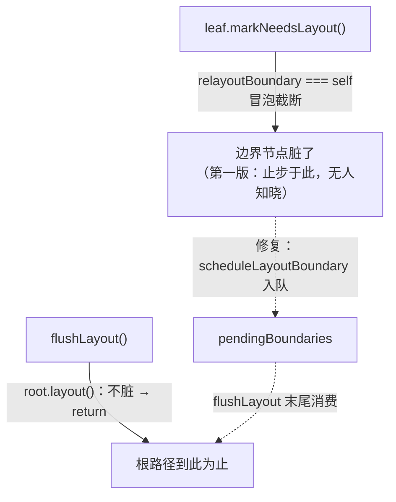
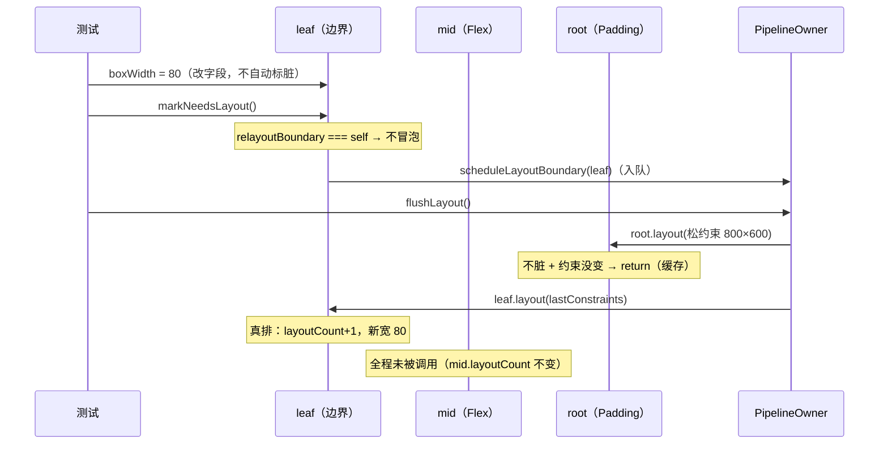

# 布局性能：缓存、边界与一个被测试抓住的调度 bug

> [返回：第四阶段导览](01-导览.md)
> 对应大纲条目：第四阶段 5。布局性能的两板斧：**布局缓存**（约束没变 + 不脏 → 跳过）与 **relayout boundary**（失效冒泡的截断点）。本册还有本站至今最有教育价值的一个真 bug：边界截断了冒泡，却没人记得去重排边界子树。走读对象：`render-object.ts` 的 layout/markNeedsLayout/updateRelayoutBoundary 与 `owner.ts` 的布局调度段；panel 数字用独立探针实跑验证。

## 1. 布局缓存：layout() 全文走读

`render-object.ts` 的布局入口（逐字摘录）：

```ts
/** 父调用。返回后 width/height 有效（约束内）。 */
layout(c: BoxConstraints): void {
  const constraintsChanged = this._lastConstraints === null || !constraintsEqual(this._lastConstraints, c);
  if (!this.needsLayout && !constraintsChanged) {
    return; // 布局缓存：不脏 + 约束没变 → 直接复用
  }
  this._lastConstraints = c;
  this.needsLayout = false;
  this.layoutCount += 1;
  this.performLayout(c);
  // 尺寸兜底钳回约束（子类忘写/写错也不至于越界）
  const s = constrainSize(c, this.size);
  this.width = s.width;
  this.height = s.height;
  // 布局边界判定：本节点成为边界的条件（对标 Flutter：tight / 自身固定尺寸 / 显式）
  this.updateRelayoutBoundary(c);
  // 重排过的子树必然要重画（布局驱动绘制的级联失效）
  this.markNeedsPaint();
}
```

十来行代码，七件事：

1. **缓存判断（前两行半）**：`_lastConstraints === null`（从没排过）或与本次约束**逐值不等**，都算「约束变了」。缓存命中要求两个条件**同时**成立——不脏 **且** 约束没变。任何一方不满足都要真正排。
2. **缓存数据的写入时机**：`_lastConstraints = c` 存的是**本次**约束（不是比较前的旧值）——排完之后，这次的约束就成了下次比较的基准。
3. **脏标记复位在 performLayout 之前**：`needsLayout = false` 先写。细节：如果 performLayout 里又触发 markNeedsLayout（理论上不该，布局中不应改状态），至少不会无限循环——脏了下次 flush 再排。
4. **layoutCount**：每次真排 +1。它是测试与诊断的观测口，生产逻辑不读它。
5. **兜底钳**：performLayout 返回后再 constrainSize 一次（第三册讲过的第二道防线）。
6. **updateRelayoutBoundary(c)**：每次真排后重新判定边界——边界不是静态属性，随约束变化（同一个节点，父给紧约束时是边界，给松约束时不是）。
7. **markNeedsPaint()**（最后一行，第六阶段新增）：真排过的子树必然要重画——布局驱动绘制的级联失效。第四阶段记住结论即可：**排了就要画**，绘制失效不用单独触发。

三行判断防住两类白工：

| 条件 | 防住的白工 | 典型触发 |
|---|---|---|
| `!needsLayout`（不脏） | 状态没变却重排 | 每帧 flushLayout、纯绘制帧 |
| `!constraintsChanged`（约束没变） | 状态变了但与布局无关的重排 | 文本变了但父级只关心自己（被边界截断后，见 §4） |

两个条件缺一不可：只查脏标记，resize 时全树都「不脏」却必须重排（约束数值变了）；只查约束，改文本后约束没变就永远排不上。

## 2. 缓存的黄金断言

`layout.test.ts` 的 `布局缓存与 relayout boundary` 组（3 条，全部实跑）。先看测试树怎么搭（buildTree 摘录）：

```ts
function buildTree(): { root: RenderObject; mid: RenderFlex; leaf: RenderBox } {
  const root = new RenderPadding(edgeInsets(8));
  const mid = new RenderFlex({ direction: FlexDirection.row });
  const leaf = new RenderBox(50, 20);
  mid.appendChild(new RenderBox(30, 20));
  mid.appendChild(leaf);
  root.appendChild(mid);
  return { root, mid, leaf };
}
```

结构：`Padding(8) > Flex(row) > [Box(30,20), Box(50,20)]`，4 个节点。三条断言：

**① 同样状态再 flush：零 performLayout（全缓存）**

```ts
const owner = flush(root);          // 首排：4 个节点各 +1
const total1 = owner.totalPerformLayouts;
owner.flushLayout();                // 没人标脏、约束没变
expect(owner.totalPerformLayouts).toBe(total1);   // 一个都没重排
expect(leaf.layoutCount).toBe(1);
```

防的错误：flush 被当成「重排命令」而不是「收敛机会」——如果 layout 不带缓存，每帧都要全树排一遍，60fps 的预算立刻被吃光。

**② 改叶子：只重排边界内子树**——§4 逐行解读（它是本册主角）。

**③ 窗口 resize：全树重排（根约束变了）**

```ts
owner.resize({ width: 400, height: 300 });
owner.flushLayout();
expect(owner.totalPerformLayouts).toBeGreaterThan(before);
expect(leaf.layoutCount).toBe(2);   // 叶子是固定尺寸也要重排（紧约束数值变了）
```

这条断言的微妙处：leaf 是 `isFixedSize` 的 RenderBox，「尺寸不随父变」为什么还要排？看它首排收到的约束：Flex 的 looseMain 给的是 `w[0..9007199254740991] × h[0..584]`——主轴无界，但**交叉轴的 max 是 584 = 600−16**（窗口高经 Padding 的 deflate 编了进去）。resize 到 400×300 后这个 max 变成 284，`constraintsEqual` 逐值比较不等，缓存失效。防的错误：以为「固定尺寸 = 永不重排」。固定的是**尺寸对约束区间的响应方式**，不是「约束变了也免检」。

## 3. relayout boundary：冒泡的截断点

`markNeedsLayout` 自底向上传染（子变脏 → 父的尺寸可能变 → 父也脏）。不截断，任何叶子变化都会重排整棵树。判定代码（逐字摘录）：

```ts
private updateRelayoutBoundary(c: BoxConstraints): void {
  const tightNow = c.minWidth === c.maxWidth && c.minHeight === c.maxHeight;
  if (tightNow || this.isFixedSize() || this.parent === null) {
    this.relayoutBoundary = this;
  } else {
    const p = this.parent;
    this.relayoutBoundary = p !== null ? p.relayoutBoundary : this;
  }
}
```

| 条件 | 直觉 | 日常例子 |
|---|---|---|
| 父给的是**紧约束**（tightNow） | 子的位置尺寸都被钉死，子怎么变也不影响父 | 窗口根、SizedBox 里的子、panel 里被 tight 链钉住的列 |
| 节点 isFixedSize（文本、RenderBox） | 自身尺寸不随约束变 | RenderText：改标题只重排文本叶子 |
| 是根（parent === null） | 没有更上层了 | owner.mount 的根 |

三条件都不满足时，**继承父的边界**（`p.relayoutBoundary`）——边界的语义是「最近的一个可以自作主张的祖先」。注意判定发生在每次真排之后（§1 第 6 点）：同一个节点换了个父（松约束）就不再是边界，边界跟着约束走。

panel 场景里三条各有一个实例（数字见 §9）：根（tightRoot 铺满）是第三条；标题文本 isFixedSize 是第二条；body 里的 Expanded（拿到紧约束 493 宽）是第一条。

## 4. 边界实验逐行解读

测试②（`改叶子：只重排边界内子树（Padding+Flex 因非边界被传染）`）全文骨架：

```ts
const { root, mid, leaf } = buildTree();
const owner = flush(root);
const midBefore = mid.layoutCount;
const leafBefore = leaf.layoutCount;

// 叶子是紧约束下的固定尺寸盒 → 自己就是 relayout boundary
expect(leaf.relayoutBoundary).toBe(leaf);
leaf.boxWidth = 80;
leaf.markNeedsLayout();
owner.flushLayout();

expect(leaf.layoutCount).toBe(leafBefore + 1);
// mid 收到的是窗口紧约束 → mid 自身也是边界（tight 成立），冒泡到 mid 为止，
// 但 mid 自己 needsLayout 未被置位：布局缓存生效，不重排
expect(mid.layoutCount).toBe(midBefore);
expect(root.needsLayout).toBe(false);
```

逐步还原 flush 时刻的调度现场：

1. `leaf.boxWidth = 80` 直接改字段（RenderBox 的 boxWidth 是 public，第二册提过）——**改字段不自动标脏**，所以下一行手动 `leaf.markNeedsLayout()`。
2. markNeedsLayout 里 leaf 的 `relayoutBoundary === this` 成立 → 不冒泡、上报 owner（scheduleLayoutBoundary）。**mid 从头到尾不知道这件事**：它的 needsLayout 从未被置位。
3. flushLayout 先走根路径：root.layout(松约束 800×600)——root 不脏且约束没变，**第一行就 return**。递归根本没往下走，mid/leaf 都不在根路径上被碰到。
4. 再走边界队列路径：pendingBoundaries 里有 leaf，`leaf.layout(leaf.lastConstraints ?? ...)`——lastConstraints 是首排时存下的 `w[0..9007199254740991] × h[0..584]`，复用它真排。leaf.layoutCount +1，新宽 80 在区间内合法。
5. 于是断言全绿：leaf +1、mid 不变、root.needsLayout 为 false。

测试名里「Padding+Flex 因非边界被传染」描述的是**假如没有边界**的世界：markNeedsLayout 会 leaf→mid→root 一路传染，4 个节点全重排。边界的价值就体现在这组对照数字里：**1 次真排 vs 4 次**。

还有一个容易读漏的点：**mid.layoutCount 不变的原因不是「mid 被调用后缓存跳过」，而是「mid 根本没被调用」**——冒泡在 leaf 截断 + 根路径第一行 return，两条路都到不了 mid。缓存（§1）在这条路径上只是备用的第二道闸；真正截断工作量的是边界。

## 5. 真 bug：边界停了冒泡，谁去重排它？

第一版实现里，叶子变脏 → 冒泡在叶子（边界）停下 → `flushLayout` 从根开始 layout → **根不脏直接缓存跳过 → 那个脏叶子永远没人排**。测试当场红：`期望 leaf.layoutCount=2，实际 1`。

根因：**「冒泡到边界为止」与「从根往下扫」是两套不相交的路径**——截断传播的同时也截断了「被发现」。画成图（虚线是修复后补上的那条边，第一版没有）：



左下角（变脏的边界）与右上角（调度入口）之间**没有边**——失效传播系统必须有「发现」与「执行」两条腿，只有冒泡（发现向上）没有调度表（执行向下），边界优化就会吞掉合法重排。

Flutter 的解法是 owner 维护待重排节点表，mini-gui 照做。修复后的三段代码（全部逐字摘录）：

```ts
// RenderObject.markNeedsLayout
if (this.relayoutBoundary === this || this.parent === null) {
  // 边界（或根）：冒泡到此为止，但必须有人记得来重排这棵子树 —— 上报 owner
  if (this.owner !== null) this.owner.scheduleLayoutBoundary(this);
  return;
}
this.parent.markNeedsLayout(); // 不是边界 → 传染给父（父的尺寸可能因此变）
```

```ts
// PipelineOwner
/** RenderObject 边界失效的上报入口（勿手动调用）。 */
scheduleLayoutBoundary(node: RenderObject): void {
  this.pendingBoundaries.push(node);
}
```

```ts
// PipelineOwner.flushLayout
flushLayout(): void {
  const root = this.root;
  if (root === null) return;
  this.layoutPasses += 1;
  root.layout(this.tightRoot ? tight(this.rootSize) : loose(this.rootSize));
  // 根没变脏时布局会被缓存跳过，但边界子树仍要按缓存约束重排
  const pending = this.pendingBoundaries;
  this.pendingBoundaries = [];
  for (const node of pending) {
    node.layout(node.lastConstraints ?? loose(this.rootSize));
  }
  this.totalPerformLayouts = this.countPerformLayouts(root);
}
```

三个实现细节值得抠：

- **队列换了再遍历**（先 `pending = this.pendingBoundaries; this.pendingBoundaries = []`）：遍历过程中如果有节点又标脏（重排触发新的失效），会进**新**队列，留给下次 flush——不会在当次循环里边遍历边增长。
- **`lastConstraints ?? loose(rootSize)` 的兜底**：lastConstraints 理论上不会是 null（能当边界说明排过），但类型上可空。兜底值选 loose(rootSize)——「窗口内自由」是最宽容的合法约束，宁可排松了也不能拿 null 去钳尺寸。
- **上报带 owner 空检查**（`if (this.owner !== null)`）：游离子树（没 mount 过）的边界失效被静默丢弃——第二册误区清单里那条的出处。

教学点：第六阶段的脏标记管线是同一课的重演（layout 与 paint 两个阶段、两份待处理列表）。**失效系统的完整性 = 传播正确 + 调度闭环**，缺一半就是「看起来省了布局、实际上丢了更新」的静默 bug——比性能问题恶劣得多。

修复后的完整时序（以边界实验为例）：



对照第一版的差别只在一处：`scheduleLayoutBoundary` 那一行不存在时，leaf 的脏状态就成了**孤儿**——没有任何后续路径会再碰到它。

## 6. markNeedsLayout 全文（含短路）

```ts
markNeedsLayout(): void {
  if (this.needsLayout) return; // 已脏：冒泡在第一次变脏时已发生
  this.needsLayout = true;
  if (this.relayoutBoundary === this || this.parent === null) {
    // 边界（或根）：冒泡到此为止，但必须有人记得来重排这棵子树 —— 上报 owner
    if (this.owner !== null) this.owner.scheduleLayoutBoundary(this);
    return;
  }
  this.parent.markNeedsLayout(); // 不是边界 → 传染给父（父的尺寸可能因此变）
}
```

- **第一行短路**：已脏直接 return。连点两次 markNeedsLayout 只有第一次冒泡/上报——既省了递归，也保证 pendingBoundaries 里不会堆重复项。前提是「脏状态在下次真排时被清」（§1 第 3 点：layout 里先复位再 performLayout）。
- 谁调用它：appendChild/removeChild（树结构变化）、setText（内容变化）、owner.mount/resize（根侧变化）、测试手动调（改 public 字段后）。**所有「布局输入变了」的入口最终都汇到这五行**。

## 7. owner：两条路径的汇合点

`PipelineOwner` 与布局相关的全部公开行为（职责清单；文件里还有第六阶段长出来的 flushPaint/schedulePaintBoundary/frame 等绘制调度，本册不展开）：

| 成员 | 职责 |
|---|---|
| `mount(root, size, {tightRoot})` | 全树 setOwner、根标脏（布局与绘制各标一次）、记录窗口与根约束模式、layoutPasses 清零 |
| `resize(size)` | 更新窗口尺寸 + 根标脏（下一帧全链重算，见 §10） |
| `flushLayout()` | 根路径 + 边界队列路径，最后统计 totalPerformLayouts |
| `scheduleLayoutBoundary(node)` | 边界上报入口（勿手动调用） |
| `layoutPasses` / `totalPerformLayouts` | 观测口：flush 次数 / 全树累计真排次数 |
| `countPerformLayouts(node)` | 自根向下累加 layoutCount |

两个观测口的量纲不同：`layoutPasses` 是「flush 被调了几次」（帧数级别的粗粒度），`totalPerformLayouts` 是「全树真排了几次」（工作量级别的细粒度）。性能断言永远用后者——前者不反映缓存效果（flush 100 次、0 次真排也是 100 passes）。

挂接纪律的落点：`appendChild` 里 `child.setOwnerRecursive(this.owner)`——树上任何位置新增子树，owner 指针自动继承。漏了这行，新子树的边界失效就会静默丢失（上报给 null）。现有测试套件都是「先组装后 mount」，没直接覆盖「往已 mount 的树上追加子树再变脏」这条路径——想抓住这类断链，就补一个这样的用例：appendChild 后改新子树状态、flush、断言 layoutCount 增加；owner 断链时它必红。

## 8. 排查手册：三个观测口怎么用

出了「界面不更新 / 更新太多」的问题时，本阶段的三个观测口就是全部仪表：

| 观测口 | 位置 | 读数含义 | 典型诊断 |
|---|---|---|---|
| `node.layoutCount` | 每节点 | 该节点历史真排次数 | 布局"僵住"：改状态后它不涨 → 看失效链（标脏入口调了吗？owner 挂上了吗？） |
| `owner.totalPerformLayouts` | 全树 | 所有节点 layoutCount 之和 | 性能问题：每帧都涨全树数量级 → 看边界条件（谁把约束弄松了？） |
| `node.lastConstraints` | 每节点 | 上次真排收到的约束 | resize 语义：跳不跳过重排，看四个数是否编入了窗口尺寸 |

排查「界面僵住」的固定套路（全部来自本册走读过的机制）：

1. 改状态后先断 `node.needsLayout === true`——不脏说明改字段的入口没标脏（public 字段直改的通病，`setText`/`markNeedsLayout` 补上）。
2. 脏了但不重排：看它是边界吗（`relayoutBoundary === node`）？是边界就要确认 owner 非空、上报进了队列（游离子树会被静默丢弃）。
3. 重排了但显示不对：看 `lastConstraints`——排是排了，用的约束对不对（§5 的 `?? loose(rootSize)` 兜底就是「lastConstraints 意外为 null」时的宽容路径）。

排查「排得太多」反过来：先看 totalPerformLayouts 的增长是全树量级（边界失效：谁冒泡到根了）还是常数级（正常局部更新）。

## 9. 数字：panel 场景实测

panel-tree（18 节点，结构见第二册 §6）的四组数字。前三组是 `panel-tree.test.ts` 断言可推出的，第四组及节点数来自我的独立探针实跑（vitest 环境、同一棵 buildPanelTree）：

| 操作 | totalPerformLayouts 增量 | 谁在排 |
|---|---|---|
| 首排（mount + flush） | **18** | 每节点一次（全部出厂即脏） |
| 同状态再 flush | **0** | 全缓存（§1 两条件全满足） |
| 改一次标题文本 | **1** | 只有文本叶子（isFixedSize 边界，冒泡止于自身） |
| resize 到 400×300 | **16** | 18 个里 16 个——**两个叶子命中缓存跳过**（§10） |

改标题那条的测试断言（`改标题文本：只有文本叶子与其边界内重排（列头不动）`）：`title.layoutCount === 2`、`header.layoutCount` 与 `col.layoutCount` 不变——**布局成本从「每帧全树」变成「每次变化只付受影响子树」**，这就是第四阶段交给第六阶段的接力棒。

**布局成本的量级感**：18 节点的树，首排 18 次、稳态 0 次、单点变化 1 次。真实界面数万节点时，这个比例（0 与 1 对 18 的对比）就是 60fps 与掉帧的分界——而全部机制只用了两个数据结构：每节点一个脏标记 + owner 一个待重排队列。

## 10. resize 语义精化：不是严格的「全树」

§2 的测试③标题写着「全树重排（根约束变了）」，panel 实测却是 16/18。谁对？都对——**「全树」的精确含义是「约束链与窗口耦合的所有节点」**。探针 dump（resize 到 400×300 后）节选：

```text
RenderText   layoutCount=1  lastC=w[0..9007199254740991] h[0..9007199254740991]   ← 跳过
RenderBox    layoutCount=1  lastC=w[0..9007199254740991] h[0..9007199254740991]   ← 跳过（状态徽标）
RenderFlex(header) layoutCount=2  ...  RenderStack layoutCount=2  ...               ← 重排
```

跳过的是 header 里的标题与状态徽标：Row 的 looseMain 给它们的是**主轴无界、交叉轴松**的约束——窗口多宽多窄，这个约束的四个数值都不变（`w[0..9007199254740991]`，第三册见过的 MAX_SAFE_INTEGER 长相）。constraintsEqual 逐值相等 → 缓存命中。

而测试③的树里，leaf 首排收到的约束虽然主轴也无界，**交叉轴 max 却编入了窗口高**（584 = 600−16，经 deflate 链传下来）——resize 后必不相等。**判据从来不是「节点是什么」，而是「上次约束的四个数与这次是否逐值相等」**。推论：想让子树对窗口变化免疫，就让它收到与窗口解耦的约束（四个数全与窗口无关，如 panel 里 crossAlign=center 的 header 给标题的 `w[0..MAX] h[0..MAX]`）——这也是「内容自适应控件放进 Row 非弹性位」比「放进 tight 链」对 resize 更友好的原因。

顺带修正一个直觉：resize 后的重排也是**按需的**——16 个重排节点走的是根路径（root 脏 → 递归 layout），每层真排是因为「脏或约束变」，不是无条件递归。缓存判断在每一层都在场。

## 11. 概念对照：Flutter 的对应物（概念对照，非本机实测）

| mini-gui | Flutter（公开源码语义） | 异同 |
|---|---|---|
| `_lastConstraints` + `constraintsEqual` | `RenderObject._constraints` 与 layout 时的比较 | 同构；Flutter 在 debug 模式还有断言包着 |
| `needsLayout` 脏标记 | `_needsLayout` | 同名同义 |
| `relayoutBoundary` 三条件 | Flutter 的判定还包括「父不使用子的尺寸（parentUsesSize=false）」与 RenderViewport 特例 | mini-gui 砍掉 parentUsesSize——单遍协议里父永远读子尺寸 |
| `owner.scheduleLayoutBoundary` | `owner._nodesNeedingLayout` 列表 | 同构；Flutter 在 flushLayout 里同样「换列表再遍历」 |
| `markNeedsLayout` 已脏短路 | 同款 `if (_needsLayout) return` | 同构 |
| flushLayout 根路径 + 队列路径 | Flutter buildOwner.flushLayout 遍历脏列表 | Flutter 没有单独的「根路径」——根也走脏列表 |

最有对照价值的是最后一条：mini-gui 的 flushLayout 每次都先调 `root.layout(...)`（靠缓存挡住白工），Flutter 则纯粹按脏列表调度。mini-gui 的写法把「根是特殊的」显式化了——教学上更容易看清两条路径；工程上 Flutter 的写法更统一。两种都对，看清权衡比背实现重要。

## 12. 常见误区

1. **「不脏就不用排」**——还要约束没变：resize 时全树都不脏，照样重排（测试③）。
2. **「脏了就全树重排」**——边界截断 + 队列调度，改标题只付 1 次（§9）。
3. **「边界截断 = 没人管它」**——真 bug 的故事：截断必须配上报，否则脏叶子永远没人排（§5）。
4. **「isFixedSize 的节点 resize 时也免排」**——不免：紧约束数值编入了窗口尺寸，逐值比较不相等（测试③的 leaf.layoutCount=2）。
5. **「resize 必然全树」**——panel 实测 16/18：约束与窗口解耦的叶子（无界主轴的文本、固定盒）照样命中缓存（§10）。
6. **「totalPerformLayouts 是耗时」**——它是**次数**：performLayout 越贵（深子树、复杂断行）同样的次数耗时越不同。它是工作量的代理指标，不是时间。
7. **「markNeedsLayout 连点两次会排两次」**——已脏短路：第二次直接 return，队列里也不会有重复项（§6）。
8. **「边界子树用根约束重排」**——用各自缓存的 `lastConstraints`（复用首排时的约束），rootSize 只是 null 时的兜底。
9. **「改 public 字段（如 boxWidth）会自动重排」**——不会：测试里改完必须手动 markNeedsLayout。自动标脏只覆盖受控入口（setText、appendChild、resize…）。

## 自测

1. 布局缓存的两个前提各防住什么？（脏标记防住谁？约束比较防住谁？）写出只保留一个前提时的失效场景。
2. 三条边界成立条件各自的直觉是什么？举一个每条的日常例子（panel 树里就有）。
3. 「发现向上、执行向下」——用 §5 的 bug 复述这条原则。修复代码里的哪个结构是「执行向下」的那条腿？
4. 边界实验里 `mid.layoutCount` 不变的精确原因是什么——「缓存跳过」还是「根本没被调用」？两条路径分别怎么绕开它的？
5. `appendChild` 里的 setOwnerRecursive 漏掉会发生什么？怎么用测试抓住？
6. resize 为什么「基本全树」又不「严格全树」？panel 里跳过的两个叶子的 lastConstraints 长什么样？
7. `lastConstraints ?? loose(rootSize)` 的兜底分支什么时候走到？为什么兜底选 loose 而不是 tight？
8. flushLayout 里「先换队列再遍历」防的是什么？如果直接遍历 this.pendingBoundaries，构造一个出问题的时序。
9. 推算：buildTree 首排后，把 mid 的 gap 从 0 改成 12 并手动 mid.markNeedsLayout()，flush 后 totalPerformLayouts 增量是多少？哪几个节点真排、哪几个命中缓存？（提示：mid 冒泡到谁？两个 Box 的约束变了吗？）
10. 推算：panel 树连续改 3 次标题（每次 setText 后都 flush），totalPerformLayouts 一共加多少？如果改成「改标题 + resize 各一次」呢？
