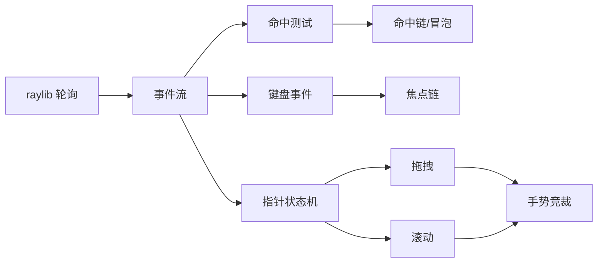

# 第五阶段导览：事件与交互

> [返回：GUI框架学习大纲](../GUI框架学习大纲.md)
> 能画不能点的界面只是幻灯片。本阶段把 raylib 的输入轮询转成事件流，做命中测试、指针状态机、焦点链与滚动——框架从「能看」变成「能用」。

## 分册索引

| 分册 | 对应大纲条目 | 一句话说明 | 状态 |
|---|---|---|---|
| 01-导览.md | — | 本页 | ✅ |
| 02-输入抽象.md | 1 | 轮询转事件流、时间戳与修饰键、逻辑坐标 | 待写 |
| 03-命中测试.md | 2 | 逆深度优先、命中链组装、吞噬与穿透 | 待写 |
| 04-指针状态机.md | 3 | hover/press/click/drag、双击长按、拖拽协议 | 待写 |
| 05-焦点系统.md | 4 | FocusScope/FocusNode、Tab 遍历、默认键处理 | 待写 |
| 06-滚动与手势.md | 5 | 视口/内容坐标、惯性与阻尼、滚动条、手势竞裁 | 待写 |

## 阶段目标

学完本阶段，你应该能不查资料做到：

- 把 raylib 的 `IsMouseButtonPressed` 式轮询改造成规范事件流，并解释轮询与回调两种模型的事件丢失差异
- 手写命中测试：逆深度优先遍历、自底向上组装命中链、不透明区吞噬事件
- 画出 hover → press → drag → release 的完整状态机，包括移动阈值如何区分点击与拖拽
- 实现焦点链与 Tab 遍历，说清树序遍历和视觉序遍历各自的问题
- 实现带惯性的滚动容器，解释视口坐标与内容坐标的换算

## 知识点地图

## 实践任务清单

1. 实现事件总线与命中测试；用 mock 事件序列（无头）断言命中链顺序与吞噬行为
2. 实现指针状态机：click / double-click / drag 三种手势的判定参数可配
3. 实现焦点链与 Tab 导航；焦点环渲染可见
4. 做出三件套：Button（含按压反馈）、可滚动列表（惯性）、键盘可导航网格（方向键 + Enter）

## 阶段自测

1. 事件从窗口到达具体控件要经过哪几步？哪一步决定「点到谁」？
2. 为什么命中测试要逆深度优先？命中链上父节点什么时候还能收到事件？
3. click 与 drag 的边界是什么参数？调大调小分别影响什么体验？
4. 焦点链为什么是树？Tab 顺序由树序决定有什么坑？
5. 惯性滚动的速度从哪来？阻尼衰减为什么用指数而不是线性？

## 常见误区与正解

下表五条误区共享同一个错误模式：把本该由系统层持有的状态下沉给单个控件，或者把跨时间、跨控件的关系压缩成局部变量。控件少的时候这些写法都能跑，界面一复杂，每一个都会变成难以定位的玄学缺陷。逐条对照自己已有的实现，比学新知识更值钱。

| 误区 | 为什么错 | 正解 |
|---|---|---|
| 命中测试从根到叶正序遍历，先访问到的先接事件 | 正序深度优先访问的是「先绘制」的兄弟，被盖住的控件反而先拿到事件；用户点的却是视觉上最上层那个，两者恰好相反 | 逆深度优先：先访问最后绘制的子树，命中即停；再自底向上组装命中链，见 [03-命中测试](03-命中测试.md) |
| 在控件内部自己计时判断双击 | 双击是两次点击之间的全局时间关系，控件各自计时会在指针快速移动时出现多个控件同时自认被双击，而且无法统一重置 | 双击归指针状态机统一判定：分发层记录上次点击的时间与坐标，新点击落在窗口内且位置接近才升级，见 [04-指针状态机](04-指针状态机.md) |
| 用全局单例记录「当前悬停的控件」 | 状态与控件解耦后，控件销毁时全局引用悬空；进入与离开被拆成两次独立处理，路径一多就漏清理，出现两个控件同时高亮 | 悬停是控件自身的槽位状态，进入与离开在同一帧内成对更新；分发层只负责找出新旧两个目标并触发状态转移 |
| 焦点顺序用数组手工维护 | 数组是视觉序的硬编码，控件增删、隐藏、滚动之后数组与真实树脱节，调试时两套真相互相矛盾 | 焦点链就是树：FocusScope 划定遍历边界，Tab 即树序遍历；树变了顺序自动跟着对，见 [05-焦点系统](05-焦点系统.md) |
| 滚动就是直接改内容的纵坐标 | 下一帧布局会把位置写回去，滚动随机丢失；子控件的世界坐标全部失真，命中测试与焦点联动跟着一起错 | 滚动偏移是视口坐标到内容坐标的换算参数：布局照常进行，绘制与命中时统一减去偏移，见 [06-滚动与手势](06-滚动与手势.md) |

## 术语速查表

交互术语在不同框架里叫法各异，指代的东西却高度收敛。本表按「点、按、拖、滚、切」的操作顺序排列，读分册遇到英文原词时按需检索。

| 术语 | 英文 | 一句话解释 |
|---|---|---|
| 命中测试 | hit testing | 从屏幕坐标反查「这一点属于哪个控件」的逆映射过程 |
| 命中链 | hit chain | 从最深命中节点到根的祖先序列，事件沿它自底向上冒泡 |
| 吞噬 | consume | 节点声明事件已处理完毕，冒泡到此为止；不透明区域默认吞噬 |
| 穿透 | pass-through | 吞噬的反面：节点自己处理完后放行事件，允许继续向祖先传播 |
| 指针捕获 | pointer capture | 按下之后把后续移动与抬起锁定给同一目标，指针移出边界也不丢 |
| 移动阈值 | touch slop | 区分点击与拖拽的最小位移，低于它算手抖，超过才升级为拖拽 |
| 双击窗口 | double-click window | 两次点击被合并为双击的最大时间间隔，属于系统级可配参数 |
| 焦点域 | FocusScope | 焦点遍历的封闭边界：Tab 在域内循环，域卸载时把焦点归还上层 |
| 焦点链 | focus chain | 从聚焦节点到根的焦点域序列，键盘事件沿它逐级路由 |
| 手势竞裁 | gesture arena | 多个手势候选同时认领同一指针序列，由统一裁决器判出唯一胜者 |
| 惯性滚动 | fling | 手指抬起后按瞬时速度继续滚动，速度采样自最近几次移动事件 |
| 阻尼衰减 | damping | 惯性速度的指数衰减模型；线性衰减会在归零前一帧急停，手感突兀 |

## 踩坑与排查速查

排查交互类缺陷的第一原则：先回答「事件到底给了谁」，再查「状态机停在哪一态」。顺序反了，往往在错误的层位上打补丁，越补越乱。下表按现象定位，处置栏给最小动作。

| 现象 | 可能原因 | 处置 |
|---|---|---|
| 点击控件毫无反应 | 上层存在透明但默认吞噬的区域；或命中测试误用正序遍历 | 打印命中链核对目标；把该区域的事件策略显式改为穿透 |
| 单击频繁被识别成双击 | 双击窗口过长，或两次点击的坐标容差过宽 | 收紧窗口与容差参数；确认超时重置逻辑确实被调度执行 |
| 拖拽一开始就误触发点击 | 状态机缺少移动阈值，移动事件一到达就进入拖拽分支 | 加阈值判定：位移超过阈值才升级拖拽，未超过则保持待定等待抬起 |
| 指针移出窗口后控件永远停在按压态 | 抬起事件丢失，状态机没有兜底转移路径 | 按下时登记指针捕获；窗口失焦或指针离界时强制合成抬起并复位 |
| Tab 一圈回不到起点，或跳到屏幕外的控件 | 焦点环没有闭合，或遍历没有过滤不可见与禁用的控件 | 检查焦点域环绕逻辑；遍历时过滤不可聚焦节点，必要时把目标滚动进视口 |
| 滚动列表时列表项里的按钮偶发误触 | 没有手势竞裁，滚动与按钮按压同时成立 | 把滚动容器注册为竞裁候选：滚动获胜时取消按钮的按压状态 |
| 惯性滚动突然急停 | 阻尼被写成线性衰减，速度一帧内跌穿零值 | 改为指数衰减，并按真实帧间隔换算时间步长，不要假设帧率恒定 |

这七类现象覆盖了本阶段实践任务里绝大多数的返工场景。共同规律是：现象出现在控件层，根因几乎都在分发层与状态机层——这正是本阶段反复强调「系统层持有状态」的原因。
