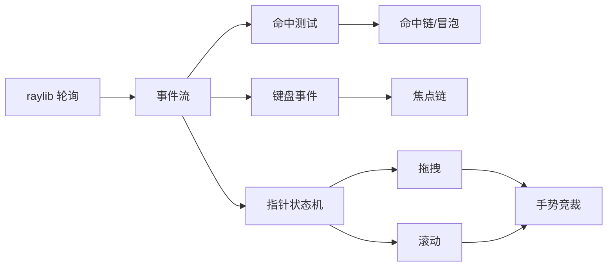

# 第五阶段导览：事件与交互

> [返回：GUI框架学习大纲](../GUI框架学习大纲.md)
> 能画不能点的界面只是幻灯片。本阶段把 raylib 的输入轮询转成事件流，做命中测试、指针状态机、焦点链与滚动——框架从「能看」变成「能用」。

## 分册索引

| 分册 | 对应大纲条目 | 一句话说明 | 状态 |
|---|---|---|---|
| 01-导览.md | — | 本页 | ✅ |
| 02-输入抽象.md | 1 | 轮询转事件流、时间戳与修饰键、逻辑坐标 | 待写 |
| 03-命中测试.md | 2 | 逆深度优先、命中链组装、吞噬与穿透 | 待写 |
| 04-指针状态机.md | 3 | hover/press/click/drag、双击长按、拖拽协议 | 待写 |
| 05-焦点系统.md | 4 | FocusScope/FocusNode、Tab 遍历、默认键处理 | 待写 |
| 06-滚动与手势.md | 5 | 视口/内容坐标、惯性与阻尼、滚动条、手势竞裁 | 待写 |

## 阶段目标

学完本阶段，你应该能不查资料做到：

- 把 raylib 的 `IsMouseButtonPressed` 式轮询改造成规范事件流，并解释轮询与回调两种模型的事件丢失差异
- 手写命中测试：逆深度优先遍历、自底向上组装命中链、不透明区吞噬事件
- 画出 hover → press → drag → release 的完整状态机，包括移动阈值如何区分点击与拖拽
- 实现焦点链与 Tab 遍历，说清树序遍历和视觉序遍历各自的问题
- 实现带惯性的滚动容器，解释视口坐标与内容坐标的换算

## 知识点地图

## 实践任务清单

1. 实现事件总线与命中测试；用 mock 事件序列（无头）断言命中链顺序与吞噬行为
2. 实现指针状态机：click / double-click / drag 三种手势的判定参数可配
3. 实现焦点链与 Tab 导航；焦点环渲染可见
4. 做出三件套：Button（含按压反馈）、可滚动列表（惯性）、键盘可导航网格（方向键 + Enter）

## 阶段自测

1. 事件从窗口到达具体控件要经过哪几步？哪一步决定「点到谁」？
2. 为什么命中测试要逆深度优先？命中链上父节点什么时候还能收到事件？
3. click 与 drag 的边界是什么参数？调大调小分别影响什么体验？
4. 焦点链为什么是树？Tab 顺序由树序决定有什么坑？
5. 惯性滚动的速度从哪来？阻尼衰减为什么用指数而不是线性？
