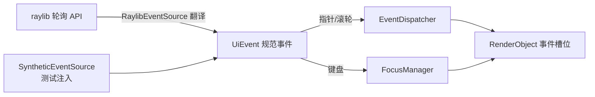

# 输入抽象：从轮询到事件流

> [返回：第五阶段导览](01-导览.md)
> 对应大纲条目：第五阶段 1。本册把 raylib 的输入轮询翻译成规范事件流：定义 `UiEvent` 三族值对象（`core/events/events.ts`，94 行），抽象出 `EventSource` 事件源接口，平台层 `RaylibEventSource`（`platform/raylib-events.ts`，67 行）负责逐条翻译规则，`RenderObject` 上的 12 个事件槽位是事件的落点——而这套槽位形态是被 ScriptC 0.0.35 的三条实测边界逼出来的。代码逐字摘自 labs 源码；测试输出来自本机实跑 `npx vitest run`（撰写时快照：全库 16 files / 136 tests 全绿，其中本阶段新增 events 12 + focus 5 + scroll 5 + interactive 7）。

## 1. 为什么要抽象：内核不该认识 raylib

第二阶段把绘制抽象成 `CommandSink`：内核只产出 `DrawCmd`，认识 raylib 的只有后端。输入侧面对称的问题：raylib 的输入是**轮询式**的——每帧主动问一次「鼠标现在在哪、这帧按没按键」，而事件分发、手势识别、焦点路由想要的是**事件流**：「发生了什么、何时发生、带什么修饰键」。

两种模型的差异不是风格偏好，是**丢失模式**不同（语义推论，未在窗口环境实测，但由 raylib 的边沿语义直接可推）：

| | 轮询（raylib） | 回调（浏览器/OS 事件） |
|---|---|---|
| 采样方式 | 每帧一次快照 | 每次变化推一条 |
| 帧内多次变化 | 折叠：`isMouseButtonPressed` 只告诉你「本帧内发生过按下」，一帧内按了两次也只见一条边沿；鼠标中间轨迹只剩最新坐标 | 每次都送达 |
| 丢失什么 | 帧内的高频变化 | 监听器注册之前发生的事 |
| 时间戳精度 | 帧粒度（`getTime()` 在轮询时取样） | 事件粒度 |

抽象层要做的就是把这个差异**关在平台层**：内核与控件只见规范事件，不见 `IsMouseButtonPressed`。对照绘制的做法——命令自包含让无头测试成为可能；事件规范化同理，`SyntheticEventSource` 让 vitest 里没有窗口也能重放任何输入序列。



键盘走另一条路（焦点路由）是刻意的：指针事件自带坐标，「点到谁」由命中测试回答；键盘事件没有位置，「给谁」由焦点系统回答（见《05-焦点系统》）。分流发生在 app 帧循环里（第 6 节）。

## 2. 规范事件类型：events.ts 全文走读

文件头注释先钉死定位（原文）：「规范化事件类型：平台层（raylib 轮询）翻译成这些值对象，内核与控件只见它们。」

### 2.1 相位与修饰键

```ts
export const PointerPhase = {
  down: 0,
  move: 1,
  up: 2,
} as const;
export type PointerPhaseValue = (typeof PointerPhase)[keyof typeof PointerPhase];

export const KeyPhase = {
  down: 0,
  up: 1,
  repeat: 2,
} as const;
export type KeyPhaseValue = (typeof KeyPhase)[keyof typeof KeyPhase];

export interface Modifiers {
  shift: boolean;
  ctrl: boolean;
  alt: boolean;
}
```

两个细节值得停下来看：

- `as const` + 索引类型把常量对象收敛成字面量联合（`PointerPhaseValue` 实际就是 `0 | 1 | 2`）。但实现与测试两侧比较相位时统一写**数字字面量加行内注释**（dispatcher.ts 里是 `ev.phase === 1 /* move */`）——`PointerPhase` 主要服务于类型层与读代码的人。这与第二阶段 Math 白名单的教训一脉相承：跨宿主（ScriptC 静态编译 / vitest）都要合法的代码，取最保守写法
- `KeyPhase` 定义了 `up` 与 `repeat`，但平台层本版**只发 down**——枚举先行、实现砍半，把「没做」显式留在类型里，好过悄悄没有

### 2.2 三族事件值对象

```ts
export interface PointerEvent {
  kind: "pointer";
  phase: PointerPhaseValue;
  /** 窗口逻辑坐标。 */
  x: number;
  y: number;
  button: number; // 0=左键
  time: number; // 秒（宿主时钟）
  modifiers: Modifiers;
}

export interface WheelEvent {
  kind: "wheel";
  x: number;
  y: number;
  /** 滚轮增量（行数为单位，向下为正）。 */
  dy: number;
  dx: number;
  time: number;
}

export interface KeyEvent {
  kind: "key";
  phase: KeyPhaseValue;
  /** 宿主键码（raylib KeyboardKey 数值）。 */
  code: number;
  time: number;
  modifiers: Modifiers;
}

export type UiEvent = PointerEvent | WheelEvent | KeyEvent;
```

逐字段读出约定：

| 字段 | 约定 | 谁依赖它 |
|---|---|---|
| `kind` | 判别联合的标签，dispatch 分流的依据 | `EventDispatcher.dispatch` 的 `if (ev.kind === "pointer")` |
| `x/y` | **窗口**逻辑坐标（不是某控件的局部坐标） | 命中测试负责从窗口坐标换算到链 |
| `time` | 秒，宿主时钟 | 双击窗口 0.3s 的间隔计算（`ev.time - this.lastClickTime`） |
| `button` | 0=左键；当前只有左键有事件源 | 手势层未分键处理 |
| `dy` | **行数为单位，向下为正** | 滚动换算 `dy * WHEEL_STEP_PX`（见《06》） |
| `code` | raylib KeyboardKey 数值（宿主键码，不是字符码） | `KEY_TAB = 258` 的比较 |

`time` 进事件是手势判定的地基：双击窗口、（将来的）长按计时都靠它，而不是靠「收到事件的时刻」——合成事件源里时间完全由测试指定（`pointerEvent(0, 100, 100, 1.2)` 的 1.2 就是 1.2 秒），无头测试因此可以精确卡窗口边界（0.15s < 0.3 与 0.95s > 0.3 两组用例）。

### 2.3 工厂函数与 NO_MODIFIERS

```ts
export const NO_MODIFIERS: Modifiers = { shift: false, ctrl: false, alt: false };

export function pointerEvent(phase: PointerPhaseValue, x: number, y: number, time: number, button = 0): PointerEvent {
  return { kind: "pointer", phase, x, y, button, time, modifiers: NO_MODIFIERS };
}

export function wheelEvent(x: number, y: number, dy: number, time: number): WheelEvent {
  return { x, y, dx: 0, dy, time, kind: "wheel" };
}

export function keyEvent(phase: KeyPhaseValue, code: number, time: number): KeyEvent {
  return { kind: "key", phase, code, time, modifiers: NO_MODIFIERS };
}
```

注意参数序：`pointerEvent` 是 **(phase, x, y, time)**、`wheelEvent` 是 **(x, y, dy, time)**——测试里 `pointerEvent(0, 260, 60, 1)` 表示 t=1s 在 (260,60) 按下；`wheelEvent(260, 60, 3, 1)` 表示同一点滚轮向下 3 行。三个工厂共享 `NO_MODIFIERS` 单例——省一次对象分配的代价是「处理里误改 modifiers 会污染全局」，本版接受（事件按不可变值对待是纪律，不是类型强制）。

## 3. EventSource 抽象与合成事件源

```ts
/** 事件源抽象：每帧把宿主输入轮询翻译成规范化事件（平台实现见 platform/raylib-events.ts）。 */
export abstract class EventSource {
  /** 取走自上次调用以来的全部事件（可为空数组）。 */
  abstract poll(): UiEvent[];
}

/** 测试用合成事件源：预置事件队列逐帧吐出。 */
export class SyntheticEventSource extends EventSource {
  private queue: UiEvent[];
  private cursor = 0;

  constructor(events: UiEvent[]) {
    super();
    this.queue = events;
  }

  poll(): UiEvent[] {
    const out: UiEvent[] = [];
    while (this.cursor < this.queue.length) {
      out.push(this.queue[this.cursor] as UiEvent);
      this.cursor += 1;
    }
    return out;
  }
}
```

接口只有一个方法：`poll()` 返回**自上次调用以来**的全部事件，可为空数组。语义细节：`SyntheticEventSource` 没有按帧切分的概念——第一次 `poll()` 把队列**一次吐完**，之后的 `poll()` 永远返回空数组。要让「一帧一条」的时序，得由测试自己分段构造多个源，或在两帧之间手动往队列外组织。这是刻意从简：本阶段的测试（events / focus / interactive）都直接 `dispatch` 单条事件，不经过帧循环；`SyntheticEventSource` 留给「想模拟真实帧节奏」的场景。

## 4. 平台层：RaylibEventSource 的四条翻译规则

文件头注释就是翻译规则表（原文）：

```ts
// raylib 事件源：把轮询 API 翻译成规范化 UiEvent。
// 轮询 → 边沿的翻译规则（第五阶段《02-输入抽象》）：
//   move    坐标变化即发（每帧最多一条）
//   down/up isMouseButtonPressed/Released 就是「本帧边沿」
//   wheel   getMouseWheelMove() != 0；raylib 正值 = 远离用户（上滚），协议 dy 向下为正 → 取负
//   key     getKeyPressed() 队列取到 0 为止（仅 down；up/repeat 本版不做，见分册取舍）
```

### 4.1 修饰键先行，move 用 NaN 初值做差分

```ts
export class RaylibEventSource extends EventSource {
  private lastX = Number.NaN;
  private lastY = Number.NaN;

  poll(): UiEvent[] {
    const out: UiEvent[] = [];
    const t = getTime();
    const mods = {
      shift: isKeyDown(KEY_LEFT_SHIFT) || isKeyDown(KEY_RIGHT_SHIFT),
      ctrl: isKeyDown(KEY_LEFT_CONTROL),
      alt: isKeyDown(KEY_LEFT_ALT),
    };

    const m = getMousePosition();
    if (m.x !== this.lastX || m.y !== this.lastY) {
      this.lastX = m.x;
      this.lastY = m.y;
      out.push({ kind: "pointer", phase: 1, x: m.x, y: m.y, button: 0, time: t, modifiers: mods });
    }
```

- **初值 NaN**：`NaN !== NaN` 恒真，所以第一帧无论鼠标在哪都必然发出第一条 move——用 `0` 当初值的话，鼠标恰好停在 (0,0) 时首条 move 会被吞，hover 初始化漏一步。这是 NaN 唯一「好用」的场景：不等于一切值，包括自己
- **move 是差分不是边沿**：坐标没变就不发。hover 差分（进/出判定）只需要位置变化驱动，静止鼠标不该每帧重算 hover
- **修饰键是轮询时刻的快照**：`isKeyDown` 在 `poll()` 里取样，所以「按下某键时 Shift 是否按着」的答案是帧粒度的——轮询模型的固有模糊，事件里的 `modifiers` 是采样值而非按键瞬间的历史值

### 4.2 down/up：边沿即事件

```ts
    if (isMouseButtonPressed(MOUSE_BUTTON_LEFT)) {
      out.push({ kind: "pointer", phase: 0, x: m.x, y: m.y, button: 0, time: t, modifiers: mods });
    }
    if (isMouseButtonReleased(MOUSE_BUTTON_LEFT)) {
      out.push({ kind: "pointer", phase: 2, x: m.x, y: m.y, button: 0, time: t, modifiers: mods });
    }
```

`isMouseButtonPressed/Released` 本身就是「本帧内发生过的边沿」，一一对应 down/up。注意 down、up、move 共用同一个坐标 `m` 与时间 `t`：同帧内 down 与 move 同时发生时，move 先入列（代码顺序），down 随后——顺序由 push 顺序决定，先 move 后 down。

### 4.3 wheel：方向翻译发生在这一行

```ts
    const wheel = getMouseWheelMove();
    if (wheel !== 0) {
      out.push({ kind: "wheel", x: m.x, y: m.y, dx: 0, dy: -wheel, time: t });
    }
```

raylib 的 `getMouseWheelMove()` 正值表示**远离用户**（上滚）；本框架协议 `dy` 向下为正——于是 `dy: -wheel`。这是整个输入侧唯一一处**符号翻译**，收在平台层一行；内核、滚动视口、测试全都按「向下为正」说话（`wheelEvent(260, 60, 3, 1)` 的 3 表示向下滚 3 行，scroll.test 里 `handleWheel(2)` 期望滚动 80px 而不是 -80px）。方向约定若在这里翻错，后面全部反向，且无头测试发现不了——合成事件源按协议说话，绕过了平台层。这类「平台层专属语义」只能靠窗口环境实测把关。

### 4.4 key：队列抽干 + guard 16

```ts
    // 键盘：本帧按下的键全部入列（0 = 空）
    let code = getKeyPressed();
    let guard = 0;
    while (code !== 0 && guard < 16) {
      const ev: KeyEvent = { kind: "key", phase: 0, code, time: t, modifiers: mods };
      out.push(ev);
      code = getKeyPressed();
      guard += 1;
    }
    return out;
  }
```

`getKeyPressed()` 是**队列**：每调一次弹出本帧按下的一个键，空了返回 0。循环抽到 0 为止；`guard < 16` 是防御性上限——万一宿主绑定异常导致永远不返回 0，最多取 16 个键而不是挂死帧循环。代价是「一帧按超过 16 个键」会被截断，物理上不可能，接受。**仅 down**：`getKeyReleased` 一类的 API 本版不接，`KeyPhase.up/repeat` 停留在枚举里（2.1 节）。

## 5. 事件槽位：ScriptC 三条边界逼出来的形态

事件要落到 `RenderObject` 上。直觉写法是 `node.onPointerDown = fn` 然后在分发器里 `node.onPointerDown(ev)`——这在纯 TS 里可行，但本项目要在 scriptc-raylib 锁定的 ScriptC 0.0.35 静态编译下也能过。`render-object.ts` 的头注释（原文）记录了三条实测边界：

```ts
/**
 * 第五阶段事件入口。
 * ScriptC 0.0.35 的三条实测边界决定了这里的形态（见《02-输入抽象》）：
 *   ① 类字段存函数不能直接调用 —— 所以入口做成「转发方法」（虚分发），方法体里调字段
 *   ② 可选字段（?: | undefined）的函数值没有静态表示 —— 字段一律「可空（null）」而非可选
 *   ③ 可空（null）函数字段 + 调用完全可用（probe8 实测）—— 每个事件一个独立槽位
 * 每实例行为：setOnClick/setOnKey/... 注入闭包；子类要定制则直接覆写 onXxx 方法。
 */
```

配合 probe 实测的报错信息（三条边界对应的具体报错）：

| 边界 | 报错（probe 实测） | 结论 |
|---|---|---|
| ① 类字段存函数直接调用 | SC1090：`method calls like node.onPointerDown is not supported yet` | 字段调用不行，但**虚方法分发可用** → 入口做成方法 |
| ② 可选字段 `?: T \| undefined` 存函数值 | SC2011：没有静态表示 | 字段类型一律「`T \| null`」 |
| ③ 可空（null）函数字段 + 调用 | probe8 实测：完全可用 | 每事件一个独立槽位成立 |
| 另：覆写方法 | SC1090：`overriding a method with a different signature` | 覆写签名必须与基类**严格一致**（参数个数、类型都一样） |

于是槽位区长这样（`render-object.ts`，摘录前 6 个槽位与 2 个转发方法，裁剪自 12 个同构成员）：

```ts
  // ---- 事件槽位（null = 无处理器；类型必须可空而非可选）----
  private fnPointerDown: ((ev: PointerEvent) => void) | null = null;
  private fnPointerMove: ((ev: PointerEvent) => void) | null = null;
  private fnPointerUp: ((ev: PointerEvent) => void) | null = null;
  private fnPointerEnter: ((ev: PointerEvent) => void) | null = null;
  private fnPointerLeave: ((ev: PointerEvent) => void) | null = null;
  private fnWheel: ((ev: WheelEvent) => boolean) | null = null;
  // ……fnClick / fnDoubleClick / fnDragStart / fnDragUpdate / fnDragEnd / fnKey 同构……

  setOnPointerDown(fn: ((ev: PointerEvent) => void) | null): void { this.fnPointerDown = fn; }
  setOnPointerMove(fn: ((ev: PointerEvent) => void) | null): void { this.fnPointerMove = fn; }
  // ……共 12 个 setOnXxx……

  onPointerDown(ev: PointerEvent): void {
    const fn = this.fnPointerDown;
    if (fn !== null) fn(ev);
  }

  /** 滚轮：返回 true = 已处理（嵌套滚动由内层先吞）。 */
  onWheel(ev: WheelEvent): boolean {
    const fn = this.fnWheel;
    if (fn !== null) return fn(ev);
    return false;
  }
```

数一下：**12 个槽位**（PointerDown/Move/Up/Enter/Leave、Wheel、Click、DoubleClick、DragStart/DragUpdate/DragEnd、Key）、**12 个 setOnXxx**、**12 个 onXxx 转发方法**。转发方法是关键：分发器只调方法（虚分发，ScriptC 可用），方法体里把字段取出判空调用（③实测可行）。`setOnClick(null)` 可以卸载处理器——参数类型带 `| null`。

两个返回 boolean 的槽位（`onWheel`/`onKey`）是**消费信号**：滚轮「已处理」止住链上后续节点（嵌套滚动内层先吞），键盘「已处理」止住冒泡（见《05》）。其余 10 个是纯通知。

### 5.1 两种定制路径：注入闭包 vs 覆写方法

同一条边界之上长出两种用法，`interactive-scene.ts` 的 `RenderButton` 是「覆写」派的现场（原文摘录）：

```ts
  // 视觉状态：直接覆写事件方法（虚分发），签名与基类严格一致
  onPointerEnter(_ev: PointerEvent): void {
    this.hovered = true;
  }
  onPointerLeave(_ev: PointerEvent): void {
    this.hovered = false;
    this.pressed = false;
  }
```

而它的点击计数走「注入」派：构造函数里 `this.setOnClick((_ev: PointerEvent) => onClick())`。分工的直觉：**视觉状态是类的固有行为，覆写**（一处定义、每个实例共享、还能再被继承）；**每次组装不同的回调，注入**（buildInteractiveScene 里三个按钮各带各的计数闭包）。注意覆写会**遮蔽**槽位转发——RenderButton 覆写 `onPointerEnter` 后不再检查 `fnPointerEnter` 槽位；覆写者若想兼容注入路径，得自己调 `super` 或再取槽位，本版没做这个组合（覆写即全权接管）。

## 6. 帧循环的接线：05-events.ts 的输入段

事件源、分发器、焦点管理器在 app 里装配（`apps/05-events.ts` 摘录）：

```ts
const events = new RaylibEventSource();
const dispatcher = new EventDispatcher();
dispatcher.gestures = new GestureController();
const focus = new FocusManager();

const scene = buildInteractiveScene(measurer, 16, { width: WIDTH, height: HEIGHT });
dispatcher.mount(scene.root);
focus.mount(scene.root);
```

每帧的输入段（原文）：

```ts
  // ---- 1. 输入轮询 → 规范事件 → 分发（指针/滚轮）或焦点路由（键盘）----
  for (const ev of events.poll()) {
    if (ev.kind === "key") {
      focus.dispatchKey(ev);
    } else {
      dispatcher.dispatch(ev);
    }
  }
  scene.scroll.update(dt); // 惯性推进
```

`kind` 分流就发生在这四行：键盘进 `FocusManager.dispatchKey`（返回是否有人处理，demo 忽略返回值），其余进 `EventDispatcher.dispatch`（其内部再按 pointer/wheel 分流，key 压根不进——dispatcher.ts 里写着 `// key 事件不走这里（焦点系统负责，见 focus.ts）`）。`scroll.update(dt)` 紧随其后：滚轮事件在 dispatch 里只改 scrollY 与初速，惯性衰减按帧推进（见《06》）。

对照平台层的另外两位成员：`RaylibMeasurer`（`raylib-measurer.ts`，39 行）把 `measureTextEx` 翻译成 `TextMeasurer` 缓存协议，`RaylibBackend` 把 `DrawCmd` 翻译成 raylib 调用——加上本册的 `RaylibEventSource`，平台适配层三件套齐了，各自只做「宿主 API ↔ 规范内核」的翻译，互不知晓。

## 7. 测试解读：协议被谁锁死

本册的协议（字段、方向、相位语义）大多被下游测试间接锁定。`events.test.ts`（12 用例）里与本册直接相关的两处：

**① dy 语义「向下为正」**——wheel 吞噬用例把 `dy=3` 原样送进链：

```ts
  it("wheel 被链上第一个 onWheel 吞掉", () => {
    const { root, inner } = setup();
    const got: number[] = [];
    inner.setOnWheel((ev) => { got.push(ev.dy); return true; });
    root.setOnWheel(() => { got.push(999); return true; }); // 不该收到
    const d = new EventDispatcher();
    d.mount(root);
    d.dispatch(wheelEvent(260, 60, 3, 1));
    expect(got).toEqual([3]);
  });
```

`got` 收到 `[3]`：dy 不经分发器变换、原值送达最深处理器（方向翻译只该发生在平台层，这行断言守住了职责边界）。`999` 是哨兵——root 若收到事件会污染 `got`，断言立刻失败。

**② time 语义**——手势用例全部用显式时间戳卡窗口边界：`pointerEvent(2, 100, 100, 1.05)` 与下一次按下 `1.2` 相差 0.15s < 0.3s 判双击；`2.05` 与 `1.05` 相差 0.95s > 0.3s 判两次普通点击（详见《04》第 8 节）。时间进事件的收益在这里兑现：无头、无钟、确定性。

此外 `interactive-scene.test.ts` 的 rig 里 `new GestureController()` 挂上 dispatcher、`FocusManager.mount(root)`——三个新组件的装配方式与 app 帧循环同构，这是「测试装配即生产装配」的又一例。

## 8. 常见误区

- **「轮询比回调低级，能换就换」**——不是档次问题，是**丢失模式**的选择。轮询丢帧内高频变化（两帧间的第二击、鼠标中间轨迹），回调丢注册前发生的事。窗口游戏循环里轮询与帧同步天然合拍；浏览器回调模型反而要自己解决「事件到了但帧还没画」的批处理
- **「move 每帧都发，反正便宜」**——差分掉静止帧不只是省事件：hover 差分以 move 为驱动，静止鼠标若每帧触发，`updateHover` 会反复对同一条链做集合比对，白算
- **「dy 的方向在每个用到的地方判一下」**——方向翻译必须只存在于平台层一处（`dy: -wheel`）。使用侧见到的任何符号分支都是这行丢失的征兆
- **「初值给 0，鼠标在 (0,0) 是小概率」**——(0,0) 恰是窗口左上角，鼠标进入窗口前 raylib 报告的位置可能就是它。NaN 初值一行成本消灭整类 bug
- **「guard 16 是随便选的」**——它是「物理上不可能被触发」的防御上限：一帧 16 个键按下不现实，但宿主绑定异常导致 `getKeyPressed()` 永不返回 0 时，没有 guard 帧循环直接挂死。防御值的原则是「永不生效，生效即救命」
- **「事件槽位用 `?: T | undefined` 更 TS 惯例」**——SC2011 实测编不过：可选字段的函数值没有静态表示。可空 `| null` 是被边界选中的形态，不是风格偏好
- **「覆写 onPointerDown 时顺手加个参数」**——SC1090：覆写方法签名不同直接编不过。基类签名就是协议，12 个 onXxx 的签名一个都不能动
- **「KeyEvent 做了 up/repeat，枚举里有」**——枚举里有，平台层没接：`getKeyPressed` 队列只吐按下。读类型声明判断功能存在与否会被 `KeyPhase` 骗到，看 RaylibEventSource 才算数

## 9. 与其他框架的对照（概念对照，非本机实测）

| 维度 | mini-gui | W3C Pointer Events / DOM | Flutter |
|---|---|---|---|
| 事件源模型 | 每帧轮询翻译 | OS 回调 → 浏览器排队成 task 派发 | engine 每帧打包 PointerDataPacket |
| 指针身份 | 单指针（button=0 左键） | `pointerId` 区分多点 | 每根手指一个 Pointer 带独立 Down 事件 |
| 相位 | `phase: 0/1/2` | pointerdown/move/up + **pointercancel** | down/move/up + cancel/hover |
| 滚轮方向 | dy 行数、向下为正 | `deltaY` 正=向下（同约定）；`deltaMode` 分 pixel/line/page | `PointerScrollEvent.scrollDelta`（物理像素） |
| 键码 | raylib 键码数值 | `code`（物理键 `KeyA`）+ `key`（字符） | `LogicalKeyboardKey` |
| 修饰键 | `Modifiers` 值对象 | 事件上的 `shiftKey/ctrlKey/altKey` 布尔 | `HardwareKeyboard` 按下的集合 |
| 取消语义 | 无 | pointercancel（系统手势抢走） | cancel 事件 + 竞技场判负 |

三点观察：其一，mini-gui 的 dy 约定与 DOM `deltaY` 一致（向下为正），与 raylib 相反——**跟随更大生态的约定、在平台层付一次翻译成本**是通用策略。其二，W3C 有 `pointercancel`、Flutter 有 cancel，都是「系统级手势（滚动接管、通知下拉）抢走指针」的出口；mini-gui 单应用独占窗口，没有系统手势竞争，取消相位暂时缺席是合理的省略，但接多触摸时要补。其三，DOM 的 `code`/`key` 二分（物理键 vs 字符）服务输入法与布局；mini-gui 只做键码、不做文本输入（IME 是第九阶段之后的命题），`KeyEvent.code` 的裸数值够用。

## 10. 本册小结

- 规范事件三族（Pointer/Wheel/Key）+ 判别联合 UiEvent；`time`/`dy`/`kind` 三个字段分别支撑手势计时、方向协议、分发分流
- 轮询→事件的四条翻译规则：move 差分（NaN 初值保首条）、down/up 边沿直映、wheel 取负（唯一符号翻译，收在平台层一行）、key 队列抽干 + guard 16
- 修饰键是轮询时刻快照，帧粒度模糊是模型固有属性
- 事件槽位形态由 ScriptC 三条实测边界决定：转发方法（SC1090 字段调用不可用）+ 可空 null（SC2011 可选字段无静态表示）+ 12 槽位 ×（fnXxx / setOnXxx / onXxx）；覆写签名必须严格一致
- 定制双路径：视觉状态覆写 onXxx（RenderButton），组装期回调注入 setOnXxx（计数闭包）；覆写即全权接管
- 键盘走焦点路由、指针走命中分发，分流在帧循环用 `ev.kind` 完成；平台层三件套（EventSource/Measurer/Backend）同构

## 自测

1. 轮询与回调两种模型各丢什么事件？各举一个 mini-gui 里会真实发生的例子（提示：帧内二连击；窗口创建前的移动）。
2. `RaylibEventSource` 的 `lastX/lastY` 为什么初始化成 `Number.NaN` 而不是 0？改成 0 会引入什么 bug，触发条件是什么？
3. raylib 的 `getMouseWheelMove()` 上滚返回正数，本框架 `dy` 向下为正——翻译发生在哪一行？把翻译挪进 `RenderScrollView.handleWheel` 要付出什么代价？
4. `pointerEvent` 与 `wheelEvent` 的参数顺序分别是什么？`wheelEvent(260, 60, 3, 1)` 的四个值各表示什么？
5. 推算：60fps 下，用户在两帧之间完整地「按下→抬起→按下→抬转」（四次动作都在同一帧窗口内完成），`RaylibEventSource.poll()` 这一次会返回几条事件、相位各是什么？手势层会识别出几次 click？
6. ScriptC 三条边界各是什么报错？它们分别把事件入口的哪个设计决策钉死了？
7. 为什么 `onWheel` 与 `onKey` 返回 boolean 而其他 10 个槽位返回 void？两个布尔各止住什么？
8. `KeyPhase` 枚举里有 `up` 和 `repeat`，能说本版支持按键抬起事件吗？判断功能是否实现，应该读哪个文件？
9. `SyntheticEventSource` 构造时传入 8 条事件，第一次 `poll()` 返回几条？第二次呢？想让测试模拟「一帧一事件」的节奏，应该怎么做？
10. `RenderButton` 覆写了 `onPointerEnter` 之后，`setOnPointerEnter(fn)` 注入的闭包还会被调用吗？为什么？如果想让两者共存，覆写者缺了什么？
