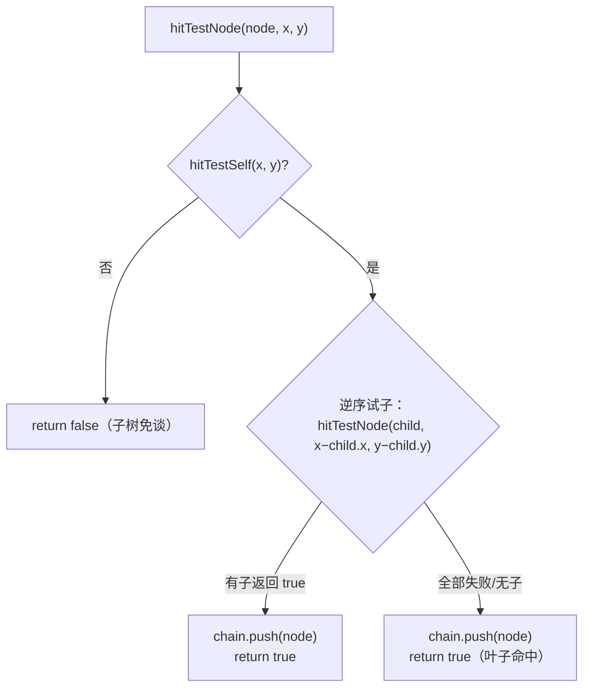

# 命中测试：从窗口坐标到命中链

> [返回：第五阶段导览](01-导览.md)
> 对应大纲条目：第五阶段 2。指针事件自带窗口坐标，但「点到谁」要靠命中测试回答：把 (x, y) 翻译成一条「从最深的被命中节点到根」的链，后续的冒泡、hover、手势全都以这条链为底座；链上「第一个返回 true 的处理器吞掉事件」与 `hitTestSelf` 的自定义覆写，分别给出吞噬与穿透的口子。本册走读 `core/events/hit-test.ts`（42 行）全文、`render-object.ts` 上的 `hitTestSelf`，以及 `events.test.ts` 的命中用例与它踩过的 rig 坑。代码逐字摘自 labs 源码；测试输出来自本机实跑 `npx vitest run`（撰写时快照：全库 16 files / 136 tests 全绿，其中 events 12 用例含命中 4 条）。

## 1. 命中测试回答什么问题

上一册结束时，事件流已经把 `PointerEvent{x: 260, y: 60, phase: down}` 送到分发器门口。分发器下一步必须回答：**这个点落在哪棵子树的哪个节点上？** 答案不是单个节点——点击按钮时，按钮的父容器（面板）、祖父（根）往往也要知道这事儿（面板要画按压涟漪、根要统计点击）。所以命中测试的产物是一条**链**：

```text
窗口坐标 (260, 60)
      │ hitTest(root, 260, 60)
      ▼
chain = [inner, b, root]     ← 从最深到根，数组序即冒泡序
```

链的顺序约定是全阶段最重要的一条：**index 0 是最深的被命中节点（最具体的目标），最后一个元素是根（最泛化的容器）**。分发器沿这个顺序派发（自底向上 = 冒泡），手势层只认 `chain[0]`（点击属于最具体的目标），滚轮沿链找第一个肯负责的节点（第 7 节）。

为什么「后画的在上」要求**逆序**试子？因为本框架的绘制序就是 `children` 数组序（`paintChildren` 正序遍历，第四阶段已见）——数组后面的子后画、画在上面。命中时若正序试子，前面的兄弟会先命中，点在重叠区会命中**被盖住**的那个。逆序试子 = 从最上层往下找。

## 2. hit-test.ts 全文走读

文件不长，全文逐字摘录：

```ts
// 命中测试：把窗口坐标翻译成「从最深的被命中节点到根」的链。
// 遍历规则：后画的在上（子序 = 绘制序），所以子按逆序试探；命中链自底向上组装。
import type { RenderObject } from "../render/render-object";

export interface HitResult {
  /** 从最深的被命中节点到根。空数组 = 谁都没命中。 */
  chain: RenderObject[];
}

export function hitTest(root: RenderObject, x: number, y: number): HitResult {
  const chain: RenderObject[] = [];
  hitTestNode(root, x, y, chain);
  return { chain };
}

/** 返回 node（或其子树）是否命中；命中时把链自底向上写入 chain。 */
function hitTestNode(node: RenderObject, x: number, y: number, chain: RenderObject[]): boolean {
  // 先问自己：不在自己盒子里，子树免谈（默认 hitTestSelf 是矩形）
  if (!node.hitTestSelf(x, y)) return false;

  // 逆序试子（局部坐标减去自己的偏移；子的 x/y 是相对父的）
  for (let i = node.children.length - 1; i >= 0; i--) {
    const child = node.children[i];
    if (child === undefined) continue;
    if (hitTestNode(child, x - child.x, y - child.y, chain)) {
      chain.push(node);
      return true;
    }
  }

  // 子没命中：自己是叶子命中（深度优先，链上先放自己）
  chain.push(node);
  return true;
}

/** 链上离根最近（最浅）的实现了某谓词的节点。 */
export function firstInChain(chain: RenderObject[], pred: (n: RenderObject) => boolean): RenderObject | null {
  for (const node of chain) {
    if (pred(node)) return node;
  }
  return null;
}
```

二十几行里有四个值得逐条拆开的决策。

### 2.1 先剪枝，再下潜

```ts
  if (!node.hitTestSelf(x, y)) return false;
```

入口第一句先问「点在不在**我自己**的盒子里」。不在，整棵子树免谈——子节点不可能画出自己的盒子（本框架没有溢出命中的语义）。这一句把搜索剪成了「只沿一条路径下潜」：命中路径长度 = 链长，路径外的节点最多被试探一次 `hitTestSelf` 即被剪掉。

### 2.2 坐标递归：每层减去子的偏移

```ts
    if (hitTestNode(child, x - child.x, y - child.y, chain)) {
```

子的 `x/y` 是**相对父**的（「位置归父协议」：布局时父给子赋 x/y）。所以每下潜一层，就把当前坐标减去子的偏移，换成子的局部坐标；`hitTestSelf` 永远在「(0,0) 是自己左上角」的局部系里判断。这个减法与滚动视口的配合是本阶段最漂亮的一处复用：滚动只是把内容子摆到 `y = -scrollY`（见《06》），命中测试照常减偏移，同一窗口点自动命中滚动后的正确行——滚动不需要通知命中系统任何事情。

### 2.3 链的组装：自底向上，push 在回溯路上

命中时链怎么长出来？看两条路径：

- **子命中**：递归调用已经把更深的节点写进 `chain`（deepest 最先 push），当前节点在递归返回后 `chain.push(node)`——**回溯时补自己**，于是链自动变成 `[最深, ..., 自己]`
- **无子命中**：自己是叶子命中，`chain.push(node)` 先放自己，之后各层祖先依次在回溯中补上

两条路径共用一个不变式：**`hitTestNode` 返回 true 时，本次调用向 `chain` 追加的一段以最深节点开头、以 `node` 结尾**。`hitTest` 最后返回的整条链自然满足「最深在 index 0、根在末尾」。

### 2.4 firstInChain：预留的谓词查找

```ts
/** 链上离根最近（最浅）的实现了某谓词的节点。 */
export function firstInChain(chain: RenderObject[], pred: (n: RenderObject) => boolean): RenderObject | null {
```

按数组序（最深在前）返回第一个满足谓词的节点——注意与注释措辞的出入：沿链数组序找到的第一个其实是**最深**的满足者，「离根最近（最浅）」要逆序遍历才对。该函数当前**没有调用方**（分发器找滚动容器是直接 for 循环链），属于预留工具；引用它之前先想清楚要最深还是最浅，或者把名字改成 `deepestInChain` 再用。注释与实现打架时，实现说了算。

## 3. 逐层追踪：一次命中测试的完整执行

拿测试树的 (260, 60) 走一遍全过程（几何见第 5 节的图）：

| 步骤 | 节点 | 收到的局部坐标 | hitTestSelf | 逆序试子 | 此刻 chain |
|---|---|---|---|---|---|
| 1 | root | (260, 60) | ✓（在 400×300 内） | 先试 b | `[]` |
| 2 | b | (260−200, 60−0) = (60, 60) | ✓（在 200×100 内） | 试 inner | `[]` |
| 3 | inner | (60−50, 60−50) = (10, 10) | ✓（在 60×40 内） | 无子，push 自己 | `[inner]` |
| 4 | 回溯到 b | — | — | inner 返回 true，push 自己 | `[inner, b]` |
| 5 | 回溯到 root | — | — | b 返回 true，push 自己 | `[inner, b, root]` |

三个观察：坐标每层减一次偏移，到 inner 手里已经是纯局部坐标 (10,10)；`hitTestSelf` 共被调 3 次（root、b、inner 各一次），a 完全没被碰（root 逆序先试 b，b 命中即返回）；push 全部发生在递归**返回之后**（步骤 3 的 push 是叶子分支、步骤 4/5 是回溯分支），这就是「链自底向上」的机制本体。

决策流程画成图：



注意 E 与 F 的对称：无论命中发生在子树还是自己，**本节点都要入链**——链上的祖先身份与「谁是直接命中者」无关。

## 4. hitTestSelf：半开区间与自定义命中的口子

`hitTestSelf` 定义在 `RenderObject` 上（原文）：

```ts
  /** 自身是否命中（局部坐标）。默认覆盖自己的盒子；非矩形控件覆盖此方法。 */
  hitTestSelf(x: number, y: number): boolean {
    return x >= 0 && x < this.width && y >= 0 && y < this.height;
  }
```

四边比较就是第二阶段钉死的**半开区间**命中：`[0, width) × [0, height)`，右边界与下边界不算命中。相邻两个控件共享一条边界线时，边界点唯一归属后者：

```text
      0                   199 200                   399
      ├────────── a ─────────┤◄─┼─┬────────── b ─────────┤
                              │ │
                     (199,10) ✓a  (200,10) ✓b
                     x<200 命中 a   x≥200 命中 b（a 的右边界不含）
```

如果改用闭区间（右边 `<=`），(200, 10) 会同时命中 a 与 b——「点击落点唯一归属一个控件」当场破产。这四行比较与第二阶段 `rectContains` 是同一条约定在两处的落点（一处几何纯函数、一处渲染树虚方法）。

更重要的是这个方法是 **public 且可覆写**的——非矩形控件的口子。三种典型覆写（示意写法，非 labs 现有代码）：

```ts
// 圆形按钮：到圆心的距离比较（平方比较免开方，与手势阈值同技巧）
hitTestSelf(x: number, y: number): boolean {
  const dx = x - this.width / 2;
  const dy = y - this.height / 2;
  const r = this.width / 2;
  return dx * dx + dy * dy <= r * r;
}

// 挖洞：中间 20px 方形区域点穿，其余照常
hitTestSelf(x: number, y: number): boolean {
  const inHole = x > 20 && x < 40 && y > 20 && y < 40;
  return !inHole && x >= 0 && x < this.width && y >= 0 && y < this.height;
}

// 透明像素穿透：读位图 alpha（需要度量/像素访问支持，第八阶段以后的事）
```

穿透之所以「免费」：`hitTestSelf` 返回 false 后，父级的逆序循环会继续试**下一个兄弟**，事件自然落到被盖住的控件上——不需要任何额外的穿透机制，只要肯在自测时说谎。它与事件槽位（`onPointerDown` 可覆写）是同一套虚分发机制：**形状是行为的一部分，行为走虚方法**。

## 5. 测试树：FixedBox rig 与三个真实踩坑

`events.test.ts` 的测试树不走布局协议，直接指定几何（原文）：

```ts
/** 布局一棵测试树：直接给各节点指定几何（不跑协议，事件系统只读 x/y/width/height）。 */
class FixedBox extends RenderObject {
  constructor(x: number, y: number, w: number, h: number) {
    super();
    this.x = x;
    this.y = y;
    this.width = w;
    this.height = h;
  }
  protected performLayout(_c: import("../render/constraints").BoxConstraints): void {
    // 测试不跑布局
  }
}

function setup(): { root: FixedBox; a: FixedBox; b: FixedBox; inner: FixedBox } {
  // 根比子大：下半部分（y>100）是空白，专测「只命中根」
  const root = new FixedBox(0, 0, 400, 300);
  const a = new FixedBox(0, 0, 200, 100);
  const b = new FixedBox(200, 0, 200, 100);
  const inner = new FixedBox(50, 50, 60, 40); // 相对 b：(250,50)~(310,90) 绝对
  root.appendChild(a);
  root.appendChild(b);
  b.appendChild(inner);
  return { root, a, b, inner };
}
```

画成图：

```text
root (0,0,400,300)
├── a (0,0,200,100)          绝对 [0,200) × [0,100)
└── b (200,0,200,100)        绝对 [200,400) × [0,100)
    └── inner 相对 b(50,50,60,40)   绝对 [250,310) × [50,90)

       0         100  150   200        250   310      400
       ┌──────────┬────┬───┼───────────┬──────┬───────┐
       │     a          │ │      b     │inner │       │ 0
       │                │ │            │      │       │
       │   (199,10)✓a   │ │(200,10)✓b  │(260,60)✓inner
       └────────────────┴─┴────────────┴──────┴───────┘ 100
       │                空 白（只命中 root）            │
       └────────────────────────────────────────────────┘ 300
```

这个 rig 沉淀了三个真实踩过的坑：

**坑一：不跑布局时 `RenderBox` 的 width/height 是 0**。手势用例的 rig 用了真 `RenderBox`，必须手动就位尺寸（原文注释）：

```ts
    const box = new RenderBox(400, 300, rgba(1, 1, 1));
    box.width = 400; box.height = 300; // 命中读真实尺寸；不跑布局需手动就位
```

`RenderBox` 的构造参数只是「期望尺寸」，真正的 `width/height` 在 `performLayout` 里由 `setSize` 写入——不跑布局就保持基类初值 0，半开区间 `[0,0)` 是空集，**命中全空、一条用例都过不了**。症状极具迷惑性：测试树挂得好好的，事件一个都不来。

**坑二：挂子必须走 `appendChild`，不能 `children.push`**。曾有一版 setup 直接操作数组，挂错了父子关系——`inner.parent` 指向 b，`inner` 却被 push 进 `root.children`。后果是命中链缺层：`hitTestNode` 沿 `root.children` 找不到 inner（它在 root 的直接子里按相对坐标 (50,50) 试探，绝对区域完全对不上），点 inner 的真实区域只能止于 b，链短一层。`appendChild` 一个方法同时维护两头的引用（`children.push` + `child.parent` 赋值 + owner 递归 + 标脏），绕过它就是手工制造「指针与数组不一致」。

**坑三：根要比子大，留空白区**。setup 注释写着「下半部分（y>100）是空白，专测『只命中根』」——没有空白区，「只命中根」这个退化分支永远测不到。构造测试树时主动留出每种深度的命中区域（深层 inner、中层 b/a、浅层根、空白），四条用例才有各自的猎物。

## 6. 测试解读：四个命中用例

`events.test.ts` 的「命中测试」describe 共 4 条（本机实跑全绿）：

| it | 关键断言 | 防什么错 |
|---|---|---|
| 命中链自底向上：inner → b → root | `hitTest(root, 260, 60).chain` `toEqual([inner, b, root])` | 链序反了（根在前）会让冒泡顺序整个倒置 |
| 后画的在上：inner 区域不命中 b 的「直接子」顺序问题不存在（链上 inner 优先） | `hitTest(root, 300, 80).chain[0]` `toBeDefined()` | 逆序试子被写成正序时，重叠区命中错误目标 |
| 边界半开：x=200 属于 b 不属于 a | `hitTest(root, 200, 10).chain` `toEqual([b, root])`；`hitTest(root, 199, 10).chain` `toEqual([a, root])` | 半开区间退化成闭区间，共享边界双命中 |
| 空白处命中整窗根 | `hitTest(root, 10, 250).chain` `toEqual([root])` | 根未入链（链只装非根节点）或空白误报 |

逐条手算验证（用第 5 节的几何）：

**① (260, 60)**：完整追踪见第 3 节的表 → `[inner, b, root]` ✓

**② (300, 80)**：inner 局部坐标 (50, 30)，仍在 [0,60)×[0,40) 内 → 链首是 inner ✓（该用例同时覆盖了「inner 右下角附近不会提前止于 b」）

**③ (200, 10)**：逆序先试 b（局部 0,10 → 命中）→ `[b, root]`；**(199, 10)**：b 的局部坐标 199−200=−1 < 0 不命中，回退试 a（局部 199,10 → 命中）→ `[a, root]`。x=200 这条竖线恰是 a 的右边界（不含）与 b 的左边界（含）——一个点、两个断言，把半开区间的「归属唯一」钉死

**④ (10, 250)**：a/b 都在 y<100，自测即失败，链上只有 root ✓

## 7. 链的第一次应用：wheel 的吞噬

大纲条目里「吞噬」的现场不在命中测试本身，而在分发器对链的消费方式上——最典型的是滚轮（`dispatcher.ts` 的 `dispatchWheel`，原文）：

```ts
  private dispatchWheel(ev: WheelEvent): void {
    const chain = hitTest(this.root as RenderObject, ev.x, ev.y).chain;
    for (const node of chain) {
      if (node.onWheel(ev)) {
        return; // 被第一个处理器吞掉（嵌套滚动由内层先处理）
      }
    }
  }
```

沿链（最深在前）逐个问 `onWheel`，第一个返回 true 的吞掉并返回——嵌套滚动场景里内层列表先于外层面板收到滚轮，内层说「我处理了」（返回 true），外层就不动。没有处理器的节点（`onWheel` 基类实现返回 false）自动放行，事件继续往上找。测试把它连同哨兵一起钉死（原文）：

```ts
  it("wheel 被链上第一个 onWheel 吞掉", () => {
    const { root, inner } = setup();
    const got: number[] = [];
    inner.setOnWheel((ev) => { got.push(ev.dy); return true; });
    root.setOnWheel(() => { got.push(999); return true; }); // 不该收到
    const d = new EventDispatcher();
    d.mount(root);
    d.dispatch(wheelEvent(260, 60, 3, 1));
    expect(got).toEqual([3]);
  });
```

`999` 是哨兵值：root 若收到事件会把 999 混进 `got`，`toEqual([3])` 立刻失败。「吞噬」在这条用例里是**可观测的行为**（root 的处理器没跑），不是注释里的愿望。对照指针事件的策略差异：`onPointerDown` 全链每节点都收（冒泡通知），`onWheel` 链上第一个认领者独享（吞噬消费）——同为「沿链派发」，通知模型与消费模型的分野就在返回值语义上。

## 8. 命中的成本与调用时机

命中测试在分发器里被调用的频率值得心里有数。按事件类型数一遍（`dispatcher.ts` 的分发路径，《04》详读）：

| 事件 | hitTest 次数 | 备注 |
|---|---|---|
| pointer down | 1 | 结果存入 `pressChain`，捕获期复用 |
| pointer move（无按压） | 1 | 驱动 hover 差分 + 派发 |
| pointer move（按压捕获期） | **0** | 直接复用 `pressChain` |
| pointer up | 2 | 一次取捕获链（或现测），一次重测用于 hover 更新 |
| wheel | 1 | 找吞噬者 |

每次的成本是「一条路径 + 路径上被试探的兄弟」级别的矩形比较：第 3 节的例子里一共 3 次 `hitTestSelf`、0 次失败；一般地，命中路径深度 d、每层平均试探 s 个兄弟时约 `O(d·s)` 次比较，而逆序第一个命中即返回，s 通常只有 1~2。

不做命中缓存的理由：命中输入是连续坐标（鼠标每动一格结果可能变），缓存命中率低；而树在布局稳定后不变、坐标比较又极便宜——缓存省不下什么，还得管失效。第六阶段如果做「指针静止时跳过重算」的优化，入口在分发器的 move 差分（平台层已经把静止 move 滤掉了，《02》4.1 节），而不是命中结果缓存。

## 9. 常见误区

- **「命中测试返回最深节点就够了，链是过度设计」**——最深节点只回答「点到了谁」，链才回答「谁需要知道」。按压捕获、hover 差分、wheel 内层先吞，全都以链为输入；只要最深节点的话这四个机制全都得另造父链查询
- **「子按正序试也行，反正命中一个就返回」**——正序试到的第一个是被**盖住**的兄弟（子序 = 绘制序，后画的在上）。重叠 UI（徽标盖在卡片上）会点穿
- **「x=200 同时给 a 和 b 发事件，更宽容」**——双命中破坏「落点唯一归属」，点击会触发两次按钮。半开区间不是优化，是正确性约定（第二阶段《03》已钉）
- **「命中前先跑一遍布局，保证尺寸新鲜」**——分发器不拥有布局管线（owner 才拥有），而且命中读的是布局产物 x/y/width/height，布局在挂树/标脏时已经跑过。测试里手动就位尺寸（坑一）就是这条职责边界的镜像：事件系统信任几何，不生产几何
- **「`children.push` 挂子更快，少一层检查」**——绕过 `appendChild` 的代价是指针与数组不一致（坑二），命中链缺层是最温和的症状，owner 递归与标脏也会丢
- **「非矩形控件做不了，框架只支持矩形」**——`hitTestSelf` 就是为此留的虚方法口子（第 4 节）；圆、挖洞、穿透都是覆写一个布尔函数的事
- **「`firstInChain` 找最浅的处理器」**——它按链数组序遍历，第一个命中谓词的是**最深**的满足者；注释写「最浅」与实现不符（2.4 节），且当前无调用方。用前先读实现
- **「wheel 也该冒泡，每个祖先都收一遍」**——嵌套滚动会双双响应，一次滚动列表滚两份。滚轮的「谁滚谁负责」语义要求消费模型（第一个 true 吞掉），通知模型留给 pointer down 这类「大家都要知道」的事件
- **「命中要考虑视觉透明度，半透明区域不该命中」**——几何命中与像素级 alpha 命中是两个成本档次；mini-gui 按 `hitTestSelf` 的几何说话，alpha 穿透留给位图控件自己覆写（第 4 节第三种示意）

## 10. 与其他框架的对照（概念对照，非本机实测）

| 维度 | mini-gui | 浏览器 DOM | Flutter | Jetpack Compose |
|---|---|---|---|---|
| 入口 | `hitTest(root, x, y)` → 链 | `elementFromPoint(x, y)` 单元素（`elementsFromPoint` 才给栈） | `RenderBox.hitTest` 结果入 `HitTestResult`（path 列表） | 布局树遍历聚合命中的 Modifier 节点 |
| 顺序 | 子序 = 绘制序，逆序试子，链自底向上 | 层叠上下文，最上层先命中 | 逆深度优先，`HitTestResult.path` 最深在前 | 后序遍历 |
| 自测口子 | `hitTestSelf` 覆写 | `pointer-events: none` 排除 | `HitTestBehavior`：opaque（吞）/ translucent（吞且透给兄弟）/ deferToChild | `interceptAndHandle` |
| 命中后 | 分发器沿链冒泡派发 | 捕获→目标→冒泡三段 | `dispatchEvent` 沿 path 派发 | 分发给命中的 Modifier 链 |

两点值得记：其一，Flutter 的 `HitTestBehavior.translucent` 是本框架没有的中间态——「自己命中但继续让兄弟也命中」，服务半透明叠层（提示层挡住按钮时两边都要响应）；mini-gui 的 `hitTestSelf` 返回 true 即在「这一层」独占，想要穿透只能返回 false 让出，想要「既命中又透传」得改 `hitTestNode` 的循环（命中后不 return、继续试兄弟并都入链）。其二，浏览器把「命中的完整栈」藏进 `elementsFromPoint`，日常 API 只给一个元素——因为 DOM 事件模型在派发阶段用捕获/冒泡三段展开整条祖先链，命中阶段不必暴露链；mini-gui 把链作为命中测试的一等产物，派发就简化成一次正序遍历。**链在哪一层暴露，取决于派发模型需要多少信息**。

## 11. 本册小结

- `hitTest` 产出 `chain: [最深, ..., 根]`；链序即冒泡序，`chain[0]` 是手势目标
- 三条遍历规则：先剪枝（不在自己盒子子树免谈）、逆序试子（后画的在上）、回溯补链（push 在递归返回路上，天然自底向上）
- 坐标每层减子的偏移，`hitTestSelf` 永远在局部系判断；滚动改内容子的 y，命中自动正确——协议复用的关键点
- `hitTestSelf` 默认半开区间矩形，可覆写（圆/挖洞/穿透的口子）；穿透免费——返回 false 让兄弟继续
- 吞噬语义在链的消费侧：wheel 沿链第一个返回 true 的处理器独享（哨兵 999 用例钉死）
- 测试树三坑：不跑布局尺寸为 0、`children.push` 挂错父、不留空白区测不到「只命中根」
- `firstInChain` 无调用方且注释与实现方向不符——预留工具，用前读实现

## 自测

1. `hitTest` 返回的链的顺序约定是什么？分发器的冒泡和手势层的目标选取各依赖链的哪一端？
2. 为什么子要**逆序**试探？把这个循环改正序，第 5 节的测试树里哪个点会命中错误的目标？
3. 手算：`hitTest(root, 310, 50)` 的链是什么？注意 inner 的绝对区域是 [250,310)×[50,90)，x=310 落在哪条边界上？
4. `hitTestNode` 里那句 `if (!node.hitTestSelf(x, y)) return false;` 剪掉了什么？没有它，最坏情况的试探次数会变成什么样？
5. rig 里 `RenderBox` 不跑布局时命中全空，根因是什么？`FixedBox` 与手动就位尺寸分别是怎样绕开这个问题的？
6. `children.push` 挂子会造成哪几处状态不一致？`appendChild` 一个方法维护了哪四件事？
7. 要做一个圆形按钮（半径 r），`hitTestSelf` 应该怎么写（用平方比较）？要让卡片中间的洞「点穿」到下层，又怎么写？
8. wheel 的吞噬用例里，哨兵值 999 为什么必须存在？只用 `expect(got).toEqual([3])` 不挂 root 的处理器，还能防住「root 也收到」的回归吗？
9. 滚动列表滚 200px 后，窗口 (150, 20) 命中 row5 而不是 row0——命中测试代码为此改了几个字符？（答案：0。用「位置归父协议」解释为什么。）
10. 推算：一棵深度 4 的满二叉树（共 15 个节点），点在最深叶子的中心且每层逆序试探的第一个子即命中，`hitTestSelf` 一共被调用几次？若这个点只落在根的盒子里（所有子都不覆盖该点），又是几次？
