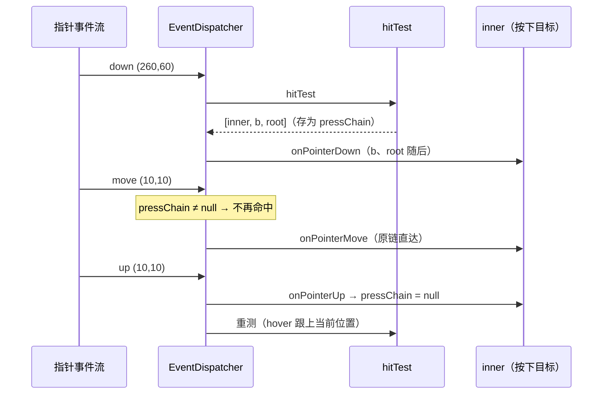
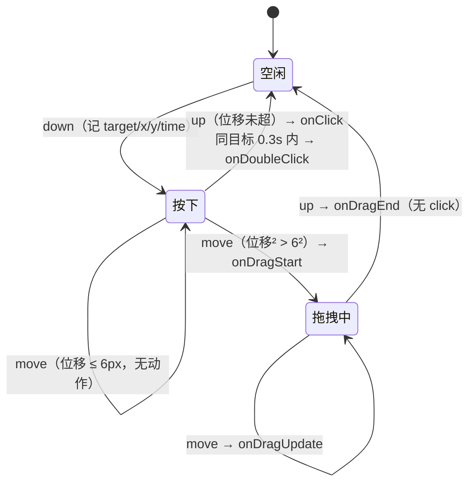

# 指针状态机：分发、捕获、hover 差分与手势判定

> [返回：第五阶段导览](01-导览.md)
> 对应大纲条目：第五阶段 3。命中链只是静态答案，指针交互的全部动态在两台状态机里：`EventDispatcher`（`core/events/dispatcher.ts`，100 行）管「事件发给谁」——冒泡顺序、按压捕获、hover 差分；`GestureController`（`core/events/gestures.ts`，88 行）管「这串事件是什么意思」——click / double-click / drag 的判定，阈值 6px、双击窗 0.3s。本册逐行走读两者、解读 8 条分发与手势用例，并摊开一次 hover 顺序的真实 bug。代码逐字摘自 labs 源码；测试输出来自本机实跑 `npx vitest run`（撰写时快照：全库 16 files / 136 tests 全绿）。

## 1. 分发顺序铁律

dispatcher.ts 的头注释就是全册的目录（原文）：

```ts
// 事件分发：命中 → 冒泡 → hover 差分 → 按压捕获。
// 分发顺序铁律：
//   pointer down  命中链自底向上（先最深）
//   pointer move  有按压时发给「按下时的目标」（捕获），否则命中链
//   pointer up    同捕获；同时驱动手势状态机
//   wheel         命中链上第一个挂了 onWheel 的节点（滚轮不冒泡穿透）
//   hover         每次指针位置变化后做链差分：旧的发 Leave，新的发 Enter
```

五条铁律各回答一个具体问题：down 谁都通知（冒泡）；move 在按压期间认死理（捕获）；up 双份工作（派发 + 喂手势 + 补 hover）；wheel 谁认领谁独享（吞噬，《03》第 7 节）；hover 是差分出来的（不是事件源发的）。整台机器的状态只有两个数组：

```ts
export class EventDispatcher {
  private root: RenderObject | null = null;
  private hoverChain: RenderObject[] = [];
  /** 按下时的命中链（捕获期所有 move/up 都发给它）。 */
  private pressChain: RenderObject[] | null = null;
  /** 手势状态机（可选：挂上后每个指针事件喂给它）。 */
  gestures: GestureController | null = null;
```

`hoverChain` 存「上一刻指针压在哪些节点上」，`pressChain` 存「按下那一刻的命中链」——**可空数组而非空数组**：`null` 表示「没在按压」，`[]` 是合法的命中结果（谁都没命中）。用空数组同时表示两种状态是 off-by-one bug 的温床。

`mount(root)` 装配时重置两个状态（`hoverChain = []`、`pressChain = null`）；`gestures` 是可选挂件——不挂，分发照常，只是没有 click/drag 语义（测试与 demo 都挂）。

## 2. dispatchPointer：三分支全文走读

```ts
  private dispatchPointer(ev: PointerEvent): void {
    if (ev.phase === 1 /* move */) {
      if (this.pressChain !== null) {
        // 捕获期：move 只发给按下目标链（拖拽中途出界不丢事件）
        this.deliverPointer(this.pressChain, ev);
        if (this.gestures !== null) this.gestures.handle(ev, this.pressChain);
      } else {
        const chain = hitTest(this.root as RenderObject, ev.x, ev.y).chain;
        this.updateHover(chain, ev);
        this.deliverPointer(chain, ev);
        if (this.gestures !== null) this.gestures.handle(ev, chain);
      }
      return;
    }

    if (ev.phase === 0 /* down */) {
      const chain = hitTest(this.root as RenderObject, ev.x, ev.y).chain;
      this.pressChain = chain;
      this.updateHover(chain, ev);
      this.deliverPointer(chain, ev);
      if (this.gestures !== null) this.gestures.handle(ev, chain);
      return;
    }

    // up：捕获链 + 解除捕获
    const chain = this.pressChain ?? hitTest(this.root as RenderObject, ev.x, ev.y).chain;
    this.pressChain = null;
    this.deliverPointer(chain, ev);
    if (this.gestures !== null) this.gestures.handle(ev, chain);
    const nowChain = hitTest(this.root as RenderObject, ev.x, ev.y).chain;
    this.updateHover(nowChain, ev);
  }
```

逐分支拆：

**down**：现测命中链 → 存入 `pressChain`（捕获开启）→ 更新 hover → 沿链派发 → 喂手势。注意 down 也驱动 hover 更新——按下那一刻指针压着的节点理应处于 hover 态。

**move（无按压）**：现测链 → hover 差分 → 派发 → 喂手势。这是「巡 finger」常态路径。

**move（按压期）**：**不再命中测试**，直接把事件发给 `pressChain`（按下时的链）。拖出目标后 move 依然送达原目标——这是「捕获」的全部含义。此间 hover 差分被冻结（不调用 `updateHover`）：拖拽时指针扫过谁不重要，拖拽结束后 up 分支会重算。

**up**：优先用捕获链（`this.pressChain ?? 现测`——`??` 只在没有任何按压时兜底现测，比如测试直接发 up）；派发前先解除捕获（`pressChain = null`）；喂完手势后**重测命中**做一次 hover 更新——抬起后指针可能停在别处，hover 态要跟上。

派发本身是一层薄循环（原文）：

```ts
  /** 链上每个节点依次收事件（自底向上 = 冒泡顺序）。 */
  private deliverPointer(chain: RenderObject[], ev: PointerEvent): void {
    for (const node of chain) {
      if (ev.phase === 0) node.onPointerDown(ev);
      else if (ev.phase === 1) node.onPointerMove(ev);
      else if (ev.phase === 2) node.onPointerUp(ev);
    }
  }
```

链序即冒泡序：`[inner, b, root]` 的 down 会依次调三个节点的 `onPointerDown`，inner（最具体）先收，root（最泛化）最后。没有「阻止冒泡」的出口——指针通知模型里 mini-gui 不给 cancel 口子（键盘的 `onKey` 返回 true 才有阻断，《05》）。

## 3. 按压捕获：为什么拖出目标事件不丢

没有捕获的世界：拖动滑块时指针稍微滑出滑块边界，后续 move 命中到别处，滑块收不到 move——拖拽在半路「断了」。浏览器的原生 `<input type="range">`、所有 GUI 工具包的滑块都靠**指针捕获**解决：按下时锁定目标，抬起时解锁。

测试钉死的行为（原文）：

```ts
  it("按压捕获：按下后拖出目标，move 仍发给原目标链", () => {
    const { root, inner } = setup();
    let moves = 0;
    inner.onPointerMove = () => (moves += 1);
    const d = new EventDispatcher();
    d.mount(root);
    d.dispatch(pointerEvent(0, 260, 60, 1)); // 按在 inner 上
    d.dispatch(pointerEvent(1, 10, 10, 2)); // 拖到空白
    expect(moves).toBe(1);
  }
```

按在 inner（链 `[inner, b, root]`），拖到空白 (10,10)（链 `[a, root]`）——inner 依然收到 1 条 move（`moves === 1`）。若没有捕获，第二个 move 的链里根本没有 inner，`moves` 是 0。

两个实现细节值得点破：其一，这个用例直接赋值 `inner.onPointerMove = ...`（覆写转发方法本身）而不是 `setOnPointerMove`——两种定制路径在这里等价（覆写接管一切，《02》5.1 节）；其二，捕获期 move **连手势都喂捕获链**（`this.gestures.handle(ev, this.pressChain)`），所以拖拽判定的位移与目标从按下起就稳定，不会因为扫过别的节点而换目标。



## 4. hover 差分：Leave/Enter 是算出来的

平台层根本不发「进入/离开」事件（raylib 只有坐标）——hover 是分发器用两条链的**集合差分**算出来的（原文）：

```ts
  /** hover 差分：旧链有新链没有 → Leave（从浅到深发）；新有旧无 → Enter（从深到浅发）。 */
  private updateHover(newChain: RenderObject[], ev: PointerEvent): void {
    const enterEv: PointerEvent = { ...ev, phase: 1 };
    for (const node of this.hoverChain) {
      if (newChain.indexOf(node) < 0) node.onPointerLeave(enterEv);
    }
    // newChain[0] 是最深节点：Enter 从深到浅 = 正序遍历
    for (const node of newChain) {
      if (this.hoverChain.indexOf(node) < 0) node.onPointerEnter(enterEv);
    }
    this.hoverChain = newChain.slice();
  }
```

机制三句话：旧链减新链，差集发 `onPointerLeave`；新链减旧链，差集发 `onPointerEnter`；`hoverChain` 换成新链的拷贝（`slice()`——拷贝是防御：调用方改原数组不污染存量状态）。差分事件复用当前 move 事件的对象展开（`{ ...ev, phase: 1 }`）——Enter/Leave 在协议上就是 move 的变体。

**顺序的真相要读实现而不是注释**。两个循环都是沿链数组**正序**遍历，而链数组自底向上（index 0 最深）——所以 Enter 与 Leave 的实际触发都从**最深**节点开始：指针滑进嵌套结构时，inner 的 Enter 先于父 b 的 Enter；滑出时 inner 的 Leave 先于 b 的。注释里「Leave（从浅到深发）」的标签与循环方向不符——好在测试断言只锁死了 Enter 侧（见下），Leave 侧同一循环方向。这里还有一段真实历史：第一版 Enter 循环写成了逆序遍历（从根往最深发），被 hover 用例的断言顺序当场抓住，改回正序。教训有两条：**用例名与注释描述的是意图，断言数组才是钉死的行为**；差分顺序这种细节，值得在测试里用 `toEqual` 锁全序而不只是锁集合。

测试原文（注意断言数组的顺序）：

```ts
  it("hover 差分：移入发 Enter，移出发 Leave（顺序：Leave 浅→深，Enter 深→浅）", () => {
    const { root, inner, b } = setup();
    const log: string[] = [];
    inner.setOnPointerEnter(() => log.push("inner:enter"));
    inner.setOnPointerLeave(() => log.push("inner:leave"));
    b.setOnPointerEnter(() => log.push("b:enter"));
    const d = new EventDispatcher();
    d.mount(root);
    d.dispatch(pointerEvent(1, 260, 60, 1)); // 移入 inner
    d.dispatch(pointerEvent(1, 10, 10, 2)); // 移出到空白
    expect(log).toEqual(["inner:enter", "b:enter", "inner:leave"]);
  });
```

手算：第一条 move 到 (260,60)，链 `[inner, b, root]`，旧链空 → Enter 差集是全链：inner（最深）先、b 随后（root 已在旧链？不——旧链是空数组，root 也会收到 Enter，只是测试没给 root 挂处理器）。第二条 move 到 (10,10)，链 `[a, root]`：Leave 差集 = {inner, b}，inner 先发（它挂了处理器，记下 `inner:leave`；b 的 Leave 触发但没有处理器）；Enter 差集 = {a}（无处理器）。log 恰为三项目标序。

**为什么按深度排序有语义**：从深到浅发 Enter，意味着「最具体的控件先知道自己被进入了」——与命中优先级（最具体优先）、手势目标（chain[0]）一脉相承。mini-gui 在每个岔路口都选了「最具体优先」。

## 5. 手势状态机：gestures.ts 全文走读

```ts
// 手势状态机：把指针事件流加工成 click / double-click / drag 三种手势。
// 状态：空闲 → 按下 →（位移超阈值）拖拽中 → 抬起；抬起时位移未超阈值 = 点击。
// 双击：同目标两次点击间隔 < doubleClickWindow（0.3s）。
import type { PointerEvent } from "./events";
import type { RenderObject } from "../render/render-object";

export interface GestureOptions {
  /** 点击判定的位移阈值（px）：按下到抬起位移不超过它才算点击。 */
  dragThreshold?: number;
  /** 双击窗口（秒）。 */
  doubleClickWindow?: number;
}

export class GestureController {
  dragThreshold: number;
  doubleClickWindow: number;

  /** 观测口：手势识别日志（测试断言「识别出了什么、发给谁」）。 */
  readonly log: string[] = [];

  private pressTarget: RenderObject | null = null;
  private pressX = 0;
  private pressY = 0;
  private pressTime = 0;
  private dragging = false;
  private lastClickTarget: RenderObject | null = null;
  private lastClickTime = -1;

  constructor(opts?: GestureOptions) {
    this.dragThreshold = opts?.dragThreshold ?? 6;
    this.doubleClickWindow = opts?.doubleClickWindow ?? 0.3;
  }
```

状态画成图：



三个字段组（按下快照 / 拖拽标志 / 上次点击记忆）对应三段判定。`handle` 的三个分支逐段读：

**down：只记快照**

```ts
  handle(ev: PointerEvent, chain: RenderObject[]): void {
    if (ev.phase === 0 /* down */) {
      const target = chain.length > 0 ? chain[0] ?? null : null;
      this.pressTarget = target;
      this.pressX = ev.x;
      this.pressY = ev.y;
      this.pressTime = ev.time;
      this.dragging = false;
      return;
    }
```

目标取 `chain[0]`——**手势只认最深目标**。父节点的 onClick 不会被触发（对照 `onPointerDown` 全链通知）：点击语义天然属于「被点的那一个」。`pressTime` 记下了但本版未用于长按（预留）。

**move：阈值判定**

```ts
    if (ev.phase === 1 /* move */) {
      if (this.pressTarget === null || this.dragging) {
        if (this.dragging && this.pressTarget !== null) {
          this.pressTarget.onDragUpdate(ev);
        }
        return;
      }
      const dx = ev.x - this.pressX;
      const dy = ev.y - this.pressY;
      const dist = dx * dx + dy * dy;
      if (dist > this.dragThreshold * this.dragThreshold) {
        this.dragging = true;
        this.log.push("drag-start");
        this.pressTarget.onDragStart(ev);
      }
      return;
    }
```

两个细节：**平方比较**（`dist > threshold²`）免开方——距离只需要与阈值比大小，开方是浪费（命中测试的圆形覆写同技巧）；比较符是严格大于，恰好在 6px 上不算拖拽。已进入拖拽后，move 只转发 `onDragUpdate` 给按下目标（不是链——拖拽事件也遵守「目标唯一」）。

**up：三岔口**

```ts
    // up
    const target = this.pressTarget;
    this.pressTarget = null;
    if (target === null) return;
    if (this.dragging) {
      this.dragging = false;
      this.log.push("drag-end");
      target.onDragEnd(ev);
      return;
    }
    this.log.push("click");
    target.onClick(ev);
    if (
      this.lastClickTarget === target &&
      ev.time - this.lastClickTime < this.doubleClickWindow
    ) {
      this.log.push("double-click");
      target.onDoubleClick(ev);
      this.lastClickTarget = null; // 三连击从零计数
    } else {
      this.lastClickTarget = target;
      this.lastClickTime = ev.time;
    }
  }
```

抬起时按 `dragging` 二分：拖拽中 → `onDragEnd`，**不补 click**（拖完不算点）；非拖拽 → `onClick`，然后查双击——**同目标**（`lastClickTarget === target`）且间隔 **< 0.3s**（严格小于）才追加 `onDoubleClick`。注意 click 先于 double-click 触发：一次双击 = 两次 click + 一次 double-click，`log` 记录 `["click", "click", "double-click"]`。双击成立后 `lastClickTarget = null`——**三连击从零计数**：第三击只是普通 click，不会与第二击组成新的双击（连点三次得到「双击 + 单击」，而不是「双击 + 双击」）。

## 6. 参数学：6px 与 0.3s 的边界推演

两个默认参数各划一条体验边界：

**dragThreshold = 6px**。位移不超过它算点击、超过算拖拽。调大：按钮更「宽容」（手抖 10px 也算点击），但拖拽启动变钝——列表要拖 12px 才开始动，跟手性差。调小：拖拽灵敏，但鼠标微颤就误判成拖拽，点击变得难触发。6px 是触摸时代前的经典桌面值（对照：Android 的 touch slop 典型 8dp、Flutter 的 kTouchSlop 18 逻辑像素——触屏手指精度低，阈值必须更大；概念对照，非本机实测）。

**doubleClickWindow = 0.3s**。两次 click 的最大间隔。调大：双击好按（老人友好），但「快速两次独立点击」被误判为双击（列表里快速选中两项变成一次双击）。调小：双击难按全。Windows 系统默认双击时间 500ms（`GetDoubleClickTime`），macOS 也以 500ms 量级为默认——mini-gui 的 0.3s 明显更紧，偏「游戏/高频交互」口味（概念对照，非本机实测）。

参数都以 `GestureOptions` 可注入（构造默认 `?? 6` / `?? 0.3`），测试里显式传 `{ dragThreshold: 6 }`——把魔法数字变成可谈判的边界，是「阈值类代码」的基本修养。第三条隐含参数是**时间字段选 `ev.time` 而不是「现在」**：双击间隔用事件自带的时钟（合成源里由测试指定），无头测试才能用 0.15s/0.95s 精确卡窗（《02》第 7 节）。

## 7. 测试解读：分发与手势的 8 条用例

`events.test.ts` 里除命中 4 条外的 8 条（本机实跑全绿）：

| describe | it | 关键断言 | 防什么错 |
|---|---|---|---|
| 分发与冒泡 | down 冒泡：inner 先收，root 最后收 | `order` `toEqual(["inner", "root"])` | 冒泡序反了（根先收） |
| 分发与冒泡 | hover 差分：移入发 Enter，移出发 Leave（顺序：Leave 浅→深，Enter 深→浅） | log `toEqual(["inner:enter", "b:enter", "inner:leave"])` | Enter 顺序错（历史 bug）；差分算错集合 |
| 分发与冒泡 | 按压捕获：按下后拖出目标，move 仍发给原目标链 | `moves` `toBe(1)` | 捕获丢失，拖拽中途断链 |
| 分发与冒泡 | wheel 被链上第一个 onWheel 吞掉 | `got` `toEqual([3])` | 滚轮穿透到外层（嵌套滚动双滚） |
| 手势状态机 | 位移小于阈值 = click | `clicks` `toEqual([3])`（up 的 time） | 微动被误判拖拽 |
| 手势状态机 | 位移超过阈值 = drag（无 click） | `clicks` `toEqual([])`；`drags` `toEqual(["start","update","end"])`；`g.log` `toEqual(["drag-start","drag-end"])` | 拖完补发 click；漏 drag 生命周期 |
| 手势状态机 | 双击窗口内二次点击 = double-click | `dbl` 长度 1；`g.log` `toEqual(["click","click","double-click"])` | 双击窗失效；click/double 顺序错 |
| 手势状态机 | 间隔超窗 = 两次普通点击 | `dbl` 长度 0；`g.log` `toEqual(["click","click"])` | 窗口卡边错误（0.95s 应出窗） |

两处手算值得写全：

**click 的判定序列**：`down(100,100,t=1)` → `move(103,100,t=2)`（dx=3，dist²=9 ≤ 36，不触发拖拽）→ `up(103,100,t=3)`：dragging=false → click，`clicks` 记下 up 的时间 **3**。断言 `toEqual([3])` 连「click 事件带的是 up 的时刻」这一细节都锁了。

**drag 的完整生命周期**：`down(100,100)` → `move(120,100)`（dx=20，dist²=400 > 36 → drag-start）→ `move(140,100)`（已在拖拽 → update）→ `up(140,100)`（drag-end）。三层断言各守一段：`drags` 数组锁控件侧收到的生命周期（start/update/end 一段不少、不乱序）；`g.log` 锁识别器侧的观测口（只有 drag-start/drag-end 两条——update 不进 log，log 是「手势事件」的流水不是指针事件流水）；`clicks` 为空锁「拖拽不发 click」。

双击的两组用例在窗口两侧各卡一刀：1.05→1.2（第二次 down 距上次 click 0.15s < 0.3）判双击；1.05→2.0（0.95s > 0.3）判两次独立点击。0.15 与 0.95 离边界 0.3 都足够远——卡边界值（0.29/0.31）反而脆：浮点与时钟精度会咬人。

## 8. 常见误区

- **「move 事件每次都做命中测试」**——按压捕获期复用 `pressChain`，不做命中（第 2 节）。这既是性能选择（拖拽时高频 move 免掉整树试探），更是语义选择（拖出目标不丢事件）
- **「捕获应该捕获到单个节点」**——本实现捕获整条链（`deliverPointer(pressChain, ev)`），按下时链上的 b、root 在拖拽期间也持续收 move。单节点捕获（浏览器的 `setPointerCapture`）与链捕获是两种设计，后者让「容器在拖拽期间画高亮」这类需求免费
- **「hover 事件由平台层发」**——raylib 只报坐标，Enter/Leave 全是差分算出来的。副作用：没有 move 就没有差分，指针静止时拔掉树上的节点不会触发 Leave（stale hover 是已知边界，重建 dispatcher 或下一次 move 才会校正）
- **「注释写了 Leave 从浅到深，那就是浅到深」**——两个差分循环都沿链数组正序走，实际都从最深先发（第 4 节）。断言 `["inner:enter","b:enter","inner:leave"]` 只钉死了 Enter 侧与 inner 的 Leave；读行为要读循环方向
- **「drag 结束应该补一个 click」**——up 分支 `if (this.dragging) { ...; return; }` 直接返回。拖完补点击的 UI（拖出菜单松手=选中项）在真实工具包里要么是专门手势、要么显式配置，不默认
- **「双击 = 两次 click 互相抵消，只发 double-click」**——本实现两次 click 照发、double-click 追加（log 三条）。计数器 UI 里双击会让计数 +2，要不要去重是控件层的事（用 double-click 时撤销一次 click 的效果）
- **「三连击应该得到双击 + 双击」**——`lastClickTarget = null` 把第三击打回单击。若要支持三击选段落（编辑器惯例），得把「从零计数」改成「计数进位」，状态从布尔变计数器
- **「阈值比较先开方再比」**——`dist > threshold * threshold` 用平方，免开方还避开浮点开方的精度噪声。真实报错场景：ScriptC 白名单里 sqrt 要用自带库（《02》第二阶段数学册），能不用就不用
- **「手势目标应该问链上谁要」**——手势只认 `chain[0]`（最具体目标），没有竞技场。多控件争同一个手势流（水平滑动 vs 列表垂直滚动）时本版无法仲裁——这是第六阶段之后「手势竞裁」的入口，《06》第 9 节讨论

## 9. 与其他框架的对照（概念对照，非本机实测）

| 维度 | mini-gui | W3C Pointer Events / DOM | Flutter | Android View |
|---|---|---|---|---|
| 指针捕获 | 按下隐式捕获整链，up 解除 | `setPointerCapture` 显式；触摸隐式捕获到目标 | 按下即命中路径独占（hit test 一次定终身） | DOWN 后事件流归该 view，直至 UP/CANCEL |
| enter/leave 顺序 | 都从最深先发（链正序） | mouseenter 浅→深（tree order），mouseleave 深→浅 | onEnter/onExit 跟随命中变化 | hover 事件（Android 10+）同 DOM 风格 |
| 拖拽阈值 | 6px，平方比较 | 无内置（自己算） | kTouchSlop 18 逻辑像素（竞技场用） | touch slop 典型 8dp（ViewConfiguration） |
| 双击窗 | 0.3s，同目标，三击清零 | 无系统级（ dblclick 事件由浏览器判定，间隔随系统设置） | kDoubleTapTimeout 300ms | `getViewConfiguration().getDoubleTapTimeout()` 300ms |
| 手势仲裁 | 无（单目标） | 无（节点自治） | **GestureArena**：多个识别器入场，胜者独享 | onInterceptTouchEvent 父子协商 |

三点观察：其一，捕获语义三家趋同——「按下决定归属，抬起释放」是拖拽正确性的公约数，分歧只在「捕获的是节点还是链」。其二，Flutter 的 GestureArena 是对 mini-gui 当前空白的直接回答：水平滑动的页签与垂直滚动的列表同时在链上，让「谁先越过自己的阈值谁赢」的仲裁取代「谁最深谁独占」；本框架单指针 + 无嵌套手势冲突，空白可以忍，但要知道忍的是什么。其三，双击窗 300ms 在 Flutter/Android 是常量库里的默认值，mini-gui 的 0.3s 与之同量级、与桌面系统默认（500ms）相左——**框架参数抄谁，暴露了它假想的交互节奏**。

## 10. 本册小结

- 分发五铁律：down 冒泡、move 按压捕获、up 派发+喂手势+补 hover、wheel 吞噬、hover 差分
- 两个状态数组：`pressChain`（可空表「没在按压」）与 `hoverChain`（上一刻的链）；up 先解除捕获再派发，之后重测命中补 hover
- 捕获期不做命中测试、move 发原链、手势也喂原链——拖出目标不丢事件（moves=1 用例）
- hover 的 Enter/Leave 是集合差分：两个循环都沿链正序（最深先发）；Enter 侧被 toEqual 锁序，历史 bug 是 Enter 写反被测试抓住——断言数组钉行为，注释只述意图
- 手势三态（空闲/按下/拖拽中），阈值 6px 平方比较，双击窗 0.3s 同目标严格小于，双击后 lastClickTarget=null 三击从零；手势只认 chain[0]，拖完不补 click
- 观测口 `GestureController.log` 记手势事件流水（drag-start/drag-end/click/double-click），测试与调试共用
- 无手势竞技场是已知边界：嵌套冲突手势（横滑 vs 竖滚）留给后续阶段

## 自测

1. 分发器的两个状态数组分别是什么？`pressChain` 为什么用 `RenderObject[] | null` 而不是空数组表示「没在按压」？
2. up 事件的处理顺序为什么是「先解除捕获 → 派发 → 喂手势 → 重测命中补 hover」？把「解除捕获」挪到最后会发生什么？
3. 按压捕获期间收到 move，`hitTest` 被调用几次？这条 move 发给了谁、不发给谁？
4. hover 差分的两个循环各遍历哪条链、按什么方向？测试 `["inner:enter", "b:enter", "inner:leave"]` 里哪个断言实际上没被「锁死顺序」（哪个节点的 Leave 顺序没验证）？
5. 手算：`down(100,100,t=1)` → `move(104,97,t=2)` → `move(103,102,t=3)` → `up(103,102,t=4)`。两次 move 各自发生什么？最终 log 里有什么？（提示：算每一步的 dist²，与 36 比。）
6. 同上，但把第二帧 move 改成 `move(130,100,t=2)`、up 改成 `up(90,100,t=3)`——注意 up 的位置离按下点 10px。log 是什么？clicks 是什么？为什么 up 的位置不重要？
7. 双击判定要求哪两个条件同时成立？双击成立后 `lastClickTarget` 置 null 防住了什么序列？写出三连击（三次 down/up，间隔都在窗内）的完整 log。
8. 为什么双击间隔用 `ev.time` 而不是测试运行的真实时钟？这个选择让哪类测试成为可能？
9. 手势目标为什么是 `chain[0]` 而不是全链？如果按钮嵌在可点击的面板里，点按钮时面板的 onClick 会被触发吗——对照面板的 onPointerDown 呢？
10. 列表（垂直滚动）上盖一个可以水平拖动的滑块，当前实现会出什么问题？Flutter 用什么机制解决，mini-gui 要抄它最小需要加什么？
