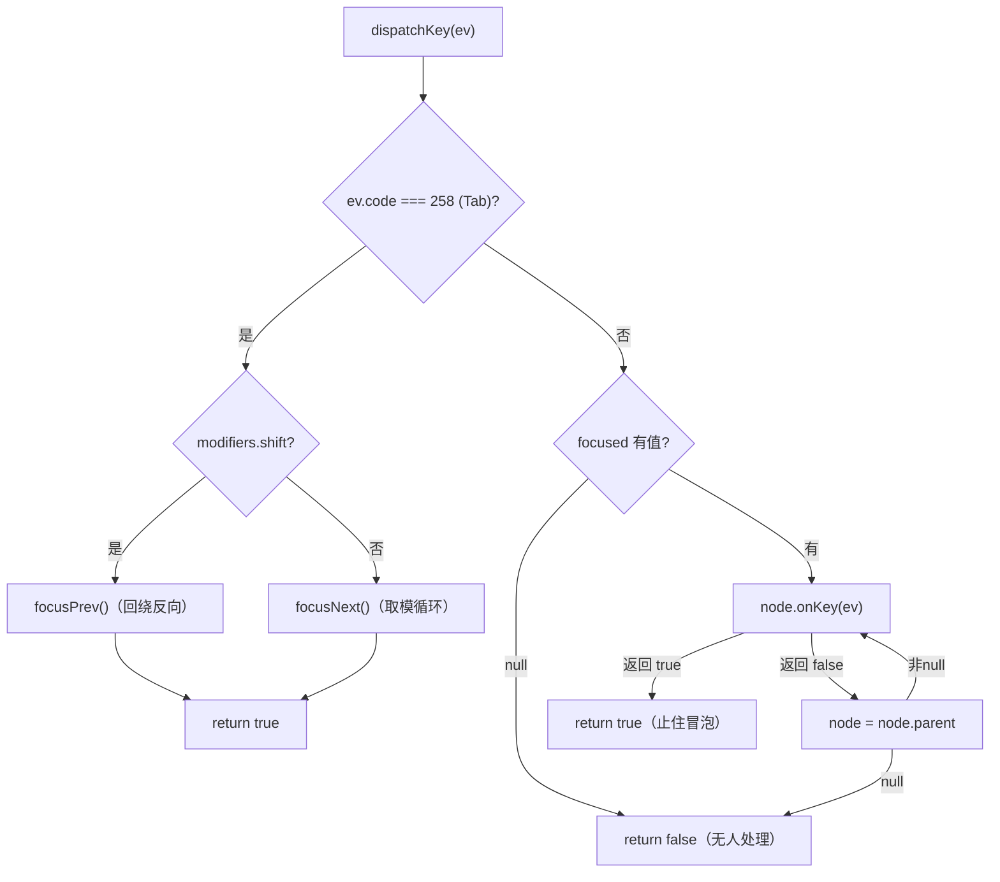

# 焦点系统：Tab 遍历与键盘路由

> [返回：第五阶段导览](01-导览.md)
> 对应大纲条目：第五阶段 4。指针事件自带坐标，「点到谁」由命中测试回答；键盘事件没有位置，「发给谁」只能靠状态记住——这个状态就是焦点。本册走读 `core/events/focus.ts`（107 行）：`FocusManager` 用一次深度优先遍历收集 `canFocus` 节点构成焦点链，Tab 沿链循环、Shift+Tab 反向，非 Tab 键先给焦点节点、没被处理（`onKey` 返回 false）则沿父链冒泡。配套看 `RenderButton` 的 `canFocus`、焦点环绘制与 demo 的焦点态同步。代码逐字摘自 labs 源码；测试输出来自本机实跑 `npx vitest run`（撰写时快照：全库 16 files / 136 tests 全绿，其中 focus 5 用例）。

## 1. 键盘事件为什么需要焦点

对照两个输入通道的「寻址方式」：

| | 指针 | 键盘 |
|---|---|---|
| 事件携带的地址信息 | 窗口坐标 (x, y) | 无（只有键码 code） |
| 「给谁」由谁决定 | 命中测试，逐事件现算 | **记住的状态**，跨事件持续 |
| 无目标时的行为 | 命中根（退化链） | 无焦点则无人处理 |

Enter 按下时该激活哪个按钮、字符该打进哪个输入框——答案不可能从事件本身读出，只能是「之前被选中的那个」。焦点就是这份被记住的选择，它带来三件必须回答的事：

1. **焦点链怎么排**（Tab 按几下分别到谁）——本实现用树序（深度优先先序）
2. **键事件怎么路由**（焦点节点不处理给谁）——先焦点节点，沿父链冒泡
3. **焦点态怎么可见**（用户怎么知道焦点在哪）——焦点环，由宿主同步、控件绘制

`FocusManager` 三个成员对应三问：`focusables[]`（链）、`focused`（当前焦点）、`dispatchKey`（路由）。

## 2. focus.ts 状态与挂载：一次 DFS 收集焦点链

```ts
// 焦点系统：Tab 遍历 + 键盘事件路由。
// 遍历序 = 树序（深度优先，canFocus 的节点按出现顺序）；键盘事件先给焦点节点，
// 未处理（onKey 返回 false / 无 onKey）则沿父链冒泡，最后由 FocusManager 消化 Tab。
import type { KeyEvent } from "./events";
import type { RenderObject } from "../render/render-object";

/** raylib/Glfw 键码（平台无关地写死一份：Tab=258）。 */
export const KEY_TAB = 258;
export const KEY_SHIFT_LEFT = 340;

export class FocusManager {
  private root: RenderObject | null = null;
  private focusables: RenderObject[] = [];
  private focusIndex = -1;

  /** 当前焦点节点（null = 无焦点）。 */
  focused: RenderObject | null = null;

  /** 观测口：焦点移动日志。 */
  readonly log: string[] = [];

  mount(root: RenderObject): void {
    this.root = root;
    this.focusables = [];
    this.collectFocusables(root);
    this.focusIndex = -1;
    this.focused = null;
  }

  private collectFocusables(node: RenderObject): void {
    if (node.canFocus) this.focusables.push(node);
    for (const child of node.children) {
      this.collectFocusables(child);
    }
  }
```

三个决策先钉住：

**① 键码本地写死，不 import 平台包**。`KEY_TAB = 258`、`KEY_SHIFT_LEFT = 340` 是 raylib/Glfw 的 KeyboardKey 数值，注释明说「平台无关地写死一份」。内核文件（core/）不依赖 scriptc-raylib——键码作为纯数值进入 `KeyEvent.code`（《02》2.2 节），焦点系统只需认得 Tab 一个码。代价：换宿主时键码表要重新对；收益：焦点逻辑在无头测试里零平台依赖。

**② 焦点链是挂载时收集的快照**。`mount` 做一次 DFS（先序：自己先入列、再递归子），把 `canFocus === true` 的节点按出现顺序摊平成数组。树后来长出新的可聚焦节点，链不会自动更新——要再 `mount` 一次（demo 的树组装后不变，成立；动态增删控件的场景是第八阶段控件化时要补的失效协议）。

**③ `canFocus` 是节点上的公开布尔**（`RenderObject` 上 `canFocus = false` 默认），不是接口/注册表。想进焦点链的控件在构造时置 true——`RenderButton` 构造函数里就一行 `this.canFocus = true`。

`log` 是观测口（与 `GestureController.log` 同款设计）：焦点每动一次记一条 `"focus:#N"`，测试与 demo 的日志输出共用（05-events.ts 结尾打印 `focusLog=[${focus.log.slice(-3).join(",")}]`）。

## 3. Tab 遍历：树序、循环与反向

```ts
  focusNode(node: RenderObject | null): void {
    const idx = node === null ? -1 : this.focusables.indexOf(node);
    if (node !== null && idx < 0) return; // 不可聚焦的节点不给焦点
    this.focusIndex = idx;
    this.focused = node;
    this.log.push(node === null ? "focus:null" : `focus:${this.nodeLabel(node)}`);
  }

  focusNext(): void {
    if (this.focusables.length === 0) return;
    this.focusIndex = (this.focusIndex + 1) % this.focusables.length;
    this.applyIndex();
  }

  focusPrev(): void {
    if (this.focusables.length === 0) return;
    this.focusIndex = this.focusIndex - 1;
    if (this.focusIndex < 0) this.focusIndex = this.focusables.length - 1;
    this.applyIndex();
  }

  private applyIndex(): void {
    const node = this.focusables[this.focusIndex] ?? null;
    this.focused = node;
    this.log.push(node === null ? "focus:none" : `focus:${this.nodeLabel(node)}`);
  }
```

**循环遍历用取模**：`(focusIndex + 1) % length`，从最后一个 Tab 回第一个——焦点链是环不是队列。**反向用回绕**：减到 -1 就跳到 `length - 1`（从尾部起）。两个函数都守了空链早退（`length === 0` 直接返回，`% 0` 会得 NaN）。

```text
        Tab（focusNext，取模 +1）
      ┌──────────────────────┐
      ▼                      │
    [a] ──► [b] ──► [nested] ┘
      ▲                      │
      └──────────────────────┘
        Shift+Tab（focusPrev，减 1，-1 回绕到尾部）

    无焦点（focusIndex = -1）：
      Tab      ──► (−1+1)%3 = 0 ──► a      （从头部进）
      Shift+Tab ──► −1−1=−2 → 回绕 2 ──► nested（从尾部进）
```

`focusNode` 是编程式入口（demo/测试用，Tab 不经过它）：先查节点在不在链上，**不在（`idx < 0`）且非 null 就拒绝**——不可聚焦的节点强行给焦点会静默失败，`focused` 保持原值。这条防御由测试钉死（第 7 节用例 ⑤）。

标签怎么来（原文）：

```ts
  private nodeLabel(node: RenderObject): string {
    // RenderBox 有 color 字段可用作测试标签；其余用树内序号
    return `#${this.indexOfNode(this.root, node)}`;
  }

  private indexOfNode(root: RenderObject | null, target: RenderObject): number {
    let counter = 0;
    const walk = (n: RenderObject): boolean => {
      if (n === target) return true;
      counter += 1;
      for (const c of n.children) {
        if (walk(c)) return true;
      }
      return false;
    };
    if (root === null) return -1;
    return walk(root) ? counter : -1;
  }
```

又是先序计数——`#N` 是节点在整树先序遍历里的序号。测试树 `root → [a, b, container → nested]` 的编号：root=#0、a=#1、b=#2、container=#3、nested=#4。连按四次 Tab 的 log 就是 `focus:#1, focus:#2, focus:#4, focus:#1`（第四下循环回 a）。

## 4. dispatchKey：Tab 垄断与键冒泡

键盘路由的全文（原文）：

```ts
  /** 键盘事件入口：焦点链冒泡 → 焦点管理器消化 Tab。返回是否有人处理。 */
  dispatchKey(ev: KeyEvent): boolean {
    // Tab 永远先由焦点系统处理（shift+tab 反向）
    if (ev.code === KEY_TAB) {
      if (ev.modifiers.shift) {
        this.focusPrev();
      } else {
        this.focusNext();
      }
      return true;
    }

    // 焦点节点先吃；没吃掉的沿父链冒泡
    let node: RenderObject | null = this.focused;
    while (node !== null) {
      if (node.onKey(ev)) return true;
      node = node.parent;
    }
    return false;
  }
```

两个语义要读准（判定树画出来）：



**Tab 被焦点系统垄断**。`code === KEY_TAB` 的检查在冒泡**之前**——焦点节点就算给 Tab 挂了 `onKey`，也永远收不到它：Tab 的语义（移动焦点）归框架，控件的 `onKey` 只见非 Tab 键。想要「Tab 在表格里跳到下一格」这种自定义行为，当前结构做不到，得把优先级倒过来或在 FocusManager 里开注册口。返回值恒 true（焦点系统处理了）。

**非 Tab 键：焦点节点先吃，沿父链冒泡**。从 `focused` 出发沿 `parent` 走到根，谁先 `onKey` 返回 true 谁止住（`return true`），一路没人认领返回 false。注意这条「链」不是命中链——是**焦点节点的祖先链**，每次现走 `parent`。对比三个「链」的来源：命中链由坐标现算（`hitTest`）、捕获链是按下时的命中快照（`pressChain`）、键冒泡链是焦点节点的祖先链——同一个「自底向上」哲学的三种物化。

Shift+Tab 的判定读 `ev.modifiers.shift`——修饰键是平台层在轮询时刻采样的快照（《02》4.1 节），不是一次独立的 Shift 按键事件。`KEY_SHIFT_LEFT = 340` 一并导出备用，但反向判定本身不消费它。

## 5. 焦点态可见：canFocus、焦点环与宿主同步

焦点系统的第三问（可见性）由 `RenderButton` 与 demo 帧循环合作回答。`interactive-scene.ts` 摘录：

```ts
export class RenderButton extends RenderObject {
  label: string;
  fontSize: number;
  measurer: TextMeasurer;
  hovered = false;
  pressed = false;
  /** 焦点态由宿主（FocusManager）置位，paint 时画焦点环。 */
  focused = false;

  constructor(label: string, fontSize: number, measurer: TextMeasurer, onClick?: () => void) {
    super();
    this.label = label;
    this.fontSize = fontSize;
    this.measurer = measurer;
    this.canFocus = true;
    // ……onClick 注入（裁剪）……
  }
```

绘制侧（`paintSelf` 摘录）：

```ts
    if (this.focused) {
      p.strokeRect({ x: -2, y: -2, width: this.width + 4, height: this.height + 4 }, 2, PALETTE.accent);
    }
```

焦点环是超出按钮 2px 的 accent 色描边。关键分工在注释里：「焦点态由宿主置位」——`FocusManager.focused` 是路由用的强引用，控件上的 `focused` 布尔是绘制用的镜像，**两者由 demo 帧循环手动同步**（`apps/05-events.ts` 原文）：

```ts
  // ---- 2. 布局（脏才排）+ 焦点态同步到按钮 ----
  scene.owner.flushLayout();
  for (const b of scene.buttons) {
    b.focused = focus.focused === b;
  }
```

每帧把 `focus.focused === b` 写进每个按钮的 `focused`。为什么不做成事件（焦点变化时通知控件）？——帧循环轮询同步在 immediate 模式思维下最简单：不做订阅、不怕漏发、代价是每帧 N 次布尔比较（demo 里 N=3）。做成 `onFocusChanged` 事件是第八阶段控件库的事（届时还要处理「上一个焦点控件收 blur」这类状态清理）。

## 6. 树序遍历的坑：视觉序不是树序

Tab 顺序 = DFS 先序 = 「children 数组里的出现顺序」。大多数布局（Row/Column 按声明排）树序与视觉序一致，但两处会分叉：

1. **视觉重排类布局**：右到左（RTL）、`column-reverse` 这类把视觉顺序倒过来的布局，树序 Tab 会逆着视觉走。mini-gui 的 Flex 没有 reverse 方向，暂时无症状——但概念上要记住**遍历序绑定的是树，不是屏幕**
2. **绝对定位/层叠**：footer 角落的徽标在树序上紧跟兄弟，视觉上却远离主流程。用户按 Tab 的心理模型是「从上到下扫过屏幕」，树序给的是「从外到内读声明」

工业框架的做法（概念对照，非本机实测）：DOM 的顺序焦点导航按「tabIndex 正数升序分组、组内按文档序」；Flutter 的 `FocusTraversalPolicy` 默认 `ReadingOrderTraversalPolicy`，按节点的**布局几何**（行扫顺序）排序——显式承认树序不够。mini-gui 选树序是刻意的简化：可预测（看声明就知道顺序）、零布局依赖（focus.ts 不读 x/y）。代价记在第 8 节误区里。

## 7. 测试解读：focus.test.ts 的 5 条 + interactive 的 1 条

`focus.test.ts` 的测试树（原文摘录）：

```ts
function buildTree(): { root: Plain; a: RenderBox; b: RenderBox; nested: RenderBox } {
  const root = new Plain();
  root.width = 400;
  root.height = 300;
  const a = new RenderBox(100, 40);
  const b = new RenderBox(100, 40);
  const container = new Plain();
  const nested = new RenderBox(100, 40);
  a.canFocus = true;
  b.canFocus = true;
  nested.canFocus = true;
  root.appendChild(a);
  root.appendChild(b);
  root.appendChild(container);
  container.appendChild(nested);
  return { root, a, b, nested };
}
```

三个 canFocus 节点：a、b、nested（container 是 Plain 不聚焦）。注意 rig 与 events.test.ts 的 FixedBox 同款教训：`root.width/height` 手动就位——焦点测试不跑布局，但至少根要有尺寸语义完整的习惯（《03》坑一）。五条用例（本机实跑全绿）：

| it | 关键断言 | 防什么错 |
|---|---|---|
| Tab 按树序循环（a → b → nested → a） | `focusableCount()` `toBe(3)`；四次 Tab 后 `focused` 依次是 a、b、nested、**a** | DFS 序错（子先于兄弟）；循环变越界 |
| Shift+Tab 反向 | 无焦点时 Shift+Tab → `focused` 是 **nested**；`focusNode(a)` 后再 Shift+Tab 仍 nested | 反向回绕错（-1 应跳尾部）；索引算偏 |
| 键事件先给焦点节点，未处理沿父链冒泡 | `got` `toEqual(["a", "root"])`；返回值 `true` | 冒泡链断（只问焦点节点）；返回值谎报 |
| onKey 返回 true 阻止冒泡 | `got` `toEqual(["a"])` | 阻断失效，root 的处理器也跑 |
| focusNode 拒绝不可聚焦节点 | `fm.focused` `toBeNull()` | 强给焦点后链内索引与 focused 不一致 |

三条手算：

**Shift+Tab 从零起**：`focusIndex = -1` → `focusPrev` 先减成 -2、小于 0 回绕到 `length-1 = 2` → `focusables[2]` = nested。焦点从「无」直接落**尾部**——反向遍历把「无焦点」解释为「已经在头部之前」，语义自然。

**冒泡用例**：a 的 `onKey` 返回 false（got 记 "a"），`node = a.parent = root`，root 返回 true（got 记 "root"）→ 循环止，dispatchKey 返回 true。若 a 返回 true，root 永远不进循环体——`toEqual(["a"])` 锁的就是这刀。

**拒绝用例**：`notFocusable`（新造的 RenderBox，canFocus 默认 false）appendChild 进树后没有重新 mount，`focusables` 里本来就没有它——`idx = -1 < 0` 触发拒绝分支。这个用例同时守住了「链是快照」的边界：后挂的可聚焦节点若不重新 mount，连 Tab 都到不了它。

`interactive-scene.test.ts` 再加一条端到端。先看它的 rig 怎么装配三个交互组件（原文）：

```ts
/** fontSize 10 → 每字符 6px；按钮 = 文本宽 + 24、高 = 10 + 10。 */
function rig() {
  const scene = buildInteractiveScene(m, 10, WIN);
  const dispatcher = new EventDispatcher();
  dispatcher.mount(scene.root);
  dispatcher.gestures = new GestureController();
  const focus = new FocusManager();
  focus.mount(scene.root);
  return { scene, dispatcher, focus };
}
```

与 `apps/05-events.ts` 的装配逐行同构（mount 同一棵 root、gestures 挂 dispatcher、focus 单独 mount）——「测试装配即生产装配」。端到端用例（原文断言）：

```ts
  it("Tab 在三个按钮间循环", () => {
    const { scene, focus } = rig();
    expect(focus.focusableCount()).toBe(3);
    focus.dispatchKey(keyEvent(0, KEY_TAB, 1));
    expect(focus.focused).toBe(scene.buttons[0]);
    // ……两次 Tab 后（裁剪）……
    expect(focus.focused).toBe(scene.buttons[0]); // 循环
  });
```

三个 RenderButton（alpha/beta/gamma）构成焦点链——20 行列表文本与计数器都不可聚焦，`focusableCount() === 3` 把「谁该进焦点链」的产品判断也钉进了测试。

## 8. 常见误区

- **「焦点链在树变化时自动更新」**——`mount` 时收集一次的快照；动态挂上的可聚焦节点要重新 mount 才进链（拒绝用例的隐含边界）。做成自动的要挂树钩子（appendChild 里通知 FocusManager），当前刻意没有
- **「焦点节点能拦截 Tab」**——Tab 在冒泡前被焦点系统吃掉，控件的 `onKey` 见不到 Tab。自定义 Tab 行为（表格单元格间跳转）当前无口子
- **「Shift+Tab 靠监听 Shift 键事件」**——判定读 `ev.modifiers.shift`（平台层轮询时采样的修饰键快照），`KEY_SHIFT_LEFT = 340` 只是导出备用
- **「focusNode 万能，给了就是焦点」**——链外节点被静默拒绝（`focused` 不变）。这不是 bug 是契约：焦点链是唯一合法路径，Tab 能到的 focusNode 才能到
- **「键冒泡沿命中链」**——不是。键盘没有坐标、没有命中；冒泡走**焦点节点的祖先链**（`node.parent` 逐级向上），与命中链只是「同为自底向上」的形似
- **「无焦点时按键给根」」**——`focused === null` 时 while 循环体一次都不进，返回 false。指针的退化是「命中根」，键盘的退化是「无人处理」——两个通道的空值行为不同，写全局快捷键（无焦点也要响应）时必须意识到这点
- **「焦点环是焦点系统画的」」**——FocusManager 不持有画笔；`RenderButton.focused` 布尔 + demo 帧循环同步 + 控件 paintSelf 自画。焦点系统的产出只有「谁是焦点」这个事实，可见性是控件的解释
- **「Tab 顺序跟视觉一致是理所当然」**——树序绑定声明顺序，视觉重排布局（reverse/RTL/绝对定位）下两者分叉（第 6 节）。mini-gui 没做几何排序是简化不是对错，但要在 UI 审查时用人眼验证 Tab 流

## 9. 与其他框架的对照（概念对照，非本机实测）

| 维度 | mini-gui | DOM | Flutter | macOS AppKit |
|---|---|---|---|---|
| 焦点链 | mount 时 DFS 快照 | 文档顺序 + `tabindex` 重排 | FocusScope 树 + `FocusTraversalPolicy` | window 的 responder 链（first responder + makeFirstResponder） |
| 进入链的条件 | `canFocus` 布尔 | 默认交互元素；`tabindex=-1` 移出、正值定序 | `Focus` widget 包裹 + `canRequestFocus` | acceptsFirstResponder 覆写 |
| Tab 语义 | 框架垄断，环序遍历 | 顺序焦点导航（tabValue 分组升序，组内文档序） | ReadingOrderTraversalPolicy 按几何行扫 | nextKeyView 显式链（可成环） |
| 键路由 | 焦点节点 → 父链冒泡 | 目标元素 → 捕获/冒泡三段 | FocusNode.onKey → 上级 scope（冒泡） | sendEvent → first responder → responder 链（superview 方向） |
| 焦点可见性 | 控件自画（宿主同步布尔） | `:focus` / `:focus-visible` 伪类自动样式 | `Focus` 的 `onFocus` 回调驱动 | `becomeFirstResponder` 里自绘（NSSelection... 传统） |

三点观察：其一，DOM 的 `tabindex` 把遍历序的控制权交给页面作者（正数分组升序、0 进默认序、-1 只能编程聚焦）——代价是「谁设了 tabindex 谁就跳出视觉流」的混乱；mini-gui 连 `tabIndex` 都没有，序完全由树决定，简单但零可配置。其二，Flutter 的 `FocusTraversalPolicy` 是可替换对象（reading order / numeric order / 自定义），承认「遍历序是策略不是数据」——本框架把策略焊死成了 DFS，将来要 RTL 时这里是要动刀的地方。其三，AppKit 的 responder 链与键冒泡同宗但方向更丰富（还能往 superview 之外的 nextResponder 走，window/app 都在链尾），mini-gui 的「父链到根即止」是最小版本。

## 10. 本册小结

- 焦点是键盘通道的「寻址状态」：`focusables[]`（DFS 先序快照）+ `focusIndex` + `focused`
- Tab 循环用取模、Shift+Tab 从 -1 回绕到尾部；`focusNode` 拒绝链外节点；空链早退
- dispatchKey 两段：Tab 垄断（冒泡前，恒返回 true）；非 Tab 键从焦点节点沿父链冒泡，`onKey` 返回 true 止住
- 键码本地写死（KEY_TAB=258），内核不 import 平台包；Shift+Tab 读修饰键快照
- 焦点可见性三件套：`canFocus` 构造置位、宿主每帧同步 `focused` 布尔、控件 paintSelf 画环（-2 外扩 2px accent 描边）
- 树序 ≠ 视觉序：reverse/RTL/绝对定位下分叉，工业框架用几何排序（ReadingOrder）或显式链（nextKeyView）解决
- 6 条用例锁：树序循环、反向回绕、冒泡顺序、true 阻断、链外拒绝、interactive 三按钮端到端

## 自测

1. 指针与键盘两个通道各自的「寻址方式」是什么？由此解释为什么焦点必须是跨事件持续的状态。
2. `mount` 之后往树上挂一个新的 `canFocus = true` 节点，Tab 能到它吗？要让 Tab 到它，最小改动是什么？
3. 测试树 `root → [a, b, container → nested]`（a/b/nested 可聚焦）：连续按 5 次 Tab，写出 log 的完整序列（用 `focus:#N` 格式，N 是先序编号）。
4. 无焦点时按 Shift+Tab，`focused` 变成谁？写出 `focusPrev` 里发生的三步（减、判断、回绕）。
5. 焦点节点 a 的 `onKey` 返回 false、根的返回 true：`dispatchKey` 返回什么、`got` 数组是什么？把 a 改成返回 true，两问的答案各变什么？
6. 给不可聚焦的节点调 `focusNode(node)`，`focused` 与 `focusIndex` 各是什么？这个拒绝分支防的是什么不一致？
7. 焦点环是谁画的？从 `FocusManager.focused` 到屏幕上的 2px 描边，中间经过哪三次交接？
8. 推算：焦点链长 7（索引 0..6），当前 `focusIndex = 4`。连按三次 Shift+Tab 后 `focusIndex` 是多少？再按五次 Tab 呢？
9. Tab 在哪一步被拦截、为什么控件的 `onKey` 收不到它？如果要做「表格里 Tab 跳到下一格」，dispatchKey 的结构要怎么改（说出方向即可）？
10. 键盘冒泡链、命中链、按压捕获链——三条「链」各自的来源和生命周期是什么？（哪条是现算的、哪条是快照、哪条是走出来的？）
