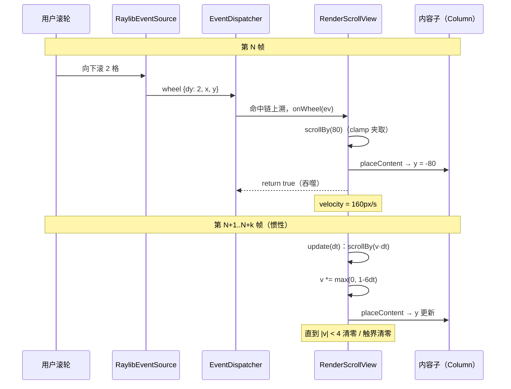

# 滚动与手势：视口、惯性与竞裁

> [返回：第五阶段导览](01-导览.md)
> 对应大纲条目：第五阶段 5。滚动是「位置归父协议 + 命中测试 + 滚轮吞噬 + 布局缓存」四件已学机制的合流：视口与内容两套坐标分离，滚动只是把内容子摆到 `y = -scrollY`，命中自动正确、重布局零次。本册走读 `core/render/scroll.ts`（105 行）全文——滚轮换算（`WHEEL_STEP_PX = 40`）、惯性指数衰减（`v *= max(0, 1-6dt)`）、边界夹取、滚动条比例——连同 `scroll.test.ts` 5 条用例的逐个手算，最后盘点本版手势竞裁的「最简裁决」与缺口。代码逐字摘自 labs 源码；测试输出来自本机实跑 `npx vitest run`（撰写时快照：全库 16 files / 136 tests 全绿，其中 scroll 5 用例）。

## 1. 两套坐标：视口系与内容系

滚动的问题定义只有一句话：**内容比视口大，用户要移动的是内容，移动的表像是视口「窗口」扫过内容**。于是任何时刻存在两套坐标：

```text
视口（viewport）：scroll 自己的盒子，高 this.height —— 用户看得见的窗口
内容（content）：children[0]，高 content.height —— 全部行

窗口点 (wx, wy)  ──换算──►  内容点 (cx, cy) = (wx, cy = wy + scrollY)

scrollY = 0：             scrollY = 200：
┌─ 视口 ─────────┐        ┌─ 视口 ─────────┐
│ row0 (y 0..40)  │        │ row5 (y 200..240)│ ← 窗口顶部对齐内容 y=200
│ row1            │        │ row6             │
│ row2            │        │ row7             │
└─────────────────┘        └──────────────────┘
     ▲ 内容 y=0 顶在视口顶        ▲ 内容子被摆到 y = -scrollY = -200
```

实现这条换算的方式不是「每个绘制/命中调用点加偏移」，而是**把内容子整体摆到 `y = -scrollY`**（位置归父协议：scroll 作为父，直接给 content 赋 y）。此后：

- **命中**：`hitTestNode` 下潜时照常做 `y - child.y`（即 `wy - (-scrollY)` = `wy + scrollY`），窗口点自动映射到内容点——《03》的递归减法一次都没改
- **布局**：content 的尺寸与行的排布完全不受 scrollY 影响（滚的是位置不是尺寸），布局缓存零失效
- **裁剪**：视口 `clipRect` 挡住越界内容，「看不见」与「不存在」分离（绘制命令仍会发出，靠裁剪与剔除兜底——第二、四阶段的老朋友）

## 2. RenderScrollView 状态与滚轮入口

```ts
/** 滚轮一格换算的像素数（宿主约定）。 */
export const WHEEL_STEP_PX = 40;

export class RenderScrollView extends RenderObject {
  scrollY = 0;
  velocity = 0;
  /** 每帧宿主调用：惯性推进（dt 秒）。 */
  update(dt: number): void {
    if (this.velocity === 0) return;
    this.scrollBy(this.velocity * dt);
    // 指数衰减：v *= e^(-6t) 的离散近似
    const decay = Math.max(0, 1 - 6 * dt);
    this.velocity = this.velocity * decay;
    if (Math.abs(this.velocity) < 4) this.velocity = 0;
    this.clampVelocity();
  }

  /** 立即滚动 delta 像素（无惯性）。 */
  scrollBy(delta: number): void {
    this.scrollY = clamp(this.scrollY + delta, 0, this.maxScroll());
    this.placeContent();
  }

  /** 滚轮入口（覆写基类事件方法，签名严格一致）：转发到 handleWheel。 */
  onWheel(ev: WheelEvent): boolean {
    this.handleWheel(ev.dy);
    return true;
  }

  /** 滚轮格数 → 像素：直接滚动 + 赋惯性初速。 */
  handleWheel(dy: number): void {
    this.scrollBy(dy * WHEEL_STEP_PX);
    this.velocity = dy * WHEEL_STEP_PX * 2;
    this.clampVelocity();
  }
```

滚轮入口是一次教科书式的**事件方法覆写**（《02》5.1 的第二种定制路径）：签名与基类严格一致（ScriptC 对覆写签名零容忍——SC1090），方法体只做转发到普通方法 `handleWheel` 并返回 true（**吞噬**：链上后继不再收到滚轮）。行为上拆成两笔：

- `scrollBy(dy * 40)`——**立即**滚 40px/格：反馈零延迟，不等惯性
- `velocity = dy * 40 * 2`——惯性初速是「每秒 2 格」：滚轮一格 (dy=1) 给 80px/s，三格 (dy=3) 给 240px/s

注意 demo 里滚轮事件的到达路径：命中链上最深的其实是某个行文本（无 `onWheel`，返回 false 放行），事件沿链上溯到 scroll 才被认领——**滚动容器靠吞噬语义在链上「接住」滚轮**，不需要是命中链的最深节点（`interactive-scene.test.ts` 的滚轮用例往 (200,200) 一发，scrollY 就 +80，见第 8 节）。

`update(dt)` 是宿主每帧调用的惯性推进（`05-events.ts` 帧循环里 `scene.scroll.update(dt)`），速度为零直接返回——静止的列表零开销。

把一次滚轮的完整闭环画出来（两帧的时序）：



注意分工：分发器只在第 N 帧参与一次（把 wheel 送到链上的吞噬者），此后惯性完全是 scroll 与宿主帧循环之间的事——**事件系统的职责到「认领」为止，物理回到组件自己身上**。

## 3. 惯性物理：初速、指数衰减、边界清零

三条规则拼出惯性：

**① 衰减是指数的**。注释写明「指数衰减：`v *= e^(-6t)` 的离散近似」，实现是显式欧拉一步：`decay = max(0, 1 - 6*dt)`。为什么指数而不是线性（每帧减固定 px/s）？线性的速度曲线是斜坡，末尾速度骤降为 0——手感「撞墙」；指数是速度越低掉得越慢，列表「滑出去、缓缓停」，符合物理直觉（摩擦力近似与速度成比例的粘滞阻尼，微分方程 dv/dt = -6v 的解正是指数）。

**② 离散近似的误差方向**。`1 - 6dt` 近似 `e^{-6dt}` 只在一阶内成立：dt=1/60 时 0.9 对 0.905（很准）；dt=0.1 时 **0.4 对 e^{-0.6} ≈ 0.549**——帧率越低，欧拉比真实指数**衰减得越狠**（滚得越短）。`Math.max(0, ...)` 那个夹取不是装饰：dt > 1/6 秒（< 6fps）时 `1 - 6dt` 变负，速度每帧**反向**——列表会来回振荡。夹到 0 的语义是「帧太久，干脆停」。

**③ 到边界速度清零**（原文）：

```ts
  private clampVelocity(): void {
    const max = this.maxScroll();
    // 顶/底弹回：到达边界时速度清零
    if ((this.scrollY <= 0 && this.velocity < 0) || (this.scrollY >= max && this.velocity > 0)) {
      this.velocity = 0;
    }
  }
```

注释写「弹回」，实现是**清零**——顶/底没有回弹动画，惯性撞到边界直接死（继续朝界外的速度清掉；朝界内的保留）。真·弹回（rubber band）要位置也越界再回弹，是 iOS 风格的 overscroll 物理（第 11 节对照）。

用手算把参数走活（60fps，dt = 1/60）：

| 量 | 公式 | 值 |
|---|---|---|
| 滚轮 1 格初速 | `1 * 40 * 2` | 80 px/s |
| 滚轮 3 格初速 | `3 * 40 * 2` | 240 px/s |
| 每帧保留比 | `1 - 6/60` | 0.9（每帧掉 10%） |
| 速度减半时间 | 解 `0.9^n = 0.5` → n ≈ 6.6 帧 | ≈ 0.11s |
| 停止阈值 | `|v| < 4` 清零 | 从 240 起约 39 帧（≈0.65s）后停下 |
| 渐近总行程 | 连续模型 ∫v dt = v0/6 | 240/6 = **40px**（离散略少） |

最后一条值得记：指数衰减（系数 k=6）的**渐近总行程 = v0/k**，与初速成正比。所以滚轮直接滚掉的 40px/格 与 惯性贡献的 `80/6 ≈ 13px/格` 加起来，一格滚轮的完整手 感 ≈ 53px——调手感时改哪个系数、动哪笔账，心里要有这张表。

## 4. placeContent 与 maxScroll：位置归父的现场

```ts
  maxScroll(): number {
    const content = this.children[0];
    if (content === undefined) return 0;
    return Math.max(0, content.height - this.height);
  }

  /** 内容子节点相对视口的偏移（负 = 向下滚）。scrollY=0 时写 0 而非 -0（Object.is 语义）。 */
  private placeContent(): void {
    const content = this.children[0];
    if (content !== undefined) {
      content.y = this.scrollY === 0 ? 0 : -this.scrollY;
    }
  }
```

`maxScroll = max(0, 内容高 − 视口高)`——内容不超出视口时为 0，`clamp(scrollY, 0, 0)` 把任何滚动请求压回 0（不可滚的容器天然免疫）。`scrollBy` 里那次 `clamp` 是**所有**改 scrollY 的公共咽喉：滚轮、惯性、编程式调用全都过这里，夹取逻辑不存在第二份。

`placeContent` 那个三目的注释是全文件最「较真」的一行：`-this.scrollY` 在 scrollY 为 +0 时会得到 **-0**（JS 一元负号），而 `toBe(0)` 这类断言走 `Object.is` 语义——`Object.is(-0, 0)` 是 **false**，测试会挂。写成条件表达式保住 `+0`。`-0` 在算术里几乎无害（`-0 + 200 === 200`），但任何 `Object.is`/`Map` 键/`JSON.stringify` 场景都会露馅——滚动位置刚好回到 0 是高频路径，这个坑不是理论坑。

## 5. performLayout：无界主轴与 ConstrainedBox 视口

```ts
  protected performLayout(c: BoxConstraints): void {
    const content = this.children[0];
    // 视口尺寸：尽量占满约束（有界时）
    const viewW = c.maxWidth === Infinity ? (content?.width ?? 0) : c.maxWidth;
    const viewH = c.maxHeight === Infinity ? (content?.height ?? 0) : c.maxHeight;
    if (content !== undefined) {
      // 内容：交叉轴跟视口（宽同宽），主轴（高）无界自由生长
      content.layout({ minWidth: 0, maxWidth: viewW, minHeight: 0, maxHeight: Number.MAX_SAFE_INTEGER });
      this.scrollY = clamp(this.scrollY, 0, Math.max(0, content.height - viewH));
      this.placeContent();
    }
    this.setSize(c, { width: viewW, height: viewH });
  }
```

三条约束语义：**视口**尽量占满有界约束（无界时贴内容尺寸）；**内容**交叉轴与视口同宽、主轴（高）拿到 `Number.MAX_SAFE_INTEGER` 的「准无界」自由生长——列在里面想多高就多高，永不因为视口被压缩；**布局后重夹 scrollY**——内容变了（行数增减）后滚动位置立即适配新的 maxScroll。

「列的无界主轴不给高度」是组装时踩过的真实坑（`interactive-scene.ts` 的原文注释）：

```ts
  // 列在无界主轴下不给视口高度 → 用 ConstrainedBox 给滚动区一个有界高度
  const scrollViewport = new RenderConstrainedBox(constraints(0, win.width, 0, win.height - 140));
  scrollViewport.appendChild(scroll);
```

滚动区放在外层 Column 里，Column 对子的主轴约束是松约束（`looseMain`：`minHeight 0, maxHeight MAX_SAFE_INTEGER`，见 `flex.ts`）——传到 scroll 手里 maxHeight「无界」，于是 `viewH = content.height`（视口=内容全高），`maxScroll = 0`，**永远滚不动**。解法是拿 `ConstrainedBox` 先把高度上界钉死（窗口高 − 上下其他内容的 140px），有界视口才存在。症状（列表显示全部/不滚）与根因（约束无界）隔着一层 flex，是布局协议课的典型补考题。

## 6. 命中随滚动自动正确 + 零重布局

两条性质各有专项测试（第 8 节用例 ④⑤），先把机制说透：

**命中自动正确**——scrollBy(200) 后内容子 `y = -200`，`hitTest(scroll, 150, 20)` 下潜到 content 时做 `20 - (-200) = 220`，row0（内容 y 0..40）不在、row5（内容 y 200..240）命中。窗口没换、代码没改，**滚动的可见性变化完全由布局产物的 y 表达**。反过来，已滚出视口的 row0 在窗口内任何点都命不中——命中只认坐标，不认裁剪；「看不见的还能点中」要靠裁剪之外的手段（本版没有，视口外的行命中不到是因为坐标确实在窗口外，不是被裁剪挡的）。

**零重布局**——`scrollBy` 只写 `content.y`，不碰任何 `needsLayout`。布局缓存的有效性来自「滚的是位置不是尺寸」：行的排布、内容的高、视口的高都没变，变的只是内容子在视口里的摆位——而摆位本来就在每次 `placeContent` 里由 scroll 自己管。`totalPerformLayouts`（owner 的观测口，`flushLayout` 后重算）前后不变就是这条性质的数字表达。

## 7. 裁剪与滚动条

```ts
  protected paintSelf(p: Painter): void {
    // 视口裁剪：内容不许越界（裁剪栈在 paintChildren 的 save/restore 内生效）
    p.clipRect({ x: 0, y: 0, width: this.width, height: this.height });
  }

  /** 滚动条（简化：右侧细条，比例与位置示意）。 */
  protected paintAfterChildren(p: Painter): void {
    const content = this.children[0];
    if (content === undefined || content.height <= this.height) return;
    const trackH = this.height;
    const thumbH = Math.max(24, (this.height / content.height) * trackH);
    const thumbY = (this.scrollY / this.maxScroll()) * (trackH - thumbH);
    p.fillRect({ x: this.width - 6, y: thumbY, width: 4, height: thumbH }, PALETTE.textMuted);
  }

  paint(p: Painter): void {
    this.paintSelf(p);
    this.paintChildren(p);
    this.paintAfterChildren(p);
  }
```

两件事：

**裁剪先于内容**。`paint` 的顺序是 paintSelf（设裁剪）→ paintChildren（画内容，此时裁剪生效）→ paintAfterChildren。内容不许越界——滚出视口的行被 scissor 挡住（配合第二阶段的「文本不做包围盒剔除、靠裁剪兜底」策略）。滚动条画在 `paintAfterChildren`：叠在内容之上、永远可见。

**滚动条是比例尺**。thumb 高 = 视口高 × (视口高/内容高)——「可见占比 × 轨道长」；thumb 位置 = 滚动进度 × 可滑动余量。拿测试的数字代入（视口 300×200、内容 800、maxScroll 600）：

```text
thumbH = max(24, (200/800) × 200)         = max(24, 50)  = 50
scrollY=200 时：thumbY = (200/600) × (200−50) = (1/3)×150  = 50
scrollY=600（底）：thumbY = 1 × 150                       = 150（thumb 底=200，贴轨道底）
```

`Math.max(24, ...)` 是可交互性下限：内容极长时纯比例会把 thumb 压成 1~2px 的线，抓不住；24px 保底后 thumbY 的换算依然自洽（可滑动余量随之收缩）。滚动条只是**指示器**——宽 4px、贴右侧、颜色 textMuted，本版不可拖拽（拖拽手势留给第八阶段的控件化）。

## 8. 测试解读：scroll.test.ts 的 5 条逐个手算

测试树（原文）：20 个 280×40 的 RenderBox 塞进 Column，再塞进 ScrollView，`owner.mount(scroll, {300,200}, tightRoot)` 后 `flushLayout`。内容高 20×40 = 800，视口 300×200，maxScroll = 800−200 = **600**。

| it | 关键断言 | 手算 | 防什么错 |
|---|---|---|---|
| 布局：视口 300×200，内容 20×40=800 | `size` `toEqual({300,200})`；`maxScroll()` `toBe(600)`；`children[0].y` `toBe(0)` | 视口占满紧约束；内容无界生长 800 | 视口被内容撑爆（无界时贴内容）；初摆位不是 0（-0 坑） |
| 滚轮换算与夹取 | `handleWheel(2)` → `scrollY === 80`；`handleWheel(100)` → `600`；`handleWheel(-100)` → `0` | 2×40=80；80+4000 夹到 600；600−4000 夹到 0 | 换算倍率错；上下夹取漏一侧 |
| 惯性衰减与边界清零 | `v0 === 40*3*2 (240)`；`update(0.1)` 后 `velocity < v0`；置 scrollY=600、v=500 后 `update(0.016)` → `velocity === 0` | 见下方两段手算 | 衰减公式错；边界不清速度（冲过头/振荡） |
| 命中随滚动偏移：同一窗口点，滚动前后命中不同的行 | 滚动前 `(150,20)` 命中 row0；`scrollBy(200)` 后同点命中 row5；`(150,199)` 不命中 row0 | 窗口 20 → 内容 220 ∈ row5 的 [200,240) | 命中没吃进内容偏移（忘了 -scrollY） |
| 滚动只改内容 y，不触发重布局 | `scrollBy(120)` 前后 `totalPerformLayouts` 不变；`children[0].y === -120` | 摆位 −120，无节点标脏 | 滚动误触发重排（性能回归） |

**惯性用例手算一**：`handleWheel(3)` → `scrollBy(120)`（scrollY=120）、`velocity = 240`。`update(0.1)`：先 `scrollBy(240×0.1 = 24)` → scrollY=144；`decay = max(0, 1−0.6) = 0.4` → velocity = 96；`|96| > 4` 保留；`clampVelocity`：scrollY=144 未到 600 边界，速度保留 → 断言 `96 < 240` ✓（用 `toBeLessThan` 而非精确值——欧拉离散本身依赖 dt，锁死精确值会把实现焊死在特定步长上）。

**惯性用例手算二**（边界清零）：直接置 `scrollY = 600`、`velocity = 500`。`update(0.016)`：`scrollBy(500×0.016=8)` → 608 夹回 600；`decay = 1−0.096 = 0.904` → v = 452；此时 `scrollY >= max(600) && v > 0` → `clampVelocity` 清零 → 断言 `velocity === 0` ✓。**先推进再夹再清**的顺序让最后一帧多滚的 8px 被夹掉、速度被清零——惯性撞底即死，不反弹。

另附 `interactive-scene.test.ts` 的端到端滚轮用例（原文断言）：

```ts
  it("滚轮在列表上滚动（dy=2 → 80px）", () => {
    const { scene, dispatcher } = rig();
    const before = scene.scroll.scrollY;
    dispatcher.dispatch(wheelEvent(200, 200, 2, 1)); // 列表区域
    expect(scene.scroll.scrollY).toBe(before + 80);
  });
```

事件走完整链路：wheel 进 dispatcher → 命中 (200,200)（最深是列表行文本，无 onWheel 放行）→ 沿链上溯到 scroll 的覆写 `onWheel` → 吞噬 + `handleWheel(2)` → +80px。无头环境把「滚轮真的滚了列表」钉进回归。

## 9. 手势竞裁：本版的最简裁决与缺口

本阶段的「手势」其实有两套判定并存，裁决规则都是**局部**的：

| 冲突 | 裁决者 | 规则 |
|---|---|---|
| click vs drag（同一目标） | `GestureController` | 位移平方 > 6² 判 drag，up 时二选一（《04》第 5 节） |
| 单击 vs 双击（同一目标） | `GestureController` | 同目标且间隔 < 0.3s 追加 double-click |
| 内层滚动 vs 外层滚动 | wheel 吞噬 | 链上第一个返回 true 的独享（《03》第 7 节） |
| 拖拽 vs 滚动 | **不存在** | 滚动只由滚轮驱动，drag 手势没有滚动语义 |

最后一行是诚实的空白：mini-gui 的滚动不消费 drag，所以「列表里拖 vs 列表里选」的冲突当前无从谈起。真到触摸/拖拽滚动那天，裁决要回答：按下后先小幅移动，此时 click/drag/滚动三种意图都活着，**谁能宣布胜利**？

把候选方案的裁决结构摆开（概念对照，非本机实测）：

| 方案 | 裁决时机 | 裁决者 | 输家得到什么 |
|---|---|---|---|
| 阈值分流（mini-gui click/drag） | 第一个越过阈值的方向 | 状态机自己 | 无（还没发过事件，天然干净） |
| 链式吞噬（mini-gui wheel） | 事件派发时 | 链上第一个认领者 | 后继根本收不到 |
| 竞技场（Flutter GestureArena） | 竞争者全部表态后 | 第一个 declareVictory，或全员 hold 后最后入场者 | 收到 reject，状态回滚 |
| 父子协商（Android intercept） | 每个事件都可抢 | 父容器（onInterceptTouchEvent） | 子收到 CANCEL，状态回滚 |

工业答案的共性是**延迟裁决 + 输家补偿**：按下后不立即判定，等竞争分出胜负再通知输家撤销（cancel/reject）。mini-gui 的阈值分流之所以不需要补偿，是因为判定前一个手势事件都没发出去——「先憋住、赢了才说」是最便宜的仲裁。滚动接入 drag 那天要补的不是竞技场本身，而是「已经发过 drag-start 的控件如何被告知输掉」的撤销协议。

## 9.1 从滚轮到像素：一帧内五个模块的接力

把第 2 节的时序图摊成数据流，一帧内五个模块各改一行状态：

```text
RaylibEventSource      dy = -getMouseWheelMove()          （符号翻译，平台层唯一一处）
EventDispatcher        chain = hitTest(root, x, y)         （命中，最深=行文本）
                       for node of chain: onWheel?          （上溯找认领者）
RenderScrollView       scrollBy(dy*40) → scrollY（clamp）   （换算+夹取）
                       velocity = dy*80                    （惯性初速）
内容子（Column）        y = -scrollY                        （placeContent，父摆位）
下一帧起               update(dt)：scrollY += v·dt; v *= 1-6dt
                       （惯性闭环，与事件系统再无关系）
```

五段接力里每一段都可单测（events.test 钉前两段、scroll.test 钉后三段、interactive 端到端钉全链）——这是无头测试覆盖率高的根本原因：**每个模块的接口都是纯数据进纯数据出**，没有一处需要真的窗口。

## 10. 常见误区

- **「滚动要通知命中系统/绘制系统」**——都不用。滚的是内容子的 y（布局产物），命中递归减偏移、绘制平移链自动跟上。滚动 = 改一个数 + 摆一次位
- **「惯性速度该用真实帧间隔累积」**——`update(dt)` 用宿主传入的 dt（`getFrameTime()`），衰减与推进都按 dt 缩放，帧率无关；只有阈值 4px/s 与系数 6 是绝对值
- **「`1 - 6dt` 不用夹 0，dt 不会那么大」**——卡顿/断点时 dt 可以任意大（窗口拖住一秒，dt=1），不夹就速度反向振荡。防御性夹取的生效条件是「永不生效」，生效即救命（《02》guard 16 同理）
- **「到边界应该弹回来」**——注释说「弹回」，代码做的是清零止步。真弹回需要位置也越界（rubber band），是 overscroll 物理的另一档实现（第 11 节）
- **「maxScroll 每次现算 content.height - height 就行，不用 max(0,...)」**——内容比视口矮时差值为负，clamp(v, 0, 负数) 行为混乱（min>max 时返回值依赖实现顺序）。`Math.max(0, ...)` 把「不可滚」折叠成 0
- **「scrollY=0 时 y=-0 无所谓」**——`Object.is(-0, 0)` 为 false，`toBe(0)` 会挂；`Map` 键、`JSON.stringify("-0")` 都会露馅。`placeContent` 的条件表达式就是为这个
- **「滚动条高度 = 视口/内容比例」**——是 `视口高 × (视口高/内容高)`（比例再乘轨道长），且 `max(24, ...)` 保底。漏乘轨道长是常见手滑
- **「滚轮一格滚多少是系统决定的」**——系统给的是「格数」（raylib 的 `getMouseWheelMove` 返回浮点格），`WHEEL_STEP_PX = 40` 是本框架的格→像素约定（Windows 的 WHEEL_DELTA=120 是每格的固定增量数，概念对照，非本机实测）
- **「列表放进 Column 里自然就能滚」**——Column 的松约束给子的主轴无界，视口被撑成内容全高，maxScroll=0。要 `ConstrainedBox` 钉出有界视口（第 5 节的坑）

## 11. 与其他框架的对照（概念对照，非本机实测）

| 维度 | mini-gui | iOS UIKit | Flutter | CSS |
|---|---|---|---|---|
| 滚动模型 | 内容子 y = -scrollY，父摆位 | contentOffset（CGPoint），bounds.origin 平移 | `ScrollPosition.pixels`，viewport offset | 滚动容器 overflow + scrollTop |
| 驱动 | 滚轮（40px/格）+ 惯性 | 触摸 pan 手势 + 惯性 | 手势 + physics | 滚轮/触摸/scrollTop 赋值 |
| 惯性 | `v *= max(0, 1-6dt)`，阈值 4 清零，边界止步 | `decelerationRate`（normal ≈ 0.998）的指数衰减，走 `UIScroll-ViewDelegate` 结束回调 | `ScrollPhysics` 族：Clamping（硬夹）/ Bouncing（弹性） | `scroll-behavior: smooth` 的补间（非物理） |
| 越界 | 夹取，不弹 | rubber-band 弹性回弹 | BouncingScrollPhysics 同款 | `overscroll-behavior: contain/none` 控制传导 |
| 滚轮单位 | 格（自定 40px/格） | ——（触屏为主） | `PointerScrollEvent` 物理像素 | `deltaY` + `deltaMode`（pixel/line/page） |

三点观察：其一，mini-gui 的「视口/内容分离 + 父摆位」与 iOS 的 `bounds.origin`、Flutter 的 viewport offset 是同一个数学的三种命名——**滚动从来不是动画，是坐标解释权的转移**。其二，越界行为是最能暴露平台出身的地方：iOS 弹（rubber band 是身份标识）、Flutter 两套 physics 按平台挑、CSS 用属性把选择权给页面作者、mini-gui 硬夹——简单，但撞底即死的「手感」在桌面滚轮场景可接受（Windows 桌面应用的传统同样是硬夹）。其三，滚轮的「格」是世界语：Windows 的 WHEEL_DELTA=120、raylib 的浮点格、DOM 的 deltaMode=line，都在说「滚轮事件是离散档位，像素化是消费方的事」——`WHEEL_STEP_PX` 放在 scroll.ts 而不是平台层，是因为「一格多少像素」是滚动语义（手感）不是设备语义，40 这个数属于框架的产品决策。

## 12. 本册小结

- 视口/内容两套坐标；滚动 = 内容子 `y = -scrollY`（位置归父协议），命中自动正确（row0→row5 用例）、零重布局（totalPerformLayouts 不变）
- 滚轮：吞噬式覆写 `onWheel`（签名严格一致），`WHEEL_STEP_PX=40` 立即滚 + 初速 `dy*80`；惯性 `v *= max(0, 1-6dt)` 指数衰减、`|v|<4` 清零、边界速度清零（不弹）
- 离散欧拉的误差方向：dt 大时比真实指数衰减更狠；`max(0,...)` 防速度反向振荡
- `placeContent` 的 -0 防御（`Object.is` 语义）；`maxScroll = max(0, 内容高−视口高)`；`scrollBy` 的 clamp 是唯一咽喉
- 无界主轴坑：Column 松约束下视口被内容撑爆，ConstrainedBox 钉出有界视口（300−140=160）
- 滚动条 = 可见占比 × 轨道长 + 24px 保底，画在 paintAfterChildren 叠在内容上
- 手势竞裁的最简版：阈值分流 click/drag、同窗判双击、链式吞噬管嵌套滚动；拖拽 vs 滚动的冲突当前不存在（滚轮驱动），竞技场是未来的答案
- 5 条 scroll 用例 + interactive 滚轮端到端，全部数字可手算复现

## 自测

1. 视口坐标与内容坐标的换算公式是什么？这个换算在代码里以什么形式存在（提示：不是函数，是一次赋值）？
2. 滚轮一格做了两笔更新，分别是什么？为什么「立即滚」与「赋初速」要分开做，而不是只给速度让惯性慢慢滚过去？
3. 手算：`handleWheel(1)` 之后立刻 `update(0.5)`——scrollY 增加多少？velocity 变成多少？再 `update(0.5)` 呢？（注意 decay 的夹取。）
4. 衰减为什么用指数而不是每帧减固定值？`max(0, 1-6dt)` 里那个 `max` 防的是什么具体故障（写出症状）？
5. 60fps 下从 240px/s 起，大约多少帧后速度跌破 4px/s 的清零线？渐近总行程（连续模型）是多少像素？
6. `placeContent` 为什么要特判 `scrollY === 0`？`-0` 会伤害哪些断言/数据结构？
7. 把 20 行 × 40px 的列表放进 160px 高的视口：maxScroll 是多少？thumbH 与滚动到中部时的 thumbY 各是多少？
8. 列表放在 Column 里滚不动，根因链条是什么（从 flex 的松约束讲到 viewH 的取值）？ConstrainedBox 的那行 `constraints(0, w, 0, h-140)` 各参数为什么这么给？
9. `scrollBy(200)` 之后 `hitTest(scroll, 150, 20)` 为什么命中 row5？写出递归下潜时坐标的两步变换。
10. 滚动不触发重布局的测试为什么用 `owner.totalPerformLayouts` 而不是比较某行的 y？这两个观测口各能证什么、不能证什么？
