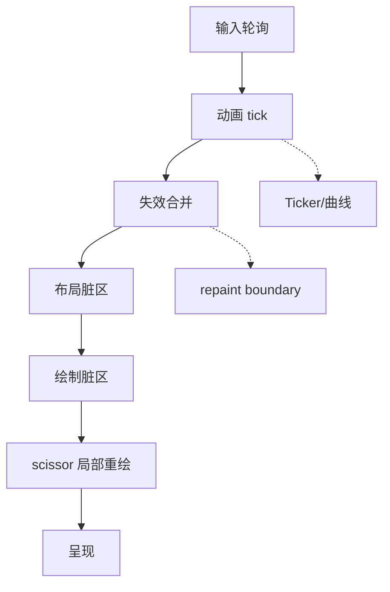

# 第六阶段导览：渲染管线与调度

> [返回：GUI框架学习大纲](../GUI框架学习大纲.md)
> 每帧全部重排重画，控件一多就掉帧。本阶段做脏标记、局部重绘、重绘边界与动画系统，把「一帧的旅程」变成显式流水线，并用数字说话。

## 分册索引

| 分册 | 对应大纲条目 | 一句话说明 | 状态 |
|---|---|---|---|
| 01-导览.md | — | 本页 | ✅ |
| 02-帧流水线.md（298 行） | 1 | 一帧的旅程、vsync 与 targetFPS、帧预算 | ✅ |
| 03-脏标记与失效传播.md（300 行） | 2 | markNeedsLayout/Paint、首个脏节点、合并失效 | ✅ |
| 04-局部重绘.md（296 行） | 3 | 脏矩形合批、scissor 限定、repaint boundary、何时反而不划算 | ✅ |
| 05-动画系统.md（301 行） | 4 | Ticker、插值与曲线、状态机、隐式动画 | ✅ |
| 06-性能度量.md（306 行） | 5 | 帧时间、绘制计数、脏区面积比、压测方法 | ✅ |

## 阶段目标

学完本阶段，你应该能不查资料做到：

- 画出一帧的完整流水线：输入轮询 → 动画 tick → 布局 → 绘制 → 呈现，标出每步的触发条件
- 实现脏标记失效传播：自底向上冒泡、自顶向下执行、一帧内合并
- 计算脏矩形并集并用 scissor 限定重绘范围；说清 repaint boundary 的收益条件
- 实现 Ticker + 曲线插值的动画系统与隐式动画
- 自建帧时间面板，对 1000 控件滚动场景给出优化前后的数字对比

## 知识点地图

## 实践任务清单

1. 实现脏标记管线（layout 阶段与 paint 阶段分开），mock 时钟下断言失效合并次数
2. 实现 repaint boundary 与脏矩形合批；对比「全帧重绘 vs 局部重绘」在 10 / 100 / 1000 控件下的帧时间
3. 实现动画系统：显式动画（控制器）与隐式动画（样式变化补间）两套
4. 帧时间面板叠加在窗口角落：帧时间曲线、绘制命令数、脏区面积比

## 阶段自测

1. 失效为什么自底向上冒泡、执行却自顶向下？两次遍历能合并成一次吗？
2. 一个按钮变色的最小失效集是什么？它需要重布局吗？
3. 什么条件下 repaint boundary 反而增加成本？
4. vsync、targetFPS、帧预算三者是什么关系？
5. 隐式动画的「自动补间」在脏标记系统里对应什么失效序列？
