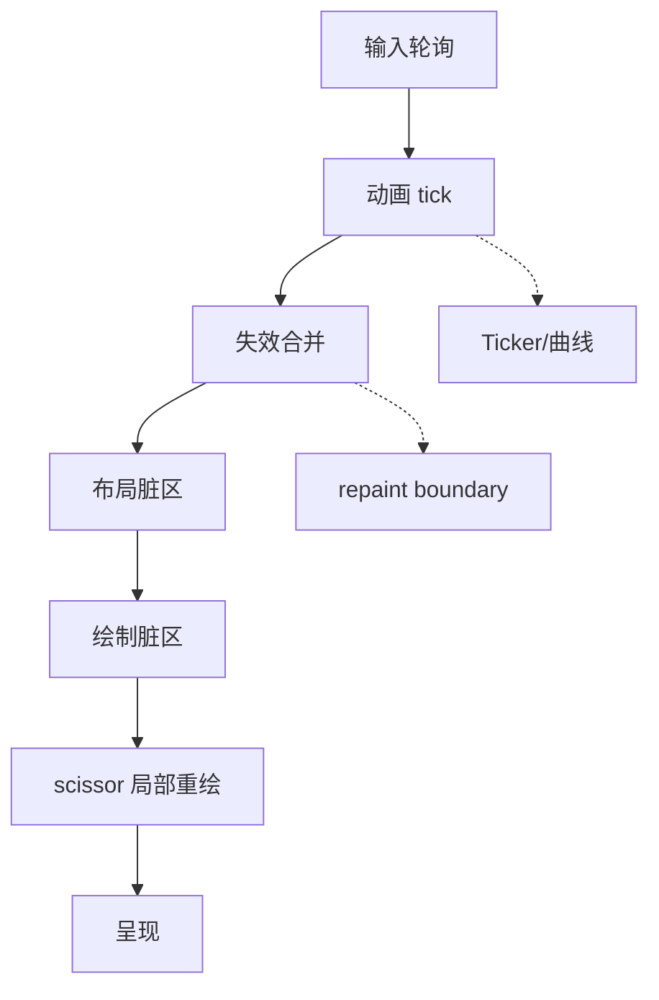

---
references:
  - 02-帧流水线
  - 03-脏标记与失效传播
  - 04-局部重绘
  - 05-动画系统
  - 06-性能度量
---

# 第六阶段导览：渲染管线与调度

> [返回：GUI框架学习大纲](../GUI框架学习大纲.md)
> 每帧全部重排重画，控件一多就掉帧。本阶段做脏标记、局部重绘、重绘边界与动画系统，把「一帧的旅程」变成显式流水线，并用数字说话。

## 分册索引

| 分册 | 对应大纲条目 | 一句话说明 | 状态 |
|---|---|---|---|
| 01-导览.md | — | 本页 | ✅ |
| 02-帧流水线.md（298 行） | 1 | 一帧的旅程、vsync 与 targetFPS、帧预算 | ✅ |
| 03-脏标记与失效传播.md（300 行） | 2 | markNeedsLayout/Paint、首个脏节点、合并失效 | ✅ |
| 04-局部重绘.md（296 行） | 3 | 脏矩形合批、scissor 限定、repaint boundary、何时反而不划算 | ✅ |
| 05-动画系统.md（301 行） | 4 | Ticker、插值与曲线、状态机、隐式动画 | ✅ |
| 06-性能度量.md（306 行） | 5 | 帧时间、绘制计数、脏区面积比、压测方法 | ✅ |

## 阶段目标

学完本阶段，你应该能不查资料做到：

- 画出一帧的完整流水线：输入轮询 → 动画 tick → 布局 → 绘制 → 呈现，标出每步的触发条件
- 实现脏标记失效传播：自底向上冒泡、自顶向下执行、一帧内合并
- 计算脏矩形并集并用 scissor 限定重绘范围；说清 repaint boundary 的收益条件
- 实现 Ticker + 曲线插值的动画系统与隐式动画
- 自建帧时间面板，对 1000 控件滚动场景给出优化前后的数字对比

## 知识点地图

## 实践任务清单

1. 实现脏标记管线（layout 阶段与 paint 阶段分开），mock 时钟下断言失效合并次数
2. 实现 repaint boundary 与脏矩形合批；对比「全帧重绘 vs 局部重绘」在 10 / 100 / 1000 控件下的帧时间
3. 实现动画系统：显式动画（控制器）与隐式动画（样式变化补间）两套
4. 帧时间面板叠加在窗口角落：帧时间曲线、绘制命令数、脏区面积比

## 阶段自测

1. 失效为什么自底向上冒泡、执行却自顶向下？两次遍历能合并成一次吗？
2. 一个按钮变色的最小失效集是什么？它需要重布局吗？
3. 什么条件下 repaint boundary 反而增加成本？
4. vsync、targetFPS、帧预算三者是什么关系？
5. 隐式动画的「自动补间」在脏标记系统里对应什么失效序列？

## 常见误区与正解

性能阶段的误区大多不是「不知道概念」，而是「知道概念但用错触发时机」。这些错误在十个控件的演示里完全无感，控件上千之后每一条都会成倍放大帧时间。对照检查时，优先看自己的失效入口与合并出口。

| 误区 | 为什么错 | 正解 |
|---|---|---|
| 状态一变就立刻重排重画 | 同一帧内十个状态变化会触发十次完整布局，每次都算出相同结果；帧预算被重复劳动吃光，用户却只能看到最后一帧 | 失效只打标记不执行，帧首统一合并成一次布局与一次绘制，见 [03-脏标记与失效传播](03-脏标记与失效传播.md) |
| 脏标记只标在变化的节点自身 | 子节点变宽会改变父的排布，只标子节点时父层完全不知情，画面出现同一区域新旧并存 | 自底向上冒泡到第一个能兜底的边界（重绘边界或根），执行时再自顶向下，见 [03-脏标记与失效传播](03-脏标记与失效传播.md) |
| 动画就是每帧手动改属性并全量重绘 | 没有失效边界时，一个两百毫秒的小动画等价于十几帧整屏重绘；几个动画叠加就直接跌穿帧预算 | 调度器只产生失效标记，属性变化走同一条脏标记管线，重绘边界把影响圈在图层内，见 [05-动画系统](05-动画系统.md) |
| 帧率均值达标就等于流畅 | 均值掩盖长尾：偶发的超预算尖峰在均值里几乎不可见，但用户每隔几秒就能感觉到一次卡顿 | 同时盯最大帧时间与高分位曲线，把尖峰定位到具体帧的失效来源，见 [06-性能度量](06-性能度量.md) |
| 局部重绘一定比全帧划算 | 脏矩形过碎时，合批计算、剪裁状态切换与多次提交的开销加起来，可能超过一次全画布重绘 | 以脏区面积比为决策指标：超过阈值就整体退回全帧重绘，见 [04-局部重绘](04-局部重绘.md) |

## 术语速查表

渲染管线的术语自带顺序：从节拍到标记到裁剪再到度量。按流水线顺序记忆，比按字母序背单词有效得多；读分册遇到英文原词时回到本表对齐口径。

| 术语 | 英文 | 一句话解释 |
|---|---|---|
| 垂直同步 | vsync | 显示器刷新的节拍信号，帧循环以它为截止时间安排整条流水线 |
| 帧预算 | frame budget | 一帧允许消耗的最大时长；六十帧目标下约为十六毫秒出头 |
| 脏标记 | dirty flag | 「需要重新布局或重绘」的布尔标记；打标便宜，执行延迟到帧首合并 |
| 失效传播 | invalidation propagation | 脏标记沿树自底向上冒泡收集、再自顶向下执行的两段式过程 |
| 重绘边界 | repaint boundary | 失效冒泡的截断点：边界内的变化不再惊扰边界外的任何节点 |
| 脏矩形 | dirty rect | 本帧真正需要重画的屏幕区域，取所有失效盒子的并集再合批 |
| 剪裁测试 | scissor test | 后端层面的矩形裁剪开关，把绘制命令的作用域限制在脏矩形内 |
| 帧调度器 | Ticker | 每帧回调一次的时间源，动画控制器挂在它上面推进插值 |
| 插值 | interpolation | 在起始值与结束值之间按进度比例取中间值 |
| 缓动曲线 | easing curve | 把线性进度映射成加速减速的非线性进度，决定动画的手感 |
| 隐式动画 | implicit animation | 只声明目标值，框架自动对样式变化做补间，无需手写控制器 |
| 帧时间 | frame time | 单帧从输入轮询到呈现完成的实际耗时，性能度量的第一指标 |

## 踩坑与排查速查

渲染类缺陷的共同特征是「现象滞后于原因」：失效在上一帧打出，错误在下一帧才上屏；有时残影甚至来自两帧之前。排查时优先回答三个问题：这一帧谁打了标、合并结果是什么、最终画了多大范围。

| 现象 | 可能原因 | 处置 |
|---|---|---|
| 改了属性画面却不动 | 只改了值没有打失效标，或标打在了布局段而绘制段没有对应标记 | 核对失效入口：样式变化应直接触发重绘标，不能依赖下一帧的巧合 |
| 帧时间尖峰周期性出现 | 多个控件的失效恰好落在同一帧叠加执行 | 在失效合并处计数并按帧输出失效节点数，定位叠加来源后错峰 |
| 同一帧内反复布局直到超时 | 约束不稳定：子回报的尺寸反过来改变父给子的约束，形成来回震荡 | 检查是否用子的结果反推给子的约束；对浮动尺寸给出最小值兜底 |
| 动画在掉帧后位置跳变 | 时间步长取固定值，没有用真实帧间隔补偿 | 回调里按真实时间差推进插值，掉帧后一步追平而不是逐帧补 |
| 局部重绘后旧图像残留 | 脏矩形没有并入上一帧的残影区域，或清除操作没有覆盖整个脏区 | 计算脏区时合并上一帧的旧脏区；确认背景清除完整覆盖并集 |
| 千级控件滚动帧时间翻倍 | 滚动区域缺少重绘边界，任何一项变化都全屏失效 | 在滚动视口处加重绘边界，并对照第六阶段基线数据验证收益 |
| 帧时间面板自身造成掉帧 | 面板文本每帧全量重建与重绘，度量工具成了性能问题本身 | 面板数值降频刷新、文本走缓存，面板放进独立重绘边界 |

如果排查中反复出现「打了标但没生效」或「没打标却重绘了」，说明失效入口不唯一——这是管线实现走形的最明确信号。回头把所有失效收敛到规定的两三个入口，这类问题通常成片消失。
