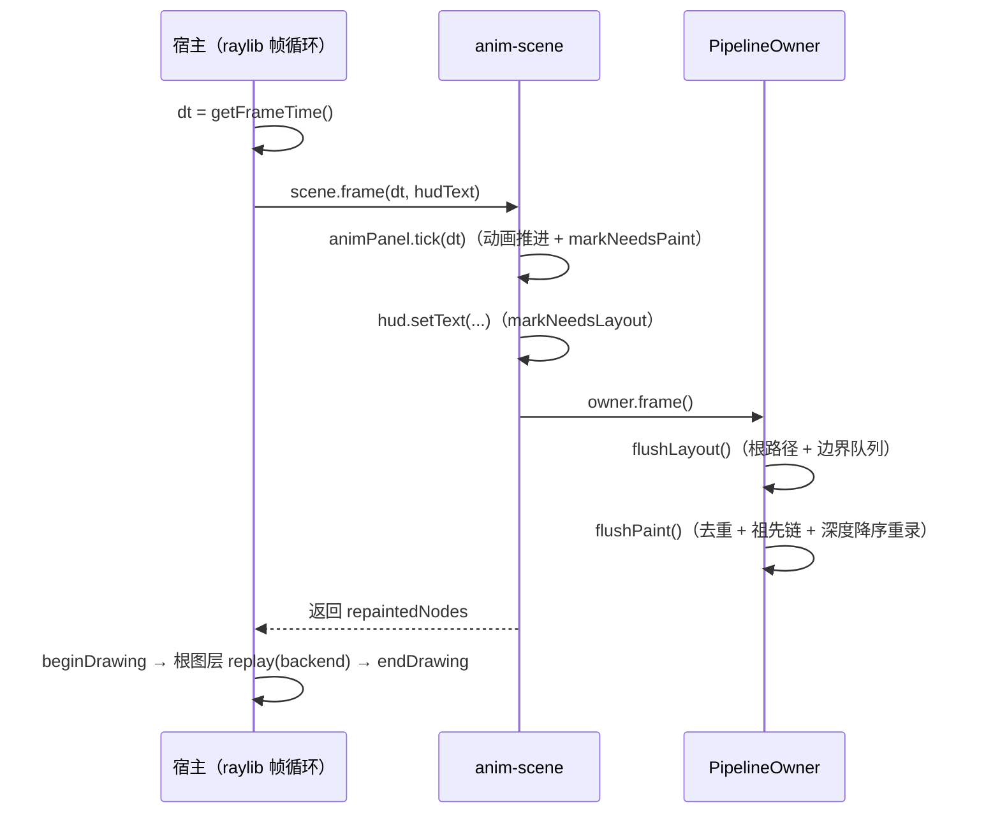

# 帧流水线：一帧的旅程

> [返回：第六阶段导览](01-导览.md)
> 对应大纲条目：第六阶段 1（一帧的完整旅程：输入轮询 → 动画 tick → 失效布局 → 失效绘制 → 呈现；vsync 与 targetFPS；帧预算 16.6ms 的含义）。
> 本册走读 `PipelineOwner.frame()`（`core/render/owner.ts`，144 行）与宿主侧 `apps/06-pipeline.ts`（74 行）的完整帧循环，把第五阶段「循环里平铺的调用」收编成显式两段流水线，再讲呈现段（根图层整段重放）与帧预算的现实校准。代码逐字摘自 labs 源码；无头测试来自本机实跑 `npx vitest run`（撰写时快照：全库 25 files / 201 tests 全绿（2026-11-14 快照），其中本阶段新增 animation 8 + pipeline 7 + anim-scene 3）；窗口数字为 2026-11-14 本机四次实跑 `MINI_GUI_SECONDS=2 npx scriptc-raylib run src/apps/06-pipeline.ts --dev`。

## 1. 从「平铺调用」到「显式流水线」

到第五阶段为止，帧循环长什么样？以 `apps/05-events.ts` 为例：输入轮询与分发、`scroll.update(dt)` 惯性推进、布局与绘制都在 `while (!windowShouldClose())` 里逐帧执行。它们**顺序对了，但语义是平铺的**——每一帧都是「输入处理一遍、动画推一遍、布局排一遍、绘制画一遍」，至于「这帧有没有东西真的变了」，循环不知道，也不在乎。

第六阶段要回答的问题正是导览里那句「每帧全部重排重画，控件一多就掉帧」。解法不是把循环写快，而是让循环**知道自己这一帧欠了多少活**：

- 布局欠活：`needsLayout` 脏标记 + `flushLayout` 只排脏子树（《03》）
- 绘制欠活：`needsPaint` 脏标记 + `flushPaint` 只重录脏边界（《04》）
- 动画欠活：`tick(dt)` 返回「还在活动吗」，没有动画时理论上整帧可以只做呈现（《05》）

把这三类欠活收进一个显式的阶段序列，就是「一帧的旅程」：



一个诚实的裁剪先说在前面：06 demo **没有输入段**。完整旅程的第一段「输入轮询」在第五阶段 `05-events.ts` 里已经接过线（`RaylibEventSource.poll()` → 分发/焦点路由），本阶段的演示窗口没有可交互控件，循环里看不到它——但流水线的形状不因此改变，输入段永远可以插在动画 tick 之前（输入改变状态 → 状态标脏 → 后续阶段自然消化）。

## 2. frame()：流水线只有两段

`PipelineOwner` 是一帧的入口与观测口。文件头注释给了用法闭环（原文）：

```ts
// PipelineOwner：一帧布局的入口与观测口。
// 用法：owner.mount(root, windowSize) → 状态变化处 markNeedsLayout() → owner.flushLayout()。
// 边界内子树的缓存复用由 RenderObject.layout 自己完成（约束没变 + 不脏 → 跳过）。
```

核心方法短得可以整段贴出（`owner.ts`，逐字）：

```ts
  /** 一帧的完整流水线：布局 → 绘制。宿主每帧调用。 */
  frame(): void {
    this.flushLayout();
    this.flushPaint();
  }
```

为什么是两段而不是五段（输入/动画/布局/绘制/呈现）？因为 owner 只拥有**树**：输入与动画属于宿主循环和场景对象（`animPanel.tick` 在 scene 里，见第 3 节），呈现属于后端（replay 在 app 里，见第 4 节）。owner 管的是中间两段——恰恰是「失效合并」能起作用的区间。每段一个 flush，各自消化自己的脏队列：

| 阶段 | 方法 | 输入（欠活清单） | 输出 | 观测口 |
|---|---|---|---|---|
| 布局 | `flushLayout()` | `pendingBoundaries`（relayout boundary 队列） | 各节点尺寸/位置有效 | `layoutPasses` / `totalPerformLayouts` |
| 绘制 | `flushPaint()` | `pendingPaintBoundaries`（repaint boundary 队列） | 各边界 `layer` 图层缓存有效 | `paintPasses` / `repaintedNodes` |

两段有严格的先后：`flushLayout()` 末尾的 `layout()` 会自动 `markNeedsPaint()`（布局驱动绘制的级联失效，`render-object.ts` 里标注「重排过的子树必然要重画」），所以绘制段的欠活清单是在布局段里长出来的——先布局后绘制不只是习惯，是依赖方向。

再看 `mount()`（逐字）：

```ts
  mount(root: RenderObject, size: Size, opts?: { tightRoot?: boolean }): void {
    this.root = root;
    this.rootSize = size;
    this.tightRoot = opts?.tightRoot ?? true;
    root.setOwner(this);
    root.markNeedsLayout();
    root.markNeedsPaint();
    this.layoutPasses = 0;
  }
```

挂载做三件事：整树赋 `owner`（失效上报的收件地址）、给根打上**两种**脏（首帧要排也要画）、清零观测口。注意 `markNeedsLayout()`/`markNeedsPaint()` 此时都命中「已脏」路径——两个标志的初始值就是 `true`（`needsLayout = true`、`needsPaint = true` 是字段声明）。首帧的绘制全靠这个初始脏：所有节点生来就是脏的，第一次 `flushPaint` 才会把每个边界都录进图层。这个初始值后来坑过一次「已脏即停」守卫，是《03》的主角。

## 3. 宿主帧循环逐字走读：apps/06-pipeline.ts

app 的装配段先过一遍（逐字，省略 import）：

```ts
const WIDTH = 800;
const HEIGHT = 450;

const targetFps = envNumber(process.env.MINI_GUI_FPS, 60);
const exitAfterSeconds = envNumber(process.env.MINI_GUI_SECONDS, 0);
const shotPath = process.env.MINI_GUI_SHOT;

initWindow(WIDTH, HEIGHT, "mini-gui 06 pipeline");
setTargetFPS(targetFps);

const backend = new RaylibBackend();
const measurer = new RaylibMeasurer();
const uiFont = loadUiFont();
backend.setFont(uiFont.font);
measurer.switchFont(uiFont.font);
const scene = buildAnimScene(measurer, 16, { width: WIDTH, height: HEIGHT });
```

三个环境变量是本阶段回归工具链的一半：`MINI_GUI_SECONDS` 定时退出（无头跑完打统计）、`MINI_GUI_FPS` 换目标帧率、`MINI_GUI_SHOT` 退出前截图（`takeScreenshot`）。字体两行是第五阶段 platform/font 的教训落地：`loadUiFont()` 优先加载含 CJK 的系统 TTF（全 ASCII + CJK 样本码点），`backend.setFont` 与 `measurer.switchFont` 同步换——只换一边，画的和量的就不是同一张脸。

场景是 `buildAnimScene`（`scenes/anim-scene.ts`，《05》详读）：静态面板（干净边界，被 blit）+ 动画面板（每帧重录的边界）+ HUD 文本，`mount` 后立刻 `owner.frame()` 跑出首帧。

主循环逐字：

```ts
let frames = 0;
let elapsed = 0;
let lastRepainted = 0;
let lastCommands = 0;

while (!windowShouldClose()) {
  const dt = getFrameTime();
  frames += 1;
  elapsed += dt;

  lastRepainted = scene.frame(dt, `fps ${getFPS()}  repainted ${lastRepainted}  cmds ${lastCommands}`);
  const rootLayer = scene.root.layer;
  if (rootLayer !== null) lastCommands = rootLayer.commands.length;

  beginDrawing();
  clearBackground(RAYWHITE);
  // 帧呈现：根图层（局部坐标 = 窗口坐标，根在原点）整段重放到后端
  if (rootLayer !== null) rootLayer.replay(backend);
  backend.endFrame();
  endDrawing();

  if (exitAfterSeconds > 0 && elapsed >= exitAfterSeconds) break;
}

if (shotPath !== undefined) takeScreenshot(shotPath);
closeWindow();
```

逐行拆开：

| 行 | 做什么 | 为什么在这 |
|---|---|---|
| `dt = getFrameTime()` | 取**上一帧**的耗时 | 动画按真实时间推进，免疫首帧尖峰（第 5 节） |
| `scene.frame(dt, hudText)` | 动画 tick + HUD 文本更新 + `owner.frame()` | 状态变化发生在 flush **之前**，本帧就消化 |
| `rootLayer.commands.length` | 记录根图层命令数 | HUD 观测口（下一帧显示） |
| `beginDrawing/endDrawing` | raylib 帧边界 | 所有绘制调用必须包在里面 |
| `clearBackground(RAYWHITE)` | 整屏清底色 | 根图层是整窗的，双保险 |
| `rootLayer.replay(backend)` | 呈现：整段重放 | 第 4 节 |
| `backend.endFrame()` | 复位可能的残留 scissor | 后端契约 |

**HUD 文字里藏着一个时序细节**。`scene.frame(dt, ...)` 的第二个参数是模板字符串，而 JS 的规则是：实参在函数调用前求值，赋值在函数返回后才完成。所以 HUD 显示的 `repainted ${lastRepainted}` 与 `cmds ${lastCommands}` 是**上一帧**的统计值——第一帧显示 `repainted 0  cmds 0`（初始值），第二帧起才有真数字。这不是 bug，是「统计面板只能显示已完成的帧」的自然结果；真要看本帧数字，得把 HUD 更新挪到 `scene.frame` 之后（但那样 HUD 文本又晚一帧进入图层缓存，永远差一帧，本质相同）。

**`scene.frame` 内部**（`anim-scene.ts`，逐字）：

```ts
    frame(dt: number, hudText: string): number {
      animPanel.tick(dt);
      hud.setText([{ text: hudText }]);
      owner.frame();
      return owner.repaintedNodes;
    },
```

三行就是「动画 tick → 失效 → 流水线」的完整接线：`animPanel.tick(dt)` 推进两个 `AnimatedValue` 并 `markNeedsPaint()`；`hud.setText(...)` 是 `RenderText` 的唯一改文本入口，内部 `markNeedsLayout()`；然后 `owner.frame()` 消化两种脏。返回 `repaintedNodes` 供 HUD。顺序不可换：tick 在前，flush 在后，本帧的动画位移本帧就能上屏。

## 4. 呈现段：根图层整段重放

绘制阶段的产物不是屏幕像素，是**根图层的显示列表**。`flushPaint` 之后，整棵树的可见内容都在 `root.layer.commands` 里（脏边界重录的新图层 + 干净边界的旧图层经 blit 拷贝进祖先，《04》详述）。呈现只剩一件事：

```ts
  if (rootLayer !== null) rootLayer.replay(backend);
```

`DisplayList.replay` 的实现就是逐条转发（`painter.ts`）：

```ts
  replay(target: CommandSink): void {
    for (const cmd of this.commands) {
      target.execute(cmd);
    }
  }
```

两个支撑事实让这一行成立：

- **根在原点**。根 `RenderColoredBox` 被父（谁也没有）摆出 `x=0, y=0`，所以「根图层的局部坐标」就是窗口坐标——app 注释原文：「帧呈现：根图层（局部坐标 = 窗口坐标，根在原点）整段重放到后端」。整棵树以根为坐标系原点记录，重放时零换算。
- **命令自包含**。第二阶段的取舍在第六阶段兑现红利：每条 `DrawCmd` 烘焙了绝对坐标与裁剪区，重放不需要任何树形上下文，`replay` 才能是五行的循环。后端 `applyClip` 会把命令自带的 `clip` 落到 `beginScissorMode`/`endScissorMode`，帧末 `backend.endFrame()` 调 `applyClip(null)` 复位残留状态。

注意呈现段的粒度：**整段重放，不挑命令**。哪怕这一帧只有动画面板变了，replay 仍然把根图层全部命令交给后端。「只把变化的部分提交给 GPU」是脏矩形/scissor 合批的课题，本版没做——《04》第 8 节与《06》的诚实账本会算清这笔账。

## 5. vsync、targetFPS 与帧预算

`setTargetFPS(60)` 的语义在第一阶段已经用数字摸过底。那是 03 demo 的实测（`docs/01-第一阶段/06-第一个窗口与帧循环.md`，2026-11-14 本机，此处复用其数据）：

```text
MINI_GUI_FPS=30 : frames=61   elapsed=2.027s avgFps=30.1  maxDt=60.09ms
MINI_GUI_FPS=60 : frames=116  elapsed=2.012s avgFps=57.7  maxDt=91.27ms
MINI_GUI_FPS=120: frames=225  elapsed=2.006s avgFps=112.2 maxDt=58.17ms
```

三个结论直接搬进本阶段的预算表：

- **实际帧率永远略低于目标**（30.1/57.7/112.2 对 30/60/120，亏空 3.8%/4.6%/6.5%，帧率越高亏空越明显）。软件帧限制是「等到至少 16.67ms」而非精确等待，加上 vsync 与调度抖动（macOS 还隔着一层 GL→Metal 兼容）。做帧预算要按 57fps 而不是 60fps 规划「每秒能干多少活」。
- **maxDt 尖峰是一次性成本**。首帧包含窗口创建、默认字体上传（45~91ms 量级）。`dt` 驱动的动画天然免疫：首帧 dt 大，位移一步到位，不卡顿不跳变；危险的是用固定步长等效的写法（第一阶段第 7 节的教训）。
- **帧预算 16.6ms 是全程预算**。60fps 目标下一帧的旅程——输入轮询、动画 tick、布局 flush、绘制 flush、replay、`endDrawing` 的等待——共享这 16.6ms（实际还拿不满）。本册流水线的意义就是把这几段变成**可分别计时的欠活清单**，哪段超了看得见（《06》）。

`dt` 的语义再强调一次：`getFrameTime()` 返回的是**上一帧**的耗时。它覆盖「上一帧开始到本帧开始」，首帧天然偏大。这个语义配合「动画用 dt 推进」就是正确的帧率无关写法。

## 6. 窗口实跑：数字与截图

2026-11-14 本机四次实跑（`MINI_GUI_SECONDS=2`，其余默认：60fps、800×450）：

| 采样 | frames | elapsed | lastRepainted | lastCommands | layoutPasses | paintPasses |
|---|---|---|---|---|---|---|
| A | 118 | 2.00s | 2 | 6 | 119 | 119 |
| B | 117 | 2.00s | 2 | 6 | 118 | 118 |
| C | 115 | 2.01s | 2 | 6 | 116 | 116 |
| D | 117 | 2.00s | 2 | 6 | 118 | 118 |

（当日更早的两次采样为 frames=116~117、passes=117~118，同一规律。）

三个不变量、一个漂移量：

- **`lastRepainted=2` 恒定**：稳态帧只有两个节点重录图层——动画面板所在的 repaint boundary + 根。静态面板的边界从不重录（`anim-scene.test` 用「图层对象引用不变」锁死这一点）。构成：`animPanel.tick` 的 `markNeedsPaint` 冒泡到动画面板边界入队；HUD `setText` → 布局 → `markNeedsPaint` 冒泡到根；flushPaint 的祖先链规则再把根补进队列（《03》《04》）。
- **`lastCommands=6` 恒定**：根图层命令数不随帧变化。构成可以数出来：根背景 fillRect（1）+ 静态面板经 blit 拷贝的 text（1）+ 动画面板经 blit 拷贝的 fillRoundedRect/fillRect/fillCircle（3）+ HUD text（1）= 6。动画面板每帧重录自己，但 blit 是命令拷贝，根图层里的三条动画命令数量不变、内容更新——《04》《06》的诚实账本以此为准。
- **`layoutPasses = paintPasses = frames + 1`**：app 循环每帧调一次 `scene.frame`（+1 次 pass），`buildAnimScene` 构造时先跑了一次 `owner.frame()` 首帧（再 +1）。115~118 的帧数差异纯粹是 2 秒窗口内的调度抖动（第一阶段同款现象），不变量关系一次不破。
- **漂移的只有 frames**：它是调度量，物理量（重录数、命令数）与定义量（pass 数的 +1 关系）全部稳定——这正是《06》「断言分层」的活例子。

截图（`MINI_GUI_SHOT`，退出前 `takeScreenshot`）经图像分析验证：左侧「static panel (blitted, painted once)」文字清晰可读；右侧圆角面板内蓝色方块与绿色圆可见；HUD 行「fps 59 repainted 2 cmds 6」清晰；无乱码、无文字重叠、无元素错位。`fps 59` 来自 raylib 自带的 `getFPS()`（它自己的滑动窗口统计，与我们的亏空结论一致：59 < 60）。

为什么「截图验证」要写进流水线分册？因为本阶段的三个真 bug 里有一个（blit 只平移 clip 忘了平移命令几何）**无头测试全绿、只有窗口截图暴露**——动画面板画在 (0,0) 盖住静态文本。《06》会把「无头断言 + 窗口实跑 + 截图」当成完整的度量手段讲。

## 7. 常见误区

- **「流水线 = 把循环里的代码换个顺序」**——不是顺序问题，是**欠活清单**问题。平铺调用的每一段都不知道前面有没有产生变化；流水线的每一段消费一个显式的脏队列（`pendingBoundaries` / `pendingPaintBoundaries`），没欠活就没开销。判断标准：把树挂上不动，无变化帧的 `repaintedNodes` 是不是 0（pipeline.test 用例二锁的就是这个）。
- **「布局和绘制的先后是习惯」**——是依赖方向：`layout()` 完成会自动 `markNeedsPaint()`（重排过的子树必然要重画）。先绘制后布局会让本帧上屏的是旧几何，或者被迫二次绘制。
- **「呈现段也该只重放变化的命令」**——想法对，机制没有。本版 replay 是整段重放，命令自包含（绝对坐标+自带 clip）让它**可**整段重放，也让它**只能**整段重放。脏矩形/scissor 合批是后续课题（《04》第 8 节）。
- **「HUD 显示的是本帧统计」**——差一帧：模板字符串在 `scene.frame` 调用前求值，赋值在返回后。首帧 HUD 是 `repainted 0 cmds 0`。做性能面板时要意识到「显示值永远滞后一帧」。
- **「targetFPS=60 就有 60fps」**——实测 57.7。软件限帧 + vsync + 调度抖动让实际帧率永远略低（亏空 3.8%~6.5%，帧率越高越明显），预算按实测值做。
- **「dt 尖峰要用代码抹平」**——不用：dt 驱动的动画天然免疫首帧尖峰（大 dt 一步到位）。要防的是「固定步长等效」的写法，它才把尖峰放大成可见跳变。
- **「06 的循环里没有输入，说明输入不在流水线里」**——只是 demo 裁剪。完整旅程输入轮询在最前（05-events 已接线），输入改状态 → 状态标脏 → 后续阶段消化，形状不变。

## 8. 与其他框架的对照（概念对照，非本机实测）

| 维度 | mini-gui | 浏览器 | Flutter | iOS |
|---|---|---|---|---|
| 帧起点 | `while` 循环 + `setTargetFPS` | vsync 到来 → `requestAnimationFrame` 回调 | vsync → engine 调 `window.onBeginFrame` | vsync → `CADisplayLink` 回调 |
| 阶段划分 | 输入（05）→ tick → flushLayout → flushPaint → replay | 输入任务 → rAF 回调 → style → layout → paint → composite | animate → build → layout → paint → composite（`SchedulerBinding` 按阶段排任务） | 主线程提交事务 → RenderServer 合成 |
| 帧预算 | 16.6ms 全程共享（实测拿不满） | rAF 回调内约 16.6ms，超时掉帧 | jank 检测按 vsync 间隔 | 期望 16.6ms 内提交 |
| 掉帧表现 | 一帧变两帧时长 | 长任务阻塞 rAF → 跳帧 | scheduler 打 jank 标记 | CA 事务错过 deadline 延一拍 |

三点观察。其一，浏览器把「什么时候开始一帧」交给 vsync（rAF 回调在渲染前一拍触发），mini-gui 与 raylib 是主动循环 + 软件限帧近似 vsync 节奏——所以实测帧率略低于目标，而 rAF 模型下帧率钉在显示器刷新率上（活干不完就是掉帧而不是降帧率）。其二，Flutter 的五段（animate/build/layout/paint/composite）与本册旅程同构，但它的 animate 段由 `SchedulerBinding` 统一调度（`vsync` listener 驱动 Ticker），mini-gui 的 tick 在场景对象里、宿主手动调用——形态简化，时序位置相同（都在布局前）。其三，iOS 把 paint/composite 拆到 RenderServer 进程（主线程只提交图层树事务），mini-gui 的 replay 在同一线程同步执行——线程模型是后续优化空间，不是本阶段命题。

## 9. 本册小结

- 一帧 = 输入（可选）→ 动画 tick → `flushLayout` → `flushPaint` → replay 呈现；owner 只拥有中间两段，恰恰是失效合并起作用的区间
- `frame()` 两行；`mount()` 做三件事：整树赋 owner、根打双脏（首帧要排要画）、清零观测口；`needsLayout`/`needsPaint` 初始 `true` 是首帧绘制的前提
- 宿主循环六步：取 dt → scene.frame（tick + setText + owner.frame）→ 记录统计 → beginDrawing → 根图层 replay → endDrawing；HUD 显示上一帧统计（实参先于赋值求值）
- 根在原点 + 命令自包含 ⇒ replay 是五行的整段重放；呈现不挑命令，本版无 scissor 合批
- 帧预算现实：avgFps 30.1/57.7/112.2 对 30/60/120（亏空 3.8%/4.6%/6.5%）；maxDt 首帧尖峰 45~91ms 一次性，dt 驱动天然免疫
- 实跑不变量：lastRepainted=2（动画边界+根）、lastCommands=6（1 背景 + 1 静态 blit + 3 动画 blit + 1 HUD）、passes=frames+1；frames 本身是漂移的调度量

## 自测

1. 画出本阶段一帧的完整旅程（含每段的触发条件与所属模块），并指出 06 demo 裁掉了哪一段、为什么流水线形状不变。
2. `PipelineOwner.frame()` 为什么只有两段？输入段和呈现段分别归谁管，依据是什么？
3. `mount()` 里连续调用 `root.markNeedsLayout()` 与 `root.markNeedsPaint()`，而两个字段的初始值就是 `true`——这两次调用命中什么路径？首帧绘制为什么仍然能发生？
4. `lastRepainted = scene.frame(dt, \`... repainted ${lastRepainted} ...\`)` 这一行，HUD 第二帧显示的 repainted 值来自哪一帧？第一帧显示什么？为什么说「想显示本帧数字」是个伪需求？
5. `scene.frame` 内三行的顺序（tick → setText → owner.frame）能否重排为（tick → owner.frame → setText）？会出现什么现象？
6. 呈现段为什么可以是「根图层整段重放」？哪两个第二阶段/布局协议的决策在支撑它？
7. 实测 avgFps 为什么到不了 targetFPS？60fps 档的亏空比例是多少？做帧预算应该按哪个数规划？
8. `maxDt` 首帧尖峰是怎么来的？为什么 dt 驱动的动画对它免疫，而「固定步长等效」的写法会出问题？
9. 四次实跑里哪些数字恒定、哪个数字漂移？`layoutPasses = frames + 1` 的 +1 来自哪里？
10. `lastCommands=6` 的六条命令分别是什么？动画面板每帧都在动，为什么命令数不变？（提示：blit 是命令拷贝——《04》）

## 附录 A：无变化帧的成本账

《03》§7 引用的「空闲帧中位 0.014ms」值得单独立账——它是本册「欠活清单」论点的定量证明。2026-11-14 tsx 无头压测（1000 盒树，第 6 册有完整方法）：

```text
空闲帧（树挂上不动，owner.frame() 照常调用）：
  中位   0.014 ms     ← flushLayout 被缓存短路 + flushPaint 队列为空
  p95    0.068 ms     ← 偶发尖峰来自根试排（constraintsEqual 短路前的取值/比较）
```

对照两条基线：16.6ms 帧预算的 **0.08%**；1000 盒冷帧 2.85ms 的 **0.5%**。换算成直观说法：不动树的帧，流水线成本约等于一次函数调用与两次队列判空。「每帧全部重排重画」的担忧至此有精确答案——只有**记账失误**（该标不标、不该清的清了）才会回到全量重算。

p95 与中位差 5× 的解读也值得留：中位数度量的是「常态路径」（两次队列判空），p95 度量的是「偶发路径」（GC、定时器、缓存比较的冷路径）。性能面板上看到 0.07ms 的尖峰不必修——它离预算还有 200 倍余量；**度量的第一课是先问「这个数离预算多远」，再问「怎么优化」**（《06》开篇命题）。


11. 空闲帧中位 0.014ms、p95 0.068ms——两者差 5 倍的原因各是什么？度量时为什么两个都要看？
12. 把「离预算多远」作为优化的第一问，用本题两个数字算一下空闲帧还有多少倍余量；在什么规模下这个余量才需要被认真对待？
13. 流水线两段（flushLayout/flushPaint）各自消费哪个队列？「根永远先试」这一步在稳态帧的成本是多少、靠什么机制？
14. 若把 `owner.frame()` 从帧尾挪到「每个输入事件后立刻调用」，合并失效的收益会损失多少？用《03》§6.1 的 120 倍数据估算。
15. 附录 A 说「p95 尖峰不必修」的判据是什么？如果同样的 0.068ms 出现在 240Hz（4.2ms 预算）的显示器上，结论要改吗？
16. `scene.frame` 返回的 repaintedNodes 与 HUD 上一帧滞后规则相遇：第 N 帧屏幕上显示的是第几帧的重录数？把这个「显示一帧滞后」推广到任何 HUD 观测口，总结一条实现守则。
17. 把「分段计时」（06 册 §5.4）接到本册的流水线描述里：layout 0.009 / paint 0.047 / replay 0.016ms——三段各自落在 §5 预算表的哪一格？哪一段是本机真正的瓶颈、它被无头压测覆盖了吗？
18. 若把 replay 也并进 owner.frame()（布局→绘制→呈现三段合一），分段账会失去什么观测能力？「呈现段在宿主侧」这一分工的代价与收益各是什么？
