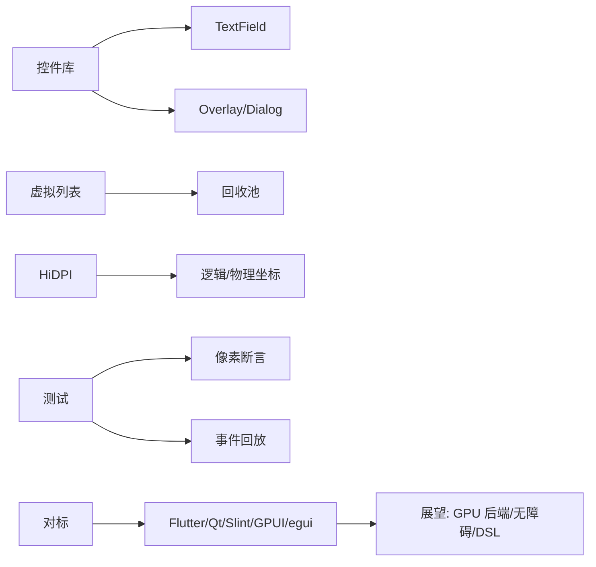

# 第八阶段导览：工程化与毕业项目

> [返回：GUI框架学习大纲](../GUI框架学习大纲.md)
> 收官阶段：补齐控件库深水区（TextField、浮层、虚拟列表），处理平台细节（HiDPI、窗口系统），建立可回归的测试方法，最后带着对标视野完成毕业项目。

## 分册索引

| 分册 | 对应大纲条目 | 一句话说明 | 状态 |
|---|---|---|---|
| 01-导览.md | — | 本页 | ✅ |
| 02-控件库补全.md | 1 | TextField 光标选区、开关类控件、Dialog/Overlay、菜单 | ✅（302 行） |
| 03-虚拟列表.md | 2 | 视口裁剪、回收池、布局分帧 | ✅（307 行） |
| 04-平台细节.md | 3 | HiDPI 缩放、多窗口概念、窗口系统与合成器 | ✅（305 行） |
| 05-测试方法.md | 4 | 无头像素断言、事件回放、布局黄金用例 | ✅（303 行） |
| 06-对标与展望.md | 5 | 五框架取舍表、GPU 后端/无障碍/DSL 展望 | ✅（300 行） |
| 07-毕业项目.md | 实践任务 | 三选一：文件浏览器 / todo / 文本编辑器 | ✅（302 行） |

## 阶段目标

学完本阶段，你应该能不查资料做到：

- 实现 TextField：光标移动、选区拖拽、键盘编辑操作（Home/End/方向键），并说清桌面 IME 的边界在哪
- 实现虚拟列表：万级数据只构建可见项，滚动位置稳定，说清回收池的复用规则
- 解释 HiDPI 下窗口坐标与像素坐标的换算，以及哪些层的坐标用逻辑、哪些用物理
- 用无头像素断言 + 事件回放把「跑起来才算」固化成可回归的脚本
- 拿出 gui-lab 与 Flutter / Qt / Slint / GPUI / egui 的取舍对照表，指出每格的判断依据

## 知识点地图

## 实践任务清单（毕业项目三选一）

1. **文件浏览器**：目录树 + 文件列表 + 滚动 + 主题切换——考布局与滚动
2. **todo 应用**：声明式 + signals + 动画——考第七阶段的完整闭环
3. **简易文本编辑器**：TextField 深水区 + 多行虚拟滚动——考文本与虚拟列表
4. 公共验收：无头测试全绿；1000 控件场景帧时间达标；键盘可完整操作（无鼠标走通主流程）

## 阶段自测

1. TextField 的选区高亮需要第三阶段哪两个几何 API？为什么？
2. 虚拟列表「只构建可见项」的判定发生在布局的哪一步？缓冲区多留几屏的代价是什么？
3. HiDPI 变化时哪些缓存必须失效？
4. 无头像素断言为什么可行？断言「某点颜色」比断言整屏快照好在哪？
5. 如果要把绘制后端换成 GPU 自绘，Painter 接口的哪些假设会被打破？

## 验收清单（DoD）

毕业不是「感觉做完了」。下表是可以逐条打勾的完成定义：前七条验证工程能力，后三条验证判断力。建议每完成一项就把证据（测试文件、数据、对照表）链接进毕业项目说明，让完成可审计。

- [ ] TextField 完整可用：光标移动、选区拖拽、编辑快捷键全部实现，桌面输入法的能力边界在代码注释里写明
- [ ] 虚拟列表通过压力验证：万级数据滚动流畅，「实际构建条目数」与可见数量同量级，且有计数断言背书
- [ ] 缩放换算正确：设备像素比动态变化后，布局、命中、绘制三层的坐标一致性有测试覆盖
- [ ] 无头像素断言可回归：不开窗口就能在测试环境跑完全部控件的视觉断言
- [ ] 事件回放可复现：一段录制好的「按下、拖拽、滚轮」序列能重放并断言最终状态一致
- [ ] 千级控件场景帧时间达标：对照第六阶段建立的基线，给出优化前后的具体数字
- [ ] 键盘可走通主流程：不接鼠标能完成所选毕业项目的全部核心操作
- [ ] 对标表每一格都有依据：五个框架的取舍表附判断理由，能指出对应的源码位置或文档出处
- [ ] 毕业项目有架构说明与已知限制清单：把限制写清楚，比藏着掖着更接近工程成熟
- [ ] 全部测试无跳过、无忽略项，测试清单与分册索引一一对应

## 踩坑与排查速查

收官阶段的坑大多出在「平台真实世界」与「教材模型」的缝隙里：输入法、缩放、字体渲染、浮层焦点。这些问题教材里不出现、真实设备必出现；下表按现象给出定位路径，处置栏给最小动作。

| 现象 | 可能原因 | 处置 |
|---|---|---|
| 输入法组合期字母乱序或重复 | 组合输入期间的按键被当成普通编辑键处理 | 识别组合态并旁路：组合期间只更新预编辑文本，不触发常规编辑命令 |
| 虚拟列表滚动时跳动或闪烁 | 可见项估算高度与真实高度不符，回收复用错位 | 用真实测量回填高度缓存；复用前强制重设内容与尺寸再入列 |
| 缩放后点击位置整体偏移 | 命中测试用了物理像素，布局却用逻辑坐标 | 统一换算口径：事件进入内核之前先换算成逻辑坐标 |
| 像素断言换一台机器就失败 | 断言点落在字形边缘或抗锯齿过渡带，跨设备渲染差异被放大 | 断言点选在纯色区块中心；用容差比较而不是精确相等 |
| 事件回放后最终状态对不上 | 回放只重发了事件，没有还原时间戳间隔 | 回放数据携带原始时间戳，按真实间隔驱动帧循环 |
| 对话框关闭后焦点凭空消失 | 浮层卸载时没有把焦点归还给触发者 | 卸载钩子里向打开方归还焦点，形成闭环 |
| 万级列表内存随滚动持续上涨 | 回收池只收不放，或复用项仍持有旧数据的引用 | 核对入池出池是否配对；复用前清空旧内容的引用 |
| 双击判定在缩放后时灵时不灵 | 时间与位移阈值按物理像素定义，没有随缩放换算 | 阈值统一用逻辑坐标表达，缩放变化时只换算一次 |
| 浮层拖拽时背景留下残影 | 浮层在独立图层，但拖拽路径上没有打重绘标 | 拖拽过程中把浮层新旧边界都并入脏区 |
| 键盘导航进入浮层后失联 | 浮层自建焦点域，没有挂回焦点链 | 浮层作为焦点域挂到触发者所在的焦点链上 |
| 毕业项目改一处崩三处 | 无头回归缺失，每次改动全靠手动验证 | 先补事件回放与像素断言，再继续加功能 |

## 前置知识与依赖关系

本阶段几乎没有全新概念，全部是「旧概念在真实约束下的再应用」。依赖密度从高到低排列如下；随机翻开任一分册若读不懂某个机制，顺着表格回溯补齐再回来继续。

| 依赖阶段 | 本阶段用到什么 | 薄弱时先回去补 |
|---|---|---|
| 第三阶段 文本与几何 | 文本框的光标与选区全部建立在文本测量与坐标换算之上 | [02-控件库补全](02-控件库补全.md) 开头的依赖说明 |
| 第五阶段 事件与交互 | 虚拟列表滚动、键盘导航、浮层焦点直接复用指针状态机与焦点链 | [05-测试方法](05-测试方法.md) 的事件回放一节 |
| 第六阶段 渲染管线 | 帧时间达标依赖脏标记与重绘边界；列表布局分帧复用失效合并 | [03-虚拟列表](03-虚拟列表.md) 的布局分帧小节 |
| 第七阶段 声明式层 | 待办类毕业项目直接架在信号与声明式组件之上 | [07-毕业项目](07-毕业项目.md) 的选题建议 |

毕业项目的价值恰恰在于强迫你把这些能力串成一条完整链路：单点都会，串联才是工程。跑通主流程之后，再回头读 [06-对标与展望](06-对标与展望.md) 补齐视野，此时你对「取舍」二字的理解会与第一遍完全不同。

最后给一个时间分配建议：本阶段内容的广度远大于深度，最容易犯的错是在单个控件的细节里无限下钻，把毕业项目拖成烂尾。把七成时间投给毕业项目本体与测试基建，三成留给对标阅读与展望；判断力来自「做完再对照」，而不是「对照完再想做」。若中途发现某项前置能力确实欠缺，宁可停下来回补半天，也不要绕过它继续堆功能——绕过的洞，会在上面的验收清单上一一现形。
