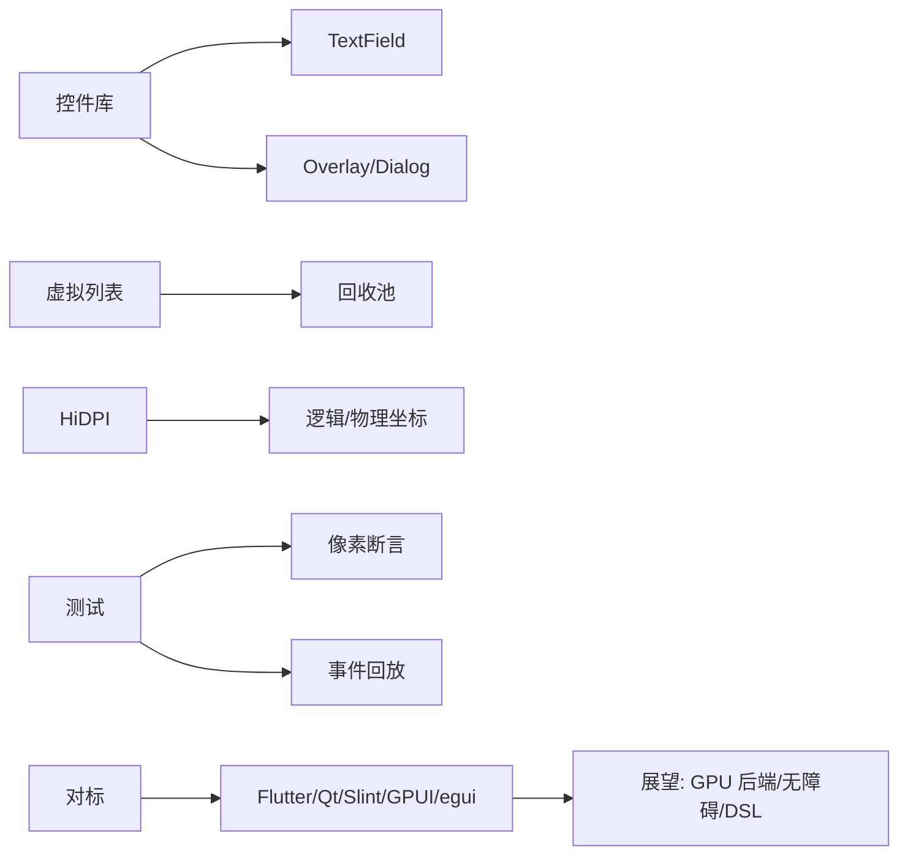

# 第八阶段导览：工程化与毕业项目

> [返回：GUI框架学习大纲](../GUI框架学习大纲.md)
> 收官阶段：补齐控件库深水区（TextField、浮层、虚拟列表），处理平台细节（HiDPI、窗口系统），建立可回归的测试方法，最后带着对标视野完成毕业项目。

## 分册索引

| 分册 | 对应大纲条目 | 一句话说明 | 状态 |
|---|---|---|---|
| 01-导览.md | — | 本页 | ✅ |
| 02-控件库补全.md | 1 | TextField 光标选区、开关类控件、Dialog/Overlay、菜单 | ✅（302 行） |
| 03-虚拟列表.md | 2 | 视口裁剪、回收池、布局分帧 | ✅（307 行） |
| 04-平台细节.md | 3 | HiDPI 缩放、多窗口概念、窗口系统与合成器 | ✅（305 行） |
| 05-测试方法.md | 4 | 无头像素断言、事件回放、布局黄金用例 | ✅（303 行） |
| 06-对标与展望.md | 5 | 五框架取舍表、GPU 后端/无障碍/DSL 展望 | ✅（300 行） |
| 07-毕业项目.md | 实践任务 | 三选一：文件浏览器 / todo / 文本编辑器 | ✅（302 行） |

## 阶段目标

学完本阶段，你应该能不查资料做到：

- 实现 TextField：光标移动、选区拖拽、键盘编辑操作（Home/End/方向键），并说清桌面 IME 的边界在哪
- 实现虚拟列表：万级数据只构建可见项，滚动位置稳定，说清回收池的复用规则
- 解释 HiDPI 下窗口坐标与像素坐标的换算，以及哪些层的坐标用逻辑、哪些用物理
- 用无头像素断言 + 事件回放把「跑起来才算」固化成可回归的脚本
- 拿出 mini-gui 与 Flutter / Qt / Slint / GPUI / egui 的取舍对照表，指出每格的判断依据

## 知识点地图

## 实践任务清单（毕业项目三选一）

1. **文件浏览器**：目录树 + 文件列表 + 滚动 + 主题切换——考布局与滚动
2. **todo 应用**：声明式 + signals + 动画——考第七阶段的完整闭环
3. **简易文本编辑器**：TextField 深水区 + 多行虚拟滚动——考文本与虚拟列表
4. 公共验收：无头测试全绿；1000 控件场景帧时间达标；键盘可完整操作（无鼠标走通主流程）

## 阶段自测

1. TextField 的选区高亮需要第三阶段哪两个几何 API？为什么？
2. 虚拟列表「只构建可见项」的判定发生在布局的哪一步？缓冲区多留几屏的代价是什么？
3. HiDPI 变化时哪些缓存必须失效？
4. 无头像素断言为什么可行？断言「某点颜色」比断言整屏快照好在哪？
5. 如果要把绘制后端换成 GPU 自绘，Painter 接口的哪些假设会被打破？
