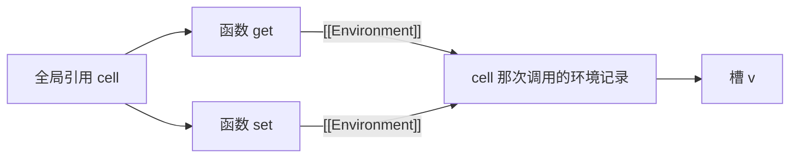

---
mdx:
  format: mdx
---
# 02 · 作用域与闭包

> 对应大纲：阶段 1 JavaScript 核心机制 → 1.2 作用域与闭包
> 配套练习：`exercises/scope-and-closure/01–04`
> 条款编号以写作时 tc39.es 上的最新版为准（ES2026 draft）；ECMA-262 各版条款**名称稳定、编号会漂移**（如 ES2015 里 Environment Records 在 §8.1，现在在 §9.1），查证时按名称搜。

## 学习目标

1. 能用 ECMA-262 的语言（`[[Environment]]`、`[[OuterEnv]]`、GetIdentifierReference）讲清「JS 为什么是词法作用域」，而不是「就是词法作用域」
2. 能把「提升」还原成规范里的**声明实例化**：var / 函数声明 / let 各自何时创建绑定、何时赋初值
3. 能从规范层面解释 TDZ 与「未声明」的区别，以及 `typeof` 为什么对前者抛错、对后者返回 `"undefined"`
4. 能把闭包定义为「函数 + [[Environment]]」，并沿着引用链推理：哪些变量在哪个函数返回后仍然活着、什么时候能被回收
5. 能讲清 `let` 修复循环闭包问题的规范机制（CreatePerIterationEnvironment），以及 IIFE 模块模式到 ES Module 的演进逻辑

## 关键概念

### 2.1 「作用域」在规范里是什么

日常说的「作用域」在 ECMA-262 里没有单一实体，它是两样东西组合出来的效果：

- **Environment Record（环境记录）**：一张「名字 → 绑定（binding）」的表。绑定不只是值，还带元数据：可变吗（var/let vs const）、**初始化了吗**（这一位就是 TDZ 的全部来源）。
- **`[[OuterEnv]]` 指针**：每个环境记录都指向上层环境记录，直到 null。标识符解析就是沿这条链向上找名字。

「作用域链」不是运行时动态构造的栈，而是**随函数/块创建出来的、挂在堆上的一串带指针的对象**。这句话是后面闭包、循环、内存分析的地基。

依据：ECMA-262 §9.1 Environment Records（含 Declarative / Function / Module / Object / Global 五种类型与 `[[OuterEnv]]` 定义）。

### 2.2 词法作用域 vs 动态作用域

两种流派的问题都是：「函数体里的自由变量 x，执行时去哪里找绑定？」

- **动态作用域**（bash、早期 Lisp）：去**调用者**的环境里找。同一个函数被不同地方调用，结果可能不同。
- **词法作用域**（JS、绝大多数现代语言）：去**函数定义时**所在的环境里找。写代码时缩进位置已经决定了答案，所以叫 lexical（源代码文本层面的）。

JS 选了词法，而且不是「引擎顺便这么实现」，是规范明文规定的两步：

1. **创建时锚定**。函数对象创建（函数声明在声明实例化时、函数表达式在求值时）走 OrdinaryFunctionCreate（§10.2.3），其中一步是：

   > Set F.[[Environment]] to the running execution context's LexicalEnvironment.

   即：把「我出生时的环境」存进函数对象的内部槽 `[[Environment]]`。函数从此随身携带出生证明。

2. **调用时接线**。调用函数走 [[Call]] → PrepareForOrdinaryCall（§10.2.1.1），其中：

   > Let localEnv be NewFunctionEnvironment(F, newTarget).
   > Set calleeContext's LexicalEnvironment to localEnv.

   而 NewFunctionEnvironment（§9.1.2.4）内部把新环境的 `[[OuterEnv]]` 设为 `F.[[Environment]]`。

两步合起来：**新函数环境的外层，永远接着「出生地」，与「谁调用的我」无关**。这就是词法作用域的全部规范机制。同理，`this` 的确定（ES2015 §9.2.1.2 OrdinaryCallEvaluateThis，现行规范重构为 §10.2.1.2 OrdinaryCallBindThis）发生在**调用时**——JS 唯一「动态」的角落，留到阶段 1.3 展开。

一个反例直觉（伪代码，动态作用域语言）：

```text
let x = "global"
function outer() { let x = "outer"; inner(); }   // 动态作用域下 inner 里的 x = "outer"
function inner() { print(x) }
outer()            // 词法作用域下 print "global" —— inner 定义在顶层，外层就是全局
```

### 2.3 标识符解析：GetIdentifierReference

拿到名字后怎么找？GetIdentifierReference（§9.1.2.1）翻译成伪代码：

```text
GetIdentifierReference(env, name, strict):
  if env == null:
      return 「unresolvable」（整条链都找不到）
  if env.HasBinding(name):
      return Reference { base: env, name, strict }   // 「引用」= 指向某个绑定的把手
  return GetIdentifierReference(env.[[OuterEnv]], name, strict)   // 沿链上溯，尾递归
```

之后真正取值时走 GetValue(reference)：unresolvable → 抛 `ReferenceError`（`typeof` 有豁免，见 2.5）；绑定存在但未初始化 → 也抛 `ReferenceError`。**「未声明」和「声明了但没初始化」抛的是同一种错，但发生的检查点不同**——这是面试里能拉开差距的一句话。

五种环境记录（§9.1 的表）：

| 类型 | 用在哪 | 特点 |
| --- | --- | --- |
| Declarative | 块、for、catch、函数（基础形态） | 绑定存在记录内部，外部无法用属性访问方式摸到 |
| Function | 普通函数调用（Declarative 的子类型） | 额外携带 `this` 与 `super` 绑定 |
| Object | `with` 语句、`import "x" from ...` 的命名空间 | 绑定直接暴露为对象属性（`with` 是严格模式禁用的历史包袱） |
| Global | 全局 | 复合结构：[[ObjectRecord]]（绑在 globalThis 上）+ [[DeclarativeRecord]]（不绑在对象上） |
| Module | 每个模块文件顶层 | 持有 import/export 绑定；严格模式；顶层 `this` 是 undefined |

Global 的复合结构解释了一个常见疑惑：全局 `var x` 会变成 `globalThis.x`（进了 ObjectRecord），而全局 `let y` 在 `globalThis` 上**找不到**（进了 DeclarativeRecord）——两个记录虽然同属一个 Global Environment Record，对外表现却不同。

依据：§9.1 Environment Records；脚本级声明走 GlobalDeclarationInstantiation，模块级走 Module 的 instantiation 流程（LinkEvaluation）。

### 2.4 提升的真相：声明实例化

「提升（hoisting）」这个词规范里不存在。规范描述的是：**进入执行上下文时先跑一遍「声明实例化」，把所有声明登记进环境记录，然后才开始逐句执行**。函数用 FunctionDeclarationInstantiation（§10.2.11），脚本用 GlobalDeclarationInstantiation。三种声明在登记时的待遇不同：

| 声明 | 绑定何时创建 | 初值 | 效果 |
| --- | --- | --- | --- |
| `var x` | 声明实例化时 | `undefined`（InitializeBinding 为 undefined） | 语句执行到 `var x = 1` 之前读 x 得 undefined，不报错 |
| 函数声明 `function f(){}` | 声明实例化时 | **立即创建函数对象并初始化绑定**（代码体 + 绑定一步到位） | 在文本定义位置之前即可完整调用 |
| `let/const/class` | 声明实例化时 | **创建但未初始化**（uninitialized） | 执行到声明语句时才执行初始化器；中间这段就是 TDZ |

推论一：**「let 没有提升」是错的**。let 的绑定同样在声明实例化时创建——否则 `typeof x` 对 TDZ 变量就该和未声明一样返回 `"undefined"`（沿链找不到绑定 → unresolvable），而实际抛 ReferenceError，证明链上**有**这个绑定、只是没初始化。准确说法：let 的**绑定**提升了，**初始化**没有。

推论二：函数声明与函数表达式的差异不在「函数」，在「声明形式」。函数表达式是表达式，求值产生值，走的是 var/let 的赋值时序：

```js live noInline
declared();                 // 正常执行 —— 声明实例化时已完整可用
function declared() {}

expr();                     // TypeError: expr is not a function —— 绑定存在，值为 undefined
var expr = function () {};  // 执行到这行才把函数对象赋进去
```

推论三：同名规则。`var` 与函数声明可以共存：声明实例化时先写 undefined（var 登记），随后函数声明**覆盖为函数对象**；执行阶段 `var x = ...` 的初始化器只是一次普通赋值，按语句顺序再覆盖回去。`let` 与 `var`/函数声明同名则是**解析期早错误**（SyntaxError，不是运行时错）——重复绑定在语法分析阶段就被拒绝。

依据：FunctionDeclarationInstantiation（§10.2.11）中「var 声明 InitializeBinding 为 undefined」「HoistableDeclaration 立即实例化并初始化」「lexicallyDeclared 只 CreateMutableBinding 不初始化」三组步骤；重复声明早错误见函数体/脚本的 Static Semantics。

一个规范演进的花絮（面试可当加分项）：ES2015 曾把「未初始化」建模为「绑定还不存在」，这导致 `typeof x` 在 TDZ 里按字面算法应返回 `"undefined"`，与实现普遍抛错矛盾；后续版本给绑定引入了显式的 initialized 状态，GetBindingValue 对未初始化绑定抛 ReferenceError，才算把话说圆。「typeof 的差异化行为」恰好是照出这次修订的透镜。

### 2.5 typeof 的双面：未声明 vs TDZ

```js live noInline
console.log(typeof neverDeclared); // "undefined"（字符串），不抛错
console.log(typeof tdzVar);        // ReferenceError: Cannot access 'tdzVar' before initialization
let tdzVar = 1;
```

规范解释（§13.5.3 The typeof Operator 的求值步骤）：

1. 求值操作数，得到一个 Reference。
2. **若这个 Reference 是 unresolvable（GetIdentifierReference 走到链尾没找到）→ 直接返回字符串 `"undefined"`，跳过取值**。
3. 否则执行 GetValue 取值 → 对未初始化的绑定，GetBindingValue 抛 ReferenceError。

即：`typeof` 豁免的只是「**没绑定**」，不豁免「**绑定未初始化**」。所以「typeof 对任何变量都安全」是流传最广的错误结论之一。工程含义：用 `typeof x === "undefined"` 探测某个可能没定义的全局名（如旧环境的 `fetch`）是安全的；但拿它探测 let/class 很容易在 TDZ 里翻车。

### 2.6 块级作用域与块内函数声明

块的求值（§14.2 Block）规则：**每次进入块，若块内有 let/const/class/函数声明，就 NewDeclarativeEnvironment 创建新环境记录**，`[[OuterEnv]]` 接当前环境，块结束时函数直接引用消失（环境记录本身由引用关系决定生死）。所以嵌套同名不是「修改」而是「遮蔽（shadowing）」——内外是两个绑定。

块内函数声明（严格模式 / ESM）：按主规范就是**块级绑定**，提升范围是块顶部。但 Annex B §B.3.2（Block-Level Function Declarations Web Legacy Compatibility Semantics）给 sloppy 模式加了 web 兼容行为：块内函数声明会在**外层函数作用域**额外登记一个 var 式同名绑定，进入块时赋值为函数对象。一句话记忆：**严格模式/ESM 里块内函数出块即不可见；sloppy 模式里浏览器替老网页把它 var 化**。本工作区用 tsx 跑练习时要注意：tsx 底层的 esbuild 会应用这套兼容降级，块外 `typeof` 可能得到 `"function"`——这是工具链行为，不是规范行为（原生 Node ESM 里同代码得 `"undefined"`，练习 01 注释里有现场说明）。

### 2.7 闭包 = 函数 + [[Environment]]

从 2.2 已知：每个函数对象都带 `[[Environment]]` 槽，指向出生地的环境记录。于是：

> **闭包 = 函数对象 + 它携带的 [[Environment]]（以及该环境沿 [[OuterEnv]] 可达的整条链）。**

这不是「某种特殊函数」才有的机制——**JS 里每个函数都是闭包**。通常说「用到了闭包」，实际是「利用了这个默认机制让外层变量活过了外层函数的返回」。

为什么外层函数返回后变量还活着？外层函数的「局部变量」存在这次调用的环境记录里，而环境记录**不是栈上的栈帧**，是堆上的对象（V8 里叫 Context）。函数返回只是执行上下文出栈，环境记录是否存活取决于可达性：



只要 get/set 任一活着，环境记录就可达，`v` 就不可回收。

闭包捕获的是**绑定**（变量的「格子」），不是**值**（格子当时的快照）。三个可观察后果：

1. 创建闭包之后再修改变量，闭包里读到的是新值；
2. 同一次调用产出的多个闭包共享同一环境记录，互相看得见写操作；
3. 不同次调用产出**全新**环境记录，互不干扰（独立计数器的原理）。

### 2.8 闭包与内存：泄漏模式与规避

闭包本身不是泄漏——「按需延长生命周期」正是它的功能。泄漏的定义是：**长生命周期对象 + 无意的长期持有**。三个高频模式：

1. **模块对象「搭便车」**：IIFE/工厂返回一组方法，方法们共享一个环境记录，其中有一个大数组。哪怕你只长期持有「不需要大数组的小方法」，环境记录整体可达 → 大数组陪葬。（练习 04 [3] 有现场演示。）
2. **事件/定时器回调捕获大对象**：注册一次全局监听器，回调里哪怕只用了一个字段，捕获的却是整个外层环境。
3. **缓存无上限**：闭包里的 Map 只进不出（这是逻辑泄漏，配合闭包更隐蔽；阶段 1.6 的 WeakMap 是对症药）。

规避手段（按优先级）：

- **缩小捕获范围**：把大对象限制在「构建阶段」的块/子函数里，只让闭包捕获算好的小结果（最干净）；
- **参数化代替捕获**：需要值时传参（IIFE/第三参数本质都是这个）；
- **主动置 null**：`dispose()` 里把闭包变量置 null，断开环境记录 → 大对象的引用；
- **WeakMap/WeakRef**：键/引用不阻止回收（阶段 1.6 展开）。

依据：ECMA-262 不规定 GC（内存管理留给实现），以上全部用「可达性」推理——规范保证闭包引用可达，实现（V8 分代标记清除）据此不敢回收。

### 2.9 循环与闭包：一个绑定 vs 每轮新绑定

经典题：`for (var i = 0; i < 3; i++) setTimeout(() => console.log(i))` 打印三个 3。三层原因，缺一层都讲不完整：

1. **同步层**：循环瞬间跑完，退出时 `i === 3`（条件失败时的值）；
2. **队列层**：回调进定时器队列，同步代码（含循环本身）执行完才轮到它们；
3. **绑定层**（本质）：`var i` 只在**函数/模块作用域创建一次**，三个回调的 `[[Environment]]` 指向同一个环境记录，解析 `i` 得到同一个绑定 → 都读到终值 3。

`let` 的修复不是「语法糖」，是规范里 for 语句的专用机制：ForBodyEvaluation（§14.7.4.3）对 let 声明的循环每轮调用 CreatePerIterationEnvironment（§14.7.4.4），伪代码：

```text
CreatePerIterationEnvironment(names):
  newEnv = NewDeclarativeEnvironment( lastIterationEnv.[[OuterEnv]] )
  for name of names:
      把 lastIterationEnv 里 name 的当前值【复制】进 newEnv 的新绑定
  当前 LexicalEnvironment = newEnv
```

要点有三个：**每轮迭代新环境**；初值是**从上一轮复制**（不是重新从头算）；**增量表达式在新环境里执行**，所以下一轮复制到的是推进后的值。于是每个回调闭包捕获的是「只属于这一轮」的 j。

var 时代的两种手动修复，本质都是「在回调创建时制造新绑定」：

```js live noInline
// IIFE：函数调用创建新环境，参数 k 是全新绑定，实参把「此刻的 i 值」传进去
for (var i = 0; i < 3; i++) {
  ((k) => setTimeout(() => console.log(k)))(i);
}
// setTimeout 第三参数：定时器触发时以保存的 args 调用回调，参数即新绑定
for (var i = 0; i < 3; i++) {
  setTimeout((v) => console.log(v), 0, i);
}
```

注意两者的传递时机不同：IIFE 是**创建回调时**求值 `i`（同步循环内，正确）；第三参数同样是注册时保存值，触发时传入——都避开了「事后才读共享绑定」。完整的可运行对照见练习 03。

### 2.10 IIFE 与模块模式；ES Module 的关系

ES2015 之前 JS 只有函数作用域和全局作用域，唯一能「圈出一块私有命名空间」的工具就是函数——IIFE（Immediately Invoked Function Expression）因此成为事实标准：

```js live noInline
const counter = (function () {
  let count = 0;                       // 私有状态：外界没有任何语法路径能碰到它
  function validate(step) { /* ... */ } // 私有函数
  return {
    stepBy(step) {                     // 公开接口只暴露这一扇门，门内先过 validate
      if (!validate(step)) throw new Error("bad step");
      return (count += step);
    },
    value() { return count; },
  };
})();
```

这就是**模块模式**：IIFE 提供作用域墙，return 的对象是唯一公开接口。两个设计原则顺手确立：

- **私有即不可达**：状态不是「约定不要碰的属性」（对比 `this._count`），而是语言层面摸不到的绑定；
- **最小暴露（Least Exposure）**：只公开必要的 API，内部 helper 一律不暴露——攻击面/误用面都更小。

变体**揭示模块模式（revealing module）**：内部全用函数实现，return 时挑几个映射出去。依赖注入也顺理成章：把依赖作为 IIFE 参数传入（练习 04 [2]），避免全局变量。

ES Module 落地后，文件本身就是作用域墙：**每个模块文件 = 一个 Module Environment Record**，顶层的 `let/const/function` 都登记在模块环境里，不进入全局；`import/export` 是模块环境之间的绑定（live binding 的深挖放阶段 4）。于是「IIFE 圈私有作用域」的历史使命结束，但仍活在三处：无需模块的场景（一次性脚本）、兼容旧环境的库打包（UMD 壳）、以及理解闭包的最佳教具。

## 可运行示例

### 示例 1：环境链、独立环境与「捕获变量」

```js live noInline
let tag = "global";

function outer() {
  let tag = "outer";
  let message = "hello";
  function inner() {
    return `${tag}/${message}`;   // tag、message 都在 inner.[[Environment]] 链上可解
  }
  return { inner, rewrite: (v) => (message = v) };
}

const o1 = outer();
const o2 = outer();
console.log(o1.inner());      // ①
console.log(o2.inner());      // ②
o1.rewrite("changed");
console.log(o1.inner());      // ③
console.log(o2.inner());      // ④
tag = "global-changed";
console.log(o1.inner());      // ⑤
```

输出：

```text
outer/hello
outer/hello
outer/changed
outer/hello
outer/changed
```

原理：①② 每次调用 `outer` 都 NewFunctionEnvironment 生成**全新**环境记录，`tag` 解析到 outer 内层绑定（遮蔽全局），证明词法链在创建时锚定；③ `rewrite` 与 `inner` 共享 o1 那次的环境记录，写的是同一个 `message` 绑定——闭包捕获变量不是值；④ o2 的环境记录纹丝不动，独立性的直接证据；⑤ 改全局 `tag` 对闭包毫无影响——inner 的 `[[OuterEnv]]` 链根本不经过全局的 `tag` 绑定……准确地说：链的**第二层**（outer 环境）已有 `tag`，解析在第二层就命中并停止，永远轮不到全局。

### 示例 2：TDZ 与 typeof 的三种结局

```js live noInline
function probe() {
  return typeof x;   // 引用下方模块级 let —— 函数体内前向引用，运行时机决定生死
}
try {
  console.log(probe());
} catch (e) {
  console.log(e.name);     // ①
}
let x = 1;
console.log(probe());      // ②
console.log(typeof nope);  // ③
```

输出：

```text
ReferenceError
number
undefined
```

原理：① 模块实例化时 `x` 的绑定已创建但未初始化，probe 首次调用进入 TDZ，GetBindingValue 抛错——`typeof` 的豁免只针对 unresolvable，救不了「有绑定没初始化」；② 初始化器执行后绑定就绪；③ `nope` 整条链无绑定 → unresolvable → typeof 按规范直接返回 `"undefined"` 字符串。三种结局对应三种状态：**未初始化 / 已初始化 / 无绑定**。

## 易错点与面试高频

1. **「let 不提升」** —— 错。绑定提升了、初始化没提升；TDZ 就是两者的时间差。证据：`typeof x` 在 TDZ 抛错（若绑定不存在，应返回 `"undefined"`）。
2. **「typeof 绝对安全」** —— 只对「未声明」安全，对 TDZ 变量抛 ReferenceError。
3. **函数声明 vs 函数表达式**：前者在声明实例化时「绑定 + 函数对象」一步到位；后者的函数对象要等表达式求值，提前调用 var 版得 TypeError（值 undefined）、let 版得 ReferenceError（TDZ）。
4. **var 循环打印 N 个 3**：必须讲出三层——同步先跑完、回调后执行、**共享同一个绑定**；只讲前两层不算及格。
5. **let 修复的规范名**：CreatePerIterationEnvironment——每轮新环境 + 从上轮**复制**值 + 增量在新环境执行。
6. **闭包导致内存泄漏？** 闭包=保留，泄漏=无意保留。答「闭包会泄漏」和「闭包不会泄漏」都不完整，要按「长生命周期持有者 → [[Environment]] → 环境记录 → 大对象」的引用链具体分析。
7. **全局 var 与全局 let 的差别**：前者进 globalThis（ObjectRecord），后者不进（DeclarativeRecord）。
8. **块内函数声明出块可见吗？** 严格模式/ESM：不可见（块级绑定）；sloppy 模式：Annex B §B.3.2 把它 var 化到外层函数。tsx/esbuild 的降级会模拟后者，别被工具骗了。
9. **同名 var 与函数声明**：声明实例化时函数对象覆盖 undefined，执行阶段 `var x = ...` 的初始化器按语句顺序再覆盖；let 与任何 var/函数同名则是解析期 SyntaxError。
10. **「闭包是特殊函数」** —— 不是。所有函数都带 [[Environment]]，闭包是默认形态；「使用了闭包」只是利用了默认机制。
11. **参数与 var 同名**：参数绑定等价于 var（可覆盖）；函数体内同名函数声明会在声明实例化时覆盖参数值；同名 var 声明不会把参数重置为 undefined。另注意 TS 的静态限制比 JS 语法更紧：`var x` 与 `function x(){}` 同作用域过不了 TS2300，对函数声明名赋值在新版 tsc 报 TS2630 —— 这些 JS 运行时合法的行为只能在注释里讲。

## 输出预测题

### 题 1

只看代码，逐行写出输出，并解释第一行为什么**不是** 1：

```js live noInline
var x = 1;
function demo() {
  console.log(x);
  var x = 2;
  console.log(x);
}
demo();

function tdzProbe() {
  console.log(typeof y);
  let y = 3;
}
try {
  tdzProbe();
} catch (e) {
  console.log("caught:", e.constructor.name);
}
```

### 题 2

写出两行输出，并对第二行说明「前三个 3 和后三个 0/1/2 分别因为什么」：

```js live noInline
function make() {
  let n = 0;
  return {
    inc: () => ++n,
    get: () => n,
    set10: () => (n = 10),
  };
}
const a1 = make();
const a2 = make();
a1.inc();
a1.inc();
a1.set10();
console.log(a1.get(), a2.get());

const readers = [];
for (var i = 0; i < 3; i++) readers.push(() => i);
for (let j = 0; j < 3; j++) readers.push(() => j);
console.log(readers.map((r) => r()));
```

## 预测题答案

### 题 1 答案

```text
undefined
2
caught: ReferenceError
```

逐步分析：

1. `demo` 被调用 → 进入函数上下文 → 声明实例化：**demo 自己的**环境记录里创建绑定 `x`，初始化为 undefined。
2. 第一行 `console.log(x)` 解析 `x`：GetIdentifierReference 在 demo 的环境记录**第一层就命中**本地的 `x`（undefined），根本不会沿 [[OuterEnv]] 找到全局的 1。同名 var 的「本地遮蔽」在声明实例化阶段就已生效，与语句顺序无关——这就是为什么不是 1。
3. 第二行：`var x = 2` 的初始化器此时已执行（本质是赋值），打印 2。
4. `tdzProbe` 调用时，`let y` 的绑定已创建但未初始化（TDZ）；`typeof y` 拿到的是「存在的绑定」而非 unresolvable，不在 typeof 的豁免范围，GetBindingValue 抛 ReferenceError，被 catch 打印构造器名。

### 题 2 答案

```text
10 0
[3, 3, 3, 0, 1, 2]
```

逐步分析：

1. 第一行：`make()` 两次调用生成两个独立环境记录。a1 的 inc/set10/get 共享「a1 那次」的环境记录：`++n` 两次 → n=2，`set10` → n=10，`get()` → **10**。a2 的环境记录全程没人动，`get()` → **0**。
2. 第二行前半：`var i` 是**模块/函数级唯一绑定**，循环结束后其值为 3（条件失败时）。三个箭头函数的 [[Environment]] 指向同一环境记录，map 时（循环早已结束）读到的都是 3。
3. 第二行后半：`let j` 走 CreatePerIterationEnvironment，每轮迭代新建环境记录并复制上一轮的值；每个箭头函数捕获的是「属于自己那一轮」的 j，所以是 0、1、2。

## 延伸阅读

- ECMA-262（现行版，按条款名检索）：
  - §9.1 Environment Records：https://tc39.es/ecma262/#sec-environment-records
  - §9.1.2.1 GetIdentifierReference：https://tc39.es/ecma262/#sec-getidentifierreference
  - §9.1.2.4 NewFunctionEnvironment：https://tc39.es/ecma262/#sec-newfunctionenvironment
  - §10.2.1.1 PrepareForOrdinaryCall：https://tc39.es/ecma262/#sec-prepareforordinarycall
  - §10.2.3 OrdinaryFunctionCreate：https://tc39.es/ecma262/#sec-ordinaryfunctioncreate
  - §10.2.11 FunctionDeclarationInstantiation：https://tc39.es/ecma262/#sec-functiondeclarationinstantiation
  - §13.5.3 The typeof Operator：https://tc39.es/ecma262/#sec-typeof-operator
  - §14.7.4.3 / §14.7.4.4 ForBodyEvaluation / CreatePerIterationEnvironment：https://tc39.es/ecma262/#sec-forbodyevaluation
  - Annex B §B.3.2 块级函数的 web 兼容语义：https://tc39.es/ecma262/#sec-block-level-function-declarations-web-legacy-compatibility-semantics
- MDN：Closures、let 的 TDZ、IIFE
- 《你不知道的 JavaScript（上卷）》第一部分「作用域和闭包」（开源版：github.com/getify/You-Dont-Know-JS）
- V8 博客（结合阶段 1.6 阅读）：contexts/隐藏类如何影响闭包变量的内存布局

---

## 替换清单（ASCII 图 → Mermaid）

| 原 ASCII 图位置/标题 | Mermaid 图表类型 |
| --- | --- |
| §2.7 闭包引用链（get/set 共享同一环境记录） | flowchart (LR) |

