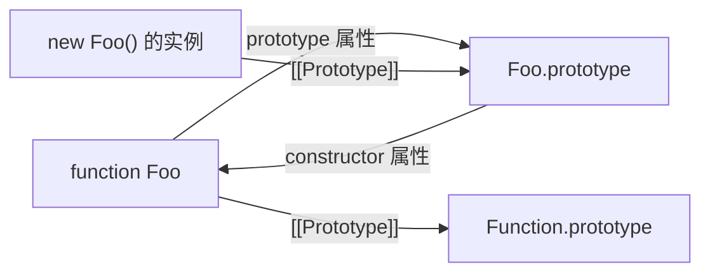

---
mdx:
  format: mdx
---
# 03 · this 与原型链

> 对应大纲：阶段 1.3「this 与原型链」（`this` 绑定四规则、箭头函数、`call/apply/bind`、原型链查找、class 本质、继承方式对比）
>
> 关联练习：`exercises/this-and-prototype/01`–`06`。建议先读练习顶部的「预期输出」做闭卷预测，再运行对照。

## 学习目标

1. 给任意一次函数调用，能按「new > 显式 > 隐式 > 默认」推出 this 是谁，并说出每条规则对应的规范机制（EvaluateCall / OrdinaryCallBindThis / `[[ThisMode]]`）
2. 能解释三个高频「怪象」的底层原因：隐式丢失、箭头函数词法 this、bind 固化（含连续 bind 只认第一次）
3. 能沿 OrdinaryGet / OrdinarySet 手推一次属性读写，讲清 receiver 在 getter/setter 里的作用、属性遮蔽、「写不穿原型」
4. 能画出 prototype / `__proto__` / constructor 三角图，并列出 class「是糖但不是纯糖」的全部差异点
5. 能逐条说出四种 ES5 继承方式的缺陷，说清 class extends ≈ 寄生组合继承 + 哪些增量能力

---

## 关键概念

### 1. this 不是函数的属性，是「一次调用」的参数

this 是每个**函数代码执行环境**自带的一个绑定槽，在进入函数体之前由「这一次调用怎么发起」决定。同一个函数被调用 N 次，就有 N 个互不相关的 this。所以「这个函数的 this 是什么」是个不完整的问题，完整的问题是「**这一次调用**的 this 是什么」。

整个判定链分两层：

**语法层（求值时）——thisArgument 从哪来。** 依据：ECMA-262 `EvaluateCall`：

- 若被调函数来自**属性引用（Reference）**（形如 `obj.fn`），thisValue = 引用的 base，也就是 `obj`（隐式绑定）；
- 否则 thisValue = `undefined`（这就是「默认绑定」的起点，注意起点是 undefined，不是 globalThis）。

**运行层（进入函数前）——thisArgument 怎么处理。** 依据：ECMA-262 `OrdinaryCallBindThis`：按函数创建时记录的 `[[ThisMode]]` 内部槽三分派：

| `[[ThisMode]]` | 谁是这种函数 | this 处理 |
| --- | --- | --- |
| `lexical` | 箭头函数 | **不做任何 this 绑定**，函数体内 this 沿词法作用域向外找 |
| `strict` | 定义在严格代码里的普通函数 | this = thisArgument **原样保留**（undefined 就是 undefined，null 就是 null，原始值不装箱） |
| `global` | 定义在非严格代码里的普通函数 | thisArgument 为 null/undefined → 替换成 globalThis；原始值 → `ToObject` 装箱（`f.call(42)` 里 this 是 Number 包装对象） |

#### 四规则与优先级

| 优先级 | 规则 | 触发形式 | 规范路径 | this |
| --- | --- | --- | --- | --- |
| 1 | new 绑定 | `new F()` | `[[Construct]]` → OrdinaryCreateFromConstructor | 以 `new.target.prototype` 新建的空对象 |
| 2 | 显式绑定 | `f.call(o, …)` / `f.apply(o, …)` / `f.bind(o)(…)` | `[[Call]]` 直接带 thisArgument；bind 是「预置并锁定」 | 指定的对象 |
| 3 | 隐式绑定 | `obj.f()` | EvaluateCall 的属性引用 base | obj（只有**最后一层**引用算数） |
| 4 | 默认绑定 | `f()` | thisArgument = undefined | strict：保留 undefined；global：替换为 globalThis 并装箱原始值 |

「优先级」的本质不是一套排序算法，而是**一次调用只会落入一条路径**：new 走 `[[Construct]]`，根本不经过 thisArgument；call/apply 是当场给出 thisArgument；属性引用由求值规则自动产生 thisArgument；都没有就是 undefined。bind 看起来「仅次于 new」，是因为它产出的函数在 `[[Call]]` 里**自带** thisArgument，调用方再传的会被丢弃（见 §4），而 `[[Construct]]` 路径压根不看它。

#### 严格 / 非严格的分水岭

- 判定单位是**函数体**，不是文件：函数声明/表达式继承所在代码的严格性；class 体天然严格；ESM 模块天然严格；`new Function("...")` 的函数体天然**非严格**（除非自己写 `"use strict"`）。
- **本工作区环境注记（实测）**：tsx 会把 `.ts` 按类 CJS（非严格）方式转译执行。因此练习文件顶部统一放 `"use strict"` 指令 + `export {}`，复原「严格 + 模块」语义（顶层 this 为 undefined、默认绑定不替换）；非严格行为一律用 `new Function` 动态创建演示（练习 01）。

### 2. 隐式丢失：Reference 被拆掉了

```ts live noInline
const obj = { tag: "obj", show() { return this.tag; } };
const detached = obj.show; // 拿到的是「函数值」，属性引用消失
detached();                // 严格模式：this === undefined；非严格：globalThis
```

原因：`obj.show` 求值 = GetValue(Reference(base=obj, name="show"))——取出的是函数**值**本身。之后 `detached()` 的调用表达式没有任何 base，回落到默认绑定。所有「回调传方法名」的场景都是同一机制：`arr.map(obj.show)`、`setTimeout(obj.show, 0)`、`const { show } = obj`。修复三选一：`obj.show.bind(obj)`、箭头包装 `(...args) => obj.show(...args)`、或调用处 `arr.map((x) => obj.show(x))`。

### 3. 箭头函数：`[[ThisMode]] = lexical`

依据：ECMA-262 OrdinaryFunctionCreate——箭头函数创建时 thisMode 取 `lexical`；OrdinaryCallBindThis 对 lexical 模式直接跳过绑定。

于是箭头函数体内 `this` 的解析和普通变量一样：**沿词法作用域链向外找**，直到最近的「非箭头函数执行环境」的 this（某个普通函数/class 那次调用的 this）；到顶层就是全局/模块的 this（ESM 里是 undefined）。对象字面量**不构成作用域**，所以「对象里写箭头方法」的 this 不会指向该对象。

三个直接推论（练习 02 逐个验证）：

1. **call/apply/bind 的第一个参数被忽略**（可传，不报错，但无效——因为根本没有 this 绑定步骤）；参数照常传递。
2. **不能作构造器**：没有 `[[Construct]]` 内部方法，`new` 抛 TypeError。
3. **没有 arguments**（也没有 super / new.target）：标识符沿词法落到外层函数——箭头里写的 `arguments` 数的是**外层函数**的实参。

适用：回调里保持外层 this（定时器、事件处理器、Promise 链）。不适用：对象方法、需要动态 this 的原型方法、构造器。

### 4. bind 的规范行为：BoundFunctionCreate

依据：ECMA-262 `Function.prototype.bind` 与 bound function 的 `[[Call]]` / `[[Construct]]`。

- `f.bind(thisArg, ...pre)` 执行 `BoundFunctionCreate`：新函数 F 带三个内部槽——`[[BoundTargetFunction]]` = f、`[[BoundThis]]` = thisArg、`[[BoundArguments]]` = pre。F 是个「外壳」，自己不执行任何函数体。
- **F 被调用时**（bound `[[Call]]`）：`args = [[BoundArguments]] ++ 本次实参`，然后 `Call([[BoundTargetFunction]], [[BoundThis]], args)`——调用方传入的 thisArgument 被整个丢弃。这就是「bind 之后 this 永久固化，再 call/apply/bind 都无效」的机制。
- **`new F()` 时**（bound `[[Construct]]`）：走构造路径，`[[BoundThis]]` 同样被无视；实参与预置参数拼接后交给原函数；new.target 若等于 F 则替换为原函数 → 实例的原型来自**原构造函数**的 prototype，`instanceof 原构造函数` 为 true。「new 绑定 > 显式绑定」的规范来源就在这（练习 03 的 `[new bound]` 系列）。
- **`bound.length`** = max(原函数.length − 预置参数个数, 0)（length 本身只数第一个默认参数/剩余参数之前的形参）；**`bound.name`** 加前缀 `"bound "`，连续 bind 会叠加成 `bound bound f`。
- **连续 bind 只认第一次**：`f.bind(A).bind(B)()` 的调用链是——外层 bound 调内层 bound（thisArgument = B 传给内层后被丢弃），内层 bound 再调 f 时用的是自己的 `[[BoundThis]]` = A。参数倒是逐层累积前置。

### 5. 原型链查找：OrdinaryGet / OrdinarySet 与 Receiver

依据：ECMA-262 `OrdinaryGet(O, P, Receiver)`（读）：

1. 在 O 的**自有属性**里找：data 属性 → 返回值；accessor 属性 → 有 getter 则 `Call(getter, Receiver)`；
2. 没找到 → `parent = O.[[Prototype]]`；为 null → 返回 undefined（链到头）；否则 `parent.[[Get]](P, Receiver)`——**Receiver 原样下传**。

这一条规则同时解释了三件事：

- **链式查找**：实例 → 原型 → 原型的原型 → … → null。普通对象的链尾是 `Object.prototype`，它的原型是 null（终点）。
- **getter/setter 的 this 是 receiver**：子对象触发父原型的 getter 时，getter 里的 this 是**发起这次访问的子对象**（Receiver），不是定义 getter 的对象。所以「读到的值」「写落的坑位」都由接收者决定——响应式库、`Object.defineProperty` 伪私有变量都依赖这一点。
- **原型是活的**：查找发生在**访问那一刻**，事后改原型属性、加方法对所有实例立即生效（练习 04 §3）。

依据：ECMA-262 `OrdinarySet(O, P, V, Receiver)`（写）：

- 沿链找到的是 **data 属性** → **不在原型上改**，而是在 Receiver 上创建自有属性 → **遮蔽（property shadowing）而非改写**，即「写不穿原型」；想改原型必须显式写 `proto.x = ...`。
- 沿链找到的是 **accessor** → 以 Receiver 为 this 调 setter（写同样落在接收者身上）。

`Object.create(null)`：原型为 null 的「字典对象」——沿链一步都查不到（没有 toString / hasOwnProperty / valueOf），是最干净的 key-value 容器；代价是传给期望普通对象的代码容易 TypeError（练习 04 §7）。

### 6. prototype / `__proto__` / constructor 三角关系



- 实例的 `[[Prototype]]` 指向构造函数的 `.prototype`；`.prototype.constructor` 默认回指构造函数。注意 constructor 只是个**普通的可写数据属性**：手动更换原型后会指错对象（寄生组合继承必须手修这一步，练习 06）。
- 构造函数自己也是对象：它的 `[[Prototype]]` 是 `Function.prototype`；而 **`Function.prototype` 本身是个函数**（`typeof` 为 `"function"`，调用返回 undefined），它是「函数一族」的原型链终点；它的 `[[Prototype]]` 又是 `Object.prototype`。
- **`__proto__` 不是内部槽的本体**：它是 `Object.prototype` 上的一个**访问器属性**（Annex B 遗留，get/set 分别转发到 `[[GetPrototypeOf]]` / `[[SetPrototypeOf]]`）。所以 `Object.create(null)` 出来的对象连 `__proto__` 都没有。现代代码用 `Object.getPrototypeOf` / `Object.setPrototypeOf`。
- 建立链接的三种方式：
  1. `Object.create(proto)` —— 创建时一次性指定（推荐，还能传 null）；
  2. `Object.setPrototypeOf(obj, proto)` —— 事后改（V8 会作废已优化的隐藏类，性能敏感处避免）；
  3. `class Child extends Parent` —— 静态链接，还附带方法不可枚举、super、静态继承等语义（见 §7/§8）。

### 7. class：是语法糖，但不是纯糖

先说「是糖」的部分：class 的运行时本体就是（构造）函数——`typeof C === "function"`；方法挂在 `C.prototype` 上；实例仍是普通对象 + 原型链。以下差异让这颗「糖」不纯（练习 05 逐条验证）：

1. **原型方法不可枚举**。依据：ClassDefinitionEvaluation 用 CreateMethodProperty 定义方法（enumerable: false）；ES5 手挂的 `C.prototype.fn = …` 是可枚举普通属性 → `Object.keys` / `for…in` 行为不同。
2. **类体自动严格**——方法被剥离对象、以 undefined 调用时，this 保持 undefined，读属性直接 TypeError（非严格函数只会被替换成 globalThis 而不报错）。
3. **构造器不能脱离 new 调用**：class 构造器函数对象带 `[[IsClassConstructor]]` 内部槽，`[[Call]]` 入口检查该槽并抛 TypeError（V8 文案 "Class constructor X cannot be invoked without 'new'"）。普通构造函数被 `call` 只是 this 变了而已。
4. **方法简写没有 `[[Construct]]`**：MethodDefinition 走 DefineMethod、不调用 MakeConstructor → `new obj.method()` 抛 TypeError；而 `obj.method = function(){}` 的普通函数表达式可以 new。这是「方法」与「函数」的真实运行时差异。
5. **static 与静态链**：static 方法定义在「类这个函数对象」自身上；`extends` 同时建立**第二条链**——`Object.getPrototypeOf(Child) === Parent`（类 → 类），静态方法因此可继承、静态方法里也能 `super`；实例侧则是 `Object.getPrototypeOf(Child.prototype) === Parent.prototype`。
6. **`#private` 真私有**：私有名字不是属性——不出现在 `getOwnPropertyNames` / `Reflect.ownKeys`，无法枚举、无法代理转发；访问权由「类体内的私有环境」控制，类体外连语法上都写不出这个名字；`#x in obj` 是品牌检查（只判断是否本类实例，不抛错）；同类实例可以互访。对比 TS 的 `private` 关键字：纯类型层约束，编译后仍是普通属性。
7. **类字段有自己的初始化时机**：派生类字段在 super() 返回后、构造器余下语句之前初始化（见 §8），而不是「进入构造器前全部就位」。
8. class 声明体有 TDZ（同 let/const），不存在函数声明那种提升。

### 8. extends / super：`[[HomeObject]]` 与 super() 的两件事

**`super.x`（方法/属性形式）**：方法定义时引擎给这个函数记下 `[[HomeObject]]`（「这个方法写在哪个对象上」）。`super.x` 的语义 = 以 `HomeObject.[[Prototype]]` 为**查找起点**、以当前 this 为 receiver 执行。所以 super 的起点由**代码书写位置**决定、与运行时谁调用无关——把方法拷走（mixin）super 依然指向原定义处的父对象。

**`super()`（构造器形式）**：派生构造器 `[[ConstructorKind]] = derived`，进入时**不创建 this**——this 处于 TDZ，提前访问抛 ReferenceError，这就是「用 this 前必须先 super()」的机制本体。super() 做两件事：

1. `Construct(父构造器, args, new.target)` —— 由父构造链产出实例并绑定为 this。**new.target 原样传递**：父构造器知道「真正被 new 的是哪个子类」，实例原型取 `new.target.prototype`（子类原型）。这正是 class 能正确继承 `Array` / `Map` 等内建类的原因——ES5 的借用构造（`Parent.call(this)`）里父函数的 new.target 是 undefined，根本做不到。
2. `InitializeInstanceElements(new.target, this)` —— 立刻初始化字段，然后才执行构造器余下语句。

由此得到完整的字段/构造顺序（练习 05 §8 实测）：

```
基类字段初始化 → 基类构造器体 → （super() 返回）派生类字段初始化 → 派生类构造器余下语句
```

推论：基类构造器里调用「可能被派生类重写的方法」时，派生字段还不存在（输出里是 undefined）——「构造器里别调可重写方法」这条 OOP 通用建议在 JS 里的具体形态。

### 9. 继承方式对比：从原型链继承到 class extends

| 方案 | 做法 | 缺陷（逐个说清） |
| --- | --- | --- |
| 原型链继承 | `Child.prototype = new Parent()` | ① 父**实例**上的引用值属性被所有子实例共享（一个实例 push，全体可见）② 无法向父构造器传参 ③ 定义 Child 时就要执行一次父构造器（副作用提前发生） |
| 借用构造函数 | 子构造器里 `Parent.call(this, args)` | ① 方法只能写在构造器体里 → 每个实例一份函数，无复无共享 ② 摸不到 `Parent.prototype` 上的方法（链根本没连）③ `instanceof Parent` 为 false |
| 组合继承 | 原型链 + 借用构造相加 | 能用、曾是主流，但**父构造器执行两次**（`new Parent()` 造原型一次 + `call` 一次）；原型上残留一份被实例同名属性遮蔽的冗余值 |
| 寄生组合继承 | `Parent.call(this)` + `Child.prototype = Object.create(Parent.prototype)` + 手修 constructor | ES5 时代最优解；缺点只剩样板代码与手动 super（`Parent.prototype.m.call(this, …)`） |
| class extends | `class C extends P { constructor() { super() } }` | ≈ 寄生组合的**自动化**：链接自动建好且 constructor 自动回指；方法不可枚举、类体严格；super 是语言级的（`[[HomeObject]]`）；new.target 贯穿（可继承内建类）；静态方法自动继承；`#private` 可用 |

手写寄生组合的三个不能忘（练习 06 A 部分逐行有注释）：用 `Object.create(Parent.prototype)` 而不是 `new Parent()`；换原型后手修 `constructor` 回指；子方法调父方法要手动 `Parent.prototype.method.call(this)`。

---

## 可运行示例

下面这个 20 行的小文件浓缩了本篇最反直觉的三个点。已实测（严格模式）：

```ts live noInline
"use strict";

// ① getter/setter 的 this 是 receiver：方法在 proto 上，读写却发生在 child 上
const proto = {
  _name: "proto",
  get name(): string { return this._name; },
  set name(v: string) { this._name = v; }, // 写的也是 receiver
};
const child = Object.create(proto);
child.name = "child"; // 触发 proto 的 setter，this 是 child → 在 child 上建了自有 _name
console.log(Object.hasOwn(child, "_name"), proto._name, child.name);

// ② new 优先于 bind：[[Construct]] 路径无视 [[BoundThis]]
function Robot(this: { id: string }, id: string): void { this.id = id; }
const BoundRobot = (Robot as unknown as Function).bind({ id: "FAKE" });
const r = new (BoundRobot as unknown as new (id: string) => { id: string })("real");
console.log(r.id, r instanceof Robot);

// ③ 箭头函数：this 认定义处（词法），参数认调用处
const box = {
  tag: "BOX",
  make(): (x: number) => string {
    return (x: number): string => `${this.tag}:${x}`; // 捕获 make() 那次调用的 this
  },
};
console.log(box.make().call({ tag: "X" }, 42));
```

逐行输出与原理：

```
true proto child
```
OrdinarySet 沿链在 proto 上找到 accessor，以 Receiver（child）为 this 调 setter → `_name` 建在 child 自身（hasOwn 为 true）；proto 的 `_name` 从未被写（还是 "proto"）；child.name 再读时，OrdinaryGet 在 child 自有属性直接命中（"child"）。

```
real true
```
new 走 bound `[[Construct]]`：`[[BoundThis]]` 被无视，实例由 Robot 以 new.target（替换为 Robot）产出 → `r.id` 是构造器里赋的 "real"，`instanceof Robot` 为 true；bind 进去的 `{ id: "FAKE" }` 没污染任何东西。

```
BOX:42
```
箭头函数 `[[ThisMode]] = lexical`：`.call({ tag: "X" }, 42)` 的第一个参数无处安放（this 仍是捕获的 box），第二个参数正常传递（42）。

更完整的可运行验证见六个练习文件（01 四规则 / 02 箭头 / 03 call-apply-bind / 04 原型链 / 05 class 本质 / 06 继承对比），每个文件顶部注释写有逐行预期输出。

---

## 易错点与面试高频

- **「obj.fn() 里 this 一定是 obj 吗？」** 不一定——obj 可能只是链上的载体：如果 fn/getter 实际定义在原型上，this 仍然是**接收者** obj（这正是 receiver 语义）。反过来，`const f = obj.fn; f()` 就丢了。
- **严格/非严格默认绑定**：背结论容易翻车的点——非严格不止「变成 globalThis」，还有**原始值装箱**（`f.call(42)` 里 `typeof this === "object"`）；严格模式则 null/原始值原样保留。
- **嵌套对象只看最后一层**：`a.b.fn()` 的 this 是 `a.b`，不是 a。
- **箭头函数能不能被 call 改 this**：不能（可传但无效）；参数正常传。「箭头函数 this 取决于定义处」的准确含义：沿**词法作用域**找最近一层非箭头函数的 this，对象字面量不算作用域。
- **箭头函数里的 arguments**：是外层函数的（常考输出题）。
- **bind 之后 call 无效、连续 bind 只认第一次**；但 **new boundFn 时 this 被忽略、instanceof 原构造函数为 true**——「bind 之后 this 永不可变」这句话对 new 不成立。
- **bound.length / name**：`max(原.length − 预置参数, 0)`；`"bound "` 前缀叠加。
- **写属性不穿原型**：`child.x = 1` 只会在 child 上建自有属性遮蔽原型的 x；想改原型得显式。`delete child.x` 删的是自有那份。
- **constructor 不可信**：只是 prototype 上的普通数据属性，换原型后不修就是错的。
- **`Object.create(null)` 没有 `__proto__`、没有 toString**：`obj.__proto__` 报错的原因是查不到 Object.prototype 上的那个访问器。
- **class 方法不可枚举** → `Object.keys(C.prototype)` 为空数组；`for…in` 只走实例与（可枚举的）原型属性，ES5 手挂方法会混进来。
- **方法简写不能 new、class 构造器不能脱离 new**：前者没有 `[[Construct]]`，后者是 `[[IsClassConstructor]]` 抛错——两个都是 TypeError，机制不同。
- **为什么子类构造器用 this 前必须 super()**：派生构造器的 this 在 super() 前处于 TDZ（ReferenceError），不是「风格建议」。
- **instanceof 与 isPrototypeOf 等价**：`a instanceof B ⟺ B.prototype.isPrototypeOf(a)`；instanceof 还可被 `Symbol.hasInstance` 定制。
- **setTimeout 回调的 this**：Node 以 Timeout 实例为 thisArg 调用、浏览器按 HTML 规范用 globalThis——都是**宿主显式传入**的，所以普通函数（哪怕严格模式）拦不住；要保 this 用箭头（练习 02 实测）。

---

## 输出预测题

先闭卷写出每一行输出，再看文末答案。（均为严格模式）

### 题 1 · this 综合推断

```ts live noInline
function showTag(this: { tag?: string } | void): string {
  return this?.tag ?? "<lost>";
}
const timer = { tag: "timer", showTag };
const fake = { tag: "fake" };

console.log(timer.showTag());
console.log(showTag.call(fake));
console.log(showTag.bind(fake).call(timer));
const detached = timer.showTag;
console.log(detached());
const holder = { tag: "holder", get label() { return showTag.call(this); } };
console.log(holder.label);
```

### 题 2 · 原型链 + class 字段初始化顺序

```ts live noInline
class A {
  name = "a";
  constructor() {
    console.log(`A ctor: ${this.name}, ${this.kind()}`);
  }
  kind(): string { return "A"; }
}
class B extends A {
  name = "b";
  kind(): string { return `B(${this.name})`; }
}
const b = new B();
console.log(`after: ${b.name}`);
const p = Object.getPrototypeOf(b);
console.log(p.constructor === B, Object.keys(p).length);
```

---

## 延伸阅读

- ECMA-262（一手规范，直接搜操作名）：
  - this 绑定：`EvaluateCall`、`GetThisValue`、`OrdinaryCallBindThis`、`OrdinaryFunctionCreate`（thisMode: lexical / strict / global）
  - bind：`Function.prototype.bind`、`BoundFunctionCreate`、bound function 的 `[[Call]]` 与 `[[Construct]]`、`SetFunctionName`
  - 原型：`OrdinaryGet`、`OrdinarySet`、`Object.prototype.__proto__`（Annex B）、`OrdinaryCreateFromConstructor`
  - class：`ClassDefinitionEvaluation`、`MethodDefinition`（DefineMethod / MakeConstructor）、`[[IsClassConstructor]]`、`MakeMethod`（`[[HomeObject]]`）、`InitializeInstanceElements`
  - 官方 HTML 版：https://tc39.es/ecma262/
- MDN「语言基础」系列：`this`（六种绑定情形）、继承与原型链、类（Class fields / Private properties / static）
- 《你不知道的 JavaScript（上卷）》第 2 章（this 全面解析）与第 5 章（原型）——结论均可在上文规范操作中找到依据
- 练习：`exercises/this-and-prototype/01`–`06`（每题顶部有逐行预期输出）

---

## 预测题答案

### 题 1 答案

```
timer
fake
fake
<lost>
holder
```

逐行解析：

1. `timer.showTag()` —— 隐式绑定：属性引用的 base 是 timer，this = timer → `"timer"`。
2. `showTag.call(fake)` —— 显式绑定：thisArg = fake → `"fake"`。
3. `showTag.bind(fake).call(timer)` —— bind 优先：`bind(fake)` 的 `[[BoundThis]]` = fake；bound `[[Call]]` 丢弃后来 `.call(timer)` 传入的 timer，仍以 fake 调原函数 → `"fake"`。
4. `detached()` —— 隐式丢失：`const detached = timer.showTag` 只取函数值，调用表达式没有 base → 默认绑定，严格模式 this = undefined → `this?.tag ?? "<lost>"` → `"<lost>"`。
5. `holder.label` —— getter 的 this 是接收者：访问 `holder.label` 时 OrdinaryGet 以 Receiver（holder）为 this 调 getter；getter 里 `showTag.call(this)` 把 holder 显式传入 → `"holder"`。

### 题 2 答案

```
A ctor: a, B(a)
after: b
true 0
```

逐行解析：

1. `new B()` 的执行顺序是「基类字段 → 基类构造器 → 派生类字段 → 派生类构造器余下」：A 的字段先把实例自有属性 `name` 初始化为 `"a"`；进入 A 构造器时 `this.name` 是 `"a"`。`this.kind()` 是**动态派发**——实例的原型已是 `B.prototype`，所以调用的是 B 的 kind，而此刻 B 的字段还没执行，`this.name` 读到的仍是 A 初始化的 `"a"` → 打印 `A ctor: a, B(a)`。（若在 A 构造器里访问 B 独有的字段，会是 undefined。）
2. A 构造器返回后，`InitializeInstanceElements` 执行 B 的字段：`name` 被重新初始化为 `"b"`（同一个自有属性被覆盖）。构造完成后 `b.name` → `"b"`。
3. `p` 是 `B.prototype`：ClassDefinitionEvaluation 创建的 constructor 方法自动回指 B → `p.constructor === B` 为 true；class 原型方法**不可枚举** → `Object.keys(p).length` 为 0（若 B 的方法是 ES5 手挂的 `B.prototype.kind = function…`，这里会是 1）。

---

## 替换清单（ASCII 图 → Mermaid）

| 原 ASCII 图位置/标题 | Mermaid 图表类型 |
| --- | --- |
| §6 prototype / `__proto__` / constructor 三角关系图 | flowchart (LR) |

