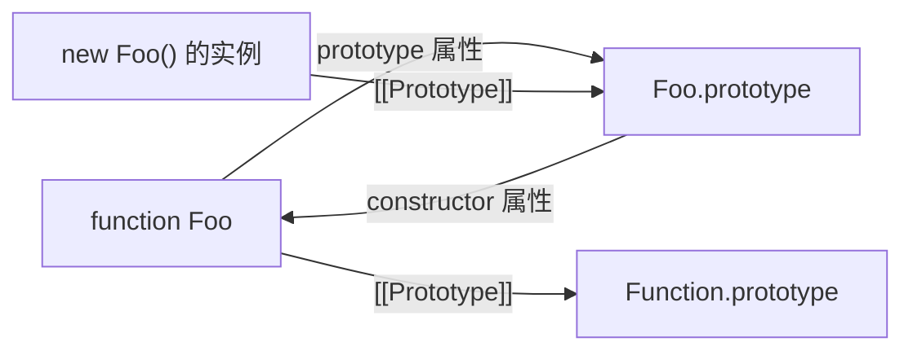

---
mdx:
  format: mdx
sources:
  - stage-1-js-core
---
# 03 · this 与原型链

> 对应大纲：阶段 1.3「this 与原型链」（`this` 绑定四规则、箭头函数、`call/apply/bind`、原型链查找、class 本质、继承方式对比）
>
> 关联练习：`exercises/this-and-prototype/01`–`06`。建议先读练习顶部的「预期输出」做闭卷预测，再运行对照。

## 学习目标

1. 给任意一次函数调用，能按「new > 显式 > 隐式 > 默认」推出 this 是谁，并说出每条规则对应的规范机制（EvaluateCall / OrdinaryCallBindThis / `[[ThisMode]]`）
2. 能解释三个高频「怪象」的底层原因：隐式丢失、箭头函数词法 this、bind 固化（含连续 bind 只认第一次）
3. 能沿 OrdinaryGet / OrdinarySet 手推一次属性读写，讲清 receiver 在 getter/setter 里的作用、属性遮蔽、「写不穿原型」
4. 能画出 prototype / `__proto__` / constructor 三角图，并列出 class「是糖但不是纯糖」的全部差异点
5. 能逐条说出四种 ES5 继承方式的缺陷，说清 class extends ≈ 寄生组合继承 + 哪些增量能力

---

## 关键概念

### 1. this 不是函数的属性，是「一次调用」的参数

this 是每个**函数代码执行环境**自带的一个绑定槽，在进入函数体之前由「这一次调用怎么发起」决定。同一个函数被调用 N 次，就有 N 个互不相关的 this。所以「这个函数的 this 是什么」是个不完整的问题，完整的问题是「**这一次调用**的 this 是什么」。

整个判定链分两层：

**语法层（求值时）——thisArgument 从哪来。** 依据：ECMA-262 `EvaluateCall`：

- 若被调函数来自**属性引用（Reference）**（形如 `obj.fn`），thisValue = 引用的 base，也就是 `obj`（隐式绑定）；
- 否则 thisValue = `undefined`（这就是「默认绑定」的起点，注意起点是 undefined，不是 globalThis）。

**运行层（进入函数前）——thisArgument 怎么处理。** 依据：ECMA-262 `OrdinaryCallBindThis`：按函数创建时记录的 `[[ThisMode]]` 内部槽三分派：

| `[[ThisMode]]` | 谁是这种函数 | this 处理 |
| --- | --- | --- |
| `lexical` | 箭头函数 | **不做任何 this 绑定**，函数体内 this 沿词法作用域向外找 |
| `strict` | 定义在严格代码里的普通函数 | this = thisArgument **原样保留**（undefined 就是 undefined，null 就是 null，原始值不装箱） |
| `global` | 定义在非严格代码里的普通函数 | thisArgument 为 null/undefined → 替换成 globalThis；原始值 → `ToObject` 装箱（`f.call(42)` 里 this 是 Number 包装对象） |

#### 四规则与优先级

| 优先级 | 规则 | 触发形式 | 规范路径 | this |
| --- | --- | --- | --- | --- |
| 1 | new 绑定 | `new F()` | `[[Construct]]` → OrdinaryCreateFromConstructor | 以 `new.target.prototype` 新建的空对象 |
| 2 | 显式绑定 | `f.call(o, …)` / `f.apply(o, …)` / `f.bind(o)(…)` | `[[Call]]` 直接带 thisArgument；bind 是「预置并锁定」 | 指定的对象 |
| 3 | 隐式绑定 | `obj.f()` | EvaluateCall 的属性引用 base | obj（只有**最后一层**引用算数） |
| 4 | 默认绑定 | `f()` | thisArgument = undefined | strict：保留 undefined；global：替换为 globalThis 并装箱原始值 |

「优先级」的本质不是一套排序算法，而是**一次调用只会落入一条路径**：new 走 `[[Construct]]`，根本不经过 thisArgument；call/apply 是当场给出 thisArgument；属性引用由求值规则自动产生 thisArgument；都没有就是 undefined。bind 看起来「仅次于 new」，是因为它产出的函数在 `[[Call]]` 里**自带** thisArgument，调用方再传的会被丢弃（见 §4），而 `[[Construct]]` 路径压根不看它。

#### 严格 / 非严格的分水岭

- 判定单位是**函数体**，不是文件：函数声明/表达式继承所在代码的严格性；class 体天然严格；ESM 模块天然严格；`new Function("...")` 的函数体天然**非严格**（除非自己写 `"use strict"`）。
- **本工作区环境注记（实测）**：tsx 会把 `.ts` 按类 CJS（非严格）方式转译执行。因此练习文件顶部统一放 `"use strict"` 指令 + `export {}`，复原「严格 + 模块」语义（顶层 this 为 undefined、默认绑定不替换）；非严格行为一律用 `new Function` 动态创建演示（练习 01）。

### 2. 隐式丢失：Reference 被拆掉了

```ts live noInline
const obj = { tag: "obj", show() { return this.tag; } };
const detached = obj.show; // 拿到的是「函数值」，属性引用消失
detached();                // 严格模式：this === undefined；非严格：globalThis
```

原因：`obj.show` 求值 = GetValue(Reference(base=obj, name="show"))——取出的是函数**值**本身。之后 `detached()` 的调用表达式没有任何 base，回落到默认绑定。所有「回调传方法名」的场景都是同一机制：`arr.map(obj.show)`、`setTimeout(obj.show, 0)`、`const { show } = obj`。修复三选一：`obj.show.bind(obj)`、箭头包装 `(...args) => obj.show(...args)`、或调用处 `arr.map((x) => obj.show(x))`。

### 3. 箭头函数：`[[ThisMode]] = lexical`

依据：ECMA-262 OrdinaryFunctionCreate——箭头函数创建时 thisMode 取 `lexical`；OrdinaryCallBindThis 对 lexical 模式直接跳过绑定。

于是箭头函数体内 `this` 的解析和普通变量一样：**沿词法作用域链向外找**，直到最近的「非箭头函数执行环境」的 this（某个普通函数/class 那次调用的 this）；到顶层就是全局/模块的 this（ESM 里是 undefined）。对象字面量**不构成作用域**，所以「对象里写箭头方法」的 this 不会指向该对象。

三个直接推论（练习 02 逐个验证）：

1. **call/apply/bind 的第一个参数被忽略**（可传，不报错，但无效——因为根本没有 this 绑定步骤）；参数照常传递。
2. **不能作构造器**：没有 `[[Construct]]` 内部方法，`new` 抛 TypeError。
3. **没有 arguments**（也没有 super / new.target）：标识符沿词法落到外层函数——箭头里写的 `arguments` 数的是**外层函数**的实参。

适用：回调里保持外层 this（定时器、事件处理器、Promise 链）。不适用：对象方法、需要动态 this 的原型方法、构造器。

### 4. bind 的规范行为：BoundFunctionCreate

依据：ECMA-262 `Function.prototype.bind` 与 bound function 的 `[[Call]]` / `[[Construct]]`。

- `f.bind(thisArg, ...pre)` 执行 `BoundFunctionCreate`：新函数 F 带三个内部槽——`[[BoundTargetFunction]]` = f、`[[BoundThis]]` = thisArg、`[[BoundArguments]]` = pre。F 是个「外壳」，自己不执行任何函数体。
- **F 被调用时**（bound `[[Call]]`）：`args = [[BoundArguments]] ++ 本次实参`，然后 `Call([[BoundTargetFunction]], [[BoundThis]], args)`——调用方传入的 thisArgument 被整个丢弃。这就是「bind 之后 this 永久固化，再 call/apply/bind 都无效」的机制。
- **`new F()` 时**（bound `[[Construct]]`）：走构造路径，`[[BoundThis]]` 同样被无视；实参与预置参数拼接后交给原函数；new.target 若等于 F 则替换为原函数 → 实例的原型来自**原构造函数**的 prototype，`instanceof 原构造函数` 为 true。「new 绑定 > 显式绑定」的规范来源就在这（练习 03 的 `[new bound]` 系列）。
- **`bound.length`** = max(原函数.length − 预置参数个数, 0)（length 本身只数第一个默认参数/剩余参数之前的形参）；**`bound.name`** 加前缀 `"bound "`，连续 bind 会叠加成 `bound bound f`。
- **连续 bind 只认第一次**：`f.bind(A).bind(B)()` 的调用链是——外层 bound 调内层 bound（thisArgument = B 传给内层后被丢弃），内层 bound 再调 f 时用的是自己的 `[[BoundThis]]` = A。参数倒是逐层累积前置。

### 5. 原型链查找：OrdinaryGet / OrdinarySet 与 Receiver

依据：ECMA-262 `OrdinaryGet(O, P, Receiver)`（读）：

1. 在 O 的**自有属性**里找：data 属性 → 返回值；accessor 属性 → 有 getter 则 `Call(getter, Receiver)`；
2. 没找到 → `parent = O.[[Prototype]]`；为 null → 返回 undefined（链到头）；否则 `parent.[[Get]](P, Receiver)`——**Receiver 原样下传**。

这一条规则同时解释了三件事：

- **链式查找**：实例 → 原型 → 原型的原型 → … → null。普通对象的链尾是 `Object.prototype`，它的原型是 null（终点）。
- **getter/setter 的 this 是 receiver**：子对象触发父原型的 getter 时，getter 里的 this 是**发起这次访问的子对象**（Receiver），不是定义 getter 的对象。所以「读到的值」「写落的坑位」都由接收者决定——响应式库、`Object.defineProperty` 伪私有变量都依赖这一点。
- **原型是活的**：查找发生在**访问那一刻**，事后改原型属性、加方法对所有实例立即生效（练习 04 §3）。

依据：ECMA-262 `OrdinarySet(O, P, V, Receiver)`（写）：

- 沿链找到的是 **data 属性** → **不在原型上改**，而是在 Receiver 上创建自有属性 → **遮蔽（property shadowing）而非改写**，即「写不穿原型」；想改原型必须显式写 `proto.x = ...`。
- 沿链找到的是 **accessor** → 以 Receiver 为 this 调 setter（写同样落在接收者身上）。

`Object.create(null)`：原型为 null 的「字典对象」——沿链一步都查不到（没有 toString / hasOwnProperty / valueOf），是最干净的 key-value 容器；代价是传给期望普通对象的代码容易 TypeError（练习 04 §7）。

### 6. prototype / `__proto__` / constructor 三角关系



- 实例的 `[[Prototype]]` 指向构造函数的 `.prototype`；`.prototype.constructor` 默认回指构造函数。注意 constructor 只是个**普通的可写数据属性**：手动更换原型后会指错对象（寄生组合继承必须手修这一步，练习 06）。
- 构造函数自己也是对象：它的 `[[Prototype]]` 是 `Function.prototype`；而 **`Function.prototype` 本身是个函数**（`typeof` 为 `"function"`，调用返回 undefined），它是「函数一族」的原型链终点；它的 `[[Prototype]]` 又是 `Object.prototype`。
- **`__proto__` 不是内部槽的本体**：它是 `Object.prototype` 上的一个**访问器属性**（Annex B 遗留，get/set 分别转发到 `[[GetPrototypeOf]]` / `[[SetPrototypeOf]]`）。所以 `Object.create(null)` 出来的对象连 `__proto__` 都没有。现代代码用 `Object.getPrototypeOf` / `Object.setPrototypeOf`。
- 建立链接的三种方式：
  1. `Object.create(proto)` —— 创建时一次性指定（推荐，还能传 null）；
  2. `Object.setPrototypeOf(obj, proto)` —— 事后改（V8 会作废已优化的隐藏类，性能敏感处避免）；
  3. `class Child extends Parent` —— 静态链接，还附带方法不可枚举、super、静态继承等语义（见 §7/§8）。

### 7. class：是语法糖，但不是纯糖

先说「是糖」的部分：class 的运行时本体就是（构造）函数——`typeof C === "function"`；方法挂在 `C.prototype` 上；实例仍是普通对象 + 原型链。以下差异让这颗「糖」不纯（练习 05 逐条验证）：

1. **原型方法不可枚举**。依据：ClassDefinitionEvaluation 用 CreateMethodProperty 定义方法（enumerable: false）；ES5 手挂的 `C.prototype.fn = …` 是可枚举普通属性 → `Object.keys` / `for…in` 行为不同。
2. **类体自动严格**——方法被剥离对象、以 undefined 调用时，this 保持 undefined，读属性直接 TypeError（非严格函数只会被替换成 globalThis 而不报错）。
3. **构造器不能脱离 new 调用**：class 构造器函数对象带 `[[IsClassConstructor]]` 内部槽，`[[Call]]` 入口检查该槽并抛 TypeError（V8 文案 "Class constructor X cannot be invoked without 'new'"）。普通构造函数被 `call` 只是 this 变了而已。
4. **方法简写没有 `[[Construct]]`**：MethodDefinition 走 DefineMethod、不调用 MakeConstructor → `new obj.method()` 抛 TypeError；而 `obj.method = function(){}` 的普通函数表达式可以 new。这是「方法」与「函数」的真实运行时差异。
5. **static 与静态链**：static 方法定义在「类这个函数对象」自身上；`extends` 同时建立**第二条链**——`Object.getPrototypeOf(Child) === Parent`（类 → 类），静态方法因此可继承、静态方法里也能 `super`；实例侧则是 `Object.getPrototypeOf(Child.prototype) === Parent.prototype`。
6. **`#private` 真私有**：私有名字不是属性——不出现在 `getOwnPropertyNames` / `Reflect.ownKeys`，无法枚举、无法代理转发；访问权由「类体内的私有环境」控制，类体外连语法上都写不出这个名字；`#x in obj` 是品牌检查（只判断是否本类实例，不抛错）；同类实例可以互访。对比 TS 的 `private` 关键字：纯类型层约束，编译后仍是普通属性。
7. **类字段有自己的初始化时机**：派生类字段在 super() 返回后、构造器余下语句之前初始化（见 §8），而不是「进入构造器前全部就位」。
8. class 声明体有 TDZ（同 let/const），不存在函数声明那种提升。

### 8. extends / super：`[[HomeObject]]` 与 super() 的两件事

**`super.x`（方法/属性形式）**：方法定义时引擎给这个函数记下 `[[HomeObject]]`（「这个方法写在哪个对象上」）。`super.x` 的语义 = 以 `HomeObject.[[Prototype]]` 为**查找起点**、以当前 this 为 receiver 执行。所以 super 的起点由**代码书写位置**决定、与运行时谁调用无关——把方法拷走（mixin）super 依然指向原定义处的父对象。

**`super()`（构造器形式）**：派生构造器 `[[ConstructorKind]] = derived`，进入时**不创建 this**——this 处于 TDZ，提前访问抛 ReferenceError，这就是「用 this 前必须先 super()」的机制本体。super() 做两件事：

1. `Construct(父构造器, args, new.target)` —— 由父构造链产出实例并绑定为 this。**new.target 原样传递**：父构造器知道「真正被 new 的是哪个子类」，实例原型取 `new.target.prototype`（子类原型）。这正是 class 能正确继承 `Array` / `Map` 等内建类的原因——ES5 的借用构造（`Parent.call(this)`）里父函数的 new.target 是 undefined，根本做不到。
2. `InitializeInstanceElements(new.target, this)` —— 立刻初始化字段，然后才执行构造器余下语句。

由此得到完整的字段/构造顺序（练习 05 §8 实测）：

```
基类字段初始化 → 基类构造器体 → （super() 返回）派生类字段初始化 → 派生类构造器余下语句
```

推论：基类构造器里调用「可能被派生类重写的方法」时，派生字段还不存在（输出里是 undefined）——「构造器里别调可重写方法」这条 OOP 通用建议在 JS 里的具体形态。

### 9. 继承方式对比：从原型链继承到 class extends

| 方案 | 做法 | 缺陷（逐个说清） |
| --- | --- | --- |
| 原型链继承 | `Child.prototype = new Parent()` | ① 父**实例**上的引用值属性被所有子实例共享（一个实例 push，全体可见）② 无法向父构造器传参 ③ 定义 Child 时就要执行一次父构造器（副作用提前发生） |
| 借用构造函数 | 子构造器里 `Parent.call(this, args)` | ① 方法只能写在构造器体里 → 每个实例一份函数，无复无共享 ② 摸不到 `Parent.prototype` 上的方法（链根本没连）③ `instanceof Parent` 为 false |
| 组合继承 | 原型链 + 借用构造相加 | 能用、曾是主流，但**父构造器执行两次**（`new Parent()` 造原型一次 + `call` 一次）；原型上残留一份被实例同名属性遮蔽的冗余值 |
| 寄生组合继承 | `Parent.call(this)` + `Child.prototype = Object.create(Parent.prototype)` + 手修 constructor | ES5 时代最优解；缺点只剩样板代码与手动 super（`Parent.prototype.m.call(this, …)`） |
| class extends | `class C extends P { constructor() { super() } }` | ≈ 寄生组合的**自动化**：链接自动建好且 constructor 自动回指；方法不可枚举、类体严格；super 是语言级的（`[[HomeObject]]`）；new.target 贯穿（可继承内建类）；静态方法自动继承；`#private` 可用 |

手写寄生组合的三个不能忘（练习 06 A 部分逐行有注释）：用 `Object.create(Parent.prototype)` 而不是 `new Parent()`；换原型后手修 `constructor` 回指；子方法调父方法要手动 `Parent.prototype.method.call(this)`。

---

## 可运行示例

下面这个 20 行的小文件浓缩了本篇最反直觉的三个点。已实测（严格模式）：

```ts live noInline
"use strict";

// ① getter/setter 的 this 是 receiver：方法在 proto 上，读写却发生在 child 上
const proto = {
  _name: "proto",
  get name(): string { return this._name; },
  set name(v: string) { this._name = v; }, // 写的也是 receiver
};
const child = Object.create(proto);
child.name = "child"; // 触发 proto 的 setter，this 是 child → 在 child 上建了自有 _name
console.log(Object.hasOwn(child, "_name"), proto._name, child.name);

// ② new 优先于 bind：[[Construct]] 路径无视 [[BoundThis]]
function Robot(this: { id: string }, id: string): void { this.id = id; }
const BoundRobot = (Robot as unknown as Function).bind({ id: "FAKE" });
const r = new (BoundRobot as unknown as new (id: string) => { id: string })("real");
console.log(r.id, r instanceof Robot);

// ③ 箭头函数：this 认定义处（词法），参数认调用处
const box = {
  tag: "BOX",
  make(): (x: number) => string {
    return (x: number): string => `${this.tag}:${x}`; // 捕获 make() 那次调用的 this
  },
};
console.log(box.make().call({ tag: "X" }, 42));
```

逐行输出与原理：

```
true proto child
```
OrdinarySet 沿链在 proto 上找到 accessor，以 Receiver（child）为 this 调 setter → `_name` 建在 child 自身（hasOwn 为 true）；proto 的 `_name` 从未被写（还是 "proto"）；child.name 再读时，OrdinaryGet 在 child 自有属性直接命中（"child"）。

```
real true
```
new 走 bound `[[Construct]]`：`[[BoundThis]]` 被无视，实例由 Robot 以 new.target（替换为 Robot）产出 → `r.id` 是构造器里赋的 "real"，`instanceof Robot` 为 true；bind 进去的 `{ id: "FAKE" }` 没污染任何东西。

```
BOX:42
```
箭头函数 `[[ThisMode]] = lexical`：`.call({ tag: "X" }, 42)` 的第一个参数无处安放（this 仍是捕获的 box），第二个参数正常传递（42）。

更完整的可运行验证见六个练习文件（01 四规则 / 02 箭头 / 03 call-apply-bind / 04 原型链 / 05 class 本质 / 06 继承对比），每个文件顶部注释写有逐行预期输出。

---

## 易错点与面试高频

- **「obj.fn() 里 this 一定是 obj 吗？」** 不一定——obj 可能只是链上的载体：如果 fn/getter 实际定义在原型上，this 仍然是**接收者** obj（这正是 receiver 语义）。反过来，`const f = obj.fn; f()` 就丢了。
- **严格/非严格默认绑定**：背结论容易翻车的点——非严格不止「变成 globalThis」，还有**原始值装箱**（`f.call(42)` 里 `typeof this === "object"`）；严格模式则 null/原始值原样保留。
- **嵌套对象只看最后一层**：`a.b.fn()` 的 this 是 `a.b`，不是 a。
- **箭头函数能不能被 call 改 this**：不能（可传但无效）；参数正常传。「箭头函数 this 取决于定义处」的准确含义：沿**词法作用域**找最近一层非箭头函数的 this，对象字面量不算作用域。
- **箭头函数里的 arguments**：是外层函数的（常考输出题）。
- **bind 之后 call 无效、连续 bind 只认第一次**；但 **new boundFn 时 this 被忽略、instanceof 原构造函数为 true**——「bind 之后 this 永不可变」这句话对 new 不成立。
- **bound.length / name**：`max(原.length − 预置参数, 0)`；`"bound "` 前缀叠加。
- **写属性不穿原型**：`child.x = 1` 只会在 child 上建自有属性遮蔽原型的 x；想改原型得显式。`delete child.x` 删的是自有那份。
- **constructor 不可信**：只是 prototype 上的普通数据属性，换原型后不修就是错的。
- **`Object.create(null)` 没有 `__proto__`、没有 toString**：`obj.__proto__` 报错的原因是查不到 Object.prototype 上的那个访问器。
- **class 方法不可枚举** → `Object.keys(C.prototype)` 为空数组；`for…in` 只走实例与（可枚举的）原型属性，ES5 手挂方法会混进来。
- **方法简写不能 new、class 构造器不能脱离 new**：前者没有 `[[Construct]]`，后者是 `[[IsClassConstructor]]` 抛错——两个都是 TypeError，机制不同。
- **为什么子类构造器用 this 前必须 super()**：派生构造器的 this 在 super() 前处于 TDZ（ReferenceError），不是「风格建议」。
- **instanceof 与 isPrototypeOf 等价**：`a instanceof B ⟺ B.prototype.isPrototypeOf(a)`；instanceof 还可被 `Symbol.hasInstance` 定制。
- **setTimeout 回调的 this**：Node 以 Timeout 实例为 thisArg 调用、浏览器按 HTML 规范用 globalThis——都是**宿主显式传入**的，所以普通函数（哪怕严格模式）拦不住；要保 this 用箭头（练习 02 实测）。

---

## 输出预测题

先闭卷写出每一行输出，再看文末答案。（均为严格模式）

### 题 1 · this 综合推断

```ts live noInline
function showTag(this: { tag?: string } | void): string {
  return this?.tag ?? "<lost>";
}
const timer = { tag: "timer", showTag };
const fake = { tag: "fake" };

console.log(timer.showTag());
console.log(showTag.call(fake));
console.log(showTag.bind(fake).call(timer));
const detached = timer.showTag;
console.log(detached());
const holder = { tag: "holder", get label() { return showTag.call(this); } };
console.log(holder.label);
```

### 题 2 · 原型链 + class 字段初始化顺序

```ts live noInline
class A {
  name = "a";
  constructor() {
    console.log(`A ctor: ${this.name}, ${this.kind()}`);
  }
  kind(): string { return "A"; }
}
class B extends A {
  name = "b";
  kind(): string { return `B(${this.name})`; }
}
const b = new B();
console.log(`after: ${b.name}`);
const p = Object.getPrototypeOf(b);
console.log(p.constructor === B, Object.keys(p).length);
```

---

## 延伸阅读

- ECMA-262（一手规范，直接搜操作名）：
  - this 绑定：`EvaluateCall`、`GetThisValue`、`OrdinaryCallBindThis`、`OrdinaryFunctionCreate`（thisMode: lexical / strict / global）
  - bind：`Function.prototype.bind`、`BoundFunctionCreate`、bound function 的 `[[Call]]` 与 `[[Construct]]`、`SetFunctionName`
  - 原型：`OrdinaryGet`、`OrdinarySet`、`Object.prototype.__proto__`（Annex B）、`OrdinaryCreateFromConstructor`
  - class：`ClassDefinitionEvaluation`、`MethodDefinition`（DefineMethod / MakeConstructor）、`[[IsClassConstructor]]`、`MakeMethod`（`[[HomeObject]]`）、`InitializeInstanceElements`
  - 官方 HTML 版：https://tc39.es/ecma262/
- MDN「语言基础」系列：`this`（六种绑定情形）、继承与原型链、类（Class fields / Private properties / static）
- 《你不知道的 JavaScript（上卷）》第 2 章（this 全面解析）与第 5 章（原型）——结论均可在上文规范操作中找到依据
- 练习：`exercises/this-and-prototype/01`–`06`（每题顶部有逐行预期输出）

---

## 预测题答案

### 题 1 答案

```
timer
fake
fake
<lost>
holder
```

逐行解析：

1. `timer.showTag()` —— 隐式绑定：属性引用的 base 是 timer，this = timer → `"timer"`。
2. `showTag.call(fake)` —— 显式绑定：thisArg = fake → `"fake"`。
3. `showTag.bind(fake).call(timer)` —— bind 优先：`bind(fake)` 的 `[[BoundThis]]` = fake；bound `[[Call]]` 丢弃后来 `.call(timer)` 传入的 timer，仍以 fake 调原函数 → `"fake"`。
4. `detached()` —— 隐式丢失：`const detached = timer.showTag` 只取函数值，调用表达式没有 base → 默认绑定，严格模式 this = undefined → `this?.tag ?? "<lost>"` → `"<lost>"`。
5. `holder.label` —— getter 的 this 是接收者：访问 `holder.label` 时 OrdinaryGet 以 Receiver（holder）为 this 调 getter；getter 里 `showTag.call(this)` 把 holder 显式传入 → `"holder"`。

### 题 2 答案

```
A ctor: a, B(a)
after: b
true 0
```

逐行解析：

1. `new B()` 的执行顺序是「基类字段 → 基类构造器 → 派生类字段 → 派生类构造器余下」：A 的字段先把实例自有属性 `name` 初始化为 `"a"`；进入 A 构造器时 `this.name` 是 `"a"`。`this.kind()` 是**动态派发**——实例的原型已是 `B.prototype`，所以调用的是 B 的 kind，而此刻 B 的字段还没执行，`this.name` 读到的仍是 A 初始化的 `"a"` → 打印 `A ctor: a, B(a)`。（若在 A 构造器里访问 B 独有的字段，会是 undefined。）
2. A 构造器返回后，`InitializeInstanceElements` 执行 B 的字段：`name` 被重新初始化为 `"b"`（同一个自有属性被覆盖）。构造完成后 `b.name` → `"b"`。
3. `p` 是 `B.prototype`：ClassDefinitionEvaluation 创建的 constructor 方法自动回指 B → `p.constructor === B` 为 true；class 原型方法**不可枚举** → `Object.keys(p).length` 为 0（若 B 的方法是 ES5 手挂的 `B.prototype.kind = function…`，这里会是 1）。

---

## 替换清单（ASCII 图 → Mermaid）

| 原 ASCII 图位置/标题 | Mermaid 图表类型 |
| --- | --- |
| §6 prototype / `__proto__` / constructor 三角关系图 | flowchart (LR) |

---

## 深入一层：六来源总表、super 的家与箭头的捕获时机

### B1. this 的六个来源与一条判定链

正文 §1 的四规则表覆盖了「普通函数的调用形态」，加上箭头函数与 getter/setter 的 receiver，this 的全部来源可以收拢成一张六行总表。判定永远从上往下问，第一个命中的分支即答案：

| 序 | 来源 | 触发形态 | this 是谁 | 一手依据 |
| --- | --- | --- | --- | --- |
| 0 | 词法（箭头） | 函数本体是箭头，或定义嵌在箭头里 | 沿词法作用域向外找最近非箭头环境的 this | `OrdinaryFunctionCreate`（thisMode: lexical）+ `GetThisEnvironment` |
| 1 | new | `new F()` | 以 `new.target.prototype` 新建的对象 | `[[Construct]]` |
| 2 | bind 外壳 | 调 bound 函数 | `[[BoundThis]]`（后来者全部丢弃） | `BoundFunctionCreate` |
| 3 | call/apply | `f.call(o)` | 当场指定的 thisArgument | `[[Call]]` |
| 4 | 隐式 | `obj.f()` | 属性引用的 base（只看最后一层） | `EvaluateCall` |
| 5 | 默认 | `f()` | undefined 起点（strict 原样；global 换 globalThis 并装箱原始值） | `EvaluateCall` + `OrdinaryCallBindThis` |

注意第 0 行排最上：箭头函数不是「优先级更低」，而是**根本不进入这套竞逐**——它体内写 this 时走的是变量解析（`GetThisEnvironment`），new 与 call 对它同时失效。第 4/5 行命中后还有一条 receiver 补丁：如果那个属性实为 getter/setter，this 是**发起访问的 Receiver**，与方法定义在哪无关（正文 §5）。这张表是下面手推配方的查表版。

一点辨析：口语常说的「优先级 new 大于 bind 大于隐式」与这张表不矛盾，但表更准——六行里真正会「竞逐」的只有 1 到 5 行，且竞逐发生在「一次调用表达式的语法形态」上：`new boundFn()` 时 new 与 bind 同现，是 bound 函数的 `[[Construct]]` 内部**主动**按构造路径处理（丢弃 `[[BoundThis]]`、替换 new.target），不是谁「赢」了谁。把优先级理解成「语法形态分派表」，比理解成「权重排序」更接近规范，也更容易解释 new boundFn 这类交叉情形。

### B2. super 的家：`[[HomeObject]]` 的收据与推论

正文 §8 说「super 的起点由代码书写位置决定」，机制本体是：方法定义时引擎给这个函数对象记下内部槽 `[[HomeObject]]`（「这个方法写在哪个对象上」）；`super.x` 的查找起点恒为 `HomeObject.[[Prototype]]`，receiver 则照常是当前 this。进阶预测题 5 的第二问是这机制的干净实验（实跑收据见文末）：

```js
const copied = { name: "copied", __proto__: base };
copied.greet = mid.greet;   // 把方法函数整个拷走
console.log(copied.greet()); // "mid->base:copied"
```

方法搬了家（现在挂在 copied 上），super 却仍从**原家 mid** 的原型（base）开始找——因为 `[[HomeObject]]` 记在函数对象身上，函数搬家不带它。返回值里的 receiver 又是 copied（当前 this），所以拼出 base:copied：**查找起点看定义处，receiver 看调用处**，一句话同框。两个工程推论：其一，mixin 拷方法时 super 语义跟着原家走，指错了父对象就是静默 bug；其二，正文 §9 的「手写寄生继承调父方法」必须显式 `Parent.prototype.m.call(this)`——ES5 普通函数没有 `[[HomeObject]]`，写 super 直接是语法错误，显式 call 是唯一出路。

顺带把 super 的两条形态划清界限：`super.x`（属性形式）走的是上面这套 `[[HomeObject]]` 查找；`super()`（构造器形式）走的是正文 §8 的 Construct 加字段初始化那两步，两者共享 super 这个词，机制却完全独立——面试里把两条混作一谈是高频翻车点。验证路径也分开：属性形式看进阶题 5 的收据，构造形式看正文 §8 的字段顺序与练习 05 §8 的实测。

### B3. 箭头函数的捕获时机：定义时接线，调用时取值

「箭头函数捕获定义处的 this」这句话有个精度问题：**定义时建立的不是值，是词法环境的链接**。`OrdinaryFunctionCreate` 创建箭头时只做两件事——把 thisMode 记为 lexical（本函数不设 this 绑定），把创建时的词法环境记为外壳。箭头体内的 this 每次**求值时**都走 `GetThisEnvironment`：沿环境链向外，跳过一切箭头环境，停在最近的「有 this 绑定」的环境上，读出当前值。由此三个精确结论：

- 值的确定时机是**外层普通函数那次调用进入时**（`OrdinaryCallBindThis` 执行完、写入环境的那一刻）——不是箭头创建那一刻，更不是箭头被调用那一刻；
- 同一段箭头代码，外层函数被调用两次，产出的两个箭头各自的 this 可以不同（收据 T1：fa 与 fb 同源，A、B 之别来自外层 make 的两次调用）；
- 外层调用结束后值随环境固定，此后对箭头 `.call(b)` 只是「传了个无处安放的参数」（T1 第二行原样输出 A B）。

这也顺带补全正文 §3 的「对象字面量不算作用域」：环境链由函数/块/模块构成，对象字面量不在其上，箭头在对象方法里向外找 this 时会直接穿过对象字面量，落到更外层的函数环境。

追问三则，把 B3 的边界问透：

- **箭头的 this 能事后改吗？** 不能。它没有可写的 this 绑定，call/apply/bind 全部无效（可传参、不报错、this 不动）。想得到「不同 this 的同一段箭头逻辑」，唯一出路是**重新调用外层函数**——工厂模式：`make.call(otherObj)` 返回的新箭头就捕获新值。题 3 的 fa 与 fb 就是两个工厂产物。
- **把箭头赋给对象属性，this 会变成那个对象吗？** 不会。`const o = { f: someArrow }` 之后 `o.f()` 的 this 仍是箭头创建时接线的外层环境值——属性赋值只搬运函数引用，环境链接是创建时焊死的。同理 `arr.map(someArrow)` 也不受数组影响，这与普通函数的隐式丢失恰好相反：普通函数丢 this，箭头函数从不「丢」也从不「得」。
- **getter 里写箭头呢？** getter 本体是普通函数，被访问时以 Receiver 为 this 进入调用；其内部的箭头捕获的正是「这次 getter 调用」的 this（即 receiver）。所以「在 getter 里用箭头把 this 传给异步回调」是成立的——箭头抓到的是当次访问的 receiver，不是定义处的某个旧对象。这类细节用配方推一遍即可，不必背。

## 手推配方：三步判定一次调用的 this

把 B1 收拢成可执行的判定流程，任何 this 输出题先闭卷手推再实跑对账。两条使用纪律：只按顺序走，不跳步——「看形态」之前必须先过「找本体」，漏掉第 1 步是 this 题最大的失分源；手推写下的每一步都要点名依据（哪一行表、哪一条规则），写不出依据的结论大概率是直觉在冒充推理。下面是三步本体：

1. **找本体**：被调函数是箭头，或定义嵌在箭头里？是 → 丢弃本次调用传入的一切 this 信息，改查「最近一层非箭头函数环境的 this」，回到本步继续向外；到顶层则取全局/模块 this（ESM 为 undefined）。
2. **看调用形态**（按序命中即停）：有 new → 实例；是 bound 外壳 → `[[BoundThis]]`；有 call/apply → 当场指定值；是属性引用 → base（`a.b.f()` 只取 b）；裸调用 → undefined 起点。
3. **过严格性修正**：函数体的 `[[ThisMode]]` 为 global 时，undefined 与 null 换成 globalThis、原始值装箱；strict 时原样保留。另有一条附加规则：命中 getter/setter 时，this 改为 Receiver（发起访问的对象）。

示范一遍：`const g = obj.wrap.inner.hit; g.call(42)`，设 hit 定义在非严格代码。第 1 步，hit 不是箭头；第 2 步，赋值表达式已把属性引用拆掉（正文 §2 隐式丢失同机制），`g.call` 命中显式绑定，thisArgument 为 42；第 3 步，global 模式把 42 装箱，this 是 Number 包装对象，`typeof this` 为 "object"——正是进阶题 4 第二行的实跑结果。三步走完不需要背任何特例，所有「怪象」都是这三步的推论。

### 复盘：三道题按配方走一遍

用配方复盘下面三道题的手推过程，对照文末实跑输出检验。

题 3：第一行 `fa()`——第 1 步，fa 是箭头，向外找最近非箭头环境：make 那次调用，base 为 a，取值为 A；fb 同理取 B。第二行 `fa.call(b)`——第 1 步仍是箭头，本次传入的 b 直接作废，取值不变，仍输出 A。两行手推与实跑一致。

题 5：`extra.greet()`——第 1 步，greet 是普通方法；第 2 步，属性引用的 base 是 extra，隐式绑定，this 为 extra。执行到 `super.greet()` 时追加两条：查找起点等于 greet 的 `[[HomeObject]]`（mid）的原型 base；receiver 是当前 this（extra）。拼出 mid->base:extra。`copied.greet()` 同法推：this 是 copied（调用处定 receiver），`[[HomeObject]]` 仍是 mid（定义处定起点），拼出 mid->base:copied——两处信息来源不同，正是这道题的考点。

题 6：`b2()`——第 1 步不是箭头；第 2 步，b2 是 bound 外壳，其目标是 b1（也是 bound 外壳），剥两层到 f；this 取**最内层** bound 的 `[[BoundThis]]` 即 first（外层包进去的 second 在 b1 被调用时整体丢弃）；参数按「逐层预置在前」拼成 (1, 2)。`new BP("real")`——bound 的构造路径：`[[BoundThis]]` 全程无视，new.target 一路替换回 P，实例原型取 P 的 prototype，故 instanceof 为 true。

## 工程三陷阱

**陷阱一：bind 的预置参数吃掉回调的第一个实参**。`f.bind(obj, arg)` 的预置参数排在实参**前面**（`[[BoundArguments]]` 在前的拼接顺序）。把「绑 this」顺手写成 `handler.bind(this, state)` 再挂到事件系统上，事件对象会被追加在 state 之后——this 修好了，参数错位了。处置：bind 只预置 this；要预置数据用箭头包装 `(...args) => handler(state, ...args)`，参数顺序自明。排查信号：回调收到的第一个参数「形状不对」（事件对象出现在第二个位置）而 this 又确实正确——先数 bind 的预置参数个数、再数实参，九成错位源于少算一层拼接。

**陷阱二：把箭头函数放在需要动态 this 的位置**。不少库以「this 指向当前实例」的方式回调（DOM 事件处理器的 this 是元素、部分框架的钩子方法以 this 取实例）；箭头函数会把这类 thisArgument 全部静默丢弃（题 3 第二行）。现象是「改成箭头后 this 变成了外层某个不相干对象」，比报错更难排查。处置：需要宿主传 this 的回调用普通函数（必要时配 bind），业务回调保持箭头——按「谁提供 this」划界，而不是一刀切。

**陷阱三：用类字段箭头把所有方法都绑死**。类字段箭头（`m = () => this.x`）每实例一份函数、挂在实例自身：原型上没有它（`Object.keys(C.prototype)` 看不到，与正文 §7「原型方法不可枚举」叠加后更容易误判），子类经原型链摸不到，`super` 更无从谈起；实例数量大时函数对象内存随之翻倍。处置：只有「作为回调字段且确实需要固化 this」的方法用类字段箭头，其余一律原型方法；确实要在原型方法上固化 this，回到 bind 并接受 bound 函数的全部语义（题 6）。

## 进阶输出预测题（五道，node v24.10.0 实跑验证）

先闭卷写输出，再看文末答案。题以 .mjs 运行（天然严格模式），题 4 的非严格函数用 `new Function` 构造。

### 题 3（箭头的捕获时机与 call 失效）

```js
function make() { return () => this.tag; }
const a = { tag: "A", make };
const b = { tag: "B", make };
const fa = a.make();
const fb = b.make();
console.log(fa(), fb());
console.log(fa.call(b), fb.call(a));
```

### 题 4（严格/非严格的默认绑定与装箱）

```js
const sloppy = new Function("return typeof this + ':' + (this === globalThis)");
console.log(sloppy());
console.log(sloppy.call(42));
const strictFn = function () { "use strict"; return typeof this; };
console.log(strictFn());
```

### 题 5（super 的家与 receiver）

```js
const base = { greet() { return "base:" + this.name; } };
const mid = { __proto__: base, name: "mid",
  greet() { return "mid->" + super.greet(); } };
const extra = { name: "extra", __proto__: mid };
console.log(extra.greet());
const copied = { name: "copied", __proto__: base };
copied.greet = mid.greet;
console.log(copied.greet());
```

### 题 6（bind 链的参数、length、name 与 new）

```js
function f(x, y) { return [x, y, this && this.id]; }
const b1 = f.bind({ id: "first" }, 1);
const b2 = b1.bind({ id: "second" }, 2);
console.log(b2());
console.log(b2.name, "|", b1.name, "|", f.length, b1.length, b2.length);
function P(id) { this.id = id; }
const BP = P.bind({ id: "fake" });
const inst = new BP("real");
console.log(inst.id, inst instanceof P);
```

### 题 7（遮蔽的删除恢复与 getter 的 receiver）

```js
const proto = { x: "proto" };
const child = Object.create(proto);
child.x = "own";
console.log(child.x);
delete child.x;
console.log(child.x);
const holder = Object.create({}, {
  label: { get() { return "getter sees " + this.who; }, enumerable: true },
});
const user = Object.create(holder);
user.who = "user";
console.log(user.label);
```

## 进阶预测题答案（实跑输出与解析）

### 题 3 答

```
A B
A B
```

fa、fb 同源而 this 不同：值在外层 make 的两次调用进入时各自确定（B3 的「定义时接线，调用时取值」）。第二行 `.call(b)` 与 `.call(a)` 的第一参数无处安放——lexical 模式没有绑定步骤——原样输出 A B；若传第二参数仍会照常生效（正文 §3 推论 1）。

### 题 4 答

```
object:true
object:false
undefined
```

第一行：sloppy 裸调用，undefined 被 `OrdinaryCallBindThis` 替换成 globalThis，`this === globalThis` 为 true，typeof 为 "object"。第二行：42 被装箱成 Number 包装对象，typeof 仍为 "object" 但 !== globalThis（false）——「非严格不止换 globalThis，还会装箱原始值」的实跑形态。第三行：严格函数裸调用 this 保持 undefined。

### 题 5 答

```
mid->base:extra
mid->base:copied
```

第一行：沿链找到 mid 的方法；方法里 super.greet 的起点是 mid 的原型（base），receiver 是 extra，故 base:extra，前缀 mid-> 来自 mid 自己的模板串。第二行是 B2 的实验：方法被拷到 copied，super 仍从原家 mid 的原型 base 起找（查找起点看定义处），this 却是 copied（receiver 看调用处）。顺带一提：若把 mid.greet 改写成箭头或普通函数表达式，super 一词直接语法报错——只有方法定义才带 `[[HomeObject]]`。

### 题 6 答

```
[ 1, 2, 'first' ]
bound bound f | bound f | 2 1 0
real true
```

第一行：预置参数 1 累积在最前，b2 再预置 2 拼在其后、实参为空，f 收到 (1, 2)；this 是 b1 的 `[[BoundThis]]` first——b2 的 bind 只包了新外壳，拦不住内层已固化的 this。第二行：name 前缀逐层叠加；length 依次为 f 是 2、b1 是 max(2−1, 0) 即 1、b2 以 b1 的 1 为基数再减 1 得 0。第三行：new 走 bound 的 `[[Construct]]`，`[[BoundThis]]` fake 被无视，new.target 替换为 P——实例的 id 是构造器赋的 real，`instanceof P` 为 true（正文 §4）。

### 题 7 答

```
own
proto
getter sees user
```

第一行：`OrdinarySet` 沿链找到的是数据属性 x，写入落在 Receiver（child）上建自有属性——遮蔽而非改写。第二行：delete 删的是自有那份，自有属性消失后查找穿透到 proto——「delete 遮蔽等于恢复原型访问」。注意与 07 册的「delete 打字典模式」区分：那是属性访问性能话题，这里是属性可见性话题，两者同词不同义。第三行：getter 定义在 holder 上，this 却是发起访问的 user（Receiver），输出 getter sees user。想让 getter 固定看 holder，得改成普通方法显式 call，或闭包捕获——receiver 语义是「谁访问谁」，这一规则对数据属性不生效，只对访问器属性生效。

## 规范原文对照：ResolveThisBinding 与 GetThisEnvironment

上文所有「词法/箭头」结论的规范落点是 ECMA-262 的两个操作（官方文本以 tc39.es/ecma262 当前版为准，此处给口径摘要）：

- **GetThisEnvironment()**：从当前执行环境沿 outer 链逐层向外，返回第一个「拥有 this 绑定」的环境记录。函数环境记录带 `[[ThisBindingStatus]]`：值为 lexical（箭头函数的环境）时**没有 this 绑定**，会被跳过继续向外；否则返回该环境。全局环境与模块环境各自持有 this 绑定（script 的全局 this 指向 globalThis，模块的 this 是 undefined）。「箭头的 this 是词法的」在规范层面就一句话：箭头环境不设 this，解析时被跳过。
- **ResolveThisBinding()**：等价于 `GetThisEnvironment().GetThisBinding()`——找到环境后读它的 this 绑定值。读值动作发生在**每次使用 this 时**，不是函数进入时的一次性快照；不过对箭头而言，外层函数的 this 在其调用进入时已由 `OrdinaryCallBindThis` 确定并写入环境，之后不再变化，效果上等同「捕获」。
- 与收据的对应：题 3 的两行输出是 ResolveThisBinding 沿链取值的直接表现；正文 §3 的「call/apply 无效」对应箭头环境根本没有可写的 this 绑定；「对象字面量不算作用域」对应对象字面量不产生环境记录、不在 `GetThisEnvironment` 的路径上。
- **OrdinaryCallBindThis(F, calleeContext, thisArgument)** 的口径补全：按 F 的 thisMode 三分派——lexical 直接返回（不做任何绑定）；strict 把 thisArgument 原样记入函数环境；global 时若 thisArgument 为 null 或 undefined 则替换为所属 realm 的 globalThis、原始值经 `ToObject` 装箱。它是正文 §1「严格/非严格的分水岭」那张表的规范原文位置，也是进阶题 4 三行输出的全部依据：三行分别对应 global 替换、global 装箱、strict 原样三种分支。

把这几个操作名（`ResolveThisBinding`、`GetThisEnvironment`、`OrdinaryCallBindThis`、`BoundFunctionCreate`）记进规范搜索框，比背十篇二手文章可靠——操作名就是这套知识点的一手索引。

