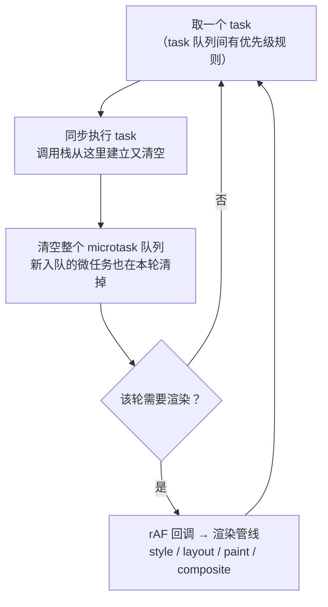

---
mdx:
  format: mdx
---
# 04 · 异步编程：事件循环、Promise 状态机与 async/await

> 对应大纲：阶段 1 JavaScript 核心机制 → 1.4 异步编程
> 配套练习：`exercises/async-programming/01–05`（每个文件头部注释都写死了逐行预期输出，先自己推一遍再运行对照）
> 规范依据说明：事件循环引用 **WHATWG HTML Standard**《Event loops》（8.1.7 processing model）与《timers and user prompts》章节；Promise 引用 **ECMA-262 §27.2 Promise** 及 Jobs 机制（抽象操作名 `PromiseReactionJob`、`NewPromiseResolveThenableJob`、`HostEnqueuePromiseJob`——条款编号随版本漂移，按名称检索）；取消引用 **DOM Standard**《Aborting an ongoing activity》。async/await 的降级产物可用 TypeScript Playground 切 target 实证。

## 学习目标

1. 能按 HTML Standard 的 processing model 复述「一轮事件循环」的完整步骤，并据此推导任意混合了同步代码 / `then` / `await` / `setTimeout` 的输出顺序，而不是背「微任务优先」四个字
2. 能讲清 `await` 的规范本质：函数暂停、续体作为微任务注册，`await x ≈ Promise.resolve(x).then(续体)`，以及非 thenable 快速路径为什么语义不变
3. 能用 ECMA-262 的状态机语言（`[[PromiseState]]` 不可逆、reaction、`NewPromiseResolveThenableJob`）解释：二次 resolve 无效、值穿透、错误沿链传播、thenable adoption「多一拍」
4. 能背出四个组合器在「正常 / 含 reject / 空数组」九宫格里的行为，并解释「短路 ≠ 取消」的规范根源
5. 能分清 `return x` 与 `return await x`、串行与并发、`forEach` 的坑，以及 AbortController 取消的到底是「什么」

## 关键概念

### 4.1 事件循环：一轮到底发生什么

**不要从「宏任务、微任务」两个名词出发，要从 processing model 出发。** HTML Standard《Event loops》§8.1.7 对每个事件循环的规定可以压缩成一条循环：

```
while (true) {
  task = 从 task 队列取一个可运行的任务（同源 task 队列间还有优先级规则）
  执行 task（调用栈从这里建立又清空）
  清空整个 microtask 队列：
      while (microtask 队列非空) { 取最早入队的微任务执行 }
      // 注意：清空过程中新入队的微任务也在本轮清掉
  （浏览器）必要时：执行 rAF 回调 → 渲染管线（style/layout/paint/composite）
}
```

同一轮循环画成图（「清空微任务」每轮必发生，「渲染」按需发生）：



三个常被背错的推论：

- **微任务队列是「清空到见底」**，不是「执行一个」。微任务里再排微任务，也会在本轮全部执行——这就是「递归 `queueMicrotask` 能把渲染和定时器饿死」的原因（HTML Standard 也专门提醒：让 microtask queue 只有有限增长是作者的责任）。
- **渲染不是每轮都有**。rAF 与渲染只在该轮「被认为需要渲染」时发生（一般与刷新率对齐），但微任务清空**每一轮 task 之后都发生**。所以「DOM 改完马上读布局」会强制同步布局，而「改完再读」放在微任务里照样来不及——两者都会读到中间态，但都发生在同一个 task 的同一段线性代码里时才有「批处理」问题。
- **宿主差异**：Node 还有一个 `process.nextTick` 队列，排在 Promise 微任务**之前**清空（Node 专有，HTML 规范里不存在）。看 Node 输出题时把它插在「微任务」前面即可。

**task 与 microtask 的来源清单**（判断输出顺序的第一步永远是先归类）：

| 类别 | 来源 |
| --- | --- |
| task（宏任务） | 脚本首次求值本身；`setTimeout`/`setInterval` 回调；UI 事件（click、input）；I/O 完成回调（Node 的 fs/net 等）；`MessageChannel`/`postMessage`；`setImmediate`（Node） |
| microtask（微任务） | Promise reaction（`then`/`catch`/`finally` 的回调）；`await` 的续体；`queueMicrotask`；`MutationObserver`（浏览器）；`process.nextTick`（Node，独立队列且最先） |

**`setTimeout(fn, 0)` 的真实含义**：

1. 它注册的是**下一轮（或更晚）循环的一个 task**——`0` 不代表「马上」，只代表「尽快的未来某一轮」。本轮正在清空的微任务、以及本轮已经排定的其他 task，都可能排在它前面。
2. 规范在《timers and user prompts》的 timer initialization steps 里规定：**嵌套层级（nesting level）大于 5 且 delay 小于 4 时，delay 强制取 4ms**。所谓嵌套层级，就是「定时器回调里再 setTimeout」链下去的深度——这是防止用 `setTimeout(fn, 0)` 递归把事件循环打穿的保护。加上实现层的取整（常见 1ms 粒度），「setTimeout(fn,0) 至少慢一个 task 周期 + 约 1ms」。
3. 所以「`setTimeout(fn,0)` vs 微任务」不是时间长短之争，是**队列归属**之争：一个在 task 队列，一个在 microtask 队列，后者永远先清空。

**输出题推演清单**（把「背结论」换成「走流程」，任何混合题都适用）：

1. 把所有代码归到三类：同步段（含 async 函数第一个 `await` 前、Promise executor）、微任务（then/catch/finally 回调、await 续体、queueMicrotask）、宏任务（setTimeout 等）。
2. 从上到下执行同步段，**同时记录两件事**：每个微任务入队的先后、每个宏任务入队的先后。async 函数调用即执行到第一个 await。
3. 同步段结束（脚本 task 结束）→ 按 FIFO 清空微任务队列；清空过程中新入队的微任务**继续按 FIFO 追加执行**，直到队列为空。
4. 处理 reaction 时问一句：回调返回的是普通值还是 Promise/thenable？后者从下一环起**多 2 拍**（adoption）。
5. 微任务见底后取下一个宏任务；宏任务回调里的同步段、它排的微任务、它排的宏任务，回到第 2 步递归处理。
6. 全程盯住「谁在什么时候入队」而不是「谁写在前面」——队列 FIFO 是唯一裁判。

### 4.2 `await` 的本质：暂停 + 续体微任务

ECMA-262 把 `await` 建模为 async 函数（一种协程）里的挂起点。执行到 `await x` 时：

1. **函数在此返回**：调用者立刻拿到 async 函数自己的（pending）Promise，同步控制流交还；
2. `x` 经 `PromiseResolve` 规整成一个 Promise：非 thenable → 新建一个已 fulfilled 的 Promise（不再多排任务，见下）；Promise → 原样使用；自定义 thenable → 走 adoption（多几拍，见 4.3）；
3. **`await` 之后的代码（续体）被作为这个 Promise 的 reaction 注册**——本质和 `then(onFulfilled)` 一样，由 `HostEnqueuePromiseJob` 排进微任务队列。

于是有等价改写（练习 04 第 1 组逐行验证过）：

```js live noInline
// async 版
async function f() {
  const a = await step("A");   // ← 暂停点
  console.log(a);
}
// ≈ then 版
function f() {
  return Promise.resolve()
    .then(() => step("A"))     // ← 同一个暂停点
    .then((a) => { console.log(a); });
}
```

三个高频细节：

- **`await 非 thenable` ≈ `Promise.resolve(x).then(续体)`，恰好一拍**。历史上这里要花两三拍（先包一层 Promise 再 then）；ES2019 前后规范合并了 `Await` 的包装步骤（社区称 await fast path，V8 博客有专文），现代引擎 `await null` 与 `Promise.resolve(null).then(cb)` 拍数相同。**语义没变，变的是少绕的弯路**——所以「非 thenable 走快速路径」只是性能优化，不是可观察行为。
- **async 函数体第一个 `await` 之前是同步执行的**：调用 `f()` 立刻执行到第一个暂停点。这也是「async 函数永远不抛同步异常」的原因（见 4.5）。
- **降级实证**：把 TypeScript Playground 的 target 切到 ES2015/ES2016，async 函数会变形成 `__awaiter` 辅助函数 + switch 状态机（或生成器 + 驱动器），每个 `await` 对应一个 `case`，由 `promise.then(stateMachineStep)` 推进——「async/await 是语法糖」不是口号，是能直接看到的产物。target ≥ ES2017 才原生输出 async。

### 4.3 Promise 状态机与 Jobs

**状态与不可逆**。每个 Promise 有内部槽 `[[PromiseState]]`（pending / fulfilled / rejected）与 `[[PromiseResult]]`。executor 里的 `resolve`/`reject` 只有第一次调用生效：第一次调用把状态从 pending 定型并保存结果，之后的调用直接返回。这就是「resolve 两次只认第一次」的规范来源——不是「后者被忽略」这种实现行为，而是状态机里**没有从 settled 回 pending 的转移**。

**then/catch/finally 都是「注册 reaction + 返回新 Promise」**。对已 settled 的 Promise 调 `then`，reaction 立刻作为 `PromiseReactionJob` 经 `HostEnqueuePromiseJob` 进入微任务队列；对 pending 的 Promise，reaction 先存起来，落定时再入队。链式调用的每一环都是一个**新** Promise，所以：

- **值穿透**：`then(123)` / `then(null)` 的参数不是 callable。规范在 PerformPromiseThen 里把非 callable 的 onFulfilled 当作不存在，`PromiseReactionJob` 对没有 handler 的 fulfilled 结果**原样传给下一环**（rejected 同理传 reason）。`then(123)` 不报错、值穿过去，就是这个机制。
- **错误传播**：rejected 状态沿链向后传递，**跳过没有 onRejected 的环节**，直到最近的 `catch`（或 then 的第二个参数）。catch 处理完返回值，链条恢复 fulfilled——后面的 catch 不会再触发。
- **finally**：回调不接参数、正常返回时**透传**值与 rejected 状态；但 finally 回调自己 throw，会用新异常**覆盖**原结果（练习 02 demo5 有三连对照）。

**thenable adoption 与「多一拍」**（面试高频）。reaction 的返回值若是一个 thenable（包括 Promise），外层新 Promise 不能直接取值，必须走 `NewPromiseResolveThenableJob`：

```
你的 then 回调 return p（一个 Promise）
→ 当前 PromiseReactionJob 结束前，enqueue 一个 NewPromiseResolveThenableJob（第 +1 拍）
→ 该 Job 执行：调用 p.then(resolve外层, reject外层) —— p 已 fulfilled，于是这个 reaction 又进队列（第 +2 拍）
→ 第 +2 拍的 Job 把外层 resolve 成 p 的值 → 下一环 .then 的回调才入队（第 +3 拍执行）
```

所以 `return promise` 比同位置的 `return 普通值` **多 2 个微任务拍**。练习 01 第 3 组与练习 02 demo3 都演示了同构现象：对照组返回普通值先打印，实验组「更早入队的链」反而后到。另外注意：**现代引擎对 `await` 原生 Promise 有快速路径（1 拍），`then` 里 `return` 原生 Promise 仍走通用 adoption**——同样是「把值交给下一环」，写法不同拍数不同。

**unhandled rejection**。ECMA-262 给宿主留了 `HostPromiseRejectionTracker` 钩子：Promise 被拒绝时通报一次、被处理时再通报一次。Node 15+ 的默认策略是：一轮微任务清空后仍无 onRejected，触发 `unhandledRejection` 并**直接抛错让进程非 0 退出**（浏览器是打到控制台）。工程含义：每条链末端必须有 catch；同一同步代码里补的 catch 算「及时」，跨 tick 再补只会收到 `rejectionHandled`（进程可能已经崩了）。

**与 Promises/A+ 的关系**（对接大纲里程碑「手写 Promise」）。Promises/A+ 是 2013 年的社区规范，ECMA-262 的 Promise 在语义上是它的超集：A+ §2.2.2–2.2.4 要求 onFulfilled/onRejected 异步执行、只调用一次、非函数则穿透——正对应本文的 `PromiseReactionJob`；A+ §2.3 的「resolve procedure」对 thenable 的处理（先取 then 再异步调用），正是 `NewPromiseResolveThenableJob` 的雏形。手写 A+ 兼容 Promise 时最容易丢的就是这两处：回调必须包进微任务（用 `queueMicrotask` 模拟），resolve thenable 时必须再排一个微任务去调它的 `then`——丢了它们，输出顺序就和原生对不上。ECMA-262 额外多了 `finally`、错误穿透到 `HostPromiseRejectionTracker`、以及 species/子类化等 A+ 没有的内容。

### 4.4 四个组合器：一张九宫格

|  | 全部成功 | 含 reject | 空数组 `[]` |
| --- | --- | --- | --- |
| `Promise.all` | 等全部，结果**按传入顺序**（非完成顺序） | **首个 reject 短路**，reason 即首个错误 | fulfilled `[]` |
| `Promise.race` | 首个 settle 者胜出 | 首个 settle 即定——**最快的是 reject 就 reject** | **永远 pending** |
| `Promise.allSettled` | 全部记账 `[{status:"fulfilled", value}]` | 成败都记账 `{status:"rejected", reason}` | fulfilled `[]` |
| `Promise.any` | 首个成功者胜出 | **忽略 reject** 直到首个成功；全失败 → reject `AggregateError`（`errors` 收齐所有 reason） | reject `AggregateError("All promises were rejected")`，`errors.length = 0` |

两条规范级事实（练习 03 用计数器 + 落地日志证明过）：

- **短路 ≠ 取消**。Promise 没有取消语义：`all` 短路只是组合器提前给出自己的结果，已启动的任务（定时器、请求）照常跑完，副作用照常发生。想要真正的停止，得用 AbortController 打断副作用本身。
- 空数组行为都是「初始值折叠」的自然结果：`all`/`allSettled` 对空集合折叠出 `[]`（fulfilled）；`any` 没有「首个成功」可等，只能收集到空错误表后抛 `AggregateError`；`race` 没有任何候选者，谁也定不了它的结果——于是**永远 pending**，这也常被用来构造「永不落定的 Promise」。

### 4.5 async/await 深水区

- **async 函数永远不抛同步异常**。函数体（包括第一个 await 之前的同步段）里 throw，会被捕获并变成「函数自身 Promise 的 rejection」。对比普通函数：`const p = f()` 与 `try { f() }` 的安全性完全不同——async 版调用永远安全，错误一定走 Promise 通道。
- **`return x` vs `return await x`**：只差在 try 块里，但差得很硬。
  - `return promise`：promise 被「交给」外层（还可能再经历一次 adoption），**异常发生在离开 try 之后**——本层 catch 接不住、finally 立刻执行不等它落定；
  - `return await promise`：**在 try 内部落定**，异常正好落在 try 的管辖范围——catch 能接住、finally 等落定后才执行。
  - 经验法则：async 函数里在 try/catch、try/finally 中返回 Promise 时写全 `return await`；其余场景两者等价。
- **串行 vs 并发**。`for...of` 循环体内 `await`：下一个任务等上一个完成才启动（并发 = 1，总耗时 ≈ 各任务之和）；先在循环里「只启动不等待」收集 Promise 数组、再 `Promise.all`：全部同时跑（并发 = N，总耗时 ≈ 最慢者）。两者**结果相同、耗时结构完全不同**——需要顺序依赖（下一轮请求依赖上一轮结果）用前者，独立任务用后者。
- **`forEach` + async 是坑**。`forEach` 对回调返回值（Promise）视而不见也不会等待：循环同步返回，所有 await 被甩进微任务里自生自灭，且**里面的异常没人接**（unhandled rejection）。修复：`for...of` + await（串行）、收集后 `Promise.all`（并发）。

### 4.6 AbortController：取消的是副作用，不是 Promise

先立住一句话：**Promise 一旦创建，只能由创建它的异步操作自然落定；外界永远无法改写它的状态。** 所以「取消一个 Promise」在语言里不存在；AbortController 提供的是**通知机制**：

- `controller.signal` 是一个可分发给任意多个消费者的信号（fetch、定时器包装、你自己的循环）；`controller.abort(reason?)` 一次性通知所有人。
- **abort 事件是同步派发的**：DOM Standard 的 signal abort 算法直接 `fire an event named abort`，监听器在 `abort()` 调用栈里执行。再次 `abort()` 是无操作（状态已定格，事件也不重发）。
- `signal.reason`：默认是 `name` 为 `"AbortError"` 的 `DOMException`；`abort(reason)` 可换成任意值。**判断取消只看 `name`/instanceof，别匹配 message 文本**（规范不固定文本）。
- `AbortSignal.timeout(ms)`：到点自动 abort，reason 是 `name` 为 `"TimeoutError"` 的 `DOMException`——和手动取消可区分。`AbortSignal.any([s1, s2])`：任一源 abort 即 abort，用于「用户取消或超时先到先得」。
- **晚到的监听器不会补发**：规范只要求向「abort 时刻已注册」的监听器派发；abort 之后再 `addEventListener('abort', ...)` 收不到事件（Node 24 实测一致，个别浏览器历史上补发过，别依赖）。可移植写法：订阅前检查 `signal.aborted`，或直接 `signal.throwIfAborted()`。

手写可取消包装的固定套路（练习 05 的 `cancellableDelay`）：

```ts
// 订阅前先查 aborted；取消时清理自己的副作用（clearTimeout），
// 再用 signal.reason reject，让等待方立刻拿到确定的结局
```

`fetch(url, { signal })` 是同一模式的标准实现：abort 后 fetch 的 Promise 以 AbortError DOMException reject——注意这不是「Promise 被改状态」，而是 fetch 自己监听信号后**主动拒绝了自己返回的 Promise**，并中止了底层传输（真正的副作用取消）。

## 可运行示例

```js live noInline
// node 直接跑：node 04-demo.js（或 npx tsx，去掉类型即可）
console.log("1 脚本同步开始");

setTimeout(() => console.log("7 setTimeout 回调（宏任务）"), 0);

Promise.resolve().then(() => console.log("4 then 第 1 层"));

queueMicrotask(() => console.log("5 queueMicrotask"));

(async () => {
  console.log("2 async 同步段");
  await null;
  console.log("6 await 续体");
})();

console.log("3 脚本同步结束");
```

逐行预期输出（已实测）：

```
1 脚本同步开始
2 async 同步段
3 脚本同步结束
4 then 第 1 层
5 queueMicrotask
6 await 续体
7 setTimeout 回调（宏任务）
```

原理复盘：

- 「1、2、3」都是同步段——包括 async IIFE 的函数体开头（`await null` 之前）。整个脚本本身就是第一个 task。
- 「4、5、6」的相对次序由**入队顺序**决定，与语言构造无关：`then` 回调（第 4 行代码）先注册、`queueMicrotask`（第 6 行代码）次之、async 续体（`await null`，第 9 行代码）最后入队——所以微任务队列清空时按 4 → 5 → 6 执行。把这三行代码的书写顺序调换，输出顺序就跟着调换。
- 「7」在 task 队列里，永远等微任务清空见底后才轮到——这就是 `setTimeout(fn, 0)` 的真实位置。

## 易错点与面试高频

1. **「`setTimeout(fn, 0)` 是 0 毫秒」**——不是。它是「下一轮循环的 task」，且嵌套 >5 层后强制 ≥4ms（HTML Standard timers）。它和微任务不是比时间，是比队列。
2. **「await 会阻塞事件循环」**——只暂停该 async 函数，事件循环照转。阻塞事件循环的是微任务递归（清空到见底）或长同步代码。
3. **「async 函数可能同步抛错」**——永不。异常一律转为自身 Promise 的 rejection；`try { asyncFn() } catch` 是接不住任何东西的（除非 asyncFn 不是函数）。
4. **「then 里 return Promise 和 return 值一样快」**——差 2 拍（`NewPromiseResolveThenableJob` + 内层 reaction）。排队顺序敏感的输出题里这就是分叉点。
5. **「catch 之后链就完了」/「finally 会吞异常」**——catch 返回值恢复 fulfilled；finally 正常时透传一切，但它自己 throw 会覆盖原值。
6. **「Promise.all 失败会取消其他请求」**——不会，短路只是不再等。要真停：`AbortController`。
7. **「race 一定是 fulfilled」**——首个 settle 无论成败都定结果；最快的是 reject 它就 reject。`race([])` 则永远 pending。
8. **「forEach 里 async 也能按序等待」**——不能。回调返回的 Promise 被忽略，循环同步结束，异常还会变成 unhandled rejection（Node 15+ 默认崩进程）。
9. **「abort 改变了 Promise 的状态」**——Promise 状态不可外界改写；abort 的是副作用（定时器/请求/循环），被包装的 Promise 是自己 reject 自己。
10. **「abort 后再挂监听也能收到」**——规范不补发，Node 实测不补发。订阅前查 `signal.aborted` 或 `throwIfAborted()`。

## 输出预测题

先闭卷推演，再对照文末答案（两题都实测过）。

**第 1 题**：写出逐行输出顺序。

```js live noInline
console.log("A");
setTimeout(() => console.log("B"), 0);
Promise.resolve().then(() => console.log("C"));

async function f() {
  console.log("D");
  await Promise.resolve();
  console.log("E");
  return "done";
}

f().then((v) => console.log("F"));
console.log("G");
```

**第 2 题**：写出逐行输出顺序，并解释 t2 为什么出现在那个位置。

```js live noInline
Promise.resolve(1)
  .then((v) => {
    console.log("t1", v);
    return Promise.resolve(v + 1);
  })
  .then((v) => {
    console.log("t3", v);
    throw new Error("boom");
  })
  .catch((e) => {
    console.log("t4", e.message);
    return Promise.resolve("recovered");
  })
  .finally(() => console.log("t5 finally"))
  .then((v) => console.log("t6", v));

Promise.resolve().then(() => console.log("t2 对照组"));
```

## 预测题答案

### 第 1 题答案

```
A
D
G
C
E
F
B
```

逐步推导：

1. 同步段：`A`；注册 setTimeout（task 队列）；`then(C)` 的 reaction 入微任务队列（第 1 个）。
2. 调用 `f()`：函数体同步执行到第一个 await——打印 `D`；`await Promise.resolve()` 挂起，续体（`E` 之后的代码）作为 reaction 入微任务队列（第 2 个），`f()` 返回 pending Promise，`.then(F)` 挂在它上面。
3. 同步收尾：`G`。脚本 task 结束，开始清空微任务队列。
4. 微任务 1（then 的回调）：`C`。
5. 微任务 2（f 的续体）：`E`；`return "done"` → f 的 Promise fulfilled → `F` 的 reaction 作为**新微任务**追加到队尾 → 下一个轮到它：`F`。
6. 微任务清空见底，下一轮循环取 task：`B`。

### 第 2 题答案

```
t1 1
t2 对照组
t3 2
t4 boom
t5 finally
t6 recovered
```

逐步推导：

1. 脚本 task 同步段只是构建两条链：主链第 1 个 reaction（t1 所在回调）入队（微任务 1），对照组回调入队（微任务 2）。
2. 微任务 1：`t1 1`；回调 `return Promise.resolve(2)` —— 返回 thenable，触发 `NewPromiseResolveThenableJob` 入队（此时排在对照组之后）。
3. 微任务 2：`t2 对照组`。**t2 落在这个位置的原因**：thenable adoption 需要先排 Job、再由 Job 调内层 Promise 的 then、其 reaction 再 resolve 外层——多出的 2 拍让主链的下一环排到了「更晚入队的对照组」之后。
4. 依次执行：thenable Job → 内层 reaction（外层被 resolve 为 2）→ 下一环回调：`t3 2`，并 throw → 主链 rejected → catch 回调入队并执行：`t4 boom`；`return Promise.resolve("recovered")` 又是一次 adoption（+2 拍）。
5. 外层被 resolve 为 `"recovered"` → `finally` 回调：`t5 finally`（finally 正常返回，值透传）→ 下一环 `t6 recovered`。
6. 全程没有宏任务，与 setTimeout 无关；若把两处 `return Promise.resolve(...)` 改成普通值，主链各少 2 拍，t2 就会插到 t3 之后。

## 延伸阅读

- WHATWG HTML Standard《Event loops》（8.1.7 processing model；task/microtask 队列与清空规则）：[https://html.spec.whatwg.org/multipage/webappapis.html#event-loops](https://html.spec.whatwg.org/multipage/webappapis.html#event-loops)
- WHATWG HTML Standard《Timers and user prompts》（timer initialization steps：嵌套 >5 且 &lt;4ms → 4ms）：[https://html.spec.whatwg.org/multipage/timers-and-user-prompts.html#timers](https://html.spec.whatwg.org/multipage/timers-and-user-prompts.html#timers)
- ECMA-262 §27.2 Promise（`PromiseReactionJob`、`NewPromiseResolveThenableJob`、`PerformPromiseThen`、`HostEnqueuePromiseJob`）：[https://tc39.es/ecma262/#sec-promise-objects](https://tc39.es/ecma262/#sec-promise-objects)
- ECMA-262 Jobs 与 Job 队列（Promise 回调为什么是微任务的一手依据）：[https://tc39.es/ecma262/#sec-jobs](https://tc39.es/ecma262/#sec-jobs)
- DOM Standard《Aborting an ongoing activity》（AbortSignal / signal abort / throwIfAborted / timeout / any）：[https://dom.spec.whatwg.org/#interface-abortsignal](https://dom.spec.whatwg.org/#interface-abortsignal)
- V8 官方博客《Faster async functions and promises》（await 快速路径、tick 数优化史）：[https://v8.dev/blog/fast-async](https://v8.dev/blog/fast-async)
- Jake Archibald《Tasks, microtasks, queues and schedules》（事件循环输出题的祖传教材，配可视化）：[https://jakearchibald.com/2015/tasks-microtasks-queues-and-schedules/](https://jakearchibald.com/2015/tasks-microtasks-queues-and-schedules/)
- MDN《Event loop》与微任务指南：[https://developer.mozilla.org/en-US/docs/Web/JavaScript/Event_loop](https://developer.mozilla.org/en-US/docs/Web/JavaScript/Event_loop)
- TypeScript Playground（把 target 切 ES2015 观察 async 函数降级为状态机 + Promise 驱动）：[https://www.typescriptlang.org/play](https://www.typescriptlang.org/play)

