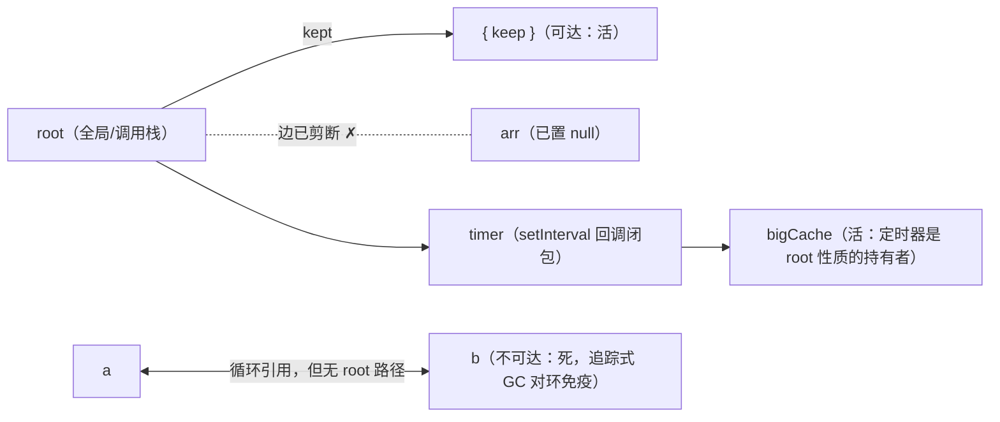

---
mdx:
  format: mdx
---
# 06 · 内存管理：V8 垃圾回收、泄漏排查与 Weak 家族

> 对应大纲：阶段 1.6（内存管理：V8 垃圾回收（分代、标记清除）、常见泄漏场景、WeakMap/WeakSet/WeakRef/FinalizationRegistry）

一手依据：V8 官方博客 v8.dev/blog（重点「Trash talk: the JavaScript garbage collection」系列的分代/Orinoco 并行增量并发各篇）与 v8.dev/features/weakrefs（WeakRef/FinalizationRegistry 的语义与警告）；Weak 集合的 API 形状以 ECMA-262 的 WeakMap/WeakSet 抽象操作为准（可注册值 CanBeHeldWeak）。

## 学习目标

1. 讲清「可达性」判定：能从 root 出发画一条引用链的对象活、画不到的死——并解释为什么循环引用在 JS 里**不是**问题（对照引用计数）
2. 能画出 V8 分代 GC 的结构：新生代半空间复制（Scavenger）+ 对象晋升、老生代 Mark-Sweep/Mark-Compact，以及增量/并发/并行分别解决什么停顿问题
3. 对五类高频泄漏场景，每个都能给出「最小复现 + 一句修法」
4. 能回答「WeakMap 为什么没有 size / 为什么不可遍历」这类语义问题（答案在 GC 语义，不在 API 设计）
5. 会用三快照对比法定位泄漏，并知道 --expose-gc 只是实验工具不是生产手段

## 关键概念

### 1. 内存生命周期与可达性

生命周期三步：分配（字面量/new/闭包捕获）→ 使用 → 释放。JS 把第三步交给 GC，但**「什么时候释放」由可达性决定，不由你写没写 `= null` 决定**。

- **root 集**：全局对象（浏览器 `window`、Node `globalThis`）、**当前调用栈上所有帧里的局部变量与参数**、以及引擎内部持有的活动引用（如正在等待的 Promise 链、定时器回调闭包）。
- **可达性判定**：从 root 出发沿引用做图遍历（标记），标记不到的对象「不可达 = 可回收」。这是**追踪式 GC**（tracing），不是引用计数（reference counting）。
- 为什么强调这点：**循环引用在追踪式 GC 下不是泄漏**——两个对象互相引用但整体从 root 不可达，照样被回收。早期 IE 的 DOM 引用计数才会被循环引用卡死，那是历史包袱，别背到现代引擎头上。
- 「不可达即可回收」的推论：`obj = null` 本身不释放内存，它只是**剪断一条引用边**；对象是否死，取决于剪断后还有没有别的路径。多数时候局部变量随作用域结束自动消亡，不需要手动置 null——需要手动置 null 的场景恰恰是「生命周期长的容器意外持有短生命周期对象」（下文泄漏场景都属此类）。
- 例外边：**弱引用不构成可达边**。WeakMap 的键、WeakSet 的值、WeakRef 的目标、FinalizationRegistry 的注册目标，都不阻止目标被回收——这是第 4、5 节的立足点。

一个 30 秒的可达性小实验（配合 `--expose-gc` 的完整版见练习 02）：



**分代速览表**（先建骨架，细节在下面三小节）：

| | 新生代 | 老生代 |
| --- | --- | --- |
| 容量 | 小（MB 级） | 大（GB 级） |
| 算法 | Scavenger（半空间复制） | Mark-Sweep（+ 按需 Mark-Compact） |
| 成本模型 | 与**存活**对象数成正比（死对象零成本） | 与堆规模/标记对象数相关 |
| 碎片 | 无（复制天然紧凑） | Mark-Sweep 有，Compact 消除 |
| 触发频率 | 高 | 低 |
| 对象来源 | 新分配 | 晋升的幸存者、大对象直接进老生代 |

### 2. V8 分代 GC：为什么分两代，每代怎么收

依据 v8.dev/blog「Trash talk: the JavaScript garbage collection（半空间）」「Concurrent marking in V8」「Parallel garbage collection（Orinoco）」等篇。

**分代假说**：绝大多数对象朝生夕死（函数内临时对象、中间数组）。按存活时间分代，对「短命」的用便宜算法高频收，对「长命」的用贵算法低频收。

**新生代（Young Generation，Scavenger 半空间复制）**：

- 结构：两块等大的半空间（from-space / to-space），总容量小（V8 默认约几 MB～几十 MB 级，随堆配置）。
- 回收过程（Cheney 复制算法的 V8 版）：把 from-space 里**仍被引用的**（root 直接或间接可达，含被老生代引用的「记录集」）对象**复制**到 to-space，然后整块 from-space 一次性清空——不需要逐对象释放，死了的对象连看都不看，这正是「多数对象已死」时最便宜的策略。
- **对象晋升（promotion）**：经历一次 Scavenge 仍存活的对象（或 to-space 放不下的大对象）复制进老生代。经验值「熬过两次回收晋升」，具体策略 V8 会自适应。
- 代价：空间换时间（任何时刻只有一半新生代可用）；存活对象多时复制成本上升——所以它只适合「死亡率极高」的新生代。

**老生代（Old Generation，Mark-Sweep / Mark-Compact）**：

- **Mark-Sweep（标记清除）**：从 root 标记所有可达对象，然后**只清除**不可达对象占用的内存块。不移动对象，速度稳定，但清除后内存出现**碎片**（hole）。
- **Mark-Compact（标记整理）**：标记后把存活对象**滑动聚拢**到内存一端，消除碎片。代价是移动对象需要更新所有指向它们的引用，更慢——所以 V8 只在碎片化到阈值时才做 compaction，平时 Mark-Sweep 为主、按需 compact。

**停顿问题与三色标记的演进**（面试「为什么会有卡顿」的完整答案链）：

- 老 GC 单次「全停顿」（stop-the-world）标记整堆，堆大了就是可感知的卡顿（几十到几百 ms）。
- **增量标记（incremental marking）**：把标记拆成小步，穿插在 JS 执行之间（写屏障 write barrier 记录增量期间被改动的引用），单次停顿变短，总时长略增。
- **并发标记（concurrent marking）**：大部分标记工作在**后台线程**做，主线程几乎不参与（v8.dev「Concurrent marking in V8」）。
- **并行（parallel）**：Scavenger 与 sweeping 也可以由多个辅助线程同时做，主线程只做最少的收尾（「Orinoco」项目的目标：把 major GC 的主线程时间压到几 ms 级）。
- 一句话总结三者：**增量=拆步骤、并发=移出主线程、并行=多线程一起干**——共同目标都是缩短主线程停顿，而不是「更快回收」。

一个对象的典型旅程（把上面的机制串起来）：

```js live noInline
function handle(req) {
  const temp = { rows: [] };        // ① 新生代 from-space 分配
  temp.rows.push(...req.items);
  return temp.rows.length;          // ② 返回后 temp 不可达
}                                    // ③ 下次 Scavenge：没被引用 → 直接留在 from-space 被整体清空（零成本死亡）
const cache = { hot: new Array(1e6) }; // ④ 大对象/长寿对象 → 晋升老生代，低频 Mark-Sweep 管理
```

**为什么 JS 不能选引用计数**：每次赋值都要更新计数（写路径开销）；环永远无法归零；跨线程共享计数更新需要原子操作。追踪式把成本集中到 GC 时刻，用分代把「大多数对象根本活不到 GC」变成优势。

### 3. 常见泄漏场景：最小复现 + 修法

统一心法：**泄漏 = 意外的可达边**。以下每个场景都先用一句话指出「哪条边」，再给复现。

**场景 1：意外全局变量**

```js live noInline
function calc() {
  result = heavyComputation(); // 忘了 const/let → 挂到全局对象，活到页面关闭
}
```

修法：`'use strict'`（ESM 默认严格，赋值给未声明变量直接 ReferenceError）+ lint 的 `no-implicit-globals`。注意：这里的泄漏是「全局对象的属性持有了大结果」，不是作用域问题。

**场景 2：被遗忘的定时器 / 事件监听器**（浏览器场景描述）

```js live noInline
function mountDashboard(el) {
  const bigCache = new Array(1e6).fill(0);   // 闭包持有的大对象
  const timer = setInterval(() => render(bigCache), 1000);
  el.addEventListener('resize', () => render(bigCache));
  return () => { /* 忘了清理 */ };
}
// SPA 路由离开后：dashboard 组件销毁，但 interval 与 listener
// 仍被事件循环/目标节点持有 → 回调闭包 → bigCache，整条链不可断
```

修法：卸载钩子里 `clearInterval(timer)` + `el.removeEventListener(...)`（或用 `AbortController` 的 `signal` 统一清理）。**定时器/监听器是 root 性质的持有者**，它们不死，闭包链就不死。

**场景 3：闭包持有大对象**

```js live noInline
function createHandler(rows) {      // rows: 100MB 数据
  const id = rows[0].id;            // 只需要一个小字段
  return () => console.log(id);
}
```

直觉以为闭包只捕获 `id`，但部分引擎实现按「整个变量环境」捕获——`rows` 可能因此活得和 handler 一样久。修法：在闭包外先提取需要的值（`const { id } = rows[0]` 再放进闭包），或让大对象的作用域尽早结束。现代 V8 有逃逸分析优化，但**不构成语义保证**，写代码按「闭包捕获整个词法环境」保守理解。

**场景 4：detached DOM 节点**

```js
const btn = document.querySelector('#go');
document.body.removeChild(btn);     // 从文档移除
const handlers = { click: () => {} };
btn.addEventListener('click', handlers.click);
globalThis.kept = handlers;          // JS 侧仍引用 btn（通过 listener 目标）→ 树虽被移除，节点不可回收
```

「detached」= 节点已不在文档树里，但 JS 变量/集合仍引用它：该节点连同其子树都保持可达。修法：移除前先 `removeEventListener`，并确保没有 JS 容器（Map/数组/全局变量）继续引用节点。DevTools 堆快照里搜 `Detached` 可直接看到（Detached DOMTree / Detached 节点的 Retainers 面板会指出 JS 侧的持有者）。

一个经典变体：`innerHTML` 整体替换看似「清空」了旧子树，但若旧节点曾被 JS 引用（如上面例子），替换后它们全部变成 detached 却不回收——「从文档消失」和「从内存消失」是两件事。

**场景 5：用 Map 做对象 → 元数据缓存**

```js live noInline
const metaCache = new Map();               // Map 的键是强引用！
function track(user) {
  metaCache.set(user, { lastSeen: Date.now(), history: [] }); // history 越积越大
}
// user 生命周期本应几秒，但只要 metaCache 活着，每个 user 都不可回收
```

修法：元数据不延长对象生命周期的场景（缓存/标记/私有数据）一律 WeakMap（见下节）；确需强引用的 LRU 用专门实现并设上限。

### 4. WeakMap / WeakSet：弱在「键的可回收性」

- **键必须是「可注册值」**：对象（ES2023 起还包括非注册 Symbol）。原始值按值传递、永不「回收」，弱引用对它们无从谈起，`new WeakMap().set('k', 1)` 直接 TypeError。
- **弱引用语义**：WeakMap 对**键**是弱引用（不阻止键被回收），对**值**仍是强引用。推论一：把对象本身存成值里的属性（`m.set(k, { self: k })`）会形成「值强引用键」的事实强环，键永远不可回收——规范不禁止，但语义上自败。推论二：从键能到达值（键死→条目死），从值**不应**回到键。
- **为什么没有 size / 不可遍历**：成员集合随 GC 变化。引擎随时可能清掉「键已回收」的条目，任何确定性的 size 或迭代顺序都无法自洽（「上一毫秒 size 是 3，现在是 2，谁对？」）。**这不是实现偷懒，是 GC 语义决定的必然**——面试答出这层因果即满分。
- 典型用途：
  - **对象元数据**：给第三方对象挂缓存/标记，对象死了元数据随之消失（对照场景 5）；
  - **私有数据**：`privateStore.set(this, {...})`，实例上无痕迹、随实例回收（现代代码可直接用 `#field`，WeakMap 方式利于理解原理，见练习 memory-management/01 Part 5）；
  - **WeakSet 去重/访问标记**：「这个对象处理过吗」只需要引用同一性判断，不应延长其生命周期。

### 5. WeakRef / FinalizationRegistry：观察回收的最后手段

- `new WeakRef(target)`：不阻止 target 被回收；`deref()` 存活返回对象、已回收返回 undefined。规范细节：**deref() 的返回值会被保持到当前 job 结束**（KeepDuringJob）——同一个同步任务里 deref 后立刻手动 GC 也看不到回收（练习 02 的实验教训）。
- `new FinalizationRegistry(held => ...)` + `register(target, held)`：target **被回收之后**，以 held value 为参数异步调用回调（held 通常用字符串 key，绝不能引用 target）。
- **规范的明确警告**（v8.dev/features/weakrefs 与 TC39 提案说明，逐条对应到行为）：
  1. 回调作为任务**异步**执行，时机不确定——可能 GC 后很久，顺序也不保证；
  2. 程序退出前**可能根本不执行**；
  3. 因此只能用于**机会性清理**（缓存失效），绝不能用于关键逻辑（释放锁/连接、提交数据）——正确性必须不依赖回调被调用；
  4. 不要在回调里 deref 同一对象「复活」它。
- **官方推荐用法**：可回收缓存——Map 存 `业务key → WeakRef(缓存值)`，FinalizationRegistry 在值被回收后删除对应槽位防 Map 膨胀（完整模式代码在 exercises/memory-management/02 底部注释）。

**Weak 家族总览**（选择器：按「你要什么语义」查表）：

| | 持有的引用 | 可遍历/计数 | 键/目标类型 | 典型用途 |
| --- | --- | --- | --- | --- |
| Map | 键、值都强引用 | 是（size/迭代/clear） | 任意 | 需要确定性集合语义 |
| WeakMap | 键弱、值强 | 否 | 可注册值（对象/非注册 Symbol） | 对象→元数据、私有数据 |
| WeakSet | 值（成员）弱 | 否 | 同上 | 去重/访问标记 |
| WeakRef | 目标弱 | —（单个句柄） | 对象 | 观察存活、缓存命中 |
| FinalizationRegistry | 注册目标弱（held 强引用） | —（回调式） | 对象 + 任意 held | 机会性清理/缓存失效 |

### 6. 排查思路（概念）

- **Heap snapshot 三快照对比法**（DevTools Memory 面板）：
  1. 快照 A（操作前）→ 重复执行疑似泄漏操作 N 次（如切 10 次路由）→ 快照 B → 强制 GC（面板垃圾桶按钮）→ 快照 C；
  2. 对比 B→C（或 A→C）的**增量**：按 Retained Size 排序，看「本应释放却仍增长」的构造器/对象，展开 Retainers 面板读出**是谁在引用它**——那条引用链就是泄漏边。
- **Allocation instrumentation on timeline**：记录每次分配的时间轴，看「蓝色条（分配）持续高于灰色条（回收）」的区间，定位到具体分配栈。
- **Node 环境**：`process.memoryUsage()` 粗看趋势；`node --inspect` + Chrome DevTools 同样可用；`v8.writeHeapSnapshot()` 在代码里触发快照。**`--expose-gc` 只用于实验**（把 gc() 交到你手里做确定性验证，如练习 02），生产代码永远拿不到这个确定性——这也是 WeakRef 语义「可能存活也可能已回收」必须两头处理的原因。

`process.memoryUsage()` 四个字段怎么看：

| 字段 | 含义 | 看泄漏时怎么用 |
| --- | --- | --- |
| `rss` | 进程实际占用物理内存 | 持续上涨的第一信号（含非 JS 部分） |
| `heapTotal` | V8 已申请的堆总量 | 与 heapUsed 的差是「未回收空间」 |
| `heapUsed` | 堆中实际使用 | 重复操作后 GC 仍不回落 → 重点怀疑 |
| `external` | 堆外内存（Buffer/字符串外置数据） | Buffer 泄漏看这里而不是 heapUsed |
- 判断口诀：**泄漏看的不是「内存高」，而是「重复操作后 Retained Size 单调增长且 GC 后不回落」**。

## 可运行示例

配套练习（均经实际运行验证，输出逐行写在文件头注释里）：

```bash
# WeakMap/WeakSet 的 API 形状 / 键必须是对象 / Map vs WeakMap 持有语义 / 去重 / 私有数据
npx tsx exercises/memory-management/01-weak-collections.ts

# WeakRef 确定性观察回收 + FinalizationRegistry 回调触发（注意 --expose-gc）
node --expose-gc exercises/memory-management/02-weakref-finalization-registry.mjs
```

WeakRef 确定性实验的三步骨架（细节与坑见练习 02 注释）：

```js
// node --expose-gc
const makeWeakRef = () => {
  const obj = { payload: new Array(1000).fill(0) };
  return new WeakRef(obj);          // obj 只活在本帧，返回后不可达
};
const ref = makeWeakRef();
await new Promise((r) => setTimeout(r, 0)); // 关键：跨宏任务边界
//   —— 1) deref 的 KeepDuringJob 在 job 结束才失效
//   —— 2) 工厂函数的旧栈帧彻底销毁（V8 保守栈扫描不再看到残留指针）
gc();
ref.deref() === undefined;          // true：对象已回收，WeakRef 没能留住它
```

## 易错点与面试高频

1. **「循环引用导致泄漏」**——现代引擎错。追踪式 GC 看可达性不看计数；只有历史 IE 的引用计数才怕环。
2. **「`obj = null` 释放内存」**——错。它只剪一条引用边；内存释放发生在下一次 GC 且对象不可达之后。手写置 null 的正确场景是「长寿容器持有短命对象」。
3. **「WeakMap 是『性能更好』的 Map」**——错。它牺牲了 size/遍历/清空（clear 已废弃），换「不绑架键生命周期」这一种语义；需要遍历/计数时它根本不可用。
4. **「WeakMap 的值也是弱引用」**——错。弱在键；值是强引用（所以值别引用键）。
5. **「FinalizationRegistry 可以当析构函数用」**——危险。回调时机不定、可能永不执行；只能做机会性清理。
6. **新生代为什么用复制而不是标记清除**：死亡率高时复制只碰活对象、整块清空零成本；代价是空间减半——只对「小而短命」的代划算。
7. **老生代为什么需要 Mark-Compact**：Mark-Sweep 产生碎片，未来大对象分配可能「总空闲够、连续块不够」；compaction 移动对象修碎片段，代价是更新全部引用，故按需触发。
8. **增量/并发/并行的区别一句话**：增量=拆小步穿插执行、并发=后台线程做、并行=多线程同时做；都为压停顿，不为提速回收本身。
9. **detached DOM**：节点移出文档 ≠ 可回收，JS 侧任何引用都会吊住整棵子树；排查时直接在堆快照搜 `Detached`。
10. **「内存涨了 = 泄漏」**——不一定。V8 惰性释放、GC 时机不定；泄漏的判据是「重复操作后 Retained Size 单调增长且 GC 后不回落」。

## 输出预测题

先闭卷推理，再看文末答案。

### 题 1（可达性判定）

```js live noInline
function build() {
  let a = { name: 'a' };
  let b = { name: 'b', ref: a };
  a.ref = b;        // 循环引用
  const keep = { name: 'keep' };
  b.k = keep;
  a = null;
  b = null;
  return keep;
}
const kept = build();
// 问：函数返回、局部变量 a/b 已置 null 后：
// 1) {name:'a'}、{name:'b'} 能否被回收？
// 2) {name:'keep'} 能否被回收？
// 3) 若这是引用计数的引擎，答案有什么不同？
```

### 题 2（泄漏找茬）

```js live noInline
const sessions = new Map(); // key: 用户对象（每个请求新建），value: 会话数据
function onLogin(user) {
  sessions.set(user, { cart: new Array(10000).fill(null), log: [] });
}
function onLogout(user) {
  sessions.get(user).log.push('logout');   // 故意不 delete
}
// 问：1) 哪条「意外的可达边」导致泄漏？2) 给出最小修法（两行以内）；
//     3) 若把 Map 换成 WeakMap，onLogout 里 sessions.get(user) 还能保证拿到值吗？为什么？
```

## 预测题答案

### 题 1 答案

1. **都能回收**。`a`、`b` 置 null 后，root（返回值 `kept` → `keep` 对象）到 `a`/`b` 的任何路径都断开；`a.ref = b`、`b.ref = a` 的循环引用在「从 root 出发的标记」中根本不可达——追踪式 GC 对环免疫。
2. **不能回收**。`keep` 被 `kept`（模块级变量，属于 root 可达）持有；虽然 `b.k = keep` 曾是另一条路径，但即使剪掉它，`kept` 这条边仍在。可达性只要求**至少一条** root 路径。
3. 引用计数引擎下，`a` 与 `b` 互相引用使双方计数都不归零（哪怕外界引用已清空）→ **两个对象都泄漏**——这正是追踪式 GC 取代引用计数的核心原因。

### 题 2 答案

1. 泄漏边：`sessions`（模块级，长期存活）→ Map 键槽**强引用**每个 user 对象 → user → `{cart, log}`（约 80KB/人）。用户对象本应请求结束即回收，却被缓存「绑架」，流量越大涨得越快。
2. 修法一（保留 Map）：`onLogout` 里补 `sessions.delete(user)`；修法二（更符合语义）：`const sessions = new WeakMap()`——元数据不应延长键对象的生命周期，泄漏边整体消失。
3. **不保证**。WeakMap 的键是弱引用：onLogout 执行时如果 user 对象已经不可达且发生过 GC，条目（连同 value）可能已被清除，`get` 返回 undefined。WeakMap 只适合「对象活着才有意义」的元数据——这正说明它是语义选择而不是性能选择；如果业务要求「登出时数据必然还在」，就该用 Map + 显式 delete（或加 TTL）。

## 延伸阅读

- v8.dev/blog：「Trash talk: the JavaScript garbage collection (part 1/2)」（分代与半空间）、「Concurrent marking in V8」、「Parallel Garbage Collection（Orinoco 系列）」
- v8.dev/features/weakrefs：WeakRef / FinalizationRegistry 的官方说明与警告
- MDN：Memory management（生命周期与可达性教学版）、WeakMap / WeakRef / FinalizationRegistry、Chrome DevTools 「Fix memory problems」（三快照法操作步骤）
- TC39 提案：tc39/proposal-weakrefs（README 的缓存示例，即练习 02 Part 3 的来源）
- 阶段衔接：阶段 2 的性能专题（长任务与 GC 停顿观测）、阶段 5 源码阅读（Vue reactivity 对 WeakMap 依赖映射的使用）

---

## 替换清单（ASCII 图 → Mermaid）

| 原 ASCII 图位置/标题 | Mermaid 图表类型 |
| --- | --- |
| §1 可达性小实验（root 出发的引用图） | flowchart (LR) |

