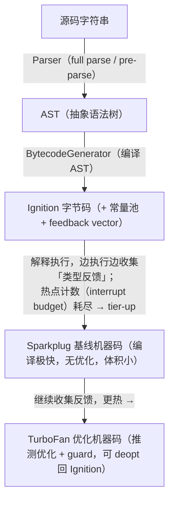
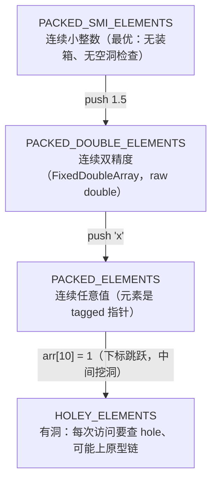

---
mdx:
  format: mdx
---
# 07 · V8 引擎：从源码到机器码

> 对应大纲：阶段 2 —— V8 执行流程（解析 → Ignition → Sparkplug/TurboFan）、隐藏类（hidden classes）与内联缓存（inline cache）对性能的影响。
> 一手依据：v8.dev 官方博客与文档，尤其是 [Fast properties in V8](https://v8.dev/blog/fast-properties)、[Sparkplug](https://v8.dev/blog/sparkplug)、[TurboFan JIT](https://v8.dev/blog/turbofan-jit)、[Ignition interpreter](https://v8.dev/blog/ignition-interpreter)、[Elements kinds](https://v8.dev/docs/elements-kinds)。

## 学习目标

- 能画出一段 JS 源码从「字符串」到「机器码执行」的完整链路，并说清每一层为什么存在。
- 能解释隐藏类（V8 内部叫 **Map**）与内联缓存（IC）如何把「动态语言的属性访问」优化成「一次内存偏移读取」。
- 能预测哪些代码模式会让对象/数组「掉出快路径」，并给出等价的快路径写法。
- 会用 `%HaveSameMap`、`--trace-opt/--trace-deopt` 等工具亲手验证结论，而不是背结论。

---

## 关键概念

### 1. 源码 → 执行全链路



分步拆解：

1. **Parser 与 lazy parsing**。V8 有两个解析器：
   - **full parser**：完整建 AST。顶层代码必须 full parse。
   - **pre-parser（预解析）**：对函数体只做「轻量语法检查 + 记录括号配对等元数据」，**不建 AST**。
   预解析为什么快？因为它跳过了建树、作用域分析等最重的部分，只线性扫一遍确认「这个函数体语法合法、能在哪起止」。更关键的是：网页上大量函数一辈子只被定义、不被调用，为它们生成 AST 和字节码是纯浪费。lazy parsing 把这份成本推迟到「函数第一次被调用」那一刻。副作用是「先预解析、后调用」会扫两遍函数体，所以 V8 对 IIFE 这类「定义即调用」模式有启发式，直接 full parse。
2. **AST → Ignition 字节码**。BytecodeGenerator 遍历 AST，产出字节码（寄存器机模型：累加器 + 寄存器 + 常量池）。字节码与函数绑定存在 SharedFunctionInfo 上。生成字节码而非直接机器码，是为了**省内存**：同一段字节码可以被解释执行，不需要为冷函数生成几十倍的机器码。
3. **Ignition 解释执行 + 热点计数**。Ignition 是 V8 的解释器，每个字节码对应一个（由 TurboFan 预生成的）机器码 handler，通过字节码分发循环执行。执行过程中，IC（见第 3 节）持续把「实际见到的类型/形状」写进 feedback vector。每个函数带一个 **interrupt budget（中断预算）**，函数调用与循环回边会扣减预算；预算耗尽就触发 tier-up 判定——这正是「热点」的判定机制。
4. **Sparkplug 基线编译**（2021 加入，见 v8.dev/blog/sparkplug）：把字节码**逐条**线性翻译成机器码，不做跨语句优化。特点：
   - 编译速度极快（几乎不比解释执行慢多少就完成编译）；
   - 生成的机器码体积小（大约只有 TurboFan 的 1/3）；
   - 执行速度大约是 Ignition 的 2 倍。
   很多「温热」函数终生停在 Sparkplug 层——这是内存、启动速度与峰值性能之间的甜点。
5. **TurboFan 优化编译**（见 v8.dev/blog/turbofan-jit）：基于**推测优化（speculation）**。它读取 feedback vector 里的历史，做出推测并生成带 **guard（检查）** 的高速代码：
   - 推测：「这个 `+` 一直见到 Smi（小整数），我按整数加法生成代码」；
   - guard：生成 `CheckSmi`，每次执行前验证推测仍成立；
   - **deopt（去优化）**：guard 失败时，TurboFan 代码作废，回退（bailout）到 Ignition/Sparkplug 继续执行，并可能带着更保守的假设重新优化。
   所以「优化代码」不是永远快——它是一种「带押注的高速路径」。类型翻来覆去变化的代码会反复 deopt，反而比不优化更慢。
6. **OSR（on-stack replacement，栈上替换）**一句带过：一个正在解释执行的长循环变热时，V8 可以**在函数还在栈上时**把当前帧替换成优化版本，让正在跑的循环立刻享受优化——这就是为什么一个死循环也能越跑越快。

> 一句话串起来：**Parser 决定「什么时候编译」，Ignition 决定「先便宜地跑着并记账」，feedback vector 是账本，Sparkplug/TurboFan 是照着账本加急的快路径，deopt 是账目对不上时的回滚。**

> 补充（2023+）：Sparkplug 与 TurboFan 之间新增了 **Maglev** 中间层编译器（Chrome 117 起），编译比 TurboFan 快、性能比 Sparkplug 好。层级模型不变，只是档位更细。

各层定位小结：

| 层 | 角色 | 编译耗时 | 执行速度 | 代码体积 | 典型归宿 |
| --- | --- | --- | --- | --- | --- |
| Ignition | 解释器 + 反馈收集器 | （生成字节码很快） | 1× | 小 | 冷函数、只跑几次的函数 |
| Sparkplug | 基线 JIT | 极快 | ~2× | ~TurboFan 的 1/3 | 温热函数（大多数函数的终点） |
| Maglev | 中间层 JIT | 快 | ~3–4× | 中 | 较热、但等不起 TurboFan 编译的函数 |
| TurboFan | 顶层优化 JIT | 慢（可数十 ms） | 最快 | 大 | 真正的热点（大循环、高频函数） |

一个常见误解是「代码越热越应该快点优化」，方向反了：**编译本身要花主线程时间**。给一个只执行几千次的函数上 TurboFan，编译成本收不回来。分层正是为了让「每个函数按自己的热度拿到性价比最高的那一层」。

### 2. 隐藏类（hidden class / Map）：对象的「形状」

依据 [v8.dev/blog/fast-properties](https://v8.dev/blog/fast-properties)。

- JS 对象在 V8 里不是「字符串键 → 值」的哈希表。每个对象头部有一个指针指向它的 **Map**（隐藏类），Map 记录的是这个对象的**形状**：
  - 有哪些属性键、按什么顺序加入的；
  - 每个属性存在哪个**偏移量**（in-object 槽位或 out-of-object 后备存储里第几格）。
- **transition（迁移）链**：从「空对象 Map」开始，每添加一个属性就沿着链走一步：

  ```mermaid
  flowchart LR
      M0["M0（空）"] -->|"加 x"| M1["M1 {x}"]
      M1 -->|"加 y"| M2["M2 {x,y}"]
  ```

  走过同一条路径的对象**共享链上的同一个 Map**。`new Point(1,2)` 一万次，这一万个对象最终都停在 M2 上。
- 属性访问于是从「哈希查找」变成：**「拿对象的 Map → 查 Map 里 x 的 offset → 直接读那块内存」**。这就是动态语言能跑出接近静态语言速度的核心。
- 对象的内存布局直观图：

  ```mermaid
  flowchart LR
      O["对象 o<br>──────<br>map 指针<br>properties<br>elements<br>slot0: x 值<br>slot1: y 值"]
      O -->|"map 指针"| M["Map（隐藏类，同类共享）<br>──────<br>形状描述：<br>slot0 → &quot;x&quot; (Smi)<br>slot1 → &quot;y&quot; (Smi)<br>transition: 加 z → M3<br>…"]
  ```

  `properties` 指针指向「快属性后备存储」（in-object 槽位放不下时的溢出区），`elements` 指向数组元素存储。快属性按 offset 直读；dictionary mode 下 `properties` 指向一个真正的哈希字典，且**该字典只属于这个对象、不共享**——共享形状的红利全部消失。
- 三种典型破坏方式：
  1. **delete**：`delete obj.x` 会把对象**整体打入 dictionary mode（慢属性）**——属性表退化成真正的哈希字典，所有后续属性访问都走哈希查找。即使你 delete 的是最后加的属性也一样。
  2. **属性添加顺序不同**：`{}→x→y` 与 `{}→y→x` 是两条**不同的 transition 链**，终点 Map 不同。「先 x 后 y」和「先 y 后 x」的两个对象形状不同。
  3. **中途插入新属性**：给 `{x,y}` 形状的对象补一个 `z`，它走到 `M3{x,y,z}`，与停在 `M2{x,y}` 的对象不再同形状——一个函数同时处理两者时 IC 变多态（见下节）。
- 形状只由「**键集合 + 添加顺序**」决定，**与属性值无关**。`p.x = 1` 改成 `p.x = null` 不改变形状——这是替代 delete 的标准手法。
- `%HaveSameMap(a, b)`（V8 native，需 `--allow-natives-syntax`）可直接验证两个对象是否共享隐藏类，见练习 01。

### 3. 内联缓存（IC，inline cache）

- 动机：上面说的「拿 Map → 查 offset」里的「查」如果每次都做，仍然慢。IC 把**「这个程序点（字节码位置）上一次见到的 Map + 对应的快速取值 handler」缓存下来**。
- 每个含属性访问（`o.x` 读/写）的字节码有一个 **feedback slot**，一个函数的所有 slot 组成它的 **feedback vector**。
- 参与 IC 的主要是 **LoadIC**（读属性）、**StoreIC**（写属性），此外还有 KeyedLoadIC、CallIC 等。
- 状态机（以 LoadIC 为例）：

  ```mermaid
  stateDiagram-v2
      uninitialized: uninitialized
      monomorphic: monomorphic（缓存 1 个 Map + handler）
      polymorphic: polymorphic（缓存 2–4 个 Map：逐个比较）
      megamorphic: megamorphic（放弃专用缓存，查全局 stub cache / 通用慢路径）
      [*] --> uninitialized
      uninitialized --> monomorphic: 首次访问
      monomorphic --> polymorphic: 又见到不同的 Map（≤4 种）
      polymorphic --> megamorphic: 出现第 5 种 Map
  ```

  - **monomorphic（单态）**：这个点永远只见过一种形状。最好：一条 map 指针比较 + 一次偏移读取，TurboFan 优化后连比较都常量化，直接变成一条寻址指令。
  - **polymorphic（多态）**：见过 2–4 种形状。每次访问要**逐个比较 Map** 命中才走对应 handler。
  - **megamorphic（超多态）**：≥5 种形状。IC 放弃本地缓存，每次走全局缓存查找或运行时通用路径。
- 把 feedback slot 具象化：下面这个函数有 3 个 IC 点，各自独立记录自己见过的形状。

  ```js
  function process(o) {
    const v = o.x;   // LoadIC  slot#0：记录见过的 Map
    o.y = v + 1;     // StoreIC slot#1：记录见过的 Map
    return o.z;      // LoadIC  slot#2：记录见过的 Map
  }
  ```

  即使 `o.x` 与 `o.z` 见到的是同一个对象，两个 slot 各自维护状态；一个点单态、另一个点多态是完全正常的现象。IC 状态是**按程序点**的，不是按函数的——「函数多态」其实是「函数内某个 slot 多态」的口语说法。
- **为什么热循环里混形状对象会慢一个数量级**：设某热函数循环 10⁶ 次读 `o.x`。
  - 全部同形状：LoadIC 单态 → TurboFan 把「Map 比较 + offset」编译成两条机器指令，循环内近乎寄存器操作；
  - 轮询传入 4+ 种形状：LoadIC 变 poly/mega，每次都要做一串 Map 比较（或全局查找），循环里这一项从 ~1 条指令膨胀到一串分支 + 查找，吞吐量掉一个数量级是常态。
  - 这就是「数据处理函数要固定输入对象的形状」的底层原因，见练习 02。

### 4. 数组元素 kinds（ElementsKind）

依据 [v8.dev/docs/elements-kinds](https://v8.dev/docs/elements-kinds)。

数组的「元素」不存属性表里，存在独立的 **elements 后备存储**中，其类型由 **ElementsKind** 标记。kind 沿「更通用」方向单向退化，**不可逆**：



每一档都有对应的 HOLEY 版（`PACKED_SMI → HOLEY_SMI → …`），退化链是格：只能往「更通用」走，**永不回头**。

- **为什么 for 循环里先 push 数字再 push 字符串会变慢**：数组从 `PACKED_SMI` 一路退化。退化瞬间整个 backing store 要**整体迁移**（Smi 数组 → double 数组 → tagged 数组）；之后遍历/求和时，解释器与优化代码都必须按最通用的 kind 处理：元素可能是任意对象，数值运算前要拆 tagged 指针、判类型，double 还要装/拆箱。
- 挖洞（`arr[5] = 1` 时长度只有 3）同样触发退化：holey 数组每次 `arr[i]` 都要检查「是不是 hole」，而**读一个洞要沿原型链查找**（`[]` 上的 `arr[3]` 若原型链有 setter/getter 就会被触发）——语义要求如此，快不掉。
- 实践：预分配定长（`new Array(n)` + 索引赋值顺序填满），同类元素打包；一旦混入异类值，**建新数组**而不是修补旧数组（旧数组的 kind 回不去了）。
- 两个延伸注意点：
  - `Object.freeze(arr)`（以及非常旧的 `arr.length = 0` 之外的极端操作）会把数组推入 dictionary elements——不可变性优先于布局优化的场景要想清楚。
  - 密集数值计算如果形状天然统一，直接用 **TypedArray**（`Float64Array`）：它是独立的存储模型（raw bytes、无 tagged、无 kind 退化），与本节机制互补；代价是只能存数字。

### 5. 可操作的性能清单

| 做法 | 原因 |
| --- | --- |
| 构造函数里**一次性按固定顺序初始化全部属性**（暂不用就置 `null`） | 所有实例停在同一个 Map，IC 单态 |
| **不要 `delete`**；用 `obj.x = null` 或重建对象 | delete → dictionary mode，全员慢属性 |
| **复用同一构造函数/同一字面量键顺序**，别为同类数据造多种形状 | 避免多态 |
| 数组**保持同类元素**，避免中途混入字符串/对象；预分配避免挖洞 | 保住 PACKED_SMI/DOUBLE kind |
| 老代码别怕 `arguments`：现代 V8 已优化（逃逸分析、arguments 与形参不重命名时零成本）。历史上 `f.apply(null, arguments)`、泄漏 arguments 到闭包会导致对象 arguments 物化，如今大多无害；新代码直接用 rest 参数 `(...args)` 更清晰 | 历史 API 已被引擎优化，理解历史即可，不必再绕着写 |
| 超热路径上的 `JSON.parse` 结果先「洗」进统一构造函数再处理 | parse 结果键序不受你控制，不洗的话 IC 可能永远多态 |
| 修改前先测量：`performance.now()` 分段、`--trace-opt --trace-deopt`、DevTools Performance | 形状问题的收益因地而异，别为冷代码做形状优化 |
| 观测手段：`node --allow-natives-syntax` + `%HaveSameMap` / `%DebugPrint`；`node --trace-opt --trace-deopt` 看 tier-up 与 deopt | 结论要用工具验证，不靠猜 |

---

## 可运行示例

配套练习（本工作区可直接运行）：

- `exercises/v8-and-performance/01-hidden-class.mjs` —— 用 `%HaveSameMap` 验证：同构造顺序共享形状、插入顺序不同形状分叉、delete 打入慢模式、置 null 保持形状。
- `exercises/v8-and-performance/02-inline-cache.mjs` —— 10⁶ 次热点访问：同形状（单态）vs 4 种形状轮询（多态），只打印确定性结论。

最小感受版（任何环境可跑）：

```js live noInline
// 混形状轮询 vs 单态 —— 只比较相对耗时，结论：慢版本更慢
function bench(objs) {
  let sink = 0;
  for (let i = 0; i < 1e6; i++) sink += objs[i & 3].x; // 防止被优化掉
  return sink;
}
const same = Array.from({ length: 4 }, (_, i) => ({ x: i + 1, y: 0 }));
const mixed = [
  { x: 1, y: 0 },   // 键序 x,y
  { y: 0, x: 2 },   // 键序 y,x —— 不同链
  (() => { const o = { z: 0 }; o.x = 3; return o; })(), // 链 z→x
  (() => { const o = {}; o.w = 0; o.x = 4; return o; })(), // 链 w→x
];
console.log(bench(same) === bench(mixed)); // true，两版计算等价
// 分别计时（练习 02 有完整实现）：mixed 版稳定慢数倍
```

用 natives 直接观测形状（需 `node --allow-natives-syntax`）：

```js live noInline
// 运行：node --allow-natives-syntax demo.mjs
function P(x, y) { this.x = x; this.y = y; }
const a = new P(1, 2);
const b = new P(3, 4);
console.log(%HaveSameMap(a, b));  // true  —— 同构造路径共享隐藏类
b.z = 5;
console.log(%HaveSameMap(a, b));  // false —— b 沿 transition 链又走了一步
delete a.x;
console.log(%HaveSameMap(a, new P(0, 0))); // false —— a 进了 dictionary mode
```

`%HaveSameMap(a, b)` 的输出含义：两个对象的头部是否指向**同一个** Map 对象。`true` 表示形状完全一致（IC 可以单态命中）；`false` 只说明形状不同，不直接说明谁快谁慢——要判断是否进了慢模式，可用 `%DebugPrint(a)` 看 `properties` 字段是否为 `DictionaryProperties`（输出较大，建议只在小对象上试）。

---

## 易错点与面试高频

1. **「JS 是解释型语言」——不准确**。现代 V8 是分层 JIT：解释（Ignition）+ 两级编译（Sparkplug/TurboFan）。准确说法：JS 先被解释执行，热点代码被渐进编译为机器码。
2. **「属性值变了 → 隐藏类变了」——错**。形状由「键集合 + 添加顺序」决定，与值无关。`p.x = 1` → `p.x = null` 形状不变。
3. **`{x:1, y:2}` 与 `{y:2, x:1}` 形状不同**。字面量键顺序就是添加顺序，走不同 transition 链。序列化/反序列化、ORM 映射层若不保证键序，会把下游 IC 打成多态。
4. **delete 的真实代价不是「删得慢」，是「删完之后每一次访问都慢」**。一次 delete，整个对象进 dictionary mode。
5. **数组 kind 退化不可逆**。`[1,2].push('a')` 之后把 `'a'` pop 掉，数组也回不到 PACKED_SMI。
6. **优化代码可能更慢**：反复 deopt（类型抖动）的函数，优化-去优化循环开销可能超过收益。`--trace-deopt` 能看到。
7. **别把「单态」教条化**：分支处理（如 `if (type === 'a')` 各分支内访问不同形状）天然多态，这不是 bug；要消灭的是「**同一个热点 slot 轮流**见到多种形状」。给不同数据定义稳定的构造路径，比到处写 `if` 更有效。
8. **JSON 反序列化的形状陷阱**：`JSON.parse` 产出的对象键顺序由字符串决定；同一接口不同分支返回不同键序，会让同一个处理函数的 IC 反复换 Map。对超热路径，把 parse 结果「洗」进统一构造函数再处理。
9. **面试高频问法**：「讲讲 V8 的隐藏类和内联缓存」「为什么 delete 慢」「为什么数组混合类型后遍历变慢」「解释一下 deopt」「JS 是编译型还是解释型」。答题骨架就是本文第 1–4 节：链路 → 形状 → IC 状态机 → elements kind，收尾落在「优化是带 guard 的押注，形状稳定才押得中」。

---

## 输出预测题

### 题 1（隐藏类）

```js live noInline
function P(x, y) { this.x = x; this.y = y; }
const a = new P(1, 2);
const b = new P(3, 4);
b.z = 5;              // ①
const c = new P(5, 6);
delete c.y;           // ②
// ① 之后：%HaveSameMap(a, b) 是？
// ② 之后：%HaveSameMap(a, c) 是？
```

### 题 2（数组 kinds）

```js live noInline
const arr = [1, 2, 3];   // 起始 PACKED_SMI_ELEMENTS
arr.push(1.5);           // A 步后 kind？
arr.push('x');           // B 步后 kind？
arr[10] = 1;             // C 步后 kind？
arr.pop(); arr.pop();    // D 步：能回到 PACKED_SMI 吗？
```

（答案见文末）

---

## 延伸阅读

- v8.dev/blog/fast-properties —— 快属性/慢属性、in-object 槽位、dictionary mode（本文第 2 节主要依据）
- v8.dev/blog/sparkplug —— 基线编译器设计动机：编译速度、代码体积、可调试性
- v8.dev/blog/turbofan-jit —— 优化编译器与推测优化
- v8.dev/blog/ignition-interpreter —— 为什么需要字节码层：内存账本
- v8.dev/blog/maglev —— 中间层编译器（2023）
- v8.dev/docs/elements-kinds —— ElementsKind 完整退化图与 `%DebugPrint` 观测法
- v8.dev/blog/slack-tracking —— 预留 in-object 槽位与构造后 Map 收缩的机制
- v8.dev/blog（博客索引）—— 持续跟踪 Maglev、Wasm、GC 等新文章
- 《深入理解 V8》（书）与 v8.dev 源码仓库 `src/objects/map.cc` —— transition 链的实现

---

## 预测题答案

### 题 1

- ① 之后 `%HaveSameMap(a, b)` 为 **false**。a 停在 `M{x,y}`；b 继续迁移到 `M{x,y,z}`（transition 链的后继节点）。两者形状分叉——b 变「长」不可怕（b 仍在快属性模式），可怕的是「同一函数既要处理 M\{x,y\} 又要处理 M\{x,y,z\}」时 IC 变多态。
- ② 之后 `%HaveSameMap(a, c)` 为 **false**，且比 ① 更糟：delete 把 c 打入 **dictionary mode（慢属性）**，c 上所有后续属性访问都退化为哈希表查找；即使再 `c.y = 6` 补回去，也不会恢复快属性形状。

### 题 2

- A：`PACKED_DOUBLE_ELEMENTS`（Smi 数组装不下小数，backing store 整体迁移为 raw double 数组）
- B：`PACKED_ELEMENTS`（字符串是 tagged 指针，double 数组装不下，再迁移为通用指针数组）
- C：`HOLEY_ELEMENTS`（下标 4–9 是洞；注意它是从 PACKED_ELEMENTS 直接到 HOLEY_ELEMENTS，kind 只能单向变通用）
- D：**回不去**。退化链单向：即使把混入的值都移走、洞补齐，kind 也不会收缩回 PACKED_SMI。想要 PACKED_SMI，只能新建数组并从头按整数填充。

---

## 替换清单（ASCII 图 → Mermaid）

| 原 ASCII 图位置/标题 | Mermaid 图表类型 |
| --- | --- |
| §1 源码 → 执行全链路（Parser → AST → Ignition → Sparkplug → TurboFan） | flowchart (TD) |
| §2 隐藏类 transition 链（M0 → M1 → M2） | flowchart (LR) |
| §2 对象内存布局直观图（对象 o 与 Map 两栏结构） | flowchart (LR) |
| §3 IC 状态机（uninitialized → monomorphic → polymorphic → megamorphic） | stateDiagram-v2 |
| §4 ElementsKind 单向退化链 | flowchart (TD) |

